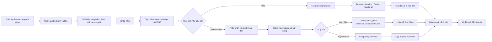
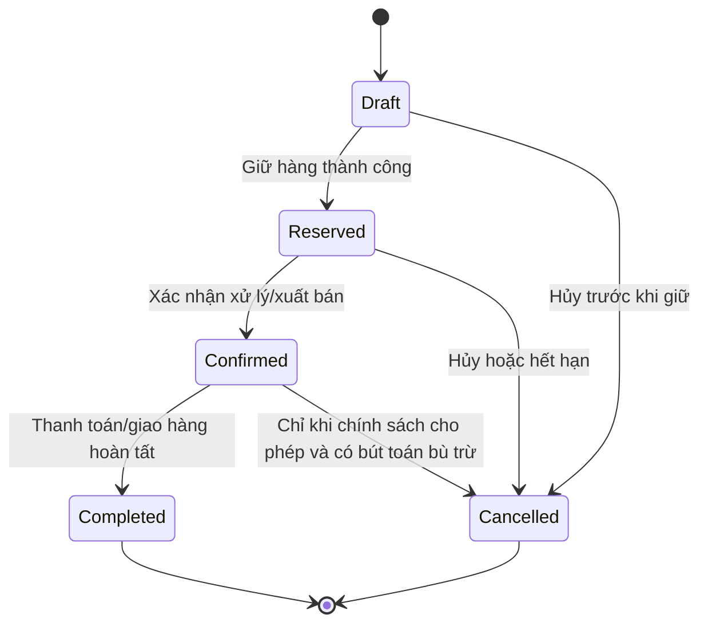

# Tổng quan quy trình nghiệp vụ

## 1. Thông tin tài liệu

- **Tên hệ thống:** Omnichannel Inventory and Sales Management System (OISM)
- **Tên tiếng Việt:** Hệ thống quản lý bán hàng và tồn kho đa kênh
- **Mục đích tài liệu:** Mô tả tổng thể các quy trình nghiệp vụ, tác nhân, phạm vi, dữ liệu cốt lõi và mối liên hệ giữa các phân hệ của OISM.
- **Phạm vi áp dụng:** Cửa hàng bán lẻ vận hành nhiều chi nhánh, kho và kênh bán hàng như POS, Admin, Shopee, TikTok Shop và Lazada.
- **Đối tượng đọc:** Chủ cửa hàng, nhân viên kho, nhân viên xử lý đơn, thu ngân, quản trị hệ thống, nhóm phân tích nghiệp vụ, nhóm phát triển và nhóm kiểm thử.

## 2. Bối cảnh nghiệp vụ

Doanh nghiệp bán lẻ đa kênh thường phải quản lý sản phẩm, tồn kho và đơn hàng trên nhiều hệ thống rời rạc. Việc cập nhật thủ công hoặc đồng bộ chậm có thể làm phát sinh:

- Bán vượt số lượng thực tế đang có.
- Một SKU được bán đồng thời tại POS và sàn thương mại điện tử.
- Không bảo vệ được số lượng đã giữ cho đơn hàng online.
- Sai lệch giữa tồn kho phần mềm và số lượng kiểm đếm thực tế.
- Khó truy vết nguyên nhân biến động tồn kho.
- Giá vốn hàng bán không chính xác hoặc không nhất quán.
- Báo cáo doanh thu, COGS và lợi nhuận gộp bị sai lệch.
- Rò rỉ dữ liệu giữa các khách hàng khi vận hành theo mô hình SaaS.

OISM giải quyết các vấn đề trên bằng một nguồn dữ liệu tồn kho thống nhất, sổ cái chỉ ghi thêm, cơ chế giữ hàng và khóa đồng thời, mô hình đơn hàng chuẩn, máy trạng thái đơn hàng và tính giá vốn bình quân gia quyền.

## 3. Mục tiêu nghiệp vụ

1. Hợp nhất đơn hàng từ mọi kênh về một trung tâm xử lý.
2. Cung cấp số liệu tồn kho gần thời gian thực theo Tenant, chi nhánh và SKU.
3. Ngăn tuyệt đối việc tồn kho khả dụng bị âm trong các giao dịch hợp lệ.
4. Bảo vệ lượng hàng đã giữ cho đơn online khỏi việc bán tại POS.
5. Ghi nhận đầy đủ mọi biến động tồn kho để kiểm toán và truy vết.
6. Tính và chụp nhanh COGS tự động, nhất quán.
7. Hỗ trợ bán hàng nhanh tại quầy bằng PWA POS.
8. Cung cấp báo cáo doanh thu, COGS, lợi nhuận gộp và tồn kho.
9. Cô lập dữ liệu giữa các Tenant trong kiến trúc SaaS đa khách hàng.
10. Hỗ trợ kiểm thử tải đồng thời, triển khai container và CI/CD.

## 4. Phạm vi nghiệp vụ

### 4.1. Trong phạm vi

- Đăng ký Tenant và quản lý người dùng theo Tenant.
- Xác thực JWT và phân quyền Owner, Staff, Cashier.
- Quản lý chi nhánh và kho.
- Quản lý danh mục, thương hiệu, sản phẩm, biến thể, SKU, mã vạch và giá bán.
- Nhập hàng và cập nhật giá vốn bình quân gia quyền.
- Chuyển kho hai bước.
- Kiểm kê và tạo bút toán điều chỉnh.
- Quản lý sổ cái tồn kho chỉ ghi thêm.
- Tiếp nhận đơn POS, Admin và webhook mô phỏng từ các sàn.
- Chuẩn hóa đơn hàng về Canonical Order Model.
- Giữ hàng, xác nhận, trừ kho, hoàn giữ và hủy đơn.
- Bán hàng và thanh toán tại PWA POS.
- Thông báo thời gian thực bằng SignalR.
- Công việc nền bằng Hangfire.
- Báo cáo doanh thu, COGS, lợi nhuận gộp và tồn kho.
- Cảnh báo tồn kho thấp và đề xuất đặt hàng lại bằng AI.

### 4.2. Ngoài phạm vi phiên bản cốt lõi

- Kết nối production chính thức với API riêng của từng sàn, nếu dự án chỉ triển khai Webhook Simulator.
- Kế toán tài chính đầy đủ như sổ cái kế toán tổng hợp, công nợ và thuế chuyên sâu.
- Quản lý vận tải, tối ưu tuyến giao hàng hoặc đội ngũ giao hàng.
- Cổng thanh toán trực tuyến hoàn chỉnh và đối soát ngân hàng tự động.
- Quản lý sản xuất, định mức nguyên vật liệu hoặc bảo hành.
- Mô hình AI tự ra quyết định mua hàng không cần người phê duyệt.

## 5. Tác nhân nghiệp vụ

| Tác nhân | Vai trò và trách nhiệm chính |
|---|---|
| Owner | Quản lý Tenant, người dùng, vai trò, chi nhánh, sản phẩm, cấu hình, báo cáo và toàn bộ dữ liệu thuộc Tenant. |
| Staff | Quản lý sản phẩm, kho, phiếu nhập, chuyển kho, kiểm kê và xử lý đơn hàng theo quyền được cấp. |
| Cashier | Sử dụng POS để tìm/quét sản phẩm, tạo giỏ hàng, thanh toán và in hóa đơn. |
| Nhà cung cấp | Cung cấp hàng hóa và thông tin giá nhập cho phiếu nhập hàng. |
| Kênh thương mại điện tử | Gửi sự kiện đơn hàng vào Order Ingestion Hub thông qua webhook hoặc trình giả lập. |
| Khách hàng | Mua hàng tại POS hoặc trên các kênh online. |
| Quản trị tác vụ nền | Hangfire xử lý hết hạn giữ hàng và tổng hợp báo cáo định kỳ. |
| Dịch vụ thời gian thực | SignalR gửi thông báo đơn hàng mới, cảnh báo và thay đổi trạng thái. |
| Hệ thống AI dự báo | Phân tích dữ liệu bán và tồn kho để đề xuất điểm hoặc lượng đặt hàng lại. |

## 6. Các phân hệ nghiệp vụ

| Mã | Phân hệ | Trách nhiệm chính | Yêu cầu liên quan |
|---|---|---|---|
| AUTH | Tenant và xác thực | Đăng ký Tenant, tài khoản, JWT, RBAC, chi nhánh/kho | FR-AUTH |
| PROD | Danh mục sản phẩm | Danh mục, thương hiệu, sản phẩm, biến thể, SKU, mã vạch, giá | FR-PROD |
| INV | Quản lý tồn kho | Sổ cái, nhập hàng, chuyển kho, kiểm kê, điều chỉnh | FR-INV |
| COST | Giá vốn | Bình quân gia quyền và snapshot CostPrice | FR-COST |
| ORD | Trung tâm đơn hàng | Chuẩn hóa đơn, máy trạng thái, phê duyệt và hủy | FR-ORD |
| RSE | Reservation Engine | Available, giữ hàng, giải phóng, trừ kho, chống bán vượt | FR-RSE |
| POS | Bán hàng tại quầy | Quét mã, giỏ hàng, thanh toán, in hóa đơn | FR-POS |
| REP | Báo cáo và cảnh báo | Doanh thu, COGS, lợi nhuận, tồn kho, cảnh báo | FR-REP |
| SIM | Mô phỏng và thời gian thực | Webhook Simulator, SignalR, Hangfire | FR-SIM |

## 7. Bản đồ quy trình nghiệp vụ cấp cao



## 8. Các quy trình nghiệp vụ cốt lõi

### BP-01. Khởi tạo Tenant và phân quyền

**Đầu vào:** Thông tin cửa hàng, tài khoản Owner.  
**Xử lý:** Tạo TenantId; tạo Owner; cấu hình chi nhánh/kho; phân quyền người dùng.  
**Đầu ra:** Không gian dữ liệu độc lập và người dùng có thể đăng nhập.  
**Kiểm soát:** Mọi dữ liệu nghiệp vụ phải gắn TenantId; JWT chứa TenantId, UserId và Role.

### BP-02. Thiết lập danh mục sản phẩm

**Đầu vào:** Danh mục, thương hiệu, sản phẩm, thuộc tính biến thể, SKU, mã vạch và giá.  
**Xử lý:** Kiểm tra tính duy nhất SKU/mã vạch theo phạm vi quy định; lưu giá bán riêng với COGS.  
**Đầu ra:** SKU sẵn sàng cho nhập kho, bán hàng và kiểm kê.

### BP-03. Nhập hàng và cập nhật COGS

**Đầu vào:** Nhà cung cấp, chi nhánh/kho nhận, SKU, số lượng, giá nhập.  
**Xử lý:** Xác nhận phiếu nhập; khóa bản ghi tồn kho liên quan; tính COGS mới; ghi giao dịch IN vào Inventory Ledger.  
**Đầu ra:** on_hand tăng; COGS mới được lưu; giao dịch có thể truy vết.

### BP-04. Tiếp nhận và xử lý đơn online

**Đầu vào:** Payload từ Shopee, TikTok Shop, Lazada hoặc Admin.  
**Xử lý:** Xác thực nguồn; chống tạo trùng; ánh xạ về Canonical Order Model; kiểm tra available; giữ hàng; chuyển trạng thái.  
**Đầu ra:** Đơn nằm ở Reserved hoặc bị từ chối với lý do rõ ràng.

### BP-05. Thanh toán nhanh tại POS

**Đầu vào:** Giỏ hàng, chi nhánh, phương thức thanh toán.  
**Xử lý:** Trong một giao dịch nguyên tử thực hiện kiểm tra, reserve, confirm, deduct, ghi ledger, snapshot COGS và hoàn tất thanh toán.  
**Đầu ra:** Đơn Completed và hóa đơn có thể in; nếu lỗi, toàn bộ giao dịch rollback.

### BP-06. Hủy đơn hoặc hết hạn giữ hàng

**Đầu vào:** Yêu cầu hủy hợp lệ hoặc reservation quá hạn.  
**Xử lý:** Khóa dữ liệu liên quan; giảm reserved; chuyển đơn sang Cancelled; ghi nhật ký.  
**Đầu ra:** available tăng tương ứng, on_hand không đổi nếu chưa xuất hàng.

### BP-07. Chuyển kho hai bước

**Đầu vào:** Kho nguồn, kho đích, SKU và số lượng.  
**Xử lý:** Xác nhận xuất kho vận chuyển; ghi OUT tại nguồn; chờ xác nhận nhận; ghi IN tại đích.  
**Đầu ra:** Có thể theo dõi hàng đang vận chuyển và lịch sử hai đầu kho.

### BP-08. Kiểm kê và điều chỉnh

**Đầu vào:** Phiên kiểm kê và số lượng đếm thực tế.  
**Xử lý:** Chốt phạm vi; đối chiếu số dư hệ thống; phê duyệt chênh lệch; ghi bút toán bù trừ.  
**Đầu ra:** Số dư hệ thống khớp số lượng được phê duyệt mà không sửa/xóa ledger cũ.

### BP-09. Báo cáo và cảnh báo

**Đầu vào:** Dữ liệu đơn hàng, OrderItem.CostPrice và Inventory Ledger.  
**Xử lý:** Tổng hợp theo thời gian, chi nhánh, kênh và SKU; tính doanh thu thuần, COGS, lợi nhuận gộp và giá trị tồn.  
**Đầu ra:** Dashboard, báo cáo, cảnh báo tồn thấp và dữ liệu đầu vào cho AI.

## 9. Dữ liệu nghiệp vụ cốt lõi

- Tenant, User, Role, Permission.
- Branch, Warehouse.
- Category, Brand, Product, ProductVariant/SKU, Barcode, Price.
- InventoryBalance hoặc StockBalance dùng cho số dư vận hành.
- InventoryTransaction/InventoryLedger dùng cho lịch sử chỉ ghi thêm.
- PurchaseReceipt và PurchaseReceiptItem.
- StockTransfer và StockTransferItem.
- StocktakeSession và StocktakeLine.
- Order và OrderItem.
- StockReservation.
- Payment và Receipt.
- Notification, AuditLog, WebhookEvent và BackgroundJob.

## 10. Nguyên tắc tồn kho

- `on_hand`: Số lượng thực tế đang thuộc kho/chi nhánh.
- `reserved`: Số lượng đang được giữ cho các đơn chưa trừ kho.
- `available`: Số lượng có thể tiếp tục bán.

```text
available = on_hand - reserved
```

Sổ cái là nguồn kiểm toán của mọi biến động. Bảng số dư có thể được duy trì để tối ưu hiệu năng nhưng chỉ được thay đổi thông qua các use case nghiệp vụ có giao dịch, khóa và ghi ledger tương ứng. Không API nào được phép sửa trực tiếp on_hand ngoài các dịch vụ miền được ủy quyền.

## 11. Vòng đời đơn hàng chuẩn



Mỗi lần chuyển trạng thái phải được xác thực theo máy trạng thái, quyền người dùng, trạng thái hiện tại và điều kiện tồn kho.

## 12. Chỉ số thành công

- Không phát sinh `available < 0` trong các bài kiểm thử đồng thời hợp lệ.
- Độ trễ p95 tìm kiếm/quét SKU tại POS dưới 200 ms.
- Giao dịch tạo/ghi đơn hàng dưới 500 ms.
- Báo cáo dưới 2 giây với tập dữ liệu dưới 100.000 bản ghi.
- 100% biến động on_hand có giao dịch ledger tương ứng.
- 100% OrderItem đã Confirmed/Completed có CostPrice snapshot.
- Mô-đun Ledger, Reservation và COGS đạt tối thiểu 80% độ bao phủ kiểm thử tự động.
- Mục tiêu hoạt động 99,5% trong khung giờ 07:00–22:00.

## 13. Truy vết yêu cầu chính

| Quy trình | Yêu cầu nguồn |
|---|---|
| Khởi tạo Tenant và phân quyền | FR-AUTH, NFR-TENANT, NFR-SEC |
| Danh mục và SKU | FR-PROD |
| Nhập hàng, chuyển kho, kiểm kê | FR-INV, FR-COST |
| Đơn hàng đa kênh | FR-ORD, FR-SIM |
| Reservation và chống bán vượt | FR-RSE, NFR-PERF-02, NFR-SEC-02 |
| POS | FR-POS, NFR-USA-02 |
| Báo cáo và cảnh báo | FR-REP |
| Kiến trúc và kiểm thử | NFR-MAINT |
