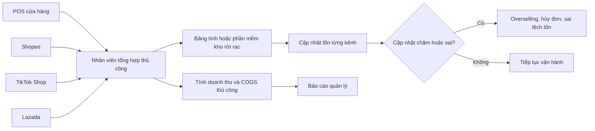

# Quy trình hiện tại (As-Is)

## 1. Mục đích

Tài liệu mô tả trạng thái vận hành điển hình trước khi triển khai OISM. Vì đề tài không cung cấp dữ liệu khảo sát của một doanh nghiệp cụ thể, quy trình As-Is dưới đây được xây dựng như một **mô hình hiện trạng giả định hợp lý** dựa trên các vấn đề đã nêu: hệ thống rời rạc, đồng bộ chậm, cập nhật thủ công, không có reservation tập trung và khó tính COGS chính xác.

## 2. Đặc điểm hiện trạng

- POS tại cửa hàng và các sàn thương mại điện tử quản lý đơn hàng riêng.
- Tồn kho được nhập trên nhiều giao diện hoặc theo dõi bằng bảng tính.
- Một số kênh chỉ được cập nhật tồn theo lịch hoặc sau khi nhân viên đối soát.
- Không có sổ cái tồn kho thống nhất, bất biến và có thể kiểm toán.
- Không phân biệt rõ on_hand, reserved và available.
- Giá vốn có thể được nhập tay hoặc tính ngoài hệ thống.
- Đơn hàng từ các kênh không dùng chung một máy trạng thái.
- Báo cáo được tổng hợp thủ công từ nhiều nguồn.

## 3. Sơ đồ tổng quan As-Is

## 4. Quy trình As-Is chi tiết

### AS-01. Thiết lập sản phẩm trên nhiều kênh

1. Nhân viên tạo sản phẩm tại POS hoặc phần mềm nội bộ.
2. Nhân viên tạo lại sản phẩm trên từng sàn.
3. Mã SKU, tên, giá hoặc thuộc tính biến thể có thể không đồng nhất.
4. Mã vạch được quản lý riêng hoặc không liên kết chắc chắn với SKU chung.
5. Khi thay đổi giá/thông tin, nhân viên cập nhật từng hệ thống.

**Vấn đề:**

- Trùng lặp thao tác.
- Không có một định danh SKU chuẩn trên toàn bộ kênh.
- Dễ ánh xạ nhầm biến thể.
- Khó xác định dữ liệu nào là nguồn chính xác.

### AS-02. Nhập hàng

1. Hàng được nhận từ nhà cung cấp.
2. Nhân viên nhập số lượng vào bảng tính hoặc phần mềm kho.
3. Tồn kho tại POS được cập nhật riêng.
4. Tồn kho trên các sàn được cập nhật thủ công hoặc chờ đồng bộ.
5. Giá nhập được lưu trên phiếu hoặc bảng tính.
6. Giá vốn được tính thủ công, theo giá gần nhất hoặc phương pháp không nhất quán.

**Vấn đề:**

- Không bảo đảm mọi lần tăng tồn đều có chứng từ và lịch sử thống nhất.
- COGS có thể không được cập nhật ngay sau khi nhập.
- Sai lệch giữa chứng từ, tồn thực tế và tồn hiển thị trên kênh.

### AS-03. Bán hàng tại POS

1. Thu ngân quét mã hoặc tìm sản phẩm.
2. POS kiểm tra số tồn cục bộ hoặc số tồn đồng bộ gần nhất.
3. Thu ngân nhận thanh toán và in hóa đơn.
4. POS trừ tồn tại cửa hàng.
5. Các kênh online chưa chắc được cập nhật ngay.

**Điểm lỗi điển hình:** Trong lúc POS bán SKU cuối cùng, một đơn online vẫn có thể được chấp nhận vì kênh online đang nhìn thấy số tồn cũ.

### AS-04. Tiếp nhận đơn hàng online

1. Khách đặt hàng trên một sàn.
2. Sàn ghi nhận đơn theo mô hình trạng thái riêng.
3. Nhân viên nhận thông báo và kiểm tra đơn.
4. Nhân viên kiểm tra tồn bằng POS, bảng tính hoặc kiểm đếm.
5. Nếu còn hàng, nhân viên xử lý đơn và cập nhật tồn.
6. Nếu hết hàng, nhân viên hủy đơn hoặc liên hệ khách.

**Vấn đề:**

- Không có bước giữ hàng nguyên tử ngay khi đơn vào.
- Hai đơn đồng thời có thể cùng nhìn thấy một SKU còn hàng.
- Không có cơ chế ưu tiên hoặc bảo vệ lượng hàng dành cho đơn online.
- Dễ tiếp nhận trùng webhook hoặc xử lý trùng đơn.

### AS-05. Hủy đơn online

1. Khách, nhân viên hoặc sàn hủy đơn.
2. Nhân viên kiểm tra xem tồn đã bị trừ hay chưa.
3. Nhân viên cộng lại tồn thủ công tại một hoặc nhiều hệ thống.
4. Một số kênh có thể không được cập nhật kịp thời.

**Vấn đề:**

- Không biết cần hoàn on_hand hay chỉ giải phóng lượng giữ.
- Có nguy cơ hoàn tồn hai lần hoặc bỏ sót hoàn tồn.
- Khó truy vết người thực hiện và nguyên nhân.

### AS-06. Chuyển kho

1. Kho A lập danh sách hàng chuyển.
2. Kho A giảm tồn bằng thao tác thủ công.
3. Hàng được vận chuyển đến Kho B.
4. Kho B tăng tồn sau khi nhận.
5. Trong thời gian vận chuyển, hệ thống có thể không thể hiện rõ trạng thái hàng.

**Vấn đề:**

- Không có quy trình hai bước thống nhất.
- Có thể tăng tồn ở B trước khi hàng thực nhận.
- Chênh lệch do thất thoát không được ghi nhận rõ.

### AS-07. Kiểm kê và điều chỉnh

1. Nhân viên xuất danh sách tồn từ phần mềm hoặc bảng tính.
2. Nhân viên đếm thực tế.
3. Chênh lệch được cập nhật trực tiếp vào cột tồn.
4. Số dư cũ bị ghi đè.

**Vấn đề:**

- Mất dấu vết số liệu trước điều chỉnh.
- Không có bút toán bù trừ và quy trình phê duyệt.
- Khó xác định sai lệch phát sinh từ bán hàng, nhập hàng hay thao tác thủ công.

### AS-08. Tính doanh thu, COGS và lợi nhuận

1. Nhân viên xuất đơn hàng từ từng kênh.
2. Dữ liệu được ghép trong bảng tính.
3. Phí, giảm giá, hoàn tiền và giá vốn được làm sạch thủ công.
4. COGS được gán theo dữ liệu hiện có tại thời điểm lập báo cáo.
5. Báo cáo được gửi cho Owner.

**Vấn đề:**

- Không snapshot giá vốn tại thời điểm xuất bán.
- Giá vốn thay đổi về sau có thể làm kết quả lịch sử sai lệch.
- Báo cáo tốn thời gian và khó lặp lại.
- Cách tính giữa các kỳ có thể không thống nhất.

## 5. Phân tích nguyên nhân gốc

| Mã | Nguyên nhân gốc | Hệ quả |
|---|---|---|
| RC-01 | Không có nguồn dữ liệu tồn kho tập trung | Số lượng giữa các kênh không đồng nhất. |
| RC-02 | Không có reservation | Nhiều đơn cùng sử dụng một lượng tồn. |
| RC-03 | Đồng bộ bất đồng bộ nhưng không có khóa/cơ chế cạnh tranh | Overselling trong giờ cao điểm. |
| RC-04 | Cho phép sửa trực tiếp số tồn | Mất khả năng kiểm toán và truy vết. |
| RC-05 | Không có Canonical Order Model | Logic xử lý phụ thuộc từng kênh. |
| RC-06 | Không có máy trạng thái | Chuyển trạng thái không hợp lệ hoặc xử lý lặp. |
| RC-07 | COGS không được tính và snapshot tự động | Sai lợi nhuận gộp lịch sử. |
| RC-08 | Mã SKU/biến thể không thống nhất | Nhầm hàng, sai tồn và sai báo cáo. |
| RC-09 | Báo cáo ghép thủ công | Chậm, khó kiểm chứng và dễ sai công thức. |
| RC-10 | Kiểm soát Tenant không tập trung | Nguy cơ truy cập nhầm dữ liệu khách hàng. |

## 6. Điểm đau theo tác nhân

### Owner

- Không có dashboard hợp nhất theo thời gian gần thực.
- Không tin cậy hoàn toàn vào số liệu tồn và lợi nhuận.
- Khó mở rộng thêm chi nhánh/kênh mà không tăng nhân sự đối soát.

### Staff

- Phải nhập lại dữ liệu ở nhiều nơi.
- Mất thời gian kiểm tra tồn trước khi duyệt đơn.
- Khó xử lý tranh chấp và truy nguyên chênh lệch.

### Cashier

- POS có thể hiển thị tồn không phản ánh lượng đã cam kết cho đơn online.
- Phải hỏi kho hoặc kiểm tra thủ công khi tồn thấp.
- Quy trình xử lý lỗi thanh toán/trừ kho không nhất quán.

### Khách hàng

- Đặt hàng thành công nhưng sau đó bị hủy vì hết hàng.
- Thời gian xác nhận chậm.
- Trải nghiệm giữa các kênh không đồng nhất.

## 7. Rủi ro nghiệp vụ hiện tại

| Mã | Rủi ro | Khả năng | Tác động | Mức độ |
|---|---|---:|---:|---|
| R-01 | Bán vượt tồn kho | Cao | Cao | Nghiêm trọng |
| R-02 | Sai lệch tồn kho | Cao | Cao | Nghiêm trọng |
| R-03 | COGS/lợi nhuận sai | Trung bình-Cao | Cao | Nghiêm trọng |
| R-04 | Xử lý đơn trùng | Trung bình | Cao | Cao |
| R-05 | Mất dấu vết điều chỉnh | Cao | Trung bình-Cao | Cao |
| R-06 | Lộ dữ liệu giữa Tenant | Thấp-Trung bình | Rất cao | Nghiêm trọng |
| R-07 | Chậm xử lý trong Flash Sale | Cao | Cao | Nghiêm trọng |
| R-08 | Hủy đơn và giảm uy tín | Cao | Cao | Nghiêm trọng |

## 8. Khoảng cách giữa As-Is và mục tiêu

| Năng lực | As-Is | Nhu cầu To-Be |
|---|---|---|
| Tồn kho | Phân tán, cập nhật trực tiếp | Ledger chỉ ghi thêm và số dư nhất quán |
| Tồn khả dụng | Không tách reserved | `available = on_hand - reserved` |
| Đồng thời | Không có khóa thống nhất | Pessimistic/Optimistic Locking |
| Đơn hàng | Mô hình riêng từng kênh | Canonical Order Model |
| Trạng thái | Xử lý linh hoạt, dễ sai | State machine nghiêm ngặt |
| COGS | Thủ công hoặc không nhất quán | Weighted Average Cost tự động |
| Báo cáo | Tổng hợp thủ công | Gần thời gian thực, lọc đa chiều |
| Kiểm toán | Ghi đè số tồn | Bút toán append-only và bù trừ |
| Tenant | Phân quyền rời rạc | TenantId, Query Filter và RBAC |
| Thông báo | Kiểm tra thủ công | SignalR push thời gian thực |

## 9. Tiêu chí kết thúc giai đoạn As-Is

Phân tích As-Is được xem là đủ cho thiết kế khi nhóm dự án đã:

- Xác nhận các giả định với giảng viên hoặc đại diện nghiệp vụ.
- Xác định nguồn dữ liệu chủ cho sản phẩm, tồn kho và đơn hàng.
- Xác định cách ánh xạ SKU giữa các kênh.
- Thống nhất thời điểm giữ hàng, trừ hàng và hoàn giữ.
- Thống nhất chính sách hủy sau Confirmed.
- Thống nhất cách xử lý trả hàng, hoàn tiền và bút toán bù trừ nếu đưa vào phạm vi.
- Xác định SLA đồng bộ và thời gian hết hạn reservation.
