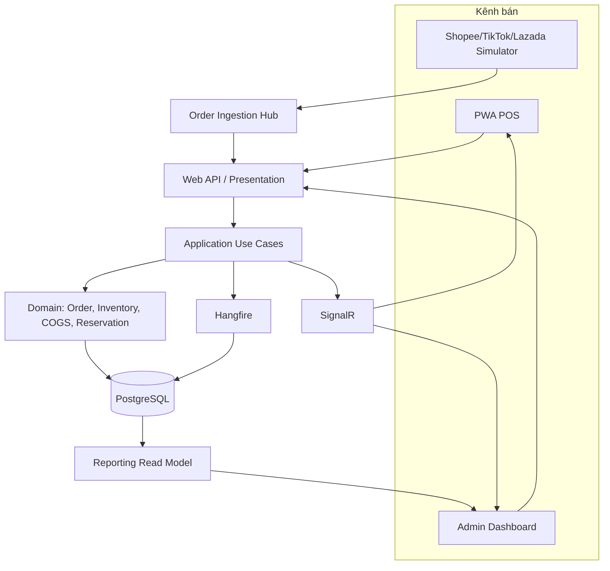
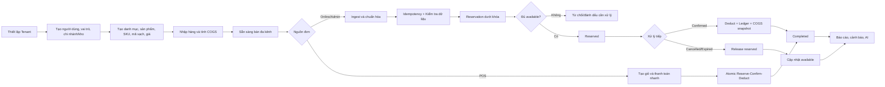
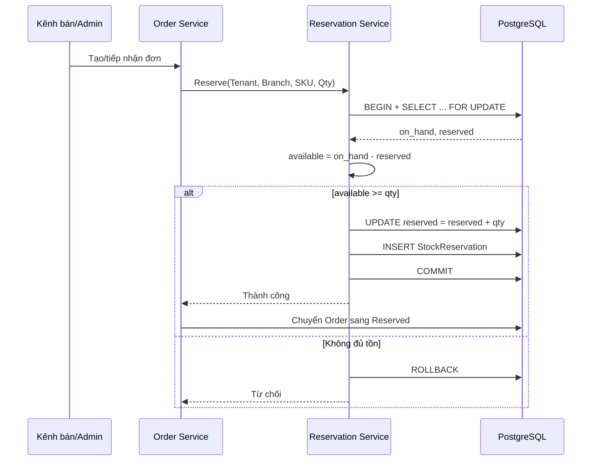
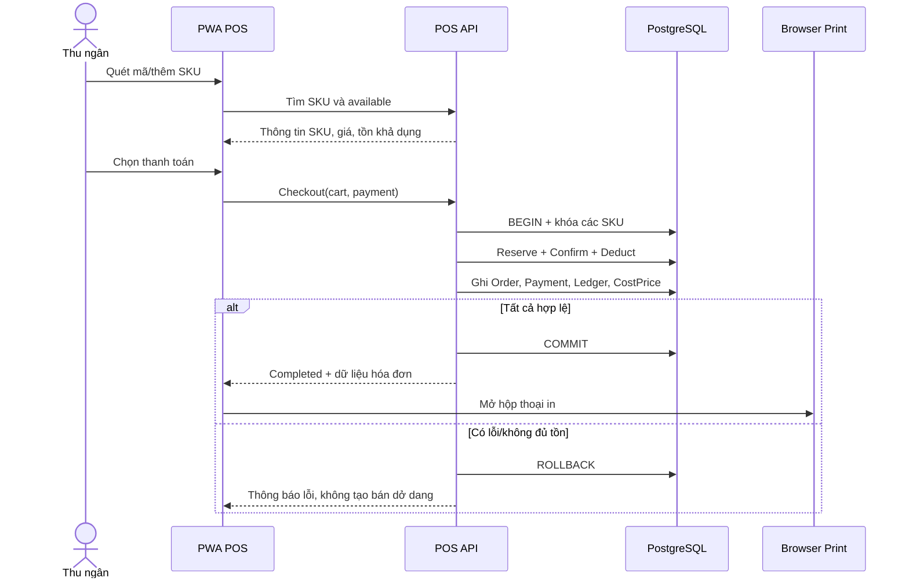

# Quy trình đề xuất (To-Be)

## 1. Mục đích

Tài liệu mô tả quy trình vận hành mục tiêu sau khi triển khai OISM. Quy trình To-Be tập trung vào bốn nguyên tắc: dữ liệu đa khách hàng được cô lập, tồn kho được ghi nhận bằng ledger chỉ ghi thêm, mọi cam kết bán hàng phải qua reservation, và các thay đổi quan trọng được thực thi trong giao dịch cơ sở dữ liệu nguyên tử.

## 2. Nguyên tắc thiết kế quy trình

1. **Một mô hình tồn kho thống nhất:** Mọi kênh dùng chung on_hand, reserved và available theo Tenant, chi nhánh/kho và SKU.
2. **Ledger chỉ ghi thêm:** Không cập nhật hoặc xóa lịch sử; sai sót được sửa bằng bút toán bù trừ.
3. **Chống bán vượt tại cơ sở dữ liệu:** Kiểm tra và thay đổi reserved/on_hand dưới khóa hoặc kiểm tra phiên bản.
4. **Đơn hàng chuẩn hóa:** Dữ liệu mọi kênh được ánh xạ về Canonical Order Model.
5. **Máy trạng thái bắt buộc:** Không cho phép chuyển trạng thái tùy ý.
6. **COGS nhất quán:** Tính lại khi nhập hàng và snapshot khi Confirmed/POS thanh toán.
7. **Tenant-aware toàn hệ thống:** TenantId được lấy từ ngữ cảnh xác thực, không tin cậy TenantId do client tùy ý gửi.
8. **Idempotency:** Webhook và lệnh quan trọng phải an toàn khi gửi lại.
9. **Quan sát được:** Có audit log, correlation ID, log lỗi và số liệu giám sát.

## 3. Kiến trúc quy trình cấp cao



## 4. Quy trình To-Be tổng thể



## 5. Quy trình chi tiết

### TB-01. Đăng ký Tenant và khởi tạo hệ thống

**Tác nhân:** Owner.  
**Điều kiện đầu:** Email/số điện thoại chưa được sử dụng theo chính sách hệ thống.  
**Luồng chính:**

1. Owner gửi thông tin đăng ký cửa hàng.
2. Hệ thống tạo Tenant và TenantId duy nhất.
3. Hệ thống tạo tài khoản Owner, băm mật khẩu bằng BCrypt hoặc Argon2.
4. Hệ thống tạo cấu hình mặc định, vai trò và chi nhánh/kho đầu tiên nếu được yêu cầu.
5. Owner đăng nhập và nhận access token, refresh token.
6. JWT chứa TenantId, UserId và Role.
7. Mọi truy vấn sau đó được áp Global Query Filter theo TenantId.

**Kết quả:** Tenant hoạt động và dữ liệu được cô lập.  
**Ngoại lệ:** Đăng ký trùng, dữ liệu không hợp lệ hoặc lỗi khởi tạo phải rollback toàn bộ.

### TB-02. Quản lý chi nhánh, kho và người dùng

1. Owner tạo/cập nhật chi nhánh hoặc kho.
2. Owner tạo người dùng và gán vai trò.
3. Hệ thống kiểm tra quyền theo RBAC tại API và màn hình.
4. Việc tắt chi nhánh không xóa lịch sử; chi nhánh ngừng xuất hiện trong thao tác mới nhưng vẫn dùng được trong báo cáo lịch sử.

### TB-03. Quản lý sản phẩm và SKU

1. Staff/Owner tạo danh mục phân cấp và thương hiệu.
2. Tạo sản phẩm đơn giản hoặc sản phẩm có biến thể.
3. Hệ thống sinh hoặc nhận SKU; kiểm tra duy nhất trong Tenant.
4. Hệ thống sinh/nhận mã vạch EAN-13 hoặc Code128 theo chính sách.
5. Thiết lập giá bán lẻ và bán sỉ, tách biệt với COGS.
6. SKU được kích hoạt để nhập kho và bán.

**Kiểm soát:** Không cho xóa cứng SKU đã có giao dịch; dùng trạng thái ngừng kinh doanh.

### TB-04. Nhập hàng và tính giá vốn bình quân

**Tác nhân:** Staff/Owner.  
**Điều kiện đầu:** Nhà cung cấp, kho nhận và SKU hợp lệ.  
**Luồng chính:**

1. Staff tạo phiếu nhập ở trạng thái Draft.
2. Nhập số lượng và đơn giá nhập của từng SKU.
3. Staff xác nhận phiếu nhập.
4. Hệ thống mở transaction và khóa số dư SKU tại chi nhánh/kho.
5. Với từng SKU, tính:

```text
new_cost = ((old_on_hand × old_cost) + (received_qty × purchase_price))
           / (old_on_hand + received_qty)
```

6. Tăng on_hand.
7. Ghi bản ghi InventoryLedger loại IN với BalanceAfter.
8. Lưu COGS mới và đánh dấu phiếu nhập Confirmed.
9. Commit và gửi thông báo cập nhật.

**Ngoại lệ:** Nếu mẫu số bằng 0 hoặc dữ liệu âm/không hợp lệ, từ chối xác nhận. Nếu một dòng lỗi, rollback toàn phiếu.

### TB-05. Tiếp nhận đơn hàng đa kênh

**Tác nhân:** Sàn mô phỏng, Admin.  
**Luồng chính:**

1. Order Ingestion Hub nhận payload.
2. Xác thực chữ ký/khóa mô phỏng và Tenant/kênh.
3. Kiểm tra idempotency theo `TenantId + Channel + ExternalOrderId` hoặc event ID.
4. Lưu payload gốc phục vụ truy vết nếu phù hợp chính sách.
5. Ánh xạ khách hàng, địa chỉ, sản phẩm, SKU, số lượng, giá và giảm giá về Canonical Order Model.
6. Kiểm tra SKU mapping và dữ liệu bắt buộc.
7. Tạo Order ở Draft.
8. Gọi Reservation Engine.
9. Nếu giữ hàng thành công, chuyển sang Reserved.
10. SignalR thông báo đơn mới cho Admin/POS liên quan.

**Ngoại lệ:**

- Event trùng: trả kết quả idempotent, không tạo đơn mới.
- Không ánh xạ được SKU: đưa vào hàng chờ xử lý, không giữ hàng sai SKU.
- Không đủ available: từ chối/đánh dấu thiếu hàng theo chính sách kênh.

### TB-06. Giữ hàng chống bán vượt



**Yêu cầu bắt buộc:**

- Thứ tự khóa SKU phải nhất quán để giảm deadlock.
- Tất cả SKU của đơn phải được giữ thành công hoặc toàn bộ rollback.
- `reserved >= 0` và `available >= 0` sau commit.
- Có thời điểm hết hạn reservation.

### TB-07. Xác nhận và trừ kho đơn online

1. Staff mở đơn Reserved.
2. Hệ thống kiểm tra quyền và trạng thái hiện tại.
3. Staff xác nhận xử lý đơn.
4. Hệ thống mở transaction và khóa các số dư theo thứ tự xác định.
5. Với mỗi OrderItem:
   - Kiểm tra reservation còn hiệu lực và đủ số lượng.
   - Giảm on_hand.
   - Giảm reserved.
   - Snapshot COGS hiện tại vào `OrderItem.CostPrice`.
   - Ghi InventoryLedger loại OUT/SALE và BalanceAfter.
6. Chuyển Order sang Confirmed.
7. Commit transaction.
8. Khi giao hàng/thanh toán hoàn tất, chuyển sang Completed.

**Bất biến:** Sau bước Confirmed, `on_hand` và `reserved` phải phản ánh đúng cùng một giao dịch; không được chỉ cập nhật một phía.

### TB-08. Hủy đơn hoặc hết hạn reservation

1. Người dùng gửi lệnh hủy hoặc Hangfire phát hiện reservation hết hạn.
2. Hệ thống kiểm tra trạng thái.
3. Nếu Order đang Reserved:
   - Khóa số dư.
   - Giảm reserved theo số lượng đã giữ.
   - Đánh dấu reservation Released/Expired.
   - Chuyển Order thành Cancelled.
4. Nếu Order đã Confirmed, phải áp dụng chính sách hủy sau xuất hàng và tạo giao dịch bù trừ/return; không được chỉ cộng sửa số tồn.
5. Commit và phát thông báo.

### TB-09. Thanh toán nhanh tại POS



**Yêu cầu trải nghiệm:** Thanh toán dưới ba lần nhấp hoặc quét mã + Enter; hỗ trợ tiền mặt và QR chuyển khoản; giao diện responsive.

### TB-10. Chuyển kho hai bước

**Bước 1 - Xuất khỏi kho nguồn:**

1. Staff tạo yêu cầu chuyển kho.
2. Hệ thống kiểm tra available tại nguồn.
3. Khi xác nhận xuất, khóa SKU và giảm on_hand nguồn.
4. Ghi ledger OUT/TRANSFER_OUT.
5. Chuyển phiếu sang InTransit.

**Bước 2 - Nhận tại kho đích:**

1. Staff kho đích kiểm nhận.
2. Ghi số lượng thực nhận và chênh lệch nếu có.
3. Khi xác nhận, tăng on_hand đích.
4. Ghi ledger IN/TRANSFER_IN.
5. Chuyển phiếu sang Received hoặc ReceivedWithVariance.

### TB-11. Kiểm kê và điều chỉnh

1. Staff tạo Stocktake Session theo kho/phạm vi SKU.
2. Hệ thống chụp số dư tham chiếu.
3. Người kiểm kê nhập số lượng đếm thực tế.
4. Hệ thống tính chênh lệch.
5. Người có quyền phê duyệt.
6. Hệ thống ghi ADJUSTMENT_IN hoặc ADJUSTMENT_OUT trong ledger.
7. Cập nhật số dư thông qua use case, không sửa lịch sử.
8. Đóng phiên và lưu người thực hiện, người duyệt, thời gian và lý do.

### TB-12. Báo cáo, cảnh báo và AI

1. Dữ liệu đơn Completed/Confirmed và CostPrice snapshot được tổng hợp.
2. Tính doanh thu thuần, COGS và lợi nhuận gộp.
3. Tính giá trị tồn kho theo COGS hiện tại.
4. Xác định SKU bán nhanh/chậm.
5. Nếu `available <= reorder_point`, tạo cảnh báo dashboard.
6. Hangfire tổng hợp báo cáo ngày.
7. Mô-đun AI đọc lịch sử bán, lead time và mức tồn để đề xuất đặt hàng lại.
8. Owner xem xét và phê duyệt; AI không tự tạo phiếu nhập đã xác nhận trong phạm vi mặc định.

## 6. Ma trận trạng thái đơn hàng

| Trạng thái hiện tại | Sự kiện | Trạng thái kế tiếp | Tác động tồn kho |
|---|---|---|---|
| Draft | Reserve thành công | Reserved | reserved tăng |
| Draft | Hủy | Cancelled | Không đổi |
| Reserved | Confirm | Confirmed | on_hand giảm, reserved giảm, ghi OUT, snapshot COGS |
| Reserved | Hủy | Cancelled | reserved giảm |
| Reserved | Hết hạn | Cancelled | reserved giảm |
| Confirmed | Hoàn tất | Completed | Không trừ kho lần nữa |
| Confirmed | Hủy hợp lệ | Cancelled/Returned theo thiết kế | Tạo bút toán bù trừ, không sửa ledger cũ |

## 7. Kiểm soát giao dịch và đồng thời

- Dùng `SELECT ... FOR UPDATE` hoặc optimistic concurrency token.
- Transaction bao phủ toàn bộ chuỗi thay đổi có liên quan.
- Khóa theo `TenantId + BranchId/WarehouseId + SKUId`.
- Khi đơn có nhiều SKU, sắp xếp khóa theo SKUId để giảm deadlock.
- Có retry giới hạn cho lỗi deadlock hoặc serialization theo chính sách.
- Ràng buộc cơ sở dữ liệu ngăn `on_hand < 0`, `reserved < 0` và `reserved > on_hand` trong mô hình không cho backorder.
- Không gọi dịch vụ ngoài kéo dài trong transaction cơ sở dữ liệu.
- Dùng outbox/event sau commit nếu cần bảo đảm thông báo không bị mất.

## 8. Trường hợp Flash Sale tham chiếu

**Kịch bản:** 50 yêu cầu đồng thời mua cùng một SKU có `on_hand = 1`, `reserved = 0`.

**Kết quả mong đợi:**

- Chính xác một yêu cầu giữ được 1 sản phẩm.
- 49 yêu cầu còn lại nhận kết quả không đủ tồn hoặc được xử lý theo chính sách chờ.
- Sau xử lý: `on_hand = 1`, `reserved = 1`, `available = 0`.
- Sau Confirm: `on_hand = 0`, `reserved = 0`, `available = 0`.
- Không có duplicate reservation hoặc ledger OUT trùng.

## 9. Theo dõi và kiểm toán

Mỗi thao tác quan trọng nên lưu:

- TenantId, UserId, Role.
- CorrelationId/RequestId.
- EntityType, EntityId.
- Hành động và trạng thái trước/sau phù hợp chính sách.
- ReferenceId liên kết Order, Receipt, Transfer hoặc Stocktake.
- Thời gian UTC và nguồn kênh.
- Lý do hủy/điều chỉnh.

## 10. Tiêu chí chấp nhận To-Be

- Không thể chuyển trạng thái ngoài ma trận đã cấu hình.
- Không thể cập nhật/xóa bản ghi InventoryLedger qua API nghiệp vụ.
- Mọi thay đổi on_hand có ledger tương ứng trong cùng transaction.
- Cùng một webhook lặp lại không tạo đơn trùng.
- POS không bán lượng đã reserved cho đơn online.
- COGS được tính lại khi nhập và snapshot khi xuất bán.
- Truy vấn của Tenant A không trả dữ liệu Tenant B.
- Các mục tiêu p95, báo cáo, uptime và độ bao phủ kiểm thử đáp ứng NFR.
