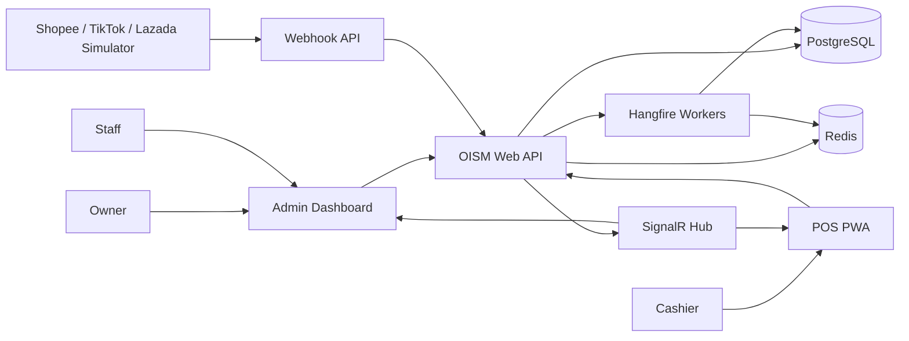
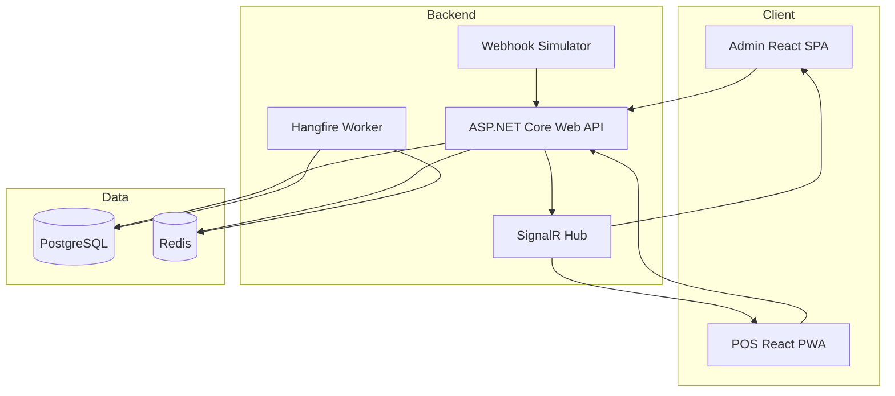

# Tổng quan kiến trúc hệ thống OISM

## 1. Mục đích tài liệu

Tài liệu mô tả kiến trúc tổng thể của **Omnichannel Inventory and Sales Management System (OISM)**, một nền tảng SaaS đa khách hàng dùng để quản lý sản phẩm, tồn kho, giá vốn, đơn hàng đa kênh, bán hàng tại quầy và báo cáo.

Các mục tiêu kiến trúc chính:

- Cô lập dữ liệu tuyệt đối giữa các tenant.
- Không cho phép tồn kho khả dụng âm khi có nhiều giao dịch đồng thời.
- Duy trì sổ cái tồn kho chỉ ghi thêm để phục vụ kiểm toán.
- Tính đúng giá vốn bình quân gia quyền và chụp giá vốn tại thời điểm xuất hàng.
- Chuẩn hóa đơn hàng POS, Admin và sàn thương mại điện tử về một mô hình duy nhất.
- Đáp ứng khả năng mở rộng, giám sát, kiểm thử và triển khai bằng container.

## 2. Phạm vi hệ thống

### 2.1 Thành phần trong phạm vi

- Backend Web API trên .NET 8.
- Admin Dashboard bằng ReactJS.
- POS PWA bằng ReactJS.
- PostgreSQL làm cơ sở dữ liệu giao dịch chính.
- Redis cho cache phân tán và dữ liệu tạm có thời hạn.
- SignalR cho sự kiện thời gian thực.
- Hangfire cho tác vụ nền.
- Webhook Simulator cho Shopee, TikTok Shop và Lazada.
- Docker Compose và GitHub Actions cho triển khai, build và kiểm thử.

### 2.2 Thành phần ngoài phạm vi hoặc được mô phỏng

- Thanh toán ngân hàng thực tế.
- API chính thức của các sàn thương mại điện tử.
- Đơn vị vận chuyển bên thứ ba.
- Hóa đơn điện tử theo nhà cung cấp thực tế.

## 3. Nguyên tắc kiến trúc

1. **Clean Architecture**: nghiệp vụ không phụ thuộc framework, UI hay cơ sở dữ liệu.
2. **Tenant-aware by default**: mọi truy vấn và lệnh nghiệp vụ đều phải có ngữ cảnh tenant.
3. **Ledger as source of audit**: mọi thay đổi tồn kho phải tạo bút toán bất biến.
4. **Transactional consistency first**: reserve, confirm, deduct và ghi ledger phải tuân thủ ACID.
5. **Idempotency**: webhook, retry và tác vụ nền không được tạo hiệu ứng nghiệp vụ trùng lặp.
6. **Defense in depth**: bảo vệ ở API, Application, ORM và cơ sở dữ liệu.
7. **Observability by design**: log, metric, trace và audit phải được thiết kế từ đầu.
8. **Cache is not the source of truth**: quyết định giữ/trừ kho luôn xác thực trên PostgreSQL.

## 4. Kiến trúc ngữ cảnh

## 5. Kiến trúc container logic

## 6. Các mô-đun nghiệp vụ

| Mô-đun | Trách nhiệm chính | Yêu cầu liên quan |
|---|---|---|
| Identity & Tenant | Tenant, người dùng, JWT, Refresh Token, RBAC | FR-AUTH, NFR-TENANT, NFR-SEC |
| Catalog | Danh mục, thương hiệu, sản phẩm, SKU, mã vạch, giá | FR-PROD |
| Inventory | On-hand, reserved, available, ledger, kiểm kê, chuyển kho | FR-INV, FR-RSE |
| Costing | Giá vốn bình quân gia quyền và snapshot COGS | FR-COST |
| Ordering | Canonical Order Model và state machine | FR-ORD |
| POS | Giỏ hàng, quét mã, thanh toán nhanh, in hóa đơn | FR-POS |
| Reporting | Doanh thu, COGS, lợi nhuận gộp, tồn kho | FR-REP |
| Integration | Webhook, SignalR, Hangfire, idempotency | FR-SIM |
| Forecasting | Gợi ý đặt hàng lại bằng AI | Gói công việc 5 |

## 7. Luồng nghiệp vụ quan trọng

### 7.1 Nhận đơn hàng online

1. Webhook gửi payload kèm `ExternalOrderId` và `EventId`.
2. Integration Adapter xác thực và chuẩn hóa sang Canonical Order Model.
3. Hệ thống kiểm tra idempotency theo `(TenantId, Channel, EventId)`.
4. Application Service mở transaction.
5. Khóa các bản ghi số dư theo thứ tự SKU ổn định.
6. Kiểm tra `available = on_hand - reserved`.
7. Tạo reservation và chuyển đơn sang `Reserved` nếu đủ hàng.
8. Commit transaction rồi phát sự kiện realtime sau commit.

### 7.2 Xác nhận đơn hàng

1. Kiểm tra trạng thái hiện tại là `Reserved`.
2. Khóa đơn, reservation và số dư tồn kho.
3. Giảm `on_hand`, giảm `reserved`.
4. Ghi `InventoryTransaction` loại `OUT/SALE`.
5. Snapshot `OrderItem.CostPrice`.
6. Chuyển đơn sang `Confirmed`.
7. Commit nguyên tử.

### 7.3 Thanh toán POS nhanh

POS thực hiện `Reserve -> Confirm -> Deduct` trong một transaction duy nhất. Hệ thống không tin giá hoặc số lượng tồn do client gửi lên; toàn bộ dữ liệu phải được kiểm tra lại ở server.

## 8. Mô hình dữ liệu cấp cao

Các aggregate và bảng chính:

- `Tenant`, `User`, `Role`, `RefreshToken`.
- `Branch`, `Warehouse`.
- `Category`, `Brand`, `Product`, `Sku`, `Barcode`, `SkuPrice`.
- `InventoryBalance`: projection giao dịch gồm `OnHand`, `Reserved`, `AverageCost`, `Version`.
- `InventoryTransaction`: sổ cái chỉ ghi thêm.
- `GoodsReceipt`, `GoodsReceiptItem`.
- `StockTransfer`, `StockTransferItem`.
- `StockCountSession`, `StockCountItem`.
- `Order`, `OrderItem`, `StockReservation`.
- `WebhookInbox`, `OutboxMessage`.
- `AuditLog`.

> `InventoryBalance` là số dư tối ưu cho giao dịch, không thay thế sổ cái. Có thể tái đối chiếu số dư từ ledger và các bút toán hợp lệ.

## 9. Quyết định kiến trúc trọng yếu

### ADR-001: Modular Monolith trước, tách dịch vụ sau

Giai đoạn đồ án sử dụng modular monolith để đảm bảo transaction mạnh giữa Order, Inventory và Costing. Ranh giới mô-đun vẫn được giữ rõ để có thể tách thành dịch vụ khi quy mô yêu cầu.

### ADR-002: PostgreSQL là nguồn dữ liệu chuẩn

Tất cả quyết định tồn kho bắt buộc đọc và ghi trong PostgreSQL. Redis chỉ tăng tốc đọc và không được dùng để xác nhận lần cuối việc còn hàng.

### ADR-003: Sử dụng InventoryBalance cùng append-only ledger

- `InventoryBalance` phục vụ khóa và kiểm tra nhanh.
- `InventoryTransaction` phục vụ kiểm toán.
- Hai thay đổi phải nằm trong cùng transaction.

### ADR-004: Transactional Outbox

Sự kiện gửi tới SignalR, báo cáo hoặc tiến trình nền được ghi vào `OutboxMessage` cùng transaction nghiệp vụ. Worker chỉ phát sự kiện sau khi dữ liệu đã commit.

## 10. Thuộc tính chất lượng

| Thuộc tính | Cách đáp ứng |
|---|---|
| Hiệu năng | Chỉ mục tenant-aware, projection số dư, cache danh mục, phân trang cursor |
| Đồng thời | Row lock hoặc optimistic concurrency, thứ tự khóa ổn định, retry giới hạn |
| Bảo mật | JWT ngắn hạn, refresh token rotation, RBAC, HTTPS, secret management |
| Kiểm toán | Append-only ledger, audit log, correlation ID |
| Khả dụng | Health check, restart policy, backup, migration có kiểm soát |
| Bảo trì | Clean Architecture, module boundary, ADR, automated tests |

## 11. Truy vết yêu cầu

- Multi-tenant: FR-AUTH-01, FR-AUTH-04, NFR-TENANT-01/02.
- Ledger và kho: FR-INV-01..04, NFR-SEC-03.
- COGS: FR-COST-01/02.
- Order Hub: FR-ORD-01..03.
- Anti-oversell: FR-RSE-01..03, NFR-PERF-02, NFR-SEC-02.
- POS: FR-POS-01..04, NFR-USA-02.
- Báo cáo: FR-REP-01..03.
- Realtime và background: FR-SIM-01..03.

## 12. Tiêu chí chấp nhận kiến trúc

- Không có truy vấn nghiệp vụ nào chạy mà thiếu `TenantId` hợp lệ.
- 50 request đồng thời cho 1 SKU còn 1 sản phẩm chỉ có tối đa 1 request thành công.
- Ledger không thể UPDATE/DELETE bởi tài khoản ứng dụng.
- Order, reservation, balance, ledger và COGS snapshot commit hoặc rollback cùng nhau.
- Webhook gửi lặp không tạo đơn hoặc reserve trùng.
- Cache lỗi không làm sai số dư tồn kho.
- Mỗi request có `CorrelationId`, `TenantId`, `UserId` và trace xuyên suốt.

## 13. Tài liệu liên quan

- `clean-architecture.md`
- `multi-tenant-architecture.md`
- `security-architecture.md`
- `concurrency-architecture.md`
- `caching-strategy.md`
- `logging-and-monitoring.md`
- `deployment-architecture.md`
