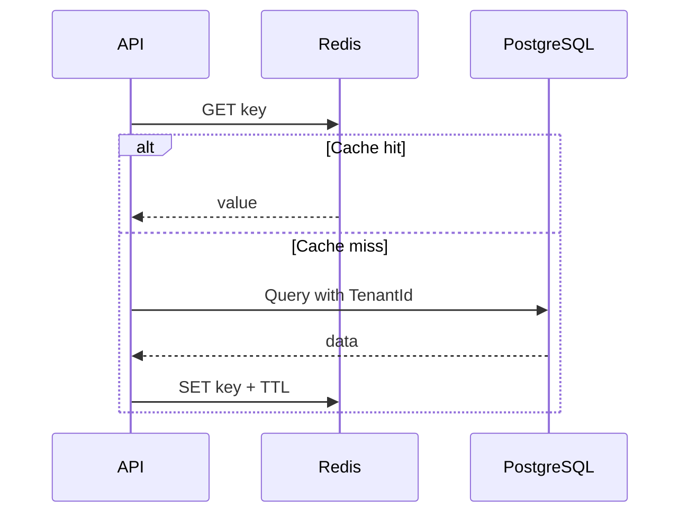

# Chiến lược caching OISM

## 1. Mục tiêu

Giảm độ trễ tìm kiếm SKU, quét mã vạch và đọc cấu hình mà không làm suy giảm tính đúng đắn của tồn kho, đơn hàng và COGS.

## 2. Nguyên tắc

1. PostgreSQL là source of truth.
2. Không dùng cache để quyết định cuối cùng việc reserve/deduct.
3. Cache key luôn chứa environment và TenantId.
4. Dữ liệu ghi phải commit trước khi invalidate hoặc publish.
5. Cache failure phải degrade gracefully, không làm hỏng transaction.
6. Không cache secret, token hoặc dữ liệu nhạy cảm không cần thiết.

## 3. Công nghệ

- In-memory cache cho metadata rất ngắn hạn trong một instance.
- Redis distributed cache cho nhiều API instance.
- HTTP/browser cache cho static assets frontend.
- Service Worker cache cho app shell của POS PWA, không phải nguồn tồn kho.

## 4. Phân loại dữ liệu

| Dữ liệu | Có cache | TTL gợi ý | Ghi chú |
|---|---:|---:|---|
| SKU theo ID/mã vạch | Có | 5-15 phút | Invalidate khi sửa SKU/barcode |
| Category/Brand | Có | 15-30 phút | Ít thay đổi |
| Giá niêm yết | Có | 1-5 phút | Invalidate ngay sau cập nhật |
| Cấu hình tenant/branch | Có | 5 phút | Cache aside |
| Quyền người dùng | Có giới hạn | 1-5 phút | Phải hỗ trợ revoke nhanh |
| On-hand/reserved/available | Không dùng để commit | 0-5 giây cho hiển thị | Luôn recheck DB khi bán |
| Order state | Thường không | Nếu có, TTL rất ngắn | Invalidate theo event |
| Báo cáo tổng hợp | Có | 1-15 phút | Key theo bộ lọc và version |
| Ledger | Không cache danh sách dài | N/A | Query phân trang/index |
| Access/refresh token | Không | N/A | Không cache ở client |

## 5. Cache key convention

```text
oism:{env}:tenant:{tenantId}:sku:id:{skuId}:v1
oism:{env}:tenant:{tenantId}:sku:barcode:{barcode}:v1
oism:{env}:tenant:{tenantId}:branch:{branchId}:settings:v1
oism:{env}:tenant:{tenantId}:report:gross-profit:{filterHash}:v1
```

Key không được chứa PII thô. `filterHash` được tạo từ bộ lọc canonical, không từ chuỗi tùy ý chưa chuẩn hóa.

## 6. Cache-aside pattern



Khi cập nhật:

1. Ghi database trong transaction.
2. Commit.
3. Outbox event `SkuUpdated` hoặc `PriceUpdated`.
4. Consumer invalidate key liên quan.

TTL là lớp bảo vệ nếu event invalidate thất bại.

## 7. Tìm kiếm SKU và quét mã vạch

- Lookup exact barcode phù hợp cache theo key.
- Search theo tên sử dụng database index/search engine tùy quy mô, không tạo quá nhiều key theo chuỗi nhập từng ký tự.
- Có debounce phía client.
- Response chứa `inventoryDisplay` chỉ mang tính tham khảo; checkout luôn gọi API giao dịch để xác nhận tồn kho.

## 8. Dữ liệu tồn kho

Không cache `available` để thực hiện reserve.

Có thể cache snapshot hiển thị tối đa vài giây để dashboard/POS phản hồi nhanh, kèm `asOf`:

```json
{
  "onHand": 12,
  "reserved": 2,
  "available": 10,
  "asOf": "2026-10-29T00:00:00Z"
}
```

Khi thêm hàng vào giỏ hoặc thanh toán, client phải chấp nhận khả năng server trả `409 insufficient_available_stock`.

## 9. Cache stampede và hot key

- Dùng TTL có jitter.
- Có single-flight/distributed lock ngắn cho báo cáo tốn kém.
- Không khóa cache quá lâu.
- Cho phép stale-while-revalidate với dữ liệu không quan trọng như danh mục.
- Hot SKU vẫn phải dựa vào row locking trong DB; Redis không thay thế transaction.

## 10. Báo cáo

Key báo cáo gồm:

- TenantId.
- Khoảng thời gian.
- Branch/channel/SKU filter.
- Time zone.
- Report version.

Invalidate theo cách thực tế:

- Báo cáo hôm nay: TTL ngắn 1-5 phút.
- Báo cáo lịch sử đã đóng: TTL dài hơn.
- Có thể tăng `reportDataVersion:{tenantId}` khi ingestion/adjustment ảnh hưởng báo cáo và đưa version vào key.

## 11. Authorization cache

Nếu cache permission:

- Key gồm TenantId + UserId + permission version.
- Thay đổi role làm tăng permission version hoặc xóa key.
- User disabled phải bị chặn bằng kiểm tra trạng thái đáng tin cậy, không chờ TTL dài.
- Không cache quyết định resource ownership phức tạp nếu dễ stale.

## 12. PWA offline strategy

Cache:

- HTML shell, JS, CSS, icon, font.
- Danh mục sản phẩm tối thiểu nếu nghiệp vụ cho phép.

Không cache hoặc không cho phép offline commit:

- Reserve/confirm/deduct.
- Payment confirmation.
- Token nhạy cảm.
- Ledger và báo cáo nhạy cảm.

Nếu mất mạng, POS hiển thị rõ trạng thái offline và không xác nhận bán hàng khi chưa thể kiểm tra tồn kho server, trừ khi dự án sau này thiết kế riêng cơ chế offline stock allocation.

## 13. Bảo mật cache

- Redis không public internet.
- TLS và authentication trong production.
- Network policy chỉ cho dịch vụ cần thiết truy cập.
- Không ghi payload cache vào log.
- Dữ liệu được serialize có schema/version.
- Thiết lập memory policy để tránh Redis làm ảnh hưởng chức năng cốt lõi.

## 14. Resilience

Khi Redis lỗi:

- Catalog/settings đọc từ database.
- Reporting có thể chậm hơn nhưng vẫn đúng.
- Rate limiting phân tán cần fallback được tài liệu hóa.
- Không rollback giao dịch DB chỉ vì invalidate cache thất bại.
- Circuit breaker ngắn giúp tránh chờ Redis quá lâu.

## 15. Metrics

- Cache hit/miss theo nhóm key.
- Redis latency p95/p99.
- Eviction count và memory usage.
- Cache load failures.
- Invalidation lag.
- DB query volume trước/sau cache.

Không tối ưu chỉ để tăng hit rate; mục tiêu là giảm latency và tải DB mà không gây stale nghiêm trọng.

## 16. Tiêu chí chấp nhận

- Không có transaction tồn kho phụ thuộc cache.
- Cache key của dữ liệu nghiệp vụ luôn có TenantId.
- Update SKU/price được invalidate sau commit.
- Redis unavailable không làm POS ghi sai tồn kho.
- Service Worker không lưu token hoặc response nhạy cảm.
