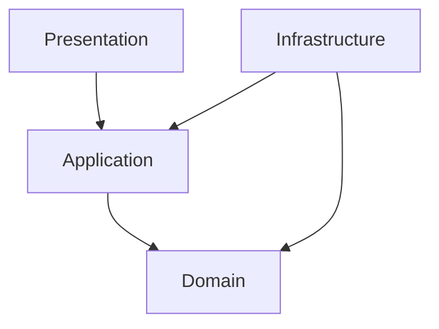
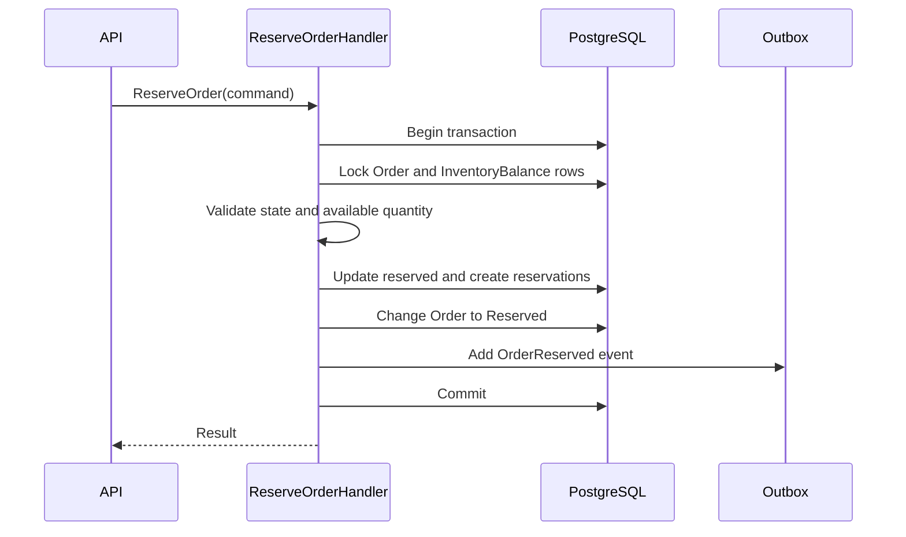

# Clean Architecture cho OISM

## 1. Mục tiêu

Áp dụng Clean Architecture để tách logic nghiệp vụ tồn kho, giá vốn và chống bán vượt khỏi ASP.NET Core, EF Core, PostgreSQL, Redis và React. Quy tắc phụ thuộc luôn hướng vào trong.



## 2. Cấu trúc solution đề xuất

```text
Oism.sln
src/
  Oism.Domain/
    Common/
    Tenancy/
    Catalog/
    Inventory/
    Costing/
    Ordering/
  Oism.Application/
    Abstractions/
    Behaviors/
    Features/
      Auth/
      Catalog/
      Inventory/
      Orders/
      Pos/
      Reports/
    Contracts/
  Oism.Infrastructure/
    Persistence/
    Identity/
    Caching/
    BackgroundJobs/
    Realtime/
    Integrations/
    Observability/
  Oism.Api/
    Endpoints/
    Middleware/
    Filters/
    Hubs/
  Oism.Worker/
frontend/
  admin-web/
  pos-pwa/
tests/
  Oism.Domain.UnitTests/
  Oism.Application.UnitTests/
  Oism.Infrastructure.IntegrationTests/
  Oism.Api.FunctionalTests/
  Oism.ConcurrencyTests/
```

## 3. Tầng Domain

### 3.1 Trách nhiệm

- Entity, Value Object, Aggregate Root.
- Quy tắc bất biến của đơn hàng và tồn kho.
- State machine của Order.
- Công thức Weighted Average Cost.
- Domain Event và Domain Exception.
- Không phụ thuộc EF Core, ASP.NET Core hoặc Redis.

### 3.2 Aggregate đề xuất

- `Order`: quản lý vòng đời Draft, Reserved, Confirmed, Completed, Cancelled.
- `StockReservation`: quản lý giữ hàng và thời hạn.
- `GoodsReceipt`: xác nhận nhập hàng.
- `StockTransfer`: vận chuyển và nhận hàng hai bước.
- `StockCountSession`: kiểm kê và tạo adjustment.

`InventoryTransaction` là bản ghi ledger bất biến. `InventoryBalance` là projection giao dịch được cập nhật thông qua use case và repository chuyên biệt.

### 3.3 Quy tắc Domain quan trọng

```text
available = on_hand - reserved
on_hand >= 0
reserved >= 0
available >= 0
```

- Không confirm đơn chưa reserve, trừ luồng POS atomic.
- Không cancel đơn đã completed.
- Không thay đổi `OrderItem.CostPrice` sau khi snapshot.
- Ledger đã tạo không có phương thức sửa hoặc xóa.
- Chuyển kho chỉ tăng kho đích sau khi xác nhận nhận hàng.

## 4. Tầng Application

### 4.1 Trách nhiệm

- Tổ chức use case bằng Command/Query.
- Validation, authorization, transaction boundary.
- Gọi interface do Application định nghĩa.
- Chuyển đổi DTO và phát domain/integration event.

### 4.2 Interface cốt lõi

```csharp
public interface ITenantContext
{
    Guid TenantId { get; }
    Guid? UserId { get; }
}

public interface IInventoryRepository
{
    Task<InventoryBalance?> GetForUpdateAsync(
        Guid branchId,
        Guid skuId,
        CancellationToken cancellationToken);
}

public interface IUnitOfWork
{
    Task<int> SaveChangesAsync(CancellationToken cancellationToken);
}

public interface IClock
{
    DateTimeOffset UtcNow { get; }
}
```

### 4.3 Pipeline behavior

Thứ tự đề xuất:

1. Correlation và request context.
2. Authentication.
3. Tenant resolution.
4. Authorization/RBAC.
5. Idempotency cho command phù hợp.
6. Validation.
7. Transaction.
8. Handler.
9. Outbox persistence.
10. Logging và metrics.

Không bọc query thuần đọc trong transaction nếu không cần thiết.

## 5. Tầng Infrastructure

### 5.1 Persistence

- `OismDbContext` và EF Core mappings.
- Global Query Filter theo `TenantId`.
- Repository triển khai row lock bằng SQL phù hợp PostgreSQL.
- Interceptor chặn UPDATE/DELETE ledger.
- Transactional Outbox và Inbox.
- Migration và seed data.

### 5.2 Các adapter

- BCrypt hoặc Argon2 password hasher.
- JWT issuer và refresh token store.
- Redis cache.
- SignalR notifier.
- Hangfire job scheduler.
- Adapter chuẩn hóa webhook theo từng channel.
- OpenTelemetry exporters và structured logger.

## 6. Tầng Presentation

- Minimal API hoặc Controllers chỉ xử lý HTTP concern.
- Không đặt nghiệp vụ trong controller/endpoint.
- DTO request/response tách khỏi entity.
- Trả lỗi theo `ProblemDetails` với mã lỗi ổn định.
- Swagger mô tả xác thực, idempotency key, correlation ID và response code.

Ví dụ endpoint:

```csharp
app.MapPost("/api/v1/orders/{orderId:guid}/reserve", ReserveOrder)
   .RequireAuthorization("Orders.Reserve")
   .Produces<ReserveOrderResponse>(StatusCodes.Status200OK)
   .ProducesProblem(StatusCodes.Status409Conflict);
```

## 7. Quy tắc phụ thuộc

Được phép:

- Domain không tham chiếu project nào.
- Application chỉ tham chiếu Domain.
- Infrastructure tham chiếu Application và Domain.
- API tham chiếu Application và cấu hình Infrastructure tại composition root.

Không được phép:

- Domain sử dụng `DbContext`, `HttpContext`, Redis hoặc SignalR.
- Application trả trực tiếp EF entity.
- Presentation truy cập DbContext để bỏ qua use case.
- Infrastructure chứa quyết định nghiệp vụ về trạng thái đơn.

## 8. Thiết kế use case mẫu: ReserveOrder



Handler phải khóa nhiều SKU theo thứ tự `SkuId` tăng dần để giảm deadlock.

## 9. Xử lý lỗi

| Lỗi | HTTP | Ví dụ mã lỗi |
|---|---:|---|
| Validation | 400 | `validation_failed` |
| Chưa xác thực | 401 | `unauthorized` |
| Không đủ quyền | 403 | `forbidden` |
| Không tìm thấy trong tenant | 404 | `order_not_found` |
| Xung đột trạng thái | 409 | `invalid_order_transition` |
| Không đủ tồn | 409 | `insufficient_available_stock` |
| Concurrency conflict | 409 hoặc retry nội bộ | `concurrency_conflict` |
| Lỗi hệ thống | 500 | `internal_error` |

Không trả stack trace, SQL hoặc secret ra client.

## 10. Kiểm thử theo tầng

- **Domain Unit Test**: state transition, WAC, invariant, reserve calculation.
- **Application Unit Test**: handler, validation, permission và orchestration.
- **Infrastructure Integration Test**: EF mappings, filter tenant, ledger protection, transaction.
- **Functional Test**: API, JWT, status code, ProblemDetails.
- **Concurrency Test**: 50 request tranh chấp 1 SKU.
- **Architecture Test**: kiểm tra project reference và namespace dependency.

Mô-đun Inventory, Reservation và Costing phải đạt tối thiểu 80% coverage theo NFR-MAINT-02; quan trọng hơn là bao phủ đầy đủ các invariant và nhánh lỗi.

## 11. Definition of Done kiến trúc

- Use case có command/query, validator và authorization policy.
- Mọi bảng nghiệp vụ có TenantId và chỉ mục phù hợp.
- Command thay đổi kho có transaction và integration test.
- Event bên ngoài được ghi qua outbox.
- Không có business logic trong controller hoặc DbContext.
- Có log, metric, trace và audit cho thao tác nhạy cảm.
