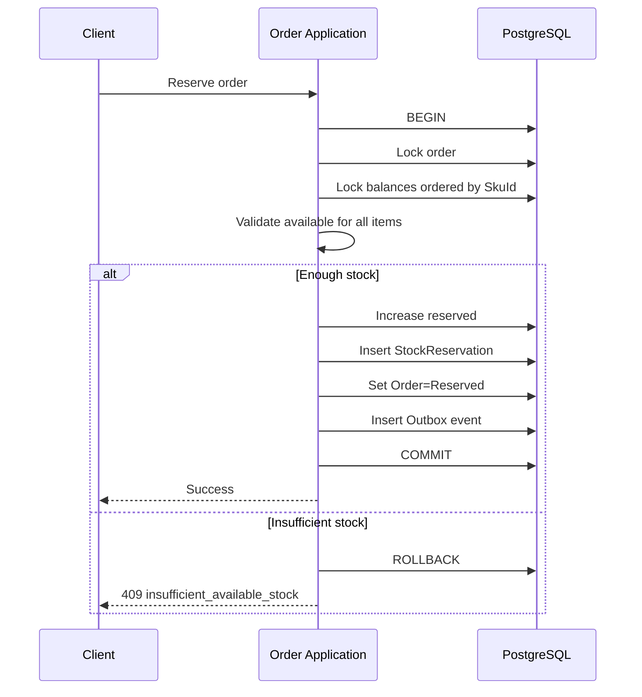

# Kiến trúc xử lý đồng thời và chống bán vượt

## 1. Mục tiêu

Đảm bảo `available = on_hand - reserved` không âm trong mọi tình huống, đặc biệt kịch bản 50 đơn hàng đồng thời tranh chấp một SKU còn lại.

## 2. Mô hình nhất quán

PostgreSQL là nguồn dữ liệu chuẩn. Mỗi tổ hợp `(TenantId, BranchId, SkuId)` có đúng một bản ghi `InventoryBalance`:

```text
OnHand >= 0
Reserved >= 0
OnHand - Reserved >= 0
```

Ledger và balance được cập nhật trong cùng transaction. Cache không tham gia quyết định commit.

## 3. Chiến lược khóa mặc định

Ưu tiên **pessimistic row locking** cho đường ghi tồn kho:

```sql
SELECT *
FROM inventory_balances
WHERE tenant_id = @tenantId
  AND branch_id = @branchId
  AND sku_id = @skuId
FOR UPDATE;
```

Lý do:

- Tranh chấp cao và cần ngăn oversell tuyệt đối.
- Luồng giao dịch ngắn.
- PostgreSQL hỗ trợ row-level lock rõ ràng.
- Dễ kiểm chứng bằng concurrency test.

Optimistic concurrency với `Version` có thể dùng cho dữ liệu quản trị ít tranh chấp; với reservation phải retry có giới hạn và vẫn kiểm tra invariant trong database.

## 4. Reserve hàng



Tất cả dòng hàng phải được kiểm tra trước khi cập nhật. Không reserve một phần trừ khi use case định nghĩa partial fulfillment rõ ràng.

## 5. Confirm và Deduct

Khi đơn từ `Reserved` sang `Confirmed`:

```text
new_on_hand = on_hand - quantity
new_reserved = reserved - quantity
```

Trong cùng transaction:

- Khóa order và balance.
- Kiểm tra reservation đang active.
- Giảm `OnHand` và `Reserved`.
- Ghi ledger `OUT/SALE` với `BalanceAfter`.
- Snapshot `OrderItem.CostPrice = AverageCost`.
- Đóng reservation.
- Chuyển order sang Confirmed.
- Ghi outbox.

## 6. Cancel đơn

Nếu đơn đang `Reserved`:

```text
new_reserved = reserved - reserved_quantity
```

Không tăng `OnHand`, vì hàng chưa bị trừ. Việc cancel phải idempotent: lệnh lặp lại không được release lần hai.

## 7. POS atomic checkout

POS thanh toán nhanh thực hiện trong một transaction:

1. Tạo order hoặc khóa draft order.
2. Khóa InventoryBalance theo thứ tự cố định.
3. Kiểm tra available.
4. Tạo reservation logic nội bộ.
5. Confirm ngay lập tức.
6. Giảm on-hand và reserved.
7. Ghi ledger và CostPrice snapshot.
8. Ghi payment record ở trạng thái phù hợp.
9. Commit.

Nếu in hóa đơn thất bại sau commit, không rollback giao dịch bán; cho phép in lại.

## 8. Kiểm soát ở database

Constraint phòng thủ:

```sql
ALTER TABLE inventory_balances
ADD CONSTRAINT ck_inventory_non_negative
CHECK (
  on_hand >= 0
  AND reserved >= 0
  AND on_hand - reserved >= 0
);
```

Unique constraint:

```sql
CREATE UNIQUE INDEX ux_inventory_balance
ON inventory_balances (tenant_id, branch_id, sku_id);
```

Lưu ý: constraint là lớp cuối, không thay thế thông báo lỗi nghiệp vụ thân thiện.

## 9. Thứ tự khóa và deadlock

Khi đơn có nhiều SKU:

- Sắp xếp theo `(BranchId, SkuId)` tăng dần trước khi khóa.
- Mọi use case Inventory phải dùng cùng thứ tự.
- Transaction phải ngắn, không gọi HTTP, SignalR hoặc tác vụ chậm bên trong.
- Nếu PostgreSQL phát hiện deadlock/serialization failure, retry toàn transaction tối đa 2-3 lần với jitter.
- Không retry lỗi thiếu hàng hoặc state transition không hợp lệ.

## 10. Isolation level

Mặc định `READ COMMITTED` kết hợp `SELECT ... FOR UPDATE` cho các row cần sửa. `SERIALIZABLE` chỉ dùng cho use case đã benchmark vì có thể tăng retry và giảm throughput.

Không thực hiện check-then-update ngoài transaction:

```text
Sai: SELECT available -> kết thúc query -> UPDATE reserved
Đúng: BEGIN -> SELECT FOR UPDATE -> check -> UPDATE -> COMMIT
```

## 11. Idempotency

Các operation cần idempotency:

- Tiếp nhận webhook.
- Reserve order.
- Confirm order.
- Cancel order.
- POS checkout khi client retry do timeout.

Bảng đề xuất:

```text
IdempotencyRecord
- TenantId
- Key
- Operation
- RequestHash
- Status
- ResponseCode
- ResponseBody
- ExpiresAt
```

Unique `(TenantId, Operation, Key)`. Nếu cùng key nhưng request hash khác, trả `409 idempotency_key_reused`.

## 12. Reservation expiration

Hangfire tìm reservation hết hạn theo batch. Mỗi bản ghi được xử lý transaction riêng hoặc batch nhỏ:

1. Lock reservation với `FOR UPDATE SKIP LOCKED`.
2. Kiểm tra vẫn Active và Order vẫn Reserved.
3. Lock InventoryBalance.
4. Giảm Reserved.
5. Chuyển reservation sang Expired và order sang Cancelled theo quy tắc.
6. Commit và phát outbox event.

`SKIP LOCKED` cho phép nhiều worker xử lý song song mà không xử lý trùng.

## 13. Weighted Average Cost dưới đồng thời

Khi xác nhận nhập hàng:

```text
newAverageCost =
((oldOnHand * oldAverageCost) + (receivedQty * purchasePrice))
/ (oldOnHand + receivedQty)
```

Balance phải được khóa trước khi đọc old quantity/cost. Quy tắc trường hợp tồn cũ bằng 0:

```text
newAverageCost = purchasePrice
```

Dùng decimal với precision thống nhất, ví dụ `numeric(18,4)` cho đơn giá và làm tròn theo chính sách tài chính đã tài liệu hóa.

## 14. Chuyển kho hai bước

- `Ship`: khóa kho nguồn, giảm on-hand nguồn, ghi ledger OUT/TRANSFER_SHIP.
- Hàng đang vận chuyển được theo dõi trên `StockTransfer` hoặc transit location.
- `Receive`: khóa kho đích, tăng on-hand, ghi ledger IN/TRANSFER_RECEIVE.
- Mỗi bước idempotent và có state transition hợp lệ.

## 15. Concurrency test bắt buộc

### Kịch bản Flash Sale

- OnHand = 1, Reserved = 0.
- Gửi 50 request reserve đồng thời.
- Kỳ vọng: 1 success, 49 conflict; available cuối = 0; reserved = 1; không âm.

### Kịch bản khác

- Hai order nhiều SKU khóa theo thứ tự khác nhau từ client nhưng server chuẩn hóa thứ tự.
- Confirm và cancel cùng order đồng thời.
- Reservation expiry tranh chấp với confirm.
- Webhook trùng `EventId`.
- POS timeout và retry cùng idempotency key.
- Goods receipt đồng thời với sale cùng SKU.

Sau mỗi test phải đối chiếu Order, Reservation, InventoryBalance và Ledger.

## 16. Metrics vận hành

- `inventory_reservation_conflicts_total`.
- `inventory_lock_wait_duration_ms`.
- `db_deadlocks_total`.
- `transaction_retries_total`.
- `reservation_expired_total`.
- `inventory_invariant_violations_total` phải luôn bằng 0.
- p95/p99 của reserve và POS checkout.

## 17. Tiêu chí chấp nhận

- Không ghi nhận `available < 0` trong test hoặc production.
- 50 request/1 SKU chỉ thành công theo số lượng thực có.
- Không có side effect trùng khi retry.
- Lock wait và deadlock có dashboard/alert.
- Outbox chỉ phát sự kiện sau commit.
