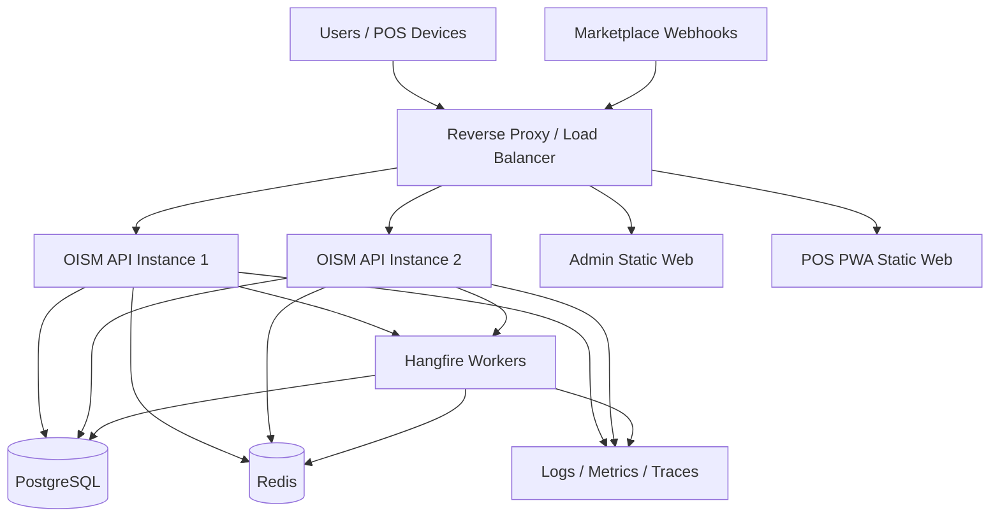

# Kiến trúc triển khai OISM

## 1. Mục tiêu

Triển khai lặp lại được, an toàn, có health check, migration, backup, quan sát và rollback. Gói demo dùng Docker Compose; production có thể triển khai trên nền tảng container orchestration hoặc managed container service.

## 2. Thành phần triển khai

- `oism-api`: ASP.NET Core Web API và SignalR Hub.
- `oism-worker`: Hangfire worker, outbox dispatcher, scheduled jobs.
- `oism-admin`: static React Admin build phục vụ qua web server/CDN.
- `oism-pos`: React PWA build.
- `postgres`: database giao dịch.
- `redis`: distributed cache và hỗ trợ scale-out phù hợp.
- `reverse-proxy`: TLS termination, routing và security headers.
- Observability stack tùy môi trường.

## 3. Sơ đồ triển khai



## 4. Môi trường

- `local`: Docker Compose, seed data và simulator.
- `test`: CI integration tests với container tạm.
- `staging`: gần giống production, dữ liệu giả.
- `production`: HA, backup, TLS, secret manager và monitoring đầy đủ.

Mỗi môi trường có database, Redis, secret và domain riêng. Không dùng production secret ở staging.

## 5. Docker image

Yêu cầu:

- Multi-stage build.
- Base image cố định theo digest hoặc version đã duyệt.
- Chạy non-root.
- Chỉ chứa artifact cần thiết.
- Có health check phù hợp.
- Không chép source, test data hoặc secret vào final image.
- Scan image trong CI.

Ví dụ cấu trúc:

```text
Dockerfile.api
Dockerfile.worker
frontend/admin-web/Dockerfile
frontend/pos-pwa/Dockerfile
docker-compose.yml
.env.example
```

## 6. Docker Compose demo

```yaml
services:
  postgres:
    image: postgres:16
    environment:
      POSTGRES_DB: oism
      POSTGRES_USER: oism
      POSTGRES_PASSWORD: ${POSTGRES_PASSWORD}
    volumes:
      - postgres_data:/var/lib/postgresql/data

  redis:
    image: redis:7-alpine

  api:
    build:
      context: .
      dockerfile: Dockerfile.api
    depends_on:
      - postgres
      - redis
    environment:
      ConnectionStrings__Default: ${DB_CONNECTION}
      Redis__ConnectionString: redis:6379

  worker:
    build:
      context: .
      dockerfile: Dockerfile.worker
    depends_on:
      - postgres
      - redis

  admin:
    build: ./frontend/admin-web

  pos:
    build: ./frontend/pos-pwa

volumes:
  postgres_data:
```

File thực tế cần health-based dependency hoặc startup retry; `depends_on` đơn thuần không đảm bảo database đã sẵn sàng.

## 7. Cấu hình và secret

- Cấu hình không nhạy cảm qua environment variables.
- Secret qua secret manager hoặc CI/CD protected secrets.
- Có `.env.example`, không commit `.env` thật.
- Validate cấu hình khi startup và fail fast nếu thiếu giá trị bắt buộc.
- Rotate JWT/database/webhook secret theo quy trình.

## 8. Database migration

Không cho mọi API instance tự chạy migration đồng thời.

Quy trình:

1. Backup hoặc snapshot theo chính sách.
2. Chạy migration job duy nhất bằng DB role riêng.
3. Xác thực migration thành công.
4. Deploy API/worker tương thích.
5. Chạy smoke test.

Áp dụng expand-and-contract cho thay đổi không downtime:

- Release 1 thêm cột/bảng tương thích ngược.
- Backfill theo batch.
- Release 2 chuyển code sang cấu trúc mới.
- Release sau mới xóa cấu trúc cũ.

Không sửa migration đã chạy ở production.

## 9. CI/CD pipeline

```mermaid
flowchart LR
    C[Commit / Pull Request] --> B[Restore and Build]
    B --> U[Unit Tests]
    U --> I[Integration and Concurrency Tests]
    I --> S[SAST / Dependency / Secret Scan]
    S --> D[Build and Scan Images]
    D --> R[Push Registry]
    R --> ST[Deploy Staging]
    ST --> SM[Smoke / DAST]
    SM --> AP[Approval]
    AP --> PR[Production Deploy]
    PR --> V[Verify and Monitor]
```



Artifact phải bất biến: cùng image digest được promote từ staging sang production.

## 10. Chiến lược release

- Rolling deployment khi thay đổi tương thích.
- Blue-green hoặc canary cho release rủi ro cao.
- API versioning và backward compatibility với frontend đang cache.
- Service Worker phải xử lý version app shell, tránh client chạy bundle cũ không tương thích API.
- Theo dõi error rate, latency, deadlock và outbox backlog sau deploy.

## 11. SignalR và scale-out

Khi có nhiều API instance:

- Load balancer hỗ trợ WebSocket.
- Cân nhắc sticky session theo cấu hình hosting.
- Dùng backplane/managed realtime service khi cần phát sự kiện xuyên instance.
- Reconnect policy phía client có exponential backoff.
- Sự kiện realtime không thay thế query nguồn dữ liệu chuẩn.

## 12. Hangfire

- API chỉ enqueue; worker riêng xử lý job nặng.
- Queue tách theo loại: `critical`, `default`, `reports`.
- Giới hạn concurrency cho job ảnh hưởng cùng tài nguyên.
- Job idempotent và có retry policy.
- Dashboard Hangfire được bảo vệ bằng authorization, không public.
- Theo dõi oldest job age và failure count.

## 13. High availability và mục tiêu 99,5%

Production đề xuất:

- Tối thiểu 2 API instance.
- PostgreSQL managed HA hoặc primary/standby.
- Redis có persistence/replication tùy vai trò và RTO.
- Load balancer health probe.
- Worker có thể scale ngang.
- Static frontend qua CDN/web server dự phòng.

Mục tiêu 99,5% trong 7:00-22:00 tương đương ngân sách gián đoạn khoảng 4,5 phút cho mỗi ngày vận hành 15 giờ, nếu đo theo ngày. Cần thống nhất cửa sổ và chu kỳ đo SLA chính thức.

## 14. Backup và recovery

- Backup PostgreSQL tự động và mã hóa.
- Có point-in-time recovery nếu production yêu cầu.
- Kiểm thử restore định kỳ, không chỉ kiểm tra job backup.
- Lưu cấu hình hạ tầng dưới dạng code.
- Ledger và audit nằm trong chiến lược backup.
- Redis cache có thể rebuild; không coi Redis là bản sao lưu dữ liệu giao dịch.

Cần quy định RPO/RTO chính thức. Giá trị khởi đầu đề xuất cho đồ án demo:

```text
RPO: 15 phút
RTO: 60 phút
```

Đây là mục tiêu đề xuất, phải được stakeholder phê duyệt.

## 15. Network security

- Chỉ reverse proxy/load balancer public.
- PostgreSQL và Redis ở private network.
- Security group/network policy theo least privilege.
- Admin endpoints và observability UI được bảo vệ.
- Egress được giới hạn khi có thể.
- TLS nội bộ được cân nhắc theo môi trường và yêu cầu bảo mật.

## 16. Capacity và scaling

Scale API theo:

- Request rate, CPU, memory, p95 latency.

Scale worker theo:

- Queue length và oldest job age.

Tối ưu database trước khi scale mù quáng:

- Index theo TenantId.
- Connection pooling.
- Query plan và slow query.
- Partition ledger khi cần.
- Read replica chỉ cho báo cáo chấp nhận độ trễ; không dùng cho quyết định reserve.

## 17. Rollback

- Rollback code bằng image digest trước.
- Migration phải backward compatible; tránh migration phá hủy trong cùng release.
- Nếu lỗi dữ liệu, không sửa ledger trực tiếp; dùng quy trình reconciliation/compensation.
- Feature flag có thể tắt integration hoặc tính năng AI mà không tắt lõi bán hàng.

## 18. Kiểm tra sau triển khai

- `/health/live` và `/health/ready` thành công.
- Đăng nhập tenant demo.
- Tìm kiếm/quét SKU.
- Tạo đơn, reserve, confirm và kiểm tra ledger.
- Webhook simulator và idempotency.
- SignalR nhận thông báo.
- Hangfire xử lý job.
- Metrics/log/trace xuất hiện.
- Backup job và cảnh báo hoạt động.

## 19. Tiêu chí chấp nhận

- Pipeline build, test, scan và tạo image tự động.
- Container chạy non-root và không chứa secret.
- Migration chỉ chạy một lần bằng role chuyên biệt.
- Production có tối thiểu hai API instance và health-based routing.
- Restore backup được diễn tập.
- Release có rollback plan và smoke test tự động.
