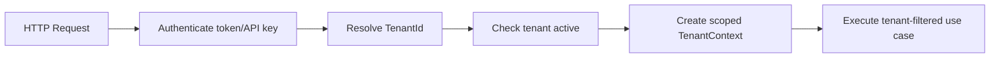

# Kiến trúc SaaS đa khách hàng

## 1. Mục tiêu

Thiết kế OISM theo mô hình **shared database, shared schema, TenantId discriminator**. Mọi dữ liệu nghiệp vụ được cô lập logic theo tenant và được bảo vệ ở nhiều lớp để giảm nguy cơ rò rỉ chéo.

> Nếu yêu cầu cuối cùng là shared database, schema riêng cho từng tenant thì chiến lược migration và vận hành sẽ phức tạp hơn. Với phạm vi đồ án, shared schema + TenantId là lựa chọn mặc định và phù hợp với yêu cầu Global Query Filters.

## 2. Nhận diện tenant

### 2.1 Nguồn nhận diện

- JWT claim `tenant_id` cho người dùng đăng nhập.
- API key hoặc webhook route mapping cho tích hợp sàn.
- Hangfire job argument chứa TenantId và được xác thực lại khi chạy.

Không chấp nhận `TenantId` do client tự gửi trong request body để quyết định phạm vi dữ liệu.

### 2.2 Luồng resolution



Nếu tenant bị vô hiệu hóa, API trả `403 tenant_inactive` và không thực thi nghiệp vụ.

## 3. Mô hình dữ liệu

Mọi bảng nghiệp vụ chứa `TenantId`, ví dụ:

```text
InventoryBalance
- TenantId
- BranchId
- SkuId
- OnHand
- Reserved
- AverageCost
- Version
```

Khóa và unique constraint phải tenant-aware:

```sql
CREATE UNIQUE INDEX ux_sku_tenant_code
ON skus (tenant_id, sku_code);

CREATE UNIQUE INDEX ux_inventory_balance
ON inventory_balances (tenant_id, branch_id, sku_id);

CREATE INDEX ix_ledger_tenant_created
ON inventory_transactions (tenant_id, created_at DESC);
```

Không dùng unique toàn cục cho SKU code vì các tenant có thể dùng cùng mã.

## 4. EF Core Global Query Filters

```csharp
public sealed class OismDbContext : DbContext
{
    private readonly ITenantContext _tenantContext;

    protected override void OnModelCreating(ModelBuilder modelBuilder)
    {
        modelBuilder.Entity<Order>()
            .HasQueryFilter(x => x.TenantId == _tenantContext.TenantId);

        modelBuilder.Entity<InventoryBalance>()
            .HasQueryFilter(x => x.TenantId == _tenantContext.TenantId);
    }
}
```

Yêu cầu bổ sung:

- Entity tenant-aware triển khai `ITenantEntity`.
- `SaveChangesInterceptor` tự gán TenantId khi INSERT.
- Interceptor từ chối UPDATE nếu TenantId entity khác context.
- Việc dùng `IgnoreQueryFilters()` bị giới hạn trong Infrastructure và phải có security review.
- Raw SQL luôn truyền TenantId bằng parameter.

## 5. Kiểm soát ghi dữ liệu

Pseudo rule trước khi lưu:

```text
For each Added entity implementing ITenantEntity:
    entity.TenantId = CurrentTenantId

For each Modified/Deleted tenant entity:
    if entity.TenantId != CurrentTenantId:
        reject and audit
```

Các bảng nền tảng dùng chung như `SystemMigration` có thể không có TenantId, nhưng phải được liệt kê rõ trong allow-list.

## 6. RBAC trong phạm vi tenant

Vai trò mặc định:

- `Owner`: toàn quyền trong tenant.
- `Staff`: quản lý sản phẩm, kho và đơn hàng theo quyền được cấp.
- `Cashier`: sử dụng POS tại chi nhánh được gán.

Một người dùng thuộc tenant A không thể được gán quyền tới tài nguyên tenant B. Nếu hỗ trợ người dùng đa tenant trong tương lai, phải dùng bảng membership và phát token theo tenant đang chọn.

## 7. Cô lập theo chi nhánh

Tenant isolation và branch authorization là hai lớp khác nhau:

- Tenant filter giới hạn toàn bộ dữ liệu của doanh nghiệp.
- Branch permission giới hạn nhân viên vào các chi nhánh được phân công.

Application policy phải kiểm tra `BranchId` của command thuộc tenant và nằm trong danh sách được cấp quyền.

## 8. Tác vụ nền và realtime

### Hangfire

- Job payload phải có `TenantId`.
- Worker tạo `TenantExecutionScope` trước khi truy vấn.
- Job không được dùng tenant context của request đã tạo job.
- Recurring job toàn hệ thống chỉ liệt kê tenant đang hoạt động, sau đó chạy từng tenant riêng biệt.

### SignalR

Nhóm kết nối:

```text
tenant:{tenantId}
tenant:{tenantId}:branch:{branchId}
tenant:{tenantId}:role:{role}
```

Server tự tạo group name từ claim đã xác thực; client không được tự chọn tenant group.

## 9. Webhook đa tenant

Định danh tenant bằng một trong các cách:

- Endpoint key: `/webhooks/{channel}/{connectionKey}`.
- API key ánh xạ tới `TenantChannelConnection`.
- Chữ ký webhook và connection mapping.

Các khóa idempotency phải gồm tenant:

```text
(TenantId, Channel, ExternalEventId)
(TenantId, Channel, ExternalOrderId)
```

## 10. Cache đa tenant

Mọi cache key phải namespace theo tenant:

```text
oism:{environment}:tenant:{tenantId}:catalog:sku:{skuId}
oism:{environment}:tenant:{tenantId}:branch:{branchId}:settings
```

Không cache dữ liệu tenant bằng key chỉ chứa `SkuId` hoặc `Email`.

## 11. Bảo vệ ở lớp cơ sở dữ liệu

Khuyến nghị production:

- Tách database user cho migration và runtime.
- Runtime user không có quyền UPDATE/DELETE ledger.
- Có thể bổ sung PostgreSQL Row-Level Security như một lớp phòng thủ, nhưng không thay thế Global Query Filters.
- Backup được mã hóa và quyền restore giới hạn.

Ví dụ policy RLS khi triển khai nâng cao:

```sql
ALTER TABLE orders ENABLE ROW LEVEL SECURITY;
CREATE POLICY tenant_isolation_orders ON orders
USING (tenant_id = current_setting('app.tenant_id')::uuid);
```

Nếu dùng RLS, mỗi transaction phải đặt `SET LOCAL app.tenant_id` và integration test connection pooling cẩn thận.

## 12. Chỉ mục và phân vùng

Chỉ mục ưu tiên:

- `(TenantId, CreatedAt)` cho Order và Ledger.
- `(TenantId, BranchId, SkuId)` cho InventoryBalance.
- `(TenantId, Status, CreatedAt)` cho xử lý đơn.
- `(TenantId, ExternalOrderId, Channel)` unique cho chống trùng.

Khi ledger đạt hàng triệu dòng, cân nhắc partition theo thời gian; mọi partition vẫn phải giữ TenantId trong index.

## 13. Kiểm thử cô lập dữ liệu

Bộ test bắt buộc:

1. Tenant A không đọc được Order của tenant B.
2. Tenant A không sửa/xóa entity tenant B khi biết ID.
3. Raw SQL không trả dữ liệu chéo.
4. Cache key không xung đột.
5. SignalR không phát chéo group.
6. Hangfire job chạy đúng tenant.
7. Export/report không trộn dữ liệu.
8. Webhook key tenant A không tạo đơn cho tenant B.

## 14. Onboarding và offboarding tenant

### Onboarding

1. Tạo Tenant và TenantId.
2. Tạo Owner đầu tiên.
3. Tạo chi nhánh/kho mặc định.
4. Tạo role và policy mặc định.
5. Seed settings, numbering sequences và notification rules.
6. Ghi audit event `TenantCreated`.

### Offboarding

- Chuyển tenant sang `Suspended` trước khi xóa.
- Thu hồi token và API key.
- Xuất dữ liệu nếu có yêu cầu.
- Áp dụng retention policy.
- Không xóa ledger tùy tiện; cần quy trình quản trị và pháp lý riêng.

## 15. Tiêu chí chấp nhận

- 100% bảng nghiệp vụ nằm trong danh sách tenant-aware.
- Không có endpoint nhận TenantId từ body để định phạm vi truy cập.
- Tất cả unique key nghiệp vụ đều gồm TenantId.
- Test rò rỉ dữ liệu chéo chạy trong CI.
- Log và metric có TenantId nhưng không chứa secret hoặc dữ liệu nhạy cảm không cần thiết.
