# OISM – Tài liệu tổng hợp toàn bộ 14 EP

> Bản hợp nhất từ bộ tài liệu nguồn được cung cấp. Bao gồm nội dung của toàn bộ 158 file Markdown; các hình ảnh, sơ đồ PNG, file Draw.io, SQL, JSON và tài liệu nguồn được giữ trong thư mục `doc/` đi kèm gói ZIP.

## Mục lục

- [EP01](#ep01)
- [EP02](#ep02)
- [EP03](#ep03)
- [EP04](#ep04)
- [EP05 – Thiết kế hệ thống và thiết kế cơ sở dữ liệu](#ep05)
- [EP06](#ep06)
- [EP07 – Database Design](#ep07)
- [EP08 – UI/UX Design](#ep08)
- [EP09](#ep09)
- [EP10](#ep10)
- [EP11](#ep11)
- [EP12](#ep12)
- [EP13](#ep13)
- [EP14 – AI Reordering](#ep14)
- [Phụ lục: Danh mục hình ảnh và sơ đồ](#phụ-lục-danh-mục-hình-ảnh-và-sơ-đồ)
- [Phụ lục: Danh mục tài liệu nguồn](#phụ-lục-danh-mục-tài-liệu-nguồn)

---


<a id="ep01"></a>
# EP01

> Số tài liệu Markdown trong nhóm: **6**.


---

## acceptance-criteria.md

<sub>Nguồn: `doc/EP01/acceptance-criteria.md`</sub>


# EP01 — Đặc tả chủ đề: Hệ thống quản lý kho

## 1. Thông tin chung

| Thuộc tính | Nội dung |
|---|---|
| Mã Epic | EP01 |
| Tên Epic | Đặc tả chủ đề — Hệ thống quản lý kho |
| Tên đề tài | Thiết kế hệ thống quản lý kho (Warehouse Management System — WMS) |
| Trạng thái | Bản nháp để nhóm rà soát và thống nhất |
| Đối tượng sử dụng tài liệu | Giảng viên, nhóm dự án, người phân tích nghiệp vụ, người thiết kế hệ thống |

## 2. Tổng quan đề tài

Đề tài tập trung khảo sát, phân tích và thiết kế một hệ thống hỗ trợ quản lý các hoạt động cơ bản trong kho hàng. Hệ thống hướng đến việc tập trung hóa thông tin hàng hóa, vị trí lưu trữ, nhập kho, xuất kho và số lượng tồn kho, giúp người phụ trách tra cứu dữ liệu và theo dõi biến động hàng hóa có hệ thống hơn.

Trong phạm vi bài tập, nhóm ưu tiên làm rõ nghiệp vụ, tác nhân, dữ liệu, quy trình và yêu cầu của hệ thống trước khi quyết định mức độ hiện thực hóa. Tài liệu này không mặc định rằng hệ thống đã được lập trình, đã kết nối thiết bị quét mã vạch hoặc đã tích hợp với phần mềm bên ngoài.

## 3. Vấn đề cần giải quyết

Ở quy trình quản lý kho thủ công hoặc sử dụng các bảng dữ liệu rời rạc, thông tin nhập — xuất — tồn có thể bị phân tán, cập nhật chậm hoặc khó đối chiếu. Việc tìm kiếm một mặt hàng, xác định lượng tồn khả dụng hay truy lại lịch sử giao dịch có thể mất thời gian. Khi không có quy trình ghi nhận thống nhất, số liệu thực tế và số liệu trên hồ sơ cũng có nguy cơ chênh lệch.

Hệ thống được đề xuất nhằm tạo một nguồn thông tin thống nhất, quy định rõ cách ghi nhận giao dịch và hỗ trợ kiểm tra tính hợp lệ của dữ liệu.

## 4. Mục tiêu

- Quản lý danh mục hàng hóa với mã hàng và các thuộc tính cần thiết.
- Ghi nhận và tra cứu nghiệp vụ nhập kho, xuất kho.
- Theo dõi số lượng tồn theo từng mặt hàng; hỗ trợ xem lịch sử biến động.
- Quản lý thông tin nhà cung cấp và các thông tin liên quan ở mức phù hợp với phạm vi bài tập.
- Hỗ trợ người dùng tìm kiếm, lọc và xem báo cáo tồn kho cơ bản.
- Xác định rõ quyền hạn, dữ liệu đầu vào, kết quả đầu ra và điều kiện hợp lệ của các nghiệp vụ.

## 5. Đối tượng sử dụng và vai trò

### 5.1. Quản trị viên

Quản lý tài khoản và phân quyền trong phạm vi hệ thống; cấu hình các danh mục hoặc thông tin dùng chung nếu được xác định trong thiết kế.

### 5.2. Nhân viên kho

Tra cứu hàng hóa; lập hoặc cập nhật phiếu nhập, phiếu xuất theo quyền được cấp; kiểm tra số lượng và theo dõi trạng thái xử lý giao dịch.

### 5.3. Người quản lý kho

Theo dõi tổng quan tình hình nhập — xuất — tồn, kiểm tra các giao dịch, xem báo cáo và hỗ trợ xử lý các trường hợp cần xác minh.

### 5.4. Bộ phận liên quan

Có thể cung cấp yêu cầu nhập hoặc xuất, thông tin nhà cung cấp hay thông tin chứng từ. Việc cấp tài khoản trực tiếp cho các bộ phận này chỉ thực hiện nếu nhóm thống nhất đưa vào phạm vi.

> Các vai trò trên là đề xuất ban đầu. Nhóm cần thống nhất tên gọi và quyền chi tiết trước khi hoàn thiện sơ đồ chức năng, DFD, ERD hoặc thiết kế giao diện.

## 6. Phạm vi hệ thống

### 6.1. Trong phạm vi đề tài

- Quản lý danh mục hàng hóa.
- Quản lý danh mục nhà cung cấp ở mức cơ bản.
- Ghi nhận phiếu nhập và chi tiết hàng nhập.
- Ghi nhận phiếu xuất và chi tiết hàng xuất.
- Cập nhật hoặc tính toán số lượng tồn theo quy tắc được nhóm chọn.
- Tìm kiếm hàng hóa và tra cứu lịch sử giao dịch.
- Xem báo cáo tổng hợp nhập — xuất — tồn cơ bản.
- Kiểm tra dữ liệu bắt buộc và ngăn các giao dịch không hợp lệ, ví dụ xuất vượt số lượng tồn khả dụng.
- Phân tích quy trình, tác nhân, dữ liệu và yêu cầu; xây dựng tài liệu thiết kế tương ứng.

### 6.2. Ngoài phạm vi mặc định

Các nội dung dưới đây chỉ được thực hiện nếu giảng viên yêu cầu hoặc nhóm chủ động thống nhất mở rộng:

- Tối ưu vị trí lưu kho nâng cao hoặc lập kế hoạch sắp xếp hàng tự động.
- Theo dõi lô, hạn sử dụng, serial hoặc truy xuất nguồn gốc chuyên sâu.
- Tích hợp máy quét mã vạch/RFID, cân điện tử hoặc thiết bị IoT.
- Đồng bộ với ERP, kế toán, thương mại điện tử hay đơn vị vận chuyển.
- Quản lý vận tải, giao hàng chặng cuối, thanh toán hoặc mua hàng đầy đủ.
- Dự báo nhu cầu bằng AI hoặc tối ưu tồn kho bằng thuật toán nâng cao.
- Triển khai production, đảm bảo tải lớn hoặc cam kết an toàn vận hành thực tế.

## 7. Quy trình nghiệp vụ mức khái quát

### 7.1. Quản lý danh mục hàng hóa

1. Người có quyền mở chức năng danh mục hàng hóa.
2. Tạo mới hoặc cập nhật thông tin hàng hóa theo các trường được quy định.
3. Hệ thống kiểm tra trường bắt buộc và tính duy nhất của mã hàng.
4. Nếu hợp lệ, hệ thống lưu dữ liệu và hiển thị kết quả; nếu không hợp lệ, thông báo nội dung cần sửa.

### 7.2. Nhập kho

1. Nhân viên tạo phiếu nhập và chọn nhà cung cấp hoặc nguồn nhập phù hợp.
2. Nhân viên thêm hàng hóa, số lượng và thông tin chứng từ cần thiết.
3. Hệ thống kiểm tra dữ liệu và tính hợp lệ của các dòng hàng.
4. Người có quyền xác nhận phiếu theo quy trình do nhóm định nghĩa.
5. Khi phiếu được xác nhận, số lượng tồn được cập nhật theo quy tắc thống nhất và giao dịch được lưu để tra cứu.

### 7.3. Xuất kho

1. Nhân viên tạo phiếu xuất, chọn hàng hóa và nhập số lượng cần xuất.
2. Hệ thống kiểm tra hàng hóa có tồn tại, số lượng có hợp lệ và tồn khả dụng có đủ hay không.
3. Nếu hợp lệ, phiếu được xử lý theo trạng thái được quy định; khi xác nhận xuất, số lượng tồn giảm tương ứng.
4. Nếu không hợp lệ, hệ thống từ chối bước xác nhận và hiển thị lý do.
5. Giao dịch được lưu để người có quyền tra cứu.

### 7.4. Tra cứu và báo cáo

Người dùng chọn tiêu chí tìm kiếm hoặc khoảng thời gian; hệ thống trả về danh sách dữ liệu phù hợp. Báo cáo phải nêu rõ phạm vi thời gian, đơn vị tính và thời điểm dữ liệu được tổng hợp nếu các thông tin này có ý nghĩa đối với cách hiểu số liệu.

## 8. Yêu cầu chức năng sơ bộ

| Mã | Yêu cầu | Mô tả |
|---|---|---|
| FR-01 | Quản lý hàng hóa | Thêm, xem, sửa và tìm kiếm thông tin hàng hóa theo quyền. |
| FR-02 | Quản lý nhà cung cấp | Lưu và tra cứu thông tin nhà cung cấp cơ bản. |
| FR-03 | Lập phiếu nhập | Tạo phiếu nhập gồm thông tin chung và các dòng hàng. |
| FR-04 | Xác nhận nhập | Kiểm tra dữ liệu và ghi nhận nhập kho theo trạng thái hợp lệ. |
| FR-05 | Lập phiếu xuất | Tạo phiếu xuất gồm thông tin chung và các dòng hàng. |
| FR-06 | Kiểm tra tồn khi xuất | Không cho xác nhận giao dịch xuất vượt tồn khả dụng. |
| FR-07 | Theo dõi tồn kho | Hiển thị lượng tồn của từng mặt hàng theo quy tắc tính được thống nhất. |
| FR-08 | Tra cứu giao dịch | Tìm phiếu nhập/xuất theo mã, thời gian hoặc tiêu chí được hỗ trợ. |
| FR-09 | Báo cáo cơ bản | Tổng hợp nhập — xuất — tồn theo kỳ hoặc theo mặt hàng. |
| FR-10 | Phân quyền | Giới hạn chức năng theo vai trò người dùng. |
| FR-11 | Kiểm tra dữ liệu | Thông báo khi thiếu dữ liệu bắt buộc hoặc dữ liệu không hợp lệ. |

Danh sách trên là yêu cầu sơ bộ, chưa thay thế đặc tả chi tiết từng chức năng hoặc tiêu chí nghiệm thu cho từng User Story.

## 9. Yêu cầu phi chức năng sơ bộ

- **Tính chính xác dữ liệu:** các thay đổi tồn kho phải dựa trên giao dịch hợp lệ; không tự ý ghi nhận giao dịch chưa được xác nhận.
- **Tính nhất quán:** thống nhất mã hàng, đơn vị tính, trạng thái phiếu và quy tắc cập nhật tồn.
- **Tính dễ sử dụng:** tên chức năng rõ ràng; thông báo lỗi chỉ ra cách khắc phục ở mức phù hợp.
- **Phân quyền:** người dùng chỉ truy cập các chức năng và dữ liệu phù hợp vai trò.
- **Khả năng truy vết:** thông tin giao dịch đủ để xác định loại nghiệp vụ, mặt hàng, số lượng và thời điểm ghi nhận trong phạm vi dữ liệu được thiết kế.
- **Khả năng bảo trì:** tài liệu, mô hình và tên gọi được tổ chức nhất quán để dễ cập nhật.

Các chỉ số định lượng như thời gian phản hồi, số lượng người dùng đồng thời hoặc thời gian sao lưu cần được xác định riêng nếu đề tài yêu cầu kiểm thử kỹ thuật.

## 10. Quy tắc nghiệp vụ ban đầu

- Mỗi hàng hóa có một mã hàng duy nhất.
- Các trường bắt buộc phải được nhập trước khi lưu hoặc xác nhận giao dịch.
- Số lượng trên dòng phiếu phải là số dương và theo đơn vị tính đã xác định.
- Chỉ giao dịch nhập/xuất được xác nhận mới tác động đến tồn kho.
- Không xác nhận xuất kho nếu số lượng xuất lớn hơn số lượng tồn khả dụng.
- Việc sửa hoặc hủy giao dịch đã xác nhận phải được kiểm soát và có cách điều chỉnh tồn rõ ràng; không xóa dữ liệu lịch sử một cách tùy tiện.
- Báo cáo nhập — xuất — tồn phải sử dụng cùng quy tắc tính tồn trong toàn hệ thống.

## 11. Giả định và phụ thuộc

- Đề tài được thực hiện như một dự án học phần; các chức năng được phân tích, thiết kế theo phạm vi giảng viên giao.
- Nhóm sẽ thống nhất cách tính tồn, vòng đời phiếu và vai trò có quyền xác nhận trước khi hoàn thiện mô hình.
- Dữ liệu minh họa có thể được tạo giả lập để trình bày luồng nghiệp vụ.
- Tích hợp bên ngoài và thiết bị chuyên dụng không được giả định là sẵn có.

---

## business-context.md

<sub>Nguồn: `doc/EP01/business-context.md`</sub>


# EP01 — Bối cảnh nghiệp vụ

## 1. Mục đích tài liệu

Tài liệu mô tả bối cảnh hoạt động của kho, các vấn đề nghiệp vụ cần giải quyết và các bên liên quan. Đây là cơ sở để nhóm xác định phạm vi hệ thống, tác nhân, quy trình và yêu cầu chức năng.

## 2. Bối cảnh hoạt động

Kho là nơi tiếp nhận, lưu giữ và xuất hàng theo yêu cầu. Để vận hành ổn định, đơn vị quản lý cần biết hàng nào đang được quản lý, số lượng hiện có, lịch sử hàng đi vào/đi ra và các giao dịch nào còn chờ xử lý. Thông tin này có thể đến từ nhân viên kho, người quản lý, nhà cung cấp hoặc bộ phận yêu cầu xuất hàng.

Trong mô hình học tập, nhóm sử dụng một kịch bản kho tổng quát. Kịch bản có thể được điều chỉnh để phù hợp ví dụ cụ thể do giảng viên yêu cầu, nhưng các thuật ngữ và quy tắc phải thống nhất xuyên suốt tài liệu.

## 3. Quy trình hiện tại giả định

Vì nhóm chưa cung cấp dữ liệu khảo sát tại một doanh nghiệp cụ thể, quy trình hiện tại dưới đây được xem là **kịch bản giả định để phân tích**, không phải kết luận khảo sát thực tế:

- Thông tin hàng hóa được lưu trong danh sách hoặc bảng dữ liệu.
- Khi hàng đến, nhân viên kiểm tra thông tin và ghi lại số lượng nhận.
- Khi cần xuất hàng, nhân viên kiểm tra số lượng hiện có rồi ghi nhận lượng xuất.
- Người quản lý tổng hợp số liệu nhập — xuất — tồn bằng cách đối chiếu các bản ghi.
- Khi cần tra cứu lịch sử, người dùng tìm theo mã hàng, số phiếu hoặc khoảng thời gian nếu dữ liệu có sẵn.

## 4. Các khó khăn nghiệp vụ có thể gặp

### 4.1. Dữ liệu phân tán

Danh mục hàng hóa và giao dịch có thể nằm ở nhiều bảng hoặc nhiều nơi, khiến việc tra cứu và đối chiếu mất thời gian.

### 4.2. Cập nhật tồn chưa đồng bộ

Nếu nghiệp vụ nhập/xuất không được ghi nhận theo cùng một quy trình, số tồn hiển thị có thể không khớp với các giao dịch đã phát sinh.

### 4.3. Thiếu kiểm soát khi xuất hàng

Nếu không kiểm tra số lượng tồn khả dụng trước khi xác nhận xuất, có nguy cơ ghi nhận lượng xuất vượt quá lượng hiện có.

### 4.4. Khó truy vết

Nếu phiếu không lưu đủ thông tin về mặt hàng, số lượng, thời điểm và người thực hiện (nếu phạm vi yêu cầu), việc giải thích chênh lệch trở nên khó khăn.

### 4.5. Báo cáo tốn công tổng hợp

Người quản lý có thể phải cộng, lọc và đối chiếu dữ liệu thủ công để có báo cáo theo kỳ hoặc theo mặt hàng.

## 5. Các bên liên quan

| Bên liên quan | Mối quan tâm chính | Thông tin hoặc thao tác liên quan |
|---|---|---|
| Nhân viên kho | Ghi nhận giao dịch nhanh và đúng | Danh mục hàng, phiếu nhập, phiếu xuất, tồn kho |
| Quản lý kho | Theo dõi tình hình và kiểm soát giao dịch | Báo cáo, lịch sử giao dịch, kiểm tra số tồn |
| Quản trị viên | Quản lý quyền truy cập và dữ liệu dùng chung | Tài khoản, vai trò, danh mục cấu hình |
| Nhà cung cấp | Cung cấp hàng và thông tin chứng từ | Thông tin nhà cung cấp, tham chiếu phiếu nhập |
| Bộ phận yêu cầu xuất | Gửi yêu cầu và nhận hàng theo quy trình | Thông tin yêu cầu xuất hoặc chứng từ liên quan |
| Nhóm dự án/giảng viên | Đảm bảo đúng phạm vi và cấu trúc báo cáo | Đặc tả, sơ đồ, mô hình dữ liệu, tiêu chí nghiệm thu |

Các bên ngoài có thể chỉ là nguồn thông tin nghiệp vụ; không nhất thiết phải là người dùng trực tiếp của phần mềm.

## 6. Nhu cầu nghiệp vụ

- Có một danh mục hàng hóa thống nhất, mã hàng không trùng lặp.
- Mỗi phiếu nhập/xuất có mã nhận diện và các dòng hàng cụ thể.
- Có quy tắc rõ ràng về thời điểm giao dịch được tính vào tồn kho.
- Tra cứu được số lượng tồn và lịch sử biến động của hàng hóa.
- Kiểm soát giao dịch không hợp lệ trước khi xác nhận.
- Người quản lý xem được báo cáo nhập — xuất — tồn với phạm vi tổng hợp rõ ràng.
- Phân biệt được quyền xem, lập và xác nhận giao dịch nếu nhóm thiết kế luồng phê duyệt.

## 7. Ranh giới hệ thống và tương tác bên ngoài

### Dữ liệu có thể đi vào hệ thống

- Thông tin hàng hóa và đơn vị tính.
- Thông tin nhà cung cấp hoặc nguồn nhập.
- Yêu cầu/thông tin phiếu nhập và phiếu xuất.
- Tiêu chí tìm kiếm, lọc và kỳ báo cáo.
- Thông tin người dùng và vai trò theo phạm vi thiết kế.

### Thông tin có thể đi ra khỏi hệ thống

- Kết quả tra cứu hàng hóa.
- Mã phiếu và trạng thái xử lý.
- Thông báo dữ liệu hợp lệ hoặc lỗi.
- Tình hình tồn kho và lịch sử giao dịch.
- Báo cáo nhập — xuất — tồn.

Nhóm nên dùng cùng tập tác nhân và tên dữ liệu khi xây dựng sơ đồ ngữ cảnh, DFD mức 0, DFD mức 1 và mô hình dữ liệu.

## 8. Chỉ số thành công ở mức nghiệp vụ

- Người dùng tra cứu được hàng hóa theo mã hoặc tiêu chí được hỗ trợ.
- Mỗi giao dịch nhập/xuất đã xác nhận có thông tin đủ để kiểm tra lại.
- Tồn kho được tính nhất quán theo quy tắc đã thống nhất.
- Hệ thống không xác nhận giao dịch xuất vượt tồn khả dụng.
- Báo cáo tổng hợp có thể đối chiếu với dữ liệu giao dịch dùng để tạo báo cáo.
- Tài liệu phân tích thể hiện được tác nhân, luồng dữ liệu, dữ liệu lưu trữ và quy tắc nghiệp vụ chính.

## 9. Giả định, giới hạn và điểm cần xác minh

- Chưa có khảo sát doanh nghiệp thực tế; các vấn đề mô tả ở trên là giả định phân tích.
- Chưa quy định cụ thể về nhiều kho, vị trí kệ, lô hàng, hạn sử dụng hay hàng lỗi.
- Chưa xác định chính sách kiểm kê và điều chỉnh tồn; nếu đưa vào phạm vi, cần đặc tả riêng.
- Chưa xác định có yêu cầu tích hợp hệ thống ngoài hay không.
- Quy trình duyệt phiếu sẽ được thống nhất trước khi hoàn tất sơ đồ nghiệp vụ.

## 10. Kết luận

Bối cảnh nghiệp vụ cho thấy hệ thống cần tập trung hóa danh mục và giao dịch kho, duy trì số liệu tồn nhất quán, hỗ trợ truy vết và tạo báo cáo cơ bản. Các quyết định về phạm vi nâng cao phải được ghi nhận rõ để tránh mở rộng ngoài khả năng của dự án học phần.

---

## expected-products.md

<sub>Nguồn: `doc/EP01/expected-products.md`</sub>


# EP01 — Giải pháp đề xuất

## 1. Mục đích

Tài liệu trình bày hướng giải quyết các vấn đề nghiệp vụ được xác định trong `business-context.md`. Giải pháp được mô tả ở mức khái niệm để làm cơ sở cho việc phân tích và thiết kế; chưa mặc định về ngôn ngữ lập trình, nền tảng triển khai hoặc công nghệ cụ thể.

## 2. Định hướng giải pháp

Xây dựng một hệ thống quản lý kho tập trung, trong đó danh mục hàng hóa và các giao dịch nhập/xuất được quản lý theo một bộ quy tắc thống nhất. Số lượng tồn được cập nhật hoặc tính toán dựa trên các giao dịch hợp lệ đã xác nhận. Người dùng được phân quyền theo vai trò và có thể tìm kiếm dữ liệu, xem lịch sử hoặc báo cáo trong phạm vi được cấp.

## 3. Các phân hệ đề xuất

### 3.1. Quản lý danh mục hàng hóa

Chức năng:
- Tạo mới, xem, chỉnh sửa và tìm kiếm hàng hóa.
- Lưu mã hàng, tên hàng, đơn vị tính và các thuộc tính được nhóm thống nhất.
- Kiểm tra mã hàng không trùng và dữ liệu bắt buộc không bị bỏ trống.

Đầu vào: thông tin hàng hóa và thao tác của người dùng.

Đầu ra: bản ghi được lưu hoặc thông báo lỗi/không hợp lệ.

### 3.2. Quản lý nhà cung cấp

Chức năng:
- Lưu thông tin nhà cung cấp ở mức cơ bản.
- Cho phép tra cứu để tham chiếu trong phiếu nhập.
- Hạn chế xóa hoặc làm mất liên kết tới nhà cung cấp đã được sử dụng trong giao dịch lịch sử.

### 3.3. Quản lý phiếu nhập

Chức năng:
- Tạo phiếu nhập với mã phiếu, ngày ghi nhận, nguồn nhập/nhà cung cấp và danh sách dòng hàng.
- Kiểm tra hàng hóa, đơn vị tính và số lượng nhập.
- Quản lý trạng thái, ví dụ: Nháp, Đã xác nhận, Đã hủy. Tên và số trạng thái cuối cùng cần do nhóm chốt.
- Chỉ cập nhật tồn kho theo chính sách khi phiếu đạt trạng thái được tính là giao dịch hợp lệ.

### 3.4. Quản lý phiếu xuất

Chức năng:
- Tạo phiếu xuất và thêm các mặt hàng cần xuất.
- Kiểm tra số lượng xuất là số dương và không vượt quá tồn khả dụng.
- Quản lý trạng thái xử lý của phiếu.
- Cập nhật tồn kho khi giao dịch được xác nhận theo đúng quy tắc.

### 3.5. Theo dõi tồn kho

Chức năng:
- Hiển thị số lượng tồn theo hàng hóa.
- Cung cấp cách xem lịch sử tăng/giảm do giao dịch nhập/xuất.
- Sử dụng một công thức nhất quán. Mô hình đơn giản có thể tính: **Tồn cuối = Tồn đầu + Tổng lượng nhập hợp lệ − Tổng lượng xuất hợp lệ ± Điều chỉnh tồn hợp lệ**. Nếu nhóm không triển khai kiểm kê/điều chỉnh tồn, bỏ thành phần điều chỉnh khỏi phạm vi.
- Tránh cập nhật tồn hai lần cho cùng một phiếu hoặc tính cả phiếu chưa được xác nhận.

### 3.6. Tra cứu và báo cáo

Chức năng:
- Tìm kiếm theo mã hàng, tên hàng, mã phiếu hoặc khoảng thời gian tùy dữ liệu có sẵn.
- Hiển thị kết quả theo tiêu chí lọc và cho biết khi không có dữ liệu phù hợp.
- Tổng hợp nhập — xuất — tồn theo mặt hàng hoặc kỳ báo cáo cơ bản.
- Đảm bảo báo cáo sử dụng cùng nguồn dữ liệu và quy tắc tính tồn với màn hình tra cứu.

### 3.7. Tài khoản và phân quyền

Chức năng ở mức sơ bộ:
- Xác định người dùng và vai trò.
- Giới hạn thao tác tạo, sửa, xác nhận hoặc xem báo cáo theo vai trò.
- Nếu xác thực tài khoản nằm ngoài phạm vi bài tập, nhóm vẫn mô tả ranh giới và giả định thay vì tuyên bố đã hiện thực hóa chức năng.

## 4. Luồng xử lý tổng quát

### 4.1. Luồng nhập kho

1. Người dùng chọn chức năng lập phiếu nhập.
2. Nhập thông tin chung và danh sách hàng hóa/số lượng.
3. Hệ thống xác thực trường bắt buộc, hàng hóa và số lượng.
4. Phiếu được lưu ở trạng thái ban đầu.
5. Người có quyền xác nhận phiếu.
6. Hệ thống ghi nhận giao dịch và cập nhật/tính lại tồn kho theo quy tắc.
7. Hệ thống hiển thị kết quả, mã phiếu và trạng thái.

Ngoại lệ: thiếu trường bắt buộc, mã hàng không tồn tại, số lượng không hợp lệ hoặc người dùng không có quyền.

### 4.2. Luồng xuất kho

1. Người dùng lập phiếu xuất và chọn mặt hàng.
2. Nhập số lượng cần xuất.
3. Hệ thống kiểm tra dữ liệu và tồn khả dụng.
4. Nếu tồn không đủ, hệ thống không cho xác nhận và giải thích lý do.
5. Nếu hợp lệ, người có quyền xác nhận phiếu.
6. Hệ thống ghi nhận giao dịch và giảm tồn theo quy tắc.
7. Hệ thống lưu lịch sử và hiển thị kết quả.

Ngoại lệ: mặt hàng không hợp lệ, thiếu số lượng, tồn không đủ, phiếu đã xử lý hoặc người dùng không có quyền.

## 5. Quy tắc thiết kế cần tuân thủ

- Mỗi mã hàng là duy nhất.
- Không dùng một trường dữ liệu với nhiều ý nghĩa khác nhau.
- Phân biệt dữ liệu danh mục (hàng hóa, nhà cung cấp, tài khoản) với dữ liệu giao dịch (phiếu nhập/xuất và dòng phiếu).
- Mỗi dòng phiếu cần liên kết được với phiếu cha và hàng hóa tương ứng.
- Tồn kho phải được xác định bằng một quy tắc thống nhất, không nhập số tồn tùy tiện vào nhiều nơi mà không có cơ chế đối chiếu.
- Giao dịch đã xác nhận cần được kiểm soát khi sửa/hủy để tránh sai lệch tồn kho.
- Tên gọi trong tài liệu, sơ đồ, bảng dữ liệu và giao diện cần thống nhất.

## 6. Dữ liệu khái niệm dự kiến

Các thực thể ứng viên cho mô hình dữ liệu:

- **Hàng hóa:** mã hàng, tên hàng, đơn vị tính và thuộc tính mô tả.
- **Nhà cung cấp:** mã nhà cung cấp, tên và thông tin liên hệ phù hợp phạm vi.
- **Phiếu nhập:** mã phiếu, ngày, trạng thái, nguồn nhập và thông tin người lập/xác nhận nếu cần.
- **Chi tiết phiếu nhập:** phiếu nhập, hàng hóa, số lượng và đơn vị tính.
- **Phiếu xuất:** mã phiếu, ngày, trạng thái và thông tin người liên quan.
- **Chi tiết phiếu xuất:** phiếu xuất, hàng hóa, số lượng và đơn vị tính.
- **Người dùng/Vai trò:** tài khoản và quyền hạn nếu chức năng phân quyền được mô hình hóa.
- **Giao dịch tồn kho:** chỉ cần thiết nếu nhóm lựa chọn thiết kế sổ giao dịch riêng để truy vết.

Đây là danh sách ứng viên, không phải ERD cuối cùng. Trước khi vẽ ERD, nhóm phải quyết định cách quản lý trạng thái, lịch sử và số dư tồn để tránh lưu trùng dữ liệu.

---

## expected-results.md

<sub>Nguồn: `doc/EP01/expected-results.md`</sub>


# EP01 — Kết quả kỳ vọng

## 1. Mục đích

Tài liệu mô tả những thay đổi và giá trị mà nhóm kỳ vọng đạt được khi hoàn thành phân tích, thiết kế hoặc nguyên mẫu của hệ thống quản lý kho. **Kết quả kỳ vọng** nói về lợi ích và trạng thái đạt được, khác với **sản phẩm bàn giao** là tài liệu hoặc hiện vật cụ thể.

## 2. Kết quả đối với nghiệp vụ

### 2.1. Dữ liệu dễ quản lý hơn

Thông tin hàng hóa, nhà cung cấp và giao dịch được tổ chức theo cấu trúc nhất quán, giúp giảm sự phụ thuộc vào các bảng dữ liệu rời rạc trong kịch bản giả định.

### 2.2. Theo dõi nhập — xuất — tồn rõ ràng

Có quy trình xác định thời điểm phiếu nhập/xuất tác động đến số lượng tồn. Người dùng có thể giải thích số tồn bằng dữ liệu giao dịch theo quy tắc đã thống nhất.

### 2.3. Giảm giao dịch không hợp lệ

Các trường hợp thiếu dữ liệu bắt buộc, số lượng không hợp lệ hoặc xuất vượt tồn khả dụng được kiểm tra trước khi xác nhận.

### 2.4. Tra cứu và tổng hợp thuận tiện

Người dùng có thể tìm hàng hóa, tra cứu phiếu và xem báo cáo tổng hợp trong phạm vi chức năng đã xác định.

### 2.5. Vai trò và trách nhiệm rõ hơn

Các vai trò có thao tác và quyền hạn được mô tả rõ, giúp nhóm tránh việc mọi người dùng đều có thể thực hiện mọi hành động trong mô hình.

## 3. Kết quả đối với dự án học phần

- Nhóm có một định nghĩa phạm vi dùng chung để chia việc và theo dõi tiến độ.
- Mô hình nghiệp vụ và dữ liệu thống nhất với yêu cầu đã ghi nhận.
- Các quyết định chưa rõ được ghi thành câu hỏi mở, giả định hoặc rủi ro thay vì âm thầm tự quyết.
- Các phần việc có đầu ra kiểm tra được và có tiêu chí nghiệm thu.
- Tài liệu có thể được rà soát chéo, cập nhật phiên bản và truy lại quyết định.
- Các sơ đồ, bảng yêu cầu và mô tả chức năng sử dụng cùng thuật ngữ.

## 4. Chỉ số hoặc bằng chứng kiểm chứng

| Kết quả mong muốn | Bằng chứng kiểm chứng đề xuất |
|---|---|
| Phạm vi được hiểu thống nhất | Tài liệu đặc tả xác định mục tiêu, trong phạm vi và ngoài phạm vi. |
| Quy trình nhập kho có thể truy vết | Có mô tả luồng chính, đầu vào, đầu ra và ngoại lệ. |
| Quy trình xuất kho kiểm soát được tồn | Có quy tắc kiểm tra tồn khả dụng và xử lý khi không đủ tồn. |
| Tồn kho được tính nhất quán | Công thức/quy tắc tồn được ghi rõ và dùng thống nhất ở các tài liệu. |
| Dữ liệu được mô hình hóa hợp lý | ERD hoặc mô hình dữ liệu được đối chiếu với các yêu cầu nghiệp vụ. |
| Báo cáo có thể đối chiếu | Nêu được nguồn dữ liệu, kỳ báo cáo và quy tắc tổng hợp. |
| Tài liệu đủ điều kiện rà soát | Các file Markdown có nội dung, liên kết tương đối hợp lệ và được kiểm tra. |

## 5. Giới hạn của kết quả kỳ vọng

Các lợi ích như giảm thời gian xử lý, giảm sai lệch tồn kho hoặc tăng năng suất là mục tiêu định hướng, chưa phải kết quả đo lường thực tế. Nhóm không nên nêu phần trăm cải thiện cụ thể nếu chưa có dữ liệu trước/sau hoặc chưa thực hiện kiểm thử phù hợp.

Nếu bài tập chỉ yêu cầu phân tích và thiết kế, nhóm cần báo cáo kết quả dưới dạng chất lượng của mô hình và tài liệu, không tuyên bố hệ thống đã vận hành thực tế.

## 6. Điều kiện để đạt kết quả

- Phạm vi và thuật ngữ được thống nhất.
- Yêu cầu, sơ đồ và mô hình dữ liệu có thể đối chiếu hai chiều.
- Có người chịu trách nhiệm rà soát chéo từng nhóm tài liệu.
- Thay đổi nghiệp vụ được cập nhật đồng bộ.
- Tiêu chí nghiệm thu được xác định trước khi đánh dấu EP01 hoàn thành.

---

## proposed-solution.md

<sub>Nguồn: `doc/EP01/proposed-solution.md`</sub>


# EP01 — Sản phẩm bàn giao kỳ vọng

## 1. Mục đích

Tài liệu liệt kê những hiện vật cụ thể nhóm cần tạo ra trong Epic EP01. Đây là danh sách kiểm tra để phân công công việc và nghiệm thu; mức độ chi tiết có thể điều chỉnh theo mẫu báo cáo và yêu cầu giảng viên.

## 2. Danh sách sản phẩm

| Mã | Sản phẩm | Nội dung tối thiểu | Định dạng/địa điểm đề xuất | Điều kiện hoàn thành |
|---|---|---|---|---|
| P-01 | Đặc tả chủ đề | Mục tiêu, phạm vi, tác nhân, yêu cầu sơ bộ, giả định và rủi ro | `topic-specification.md` | Nội dung nhất quán và các câu hỏi chưa chốt được ghi rõ. |
| P-02 | Bối cảnh nghiệp vụ | Vấn đề, quy trình giả định, bên liên quan, nhu cầu và ranh giới hệ thống | `business-context.md` | Phân biệt rõ thông tin giả định với khảo sát thực tế. |
| P-03 | Giải pháp đề xuất | Phân hệ, luồng chính, ngoại lệ, quy tắc thiết kế và thực thể dự kiến | `proposed-solution.md` | Giải pháp xử lý được các vấn đề đã nêu và không tự mở rộng phạm vi. |
| P-04 | Kết quả kỳ vọng | Lợi ích, kết quả dự án và bằng chứng kiểm chứng | `expected-results.md` | Không đưa ra số liệu cải thiện chưa được chứng minh. |
| P-05 | Danh sách sản phẩm kỳ vọng | Các đầu ra và điều kiện hoàn thành | `expected-products.md` | Có thể dùng để kiểm tra tiến độ và nghiệm thu EP01. |
| P-06 | Tiêu chí nghiệm thu | Tiêu chí kiểm tra tài liệu, phạm vi, quy trình và tính nhất quán | `acceptance-criteria.md` | Tiêu chí quan sát/kiểm tra được và có thể ghi nhận Pass/Fail. |
| P-07 | Bảng thuật ngữ chung | Định nghĩa các thuật ngữ như hàng hóa, tồn khả dụng, phiếu nhập, phiếu xuất, xác nhận | Có thể đặt trong Confluence hoặc thêm thành file riêng nếu cần | Thành viên dùng thống nhất một cách gọi. |
| P-08 | Danh sách câu hỏi mở và rủi ro | Quyết định chưa chốt, người phụ trách, hướng xử lý và trạng thái | Jira/Confluence | Mỗi mục có người theo dõi và cập nhật trạng thái. |

P-07 và P-08 là đầu ra quản lý được khuyến nghị; nếu cấu trúc báo cáo của giảng viên không yêu cầu file riêng, nhóm có thể lưu chúng trong trang Confluence hoặc bảng Jira.

## 3. Cấu trúc thư mục mục tiêu

```text
EP01/
└── 01-topic-specification/
    ├── topic-specification.md
    ├── business-context.md
    ├── proposed-solution.md
    ├── expected-results.md
    ├── expected-products.md
    └── acceptance-criteria.md
```

## 4. Yêu cầu chung đối với sản phẩm

- Viết bằng tiếng Việt rõ ràng, trừ thuật ngữ tiếng Anh cần thiết; giải thích từ viết tắt ở lần xuất hiện đầu tiên.
- Dùng tiêu đề Markdown theo cấp bậc nhất quán.
- Tên tệp viết thường, dùng dấu gạch nối và không dùng dấu tiếng Việt.
- Không đưa thông tin tài khoản, mật khẩu hoặc dữ liệu cá nhân thật vào tài liệu.
- Dùng dữ liệu giả lập nếu cần ví dụ; đánh dấu rõ dữ liệu minh họa.
- Các liên kết trong cùng thư mục sử dụng đường dẫn tương đối.
- Khi cập nhật phạm vi, rà soát các tài liệu bị ảnh hưởng và ghi nhận thay đổi.
- Tài liệu phải phù hợp với khung báo cáo/mẫu của giảng viên; nếu có mâu thuẫn, yêu cầu của giảng viên được ưu tiên.

## 5. Quan hệ phụ thuộc giữa các sản phẩm

1. `business-context.md` làm rõ vấn đề và nhu cầu.
2. `topic-specification.md` tổng hợp và xác định ranh giới đề tài.
3. `proposed-solution.md` mô tả hướng xử lý nhu cầu và quy tắc chính.
4. `expected-results.md` xác định giá trị mong đợi và bằng chứng kiểm tra.
5. `expected-products.md` liệt kê đầu ra cần có.
6. `acceptance-criteria.md` xác nhận khi nào EP01 đủ điều kiện hoàn thành.

Các file được tạo cùng nhau có thể được rà soát lặp lại; thứ tự trên là quan hệ logic chứ không bắt buộc phải viết tuần tự tuyệt đối.

---

## topic-specification.md

<sub>Nguồn: `doc/EP01/topic-specification.md`</sub>


# EP01 — Tiêu chí nghiệm thu

## 1. Mục đích

Tài liệu xác định điều kiện để nhóm đánh dấu Epic EP01 — Đặc tả chủ đề là hoàn thành. Các tiêu chí tập trung vào tính đầy đủ, nhất quán và khả năng kiểm tra của bộ tài liệu Markdown; chúng không tự động chứng minh phần mềm đã được xây dựng hoặc vận hành.

## 2. Quy ước nghiệm thu

- **Pass:** Có bằng chứng đáp ứng tiêu chí.
- **Fail:** Chưa đáp ứng hoặc có mâu thuẫn rõ ràng.
- **N/A:** Không áp dụng; phải ghi lý do và được nhóm/giảng viên chấp nhận nếu tiêu chí thuộc yêu cầu bắt buộc.

Người rà soát nên ghi nhận trạng thái và đường dẫn/vị trí bằng chứng ở bảng kiểm tra phía dưới.

## 3. Tiêu chí nghiệm thu chi tiết

### AC-01 — Đầy đủ cấu trúc tệp

**Điều kiện:** Thư mục `01-topic-specification` có đủ sáu file:
- `topic-specification.md`
- `business-context.md`
- `proposed-solution.md`
- `expected-results.md`
- `expected-products.md`
- `acceptance-criteria.md`

**Cách kiểm tra:** Đối chiếu trực tiếp cây thư mục trong repository.

### AC-02 — Đặc tả chủ đề xác định được phạm vi

**Điều kiện:** `topic-specification.md` nêu rõ mục tiêu, vai trò người dùng, chức năng sơ bộ, yêu cầu phi chức năng, nghiệp vụ chính, giả định, rủi ro và nội dung ngoài phạm vi.

**Cách kiểm tra:** Rà soát từng đề mục; không chấp nhận phạm vi mơ hồ đến mức không xác định được hệ thống sẽ làm gì.

### AC-03 — Bối cảnh nghiệp vụ có nguồn gốc rõ ràng

**Điều kiện:** `business-context.md` mô tả vấn đề, bên liên quan, nhu cầu, quy trình và ranh giới hệ thống; các nhận định chưa được khảo sát phải được ghi rõ là giả định.

**Cách kiểm tra:** Xác nhận tài liệu không trình bày kịch bản giả định như dữ kiện của một doanh nghiệp có thật.

### AC-04 — Giải pháp liên kết với vấn đề

**Điều kiện:** `proposed-solution.md` đề xuất chức năng hoặc quy tắc xử lý tương ứng với các nhu cầu trong bối cảnh nghiệp vụ; nêu luồng chính và ít nhất các tình huống lỗi quan trọng như dữ liệu thiếu hoặc xuất vượt tồn.

**Cách kiểm tra:** Đối chiếu các vấn đề với phân hệ/luồng giải quyết; đánh dấu các vấn đề chưa được xử lý để nhóm quyết định.

### AC-05 — Quy tắc nhập/xuất/tồn nhất quán

**Điều kiện:** Bộ tài liệu dùng cùng định nghĩa về giao dịch hợp lệ, thời điểm cập nhật tồn, số lượng dương và kiểm tra tồn khi xuất. Không có tài liệu nào nói rằng phiếu nháp tự động làm thay đổi tồn nếu quy tắc chung đã xác định chỉ phiếu xác nhận mới tác động.

**Cách kiểm tra:** Tìm các đoạn nói về nhập kho, xuất kho, xác nhận và công thức tính tồn; sửa mọi mâu thuẫn.

### AC-06 — Kết quả kỳ vọng có thể kiểm chứng

**Điều kiện:** `expected-results.md` phân biệt lợi ích kỳ vọng với kết quả đã đo lường và chỉ rõ bằng chứng có thể dùng để kiểm tra từng kết quả.

**Cách kiểm tra:** Không có phần trăm hiệu quả hoặc tuyên bố thành công thực tế nếu chưa có dữ liệu đo.

### AC-07 — Sản phẩm bàn giao được định danh

**Điều kiện:** `expected-products.md` xác định các đầu ra, nội dung tối thiểu, định dạng/vị trí và điều kiện hoàn thành.

**Cách kiểm tra:** Mỗi sản phẩm có thể được nhận diện và đánh dấu hoàn thành/chưa hoàn thành.

### AC-08 — Tiêu chí nghiệm thu cụ thể

**Điều kiện:** `acceptance-criteria.md` có tiêu chí được đánh mã, có điều kiện đạt và cách kiểm tra rõ ràng.

**Cách kiểm tra:** Người khác trong nhóm có thể áp dụng tiêu chí mà không phải đoán ý nghĩa của từ như “tốt”, “đẹp” hoặc “đầy đủ” nếu không có giải thích.

### AC-09 — Thuật ngữ và cấu trúc nhất quán

**Điều kiện:** Tên gọi hàng hóa, phiếu nhập, phiếu xuất, tồn kho, trạng thái và vai trò được dùng nhất quán; tiêu đề Markdown theo thứ bậc hợp lý.

**Cách kiểm tra:** Rà soát chéo cả sáu file; bổ sung bảng thuật ngữ nếu có nhiều cách gọi.

### AC-10 — Liên kết nội bộ hoạt động

**Điều kiện:** Các liên kết tương đối giữa tài liệu trong thư mục trỏ đúng tên file hiện có.

**Cách kiểm tra:** Mở từng liên kết trong trình xem Markdown hoặc kiểm tra đường dẫn trong repository.

### AC-11 — Giả định, rủi ro và điểm chưa chốt được ghi nhận

**Điều kiện:** Các quyết định còn thiếu dữ liệu, rủi ro về phạm vi, tính nhất quán hoặc tiến độ được ghi rõ; không che giấu bằng cách khẳng định tùy ý.

**Cách kiểm tra:** Đối chiếu mục giả định/rủi ro và danh sách câu hỏi mở; xác định người phụ trách theo dõi ở Jira/Confluence nếu có.

### AC-12 — Phù hợp yêu cầu giảng viên

**Điều kiện:** Bộ tài liệu không thay thế hoặc làm sai lệch cấu trúc bắt buộc trong mẫu báo cáo do giảng viên cung cấp.

**Cách kiểm tra:** Đối chiếu với hướng dẫn/mẫu chính thức của môn học; điều chỉnh cấu trúc nếu có khác biệt.

## 4. Bảng ghi nhận nghiệm thu

| Mã tiêu chí | Trạng thái (Pass/Fail/N/A) | Bằng chứng hoặc vị trí | Người rà soát | Ghi chú/việc cần sửa |
|---|---|---|---|---|
| AC-01 | Chưa kiểm tra |  |  |  |
| AC-02 | Chưa kiểm tra |  |  |  |
| AC-03 | Chưa kiểm tra |  |  |  |
| AC-04 | Chưa kiểm tra |  |  |  |
| AC-05 | Chưa kiểm tra |  |  |  |
| AC-06 | Chưa kiểm tra |  |  |  |
| AC-07 | Chưa kiểm tra |  |  |  |
| AC-08 | Chưa kiểm tra |  |  |  |
| AC-09 | Chưa kiểm tra |  |  |  |
| AC-10 | Chưa kiểm tra |  |  |  |
| AC-11 | Chưa kiểm tra |  |  |  |
| AC-12 | Chưa kiểm tra |  |  |  |

## 5. Điều kiện hoàn thành EP01

EP01 có thể chuyển sang **Done** khi:

1. Tất cả tiêu chí bắt buộc được đánh dấu Pass.
2. Không còn lỗi mâu thuẫn nghiêm trọng về phạm vi, luồng nghiệp vụ hoặc quy tắc tồn kho.
3. Các tiêu chí Fail có kế hoạch xử lý rõ ràng; tiêu chí N/A có lý do được chấp nhận.
4. Các file được rà soát chéo và liên kết nội bộ đã kiểm tra.
5. Nhóm xác nhận bộ tài liệu phù hợp với yêu cầu giảng viên và đủ cơ sở để chuyển sang Epic/giai đoạn tiếp theo.


<a id="ep02"></a>
# EP02

> Số tài liệu Markdown trong nhóm: **14**.


---

## agile-scrum.md

<sub>Nguồn: `doc/EP02/agile-scrum.md`</sub>


# EP02 — Cơ sở lý thuyết: Agile và Scrum

## 1. Mục tiêu

Tài liệu mô tả Agile và Scrum ở mức đủ để nhóm dùng khi tổ chức dự án thiết kế hệ thống quản lý kho. Scrum là một framework để giải quyết vấn đề phức tạp qua các vòng lặp; không phải quy trình làm việc cứng hoặc chỉ là bảng Jira có trạng thái To Do/Doing/Done.

## 2. Agile và Scrum

- **Agile:** nhóm tư duy/phương pháp đề cao giá trị giao được, hợp tác, phản hồi và thích ứng với thay đổi.
- **Scrum:** framework cụ thể gồm các trách nhiệm, sự kiện, sản phẩm công việc và cam kết liên quan.
- **Increment:** phần sản phẩm hoàn thiện tích lũy, đạt tiêu chuẩn chất lượng được nhóm định nghĩa.
- **Empiricism:** quyết định dựa trên quan sát và bằng chứng, qua minh bạch, kiểm tra và thích ứng.

Scrum không có nghĩa bỏ qua tài liệu. Tài liệu cần thiết để hiểu, kiểm thử, bàn giao và đáp ứng yêu cầu học thuật vẫn phải được tạo ra với mức vừa đủ.

## 3. Ba trách nhiệm trong Scrum

- **Product Owner:** chịu trách nhiệm tối đa hóa giá trị sản phẩm và quản lý thứ tự Product Backlog. Trong đồ án sinh viên, nhóm có thể phân công một thành viên đảm nhận vai trò này; không nên mặc định nhóm trưởng tự động là Product Owner nếu chưa thống nhất.
- **Scrum Master:** giúp hiểu và áp dụng Scrum, hỗ trợ loại bỏ trở ngại. Đây không đơn thuần là người giao việc hoặc kiểm tra tiến độ.
- **Developers:** những người tạo ra Increment đáp ứng Definition of Done; trong nhóm sinh viên có thể bao gồm phân tích, thiết kế, lập trình, kiểm thử và viết tài liệu tùy sản phẩm.

Các vai trò trong Scrum chính thức là trách nhiệm của Scrum Team; cách phân công thực tế có thể được điều chỉnh cho quy mô lớp học nhưng nhóm cần nêu rõ ai chịu trách nhiệm gì.

## 4. Sự kiện Scrum

### Sprint

Khoảng thời gian cố định không dài hơn một tháng, trong đó nhóm tạo ra Increment có giá trị. Sprint mới bắt đầu ngay sau khi Sprint trước kết thúc. Với bài tập có hạn nộp, độ dài Sprint nên phù hợp lịch học và khả năng phản hồi.

### Sprint Planning

Nhóm xác định vì sao Sprint có giá trị, công việc nào có thể hoàn thành và kế hoạch để thực hiện. Không nên chỉ phân công danh sách việc mà thiếu mục tiêu chung.

### Daily Scrum

Sự kiện ngắn để Developers kiểm tra tiến độ hướng tới Sprint Goal và điều chỉnh kế hoạch. Nó không nên trở thành buổi báo cáo riêng cho nhóm trưởng; thành viên cần tập trung vào công việc và trở ngại cần xử lý.

### Sprint Review

Nhóm và bên liên quan kiểm tra kết quả, thảo luận điều kiện thay đổi và điều chỉnh hướng đi. Với đồ án môn học, review có thể gồm trình bày sơ đồ, tài liệu, prototype hoặc chức năng đã hoàn thành.

### Sprint Retrospective

Nhóm xem xét cách làm việc, chất lượng và quan hệ phối hợp để chọn cải tiến cụ thể cho Sprint sau. Cải tiến nên có người phụ trách và cách kiểm chứng.

## 5. Ba sản phẩm công việc và cam kết

| Artifact | Mô tả | Cam kết liên quan |
|---|---|---|
| Product Backlog | Danh sách công việc cần thiết cho sản phẩm, được sắp xếp ưu tiên | Product Goal |
| Sprint Backlog | Mục tiêu Sprint, các backlog item được chọn và kế hoạch thực hiện | Sprint Goal |
| Increment | Phần sản phẩm tích hợp đáp ứng tiêu chuẩn hoàn thành | Definition of Done |

Jira có thể hỗ trợ quản lý backlog và Sprint; Confluence có thể lưu đặc tả, quyết định và biên bản. Công cụ không tự động bảo đảm nhóm thực hành Scrum đúng.

## 6. Áp dụng cho dự án thiết kế quản lý kho

Một phân rã có thể gồm:

- EP01: Đặc tả chủ đề và phạm vi.
- EP02: Cơ sở lý thuyết và quyết định khái niệm.
- Các Epic/Story sau: yêu cầu nghiệp vụ, mô hình hóa quy trình, dữ liệu, kiến trúc, giao diện/prototype, kiểm thử và báo cáo cuối.

Cách phân rã này chỉ là gợi ý. Cấu trúc Jira cần bám theo mẫu giảng viên và định nghĩa nhóm đang dùng; không nên tự coi `EP02` là Scrum Epic đúng nghĩa nếu đây chỉ là mã thư mục/tài liệu. Nhóm cần phân biệt mã tài liệu và loại issue trong công cụ.

Ví dụ User Story:

> Với vai trò nhân viên kho, tôi muốn tra cứu tồn của một SKU theo kho để biết số lượng có thể xử lý trước khi lập phiếu xuất.

Acceptance criteria mẫu:

1. Người dùng có quyền chọn SKU và kho hợp lệ.
2. Kết quả phân biệt tồn thực tế và tồn khả dụng nếu hệ thống có giữ chỗ.
3. Trường hợp không có dữ liệu được hiển thị rõ.
4. Người không có quyền không xem được dữ liệu ngoài phạm vi.

User Story cần diễn đạt giá trị sử dụng; các tác vụ kỹ thuật như “tạo bảng inventory” có thể là task hỗ trợ cho một story.

## 7. Quy ước làm việc tối thiểu

- Mỗi công việc có người phụ trách, tiêu chí hoàn thành và liên kết tài liệu liên quan.
- Definition of Done xác định điều kiện hoàn thành, ví dụ đã tự rà soát, có liên kết, không còn placeholder quan trọng, được một thành viên khác review và tuân thủ cấu trúc thầy yêu cầu.
- Công việc đang bị chặn được ghi rõ nguyên nhân và bước tiếp theo.
- Thay đổi phạm vi phải được ghi nhận để tránh sửa tài liệu không đồng bộ.
- Review tài liệu phải kiểm tra nhất quán giữa phạm vi, thuật ngữ, sơ đồ, dữ liệu và tiêu chí nghiệm thu.

## 8. Rủi ro thực hành thường gặp

- Chỉ cập nhật Jira nhưng không có sản phẩm thật.
- Chia việc theo số trang mà không xác định đầu ra và tiêu chuẩn chất lượng.
- Nhiều thành viên sửa cùng một phần không có người chịu trách nhiệm cuối.
- Dùng trạng thái Done khi công việc chưa review hoặc chưa tích hợp.
- Daily Scrum kéo dài thành buổi báo cáo.
- Thêm Scrum ceremony nhưng không giúp nhóm học hoặc giao sản phẩm tốt hơn.

---

## anti-oversell-mechanism.md

<sub>Nguồn: `doc/EP02/anti-oversell-mechanism.md`</sub>


# EP02 — Cơ sở lý thuyết: Anti-Oversell Mechanism

## 1. Mục đích

Cơ chế chống bán vượt tồn (anti-oversell) ngăn hệ thống chấp nhận hoặc xác nhận nhiều nhu cầu hơn lượng hàng thực sự có thể phân bổ. Nó đặc biệt quan trọng khi nhiều người dùng hoặc nhiều kênh gửi yêu cầu cùng lúc. Trong WMS cơ bản, nguyên tắc tương ứng là không cho xuất vượt tồn khả dụng.

## 2. Các khái niệm

- `on_hand`: lượng tồn thực tế được ghi nhận.
- `reserved`: lượng đã giữ chỗ cho những nhu cầu đang hoạt động.
- `blocked`: lượng bị khóa, hỏng hoặc chưa đủ điều kiện sử dụng, nếu đang được tính bên trong `on_hand`.
- `available`: lượng còn có thể phân bổ theo quy ước.

Mô hình đơn giản: `available = on_hand − reserved − blocked`. Hệ thống cần định nghĩa rõ các đại lượng và tránh trừ một khoản hai lần. Với một quy trình chỉ có nhập và xuất, có thể không cần bảng reservation riêng; khi có đơn chờ xử lý, giữ chỗ giúp ngăn cùng một lượng hàng bị phân bổ cho hai đơn.

## 3. Vì sao chỉ kiểm tra ở giao diện là không đủ

Giả sử còn 5 đơn vị. Hai nhân viên cùng mở màn hình thấy tồn là 5; mỗi người tạo yêu cầu xuất 4 đơn vị. Nếu cả hai hệ thống chỉ đọc số lượng trước rồi mới ghi giảm, hai yêu cầu đều có thể vượt qua kiểm tra và tổng xuất thành 8. Đây là race condition.

Kiểm tra phải được thực hiện tại nơi dữ liệu được ghi, trong một thao tác nguyên tử hoặc transaction có mức cô lập và khóa thích hợp. Giao diện chỉ hỗ trợ trải nghiệm người dùng, không phải ranh giới bảo vệ tính đúng đắn.

## 4. Quy trình giữ chỗ tham khảo

1. Nhận yêu cầu giữ `q` đơn vị cho một SKU và kho.
2. Xác thực quyền, trạng thái đơn, đơn vị và số lượng `q > 0`.
3. Trong transaction, khóa/kiểm tra bản ghi tồn phù hợp hoặc dùng câu lệnh cập nhật có điều kiện.
4. Nếu `available >= q`, tăng lượng reserved hoặc tạo reservation duy nhất cho nhu cầu đó.
5. Commit và trả kết quả thành công.
6. Nếu không đủ tồn, không tạo reservation; trả trạng thái thiếu hàng.
7. Khi đơn bị hủy/hết hạn, giải phóng reservation đúng một lần.
8. Khi xuất thực tế, chuyển đổi giữ chỗ và tồn theo chính sách đã định nghĩa, tránh giảm cùng một lượng hai lần.

Nếu hệ thống không cần quản lý reservation riêng, có thể đơn giản hóa luồng nhưng vẫn phải bảo đảm phép kiểm tra tồn và giảm tồn là nguyên tử.

## 5. Các kỹ thuật thường dùng

### 5.1. Cập nhật có điều kiện

Ví dụ SQL minh họa cho một mô hình có cột `available_qty`:

```sql
UPDATE inventory_balance
SET available_qty = available_qty - :qty,
    version = version + 1
WHERE sku_id = :sku_id
  AND warehouse_id = :warehouse_id
  AND available_qty >= :qty;
```

Ứng dụng kiểm tra số dòng được cập nhật. Nếu bằng 1, phép trừ có điều kiện thành công; nếu bằng 0, cần xác định là không đủ tồn hoặc bản ghi không tồn tại. Câu lệnh trên chỉ là minh họa; cấu trúc thật có thể dùng `on_hand` và `reserved` thay cho `available_qty`. Ledger, reservation và số dư vẫn phải được ghi nhất quán trong transaction.

### 5.2. Khóa hàng hoặc kiểm soát lạc quan

Khóa hàng (`SELECT ... FOR UPDATE` trong hệ quản trị hỗ trợ) có thể tuần tự hóa thao tác trên cùng bản ghi. Kiểm soát lạc quan dùng trường `version` để phát hiện bản ghi đã đổi. Việc lựa chọn phụ thuộc cơ sở dữ liệu, lưu lượng và thời gian transaction. Xem [Kiểm soát đồng thời](concurrency-control.md).

### 5.3. Idempotency

Mỗi yêu cầu tạo reservation hoặc xuất kho cần một mã định danh ổn định để gửi lại cùng yêu cầu không tạo thêm tác động. Idempotency khác với kiểm soát đồng thời: một cơ chế ngăn xử lý lặp, cơ chế còn lại bảo vệ nhiều thay đổi cạnh tranh.

## 6. Trạng thái reservation

Mô hình đơn giản có thể gồm:

- `ACTIVE`: đang giữ chỗ, làm giảm lượng khả dụng.
- `CONSUMED`: đã được chuyển hóa vào nghiệp vụ xuất kho.
- `RELEASED`: đã giải phóng do hủy hoặc thất bại.
- `EXPIRED`: hết thời hạn giữ chỗ và đã được xử lý giải phóng.

Chuyển trạng thái phải có điều kiện để một reservation không thể vừa `CONSUMED` vừa `RELEASED`. Hết hạn cần cơ chế nền hoặc tác vụ định kỳ; xem [Xử lý nền](background-processing.md). Trạng thái đơn hàng và reservation phải phối hợp, nhưng không nên dùng một trường trạng thái duy nhất để đại diện hai khái niệm khác nhau.

## 7. Tình huống lỗi cần xử lý

- Người dùng nhấn nút hai lần.
- Client timeout sau khi server đã commit; client gửi lại.
- Hai đơn cùng tranh lượng tồn cuối cùng.
- Đơn bị hủy trong lúc kho đang xác nhận xuất.
- Worker giải phóng reservation lặp.
- Sự kiện thanh toán đến chậm hoặc gửi lại sau khi đơn hết hạn.
- Tồn số dư và ledger không được commit cùng nhau.

Mỗi tình huống phải có kết quả xác định: thành công một lần, từ chối do thiếu hàng, hoặc trạng thái cần đối soát; không để lại reservation mồ côi âm thầm.

## 8. Kiểm thử tối thiểu

1. Tồn khả dụng bằng 0: yêu cầu giữ chỗ bị từ chối.
2. Số lượng yêu cầu bằng 0 hoặc âm: bị từ chối.
3. Tồn 5, hai yêu cầu đồng thời mỗi yêu cầu 4: tối đa một yêu cầu thành công nếu không có nhập thêm.
4. Gửi lại cùng idempotency key: không giữ chỗ hai lần.
5. Hủy đơn: reservation được giải phóng đúng một lần.
6. Xuất đã ghi sổ: không tiếp tục giữ reservation cho cùng số lượng.
7. Lỗi giữa quy trình: transaction rollback hoặc quy trình bù trừ có thể truy vết.

## 9. Giới hạn trong đồ án

Nếu chỉ phân tích/thiết kế, nhóm có thể trình bày thuật toán, sơ đồ tuần tự, ràng buộc dữ liệu và ca kiểm thử mà không cần xây dựng hệ thống phân tán hoàn chỉnh. Chỉ tuyên bố “ngăn bán vượt tồn trong mọi trường hợp” khi có thiết kế và bằng chứng kiểm thử cho các luồng đồng thời, retry và lỗi giao dịch.

## 10. Tài liệu liên quan

- [Quản lý tồn kho](inventory-management.md)
- [Sổ biến động tồn kho](inventory-ledger.md)
- [Máy trạng thái đơn hàng](order-state-machine.md)
- [Xử lý nền](background-processing.md)
- [Kiểm soát đồng thời](concurrency-control.md)

---

## background-processing.md

<sub>Nguồn: `doc/EP02/background-processing.md`</sub>


# EP02 — Cơ sở lý thuyết: Background Processing

## 1. Mục tiêu

Xử lý nền (background processing) là thực hiện công việc không cần hoàn tất trong phản hồi trực tiếp của người dùng, thường qua hàng đợi (queue), worker hoặc tác vụ định kỳ. Trong quản lý kho, các ví dụ có thể gồm tạo báo cáo lớn, gửi thông báo, đồng bộ hệ thống ngoài, hết hạn reservation hoặc xử lý file nhập dữ liệu.

Không nên đưa mọi tác vụ vào queue. Nghiệp vụ cần phản hồi tức thời hoặc phải bảo đảm trạng thái tồn trước khi trả kết quả có thể cần xử lý đồng bộ trong transaction; phần gửi thông báo hay tổng hợp dữ liệu sau đó mới được tách nền.

## 2. Các thành phần

- **Producer:** thành phần tạo công việc/sự kiện.
- **Queue/Broker:** nơi lưu thông điệp chờ xử lý.
- **Worker/Consumer:** tiến trình lấy và xử lý công việc.
- **Retry policy:** quy tắc thử lại khi thất bại.
- **Dead-letter queue (DLQ):** nơi lưu những thông điệp thất bại sau số lần thử quy định để điều tra.
- **Scheduled job:** tác vụ chạy theo lịch.
- **Idempotency:** xử lý lại cùng một yêu cầu không tạo tác động nghiệp vụ lặp.

Queue không tự bảo đảm công việc chỉ chạy một lần. Nhiều hệ thống cung cấp ngữ nghĩa ít nhất một lần (at-least-once), nghĩa là thông điệp có thể được giao lại; consumer cần được thiết kế phù hợp.

## 3. Phân loại công việc trong WMS

| Công việc | Đồng bộ hay nền? | Lưu ý |
|---|---|---|
| Kiểm tra tồn và ghi sổ xuất kho | Thường cần xác nhận đồng bộ trong use case | Phải đảm bảo tính nguyên tử; không trả thành công trước commit |
| Gửi email/thông báo sau ghi sổ | Có thể chạy nền | Lỗi gửi không được làm mất giao dịch đã commit |
| Xuất báo cáo lớn | Có thể chạy nền | Trả mã job và trạng thái tải file |
| Nhập hàng loạt từ CSV | Có thể chạy nền | Cần kiểm tra dữ liệu, kết quả từng dòng và chống nhập lặp |
| Hết hạn reservation | Có thể dùng worker/lịch | Giải phóng đúng một lần và phối hợp với trạng thái đơn |
| Đồng bộ sự kiện bên ngoài | Thường có thể chạy nền | Có retry, idempotency và đối soát |

## 4. Quy trình xử lý tin cậy

1. Tạo công việc với ID duy nhất và payload tối thiểu cần thiết.
2. Lưu công việc/sự kiện theo cơ chế bảo đảm không mất sau transaction nghiệp vụ.
3. Worker lấy công việc và kiểm tra dữ liệu/quyền/ngữ cảnh cần thiết.
4. Xử lý với idempotency key và transaction phù hợp.
5. Đánh dấu thành công sau khi tác động đã được lưu.
6. Nếu lỗi tạm thời, retry theo backoff; nếu lỗi không thể phục hồi hoặc vượt số lần thử, đưa vào DLQ và cảnh báo.
7. Cung cấp cách xem trạng thái, thử lại hoặc xử lý thủ công có kiểm soát.

### Exponential backoff

Thay vì retry liên tục ngay lập tức, thời gian chờ có thể tăng theo số lần thất bại, có giới hạn tối đa và jitter để tránh nhiều worker cùng retry đồng thời. Chính sách cần phân biệt lỗi tạm thời (timeout, dịch vụ chưa sẵn sàng) và lỗi dữ liệu vĩnh viễn (schema sai, SKU không hợp lệ).

## 5. Transactional outbox

Một vấn đề thường gặp: ứng dụng commit phiếu xuất vào database thành công nhưng ngừng hoạt động trước khi gửi sự kiện sang queue. Khi đó dữ liệu đã đổi nhưng sự kiện có thể bị mất.

Mẫu transactional outbox giải quyết bằng cách ghi dữ liệu nghiệp vụ và một bản ghi outbox trong cùng transaction. Một tiến trình riêng đọc outbox rồi phát sự kiện; sau khi xử lý, nó đánh dấu đã gửi. Consumer vẫn phải xử lý message lặp vì phát lại có thể xảy ra. Mẫu này hữu ích khi cần sự tin cậy cao, nhưng có thể là phần mở rộng đối với đồ án cơ bản.

## 6. Idempotency và khóa công việc

Nếu worker nhận cùng job nhiều lần, nó cần phát hiện đã xử lý hoặc đảm bảo hành động được thực hiện tối đa một lần ở cấp nghiệp vụ. Có thể dùng ID job, bảng xử lý sự kiện, ràng buộc duy nhất hoặc trạng thái chuyển đổi có điều kiện. Chỉ đánh dấu message đã xong trước khi dữ liệu được commit có thể dẫn đến mất việc; đánh dấu sau commit có thể khiến message lặp, do đó xử lý phải idempotent.

## 7. Vận hành và quan sát

Theo dõi ít nhất: độ dài queue, tuổi của job lâu nhất, số lần retry, số job thất bại, thời gian xử lý, tốc độ hoàn thành và số phần tử DLQ. Log nên có `job_id`, `correlation_id` và `tenant_id` nếu áp dụng, nhưng không ghi bí mật hoặc dữ liệu cá nhân không cần thiết. Cần giới hạn số worker và dung lượng payload để tránh một job lớn làm nghẽn toàn hệ thống.

## 8. Kiểm thử

- Job thành công cập nhật đúng trạng thái và kết quả.
- Worker chết sau khi commit nhưng trước khi ACK: retry không tạo tác động lặp.
- Lỗi tạm thời được retry theo chính sách.
- Lỗi dữ liệu cuối cùng được đưa vào DLQ hoặc trạng thái cần xử lý.
- Công việc hết hạn không giải phóng reservation hai lần.
- Lỗi gửi thông báo không đảo ngược transaction tồn kho đã hoàn tất.
- Công việc của tenant được xử lý trong đúng phạm vi nếu dùng multi-tenancy.

---

## clean-architecture.md

<sub>Nguồn: `doc/EP02/clean-architecture.md`</sub>


# EP02 — Cơ sở lý thuyết: Clean Architecture

## 1. Mục tiêu

Clean Architecture là cách tổ chức phần mềm nhằm tách quy tắc nghiệp vụ cốt lõi khỏi framework, giao diện, cơ sở dữ liệu và dịch vụ bên ngoài. Với hệ thống quản lý kho, mục tiêu là giữ cho quy tắc như “không xuất vượt tồn khả dụng” không bị phân tán trong nhiều màn hình hoặc phụ thuộc trực tiếp vào một thư viện giao diện.

Đây là hướng thiết kế, không phải khuôn mẫu bắt buộc phải có đúng số thư mục hoặc tên lớp. Cách tổ chức cuối cùng cần phù hợp quy mô đồ án và khả năng của nhóm.

## 2. Các lớp khái niệm

### 2.1. Domain (nghiệp vụ lõi)

Chứa khái niệm và quy tắc nghiệp vụ ít phụ thuộc công nghệ: SKU, phiếu nhập, phiếu xuất, quy tắc chuyển trạng thái, kiểm tra số lượng hợp lệ và các điều kiện nghiệp vụ. Domain không nên gọi trực tiếp framework web, giao diện hay SQL cụ thể.

### 2.2. Application / Use Cases

Điều phối hành động của người dùng, ví dụ `CreateReceipt`, `PostReceipt`, `CreateIssue`, `PostIssue`, `GetInventoryBalance`. Lớp này xác định bước xử lý, ranh giới giao dịch, quyền yêu cầu và các cổng dịch vụ cần thiết. Quy tắc cốt lõi không nên chỉ nằm trong controller.

### 2.3. Adapters / Interface Adapters

Chuyển đổi dữ liệu giữa bên ngoài và ứng dụng: controller/API handler, DTO, mapper, presenter, repository implementation hoặc adapter cho dịch vụ khác. Các lớp này không nên trở thành nơi duy nhất chứa quy tắc tồn kho quan trọng.

### 2.4. Infrastructure / Frameworks

Các chi tiết cụ thể như database driver, ORM, message queue, gửi email, nhà cung cấp xác thực, framework web, file storage và triển khai logging. Có thể thay thế một số chi tiết mà không phải viết lại quy tắc nghiệp vụ.

## 3. Quy tắc phụ thuộc

Nguyên tắc cốt lõi là phụ thuộc mã nguồn hướng vào các chính sách ổn định hơn. Domain không nên biết controller dùng framework nào hoặc dữ liệu lưu bằng PostgreSQL, MySQL hay cơ chế khác. Application có thể định nghĩa interface cần thiết; infrastructure cung cấp implementation của interface đó.

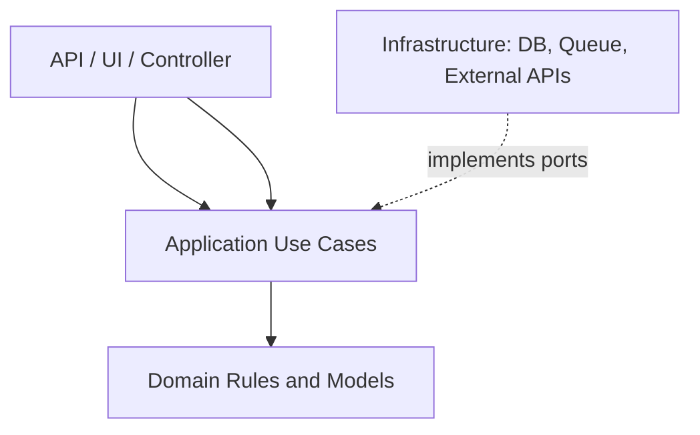

Sơ đồ trên là sơ đồ khái quát; mũi tên nét đứt biểu thị infrastructure cung cấp implementation cho các cổng được định nghĩa ở tầng trong. Không nên diễn giải sơ đồ đơn giản này như một quy định duy nhất cho mọi dự án.

## 4. Ví dụ áp dụng cho nghiệp vụ xuất kho

Use case `PostIssue` có thể thực hiện các bước:

1. Nhận ID phiếu xuất và thông tin người thực hiện.
2. Nạp phiếu và dòng hàng qua repository.
3. Kiểm tra phiếu đang ở trạng thái có thể ghi sổ.
4. Áp dụng quy tắc số lượng hợp lệ và kiểm tra tồn khả dụng.
5. Dùng cơ chế transaction/port để ghi biến động và cập nhật số dư.
6. Đổi trạng thái phiếu sang `POSTED`.
7. Commit; sau đó phát sự kiện để cập nhật thông báo hoặc báo cáo nếu cần.

Controller chỉ nên xác thực cấu trúc request và gọi use case; không tự chứa toàn bộ logic tồn kho. Quy tắc domain không nên tự gọi trực tiếp một `DatabaseConnection` cụ thể. Tuy nhiên, ranh giới transaction là chi tiết quan trọng: kiến trúc phải bảo đảm thao tác ledger, balance và status nhất quán trong cơ sở dữ liệu.

## 5. Cấu trúc thư mục minh họa

```text
src/
  domain/
    inventory/
    product/
    receipt/
    issue/
  application/
    use-cases/
    ports/
    dto/
  adapters/
    http/
    persistence-mappers/
  infrastructure/
    database/
    queue/
    auth/
  tests/
```

Tên thư mục có thể đổi theo ngôn ngữ và framework. Không nên tạo quá nhiều lớp chỉ để bắt chước mẫu. Nếu bài tập mới dừng ở phân tích và thiết kế, nhóm có thể biểu diễn các tầng bằng sơ đồ kiến trúc và mô tả trách nhiệm thay vì bắt buộc có mã nguồn.

## 6. Lợi ích và chi phí

**Lợi ích:** quy tắc nghiệp vụ tập trung hơn; dễ unit test; giảm phụ thuộc framework; hỗ trợ thay đổi cách lưu trữ hoặc giao diện; các thành viên dễ biết nơi đặt logic.

**Chi phí:** nhiều interface/DTO hơn; cần thống nhất cách chia lớp; có thể tạo độ phức tạp không cần thiết với ứng dụng rất nhỏ. Clean Architecture không tự động làm hệ thống nhanh hơn, an toàn hơn hoặc có chất lượng nếu quy tắc và kiểm thử vẫn thiếu.

## 7. Nguyên tắc thiết kế nhóm nên thống nhất

- Controller không thay thế use case.
- Quy tắc nghiệp vụ quan trọng có một nơi sở hữu rõ ràng.
- Repository không trả dữ liệu của tenant khác nếu hệ thống dùng multi-tenancy.
- Lỗi nghiệp vụ (ví dụ không đủ tồn) được phân biệt với lỗi kỹ thuật (ví dụ database không kết nối).
- Tác động phụ như gửi email/notification không làm transaction tồn kho bị giữ lâu ngoài mức cần thiết.
- Interface chỉ được thêm khi tạo ranh giới có ý nghĩa, không phải vì mọi lớp đều bắt buộc phải có interface.

## 8. Kiểm thử kiến trúc

- Unit test quy tắc tồn/điều kiện chuyển trạng thái không cần khởi động web server.
- Test use case bằng repository giả hoặc test integration phù hợp.
- Test integration xác nhận transaction, khóa và ràng buộc thực sự hoạt động với database mục tiêu.
- Test API xác nhận request sai, quyền không đủ và lỗi nghiệp vụ trả về đúng.

Unit test không đủ chứng minh vấn đề đồng thời đã được giải quyết; các quy tắc cạnh tranh cần kiểm thử tích hợp trên môi trường dữ liệu phù hợp.

## 9. Áp dụng và giới hạn

Với đồ án hiện tại, Clean Architecture có thể dùng làm cơ sở đề xuất tổ chức phần mềm, nhưng nhóm cần ưu tiên sơ đồ dễ hiểu, luồng dữ liệu và quy tắc nghiệp vụ. Không nên biến kiến trúc thành một yêu cầu triển khai lớn nếu giảng viên chỉ đánh giá phân tích thiết kế.

## 10. Tài liệu liên quan

- [Máy trạng thái đơn hàng](order-state-machine.md)
- [Sổ biến động tồn kho](inventory-ledger.md)
- [SaaS Multi-Tenancy](saas-multi-tenancy.md)
- [UML 2.x](uml-2.0.md)

---

## concurrency-control.md

<sub>Nguồn: `doc/EP02/concurrency-control.md`</sub>


# EP02 — Cơ sở lý thuyết: Background Processing

## 1. Mục tiêu

Xử lý nền (background processing) là thực hiện công việc không cần hoàn tất trong phản hồi trực tiếp của người dùng, thường qua hàng đợi (queue), worker hoặc tác vụ định kỳ. Trong quản lý kho, các ví dụ có thể gồm tạo báo cáo lớn, gửi thông báo, đồng bộ hệ thống ngoài, hết hạn reservation hoặc xử lý file nhập dữ liệu.

Không nên đưa mọi tác vụ vào queue. Nghiệp vụ cần phản hồi tức thời hoặc phải bảo đảm trạng thái tồn trước khi trả kết quả có thể cần xử lý đồng bộ trong transaction; phần gửi thông báo hay tổng hợp dữ liệu sau đó mới được tách nền.

## 2. Các thành phần

- **Producer:** thành phần tạo công việc/sự kiện.
- **Queue/Broker:** nơi lưu thông điệp chờ xử lý.
- **Worker/Consumer:** tiến trình lấy và xử lý công việc.
- **Retry policy:** quy tắc thử lại khi thất bại.
- **Dead-letter queue (DLQ):** nơi lưu những thông điệp thất bại sau số lần thử quy định để điều tra.
- **Scheduled job:** tác vụ chạy theo lịch.
- **Idempotency:** xử lý lại cùng một yêu cầu không tạo tác động nghiệp vụ lặp.

Queue không tự bảo đảm công việc chỉ chạy một lần. Nhiều hệ thống cung cấp ngữ nghĩa ít nhất một lần (at-least-once), nghĩa là thông điệp có thể được giao lại; consumer cần được thiết kế phù hợp.

## 3. Phân loại công việc trong WMS

| Công việc | Đồng bộ hay nền? | Lưu ý |
|---|---|---|
| Kiểm tra tồn và ghi sổ xuất kho | Thường cần xác nhận đồng bộ trong use case | Phải đảm bảo tính nguyên tử; không trả thành công trước commit |
| Gửi email/thông báo sau ghi sổ | Có thể chạy nền | Lỗi gửi không được làm mất giao dịch đã commit |
| Xuất báo cáo lớn | Có thể chạy nền | Trả mã job và trạng thái tải file |
| Nhập hàng loạt từ CSV | Có thể chạy nền | Cần kiểm tra dữ liệu, kết quả từng dòng và chống nhập lặp |
| Hết hạn reservation | Có thể dùng worker/lịch | Giải phóng đúng một lần và phối hợp với trạng thái đơn |
| Đồng bộ sự kiện bên ngoài | Thường có thể chạy nền | Có retry, idempotency và đối soát |

## 4. Quy trình xử lý tin cậy

1. Tạo công việc với ID duy nhất và payload tối thiểu cần thiết.
2. Lưu công việc/sự kiện theo cơ chế bảo đảm không mất sau transaction nghiệp vụ.
3. Worker lấy công việc và kiểm tra dữ liệu/quyền/ngữ cảnh cần thiết.
4. Xử lý với idempotency key và transaction phù hợp.
5. Đánh dấu thành công sau khi tác động đã được lưu.
6. Nếu lỗi tạm thời, retry theo backoff; nếu lỗi không thể phục hồi hoặc vượt số lần thử, đưa vào DLQ và cảnh báo.
7. Cung cấp cách xem trạng thái, thử lại hoặc xử lý thủ công có kiểm soát.

### Exponential backoff

Thay vì retry liên tục ngay lập tức, thời gian chờ có thể tăng theo số lần thất bại, có giới hạn tối đa và jitter để tránh nhiều worker cùng retry đồng thời. Chính sách cần phân biệt lỗi tạm thời (timeout, dịch vụ chưa sẵn sàng) và lỗi dữ liệu vĩnh viễn (schema sai, SKU không hợp lệ).

## 5. Transactional outbox

Một vấn đề thường gặp: ứng dụng commit phiếu xuất vào database thành công nhưng ngừng hoạt động trước khi gửi sự kiện sang queue. Khi đó dữ liệu đã đổi nhưng sự kiện có thể bị mất.

Mẫu transactional outbox giải quyết bằng cách ghi dữ liệu nghiệp vụ và một bản ghi outbox trong cùng transaction. Một tiến trình riêng đọc outbox rồi phát sự kiện; sau khi xử lý, nó đánh dấu đã gửi. Consumer vẫn phải xử lý message lặp vì phát lại có thể xảy ra. Mẫu này hữu ích khi cần sự tin cậy cao, nhưng có thể là phần mở rộng đối với đồ án cơ bản.

## 6. Idempotency và khóa công việc

Nếu worker nhận cùng job nhiều lần, nó cần phát hiện đã xử lý hoặc đảm bảo hành động được thực hiện tối đa một lần ở cấp nghiệp vụ. Có thể dùng ID job, bảng xử lý sự kiện, ràng buộc duy nhất hoặc trạng thái chuyển đổi có điều kiện. Chỉ đánh dấu message đã xong trước khi dữ liệu được commit có thể dẫn đến mất việc; đánh dấu sau commit có thể khiến message lặp, do đó xử lý phải idempotent.

## 7. Vận hành và quan sát

Theo dõi ít nhất: độ dài queue, tuổi của job lâu nhất, số lần retry, số job thất bại, thời gian xử lý, tốc độ hoàn thành và số phần tử DLQ. Log nên có `job_id`, `correlation_id` và `tenant_id` nếu áp dụng, nhưng không ghi bí mật hoặc dữ liệu cá nhân không cần thiết. Cần giới hạn số worker và dung lượng payload để tránh một job lớn làm nghẽn toàn hệ thống.

## 8. Kiểm thử

- Job thành công cập nhật đúng trạng thái và kết quả.
- Worker chết sau khi commit nhưng trước khi ACK: retry không tạo tác động lặp.
- Lỗi tạm thời được retry theo chính sách.
- Lỗi dữ liệu cuối cùng được đưa vào DLQ hoặc trạng thái cần xử lý.
- Công việc hết hạn không giải phóng reservation hai lần.
- Lỗi gửi thông báo không đảo ngược transaction tồn kho đã hoàn tất.
- Công việc của tenant được xử lý trong đúng phạm vi nếu dùng multi-tenancy.

---

## inventory-ledger.md

<sub>Nguồn: `doc/EP02/inventory-ledger.md`</sub>


# EP02 — Cơ sở lý thuyết: Inventory Ledger

## 1. Mục tiêu

Sổ biến động tồn kho (inventory ledger) là cơ sở để giải thích vì sao số lượng tồn thay đổi và truy lại giao dịch đã tạo nên số dư hiện tại. Tài liệu này mô tả nguyên tắc ghi sổ, đối chiếu với số dư hiện tại và cách bảo vệ lịch sử nghiệp vụ.

## 2. Khái niệm

**Ledger** là nhật ký các biến động tăng/giảm được ghi nhận theo thứ tự thời gian hoặc theo mã giao dịch. Một bản ghi thường thể hiện mặt hàng, kho, lượng thay đổi, loại nghiệp vụ, tham chiếu chứng từ, thời gian và người/hệ thống tạo.

Cần phân biệt:

- **Inventory movement:** một biến động hàng hóa cụ thể, thường có số lượng tăng hoặc giảm.
- **Inventory ledger:** tập hợp các biến động đã ghi sổ và có thể được truy vấn để kiểm toán.
- **Inventory balance/snapshot:** số dư tổng hợp tại một thời điểm để truy vấn nhanh.
- **Draft document:** chứng từ đang lập, chưa chắc đã ảnh hưởng tồn.
- **Posted transaction:** giao dịch đã được xác nhận và ghi sổ theo quy tắc nghiệp vụ.

Ledger không nhất thiết phải là sổ kế toán tài chính đầy đủ. Trong đồ án, nó có thể là nhật ký nghiệp vụ tồn kho với số lượng, nhưng cần gọi tên và mô tả phạm vi chính xác.

## 3. Nguyên tắc thiết kế

### 3.1. Ghi nhận biến động, không chỉ lưu kết quả cuối

Nếu chỉ cập nhật trường `quantity = 25` thành `quantity = 18`, hệ thống có thể biết số hiện tại nhưng không biết vì sao giảm 7 đơn vị. Bản ghi ledger giúp giải thích giảm do phiếu xuất nào, ai ghi nhận và lúc nào.

### 3.2. Bản ghi đã ghi sổ không bị sửa âm thầm

Khi giao dịch đã có hiệu lực, chỉnh sai nên thực hiện bằng giao dịch đảo hoặc điều chỉnh có lý do, thay vì xóa lịch sử. Với ứng dụng bài tập, có thể không cần xây dựng toàn bộ quy trình đảo phức tạp, nhưng tài liệu phải nêu nguyên tắc truy vết.

### 3.3. Số dư là dữ liệu dẫn xuất hoặc được đồng bộ nguyên tử

Có hai hướng thường gặp:

- Tính số dư bằng cách tổng hợp ledger: dễ giải thích nguồn gốc nhưng có thể tốn chi phí truy vấn khi dữ liệu lớn.
- Lưu bảng số dư để đọc nhanh và ghi ledger cùng giao dịch: hiệu quả hơn, nhưng cần đảm bảo số dư và ledger không bị lệch.

Dù chọn cách nào, hệ thống phải chỉ định nguồn dữ liệu chuẩn và quy trình đối soát. Không được để một luồng cập nhật ledger trong khi luồng khác chỉ sửa số dư.

## 4. Mô hình bản ghi gợi ý

| Trường | Ý nghĩa |
|---|---|
| `movement_id` | Định danh duy nhất của biến động |
| `tenant_id` | Mã đơn vị/khách hàng nếu dùng kiến trúc nhiều tenant |
| `sku_id` | Mặt hàng được tác động |
| `warehouse_id` | Kho chịu tác động |
| `location_id` | Vị trí trong kho, nếu quản lý đến cấp vị trí |
| `movement_type` | Nhập, xuất, điều chỉnh, điều chuyển hoặc đảo giao dịch |
| `quantity_delta` | Lượng tăng dương hoặc giảm âm theo quy ước đã chọn |
| `reference_type`, `reference_id` | Loại và mã chứng từ nguồn |
| `occurred_at` | Thời điểm nghiệp vụ được ghi nhận |
| `recorded_at` | Thời điểm hệ thống lưu bản ghi |
| `created_by` | Tài khoản hoặc tiến trình hệ thống tạo |
| `reason` | Lý do, bắt buộc cho điều chỉnh/đảo nếu quy định |

Không phải dự án nào cũng cần mọi cột. `tenant_id` chỉ áp dụng nếu có nhiều khách hàng độc lập dùng chung hệ thống.

## 5. Luồng ghi sổ tham khảo

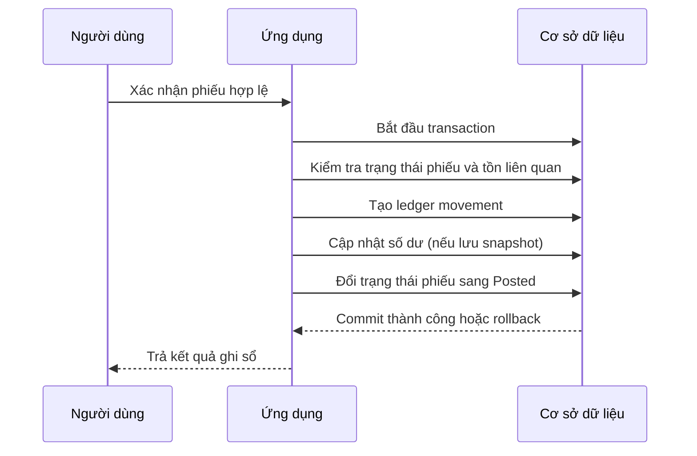

Các thay đổi thuộc cùng một nghiệp vụ phải được commit đồng bộ trong một transaction dữ liệu phù hợp. Nếu còn bước bên ngoài như gửi thông báo, nên thực hiện sau commit qua sự kiện/queue để không làm transaction tồn kho phụ thuộc vào dịch vụ mạng.

## 6. Ví dụ đối chiếu

SKU X bắt đầu có 20 đơn vị. Ledger ghi nhập `+10`, xuất `−4`, điều chỉnh `−1`. Số dư theo ledger là `20 + 10 − 4 − 1 = 25` đơn vị, giả sử không có nghiệp vụ khác và không có bản ghi bị bỏ sót.

Nếu bảng số dư hiện hiển thị 24, nhóm cần đối soát bằng cách lọc theo SKU/kho và thời điểm, kiểm tra giao dịch ghi sổ, dữ liệu trùng, giao dịch rollback một phần hoặc thao tác cập nhật thủ công. Không nên tự sửa số dư về 25 mà không tìm nguyên nhân.

## 7. Idempotency và chống ghi trùng

Một yêu cầu ghi sổ có thể bị gửi lại do timeout hoặc người dùng nhấn nút nhiều lần. Để tránh tạo hai biến động giống nhau, ứng dụng nên sử dụng mã yêu cầu/idempotency key hoặc ràng buộc duy nhất cho tham chiếu nghiệp vụ phù hợp. Chỉ kiểm tra ở giao diện là chưa đủ vì yêu cầu có thể đến đồng thời hoặc được gửi từ hệ thống khác.

Ràng buộc duy nhất phải phù hợp với nghiệp vụ: một phiếu có thể hợp lệ tạo nhiều dòng ledger (mỗi SKU, kho hoặc vị trí một dòng), nên không thể tùy tiện dùng `reference_id` làm khóa duy nhất trên mọi movement.

## 8. Các câu hỏi thiết kế

- Có cần lưu số dư tại từng vị trí không, hay chỉ theo SKU và kho?
- Có quản lý lô, serial, hàng đang chuyển hoặc hàng chờ kiểm không?
- Thời điểm ghi nhận xuất kho là khi xác nhận xuất, khi đóng gói hay khi bàn giao?
- Ai có quyền tạo giao dịch đảo hoặc điều chỉnh?
- Cách đối soát số dư và ledger là gì?
- Báo cáo dùng thời điểm nghiệp vụ (`occurred_at`) hay thời điểm ghi nhận (`recorded_at`)?

## 9. Tiêu chí kiểm tra

- Mọi thay đổi tồn quan trọng đều có tham chiếu đến nghiệp vụ.
- Số dư và ledger được cập nhật nhất quán.
- Có khả năng truy vấn lịch sử theo SKU, kho, loại giao dịch và thời gian.
- Giao dịch bị gửi lại không tạo biến động trùng.
- Quy trình sửa sai vẫn giữ dấu vết.

## 10. Tài liệu liên quan

- [Quản lý tồn kho](inventory-management.md)
- [Giá bình quân gia quyền](weighted-average-cost.md)
- [Cơ chế chống bán vượt tồn](anti-oversell-mechanism.md)
- [Xử lý nền](background-processing.md)
- [Kiểm soát đồng thời](concurrency-control.md)

---

## inventory-management.md

<sub>Nguồn: `doc/EP02/inventory-management.md`</sub>


# EP02 — Cơ sở lý thuyết: Inventory Management

## 1. Mục tiêu

Tài liệu xác định các khái niệm nền tảng của quản lý tồn kho và cách áp dụng trong hệ thống quản lý kho. Mục tiêu là giúp nhóm dùng thuật ngữ thống nhất trước khi xây dựng BFD, DFD, ERD, quy trình nghiệp vụ hoặc thiết kế cơ sở dữ liệu.

## 2. Khái niệm và đơn vị quản lý

**Quản lý tồn kho** là quá trình theo dõi số lượng hàng hóa, vị trí, trạng thái và lịch sử thay đổi của hàng trong một hoặc nhiều địa điểm.

Các khái niệm cần phân biệt:

- **Product:** sản phẩm ở cấp mô tả chung, ví dụ “Áo thun”.
- **SKU (Stock Keeping Unit):** mã định danh một đơn vị hàng có thuộc tính lưu kho cụ thể, ví dụ áo thun màu đen, size M. SKU thường là cấp độ kiểm soát tồn.
- **Warehouse:** kho hoặc địa điểm quản lý hàng.
- **Location/Bin:** vị trí cụ thể bên trong kho, nếu hệ thống quản lý đến cấp kệ/ngăn.
- **On-hand quantity:** số lượng đang được ghi nhận là hiện có trong kho.
- **Reserved quantity:** số lượng đã được giữ cho nhu cầu cụ thể và không được phân bổ thêm.
- **Blocked/Quarantined quantity:** hàng có mặt nhưng chưa được phép sử dụng hoặc xuất bán.
- **Available quantity:** lượng có thể phân bổ theo quy tắc nghiệp vụ.
- **Reorder point:** ngưỡng tồn dùng để cảnh báo hoặc đề xuất bổ sung, không tự động đồng nghĩa với đơn mua hàng.

Đồ án phải quy định rõ phạm vi chi tiết: quản lý theo SKU và kho là mức cơ bản; quản lý theo vị trí, lô, hạn sử dụng hoặc serial làm tăng đáng kể độ phức tạp.

## 3. Nghiệp vụ cốt lõi

### 3.1. Nhập kho

1. Lập phiếu hoặc ghi nhận nguồn nhập.
2. Thêm các dòng SKU và số lượng.
3. Kiểm tra mã hàng, số lượng, chứng từ và quyền thao tác.
4. Xác nhận/đăng sổ theo quy trình đã định nghĩa.
5. Tăng tồn kho và ghi nhận biến động tương ứng trong cùng một giao dịch logic.

Bản nháp chưa được xác nhận không nên làm tăng tồn khả dụng. Nếu quy trình có trạng thái “đã nhận nhưng chờ kiểm”, số lượng đó cần được mô hình hóa riêng thay vì cộng thẳng vào hàng có thể xuất.

### 3.2. Xuất kho

1. Nhận nhu cầu xuất và xác định SKU, số lượng, kho.
2. Kiểm tra tồn khả dụng.
3. Xác nhận/giữ chỗ nếu quy trình yêu cầu.
4. Lấy hàng, đóng gói và xác nhận xuất.
5. Giảm tồn theo đúng thời điểm được chọn, ghi sổ và lưu người thực hiện.

Nhóm cần phân biệt **giữ chỗ** với **xuất kho thực tế**: giữ chỗ làm giảm lượng có thể phân bổ nhưng chưa nhất thiết làm giảm hàng đang có trong kho.

### 3.3. Điều chỉnh và kiểm kê

Điều chỉnh tồn chỉ được thực hiện bởi vai trò có quyền, cần lý do, số lượng trước/sau, người thao tác, thời gian và dấu vết kiểm toán. Kiểm kê là hoạt động so sánh số lượng thực tế với số liệu hệ thống; chênh lệch cần được duyệt và ghi nhận bằng giao dịch điều chỉnh, không nên âm thầm sửa số tồn.

### 3.4. Điều chuyển

Điều chuyển giữa hai kho nên có tối thiểu trạng thái tạo yêu cầu, xuất khỏi kho nguồn, đang chuyển và nhận tại kho đích. Nếu chỉ giảm ở kho nguồn và tăng ở kho đích ngay lập tức, hệ thống không biểu diễn được hàng đang vận chuyển. Đồ án cơ bản có thể loại điều chuyển khỏi phạm vi, nhưng phải ghi rõ.

## 4. Quy tắc tính tồn

Một mô hình đơn giản ở cấp SKU và kho:

`Tồn cuối = Tồn đầu + Tổng nhập đã ghi sổ − Tổng xuất đã ghi sổ +/− Điều chỉnh đã ghi sổ`

Công thức này mô tả số lượng hiện có; nó không thay thế việc tính tồn khả dụng, giá trị tồn kho hay trạng thái hàng. Khi có giữ chỗ, hàng bị khóa hoặc điều chuyển đang diễn ra, cần các đại lượng bổ sung.

### Ví dụ

SKU A có 40 đơn vị đã ghi nhận. Có 8 đơn vị được giữ cho đơn hàng, 2 đơn vị bị khóa vì hư hỏng. Theo quy ước đơn giản, lượng có thể phân bổ là `40 − 8 − 2 = 30`. Nếu một đơn vị hàng được nhập nhưng đang chờ kiểm nhận thì phải quyết định có nằm trong con số 40 hay ở một trạng thái riêng; nhóm không được đổi quy ước giữa các chức năng.

## 5. Chất lượng dữ liệu và kiểm soát

- Mã SKU phải ổn định và duy nhất trong phạm vi được xác định.
- Số lượng phải dùng kiểu số phù hợp; không nhận giá trị âm khi nghiệp vụ không cho phép.
- Các đơn vị đo phải được chuẩn hóa và chuyển đổi có kiểm soát.
- Tồn không nên nhập tay qua nhiều màn hình độc lập; các nghiệp vụ làm thay đổi tồn cần dùng chung quy tắc.
- Giao dịch đã ghi sổ cần có mã tham chiếu và dấu vết để truy vết.
- Báo cáo tồn nên chỉ rõ thời điểm chụp dữ liệu hoặc phạm vi bộ lọc.

## 6. Dữ liệu tối thiểu tham khảo

| Nhóm dữ liệu | Trường gợi ý | Ghi chú |
|---|---|---|
| SKU | `sku_id`, `code`, `name`, `unit`, `status` | `code` duy nhất theo quy ước |
| Kho | `warehouse_id`, `code`, `name`, `status` | Mã kho duy nhất |
| Số dư | `sku_id`, `warehouse_id`, `on_hand`, `reserved`, `blocked`, `version` | Khóa kết hợp tùy thiết kế |
| Phiếu | `document_id`, `type`, `status`, `created_by`, `posted_at` | Trạng thái phải được định nghĩa |
| Dòng phiếu | `document_id`, `sku_id`, `quantity`, `unit_cost` | Giá vốn chỉ áp dụng khi thuộc phạm vi |
| Biến động | `movement_id`, `reference_id`, `quantity_delta`, `occurred_at` | Không tùy tiện ghi đè lịch sử |

Đây là danh sách gợi ý cho phân tích; cấu trúc cuối cùng phải được phản ánh nhất quán trong ERD và từ điển dữ liệu.

## 7. Các chỉ số có thể báo cáo

- Tồn đầu, tổng nhập, tổng xuất và tồn cuối theo kỳ.
- Tồn khả dụng theo SKU/kho.
- Hàng dưới ngưỡng cảnh báo.
- Chênh lệch kiểm kê.
- Tuổi tồn hoặc hàng chậm luân chuyển nếu dữ liệu đủ.

Không nên tuyên bố rằng hệ thống “tối ưu tồn kho” chỉ dựa vào việc hiển thị báo cáo. Để đánh giá tối ưu, cần mục tiêu, dữ liệu và phương pháp cụ thể.

---

## omnichannel-retail.md

<sub>Nguồn: `doc/EP02/omnichannel-retail.md`</sub>


# EP02 — Cơ sở lý thuyết: Omnichannel Retail

## 1. Mục đích tài liệu

Tài liệu giải thích mô hình bán lẻ đa kênh (omnichannel retail) và mối liên hệ giữa mô hình này với quản lý tồn kho. Đây là bối cảnh lý thuyết để nhóm hiểu vì sao dữ liệu kho cần nhất quán khi đơn hàng có thể đến từ nhiều kênh. **Omnichannel là bối cảnh mở rộng**, không có nghĩa đồ án bắt buộc phải xây dựng website bán hàng, ứng dụng cửa hàng hoặc tích hợp sàn thương mại điện tử.

## 2. Khái niệm

- **Multichannel:** doanh nghiệp bán hàng trên nhiều kênh, chẳng hạn cửa hàng vật lý, website và sàn thương mại điện tử; mỗi kênh có thể vận hành dữ liệu tương đối tách biệt.
- **Omnichannel:** các kênh được phối hợp để tạo trải nghiệm liền mạch; thông tin sản phẩm, đơn hàng, tồn kho và thực hiện đơn được chia sẻ theo quy tắc thống nhất.
- **OMS (Order Management System):** quản lý vòng đời đơn hàng và quyết định cách thực hiện đơn.
- **WMS (Warehouse Management System):** quản lý hoạt động kho như nhận hàng, cất hàng, kiểm kê, lấy hàng và xuất hàng.
- **Inventory visibility:** khả năng xem trạng thái tồn kho phù hợp với mục đích sử dụng, có thể gồm tồn thực tế, tồn đã giữ chỗ và tồn khả dụng.

Omnichannel không đồng nghĩa với việc mọi kênh đọc trực tiếp cùng một bảng dữ liệu. Hệ thống có thể dùng API, sự kiện hoặc đồng bộ theo lô, nhưng phải nêu rõ độ trễ, nguồn dữ liệu chuẩn và cách xử lý khi đồng bộ thất bại.

## 3. Vấn đề nghiệp vụ

Nếu cửa hàng và kênh trực tuyến sử dụng tồn kho riêng hoặc cập nhật chậm, hai đơn hàng có thể cùng được chấp nhận cho một lượng hàng chỉ còn một đơn vị. Mặt khác, tồn kho có thể đang nằm ở trạng thái chờ kiểm hàng, hư hỏng, đã được giữ cho đơn khác hoặc đang chuyển giữa các địa điểm. Chỉ hiển thị một con số “tồn kho” có thể làm người dùng hiểu nhầm.

Các câu hỏi cần được xác định từ đầu gồm:

1. Hệ thống nào là nguồn chuẩn cho số lượng tồn?
2. Tồn kho được quản lý theo SKU, kho, vị trí, lô hay serial?
3. Một đơn có thể lấy hàng từ nhiều kho không?
4. Khi đơn bị hủy, giữ chỗ được giải phóng lúc nào?
5. Đồng bộ kênh bán chậm hoặc lỗi thì người dùng nhìn thấy trạng thái gì?

## 4. Mô hình dữ liệu khái niệm

Các thực thể có thể xuất hiện trong một hệ thống đa kênh:

- `Product / SKU`: danh mục và mã biến thể có thể lưu kho.
- `Warehouse`: địa điểm vật lý hoặc đơn vị quản lý tồn kho.
- `InventoryBalance`: ảnh chụp số lượng hiện tại theo SKU và kho (có thể thêm vị trí/lô).
- `InventoryMovement`: nhật ký biến động tăng/giảm/điều chuyển.
- `Order`: đơn hàng được tạo từ một kênh.
- `OrderLine`: SKU và số lượng yêu cầu.
- `Reservation`: lượng tồn được giữ cho đơn trong một khoảng thời gian hoặc đến khi có sự kiện giải phóng.
- `Channel`: nguồn đơn như cửa hàng, website hoặc nền tảng bên ngoài.

Danh sách trên là mô hình lý thuyết. Đồ án chỉ nên triển khai các thực thể đáp ứng yêu cầu đã thống nhất ở EP01.

## 5. Luồng xử lý tham khảo

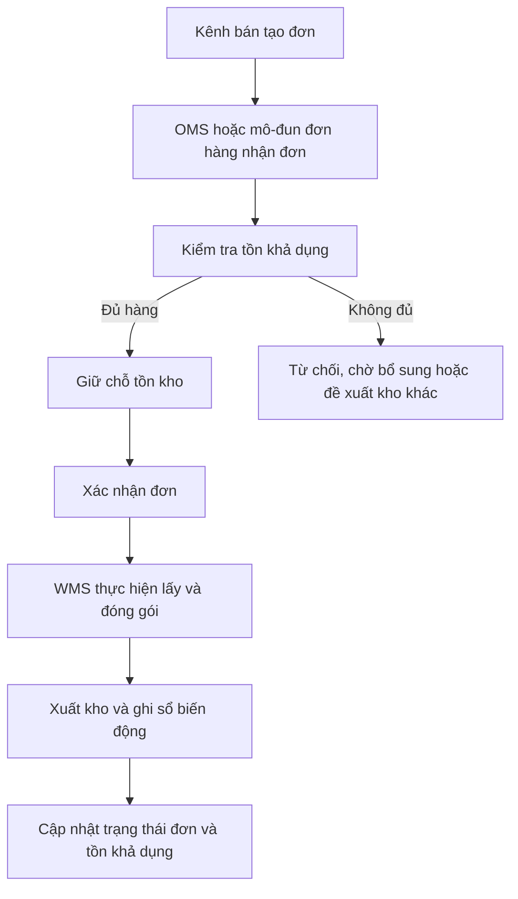

Đây là luồng minh họa; việc dùng OMS riêng hay tích hợp vào một ứng dụng duy nhất phụ thuộc vào phạm vi và kiến trúc được chọn.

## 6. Nguyên tắc thiết kế liên quan đến kho

### 6.1. Phân biệt tồn thực tế và tồn khả dụng

Một cách diễn giải cơ bản là:

`Tồn khả dụng = Tồn thực tế − Lượng đã giữ chỗ − Lượng bị khóa`

Công thức này chỉ hợp lệ khi ba thành phần được định nghĩa nhất quán, không trừ cùng một lượng hai lần và lượng bị khóa vẫn được tính trong tồn thực tế. Hàng đang chuyển kho, hàng chờ kiểm nhận hoặc hàng theo lô có thể cần mô hình riêng.

### 6.2. Quyết định phân bổ đơn

Đơn có thể được phân bổ theo kho ưu tiên, khoảng cách, khả năng đáp ứng, thời gian giao hoặc chi phí. Không nên tự đưa thuật toán tối ưu nhiều kho vào phạm vi đồ án cơ bản nếu chưa có yêu cầu.

### 6.3. Đồng bộ có kiểm soát

Mỗi bản tin đồng bộ cần định danh, thời điểm, nguồn phát và khả năng xử lý lặp. Mất mạng hoặc gửi lại thông điệp không được tạo thêm một lần xuất kho. Nếu đồng bộ bất đồng bộ, nên theo dõi trạng thái và lỗi để có thể thử lại hoặc đối soát.

## 7. Áp dụng vào đề tài

Ở mức đồ án WMS cơ bản, nhóm có thể sử dụng mô hình omnichannel làm bối cảnh để giải thích nhu cầu tồn kho nhất quán, nhưng giới hạn hiện thực hóa ở danh mục hàng hóa, nhập kho, xuất kho, tồn kho và lịch sử giao dịch. Nếu giảng viên mở rộng sang bán lẻ đa kênh, nhóm cần bổ sung rõ nguồn đơn, đồng bộ, giữ chỗ và điều phối kho.

## 8. Rủi ro và biện pháp

| Rủi ro | Hướng kiểm soát |
|---|---|
| Tồn hiển thị khác tồn thật | Chọn nguồn dữ liệu chuẩn; đối soát và kiểm kê |
| Hai đơn cùng dùng một lượng tồn | Thực hiện giữ chỗ nguyên tử trong giao dịch dữ liệu |
| Sự kiện đồng bộ bị gửi lặp | Idempotency key hoặc mã sự kiện duy nhất |
| Một kênh ngừng hoạt động | Ghi nhận trạng thái đồng bộ; quy định hành vi dự phòng |
| Phạm vi bị mở rộng quá mức | Phân biệt yêu cầu bắt buộc, giả định và hướng phát triển |

---

## order-state-machine.md

<sub>Nguồn: `doc/EP02/order-state-machine.md`</sub>


# EP02 — Cơ sở lý thuyết: Order State Machine

## 1. Mục tiêu

Máy trạng thái (state machine) mô tả một đơn hàng có thể ở trạng thái nào, được chuyển từ trạng thái nào sang trạng thái nào, điều kiện gì phải thỏa mãn và tác động nghiệp vụ đi kèm. Cách mô hình hóa này giúp tránh các cập nhật trạng thái tùy ý, chẳng hạn một đơn đã hủy lại chuyển sang đang giao hàng.

## 2. Các thành phần

- **State:** tình trạng hiện tại của đơn.
- **Event/Command:** sự kiện hoặc yêu cầu có thể kích hoạt chuyển trạng thái.
- **Transition:** quy tắc chuyển từ trạng thái cũ sang trạng thái mới.
- **Guard:** điều kiện phải đúng trước khi chuyển.
- **Side effect:** hành động đi kèm như giữ chỗ, giải phóng giữ chỗ, ghi sổ xuất kho hoặc gửi thông báo.
- **Terminal state:** trạng thái kết thúc theo mô hình hiện tại; không có chuyển tiếp thông thường ra khỏi trạng thái đó.

State machine không chỉ là danh sách giá trị enum. Nó cần mô tả các chuyển tiếp được phép và tác động của chúng.

## 3. Mô hình tham khảo

Một luồng đơn hàng đơn giản có thể gồm:

- `DRAFT`: đơn nháp.
- `PENDING_CONFIRMATION`: chờ xác nhận.
- `CONFIRMED`: đã xác nhận.
- `PICKING`: đang lấy hàng.
- `PACKED`: đã đóng gói.
- `SHIPPED`: đã xuất/bàn giao cho đơn vị vận chuyển.
- `DELIVERED`: đã giao thành công.
- `CANCELLED`: đã hủy.

Một số trạng thái có thể không cần với bài tập cơ bản. `RETURNED` hoặc xử lý hoàn trả nên được mô hình hóa thêm khi nghiệp vụ yêu cầu; không nên gộp mọi quy trình đổi/trả vào trạng thái giao hàng.

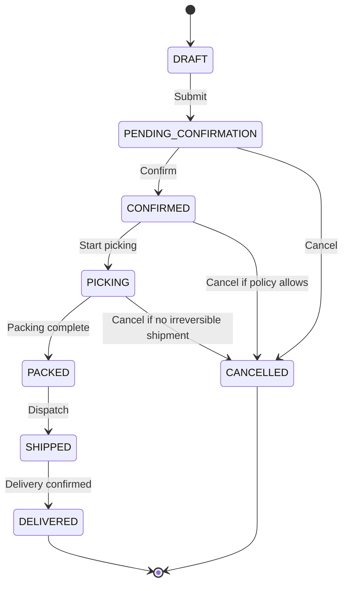

Sơ đồ là ví dụ thảo luận, không phải chính sách mặc định. Nhóm cần quyết định hủy ở giai đoạn nào được phép, ai được thực hiện và cách xử lý hàng đã lấy/đóng gói.

## 4. Bảng chuyển trạng thái

| Trạng thái hiện tại | Sự kiện | Điều kiện/Guard | Trạng thái mới | Tác động cần xem xét |
|---|---|---|---|---|
| `DRAFT` | Submit | Các dòng hàng hợp lệ | `PENDING_CONFIRMATION` | Lưu thời điểm gửi |
| `PENDING_CONFIRMATION` | Confirm | Có quyền, thông tin hợp lệ, đáp ứng điều kiện tồn | `CONFIRMED` | Giữ chỗ nếu chính sách yêu cầu |
| `CONFIRMED` | Start picking | Phiếu còn hợp lệ | `PICKING` | Giao nhiệm vụ lấy hàng |
| `PICKING` | Packing complete | Đủ hàng/đã xử lý thiếu hàng | `PACKED` | Ghi nhận kết quả đóng gói |
| `PACKED` | Dispatch | Điều kiện xuất kho hoàn tất | `SHIPPED` | Ghi sổ xuất theo quy định, đổi reservation phù hợp |
| Trạng thái được phép hủy | Cancel | Quyền hợp lệ; chưa qua điểm không thể đảo | `CANCELLED` | Giải phóng reservation đúng một lần |

Bảng cần được tùy chỉnh theo yêu cầu. Ví dụ, việc ghi sổ xuất có thể diễn ra trước khi trạng thái `SHIPPED` được lưu hoặc trong cùng một thao tác xác nhận bàn giao; nhóm phải chọn một mốc rõ ràng.

## 5. Trạng thái đơn và trạng thái tồn là hai khái niệm

Trạng thái đơn hàng cho biết tiến trình xử lý nhu cầu; reservation cho biết lượng hàng đang được giữ; ledger ghi nhận các biến động tồn thực tế. Không nên dùng `order.status = CONFIRMED` làm bằng chứng duy nhất rằng giữ chỗ tồn đã thành công nếu hai cập nhật không được bảo đảm nhất quán.

Các thao tác liên quan cần giao dịch hoặc quy trình bù trừ được thiết kế rõ. Nếu một use case cập nhật đơn rồi lỗi trước khi giữ chỗ, hệ thống phải rollback hoặc đánh dấu trạng thái trung gian để có thể xử lý lại an toàn.

## 6. Invariant và quy tắc

- Chỉ trạng thái được phép mới nhận một sự kiện.
- Đơn hủy không thể được đóng gói hoặc giao theo luồng thường.
- Gửi lặp `Confirm` không tạo thêm reservation.
- Khi hủy, reservation chỉ được giải phóng một lần.
- Ghi sổ xuất kho phải tham chiếu đến đơn/phiếu hợp lệ.
- Trạng thái hiện tại và lịch sử chuyển trạng thái phải có thể truy vết.
- Nếu cho phép sửa đơn sau xác nhận, phải quy định ảnh hưởng đến reservation và nhiệm vụ kho.

## 7. Lịch sử chuyển trạng thái

Có thể lưu `order_status_history` gồm ID, mã đơn, trạng thái cũ/mới, sự kiện, người hoặc hệ thống thực hiện, thời điểm và lý do. Nhật ký này hỗ trợ kiểm toán và tìm nguyên nhân. Với hệ thống nhỏ, có thể lưu một phần lịch sử nếu yêu cầu giới hạn, nhưng không nên giả định rằng chỉ có trạng thái hiện tại đủ để truy vết mọi quyết định.

## 8. Xử lý lỗi và sự kiện lặp

Trong hệ thống có queue hoặc webhook, cùng một sự kiện có thể đến nhiều lần hoặc đến sai thứ tự. Mỗi sự kiện cần ID và quy tắc kiểm tra trạng thái hiện tại; tác động đi kèm phải idempotent. Không nên nhận một sự kiện cũ để đưa đơn từ `DELIVERED` quay về `SHIPPED` nếu không có quy trình sửa sai riêng.

## 9. Kiểm thử

- Mỗi transition hợp lệ được kiểm thử với guard đúng.
- Transition bất hợp lệ bị từ chối mà không tạo tác động phụ.
- Hủy đơn giải phóng reservation đúng một lần.
- Sự kiện xác nhận gửi lại không tạo tác động lặp.
- Lỗi giữa cập nhật trạng thái và ghi sổ không tạo dữ liệu nửa chừng.
- Lịch sử trạng thái ghi nhận người, thời gian và kết quả.

## 10. Tài liệu liên quan

- [Cơ chế chống bán vượt tồn](anti-oversell-mechanism.md)
- [Sổ biến động tồn kho](inventory-ledger.md)
- [Clean Architecture](clean-architecture.md)
- [Xử lý nền](background-processing.md)
- [UML 2.x](uml-2.0.md)

---

## progressive-web-app.md

<sub>Nguồn: `doc/EP02/progressive-web-app.md`</sub>


# EP02 — Cơ sở lý thuyết: Progressive Web App (PWA)

## 1. Mục tiêu

Progressive Web App (PWA) là cách xây dựng ứng dụng web có thể cung cấp một số trải nghiệm gần ứng dụng cài đặt, chẳng hạn thêm biểu tượng vào màn hình chính, tải tài nguyên đã cache và một số khả năng ngoại tuyến tùy trình duyệt. Tài liệu này giúp nhóm đánh giá PWA như một phương án giao diện cho nhân viên kho dùng điện thoại hoặc máy tính bảng.

## 2. Thành phần thường gặp

- **Web App Manifest:** mô tả tên, biểu tượng, màu sắc và chế độ hiển thị của ứng dụng.
- **Service Worker:** script chạy trong nền trình duyệt để hỗ trợ cache, kiểm soát request và một số luồng offline.
- **HTTPS:** yêu cầu an toàn cho phần lớn tính năng service worker ngoài môi trường phát triển cục bộ.
- **Responsive UI:** giao diện thích ứng với màn hình điện thoại, tablet và máy tính.
- **Cache strategy:** quy tắc xác định tài nguyên nào được cache và cách cập nhật nội dung.

PWA không tự biến web thành ứng dụng native và không đảm bảo mọi API hay hành vi hoạt động giống nhau trên tất cả thiết bị/trình duyệt.

## 3. Cách áp dụng vào WMS

Các chức năng giao diện có thể phù hợp với PWA gồm tra cứu SKU, xem số lượng tồn, tìm phiếu, xem nhiệm vụ lấy hàng và nhập dữ liệu qua biểu mẫu. Nếu triển khai quét mã vạch bằng camera hoặc thiết bị ngoại vi, nhóm phải kiểm tra hỗ trợ trình duyệt, quyền truy cập và khả năng tương thích thực tế; không nên tuyên bố hỗ trợ mọi máy chỉ dựa trên lý thuyết PWA.

### Phân loại dữ liệu theo mức an toàn khi offline

| Loại dữ liệu/thao tác | Hướng xử lý tham khảo |
|---|---|
| Tài nguyên tĩnh (CSS, JS, biểu tượng) | Có thể cache để giao diện tải nhanh hơn |
| Danh mục đọc-only, không nhạy cảm | Có thể cache có thời hạn và chính sách xóa phù hợp |
| Tồn kho hiện tại | Hiển thị thời điểm cập nhật; không coi dữ liệu cũ là tồn chuẩn |
| Tạo phiếu nháp | Có thể cho lưu cục bộ nếu có cơ chế đồng bộ/conflict rõ |
| Ghi sổ nhập/xuất hoặc giữ chỗ | Không nên giả định thành công khi offline; cần server xác nhận và kiểm soát tồn nguyên tử |

Đặc biệt, thiết bị offline không thể tự xác minh số tồn hiện tại trên server. Giao diện có thể cho phép ghi nháp ngoại tuyến, nhưng nên phân biệt rõ `chưa đồng bộ`, `đang chờ xác nhận` và `đã ghi sổ`.

## 4. Chiến lược cache

- **Cache-first:** phù hợp với tài nguyên tĩnh ít thay đổi; cần chiến lược cập nhật phiên bản.
- **Network-first:** ưu tiên dữ liệu mới từ server, có thể dùng cache như dự phòng khi phù hợp.
- **Stale-while-revalidate:** hiển thị cache nhanh rồi cập nhật ở nền; phải hiển thị dữ liệu cũ rõ ràng nếu dùng cho thông tin tồn.

Không có một chiến lược duy nhất phù hợp với tất cả dữ liệu. Không nên cache phản hồi chứa thông tin nhạy cảm hoặc dữ liệu tenant mà không hiểu phạm vi người dùng, đăng xuất và vòng đời lưu trữ.

## 5. Cập nhật ứng dụng

Service worker có vòng đời riêng và có thể giữ phiên bản tài nguyên cũ trong cache. Khi phát hành phiên bản mới, cần kiểm tra cách cập nhật, tránh để client dùng JavaScript mới với API/data contract cũ không tương thích. Có thể hiển thị thông báo “có phiên bản mới” để người dùng tải lại vào thời điểm phù hợp.

## 6. Bảo mật và quyền riêng tư

- Dùng HTTPS và bảo vệ API phía server; PWA không làm thay cho xác thực/phân quyền.
- Tránh lưu mật khẩu, token dài hạn hoặc dữ liệu nhạy cảm trong storage không phù hợp.
- Có quy tắc xóa cache dữ liệu riêng tư khi đăng xuất hoặc chuyển tài khoản.
- Không tin dữ liệu tồn kho ở client khi xác nhận xuất kho.
- Xử lý rõ quyền camera/notification và trường hợp người dùng từ chối quyền.
- Với multi-tenancy, cache key và dữ liệu phải phân tách theo tài khoản/tenant.

## 7. Tiêu chí đánh giá

- Giao diện sử dụng được trên màn hình mục tiêu.
- Ứng dụng có thể cài/thêm vào màn hình chính trên môi trường hỗ trợ.
- Tài nguyên tĩnh được cache đúng theo chiến lược đã chọn.
- Dữ liệu tồn cũ được nhận diện, không giả làm dữ liệu thời gian thực.
- Thao tác tồn kho quan trọng phải nhận xác nhận từ server.
- Đăng xuất/chuyển tài khoản không để lộ dữ liệu được cache của người dùng trước.
- Có cách cập nhật ứng dụng và xử lý lỗi mạng.

## 8. Áp dụng trong phạm vi đồ án

PWA có thể là phương án giao diện nếu nhóm có hiện thực hóa sản phẩm web. Nếu đồ án dừng ở phân tích và thiết kế, chỉ cần mô tả nhu cầu thiết bị, chức năng offline nào có/không có và các ràng buộc về tính nhất quán. Không nên đưa “offline xuất kho hoàn chỉnh” vào yêu cầu nếu chưa thiết kế đồng bộ, tranh chấp và xử lý xung đột.

## 9. Tài liệu liên quan

- [Giao tiếp thời gian thực](real-time-communication.md)
- [Xử lý nền](background-processing.md)
- [Kiểm soát đồng thời](concurrency-control.md)
- [Clean Architecture](clean-architecture.md)

---

## real-time-communication.md

<sub>Nguồn: `doc/EP02/real-time-communication.md`</sub>


# EP02 — Cơ sở lý thuyết: Real-Time Communication

## 1. Mục tiêu

Giao tiếp thời gian thực cho phép server thông báo đến giao diện hoặc hệ thống khác gần như ngay khi một sự kiện xảy ra, thay vì chờ người dùng tải lại trang hoặc chờ chu kỳ đồng bộ dài. Với WMS, ví dụ sử dụng có thể là thông báo đơn mới, cập nhật trạng thái lấy hàng hoặc cảnh báo tồn sắp hết.

**Thông báo thời gian thực không phải nguồn dữ liệu chuẩn.** Nghiệp vụ tồn kho vẫn cần được xác nhận và lưu an toàn ở server/database.

## 2. Các phương án chính

| Phương án | Cách hoạt động | Khi cân nhắc |
|---|---|---|
| Polling | Client định kỳ gọi API hỏi có dữ liệu mới không | Đơn giản, phù hợp hệ thống nhỏ hoặc yêu cầu không quá tức thời |
| Server-Sent Events (SSE) | Server đẩy luồng sự kiện một chiều đến client | Phù hợp thông báo server → trình duyệt |
| WebSocket | Kết nối hai chiều lâu dài | Khi cần trao đổi hai chiều thường xuyên, độ trễ thấp |
| Push notification | Thông báo qua dịch vụ push/trình duyệt hoặc thiết bị | Khi cần thông báo ngoài lúc ứng dụng đang mở; phụ thuộc nền tảng và quyền người dùng |

Lựa chọn công nghệ phải dựa trên yêu cầu, hạ tầng và mức độ phức tạp; không phải hệ thống nào cũng cần WebSocket.

## 3. Ví dụ luồng sự kiện

Khi phiếu xuất được ghi sổ, ứng dụng lưu transaction gồm trạng thái phiếu, ledger và số dư liên quan. Sau commit, một sự kiện `InventoryChanged` có thể được phát để giao diện đang mở biết cần làm mới số liệu. Server nên lưu hoặc truyền một loại thông tin tối thiểu như mã sự kiện, thực thể bị ảnh hưởng và thời điểm; client gọi API có phân quyền để lấy dữ liệu chi tiết mới nhất.

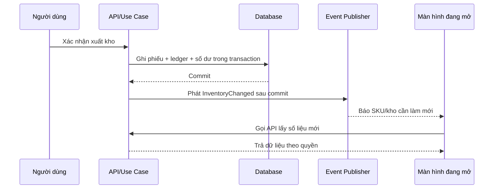

Để tránh mất sự kiện khi server lỗi ngay sau commit, hệ thống lớn thường cân nhắc transactional outbox hoặc cơ chế phát lại. Với đồ án nhỏ, nhóm có thể mô tả đây là phương án nâng cao, nhưng phải nhận thức rằng “commit xong rồi gửi ngay” vẫn có khoảng trống lỗi.

## 4. Thiết kế sự kiện

Một sự kiện nên có ID duy nhất, loại, thời điểm, phiên bản schema nếu cần, phạm vi tenant nếu áp dụng và tham chiếu thực thể. Tránh đưa dữ liệu nhạy cảm hoặc thông tin cá nhân dư thừa vào message broadcast.

Client nên xử lý sự kiện như một tín hiệu cần cập nhật, không mặc định mọi message sẽ đến đủ, đúng thứ tự và chỉ một lần. Khi reconnect, client có thể cần tải snapshot mới hoặc đọc các sự kiện từ cursor đã biết, tùy thiết kế.

## 5. Bảo mật

- Xác thực kết nối và phân quyền theo kênh/topic.
- Kiểm tra tenant và quyền của mỗi subscription.
- Không dùng ID khó đoán làm cơ chế phân quyền.
- Hạn chế tần suất gửi và kích thước message.
- Tránh phát toàn bộ số liệu kho cho tất cả người dùng nếu họ chỉ được xem một kho.
- Bảo vệ khỏi kết nối giữ lâu, chiếm dụng tài nguyên và dữ liệu đầu vào không hợp lệ.

## 6. Độ tin cậy và hiển thị giao diện

Kết nối thời gian thực có thể mất mạng, bị proxy ngắt hoặc kết nối lại. Giao diện nên hiển thị trạng thái kết nối khi điều đó quan trọng, cho phép làm mới dữ liệu và không coi thông báo lỗi mạng là chứng cứ rằng giao dịch server chưa thành công. Nếu request ghi sổ bị timeout, client cần truy vấn trạng thái hoặc gửi lại bằng idempotency key.

## 7. Chọn công nghệ theo nhu cầu

- Dùng polling khi quy mô và yêu cầu tức thời thấp, ưu tiên triển khai đơn giản.
- Cân nhắc SSE cho luồng thông báo một chiều từ server.
- Cân nhắc WebSocket khi thực sự cần giao tiếp hai chiều liên tục.
- Push notification phù hợp một số thông báo ngoài phiên hoạt động, nhưng không dùng để xác nhận giao dịch tồn kho.

Các lựa chọn trên là hướng dẫn khái quát, không phải bảng benchmark; cần đánh giá tải, proxy, trình duyệt và hạ tầng nếu triển khai thật.

## 8. Kiểm thử

- Client nhận thông báo khi một giao dịch hợp lệ commit.
- Giao dịch rollback không phát thông báo “đã thành công”.
- Reconnect không làm client cộng/trừ tồn lần hai chỉ vì nhận message lặp.
- Người không có quyền không đọc được kênh của kho/tenant khác.
- Khi sự kiện bị mất, thao tác làm mới đưa UI về dữ liệu chuẩn.
- Lỗi gửi thông báo không làm đảo ngược giao dịch tồn kho đã commit.

## 9. Tài liệu liên quan

- [SaaS Multi-Tenancy](saas-multi-tenancy.md)
- [PWA](progressive-web-app.md)
- [Xử lý nền](background-processing.md)
- [Sổ biến động tồn kho](inventory-ledger.md)

---

## saas-multi-tenancy.md

<sub>Nguồn: `doc/EP02/saas-multi-tenancy.md`</sub>


# EP02 — Cơ sở lý thuyết: SaaS Multi-Tenancy

## 1. Mục tiêu

Multi-tenancy là mô hình trong đó một hệ thống phần mềm phục vụ nhiều tổ chức/khách hàng độc lập (tenant). Tài liệu trình bày cách cô lập dữ liệu và quyền truy cập nếu hệ thống quản lý kho được phát triển thành dịch vụ dùng chung. **Đây là lựa chọn kiến trúc mở rộng**, không phải yêu cầu mặc định của WMS chỉ phục vụ một kho hoặc một tổ chức.

## 2. Khái niệm

- **SaaS (Software as a Service):** ứng dụng được cung cấp như một dịch vụ; người dùng truy cập và sử dụng theo mô hình dịch vụ.
- **Tenant:** phạm vi tổ chức/khách hàng có dữ liệu và cấu hình riêng.
- **Tenant context:** thông tin tenant đã được xác thực và gắn với yêu cầu xử lý.
- **Data isolation:** biện pháp ngăn tenant này đọc hoặc thay đổi dữ liệu tenant khác.
- **Tenant-scoped authorization:** kiểm tra cả quyền người dùng và phạm vi tenant của tài nguyên.

Một tổ chức có thể có nhiều kho; không nên mặc định `tenant = warehouse`. Tenant là ranh giới khách hàng/tổ chức, còn kho là địa điểm nghiệp vụ trong tenant đó.

## 3. Các mô hình triển khai

| Mô hình | Mô tả | Ưu/nhược điểm khái quát |
|---|---|---|
| Database riêng cho từng tenant | Mỗi khách hàng có cơ sở dữ liệu riêng | Cô lập mạnh, nhưng vận hành/migration tốn công |
| Schema riêng | Dùng chung database, tách schema | Ranh giới tương đối rõ; quản lý nhiều schema phức tạp |
| Database/schema dùng chung với `tenant_id` | Các hàng dữ liệu có khóa tenant | Vận hành hiệu quả hơn nhưng yêu cầu kiểm soát truy cập nghiêm ngặt |

Không có mô hình nào tối ưu trong mọi hoàn cảnh. Với đồ án, nếu cần minh họa multi-tenancy thì mô hình dùng chung có `tenant_id` dễ giải thích; không nên tuyên bố độ an toàn tuyệt đối chỉ vì đã thêm cột này.

## 4. Yêu cầu an toàn dữ liệu

### 4.1. Không tin tenant do client tự khai báo

Server phải xác định tenant từ phiên đăng nhập, token đã xác minh hoặc ngữ cảnh tổ chức đã được kiểm tra. Không nên chỉ nhận `tenant_id` từ query string/body rồi dùng trực tiếp. Nếu tài khoản có quyền ở nhiều tenant, cần quy trình chọn tenant và xác minh quyền rõ ràng.

### 4.2. Phạm vi tenant trong mọi truy vấn

Đọc, cập nhật, xóa, tìm kiếm, export, báo cáo và tác vụ nền đều phải giới hạn tenant đúng. Ví dụ, truy vấn phiếu nhập theo `document_id` vẫn cần kiểm tra phiếu thuộc tenant hiện tại; mã ID khó đoán không thay thế kiểm soát quyền.

### 4.3. Ràng buộc và chỉ mục

Các mã có tính duy nhất trong phạm vi tenant cần được mô hình hóa bằng khóa duy nhất kết hợp, ví dụ `(tenant_id, sku_code)`, nếu nghiệp vụ cho phép hai tenant dùng cùng mã. Khóa ngoại và truy vấn kết hợp cũng cần tránh liên kết chéo tenant.

### 4.4. Hệ thống nền và kênh thông báo

Job nền, lịch chạy định kỳ, báo cáo xuất file, cache, websocket topic, log nghiệp vụ và thông điệp queue cần giữ tenant context. Một endpoint được bảo vệ đúng nhưng worker nền xử lý nhầm tenant vẫn có thể gây lộ dữ liệu.

## 5. Ví dụ bảng khái niệm

```text
Tenant(tenant_id, name, status)
User(user_id, email, status)
Membership(user_id, tenant_id, role)
Product(product_id, tenant_id, sku_code, name)
Warehouse(warehouse_id, tenant_id, code, name)
InventoryBalance(balance_id, tenant_id, warehouse_id, product_id, ...)
```

Trong thiết kế thực tế, có thể dùng khóa chính tổng hợp hoặc khóa ID đơn kèm ràng buộc duy nhất/phạm vi tenant. Điểm quan trọng là quan hệ dữ liệu không cho phép vô tình ghép sản phẩm của tenant A với kho của tenant B.

## 6. Phân quyền

Phân quyền cần kết hợp:

1. **Xác thực:** người dùng là ai?
2. **Vai trò/quyền chức năng:** người dùng được làm gì?
3. **Phạm vi tenant:** người dùng được thao tác trên dữ liệu tổ chức nào?
4. **Phạm vi tài nguyên:** người dùng được truy cập kho/phiếu cụ thể nào, nếu quy định yêu cầu?

Vai trò như quản trị viên, quản lý kho, nhân viên kho chỉ là gợi ý. Trong SaaS thật, cần phân biệt quản trị viên toàn nền tảng với quản trị viên của một tenant để tránh quyền toàn cục bị gán nhầm.

## 7. Kiểm thử cô lập tenant

- Người dùng tenant A không thể đọc/ghi SKU, phiếu hoặc kho thuộc B.
- Thay `tenant_id` trong request không làm vượt quyền.
- Endpoint chi tiết theo ID, tìm kiếm, export và báo cáo đều kiểm tra tenant.
- Worker xử lý job đã lưu tenant context đúng.
- Cache key chứa phạm vi tenant khi dữ liệu có thể khác nhau theo tenant.
- Cùng một SKU code ở hai tenant không gây xung đột nếu quy tắc cho phép.
- Log không làm lộ dữ liệu nhạy cảm của tenant khác.

## 8. Rủi ro và cách giảm thiểu

Rủi ro lớn nhất là truy vấn thiếu điều kiện tenant hoặc xử lý ở một đường dẫn phụ như export, websocket và job nền. Có thể giảm bằng cách tập trung tạo tenant context, dùng repository/API có phạm vi tenant, kiểm thử âm tính, rà soát code và cân nhắc Row-Level Security nếu cơ sở dữ liệu hỗ trợ. RLS là một lớp phòng vệ bổ sung, không thay thế thiết kế phân quyền và kiểm thử.

## 9. Phạm vi áp dụng

Nếu đồ án chỉ có một tổ chức sử dụng hệ thống, nhóm có thể ghi multi-tenancy là kiến thức mở rộng. Nếu đưa vào phạm vi, phải cập nhật EP01, ERD, phân quyền, mô hình dữ liệu, luồng đăng nhập và tiêu chí nghiệm thu; không chỉ thêm một cột `tenant_id`.

## 10. Tài liệu liên quan

- [Clean Architecture](clean-architecture.md)
- [Giao tiếp thời gian thực](real-time-communication.md)
- [Xử lý nền](background-processing.md)
- [UML 2.x](uml-2.0.md)

---

## uml-2.0.md

<sub>Nguồn: `doc/EP02/uml-2.0.md`</sub>


# EP02 — Cơ sở lý thuyết: UML 2.x

## 1. Mục tiêu

UML (Unified Modeling Language) là ngôn ngữ mô hình hóa dùng để biểu diễn cấu trúc và hành vi của hệ thống. Tên file này giữ theo cây thư mục yêu cầu; trong thực hành, nhóm nên dùng thuật ngữ **UML 2.x** và ghi rõ loại sơ đồ. UML không phải phương pháp phát triển phần mềm và cũng không thay thế đặc tả nghiệp vụ bằng văn bản.

Tài liệu tập trung vào cách chọn sơ đồ phù hợp cho hệ thống quản lý kho. Nhóm không cần tạo mọi loại sơ đồ UML; hãy chọn sơ đồ trả lời câu hỏi phân tích/thiết kế cụ thể.

## 2. Các sơ đồ hữu ích

### 2.1. Use Case Diagram

Thể hiện tác nhân bên ngoài và mục tiêu/chức năng họ tương tác với hệ thống. Ví dụ: Nhân viên kho lập phiếu nhập, lập phiếu xuất, tra cứu tồn; Quản lý kho xem báo cáo; Quản trị viên quản lý tài khoản.

Use case không mô tả mọi bước xử lý bên trong. Hành vi chi tiết nên được ghi bằng đặc tả use case hoặc sơ đồ hoạt động/tuần tự. Các quan hệ `include` và `extend` cần dùng theo ý nghĩa UML, không phải cứ hai chức năng có chung bước là tùy tiện nối.

### 2.2. Class Diagram

Mô tả các lớp, thuộc tính, thao tác và quan hệ tĩnh. Với mô hình miền kho, các lớp khái niệm có thể là `Product`, `Warehouse`, `Receipt`, `ReceiptLine`, `Issue`, `IssueLine`, `InventoryBalance` và `InventoryMovement`. Cần phân biệt class diagram ở mức phân tích với schema database ở mức triển khai; hai mô hình liên quan nhưng không phải lúc nào cũng giống nhau từng cột.

### 2.3. Sequence Diagram

Mô tả thông điệp giữa các đối tượng/thành phần theo thứ tự thời gian cho một kịch bản cụ thể. Ví dụ: nhân viên xác nhận xuất kho, API gọi use case, use case kiểm tra tồn, repository ghi ledger và số dư, rồi trả kết quả. Đây là sơ đồ hữu ích khi giải thích transaction, kiểm tra quyền, phản hồi lỗi và sự kiện sau commit.

### 2.4. Activity Diagram

Mô tả luồng công việc, điểm quyết định, nhánh và song song. Có thể sử dụng cho quy trình nhập kho: tạo phiếu → kiểm tra dữ liệu → duyệt → ghi sổ; nhánh lỗi dẫn đến thông báo và không thay đổi tồn. Activity Diagram phù hợp khi cần trình bày logic quy trình chi tiết hơn so với use case.

### 2.5. State Machine Diagram

Mô tả trạng thái và chuyển trạng thái của một đối tượng theo sự kiện, điều kiện và hành động. Phù hợp cho vòng đời phiếu nhập/xuất hoặc đơn hàng. Xem [Máy trạng thái đơn hàng](order-state-machine.md).

### 2.6. Component và Deployment Diagram

Component Diagram thể hiện các thành phần phần mềm và quan hệ phụ thuộc; Deployment Diagram biểu diễn các nút môi trường triển khai và cách artifact được triển khai. Chỉ cần dùng khi phạm vi yêu cầu kiến trúc hoặc triển khai, không phải mặc định cho mọi báo cáo phân tích.

## 3. UML so với BFD, DFD và ERD

Các sơ đồ sau thường được dùng trong phân tích hệ thống nhưng không phải đều là sơ đồ UML:

- **BFD (Business Function Diagram):** phân rã chức năng nghiệp vụ theo cấp bậc, giúp thấy hệ thống gồm những nhóm chức năng nào.
- **DFD (Data Flow Diagram):** thể hiện tiến trình, luồng dữ liệu, kho dữ liệu và tác nhân ngoài theo quy ước DFD.
- **ERD (Entity-Relationship Diagram):** thể hiện thực thể dữ liệu, thuộc tính và quan hệ theo mô hình dữ liệu.
- **UML Use Case/Activity/Class/Sequence:** thuộc họ UML, phục vụ các góc nhìn khác nhau về tương tác, hành vi và cấu trúc.

Không nên dùng một sơ đồ để thay thế mọi góc nhìn. Ví dụ, DFD tập trung luồng dữ liệu, còn Activity Diagram tập trung hành động/quyết định trong quy trình. ERD mô tả cấu trúc dữ liệu ở mức khái niệm/logical, còn Class Diagram mô tả lớp và quan hệ trong mô hình hướng đối tượng; hai sơ đồ có thể giống về hình thức nhưng ý nghĩa khác nhau.

## 4. Ví dụ chọn sơ đồ theo câu hỏi

| Câu hỏi cần trả lời | Sơ đồ phù hợp |
|---|---|
| Ai sử dụng hệ thống và dùng chức năng gì? | Use Case Diagram |
| Hệ thống gồm những nhóm chức năng nào? | BFD |
| Dữ liệu đi từ tác nhân qua tiến trình đến kho dữ liệu như thế nào? | DFD |
| Dữ liệu gồm thực thể nào và liên kết ra sao? | ERD hoặc Class Diagram ở góc nhìn miền phù hợp |
| Quy trình nhập/xuất có nhánh điều kiện nào? | Activity Diagram hoặc DFD tùy câu hỏi |
| Một yêu cầu chạy qua những thành phần theo trình tự nào? | Sequence Diagram |
| Phiếu/đơn chuyển giữa các trạng thái ra sao? | State Machine Diagram |
| Các module phụ thuộc và triển khai ở đâu? | Component/Deployment Diagram |

## 5. Quy tắc vẽ và đặc tả

- Ghi tên sơ đồ, phạm vi và góc nhìn rõ ràng.
- Dùng đúng ký pháp của loại sơ đồ; tránh trộn ký hiệu DFD và UML trên một hình nếu không có chú giải.
- Giữ tên gọi nhất quán: cùng một thuật ngữ phải trỏ đến cùng khái niệm ở tài liệu, sơ đồ và dữ liệu.
- Không vẽ quan hệ chỉ để làm hình phức tạp; mỗi đường nối phải có ý nghĩa.
- Bổ sung luồng thay thế và lỗi cho kịch bản nghiệp vụ quan trọng.
- Mỗi sơ đồ cần có mục đích và được đối chiếu với yêu cầu hoặc use case liên quan.
- Với dữ liệu, ghi bội số quan hệ rõ ràng; không tự đặt quan hệ một-nhiều nếu nghiệp vụ chưa xác định.
- Tránh sơ đồ quá lớn: chia theo phạm vi/kịch bản và giữ liên kết giữa các hình.

## 6. Ví dụ use case rút gọn cho WMS

Tác nhân: Nhân viên kho, Quản lý kho, Quản trị viên.

Use case có thể gồm:

- Đăng nhập/đăng xuất.
- Quản lý danh mục hàng hóa.
- Quản lý nhà cung cấp, nếu thuộc phạm vi.
- Lập và ghi sổ phiếu nhập.
- Lập và ghi sổ phiếu xuất.
- Tra cứu tồn kho và lịch sử biến động.
- Xem báo cáo nhập–xuất–tồn.
- Quản lý người dùng và phân quyền.

Danh sách này là gợi ý dựa trên phạm vi ban đầu của EP01; cần cập nhật khi nhóm thống nhất yêu cầu thật. Các use case nên được viết với tiền điều kiện, luồng chính, luồng thay thế, hậu điều kiện và quy tắc liên quan khi cần.

## 7. Liên kết mô hình

Một quy trình nhất quán có thể đi theo chuỗi:

1. BFD xác định nhóm chức năng.
2. Use case xác định mục tiêu của tác nhân.
3. DFD hoặc Activity Diagram làm rõ luồng xử lý/dữ liệu ở mức phù hợp.
4. ERD mô hình hóa dữ liệu cần lưu.
5. Sequence Diagram làm rõ một kịch bản tương tác.
6. Class/Component Diagram mô tả cấu trúc phần mềm nếu có thiết kế hướng đối tượng/kiến trúc.
7. State Machine Diagram làm rõ vòng đời phiếu hoặc đơn khi nhiều trạng thái.

Đây không phải trình tự bắt buộc duy nhất, nhưng các hình phải thống nhất thuật ngữ và không mâu thuẫn nhau.

## 8. Lỗi thường gặp

- Dùng DFD để mô tả thứ tự thời gian giống sequence diagram nhưng không theo ký pháp DFD.
- Vẽ use case thành sơ đồ luồng công việc chi tiết.
- Dùng ERD và class diagram như hai bản giống hệt mà không giải thích mục tiêu.
- Bỏ qua tác nhân ngoài, dữ liệu đi vào/đi ra hoặc các nhánh lỗi.
- Sơ đồ và phần mô tả dùng tên chức năng khác nhau.
- Vẽ chức năng ngoài phạm vi rồi không thể giải thích nguồn yêu cầu.

## 9. Checklist rà soát

- [ ] Sơ đồ có tên và mục đích rõ.
- [ ] Ký hiệu đúng loại sơ đồ.
- [ ] Thuật ngữ thống nhất với EP01.
- [ ] Có đủ tác nhân/luồng/quan hệ ở phạm vi cần thể hiện.
- [ ] Nhánh lỗi hoặc điều kiện quan trọng đã được xem xét.
- [ ] Sơ đồ không mâu thuẫn với quy trình, ERD hoặc tiêu chí nghiệm thu.
- [ ] Có chú giải nếu sử dụng quy ước riêng.

## 10. Tài liệu liên quan

- [Đặc tả chủ đề EP01](../../EP01/01-topic-specification/topic-specification.md)
- [Clean Architecture](clean-architecture.md)
- [Máy trạng thái đơn hàng](order-state-machine.md)
- [Quản lý tồn kho](inventory-management.md)

---

## weighted-average-cost.md

<sub>Nguồn: `doc/EP02/weighted-average-cost.md`</sub>


# EP02 — Cơ sở lý thuyết: Weighted Average Cost

## 1. Mục tiêu và phạm vi

Giá bình quân gia quyền (Weighted Average Cost — WAC) là một phương pháp xác định đơn giá vốn bình quân của hàng tồn kho. Tài liệu giải thích công thức và cách liên kết với giao dịch nhập/xuất. Đây là phần lý thuyết về định giá; **không mặc định đồ án phải triển khai kế toán giá vốn** nếu yêu cầu của giảng viên chỉ tập trung vào số lượng tồn.

## 2. Khái niệm

Khi cùng một SKU được nhập nhiều lần với đơn giá khác nhau, doanh nghiệp có thể dùng phương pháp bình quân để xác định đơn giá trị hàng tồn theo chính sách kế toán đã chọn. Cần phân biệt:

- **Số lượng tồn:** bao nhiêu đơn vị đang có.
- **Đơn giá vốn bình quân:** giá vốn trung bình được tính theo phương pháp quy định.
- **Giá bán:** giá bán cho khách hàng, không phải đơn giá vốn.
- **Giá trị tồn kho:** số lượng đủ điều kiện định giá nhân với đơn giá vốn theo chính sách đã chọn.

Tài liệu này mô tả bình quân di động (perpetual/moving weighted average) vì dễ gắn với mỗi lần ghi sổ nhập. Bình quân cuối kỳ là phương pháp khác, thường tổng hợp dữ liệu trong kỳ rồi mới tính mức bình quân cho kỳ đó. Nhóm không nên trộn công thức của hai phương pháp.

## 3. Công thức bình quân di động

Khi nhập hàng và ghi sổ thành công:

\[
\text{Đơn giá bình quân mới} = \frac{Q_{cũ} \times C_{cũ} + Q_{nhập} \times C_{nhập}}{Q_{cũ} + Q_{nhập}}
\]

Trong đó:

- `Q_cũ`: số lượng tồn đủ điều kiện định giá ngay trước khi nhập.
- `C_cũ`: đơn giá vốn bình quân trước khi nhập.
- `Q_nhập`: số lượng nhập được ghi nhận.
- `C_nhập`: đơn giá vốn hợp lệ của lượng nhập.

Giá trị tồn sau nhập bằng giá trị trước nhập cộng giá trị nhập theo quy tắc xác định chi phí. Nếu tổng số lượng sau nhập bằng 0 thì không được chia cho 0; trong nghiệp vụ bình quân di động thông thường, không thể có tồn dương trước khi cộng một lượng nhập dương mà tổng lượng cuối vẫn bằng 0, nhưng hệ thống vẫn cần kiểm tra dữ liệu đầu vào.

### Ví dụ

Đang có 10 đơn vị với giá vốn bình quân 20.000 đồng/đơn vị. Nhập thêm 5 đơn vị với giá vốn 26.000 đồng/đơn vị:

- Giá trị trước nhập: `10 × 20.000 = 200.000 đồng`.
- Giá trị nhập: `5 × 26.000 = 130.000 đồng`.
- Tổng lượng: `15` đơn vị; tổng giá trị: `330.000 đồng`.
- Đơn giá bình quân mới: `330.000 / 15 = 22.000 đồng/đơn vị`.

Nếu xuất 4 đơn vị sau đó, theo mô hình bình quân di động, giá vốn xuất tham khảo là `4 × 22.000 = 88.000 đồng`, và lượng còn lại là 11 đơn vị với giá bình quân 22.000 đồng, trước các điều chỉnh giá trị khác.

## 4. Thời điểm áp dụng

Công thức chỉ chạy trên giao dịch nhập đã được xác nhận và ghi sổ; phiếu nháp hoặc phiếu bị hủy không được làm đổi giá bình quân. Với xuất kho, hệ thống lấy giá vốn bình quân có hiệu lực tại thời điểm ghi sổ xuất. Vì nhiều giao dịch có thể diễn ra đồng thời, việc đọc số lượng/giá trị, tính đơn giá mới và ghi lại phải được bảo vệ bằng transaction và cơ chế kiểm soát đồng thời.

## 5. Các chính sách phải được thống nhất

1. **Phạm vi tính bình quân:** theo SKU toàn công ty, theo SKU và kho, hay theo SKU–kho–lô.
2. **Chi phí cấu thành giá nhập:** giá mua, chi phí vận chuyển phân bổ, thuế không được khấu trừ và chi phí liên quan theo chính sách phù hợp.
3. **Làm tròn:** lưu độ chính xác bao nhiêu chữ số, làm tròn ở bước nào; chỉ làm tròn hiển thị hay cả lưu trữ.
4. **Nhập trả hàng và xuất trả hàng:** giá vốn lấy theo giao dịch gốc hay theo chính sách riêng.
5. **Nhập ngược ngày:** có cho ghi sổ lùi ngày không; nếu có, cần tái tính giá vốn và xác định ảnh hưởng đến giao dịch sau.
6. **Tồn âm:** khuyến nghị không cho xuất vượt tồn trong thiết kế cơ bản; tồn âm khiến việc xác định giá bình quân có thể phức tạp.
7. **Điều chỉnh giá trị:** cách xử lý hóa đơn phí đến sau và các khoản chênh lệch.

Đây là các quyết định chính sách; tài liệu đồ án không nên khẳng định tuân thủ một chuẩn kế toán cụ thể nếu nhóm chưa nghiên cứu và thống nhất căn cứ áp dụng.

## 6. Trường dữ liệu tham khảo

Nếu phạm vi có định giá, số dư có thể cần `quantity_on_hand`, `inventory_value` và/hoặc `average_unit_cost`; dòng nhập cần `quantity_received`, `unit_cost` và các thành phần chi phí. Cần quyết định lưu giá trị tổng làm nguồn chuẩn hay tính lại từ lượng nhân đơn giá. Khi lưu cả giá trị và đơn giá, phải duy trì điều kiện nhất quán trong cùng transaction.

Ledger số lượng và ledger giá trị có thể cùng dùng mã tham chiếu nhưng cần xác định rõ ý nghĩa. Không dùng số tiền làm đại diện cho số lượng và không suy ra giá vốn chỉ từ giá bán.

## 7. Kiểm thử cần có nếu triển khai

- Nhập một lô có đơn giá giống lô trước: đơn giá bình quân giữ nguyên, trong giới hạn làm tròn.
- Nhập một lô có đơn giá cao/thấp: kiểm tra kết quả theo công thức.
- Phiếu nháp/hủy: không làm thay đổi giá vốn.
- Xuất kho: sử dụng đơn giá có hiệu lực tại thời điểm ghi sổ.
- Hai lần nhập đồng thời: không mất cập nhật hoặc tính giá bình quân dựa trên dữ liệu cũ.
- Giá hoặc số lượng không hợp lệ: bị từ chối và không để lại cập nhật dở dang.

## 8. Giới hạn

WAC là một lựa chọn định giá, không tự giải quyết vấn đề chất lượng, lô/hạn sử dụng hoặc việc xác định đúng đơn hàng. Nếu bài tập chỉ yêu cầu quản lý số lượng nhập–xuất–tồn, nhóm nên ghi phần này như lý thuyết mở rộng và không thêm trường giá vốn vào mô hình cốt lõi một cách thiếu căn cứ.

## 9. Tài liệu liên quan

- [Quản lý tồn kho](inventory-management.md)
- [Sổ biến động tồn kho](inventory-ledger.md)
- [Kiểm soát đồng thời](concurrency-control.md)

<a id="ep03"></a>
# EP03

> Số tài liệu Markdown trong nhóm: **15**.


---

## business-process-overview.md

<sub>Nguồn: `doc/EP-03/business-process-overview.md`</sub>


# Tổng quan quy trình nghiệp vụ

## 1. Thông tin tài liệu

- **Tên hệ thống:** Omnichannel Inventory and Sales Management System (OISM)
- **Tên tiếng Việt:** Hệ thống quản lý bán hàng và tồn kho đa kênh
- **Mục đích tài liệu:** Mô tả tổng thể các quy trình nghiệp vụ, tác nhân, phạm vi, dữ liệu cốt lõi và mối liên hệ giữa các phân hệ của OISM.
- **Phạm vi áp dụng:** Cửa hàng bán lẻ vận hành nhiều chi nhánh, kho và kênh bán hàng như POS, Admin, Shopee, TikTok Shop và Lazada.
- **Đối tượng đọc:** Chủ cửa hàng, nhân viên kho, nhân viên xử lý đơn, thu ngân, quản trị hệ thống, nhóm phân tích nghiệp vụ, nhóm phát triển và nhóm kiểm thử.

## 2. Bối cảnh nghiệp vụ

Doanh nghiệp bán lẻ đa kênh thường phải quản lý sản phẩm, tồn kho và đơn hàng trên nhiều hệ thống rời rạc. Việc cập nhật thủ công hoặc đồng bộ chậm có thể làm phát sinh:

- Bán vượt số lượng thực tế đang có.
- Một SKU được bán đồng thời tại POS và sàn thương mại điện tử.
- Không bảo vệ được số lượng đã giữ cho đơn hàng online.
- Sai lệch giữa tồn kho phần mềm và số lượng kiểm đếm thực tế.
- Khó truy vết nguyên nhân biến động tồn kho.
- Giá vốn hàng bán không chính xác hoặc không nhất quán.
- Báo cáo doanh thu, COGS và lợi nhuận gộp bị sai lệch.
- Rò rỉ dữ liệu giữa các khách hàng khi vận hành theo mô hình SaaS.

OISM giải quyết các vấn đề trên bằng một nguồn dữ liệu tồn kho thống nhất, sổ cái chỉ ghi thêm, cơ chế giữ hàng và khóa đồng thời, mô hình đơn hàng chuẩn, máy trạng thái đơn hàng và tính giá vốn bình quân gia quyền.

## 3. Mục tiêu nghiệp vụ

1. Hợp nhất đơn hàng từ mọi kênh về một trung tâm xử lý.
2. Cung cấp số liệu tồn kho gần thời gian thực theo Tenant, chi nhánh và SKU.
3. Ngăn tuyệt đối việc tồn kho khả dụng bị âm trong các giao dịch hợp lệ.
4. Bảo vệ lượng hàng đã giữ cho đơn online khỏi việc bán tại POS.
5. Ghi nhận đầy đủ mọi biến động tồn kho để kiểm toán và truy vết.
6. Tính và chụp nhanh COGS tự động, nhất quán.
7. Hỗ trợ bán hàng nhanh tại quầy bằng PWA POS.
8. Cung cấp báo cáo doanh thu, COGS, lợi nhuận gộp và tồn kho.
9. Cô lập dữ liệu giữa các Tenant trong kiến trúc SaaS đa khách hàng.
10. Hỗ trợ kiểm thử tải đồng thời, triển khai container và CI/CD.

## 4. Phạm vi nghiệp vụ

### 4.1. Trong phạm vi

- Đăng ký Tenant và quản lý người dùng theo Tenant.
- Xác thực JWT và phân quyền Owner, Staff, Cashier.
- Quản lý chi nhánh và kho.
- Quản lý danh mục, thương hiệu, sản phẩm, biến thể, SKU, mã vạch và giá bán.
- Nhập hàng và cập nhật giá vốn bình quân gia quyền.
- Chuyển kho hai bước.
- Kiểm kê và tạo bút toán điều chỉnh.
- Quản lý sổ cái tồn kho chỉ ghi thêm.
- Tiếp nhận đơn POS, Admin và webhook mô phỏng từ các sàn.
- Chuẩn hóa đơn hàng về Canonical Order Model.
- Giữ hàng, xác nhận, trừ kho, hoàn giữ và hủy đơn.
- Bán hàng và thanh toán tại PWA POS.
- Thông báo thời gian thực bằng SignalR.
- Công việc nền bằng Hangfire.
- Báo cáo doanh thu, COGS, lợi nhuận gộp và tồn kho.
- Cảnh báo tồn kho thấp và đề xuất đặt hàng lại bằng AI.

### 4.2. Ngoài phạm vi phiên bản cốt lõi

- Kết nối production chính thức với API riêng của từng sàn, nếu dự án chỉ triển khai Webhook Simulator.
- Kế toán tài chính đầy đủ như sổ cái kế toán tổng hợp, công nợ và thuế chuyên sâu.
- Quản lý vận tải, tối ưu tuyến giao hàng hoặc đội ngũ giao hàng.
- Cổng thanh toán trực tuyến hoàn chỉnh và đối soát ngân hàng tự động.
- Quản lý sản xuất, định mức nguyên vật liệu hoặc bảo hành.
- Mô hình AI tự ra quyết định mua hàng không cần người phê duyệt.

## 5. Tác nhân nghiệp vụ

| Tác nhân | Vai trò và trách nhiệm chính |
|---|---|
| Owner | Quản lý Tenant, người dùng, vai trò, chi nhánh, sản phẩm, cấu hình, báo cáo và toàn bộ dữ liệu thuộc Tenant. |
| Staff | Quản lý sản phẩm, kho, phiếu nhập, chuyển kho, kiểm kê và xử lý đơn hàng theo quyền được cấp. |
| Cashier | Sử dụng POS để tìm/quét sản phẩm, tạo giỏ hàng, thanh toán và in hóa đơn. |
| Nhà cung cấp | Cung cấp hàng hóa và thông tin giá nhập cho phiếu nhập hàng. |
| Kênh thương mại điện tử | Gửi sự kiện đơn hàng vào Order Ingestion Hub thông qua webhook hoặc trình giả lập. |
| Khách hàng | Mua hàng tại POS hoặc trên các kênh online. |
| Quản trị tác vụ nền | Hangfire xử lý hết hạn giữ hàng và tổng hợp báo cáo định kỳ. |
| Dịch vụ thời gian thực | SignalR gửi thông báo đơn hàng mới, cảnh báo và thay đổi trạng thái. |
| Hệ thống AI dự báo | Phân tích dữ liệu bán và tồn kho để đề xuất điểm hoặc lượng đặt hàng lại. |

## 6. Các phân hệ nghiệp vụ

| Mã | Phân hệ | Trách nhiệm chính | Yêu cầu liên quan |
|---|---|---|---|
| AUTH | Tenant và xác thực | Đăng ký Tenant, tài khoản, JWT, RBAC, chi nhánh/kho | FR-AUTH |
| PROD | Danh mục sản phẩm | Danh mục, thương hiệu, sản phẩm, biến thể, SKU, mã vạch, giá | FR-PROD |
| INV | Quản lý tồn kho | Sổ cái, nhập hàng, chuyển kho, kiểm kê, điều chỉnh | FR-INV |
| COST | Giá vốn | Bình quân gia quyền và snapshot CostPrice | FR-COST |
| ORD | Trung tâm đơn hàng | Chuẩn hóa đơn, máy trạng thái, phê duyệt và hủy | FR-ORD |
| RSE | Reservation Engine | Available, giữ hàng, giải phóng, trừ kho, chống bán vượt | FR-RSE |
| POS | Bán hàng tại quầy | Quét mã, giỏ hàng, thanh toán, in hóa đơn | FR-POS |
| REP | Báo cáo và cảnh báo | Doanh thu, COGS, lợi nhuận, tồn kho, cảnh báo | FR-REP |
| SIM | Mô phỏng và thời gian thực | Webhook Simulator, SignalR, Hangfire | FR-SIM |

## 7. Bản đồ quy trình nghiệp vụ cấp cao

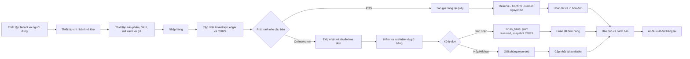

## 8. Các quy trình nghiệp vụ cốt lõi

### BP-01. Khởi tạo Tenant và phân quyền

**Đầu vào:** Thông tin cửa hàng, tài khoản Owner.  
**Xử lý:** Tạo TenantId; tạo Owner; cấu hình chi nhánh/kho; phân quyền người dùng.  
**Đầu ra:** Không gian dữ liệu độc lập và người dùng có thể đăng nhập.  
**Kiểm soát:** Mọi dữ liệu nghiệp vụ phải gắn TenantId; JWT chứa TenantId, UserId và Role.

### BP-02. Thiết lập danh mục sản phẩm

**Đầu vào:** Danh mục, thương hiệu, sản phẩm, thuộc tính biến thể, SKU, mã vạch và giá.  
**Xử lý:** Kiểm tra tính duy nhất SKU/mã vạch theo phạm vi quy định; lưu giá bán riêng với COGS.  
**Đầu ra:** SKU sẵn sàng cho nhập kho, bán hàng và kiểm kê.

### BP-03. Nhập hàng và cập nhật COGS

**Đầu vào:** Nhà cung cấp, chi nhánh/kho nhận, SKU, số lượng, giá nhập.  
**Xử lý:** Xác nhận phiếu nhập; khóa bản ghi tồn kho liên quan; tính COGS mới; ghi giao dịch IN vào Inventory Ledger.  
**Đầu ra:** on_hand tăng; COGS mới được lưu; giao dịch có thể truy vết.

### BP-04. Tiếp nhận và xử lý đơn online

**Đầu vào:** Payload từ Shopee, TikTok Shop, Lazada hoặc Admin.  
**Xử lý:** Xác thực nguồn; chống tạo trùng; ánh xạ về Canonical Order Model; kiểm tra available; giữ hàng; chuyển trạng thái.  
**Đầu ra:** Đơn nằm ở Reserved hoặc bị từ chối với lý do rõ ràng.

### BP-05. Thanh toán nhanh tại POS

**Đầu vào:** Giỏ hàng, chi nhánh, phương thức thanh toán.  
**Xử lý:** Trong một giao dịch nguyên tử thực hiện kiểm tra, reserve, confirm, deduct, ghi ledger, snapshot COGS và hoàn tất thanh toán.  
**Đầu ra:** Đơn Completed và hóa đơn có thể in; nếu lỗi, toàn bộ giao dịch rollback.

### BP-06. Hủy đơn hoặc hết hạn giữ hàng

**Đầu vào:** Yêu cầu hủy hợp lệ hoặc reservation quá hạn.  
**Xử lý:** Khóa dữ liệu liên quan; giảm reserved; chuyển đơn sang Cancelled; ghi nhật ký.  
**Đầu ra:** available tăng tương ứng, on_hand không đổi nếu chưa xuất hàng.

### BP-07. Chuyển kho hai bước

**Đầu vào:** Kho nguồn, kho đích, SKU và số lượng.  
**Xử lý:** Xác nhận xuất kho vận chuyển; ghi OUT tại nguồn; chờ xác nhận nhận; ghi IN tại đích.  
**Đầu ra:** Có thể theo dõi hàng đang vận chuyển và lịch sử hai đầu kho.

### BP-08. Kiểm kê và điều chỉnh

**Đầu vào:** Phiên kiểm kê và số lượng đếm thực tế.  
**Xử lý:** Chốt phạm vi; đối chiếu số dư hệ thống; phê duyệt chênh lệch; ghi bút toán bù trừ.  
**Đầu ra:** Số dư hệ thống khớp số lượng được phê duyệt mà không sửa/xóa ledger cũ.

### BP-09. Báo cáo và cảnh báo

**Đầu vào:** Dữ liệu đơn hàng, OrderItem.CostPrice và Inventory Ledger.  
**Xử lý:** Tổng hợp theo thời gian, chi nhánh, kênh và SKU; tính doanh thu thuần, COGS, lợi nhuận gộp và giá trị tồn.  
**Đầu ra:** Dashboard, báo cáo, cảnh báo tồn thấp và dữ liệu đầu vào cho AI.

## 9. Dữ liệu nghiệp vụ cốt lõi

- Tenant, User, Role, Permission.
- Branch, Warehouse.
- Category, Brand, Product, ProductVariant/SKU, Barcode, Price.
- InventoryBalance hoặc StockBalance dùng cho số dư vận hành.
- InventoryTransaction/InventoryLedger dùng cho lịch sử chỉ ghi thêm.
- PurchaseReceipt và PurchaseReceiptItem.
- StockTransfer và StockTransferItem.
- StocktakeSession và StocktakeLine.
- Order và OrderItem.
- StockReservation.
- Payment và Receipt.
- Notification, AuditLog, WebhookEvent và BackgroundJob.

## 10. Nguyên tắc tồn kho

- `on_hand`: Số lượng thực tế đang thuộc kho/chi nhánh.
- `reserved`: Số lượng đang được giữ cho các đơn chưa trừ kho.
- `available`: Số lượng có thể tiếp tục bán.

```text
available = on_hand - reserved
```

Sổ cái là nguồn kiểm toán của mọi biến động. Bảng số dư có thể được duy trì để tối ưu hiệu năng nhưng chỉ được thay đổi thông qua các use case nghiệp vụ có giao dịch, khóa và ghi ledger tương ứng. Không API nào được phép sửa trực tiếp on_hand ngoài các dịch vụ miền được ủy quyền.

## 11. Vòng đời đơn hàng chuẩn

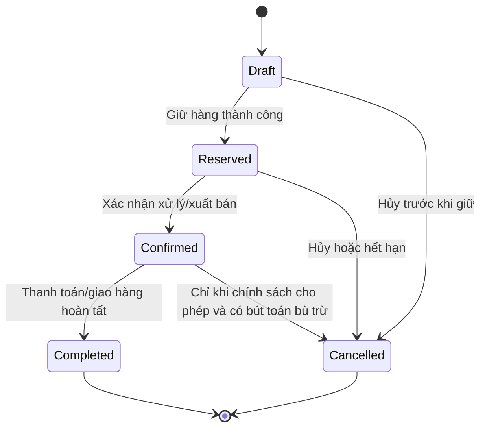

Mỗi lần chuyển trạng thái phải được xác thực theo máy trạng thái, quyền người dùng, trạng thái hiện tại và điều kiện tồn kho.

## 12. Chỉ số thành công

- Không phát sinh `available < 0` trong các bài kiểm thử đồng thời hợp lệ.
- Độ trễ p95 tìm kiếm/quét SKU tại POS dưới 200 ms.
- Giao dịch tạo/ghi đơn hàng dưới 500 ms.
- Báo cáo dưới 2 giây với tập dữ liệu dưới 100.000 bản ghi.
- 100% biến động on_hand có giao dịch ledger tương ứng.
- 100% OrderItem đã Confirmed/Completed có CostPrice snapshot.
- Mô-đun Ledger, Reservation và COGS đạt tối thiểu 80% độ bao phủ kiểm thử tự động.
- Mục tiêu hoạt động 99,5% trong khung giờ 07:00–22:00.

## 13. Truy vết yêu cầu chính

| Quy trình | Yêu cầu nguồn |
|---|---|
| Khởi tạo Tenant và phân quyền | FR-AUTH, NFR-TENANT, NFR-SEC |
| Danh mục và SKU | FR-PROD |
| Nhập hàng, chuyển kho, kiểm kê | FR-INV, FR-COST |
| Đơn hàng đa kênh | FR-ORD, FR-SIM |
| Reservation và chống bán vượt | FR-RSE, NFR-PERF-02, NFR-SEC-02 |
| POS | FR-POS, NFR-USA-02 |
| Báo cáo và cảnh báo | FR-REP |
| Kiến trúc và kiểm thử | NFR-MAINT |


---

## business-rules.md

<sub>Nguồn: `doc/EP-03/business-rules.md`</sub>


# Quy tắc nghiệp vụ

## 1. Mục đích

Tài liệu định nghĩa các quy tắc nghiệp vụ bắt buộc của OISM. Mỗi quy tắc có mã duy nhất để truy vết sang URS, RTM, use case, API, kiểm thử và mã nguồn.

## 2. Quy ước mức độ

- **MUST:** Bắt buộc, vi phạm phải từ chối hoặc rollback giao dịch.
- **SHOULD:** Nên áp dụng; chỉ được bỏ qua khi có lý do thiết kế được phê duyệt.
- **MAY:** Tùy chọn hoặc có thể cấu hình.

## 3. Quy tắc Tenant, xác thực và phân quyền

### BR-AUTH-001 - Mọi dữ liệu nghiệp vụ thuộc một Tenant

- Mỗi bản ghi nghiệp vụ MUST có TenantId, trừ bảng tham chiếu toàn hệ thống được xác định rõ.
- TenantId MUST được lấy từ ngữ cảnh xác thực phía server.
- Client không được phép đổi TenantId để truy cập dữ liệu Tenant khác.
- **Nguồn:** FR-AUTH-01, NFR-TENANT-01.

### BR-AUTH-002 - TenantId là bất biến

TenantId của một bản ghi nghiệp vụ MUST NOT được thay đổi sau khi tạo. Việc chuyển dữ liệu giữa Tenant không nằm trong thao tác nghiệp vụ thông thường.

### BR-AUTH-003 - Nội dung token

JWT hợp lệ MUST chứa tối thiểu TenantId, UserId và Role; access token có thời hạn tối đa 60 phút theo yêu cầu đề tài.

### BR-AUTH-004 - Mật khẩu

Mật khẩu MUST được băm bằng BCrypt hoặc Argon2; không được lưu hoặc ghi log mật khẩu dạng rõ.

### BR-AUTH-005 - Quyền theo vai trò

- Owner: toàn quyền trong Tenant.
- Staff: quản lý kho, sản phẩm và đơn theo quyền được cấu hình.
- Cashier: chỉ truy cập chức năng POS và dữ liệu tối thiểu cần thiết.
- API MUST kiểm tra quyền phía server; ẩn nút trên giao diện không thay thế kiểm tra API.

### BR-AUTH-006 - Chi nhánh bị tắt

Chi nhánh/kho đã có lịch sử giao dịch MUST NOT bị xóa cứng. Khi bị tắt, hệ thống không cho tạo giao dịch mới nhưng vẫn cho phép truy vấn báo cáo lịch sử.

## 4. Quy tắc sản phẩm, SKU, mã vạch và giá

### BR-PROD-001 - SKU duy nhất

Mã SKU MUST là duy nhất trong cùng một Tenant. Hai Tenant khác nhau MAY sử dụng cùng chuỗi SKU.

### BR-PROD-002 - SKU đại diện đơn vị tồn kho

Mỗi biến thể bán được MUST có SKU riêng. Tồn kho, reservation, COGS và OrderItem MUST tham chiếu SKU, không chỉ tham chiếu Product.

### BR-PROD-003 - Mã vạch

- Mã vạch được sinh hoặc nhập thủ công.
- Mã vạch đang hoạt động SHOULD là duy nhất trong Tenant để tránh quét nhầm.
- Nếu dùng EAN-13, hệ thống SHOULD kiểm tra đủ 13 chữ số và check digit.
- Nếu dùng Code128, hệ thống MUST kiểm tra độ dài và tập ký tự theo cấu hình.

### BR-PROD-004 - Giá bán tách biệt COGS

RetailPrice và WholesalePrice MUST được lưu tách biệt với CostPrice/COGS. Thay đổi giá bán không được tự động thay đổi COGS.

### BR-PROD-005 - Không xóa SKU có lịch sử

SKU đã xuất hiện trong ledger, đơn hàng, phiếu nhập hoặc kiểm kê MUST NOT bị xóa cứng; chỉ được ngừng hoạt động.

### BR-PROD-006 - Số lượng và giá hợp lệ

- Số lượng giao dịch MUST lớn hơn 0, trừ trường chênh lệch tính toán được biểu diễn bằng loại IN/OUT riêng.
- Giá nhập và giá bán MUST không âm.
- Tiền tệ và quy tắc làm tròn MUST nhất quán trong Tenant.

## 5. Quy tắc tồn kho và Inventory Ledger

### BR-INV-001 - Công thức tồn khả dụng

```text
available = on_hand - reserved
```

Với mô hình không cho phép backorder, available MUST luôn lớn hơn hoặc bằng 0 sau khi commit.

### BR-INV-002 - Cấp quản lý số dư

Số dư MUST được xác định tối thiểu theo `TenantId + BranchId/WarehouseId + SKUId`. Không được gộp tồn giữa các Tenant.

### BR-INV-003 - Ledger chỉ ghi thêm

InventoryLedger MUST chỉ cho phép INSERT. UPDATE và DELETE bị cấm ở tầng ứng dụng và SHOULD bị ngăn thêm bằng quyền/ràng buộc cơ sở dữ liệu.

### BR-INV-004 - Điều chỉnh bằng bút toán bù trừ

Nếu giao dịch ledger sai, hệ thống MUST tạo giao dịch bù trừ có ReferenceId liên kết bản ghi gốc; không chỉnh sửa bản ghi cũ.

### BR-INV-005 - Trường bắt buộc của ledger

Mọi bản ghi MUST có TenantId, BranchId/WarehouseId, SKUId, Type, Quantity, BalanceAfter, ReferenceId và CreatedAt; SHOULD có ActorId, ReasonCode và CorrelationId.

### BR-INV-006 - Đồng nhất số dư và ledger

Mọi thay đổi on_hand MUST có ledger tương ứng trong cùng transaction. Nếu ghi ledger thất bại, cập nhật số dư MUST rollback.

### BR-INV-007 - BalanceAfter

BalanceAfter MUST bằng số dư on_hand sau khi áp dụng giao dịch tại đúng kho và SKU. Việc tính BalanceAfter phải diễn ra dưới cùng cơ chế khóa với cập nhật số dư.

### BR-INV-008 - Không cập nhật tồn trực tiếp

Không API/UI nào được phép nhập một giá trị mới để ghi đè on_hand. Thay đổi chỉ đi qua nghiệp vụ nhập hàng, bán hàng, trả hàng, chuyển kho hoặc kiểm kê/điều chỉnh.

### BR-INV-009 - Không cho tồn âm

on_hand MUST không âm sau commit, trừ khi một chính sách backorder riêng được thiết kế và phê duyệt. Phiên bản đề tài mặc định không hỗ trợ backorder.

### BR-INV-010 - Nhập hàng

Phiếu nhập chỉ làm tăng tồn và cập nhật COGS khi chuyển sang Confirmed. Phiếu Draft MUST không ảnh hưởng số dư.

### BR-INV-011 - Tính nguyên tử của phiếu nhập

Khi xác nhận phiếu nhập nhiều dòng, tất cả dòng MUST thành công hoặc toàn bộ phiếu rollback.

### BR-INV-012 - Chuyển kho hai bước

- Confirm Dispatch: ghi OUT tại nguồn và chuyển trạng thái InTransit.
- Confirm Receipt: ghi IN tại đích.
- Kho đích MUST NOT tăng on_hand trước khi xác nhận nhận.

### BR-INV-013 - Chênh lệch chuyển kho

Nếu số lượng nhận khác số lượng gửi, hệ thống MUST ghi nhận chênh lệch và yêu cầu lý do/phê duyệt; không âm thầm sửa số lượng gửi.

### BR-INV-014 - Kiểm kê

Kết quả kiểm kê chỉ thay đổi tồn sau khi được người có quyền phê duyệt. Chênh lệch dương ghi ADJUSTMENT_IN; chênh lệch âm ghi ADJUSTMENT_OUT.

## 6. Quy tắc COGS

### BR-COST-001 - Phương pháp giá vốn

OISM sử dụng giá vốn bình quân gia quyền theo SKU và phạm vi kho/chi nhánh được thiết kế.

### BR-COST-002 - Công thức nhập hàng

```text
new_cost = ((old_on_hand × old_cost) + (received_qty × purchase_price))
           / (old_on_hand + received_qty)
```

Công thức chỉ áp dụng khi phiếu nhập được Confirmed.

### BR-COST-003 - Trường hợp tồn cũ bằng 0

Nếu `old_on_hand = 0` và `received_qty > 0`, `new_cost` MUST bằng `purchase_price`.

### BR-COST-004 - Trường hợp mẫu số không hợp lệ

Nếu `old_on_hand + received_qty <= 0`, hệ thống MUST từ chối phép tính và rollback giao dịch.

### BR-COST-005 - Độ chính xác và làm tròn

Phép tính COGS MUST dùng kiểu decimal, không dùng floating point nhị phân. Hệ thống SHOULD lưu nhiều chữ số thập phân hơn số hiển thị và chỉ làm tròn theo chính sách tiền tệ khi xuất báo cáo/hóa đơn.

### BR-COST-006 - Snapshot khi xuất bán

Khi đơn chuyển sang Confirmed hoặc POS thanh toán, COGS hiện tại MUST được lưu vào `OrderItem.CostPrice` trong cùng transaction với trừ kho.

### BR-COST-007 - Bất biến lịch sử COGS

Việc nhập hàng hoặc thay đổi COGS trong tương lai MUST NOT thay đổi `OrderItem.CostPrice` của đơn đã Confirmed/Completed.

### BR-COST-008 - Lợi nhuận gộp

```text
GrossProfit = NetRevenue - COGS
COGS = Sum(OrderItem.CostPrice × confirmed_quantity)
```

Đơn Cancelled chưa xuất hàng MUST không đóng góp doanh thu hoặc COGS. Trả hàng/hoàn tiền phải dùng quy tắc bù trừ được định nghĩa.

## 7. Quy tắc đơn hàng và máy trạng thái

### BR-ORD-001 - Mô hình đơn chuẩn

Mọi đơn POS, Admin và sàn MUST được chuyển về Canonical Order Model trước khi xử lý nghiệp vụ chung.

### BR-ORD-002 - Định danh đơn ngoài hệ thống

Tổ hợp `TenantId + Channel + ExternalOrderId` MUST duy nhất đối với đơn online để ngăn tạo trùng.

### BR-ORD-003 - Idempotency webhook

Nhận lại cùng event hoặc cùng khóa idempotency MUST không tạo thêm Order, reservation, payment hoặc ledger transaction.

### BR-ORD-004 - Chuyển trạng thái hợp lệ

Các chuyển đổi mặc định:

- Draft → Reserved
- Draft → Cancelled
- Reserved → Confirmed
- Reserved → Cancelled
- Confirmed → Completed
- Confirmed → trạng thái hủy/trả chỉ theo quy trình bù trừ được phê duyệt

Mọi chuyển đổi khác MUST bị từ chối.

### BR-ORD-005 - Kiểm tra trạng thái hiện tại

Lệnh chuyển trạng thái MUST kiểm tra trạng thái hiện tại trong cơ sở dữ liệu dưới kiểm soát đồng thời; không chỉ dựa trên trạng thái client gửi lên.

### BR-ORD-006 - Đơn nhiều dòng

Reservation/Confirm cho đơn nhiều dòng MUST theo nguyên tắc all-or-nothing, trừ khi nghiệp vụ tách đơn/backorder được bổ sung rõ ràng.

### BR-ORD-007 - SKU không ánh xạ được

Đơn online có SKU ngoài chưa ánh xạ MUST được đưa vào hàng chờ lỗi và MUST NOT giữ tồn của một SKU khác theo suy đoán.

### BR-ORD-008 - Hủy sau Confirmed

Không được hoàn tác đơn Confirmed chỉ bằng cách đổi trạng thái. Hệ thống MUST tạo nghiệp vụ trả hàng hoặc bút toán tồn kho bù trừ nếu hàng quay lại kho.

## 8. Quy tắc Reservation và chống bán vượt

### BR-RSE-001 - Điều kiện giữ hàng

Reservation chỉ thành công nếu tại thời điểm khóa:

```text
on_hand - reserved >= requested_quantity
```

### BR-RSE-002 - Tác động của Reserve

Reserve thành công MUST tăng reserved, không giảm on_hand và không ghi ledger xuất kho.

### BR-RSE-003 - Tác động của Confirm

Confirm MUST đồng thời:

1. Giảm on_hand theo số lượng xác nhận.
2. Giảm reserved theo lượng đã giữ.
3. Ghi ledger OUT/SALE.
4. Snapshot COGS.
5. Chuyển trạng thái đơn.

Tất cả thực hiện trong một transaction.

### BR-RSE-004 - Tác động của Cancel/Expire

Nếu đơn đang Reserved, Cancel/Expire MUST giảm reserved; on_hand không đổi và không ghi ledger OUT.

### BR-RSE-005 - Một reservation không được giải phóng hai lần

Reservation MUST có trạng thái hoặc version để bảo đảm Release/Expire chỉ tác động một lần.

### BR-RSE-006 - Khóa đồng thời

Cập nhật reserved/on_hand MUST dùng pessimistic locking hoặc optimistic locking ở cấp cơ sở dữ liệu. Kiểm tra tồn chỉ ở tầng ứng dụng mà không có bảo vệ DB là không hợp lệ.

### BR-RSE-007 - Thứ tự khóa

Khi một đơn có nhiều SKU, dịch vụ MUST khóa số dư theo một thứ tự ổn định, ví dụ SKUId tăng dần, để giảm nguy cơ deadlock.

### BR-RSE-008 - Hết hạn reservation

Mỗi reservation online SHOULD có `ExpiresAt`. Hangfire MAY quét theo lịch, nhưng thao tác hết hạn MUST idempotent và dùng khóa/phiên bản.

### BR-RSE-009 - Kịch bản Flash Sale

Với 50 yêu cầu đồng thời cho SKU còn 1 đơn vị, tối đa một reservation được thành công; `available` MUST không âm.

## 9. Quy tắc POS và thanh toán

### BR-POS-001 - Kiểm tra available

POS MUST kiểm tra available khi thêm/chỉnh số lượng và MUST kiểm tra lại trong transaction checkout. Kiểm tra trên giao diện không thay thế kiểm tra tại server.

### BR-POS-002 - Bảo vệ hàng online

POS chỉ được bán available, không được sử dụng phần reserved cho đơn online.

### BR-POS-003 - Thanh toán nguyên tử

Checkout POS MUST thực hiện Reserve → Confirm → Deduct, tạo Order, Payment, ledger và snapshot COGS trong một transaction nguyên tử.

### BR-POS-004 - Rollback khi lỗi

Nếu bất kỳ phần nào của checkout thất bại, không được để lại đơn thanh toán dở dang, số dư thay đổi một phần hoặc ledger thiếu.

### BR-POS-005 - Phương thức thanh toán

Phiên bản cốt lõi hỗ trợ tiền mặt và QR chuyển khoản. Payment MUST lưu phương thức, số tiền, trạng thái, thời gian và người thực hiện.

### BR-POS-006 - In hóa đơn

Chỉ mở hộp thoại in hóa đơn hoàn tất sau khi transaction checkout đã commit thành công.

### BR-POS-007 - Giá tại thời điểm bán

OrderItem MUST snapshot đơn giá bán, giảm giá, thuế nếu có và CostPrice; thay đổi bảng giá sau đó không sửa đơn lịch sử.

## 10. Quy tắc báo cáo và cảnh báo

### BR-REP-001 - Phạm vi doanh thu

Báo cáo doanh thu MUST chỉ tính các trạng thái được quy định là đã ghi nhận doanh thu, mặc định là Completed hoặc Confirmed theo chính sách kế toán của Tenant. Chính sách phải nhất quán giữa các báo cáo.

### BR-REP-002 - Bộ lọc

Báo cáo MUST hỗ trợ tối thiểu khoảng thời gian, chi nhánh, kênh bán và SKU.

### BR-REP-003 - Giá trị tồn kho

Giá trị tồn kho được tính theo số lượng on_hand nhân COGS hiện tại của SKU trong phạm vi kho tương ứng, theo chính sách định giá đã chọn.

### BR-REP-004 - Cảnh báo tồn thấp

Cảnh báo được tạo khi:

```text
available <= reorder_point
```

Một SKU không nên tạo lặp vô hạn cùng cảnh báo chưa xử lý; hệ thống SHOULD có cơ chế gộp hoặc trạng thái cảnh báo.

### BR-REP-005 - Dữ liệu gần thời gian thực

Sau khi transaction tồn kho hoặc đơn hàng commit, dashboard SHOULD được cập nhật qua SignalR hoặc cơ chế làm mới phù hợp; thông báo không được phát trước commit.

### BR-REP-006 - Đề xuất AI

Đề xuất của AI là thông tin hỗ trợ quyết định. Trong phạm vi mặc định, AI MUST NOT tự xác nhận phiếu nhập hoặc tạo cam kết tài chính mà không có người có quyền phê duyệt.

## 11. Quy tắc bảo mật, hiệu năng và vận hành

### BR-NFR-001 - HTTPS

API production MUST sử dụng HTTPS với TLS 1.3 theo yêu cầu dự án.

### BR-NFR-002 - Refresh token

Refresh token MUST được lưu và truyền an toàn, có khả năng thu hồi, xoay vòng hoặc vô hiệu hóa theo thiết kế bảo mật.

### BR-NFR-003 - Global Query Filter

EF Core Global Query Filters MUST áp dụng cho các entity theo Tenant; các truy vấn bỏ filter chỉ được dùng trong tác vụ quản trị được kiểm soát và kiểm toán.

### BR-NFR-004 - Chỉ mục

InventoryLedger và Orders MUST có chỉ mục hỗ trợ `(TenantId, CreatedAt)` và `(TenantId, SKUId)` hoặc biến thể phù hợp với truy vấn thực tế.

### BR-NFR-005 - Mục tiêu hiệu năng

- p95 tìm kiếm/quét SKU tại POS: dưới 200 ms.
- Tạo/ghi đơn hàng: dưới 500 ms.
- Báo cáo tổng hợp: dưới 2 giây với dưới 100.000 bản ghi.

### BR-NFR-006 - Thời gian hoạt động

Hệ thống SHOULD đạt 99,5% uptime trong giờ vận hành 07:00–22:00.

### BR-NFR-007 - Clean Architecture

Domain không được phụ thuộc trực tiếp EF Core, SignalR, Hangfire hoặc Presentation. Application điều phối use case; Infrastructure triển khai giao tiếp kỹ thuật.

### BR-NFR-008 - Độ bao phủ kiểm thử

Inventory Ledger, Reservation/Anti-Oversell và COGS MUST đạt tối thiểu 80% coverage kết hợp Unit Test và Integration Test theo tiêu chí dự án.

### BR-NFR-009 - Thời gian chuẩn

Timestamp SHOULD được lưu ở UTC và chuyển đổi theo múi giờ Tenant khi hiển thị. CreatedAt của ledger MUST do server tạo.

### BR-NFR-010 - Không ghi log dữ liệu nhạy cảm

Log MUST NOT chứa mật khẩu, token đầy đủ, bí mật webhook hoặc dữ liệu thanh toán nhạy cảm. Log SHOULD có CorrelationId và TenantId ở dạng phù hợp.

## 12. Bất biến miền quan trọng

Các bất biến sau phải được bảo vệ bằng code miền, transaction và ràng buộc DB khi phù hợp:

```text
on_hand >= 0
reserved >= 0
available = on_hand - reserved
available >= 0
reserved <= on_hand
ledger is append-only
confirmed order item has CostPrice
TenantId never changes
one external order creates at most one internal order
one reservation is released at most once
```

## 13. Quy tắc cần được làm rõ thêm

Các nội dung sau chưa được đề tài quy định đầy đủ và cần quyết định trước khi hoàn thiện đặc tả chi tiết:

1. Reservation hết hạn sau bao nhiêu phút cho từng kênh?
2. COGS bình quân được tính riêng theo kho hay chung toàn Tenant?
3. Có hỗ trợ bán âm/backorder không? Tài liệu này mặc định là không.
4. Chính sách trả hàng, hoàn tiền và hàng trả về có nhập lại kho hay không?
5. Đơn Confirmed có được hủy trực tiếp hay bắt buộc tạo Return?
6. Revenue được ghi nhận tại Confirmed hay Completed?
7. Có cho nhận chuyển kho từng phần không?
8. Có cho xác nhận nhập hàng từng phần không?
9. Giá và giảm giá có cần quy tắc phê duyệt theo vai trò không?
10. Cách xử lý phí sàn, phí vận chuyển, thuế và voucher khi tính NetRevenue?
11. Phạm vi duy nhất của mã vạch là Tenant hay toàn hệ thống?
12. Chi nhánh và kho là cùng một thực thể hay hai thực thể liên kết?

## 14. Gợi ý truy vết kiểm thử

| Nhóm quy tắc | Kiểm thử tối thiểu |
|---|---|
| AUTH/Tenant | Truy cập chéo Tenant bị từ chối; JWT sai Tenant; quyền theo vai trò. |
| Product | SKU/mã vạch trùng; SKU ngừng hoạt động; dữ liệu giá không hợp lệ. |
| Ledger | Không UPDATE/DELETE; BalanceAfter đúng; rollback khi ghi ledger lỗi. |
| COGS | Tồn cũ bằng 0; nhiều lần nhập; decimal/rounding; snapshot bất biến. |
| Order | Chuyển trạng thái sai; webhook trùng; SKU không ánh xạ. |
| Reservation | 50 yêu cầu/1 SKU; cancel hai lần; expire và confirm cạnh tranh. |
| POS | Checkout thiếu tồn; lỗi payment; rollback toàn bộ; in sau commit. |
| Report | Lọc đúng; loại Cancelled; lợi nhuận dùng snapshot CostPrice. |


---

## current-process-as-is.md

<sub>Nguồn: `doc/EP-03/current-process-as-is.md`</sub>


# Quy trình hiện tại (As-Is)

## 1. Mục đích

Tài liệu mô tả trạng thái vận hành điển hình trước khi triển khai OISM. Vì đề tài không cung cấp dữ liệu khảo sát của một doanh nghiệp cụ thể, quy trình As-Is dưới đây được xây dựng như một **mô hình hiện trạng giả định hợp lý** dựa trên các vấn đề đã nêu: hệ thống rời rạc, đồng bộ chậm, cập nhật thủ công, không có reservation tập trung và khó tính COGS chính xác.

## 2. Đặc điểm hiện trạng

- POS tại cửa hàng và các sàn thương mại điện tử quản lý đơn hàng riêng.
- Tồn kho được nhập trên nhiều giao diện hoặc theo dõi bằng bảng tính.
- Một số kênh chỉ được cập nhật tồn theo lịch hoặc sau khi nhân viên đối soát.
- Không có sổ cái tồn kho thống nhất, bất biến và có thể kiểm toán.
- Không phân biệt rõ on_hand, reserved và available.
- Giá vốn có thể được nhập tay hoặc tính ngoài hệ thống.
- Đơn hàng từ các kênh không dùng chung một máy trạng thái.
- Báo cáo được tổng hợp thủ công từ nhiều nguồn.

## 3. Sơ đồ tổng quan As-Is

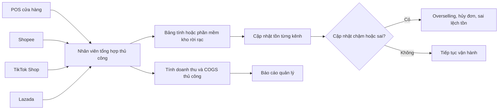

## 4. Quy trình As-Is chi tiết

### AS-01. Thiết lập sản phẩm trên nhiều kênh

1. Nhân viên tạo sản phẩm tại POS hoặc phần mềm nội bộ.
2. Nhân viên tạo lại sản phẩm trên từng sàn.
3. Mã SKU, tên, giá hoặc thuộc tính biến thể có thể không đồng nhất.
4. Mã vạch được quản lý riêng hoặc không liên kết chắc chắn với SKU chung.
5. Khi thay đổi giá/thông tin, nhân viên cập nhật từng hệ thống.

**Vấn đề:**

- Trùng lặp thao tác.
- Không có một định danh SKU chuẩn trên toàn bộ kênh.
- Dễ ánh xạ nhầm biến thể.
- Khó xác định dữ liệu nào là nguồn chính xác.

### AS-02. Nhập hàng

1. Hàng được nhận từ nhà cung cấp.
2. Nhân viên nhập số lượng vào bảng tính hoặc phần mềm kho.
3. Tồn kho tại POS được cập nhật riêng.
4. Tồn kho trên các sàn được cập nhật thủ công hoặc chờ đồng bộ.
5. Giá nhập được lưu trên phiếu hoặc bảng tính.
6. Giá vốn được tính thủ công, theo giá gần nhất hoặc phương pháp không nhất quán.

**Vấn đề:**

- Không bảo đảm mọi lần tăng tồn đều có chứng từ và lịch sử thống nhất.
- COGS có thể không được cập nhật ngay sau khi nhập.
- Sai lệch giữa chứng từ, tồn thực tế và tồn hiển thị trên kênh.

### AS-03. Bán hàng tại POS

1. Thu ngân quét mã hoặc tìm sản phẩm.
2. POS kiểm tra số tồn cục bộ hoặc số tồn đồng bộ gần nhất.
3. Thu ngân nhận thanh toán và in hóa đơn.
4. POS trừ tồn tại cửa hàng.
5. Các kênh online chưa chắc được cập nhật ngay.

**Điểm lỗi điển hình:** Trong lúc POS bán SKU cuối cùng, một đơn online vẫn có thể được chấp nhận vì kênh online đang nhìn thấy số tồn cũ.

### AS-04. Tiếp nhận đơn hàng online

1. Khách đặt hàng trên một sàn.
2. Sàn ghi nhận đơn theo mô hình trạng thái riêng.
3. Nhân viên nhận thông báo và kiểm tra đơn.
4. Nhân viên kiểm tra tồn bằng POS, bảng tính hoặc kiểm đếm.
5. Nếu còn hàng, nhân viên xử lý đơn và cập nhật tồn.
6. Nếu hết hàng, nhân viên hủy đơn hoặc liên hệ khách.

**Vấn đề:**

- Không có bước giữ hàng nguyên tử ngay khi đơn vào.
- Hai đơn đồng thời có thể cùng nhìn thấy một SKU còn hàng.
- Không có cơ chế ưu tiên hoặc bảo vệ lượng hàng dành cho đơn online.
- Dễ tiếp nhận trùng webhook hoặc xử lý trùng đơn.

### AS-05. Hủy đơn online

1. Khách, nhân viên hoặc sàn hủy đơn.
2. Nhân viên kiểm tra xem tồn đã bị trừ hay chưa.
3. Nhân viên cộng lại tồn thủ công tại một hoặc nhiều hệ thống.
4. Một số kênh có thể không được cập nhật kịp thời.

**Vấn đề:**

- Không biết cần hoàn on_hand hay chỉ giải phóng lượng giữ.
- Có nguy cơ hoàn tồn hai lần hoặc bỏ sót hoàn tồn.
- Khó truy vết người thực hiện và nguyên nhân.

### AS-06. Chuyển kho

1. Kho A lập danh sách hàng chuyển.
2. Kho A giảm tồn bằng thao tác thủ công.
3. Hàng được vận chuyển đến Kho B.
4. Kho B tăng tồn sau khi nhận.
5. Trong thời gian vận chuyển, hệ thống có thể không thể hiện rõ trạng thái hàng.

**Vấn đề:**

- Không có quy trình hai bước thống nhất.
- Có thể tăng tồn ở B trước khi hàng thực nhận.
- Chênh lệch do thất thoát không được ghi nhận rõ.

### AS-07. Kiểm kê và điều chỉnh

1. Nhân viên xuất danh sách tồn từ phần mềm hoặc bảng tính.
2. Nhân viên đếm thực tế.
3. Chênh lệch được cập nhật trực tiếp vào cột tồn.
4. Số dư cũ bị ghi đè.

**Vấn đề:**

- Mất dấu vết số liệu trước điều chỉnh.
- Không có bút toán bù trừ và quy trình phê duyệt.
- Khó xác định sai lệch phát sinh từ bán hàng, nhập hàng hay thao tác thủ công.

### AS-08. Tính doanh thu, COGS và lợi nhuận

1. Nhân viên xuất đơn hàng từ từng kênh.
2. Dữ liệu được ghép trong bảng tính.
3. Phí, giảm giá, hoàn tiền và giá vốn được làm sạch thủ công.
4. COGS được gán theo dữ liệu hiện có tại thời điểm lập báo cáo.
5. Báo cáo được gửi cho Owner.

**Vấn đề:**

- Không snapshot giá vốn tại thời điểm xuất bán.
- Giá vốn thay đổi về sau có thể làm kết quả lịch sử sai lệch.
- Báo cáo tốn thời gian và khó lặp lại.
- Cách tính giữa các kỳ có thể không thống nhất.

## 5. Phân tích nguyên nhân gốc

| Mã | Nguyên nhân gốc | Hệ quả |
|---|---|---|
| RC-01 | Không có nguồn dữ liệu tồn kho tập trung | Số lượng giữa các kênh không đồng nhất. |
| RC-02 | Không có reservation | Nhiều đơn cùng sử dụng một lượng tồn. |
| RC-03 | Đồng bộ bất đồng bộ nhưng không có khóa/cơ chế cạnh tranh | Overselling trong giờ cao điểm. |
| RC-04 | Cho phép sửa trực tiếp số tồn | Mất khả năng kiểm toán và truy vết. |
| RC-05 | Không có Canonical Order Model | Logic xử lý phụ thuộc từng kênh. |
| RC-06 | Không có máy trạng thái | Chuyển trạng thái không hợp lệ hoặc xử lý lặp. |
| RC-07 | COGS không được tính và snapshot tự động | Sai lợi nhuận gộp lịch sử. |
| RC-08 | Mã SKU/biến thể không thống nhất | Nhầm hàng, sai tồn và sai báo cáo. |
| RC-09 | Báo cáo ghép thủ công | Chậm, khó kiểm chứng và dễ sai công thức. |
| RC-10 | Kiểm soát Tenant không tập trung | Nguy cơ truy cập nhầm dữ liệu khách hàng. |

## 6. Điểm đau theo tác nhân

### Owner

- Không có dashboard hợp nhất theo thời gian gần thực.
- Không tin cậy hoàn toàn vào số liệu tồn và lợi nhuận.
- Khó mở rộng thêm chi nhánh/kênh mà không tăng nhân sự đối soát.

### Staff

- Phải nhập lại dữ liệu ở nhiều nơi.
- Mất thời gian kiểm tra tồn trước khi duyệt đơn.
- Khó xử lý tranh chấp và truy nguyên chênh lệch.

### Cashier

- POS có thể hiển thị tồn không phản ánh lượng đã cam kết cho đơn online.
- Phải hỏi kho hoặc kiểm tra thủ công khi tồn thấp.
- Quy trình xử lý lỗi thanh toán/trừ kho không nhất quán.

### Khách hàng

- Đặt hàng thành công nhưng sau đó bị hủy vì hết hàng.
- Thời gian xác nhận chậm.
- Trải nghiệm giữa các kênh không đồng nhất.

## 7. Rủi ro nghiệp vụ hiện tại

| Mã | Rủi ro | Khả năng | Tác động | Mức độ |
|---|---|---:|---:|---|
| R-01 | Bán vượt tồn kho | Cao | Cao | Nghiêm trọng |
| R-02 | Sai lệch tồn kho | Cao | Cao | Nghiêm trọng |
| R-03 | COGS/lợi nhuận sai | Trung bình-Cao | Cao | Nghiêm trọng |
| R-04 | Xử lý đơn trùng | Trung bình | Cao | Cao |
| R-05 | Mất dấu vết điều chỉnh | Cao | Trung bình-Cao | Cao |
| R-06 | Lộ dữ liệu giữa Tenant | Thấp-Trung bình | Rất cao | Nghiêm trọng |
| R-07 | Chậm xử lý trong Flash Sale | Cao | Cao | Nghiêm trọng |
| R-08 | Hủy đơn và giảm uy tín | Cao | Cao | Nghiêm trọng |

## 8. Khoảng cách giữa As-Is và mục tiêu

| Năng lực | As-Is | Nhu cầu To-Be |
|---|---|---|
| Tồn kho | Phân tán, cập nhật trực tiếp | Ledger chỉ ghi thêm và số dư nhất quán |
| Tồn khả dụng | Không tách reserved | `available = on_hand - reserved` |
| Đồng thời | Không có khóa thống nhất | Pessimistic/Optimistic Locking |
| Đơn hàng | Mô hình riêng từng kênh | Canonical Order Model |
| Trạng thái | Xử lý linh hoạt, dễ sai | State machine nghiêm ngặt |
| COGS | Thủ công hoặc không nhất quán | Weighted Average Cost tự động |
| Báo cáo | Tổng hợp thủ công | Gần thời gian thực, lọc đa chiều |
| Kiểm toán | Ghi đè số tồn | Bút toán append-only và bù trừ |
| Tenant | Phân quyền rời rạc | TenantId, Query Filter và RBAC |
| Thông báo | Kiểm tra thủ công | SignalR push thời gian thực |

## 9. Tiêu chí kết thúc giai đoạn As-Is

Phân tích As-Is được xem là đủ cho thiết kế khi nhóm dự án đã:

- Xác nhận các giả định với giảng viên hoặc đại diện nghiệp vụ.
- Xác định nguồn dữ liệu chủ cho sản phẩm, tồn kho và đơn hàng.
- Xác định cách ánh xạ SKU giữa các kênh.
- Thống nhất thời điểm giữ hàng, trừ hàng và hoàn giữ.
- Thống nhất chính sách hủy sau Confirmed.
- Thống nhất cách xử lý trả hàng, hoàn tiền và bút toán bù trừ nếu đưa vào phạm vi.
- Xác định SLA đồng bộ và thời gian hết hạn reservation.


---

## goods-receipt-process.md

<sub>Nguồn: `doc/EP-03/goods-receipt-process.md`</sub>


# Goods Receipt Process

## Mục đích
Nhập hàng từ nhà cung cấp.

## Luồng chính
1. Tạo phiếu nhập.
2. Chọn sản phẩm và số lượng.
3. Xác nhận nhập.
4. Ghi Inventory Ledger.
5. Tính lại COGS.


---

## online-order-process.md

<sub>Nguồn: `doc/EP-03/online-order-process.md`</sub>


# Online Order Process

## Luồng chính
Draft -> Reserved -> Confirmed -> Completed.

1. Nhận webhook.
2. Chuẩn hóa đơn hàng.
3. Reserve hàng.
4. Confirm đơn.
5. Trừ kho.


---

## order-cancellation-process.md

<sub>Nguồn: `doc/EP-03/order-cancellation-process.md`</sub>


# Order Cancellation Process

## Luồng chính
1. Chọn hủy đơn.
2. Kiểm tra trạng thái.
3. Giảm Reserved.
4. Cập nhật Cancelled.


---

## pos-sales-process.md

<sub>Nguồn: `doc/EP-03/pos-sales-process.md`</sub>


# POS Sales Process

## Luồng chính
1. Quét mã vạch.
2. Tìm SKU.
3. Chọn thanh toán.
4. Reserve -> Confirm -> Deduct.
5. In hóa đơn.


---

## product-management-process.md

<sub>Nguồn: `doc/EP-03/product-management-process.md`</sub>


# Product Management Process

## Mục đích
Quản lý danh mục, thương hiệu, sản phẩm và SKU.

## Luồng chính
1. Tạo sản phẩm.
2. Khai báo biến thể.
3. Sinh SKU và Barcode.
4. Thiết lập giá bán.
5. Lưu sản phẩm.


---

## proposed-process-to-be.md

<sub>Nguồn: `doc/EP-03/proposed-process-to-be.md`</sub>


# Quy trình đề xuất (To-Be)

## 1. Mục đích

Tài liệu mô tả quy trình vận hành mục tiêu sau khi triển khai OISM. Quy trình To-Be tập trung vào bốn nguyên tắc: dữ liệu đa khách hàng được cô lập, tồn kho được ghi nhận bằng ledger chỉ ghi thêm, mọi cam kết bán hàng phải qua reservation, và các thay đổi quan trọng được thực thi trong giao dịch cơ sở dữ liệu nguyên tử.

## 2. Nguyên tắc thiết kế quy trình

1. **Một mô hình tồn kho thống nhất:** Mọi kênh dùng chung on_hand, reserved và available theo Tenant, chi nhánh/kho và SKU.
2. **Ledger chỉ ghi thêm:** Không cập nhật hoặc xóa lịch sử; sai sót được sửa bằng bút toán bù trừ.
3. **Chống bán vượt tại cơ sở dữ liệu:** Kiểm tra và thay đổi reserved/on_hand dưới khóa hoặc kiểm tra phiên bản.
4. **Đơn hàng chuẩn hóa:** Dữ liệu mọi kênh được ánh xạ về Canonical Order Model.
5. **Máy trạng thái bắt buộc:** Không cho phép chuyển trạng thái tùy ý.
6. **COGS nhất quán:** Tính lại khi nhập hàng và snapshot khi Confirmed/POS thanh toán.
7. **Tenant-aware toàn hệ thống:** TenantId được lấy từ ngữ cảnh xác thực, không tin cậy TenantId do client tùy ý gửi.
8. **Idempotency:** Webhook và lệnh quan trọng phải an toàn khi gửi lại.
9. **Quan sát được:** Có audit log, correlation ID, log lỗi và số liệu giám sát.

## 3. Kiến trúc quy trình cấp cao

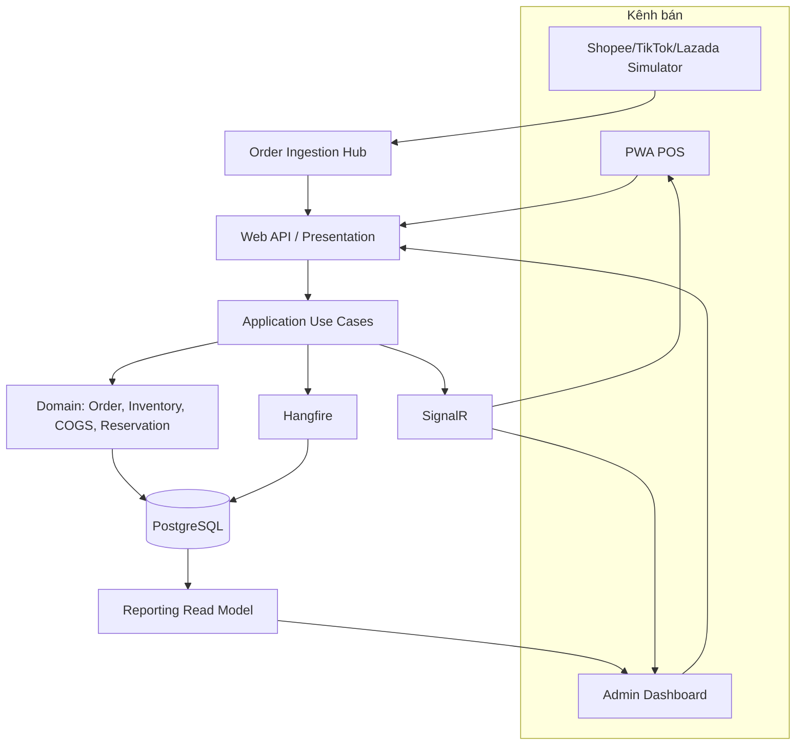

## 4. Quy trình To-Be tổng thể

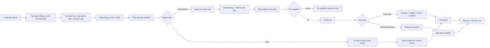

## 5. Quy trình chi tiết

### TB-01. Đăng ký Tenant và khởi tạo hệ thống

**Tác nhân:** Owner.  
**Điều kiện đầu:** Email/số điện thoại chưa được sử dụng theo chính sách hệ thống.  
**Luồng chính:**

1. Owner gửi thông tin đăng ký cửa hàng.
2. Hệ thống tạo Tenant và TenantId duy nhất.
3. Hệ thống tạo tài khoản Owner, băm mật khẩu bằng BCrypt hoặc Argon2.
4. Hệ thống tạo cấu hình mặc định, vai trò và chi nhánh/kho đầu tiên nếu được yêu cầu.
5. Owner đăng nhập và nhận access token, refresh token.
6. JWT chứa TenantId, UserId và Role.
7. Mọi truy vấn sau đó được áp Global Query Filter theo TenantId.

**Kết quả:** Tenant hoạt động và dữ liệu được cô lập.  
**Ngoại lệ:** Đăng ký trùng, dữ liệu không hợp lệ hoặc lỗi khởi tạo phải rollback toàn bộ.

### TB-02. Quản lý chi nhánh, kho và người dùng

1. Owner tạo/cập nhật chi nhánh hoặc kho.
2. Owner tạo người dùng và gán vai trò.
3. Hệ thống kiểm tra quyền theo RBAC tại API và màn hình.
4. Việc tắt chi nhánh không xóa lịch sử; chi nhánh ngừng xuất hiện trong thao tác mới nhưng vẫn dùng được trong báo cáo lịch sử.

### TB-03. Quản lý sản phẩm và SKU

1. Staff/Owner tạo danh mục phân cấp và thương hiệu.
2. Tạo sản phẩm đơn giản hoặc sản phẩm có biến thể.
3. Hệ thống sinh hoặc nhận SKU; kiểm tra duy nhất trong Tenant.
4. Hệ thống sinh/nhận mã vạch EAN-13 hoặc Code128 theo chính sách.
5. Thiết lập giá bán lẻ và bán sỉ, tách biệt với COGS.
6. SKU được kích hoạt để nhập kho và bán.

**Kiểm soát:** Không cho xóa cứng SKU đã có giao dịch; dùng trạng thái ngừng kinh doanh.

### TB-04. Nhập hàng và tính giá vốn bình quân

**Tác nhân:** Staff/Owner.  
**Điều kiện đầu:** Nhà cung cấp, kho nhận và SKU hợp lệ.  
**Luồng chính:**

1. Staff tạo phiếu nhập ở trạng thái Draft.
2. Nhập số lượng và đơn giá nhập của từng SKU.
3. Staff xác nhận phiếu nhập.
4. Hệ thống mở transaction và khóa số dư SKU tại chi nhánh/kho.
5. Với từng SKU, tính:

```text
new_cost = ((old_on_hand × old_cost) + (received_qty × purchase_price))
           / (old_on_hand + received_qty)
```

6. Tăng on_hand.
7. Ghi bản ghi InventoryLedger loại IN với BalanceAfter.
8. Lưu COGS mới và đánh dấu phiếu nhập Confirmed.
9. Commit và gửi thông báo cập nhật.

**Ngoại lệ:** Nếu mẫu số bằng 0 hoặc dữ liệu âm/không hợp lệ, từ chối xác nhận. Nếu một dòng lỗi, rollback toàn phiếu.

### TB-05. Tiếp nhận đơn hàng đa kênh

**Tác nhân:** Sàn mô phỏng, Admin.  
**Luồng chính:**

1. Order Ingestion Hub nhận payload.
2. Xác thực chữ ký/khóa mô phỏng và Tenant/kênh.
3. Kiểm tra idempotency theo `TenantId + Channel + ExternalOrderId` hoặc event ID.
4. Lưu payload gốc phục vụ truy vết nếu phù hợp chính sách.
5. Ánh xạ khách hàng, địa chỉ, sản phẩm, SKU, số lượng, giá và giảm giá về Canonical Order Model.
6. Kiểm tra SKU mapping và dữ liệu bắt buộc.
7. Tạo Order ở Draft.
8. Gọi Reservation Engine.
9. Nếu giữ hàng thành công, chuyển sang Reserved.
10. SignalR thông báo đơn mới cho Admin/POS liên quan.

**Ngoại lệ:**

- Event trùng: trả kết quả idempotent, không tạo đơn mới.
- Không ánh xạ được SKU: đưa vào hàng chờ xử lý, không giữ hàng sai SKU.
- Không đủ available: từ chối/đánh dấu thiếu hàng theo chính sách kênh.

### TB-06. Giữ hàng chống bán vượt

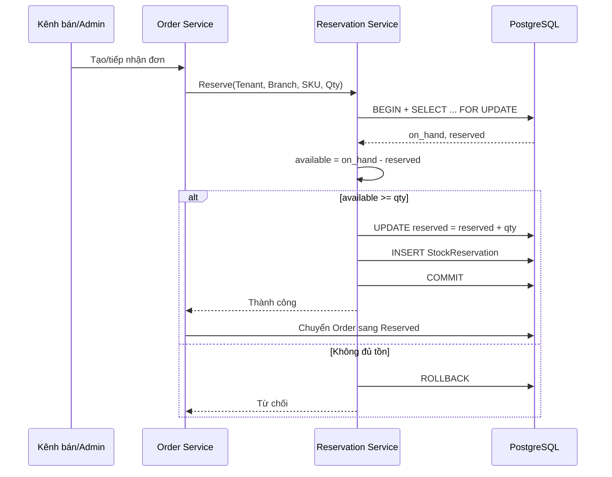

**Yêu cầu bắt buộc:**

- Thứ tự khóa SKU phải nhất quán để giảm deadlock.
- Tất cả SKU của đơn phải được giữ thành công hoặc toàn bộ rollback.
- `reserved >= 0` và `available >= 0` sau commit.
- Có thời điểm hết hạn reservation.

### TB-07. Xác nhận và trừ kho đơn online

1. Staff mở đơn Reserved.
2. Hệ thống kiểm tra quyền và trạng thái hiện tại.
3. Staff xác nhận xử lý đơn.
4. Hệ thống mở transaction và khóa các số dư theo thứ tự xác định.
5. Với mỗi OrderItem:
   - Kiểm tra reservation còn hiệu lực và đủ số lượng.
   - Giảm on_hand.
   - Giảm reserved.
   - Snapshot COGS hiện tại vào `OrderItem.CostPrice`.
   - Ghi InventoryLedger loại OUT/SALE và BalanceAfter.
6. Chuyển Order sang Confirmed.
7. Commit transaction.
8. Khi giao hàng/thanh toán hoàn tất, chuyển sang Completed.

**Bất biến:** Sau bước Confirmed, `on_hand` và `reserved` phải phản ánh đúng cùng một giao dịch; không được chỉ cập nhật một phía.

### TB-08. Hủy đơn hoặc hết hạn reservation

1. Người dùng gửi lệnh hủy hoặc Hangfire phát hiện reservation hết hạn.
2. Hệ thống kiểm tra trạng thái.
3. Nếu Order đang Reserved:
   - Khóa số dư.
   - Giảm reserved theo số lượng đã giữ.
   - Đánh dấu reservation Released/Expired.
   - Chuyển Order thành Cancelled.
4. Nếu Order đã Confirmed, phải áp dụng chính sách hủy sau xuất hàng và tạo giao dịch bù trừ/return; không được chỉ cộng sửa số tồn.
5. Commit và phát thông báo.

### TB-09. Thanh toán nhanh tại POS

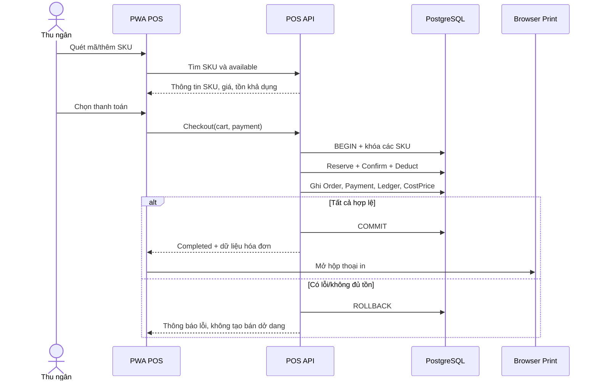

**Yêu cầu trải nghiệm:** Thanh toán dưới ba lần nhấp hoặc quét mã + Enter; hỗ trợ tiền mặt và QR chuyển khoản; giao diện responsive.

### TB-10. Chuyển kho hai bước

**Bước 1 - Xuất khỏi kho nguồn:**

1. Staff tạo yêu cầu chuyển kho.
2. Hệ thống kiểm tra available tại nguồn.
3. Khi xác nhận xuất, khóa SKU và giảm on_hand nguồn.
4. Ghi ledger OUT/TRANSFER_OUT.
5. Chuyển phiếu sang InTransit.

**Bước 2 - Nhận tại kho đích:**

1. Staff kho đích kiểm nhận.
2. Ghi số lượng thực nhận và chênh lệch nếu có.
3. Khi xác nhận, tăng on_hand đích.
4. Ghi ledger IN/TRANSFER_IN.
5. Chuyển phiếu sang Received hoặc ReceivedWithVariance.

### TB-11. Kiểm kê và điều chỉnh

1. Staff tạo Stocktake Session theo kho/phạm vi SKU.
2. Hệ thống chụp số dư tham chiếu.
3. Người kiểm kê nhập số lượng đếm thực tế.
4. Hệ thống tính chênh lệch.
5. Người có quyền phê duyệt.
6. Hệ thống ghi ADJUSTMENT_IN hoặc ADJUSTMENT_OUT trong ledger.
7. Cập nhật số dư thông qua use case, không sửa lịch sử.
8. Đóng phiên và lưu người thực hiện, người duyệt, thời gian và lý do.

### TB-12. Báo cáo, cảnh báo và AI

1. Dữ liệu đơn Completed/Confirmed và CostPrice snapshot được tổng hợp.
2. Tính doanh thu thuần, COGS và lợi nhuận gộp.
3. Tính giá trị tồn kho theo COGS hiện tại.
4. Xác định SKU bán nhanh/chậm.
5. Nếu `available <= reorder_point`, tạo cảnh báo dashboard.
6. Hangfire tổng hợp báo cáo ngày.
7. Mô-đun AI đọc lịch sử bán, lead time và mức tồn để đề xuất đặt hàng lại.
8. Owner xem xét và phê duyệt; AI không tự tạo phiếu nhập đã xác nhận trong phạm vi mặc định.

## 6. Ma trận trạng thái đơn hàng

| Trạng thái hiện tại | Sự kiện | Trạng thái kế tiếp | Tác động tồn kho |
|---|---|---|---|
| Draft | Reserve thành công | Reserved | reserved tăng |
| Draft | Hủy | Cancelled | Không đổi |
| Reserved | Confirm | Confirmed | on_hand giảm, reserved giảm, ghi OUT, snapshot COGS |
| Reserved | Hủy | Cancelled | reserved giảm |
| Reserved | Hết hạn | Cancelled | reserved giảm |
| Confirmed | Hoàn tất | Completed | Không trừ kho lần nữa |
| Confirmed | Hủy hợp lệ | Cancelled/Returned theo thiết kế | Tạo bút toán bù trừ, không sửa ledger cũ |

## 7. Kiểm soát giao dịch và đồng thời

- Dùng `SELECT ... FOR UPDATE` hoặc optimistic concurrency token.
- Transaction bao phủ toàn bộ chuỗi thay đổi có liên quan.
- Khóa theo `TenantId + BranchId/WarehouseId + SKUId`.
- Khi đơn có nhiều SKU, sắp xếp khóa theo SKUId để giảm deadlock.
- Có retry giới hạn cho lỗi deadlock hoặc serialization theo chính sách.
- Ràng buộc cơ sở dữ liệu ngăn `on_hand < 0`, `reserved < 0` và `reserved > on_hand` trong mô hình không cho backorder.
- Không gọi dịch vụ ngoài kéo dài trong transaction cơ sở dữ liệu.
- Dùng outbox/event sau commit nếu cần bảo đảm thông báo không bị mất.

## 8. Trường hợp Flash Sale tham chiếu

**Kịch bản:** 50 yêu cầu đồng thời mua cùng một SKU có `on_hand = 1`, `reserved = 0`.

**Kết quả mong đợi:**

- Chính xác một yêu cầu giữ được 1 sản phẩm.
- 49 yêu cầu còn lại nhận kết quả không đủ tồn hoặc được xử lý theo chính sách chờ.
- Sau xử lý: `on_hand = 1`, `reserved = 1`, `available = 0`.
- Sau Confirm: `on_hand = 0`, `reserved = 0`, `available = 0`.
- Không có duplicate reservation hoặc ledger OUT trùng.

## 9. Theo dõi và kiểm toán

Mỗi thao tác quan trọng nên lưu:

- TenantId, UserId, Role.
- CorrelationId/RequestId.
- EntityType, EntityId.
- Hành động và trạng thái trước/sau phù hợp chính sách.
- ReferenceId liên kết Order, Receipt, Transfer hoặc Stocktake.
- Thời gian UTC và nguồn kênh.
- Lý do hủy/điều chỉnh.

## 10. Tiêu chí chấp nhận To-Be

- Không thể chuyển trạng thái ngoài ma trận đã cấu hình.
- Không thể cập nhật/xóa bản ghi InventoryLedger qua API nghiệp vụ.
- Mọi thay đổi on_hand có ledger tương ứng trong cùng transaction.
- Cùng một webhook lặp lại không tạo đơn trùng.
- POS không bán lượng đã reserved cho đơn online.
- COGS được tính lại khi nhập và snapshot khi xuất bán.
- Truy vấn của Tenant A không trả dữ liệu Tenant B.
- Các mục tiêu p95, báo cáo, uptime và độ bao phủ kiểm thử đáp ứng NFR.


---

## reporting-process.md

<sub>Nguồn: `doc/EP-03/reporting-process.md`</sub>


# Reporting Process

## Báo cáo
- Revenue
- COGS
- Gross Profit
- Inventory Value
- Reorder Alert


---

## return-process.md

<sub>Nguồn: `doc/EP-03/return-process.md`</sub>


# Return Process

## Luồng chính
1. Tạo yêu cầu trả hàng.
2. Xác nhận.
3. Tăng tồn kho.
4. Ghi Ledger IN.


---

## stock-reservation-process.md

<sub>Nguồn: `doc/EP-03/stock-reservation-process.md`</sub>


# Stock Reservation Process

## Công thức
Available = OnHand - Reserved

## Luồng chính
1. Khóa SKU.
2. Kiểm tra tồn.
3. Tăng Reserved.
4. Commit.


---

## stocktake-process.md

<sub>Nguồn: `doc/EP-03/stocktake-process.md`</sub>


# Stocktake Process

## Mục đích
Kiểm kê tồn kho.

## Luồng chính
1. Tạo phiên kiểm kê.
2. Đếm thực tế.
3. Đối chiếu.
4. Sinh Adjustment Ledger.


---

## tenant-registration-process.md

<sub>Nguồn: `doc/EP-03/tenant-registration-process.md`</sub>


# Tenant Registration Process

## Mục đích
Cho phép chủ cửa hàng đăng ký hệ thống mới và tạo Tenant độc lập.

## Tác nhân
- Owner
- Authentication Service

## Tiền điều kiện
- Email hoặc số điện thoại chưa tồn tại.

## Luồng chính
1. Người dùng truy cập trang đăng ký.
2. Nhập tên cửa hàng, email/SĐT, mật khẩu.
3. Hệ thống kiểm tra dữ liệu.
4. Tạo Tenant, Owner, chi nhánh mặc định.
5. Mã hóa mật khẩu.
6. Lưu dữ liệu.
7. Trả JWT.
8. Chuyển Dashboard.


---

## warehouse-transfer-process.md

<sub>Nguồn: `doc/EP-03/warehouse-transfer-process.md`</sub>


# Warehouse Transfer Process

## Mục đích
Chuyển hàng giữa các kho.

## Luồng chính
1. Tạo phiếu chuyển.
2. Xuất kho nguồn.
3. Ghi Ledger OUT.
4. Nhập kho đích.
5. Ghi Ledger IN.


<a id="ep04"></a>
# EP04

> Số tài liệu Markdown trong nhóm: **8**.


---

## acceptance-criteria.md

<sub>Nguồn: `doc/EP-04/acceptance-criteria.md`</sub>


# Tiêu chí chấp nhận

> **Dự án:** Omnichannel Inventory and Sales Management System (OISM)  
> **Phiên bản:** 1.0  
> **Trạng thái:** Bản đặc tả cơ sở  
> **Ngày cập nhật:** 29/10/2026  
> **Phạm vi:** SaaS đa khách hàng, Backend .NET 8, PostgreSQL, ReactJS Admin, PWA POS, SignalR, Hangfire và Docker.

---

## 1. Quy ước Given–When–Then

Mỗi tiêu chí phải kiểm thử được và truy vết tới FR/User Story. Dữ liệu test phải gồm ít nhất hai tenant, hai branch, SKU có/không tồn, đơn trùng idempotency và tình huống đồng thời.

## 2. Xác thực, tenant và RBAC

### AC-AUTH-01 – Tạo tenant
- **Given** thông tin tenant và Owner hợp lệ  
  **When** đăng ký  
  **Then** tạo TenantId duy nhất, Owner thuộc tenant và dữ liệu khởi tạo trong một transaction.
- **Given** quá trình tạo Owner thất bại  
  **When** transaction kết thúc  
  **Then** không tồn tại tenant mồ côi.

### AC-AUTH-02 – Đăng nhập và token
- **Given** credential đúng và tài khoản active  
  **When** đăng nhập  
  **Then** trả JWT chứa TenantId/UserId/Role, expiry <= 60 phút và refresh token an toàn.
- **Given** token hết hạn/revoked  
  **When** gọi API bảo vệ  
  **Then** trả 401 và không trả dữ liệu.

### AC-AUTH-03 – RBAC và cô lập
- **Given** Cashier  
  **When** gọi API quản lý người dùng  
  **Then** trả 403.
- **Given** user tenant A cố truy cập ID thuộc tenant B  
  **When** gọi API/query/export hoặc kết nối group realtime  
  **Then** không nhận dữ liệu tenant B và sự kiện được audit.

## 3. Catalog

### AC-PROD-01 – SKU/barcode duy nhất
- Tạo SKU trùng code trong cùng tenant bị từ chối; cùng code ở tenant khác được phép.
- Gán barcode đã thuộc SKU khác trong cùng tenant bị từ chối với mã lỗi rõ ràng.
- EAN-13 sai check digit bị từ chối nếu khai báo symbology EAN-13.

### AC-PROD-02 – Giá
- Giá bán âm bị từ chối.
- Thay đổi retail/wholesale không làm thay đổi current average cost.

## 4. Ledger, nhập, chuyển và kiểm kê

### AC-INV-01 – Ledger append-only
- Mọi thay đổi on-hand thành công tạo đúng bút toán và BalanceAfter.
- Thử UPDATE/DELETE bằng application DB role bị từ chối.
- Sửa sai tạo compensating entry tham chiếu bút toán gốc, không sửa lịch sử.

### AC-INV-02 – Phiếu nhập và COGS
- **Given** on-hand 10, cost 100.000; nhận 10, unit cost 120.000  
  **When** Confirm receipt  
  **Then** on-hand = 20, cost = 110.000 và có ledger IN quantity 10.
- Retry confirm cùng command/idempotency key không tăng tồn lần hai.
- Receipt Confirmed không thể sửa quantity/cost trực tiếp.

### AC-INV-03 – Chuyển kho
- Dispatch 5 làm kho nguồn giảm 5, in-transit tăng 5, kho đích chưa tăng.
- Receive 5 làm in-transit về 0, kho đích tăng 5 và có ledger liên quan ở hai đầu.
- Receive vượt lượng còn in-transit bị từ chối.

### AC-INV-04 – Kiểm kê
- SystemQty 20, CountedQty 18 sau phê duyệt tạo adjustment OUT 2 và BalanceAfter 18.
- Phiên chưa phê duyệt không làm thay đổi stock.

## 5. Order, reservation và anti-oversell

### AC-ORD-01 – Chuẩn hóa và idempotency
- Payload hợp lệ từng simulator tạo Canonical Order với channel/external order ID chính xác.
- Hai webhook cùng external event/idempotency key chỉ tạo một Order và một tập reservation.
- Payload sai trả lỗi mapping/validation, không tác động tồn.

### AC-ORD-02 – State machine
- Draft -> Reserved -> Confirmed -> Completed thành công khi đủ điều kiện.
- Draft -> Completed trực tiếp bị từ chối.
- Completed -> Cancelled bị từ chối; quy trình Return được yêu cầu.
- Mỗi transition lưu From/To, actor, reason và timestamp.

### AC-RSE-01 – Reserve
- **Given** on-hand 10, reserved 7  
  **When** reserve 3  
  **Then** reserved = 10, available = 0.
- **When** reserve thêm 1  
  **Then** trả `INSUFFICIENT_STOCK` và balance không đổi.

### AC-RSE-02 – Confirm và cancel
- Confirm reservation 3 làm on-hand giảm 3, reserved giảm 3, available không bị âm, tạo SALE ledger và snapshot CostPrice.
- Cancel reservation 3 làm reserved giảm 3, on-hand không đổi.
- Gọi cancel/confirm lặp không trừ hoặc giải phóng hai lần.

### AC-RSE-03 – Flash Sale
- **Given** SKU có on-hand 1, reserved 0  
  **When** 50 request reserve hợp lệ chạy đồng thời  
  **Then** đúng tối đa 1 request thành công, 49 request bị từ chối/xung đột xử lý đúng; on-hand = 1, reserved = 1, available = 0.
- Sau confirm request thắng: on-hand = 0, reserved = 0; ledger có đúng một SALE.
- Không có deadlock chưa xử lý, order trùng hoặc balance âm.

## 6. POS và thanh toán

### AC-POS-01 – Tìm/quét
- Quét barcode hợp lệ trả đúng SKU trong tenant/branch và hiển thị available trong p95 < 200 ms ở môi trường chuẩn.
- Barcode không tồn tại hiển thị lỗi có thể phục hồi mà không làm mất giỏ.

### AC-POS-02 – Chặn oversell
- Client chặn quantity vượt available hiển thị, nhưng server vẫn kiểm tra lại khi checkout.
- Nếu tồn đã bị đơn online giữ sau khi POS tải màn hình, checkout bị từ chối/cho chỉnh giỏ và không ghi payment/ledger dở dang.

### AC-POS-03 – Checkout nguyên tử
- Với tồn đủ và payment hợp lệ, một thao tác tạo order, payment, cost snapshot, stock update và ledger, sau đó mở khả năng in.
- Giả lập lỗi trước commit làm rollback toàn bộ; không có hóa đơn/payment thành công giả.
- In lại không tạo thêm giao dịch.

### AC-POS-04 – Khả dụng
- Luồng chuẩn quét barcode + Enter hoặc không quá 3 cú nhấp để hoàn tất.
- Các control chính dùng được bằng bàn phím và giao diện không vỡ ở desktop/tablet mục tiêu.

## 7. Báo cáo, cảnh báo và AI

### AC-REP-01 – Doanh thu/COGS/lợi nhuận
- Dataset chuẩn có Net Revenue 1.000.000 và COGS 600.000 phải trả Gross Profit 400.000.
- Draft/Cancelled bị loại; Return/discount được xử lý theo business rule công bố.
- Bộ lọc time/branch/channel/SKU cho kết quả đúng và không chéo tenant.

### AC-REP-02 – Tồn và hiệu năng
- Inventory value khớp tổng `on_hand × current average cost` theo phương pháp hệ thống.
- Báo cáo dưới 100.000 bản ghi hoàn thành < 2 giây trên môi trường benchmark được ghi nhận.

### AC-REP-03 – Tồn thấp
- Khi available <= reorder point, tạo một cảnh báo mở và đẩy đúng tenant sau commit.
- Chạy job/check nhiều lần không tạo cảnh báo mở trùng.

### AC-AI-01 – Khuyến nghị
- Kết quả có suggested quantity, horizon, dữ liệu đầu vào/lý do và trạng thái phê duyệt.
- Không tự Confirm receipt; dữ liệu thiếu phải hiển thị cảnh báo độ tin cậy.

## 8. Simulator, realtime và background

### AC-SIM-01 – Simulator
- Tester được phép gửi payload theo kênh, số request và concurrency; xem được success/failure/latency.
- User không có quyền hoặc môi trường production bị cấu hình khóa thì không sử dụng được.

### AC-SIM-02 – SignalR
- Đơn mới sau commit đẩy đến client cùng tenant/group; client tenant khác không nhận.
- Mất kết nối/reconnect không làm mất khả năng tải dữ liệu chuẩn từ API.

### AC-SIM-03 – Hangfire
- Reservation hết hạn chưa Confirmed được release đúng một lần.
- Job retry không thay đổi dữ liệu lần hai; job thất bại quá ngưỡng được log/cảnh báo.

## 9. Phi chức năng, bảo mật và triển khai

### AC-NFR-01 – Hiệu năng
- Load test ghi rõ hạ tầng, dataset, warm-up, duration và percentile.
- SKU search p95 < 200 ms; order write p95 < 500 ms theo workload chuẩn.
- Không chấp nhận kết quả nhanh nếu có lỗi dữ liệu hoặc request bị bỏ qua không báo cáo.

### AC-NFR-02 – Bảo mật
- Password trong DB không ở dạng rõ; token/secret không xuất hiện trong log.
- API trả đúng 401/403; input injection/mass assignment cơ bản bị chặn.
- Refresh token rotate/revoke hoạt động và token cũ không tái sử dụng được.

### AC-NFR-03 – Kiểm thử và coverage
- Module Ledger, Reservation và COGS đạt >= 80% coverage với unit/integration test có assertion nghiệp vụ.
- CI thất bại khi test bắt buộc hoặc build thất bại.

### AC-NFR-04 – Docker/CI-CD
- Từ repository sạch, `docker compose up` theo hướng dẫn khởi động Backend, Admin, POS và PostgreSQL; seed demo hoạt động.
- Swagger/API health check truy cập được; migration chạy đúng một lần.
- GitHub Actions restore/build/test/image thành công và không lộ secret.

## 10. Điều kiện nghiệm thu toàn hệ thống

Hệ thống được nghiệm thu khi toàn bộ tiêu chí Must đạt, không còn lỗi Critical/High, ma trận URS–FR/NFR–Story–Test có truy vết, gói Docker demo chạy được, dữ liệu tenant cô lập, Flash Sale không oversell và bộ tài liệu cài đặt/sử dụng/API đã hoàn tất.


---

## business-rules.md

<sub>Nguồn: `doc/EP-04/business-rules.md`</sub>


# Quy tắc nghiệp vụ

## 1. Mục đích

Tài liệu định nghĩa các quy tắc nghiệp vụ bắt buộc của OISM. Mỗi quy tắc có mã duy nhất để truy vết sang URS, RTM, use case, API, kiểm thử và mã nguồn.

## 2. Quy ước mức độ

- **MUST:** Bắt buộc, vi phạm phải từ chối hoặc rollback giao dịch.
- **SHOULD:** Nên áp dụng; chỉ được bỏ qua khi có lý do thiết kế được phê duyệt.
- **MAY:** Tùy chọn hoặc có thể cấu hình.

## 3. Quy tắc Tenant, xác thực và phân quyền

### BR-AUTH-001 - Mọi dữ liệu nghiệp vụ thuộc một Tenant

- Mỗi bản ghi nghiệp vụ MUST có TenantId, trừ bảng tham chiếu toàn hệ thống được xác định rõ.
- TenantId MUST được lấy từ ngữ cảnh xác thực phía server.
- Client không được phép đổi TenantId để truy cập dữ liệu Tenant khác.
- **Nguồn:** FR-AUTH-01, NFR-TENANT-01.

### BR-AUTH-002 - TenantId là bất biến

TenantId của một bản ghi nghiệp vụ MUST NOT được thay đổi sau khi tạo. Việc chuyển dữ liệu giữa Tenant không nằm trong thao tác nghiệp vụ thông thường.

### BR-AUTH-003 - Nội dung token

JWT hợp lệ MUST chứa tối thiểu TenantId, UserId và Role; access token có thời hạn tối đa 60 phút theo yêu cầu đề tài.

### BR-AUTH-004 - Mật khẩu

Mật khẩu MUST được băm bằng BCrypt hoặc Argon2; không được lưu hoặc ghi log mật khẩu dạng rõ.

### BR-AUTH-005 - Quyền theo vai trò

- Owner: toàn quyền trong Tenant.
- Staff: quản lý kho, sản phẩm và đơn theo quyền được cấu hình.
- Cashier: chỉ truy cập chức năng POS và dữ liệu tối thiểu cần thiết.
- API MUST kiểm tra quyền phía server; ẩn nút trên giao diện không thay thế kiểm tra API.

### BR-AUTH-006 - Chi nhánh bị tắt

Chi nhánh/kho đã có lịch sử giao dịch MUST NOT bị xóa cứng. Khi bị tắt, hệ thống không cho tạo giao dịch mới nhưng vẫn cho phép truy vấn báo cáo lịch sử.

## 4. Quy tắc sản phẩm, SKU, mã vạch và giá

### BR-PROD-001 - SKU duy nhất

Mã SKU MUST là duy nhất trong cùng một Tenant. Hai Tenant khác nhau MAY sử dụng cùng chuỗi SKU.

### BR-PROD-002 - SKU đại diện đơn vị tồn kho

Mỗi biến thể bán được MUST có SKU riêng. Tồn kho, reservation, COGS và OrderItem MUST tham chiếu SKU, không chỉ tham chiếu Product.

### BR-PROD-003 - Mã vạch

- Mã vạch được sinh hoặc nhập thủ công.
- Mã vạch đang hoạt động SHOULD là duy nhất trong Tenant để tránh quét nhầm.
- Nếu dùng EAN-13, hệ thống SHOULD kiểm tra đủ 13 chữ số và check digit.
- Nếu dùng Code128, hệ thống MUST kiểm tra độ dài và tập ký tự theo cấu hình.

### BR-PROD-004 - Giá bán tách biệt COGS

RetailPrice và WholesalePrice MUST được lưu tách biệt với CostPrice/COGS. Thay đổi giá bán không được tự động thay đổi COGS.

### BR-PROD-005 - Không xóa SKU có lịch sử

SKU đã xuất hiện trong ledger, đơn hàng, phiếu nhập hoặc kiểm kê MUST NOT bị xóa cứng; chỉ được ngừng hoạt động.

### BR-PROD-006 - Số lượng và giá hợp lệ

- Số lượng giao dịch MUST lớn hơn 0, trừ trường chênh lệch tính toán được biểu diễn bằng loại IN/OUT riêng.
- Giá nhập và giá bán MUST không âm.
- Tiền tệ và quy tắc làm tròn MUST nhất quán trong Tenant.

## 5. Quy tắc tồn kho và Inventory Ledger

### BR-INV-001 - Công thức tồn khả dụng

```text
available = on_hand - reserved
```

Với mô hình không cho phép backorder, available MUST luôn lớn hơn hoặc bằng 0 sau khi commit.

### BR-INV-002 - Cấp quản lý số dư

Số dư MUST được xác định tối thiểu theo `TenantId + BranchId/WarehouseId + SKUId`. Không được gộp tồn giữa các Tenant.

### BR-INV-003 - Ledger chỉ ghi thêm

InventoryLedger MUST chỉ cho phép INSERT. UPDATE và DELETE bị cấm ở tầng ứng dụng và SHOULD bị ngăn thêm bằng quyền/ràng buộc cơ sở dữ liệu.

### BR-INV-004 - Điều chỉnh bằng bút toán bù trừ

Nếu giao dịch ledger sai, hệ thống MUST tạo giao dịch bù trừ có ReferenceId liên kết bản ghi gốc; không chỉnh sửa bản ghi cũ.

### BR-INV-005 - Trường bắt buộc của ledger

Mọi bản ghi MUST có TenantId, BranchId/WarehouseId, SKUId, Type, Quantity, BalanceAfter, ReferenceId và CreatedAt; SHOULD có ActorId, ReasonCode và CorrelationId.

### BR-INV-006 - Đồng nhất số dư và ledger

Mọi thay đổi on_hand MUST có ledger tương ứng trong cùng transaction. Nếu ghi ledger thất bại, cập nhật số dư MUST rollback.

### BR-INV-007 - BalanceAfter

BalanceAfter MUST bằng số dư on_hand sau khi áp dụng giao dịch tại đúng kho và SKU. Việc tính BalanceAfter phải diễn ra dưới cùng cơ chế khóa với cập nhật số dư.

### BR-INV-008 - Không cập nhật tồn trực tiếp

Không API/UI nào được phép nhập một giá trị mới để ghi đè on_hand. Thay đổi chỉ đi qua nghiệp vụ nhập hàng, bán hàng, trả hàng, chuyển kho hoặc kiểm kê/điều chỉnh.

### BR-INV-009 - Không cho tồn âm

on_hand MUST không âm sau commit, trừ khi một chính sách backorder riêng được thiết kế và phê duyệt. Phiên bản đề tài mặc định không hỗ trợ backorder.

### BR-INV-010 - Nhập hàng

Phiếu nhập chỉ làm tăng tồn và cập nhật COGS khi chuyển sang Confirmed. Phiếu Draft MUST không ảnh hưởng số dư.

### BR-INV-011 - Tính nguyên tử của phiếu nhập

Khi xác nhận phiếu nhập nhiều dòng, tất cả dòng MUST thành công hoặc toàn bộ phiếu rollback.

### BR-INV-012 - Chuyển kho hai bước

- Confirm Dispatch: ghi OUT tại nguồn và chuyển trạng thái InTransit.
- Confirm Receipt: ghi IN tại đích.
- Kho đích MUST NOT tăng on_hand trước khi xác nhận nhận.

### BR-INV-013 - Chênh lệch chuyển kho

Nếu số lượng nhận khác số lượng gửi, hệ thống MUST ghi nhận chênh lệch và yêu cầu lý do/phê duyệt; không âm thầm sửa số lượng gửi.

### BR-INV-014 - Kiểm kê

Kết quả kiểm kê chỉ thay đổi tồn sau khi được người có quyền phê duyệt. Chênh lệch dương ghi ADJUSTMENT_IN; chênh lệch âm ghi ADJUSTMENT_OUT.

## 6. Quy tắc COGS

### BR-COST-001 - Phương pháp giá vốn

OISM sử dụng giá vốn bình quân gia quyền theo SKU và phạm vi kho/chi nhánh được thiết kế.

### BR-COST-002 - Công thức nhập hàng

```text
new_cost = ((old_on_hand × old_cost) + (received_qty × purchase_price))
           / (old_on_hand + received_qty)
```

Công thức chỉ áp dụng khi phiếu nhập được Confirmed.

### BR-COST-003 - Trường hợp tồn cũ bằng 0

Nếu `old_on_hand = 0` và `received_qty > 0`, `new_cost` MUST bằng `purchase_price`.

### BR-COST-004 - Trường hợp mẫu số không hợp lệ

Nếu `old_on_hand + received_qty <= 0`, hệ thống MUST từ chối phép tính và rollback giao dịch.

### BR-COST-005 - Độ chính xác và làm tròn

Phép tính COGS MUST dùng kiểu decimal, không dùng floating point nhị phân. Hệ thống SHOULD lưu nhiều chữ số thập phân hơn số hiển thị và chỉ làm tròn theo chính sách tiền tệ khi xuất báo cáo/hóa đơn.

### BR-COST-006 - Snapshot khi xuất bán

Khi đơn chuyển sang Confirmed hoặc POS thanh toán, COGS hiện tại MUST được lưu vào `OrderItem.CostPrice` trong cùng transaction với trừ kho.

### BR-COST-007 - Bất biến lịch sử COGS

Việc nhập hàng hoặc thay đổi COGS trong tương lai MUST NOT thay đổi `OrderItem.CostPrice` của đơn đã Confirmed/Completed.

### BR-COST-008 - Lợi nhuận gộp

```text
GrossProfit = NetRevenue - COGS
COGS = Sum(OrderItem.CostPrice × confirmed_quantity)
```

Đơn Cancelled chưa xuất hàng MUST không đóng góp doanh thu hoặc COGS. Trả hàng/hoàn tiền phải dùng quy tắc bù trừ được định nghĩa.

## 7. Quy tắc đơn hàng và máy trạng thái

### BR-ORD-001 - Mô hình đơn chuẩn

Mọi đơn POS, Admin và sàn MUST được chuyển về Canonical Order Model trước khi xử lý nghiệp vụ chung.

### BR-ORD-002 - Định danh đơn ngoài hệ thống

Tổ hợp `TenantId + Channel + ExternalOrderId` MUST duy nhất đối với đơn online để ngăn tạo trùng.

### BR-ORD-003 - Idempotency webhook

Nhận lại cùng event hoặc cùng khóa idempotency MUST không tạo thêm Order, reservation, payment hoặc ledger transaction.

### BR-ORD-004 - Chuyển trạng thái hợp lệ

Các chuyển đổi mặc định:

- Draft → Reserved
- Draft → Cancelled
- Reserved → Confirmed
- Reserved → Cancelled
- Confirmed → Completed
- Confirmed → trạng thái hủy/trả chỉ theo quy trình bù trừ được phê duyệt

Mọi chuyển đổi khác MUST bị từ chối.

### BR-ORD-005 - Kiểm tra trạng thái hiện tại

Lệnh chuyển trạng thái MUST kiểm tra trạng thái hiện tại trong cơ sở dữ liệu dưới kiểm soát đồng thời; không chỉ dựa trên trạng thái client gửi lên.

### BR-ORD-006 - Đơn nhiều dòng

Reservation/Confirm cho đơn nhiều dòng MUST theo nguyên tắc all-or-nothing, trừ khi nghiệp vụ tách đơn/backorder được bổ sung rõ ràng.

### BR-ORD-007 - SKU không ánh xạ được

Đơn online có SKU ngoài chưa ánh xạ MUST được đưa vào hàng chờ lỗi và MUST NOT giữ tồn của một SKU khác theo suy đoán.

### BR-ORD-008 - Hủy sau Confirmed

Không được hoàn tác đơn Confirmed chỉ bằng cách đổi trạng thái. Hệ thống MUST tạo nghiệp vụ trả hàng hoặc bút toán tồn kho bù trừ nếu hàng quay lại kho.

## 8. Quy tắc Reservation và chống bán vượt

### BR-RSE-001 - Điều kiện giữ hàng

Reservation chỉ thành công nếu tại thời điểm khóa:

```text
on_hand - reserved >= requested_quantity
```

### BR-RSE-002 - Tác động của Reserve

Reserve thành công MUST tăng reserved, không giảm on_hand và không ghi ledger xuất kho.

### BR-RSE-003 - Tác động của Confirm

Confirm MUST đồng thời:

1. Giảm on_hand theo số lượng xác nhận.
2. Giảm reserved theo lượng đã giữ.
3. Ghi ledger OUT/SALE.
4. Snapshot COGS.
5. Chuyển trạng thái đơn.

Tất cả thực hiện trong một transaction.

### BR-RSE-004 - Tác động của Cancel/Expire

Nếu đơn đang Reserved, Cancel/Expire MUST giảm reserved; on_hand không đổi và không ghi ledger OUT.

### BR-RSE-005 - Một reservation không được giải phóng hai lần

Reservation MUST có trạng thái hoặc version để bảo đảm Release/Expire chỉ tác động một lần.

### BR-RSE-006 - Khóa đồng thời

Cập nhật reserved/on_hand MUST dùng pessimistic locking hoặc optimistic locking ở cấp cơ sở dữ liệu. Kiểm tra tồn chỉ ở tầng ứng dụng mà không có bảo vệ DB là không hợp lệ.

### BR-RSE-007 - Thứ tự khóa

Khi một đơn có nhiều SKU, dịch vụ MUST khóa số dư theo một thứ tự ổn định, ví dụ SKUId tăng dần, để giảm nguy cơ deadlock.

### BR-RSE-008 - Hết hạn reservation

Mỗi reservation online SHOULD có `ExpiresAt`. Hangfire MAY quét theo lịch, nhưng thao tác hết hạn MUST idempotent và dùng khóa/phiên bản.

### BR-RSE-009 - Kịch bản Flash Sale

Với 50 yêu cầu đồng thời cho SKU còn 1 đơn vị, tối đa một reservation được thành công; `available` MUST không âm.

## 9. Quy tắc POS và thanh toán

### BR-POS-001 - Kiểm tra available

POS MUST kiểm tra available khi thêm/chỉnh số lượng và MUST kiểm tra lại trong transaction checkout. Kiểm tra trên giao diện không thay thế kiểm tra tại server.

### BR-POS-002 - Bảo vệ hàng online

POS chỉ được bán available, không được sử dụng phần reserved cho đơn online.

### BR-POS-003 - Thanh toán nguyên tử

Checkout POS MUST thực hiện Reserve → Confirm → Deduct, tạo Order, Payment, ledger và snapshot COGS trong một transaction nguyên tử.

### BR-POS-004 - Rollback khi lỗi

Nếu bất kỳ phần nào của checkout thất bại, không được để lại đơn thanh toán dở dang, số dư thay đổi một phần hoặc ledger thiếu.

### BR-POS-005 - Phương thức thanh toán

Phiên bản cốt lõi hỗ trợ tiền mặt và QR chuyển khoản. Payment MUST lưu phương thức, số tiền, trạng thái, thời gian và người thực hiện.

### BR-POS-006 - In hóa đơn

Chỉ mở hộp thoại in hóa đơn hoàn tất sau khi transaction checkout đã commit thành công.

### BR-POS-007 - Giá tại thời điểm bán

OrderItem MUST snapshot đơn giá bán, giảm giá, thuế nếu có và CostPrice; thay đổi bảng giá sau đó không sửa đơn lịch sử.

## 10. Quy tắc báo cáo và cảnh báo

### BR-REP-001 - Phạm vi doanh thu

Báo cáo doanh thu MUST chỉ tính các trạng thái được quy định là đã ghi nhận doanh thu, mặc định là Completed hoặc Confirmed theo chính sách kế toán của Tenant. Chính sách phải nhất quán giữa các báo cáo.

### BR-REP-002 - Bộ lọc

Báo cáo MUST hỗ trợ tối thiểu khoảng thời gian, chi nhánh, kênh bán và SKU.

### BR-REP-003 - Giá trị tồn kho

Giá trị tồn kho được tính theo số lượng on_hand nhân COGS hiện tại của SKU trong phạm vi kho tương ứng, theo chính sách định giá đã chọn.

### BR-REP-004 - Cảnh báo tồn thấp

Cảnh báo được tạo khi:

```text
available <= reorder_point
```

Một SKU không nên tạo lặp vô hạn cùng cảnh báo chưa xử lý; hệ thống SHOULD có cơ chế gộp hoặc trạng thái cảnh báo.

### BR-REP-005 - Dữ liệu gần thời gian thực

Sau khi transaction tồn kho hoặc đơn hàng commit, dashboard SHOULD được cập nhật qua SignalR hoặc cơ chế làm mới phù hợp; thông báo không được phát trước commit.

### BR-REP-006 - Đề xuất AI

Đề xuất của AI là thông tin hỗ trợ quyết định. Trong phạm vi mặc định, AI MUST NOT tự xác nhận phiếu nhập hoặc tạo cam kết tài chính mà không có người có quyền phê duyệt.

## 11. Quy tắc bảo mật, hiệu năng và vận hành

### BR-NFR-001 - HTTPS

API production MUST sử dụng HTTPS với TLS 1.3 theo yêu cầu dự án.

### BR-NFR-002 - Refresh token

Refresh token MUST được lưu và truyền an toàn, có khả năng thu hồi, xoay vòng hoặc vô hiệu hóa theo thiết kế bảo mật.

### BR-NFR-003 - Global Query Filter

EF Core Global Query Filters MUST áp dụng cho các entity theo Tenant; các truy vấn bỏ filter chỉ được dùng trong tác vụ quản trị được kiểm soát và kiểm toán.

### BR-NFR-004 - Chỉ mục

InventoryLedger và Orders MUST có chỉ mục hỗ trợ `(TenantId, CreatedAt)` và `(TenantId, SKUId)` hoặc biến thể phù hợp với truy vấn thực tế.

### BR-NFR-005 - Mục tiêu hiệu năng

- p95 tìm kiếm/quét SKU tại POS: dưới 200 ms.
- Tạo/ghi đơn hàng: dưới 500 ms.
- Báo cáo tổng hợp: dưới 2 giây với dưới 100.000 bản ghi.

### BR-NFR-006 - Thời gian hoạt động

Hệ thống SHOULD đạt 99,5% uptime trong giờ vận hành 07:00–22:00.

### BR-NFR-007 - Clean Architecture

Domain không được phụ thuộc trực tiếp EF Core, SignalR, Hangfire hoặc Presentation. Application điều phối use case; Infrastructure triển khai giao tiếp kỹ thuật.

### BR-NFR-008 - Độ bao phủ kiểm thử

Inventory Ledger, Reservation/Anti-Oversell và COGS MUST đạt tối thiểu 80% coverage kết hợp Unit Test và Integration Test theo tiêu chí dự án.

### BR-NFR-009 - Thời gian chuẩn

Timestamp SHOULD được lưu ở UTC và chuyển đổi theo múi giờ Tenant khi hiển thị. CreatedAt của ledger MUST do server tạo.

### BR-NFR-010 - Không ghi log dữ liệu nhạy cảm

Log MUST NOT chứa mật khẩu, token đầy đủ, bí mật webhook hoặc dữ liệu thanh toán nhạy cảm. Log SHOULD có CorrelationId và TenantId ở dạng phù hợp.

## 12. Bất biến miền quan trọng

Các bất biến sau phải được bảo vệ bằng code miền, transaction và ràng buộc DB khi phù hợp:

```text
on_hand >= 0
reserved >= 0
available = on_hand - reserved
available >= 0
reserved <= on_hand
ledger is append-only
confirmed order item has CostPrice
TenantId never changes
one external order creates at most one internal order
one reservation is released at most once
```

## 13. Quy tắc cần được làm rõ thêm

Các nội dung sau chưa được đề tài quy định đầy đủ và cần quyết định trước khi hoàn thiện đặc tả chi tiết:

1. Reservation hết hạn sau bao nhiêu phút cho từng kênh?
2. COGS bình quân được tính riêng theo kho hay chung toàn Tenant?
3. Có hỗ trợ bán âm/backorder không? Tài liệu này mặc định là không.
4. Chính sách trả hàng, hoàn tiền và hàng trả về có nhập lại kho hay không?
5. Đơn Confirmed có được hủy trực tiếp hay bắt buộc tạo Return?
6. Revenue được ghi nhận tại Confirmed hay Completed?
7. Có cho nhận chuyển kho từng phần không?
8. Có cho xác nhận nhập hàng từng phần không?
9. Giá và giảm giá có cần quy tắc phê duyệt theo vai trò không?
10. Cách xử lý phí sàn, phí vận chuyển, thuế và voucher khi tính NetRevenue?
11. Phạm vi duy nhất của mã vạch là Tenant hay toàn hệ thống?
12. Chi nhánh và kho là cùng một thực thể hay hai thực thể liên kết?

## 14. Gợi ý truy vết kiểm thử

| Nhóm quy tắc | Kiểm thử tối thiểu |
|---|---|
| AUTH/Tenant | Truy cập chéo Tenant bị từ chối; JWT sai Tenant; quyền theo vai trò. |
| Product | SKU/mã vạch trùng; SKU ngừng hoạt động; dữ liệu giá không hợp lệ. |
| Ledger | Không UPDATE/DELETE; BalanceAfter đúng; rollback khi ghi ledger lỗi. |
| COGS | Tồn cũ bằng 0; nhiều lần nhập; decimal/rounding; snapshot bất biến. |
| Order | Chuyển trạng thái sai; webhook trùng; SKU không ánh xạ. |
| Reservation | 50 yêu cầu/1 SKU; cancel hai lần; expire và confirm cạnh tranh. |
| POS | Checkout thiếu tồn; lỗi payment; rollback toàn bộ; in sau commit. |
| Report | Lọc đúng; loại Cancelled; lợi nhuận dùng snapshot CostPrice. |


---

## data-requirements.md

<sub>Nguồn: `doc/EP-04/data-requirements.md`</sub>


# Yêu cầu dữ liệu

> **Dự án:** Omnichannel Inventory and Sales Management System (OISM)  
> **Phiên bản:** 1.0  
> **Trạng thái:** Bản đặc tả cơ sở  
> **Ngày cập nhật:** 29/10/2026  
> **Phạm vi:** SaaS đa khách hàng, Backend .NET 8, PostgreSQL, ReactJS Admin, PWA POS, SignalR, Hangfire và Docker.

---

## 1. Nguyên tắc dữ liệu

- PostgreSQL là hệ quản trị dữ liệu giao dịch chính.
- Mọi bảng nghiệp vụ có `TenantId`; khóa/unique/index phải xét tenant scope.
- ID dùng UUID/ULID; thời gian lưu UTC (`timestamptz`).
- Tiền và cost dùng `numeric/decimal`; không dùng float/double.
- Bản ghi đã phát sinh giao dịch ưu tiên soft-disable; transaction/ledger không xóa cứng.
- `CreatedAt`, `CreatedBy`, `UpdatedAt`, `UpdatedBy` áp dụng phù hợp; ledger không có thao tác cập nhật.

## 2. Cụm thực thể

### 2.1 Identity và tenant

- **Tenant:** TenantId, Name, Code, TimeZone, Currency, Status, CreatedAt.
- **User:** UserId, TenantId, Email, Phone, PasswordHash, Role, Status, LastLoginAt.
- **RefreshToken:** TokenId, TenantId, UserId, TokenHash, ExpiresAt, RevokedAt, ReplacedBy.
- **Branch:** BranchId, TenantId, Code, Name, Address, Status.
- **Warehouse:** WarehouseId, TenantId, BranchId, Code, Name, Status.

### 2.2 Catalog

- **Category:** CategoryId, TenantId, ParentId, Name, Path/Level, Status.
- **Brand:** BrandId, TenantId, Name, Status.
- **Product:** ProductId, TenantId, CategoryId, BrandId, Name, Description, ProductType, Status.
- **ProductVariant/SKU:** SKUId, TenantId, ProductId, SKUCode, VariantAttributes, Unit, Status.
- **Barcode:** BarcodeId, TenantId, SKUId, Value, Symbology, IsPrimary.
- **Price:** PriceId, TenantId, SKUId, PriceType, Amount, Currency, EffectiveFrom, EffectiveTo.

### 2.3 Inventory và cost

- **StockBalance:** TenantId, BranchId/WarehouseId, SKUId, OnHand, Reserved, Version, UpdatedAt.
- **InventoryTransaction:** TransactionId, TenantId, BranchId, SKUId, Type, Reason, Quantity, BalanceAfter, UnitCost, ReferenceType, ReferenceId, ReversalOfId, CreatedAt, CreatedBy.
- **GoodsReceipt/Header-Line:** ReceiptId, SupplierId, BranchId, Status; SKUId, Qty, UnitCost.
- **StockTransfer/Header-Line:** TransferId, FromBranchId, ToBranchId, Status; SKUId, DispatchedQty, ReceivedQty.
- **Stocktake/Header-Line:** StocktakeId, BranchId, Status, SnapshotAt; SKUId, SystemQty, CountedQty, Variance.
- **SKUCost:** TenantId, BranchId hoặc tenant-level theo quyết định thiết kế, SKUId, AverageCost, Version, UpdatedAt.
- **CostHistory:** CostHistoryId, SKUId, OldCost, NewCost, SourceReceiptId, EffectiveAt.

### 2.4 Order, reservation và payment

- **Order:** OrderId, TenantId, BranchId, Channel, ExternalOrderId, Status, Customer fields tối thiểu, Subtotal, Discount, NetTotal, Currency, IdempotencyKey, CreatedAt, ConfirmedAt, CompletedAt.
- **OrderItem:** OrderItemId, OrderId, SKUId, Quantity, UnitPrice, Discount, CostPrice, LineTotal.
- **OrderStatusHistory:** HistoryId, OrderId, FromStatus, ToStatus, Reason, ChangedBy, ChangedAt.
- **StockReservation:** ReservationId, TenantId, BranchId, OrderId, SKUId, Quantity, Status, ExpiresAt, ReleasedAt, Version.
- **Payment:** PaymentId, OrderId, Method, Amount, Status, ExternalReference, PaidAt.
- **WebhookInbox:** InboxId, TenantId, Channel, ExternalEventId, IdempotencyKey, PayloadHash/EncryptedPayload, Status, ReceivedAt, ProcessedAt, Error.
- **OutboxMessage:** MessageId, TenantId, Type, AggregateId, Payload, OccurredAt, PublishedAt, RetryCount.

### 2.5 Reporting, alert và audit

- **LowStockAlert:** AlertId, TenantId, BranchId, SKUId, Threshold, AvailableAtCreation, Status, CreatedAt, ResolvedAt.
- **DailySalesSummary:** TenantId, Date, BranchId, Channel, Revenue, COGS, GrossProfit, OrderCount.
- **AuditLog:** AuditId, TenantId, UserId, Action, EntityType, EntityId, Result, Metadata, TraceId, CreatedAt.
- **ForecastRecommendation:** RecommendationId, TenantId, BranchId, SKUId, Horizon, SuggestedQty, Inputs, Confidence/Reason, Status, CreatedAt.

## 3. Quan hệ và bội số chính

- Tenant 1–N User/Branch/Product/Order/InventoryTransaction.
- Product 1–N SKU; SKU 1–N Barcode/Price/OrderItem/InventoryTransaction.
- Branch + SKU 1–1 StockBalance.
- Order 1–N OrderItem, StatusHistory, Reservation và Payment.
- Receipt/Transfer/Stocktake 1–N line; mỗi line tham chiếu SKU.
- InventoryTransaction N–1 chứng từ qua ReferenceType/ReferenceId hoặc FK chuyên biệt.

## 4. Ràng buộc dữ liệu

| ID | Ràng buộc |
|---|---|
| DR-01 | `OnHand >= 0`, `Reserved >= 0`, `Reserved <= OnHand` trong baseline |
| DR-02 | Quantity của order/receipt/reservation > 0 |
| DR-03 | Monetary amount >= 0 và cùng currency trong một đơn |
| DR-04 | Unique `(TenantId, SKUCode)` |
| DR-05 | Unique `(TenantId, Barcode.Value)` khi không null |
| DR-06 | Unique `(TenantId, BranchId, SKUId)` cho StockBalance |
| DR-07 | Unique `(TenantId, Channel, ExternalOrderId)` khi external ID có giá trị |
| DR-08 | Unique idempotency key trong phạm vi endpoint/tenant phù hợp |
| DR-09 | `ExpiresAt > CreatedAt` cho reservation có expiry |
| DR-10 | TenantId của quan hệ cha/con phải trùng; ngăn liên kết chéo tenant |

## 5. Chỉ mục đề xuất

- InventoryTransaction: `(TenantId, SKUId, CreatedAt DESC)`, `(TenantId, BranchId, CreatedAt DESC)`, `(TenantId, ReferenceType, ReferenceId)`.
- Orders: `(TenantId, CreatedAt DESC)`, `(TenantId, Status, CreatedAt)`, `(TenantId, BranchId, Channel, CreatedAt)`.
- StockBalance: unique `(TenantId, BranchId, SKUId)`; index tìm barcode đi qua Barcode.
- Reservation: `(TenantId, Status, ExpiresAt)` phục vụ Hangfire.
- WebhookInbox: unique `(TenantId, Channel, ExternalEventId)` và/hoặc idempotency key.
- Outbox: `(PublishedAt, OccurredAt)` lọc bản ghi chưa phát.

Index cuối cùng phải được xác nhận bằng query plan và workload, tránh tạo index dư làm chậm ghi.

## 6. Append-only và đối soát

- Chặn UPDATE/DELETE InventoryTransaction bằng quyền DB và, nếu cần, trigger bảo vệ.
- Mỗi bút toán có reference, actor/source và thời gian.
- Có truy vấn kiểm tra StockBalance so với ledger theo branch/SKU.
- Rebuild projection chạy có kiểm soát, không sửa ledger gốc.
- Bút toán đảo tham chiếu bút toán bị đảo và dùng quantity tương ứng.

## 7. Concurrency và transaction

- StockBalance và SKUCost có `Version` hoặc được khóa bằng `FOR UPDATE`.
- Các dòng nhiều SKU được khóa theo thứ tự ổn định.
- Ledger, balance, reservation, cost snapshot và outbox cần cùng transaction theo use case.
- Isolation level lựa chọn phải được kiểm thử; mặc định Read Committed + row lock có thể phù hợp, nhưng kết luận dựa trên test thực tế.

## 8. Vòng đời và lưu giữ

- Ledger, order và audit giữ theo chính sách pháp lý/nghiệp vụ; baseline đồ án không tự xóa.
- Raw webhook chứa dữ liệu nhạy cảm phải tối thiểu hóa, mã hóa hoặc chỉ lưu hash/tham chiếu.
- Refresh token hết hạn/thu hồi có thể dọn theo lịch sau thời gian lưu vết.
- Dữ liệu báo cáo tổng hợp được tái tạo từ nguồn chuẩn hoặc có version logic.
- Seed demo tách khỏi production và không chứa dữ liệu cá nhân thực.

## 9. Chất lượng, import và migration

- Validate encoding, timezone, decimal separator và mapping SKU khi import.
- Import hàng loạt có chế độ dry-run, báo lỗi theo dòng và không commit nửa vời nếu chọn atomic batch.
- Migration có số phiên bản, chạy một lần, có log; thay đổi schema lớn dùng chiến lược tương thích ngược.
- Kiểm tra định kỳ: orphan FK, duplicate business key, negative balance, reservation hết hạn chưa release, ledger/reference thiếu.

## 10. Từ điển thuật ngữ dữ liệu

- **On-hand:** lượng vật lý đã ghi nhận tại chi nhánh/kho.
- **Reserved:** lượng đang giữ cho đơn chưa trừ kho.
- **Available:** lượng có thể bán, bằng on-hand trừ reserved.
- **In-transit:** lượng đã xuất kho nguồn nhưng chưa nhập kho đích.
- **COGS:** giá vốn snapshot cho lượng hàng đã bán.
- **Ledger:** chuỗi bút toán tồn kho chỉ thêm mới.
- **Canonical Order:** mô hình đơn chuẩn độc lập định dạng từng kênh.


---

## functional-requirements.md

<sub>Nguồn: `doc/EP-04/functional-requirements.md`</sub>


# Yêu cầu chức năng

> **Dự án:** Omnichannel Inventory and Sales Management System (OISM)  
> **Phiên bản:** 1.0  
> **Trạng thái:** Bản đặc tả cơ sở  
> **Ngày cập nhật:** 29/10/2026  
> **Phạm vi:** SaaS đa khách hàng, Backend .NET 8, PostgreSQL, ReactJS Admin, PWA POS, SignalR, Hangfire và Docker.

---

## 1. Quy ước

- **Must/Should/Could:** ưu tiên MoSCoW.
- Mỗi yêu cầu phải có kiểm tra quyền, tenant scope, validation, audit phù hợp và phản hồi lỗi xác định.
- “Ghi ledger” luôn có `TenantId`, `BranchId`, `SKUId`, `Type`, `Quantity`, `BalanceAfter`, `ReferenceType`, `ReferenceId`, `CreatedAt` và actor/source khi áp dụng.

## 2. FR-AUTH – Tenant, xác thực và phân quyền

### FR-AUTH-01 – Đăng ký Tenant [Must]
Hệ thống cho phép tạo tenant với TenantId duy nhất, thông tin cửa hàng, múi giờ, tiền tệ mặc định và tài khoản Owner đầu tiên. Việc tạo phải nguyên tử; không tạo tenant mồ côi nếu tạo Owner thất bại.

### FR-AUTH-02 – Xác thực người dùng [Must]
Đăng nhập bằng email hoặc số điện thoại và mật khẩu; trả access JWT tối đa 60 phút cùng refresh token. JWT chứa TenantId, UserId, Role và token identifier. Hỗ trợ logout/revoke.

### FR-AUTH-03 – RBAC [Must]
Áp dụng chính sách Owner, Staff, Cashier ở cả API và màn hình. Ẩn menu không thay thế cho kiểm tra quyền phía server. Yêu cầu bị cấm trả 403, chưa xác thực trả 401.

### FR-AUTH-04 – Quản lý chi nhánh/kho [Must]
Owner tạo, cập nhật, kích hoạt/vô hiệu hóa chi nhánh và kho. Không xóa cứng đơn vị đã phát sinh giao dịch; chi nhánh vô hiệu hóa không nhận giao dịch mới nhưng vẫn xem được lịch sử.

## 3. FR-PROD – Sản phẩm và biến thể

### FR-PROD-01 – Danh mục và thương hiệu [Must]
CRUD danh mục phân cấp và thương hiệu trong tenant; ngăn chu kỳ cây danh mục; hỗ trợ trạng thái active.

### FR-PROD-02 – Sản phẩm, biến thể và SKU [Must]
Quản lý sản phẩm đơn giản hoặc có biến thể. Mỗi SKU code duy nhất trong tenant; thuộc tính biến thể phải tạo tổ hợp không trùng.

### FR-PROD-03 – Mã vạch [Must]
Cho phép sinh/nhập EAN-13 hoặc Code128; kiểm tra định dạng/check digit khi phù hợp và không cho barcode ánh xạ nhiều SKU trong một tenant.

### FR-PROD-04 – Giá niêm yết [Must]
Thiết lập giá bán lẻ/sỉ theo SKU, số tiền không âm, có hiệu lực theo thời gian nếu triển khai price history. Giá bán tách khỏi CostPrice.

## 4. FR-INV – Tồn kho và ledger

### FR-INV-01 – Append-only Inventory Ledger [Must]
Mọi tăng/giảm kho phải tạo ledger trong cùng transaction thay đổi StockBalance. API và database role ứng dụng không được UPDATE/DELETE ledger; chỉnh sai bằng bút toán bù.

### FR-INV-02 – Phiếu nhập [Must]
Tạo phiếu nhập theo nhà cung cấp, dòng SKU, quantity, unit cost; chỉ khi Confirmed mới tăng on-hand, cập nhật weighted average cost và ghi ledger. Confirmed không được sửa.

### FR-INV-03 – Chuyển kho hai bước [Must]
Dispatch làm giảm tồn kho nguồn và tạo lượng in-transit; Receive tăng tồn kho đích và kết thúc in-transit. Không cho nhận quá số đã dispatch trừ khi có luật xử lý chênh lệch được phê duyệt.

### FR-INV-04 – Kiểm kê [Must]
Tạo phiên, chụp số dư hệ thống, nhập số đếm, tính chênh lệch và khi phê duyệt tạo ledger Adjustment. Lưu người đếm, người duyệt và thời điểm.

## 5. FR-COST – Giá vốn

### FR-COST-01 – Weighted Average Cost [Must]
Khi receipt được xác nhận, tính:

`NewCost = ((OldOnHand × OldCost) + (ReceivedQty × UnitCost)) / (OldOnHand + ReceivedQty)`

Làm tròn theo cấu hình tiền tệ; nếu mẫu số bằng 0 thì không thực hiện phép chia và xử lý theo BR-COST-03.

### FR-COST-02 – Snapshot COGS [Must]
Khi Confirmed/POS payment, lưu `OrderItem.CostPrice` từ cost hiện hành trong cùng transaction. Snapshot không đổi khi cost tương lai thay đổi.

## 6. FR-ORD – Order Hub

### FR-ORD-01 – Tiếp nhận đa kênh [Must]
Chuẩn hóa POS, Admin, Shopee Simulator, TikTok Simulator và Lazada Simulator thành Canonical Order. Lưu raw payload an toàn hoặc hash/tham chiếu để truy vết; chống trùng theo channel + external ID/idempotency key.

### FR-ORD-02 – State machine [Must]
Chỉ cho phép chuyển trạng thái hợp lệ: Draft -> Reserved -> Confirmed -> Completed, cùng các nhánh Cancelled được quy định. Mỗi chuyển trạng thái lưu lịch sử actor, timestamp và lý do.

### FR-ORD-03 – Xử lý đơn [Must]
Staff xem/lọc các đơn chờ, duyệt, xác nhận, in phiếu giao hàng và hủy khi hợp lệ. Thao tác phải tuân theo quyền, state và tồn.

## 7. FR-RSE – Anti-oversell

### FR-RSE-01 – Tồn khả dụng [Must]
Duy trì `available = on_hand - reserved`; giá trị được tính nhất quán theo StockBalance và không âm sau command thành công.

### FR-RSE-02 – Reservation [Must]
Khi đơn online vào Reserved, khóa/version-check balance, kiểm tra available, tăng reserved và tạo reservation có expiry. Nếu thiếu, không thay đổi dữ liệu và trả lỗi `INSUFFICIENT_STOCK`.

### FR-RSE-03 – Confirm hoặc Release [Must]
Confirmed: giảm on-hand và reserved, snapshot COGS và ghi ledger SALE. Cancelled/Expired trước confirm: giảm reserved, đánh dấu reservation released; thao tác lặp lại không làm giảm hai lần.

## 8. FR-POS – PWA POS

### FR-POS-01 – Bán hàng nhanh [Must]
Tìm kiếm theo tên/SKU/barcode; hỗ trợ bàn phím, máy quét và cảm ứng; hiển thị giá, available, số lượng giỏ và tổng tiền.

### FR-POS-02 – Ràng buộc tồn [Must]
Kiểm tra nhanh khi thêm/sửa số lượng và kiểm tra bắt buộc lại trong transaction thanh toán. Không dựa duy nhất vào tồn hiển thị ở client.

### FR-POS-03 – Thanh toán và in [Must]
Hỗ trợ Cash và QR Transfer; ghi phương thức, số tiền, reference khi có. Sau thanh toán thành công cho phép mở print dialog với mẫu hóa đơn.

### FR-POS-04 – Thanh toán nguyên tử [Must]
Reserve -> Confirm -> Deduct -> Payment -> Ledger thực hiện trong một transaction. Không phát hành hóa đơn “đã thanh toán” nếu transaction rollback.

## 9. FR-REP – Báo cáo và cảnh báo

### FR-REP-01 – Doanh thu/lợi nhuận [Must]
Tổng hợp net revenue, COGS và gross profit theo khoảng thời gian, branch, channel, SKU; định nghĩa rõ trạng thái đơn được tính và tác động return/discount.

### FR-REP-02 – Tồn kho/tốc độ bán [Must]
Hiển thị on-hand, reserved, available, inventory value theo cost, top seller và slow-moving theo khoảng phân tích cấu hình.

### FR-REP-03 – Cảnh báo tồn thấp [Must]
Khi available <= reorder point, tạo cảnh báo dashboard, chống tạo trùng còn mở và cho phép acknowledge/resolve.

## 10. FR-SIM – Simulator, realtime và background

### FR-SIM-01 – Webhook Simulator [Should]
Cho phép chọn kênh, tạo payload hợp lệ/không hợp lệ, số lượng request và mức đồng thời; giới hạn cho môi trường/role được phép; hiển thị response và kết quả idempotency.

### FR-SIM-02 – SignalR [Should]
Đẩy sự kiện đơn mới/cảnh báo sau commit đến đúng tenant/branch/role; client reconnect và tải lại dữ liệu chuẩn từ API khi cần.

### FR-SIM-03 – Hangfire [Must]
Hủy reservation hết hạn, tổng hợp báo cáo ngày và retry tác vụ tạm lỗi. Job idempotent, có theo dõi thất bại và không làm thay đổi dữ liệu hai lần.

## 11. FR-AI – Đề xuất đặt hàng lại

### FR-AI-01 – Forecast/Reorder Recommendation [Could]
Tính đề xuất nhập theo lịch sử bán, lead time, tồn khả dụng, hàng đang về và safety stock. Kết quả gồm suggested quantity, kỳ dự báo, dữ liệu sử dụng và trạng thái phê duyệt; không tự tạo receipt đã Confirmed.

## 12. Yêu cầu chức năng dùng chung

- FR-COM-01: Mọi danh sách lớn hỗ trợ phân trang, lọc và sắp xếp.
- FR-COM-02: Mọi command quan trọng trả trace ID và mã lỗi ổn định.
- FR-COM-03: Các bản ghi master đã được tham chiếu dùng soft-disable thay vì hard delete.
- FR-COM-04: Export báo cáo phải áp dụng cùng tenant scope và bộ lọc như màn hình.
- FR-COM-05: Giao dịch quan trọng tạo audit trail và/hoặc state history.


---

## non-functional-requirements.md

<sub>Nguồn: `doc/EP-04/non-functional-requirements.md`</sub>


# Yêu cầu phi chức năng

> **Dự án:** Omnichannel Inventory and Sales Management System (OISM)  
> **Phiên bản:** 1.0  
> **Trạng thái:** Bản đặc tả cơ sở  
> **Ngày cập nhật:** 29/10/2026  
> **Phạm vi:** SaaS đa khách hàng, Backend .NET 8, PostgreSQL, ReactJS Admin, PWA POS, SignalR, Hangfire và Docker.

---

## 1. Hiệu năng và khả năng đồng thời

| ID | Yêu cầu đo được | Phương pháp xác minh |
|---|---|---|
| NFR-PERF-01A | p95 tìm SKU/quét barcode < 200 ms | Load test trên môi trường chuẩn, cache ấm, công bố cấu hình |
| NFR-PERF-01B | p95 tạo/ghi đơn < 500 ms | Đo API end-to-end, không tính độ trễ dịch vụ ngoài |
| NFR-PERF-01C | Báo cáo tổng hợp < 2 giây với < 100.000 bản ghi | Dataset chuẩn và bộ lọc công bố trước |
| NFR-PERF-02A | 50 request đồng thời tranh 1 SKU không làm available âm | Concurrency test lặp nhiều vòng |
| NFR-PERF-02B | Tổng lượng confirm thành công không vượt tồn có thể bán | Đối chiếu balance, reservation và ledger |
| NFR-PERF-03 | Timeout, deadlock và retry được cấu hình giới hạn | Fault/concurrency test |

## 2. Multi-tenancy và mở rộng

| ID | Yêu cầu |
|---|---|
| NFR-TENANT-01 | Mọi bảng nghiệp vụ có TenantId; EF Core Global Query Filters bật mặc định; unique/index có tenant scope |
| NFR-TENANT-02 | Không endpoint, export, SignalR group, job hoặc cache key nào được rò dữ liệu chéo tenant |
| NFR-TENANT-03 | Chỉ mục tối thiểu `(TenantId, CreatedAt)`, `(TenantId, SKUId)` cho ledger/orders theo truy vấn thực tế |
| NFR-TENANT-04 | Thiết kế hỗ trợ hàng triệu dòng ledger bằng pagination, covering index/partitioning khi cần, không tải toàn bộ vào RAM |
| NFR-TENANT-05 | TenantId tin cậy được lấy từ principal/server context; payload client không được dùng để vượt scope |

## 3. Bảo mật và toàn vẹn

| ID | Yêu cầu |
|---|---|
| NFR-SEC-01 | HTTPS/TLS 1.3 tại hạ tầng hỗ trợ; mật khẩu hash BCrypt/Argon2; access token <= 60 phút; refresh token hash, rotate, revoke |
| NFR-SEC-02 | Reserve/confirm/deduct và POS checkout tuân thủ ACID, rollback toàn bộ khi lỗi |
| NFR-SEC-03 | InventoryLedger append-only; application DB role không có UPDATE/DELETE; sửa sai bằng compensating entry |
| NFR-SEC-04 | RBAC được thực thi server-side; nguyên tắc least privilege cho DB, CI/CD và vận hành |
| NFR-SEC-05 | Chống injection, XSS, CSRF theo cơ chế xác thực, brute force, mass assignment; validate input và rate limit |
| NFR-SEC-06 | Không log password, token, secret hoặc dữ liệu thanh toán nhạy cảm; secret nằm trong secret store/environment |
| NFR-SEC-07 | Audit log chứa actor, tenant, action, entity, timestamp, result và trace ID; chống sửa trái phép |

## 4. Sẵn sàng, độ tin cậy và khôi phục

| ID | Yêu cầu |
|---|---|
| NFR-USA-01 | Mục tiêu uptime 99,5% trong 07:00–22:00, loại trừ bảo trì đã thông báo theo thỏa thuận dự án |
| NFR-REL-01 | Webhook, event và job phải idempotent; retry không tạo duplicate order/ledger/payment |
| NFR-REL-02 | SignalR chỉ là kênh thông báo; dữ liệu chuẩn luôn truy xuất lại được qua API |
| NFR-REL-03 | Có health check, structured log, metrics và cảnh báo cho API, DB, worker |
| NFR-REL-04 | Backup tự động; bài kiểm tra restore được ghi nhận. Mục tiêu demo đề xuất RPO <= 24 giờ, RTO <= 4 giờ |
| NFR-REL-05 | Sự kiện sau giao dịch dùng outbox hoặc cơ chế tương đương để tránh commit thành công nhưng mất thông báo |

## 5. Khả năng sử dụng và truy cập

| ID | Yêu cầu |
|---|---|
| NFR-USA-02 | POS responsive trên desktop/tablet/thiết bị cầm tay; luồng chuẩn dưới 3 cú nhấp hoặc barcode + Enter |
| NFR-USA-03 | Tác vụ chính dùng được bằng bàn phím; focus rõ; lỗi chỉ ra trường và cách khắc phục |
| NFR-USA-04 | Không chỉ dùng màu để báo trạng thái; độ tương phản và nhãn form đạt mức truy cập hợp lý theo WCAG 2.1 AA mục tiêu |
| NFR-USA-05 | Thời gian, số và tiền tệ hiển thị theo locale/múi giờ tenant; lưu thời gian UTC |
| NFR-USA-06 | Hành động phá hủy/hủy có xác nhận và hiển thị tác động đến reservation/tồn |

## 6. Bảo trì và kiểm thử

| ID | Yêu cầu |
|---|---|
| NFR-MAINT-01 | Domain không phụ thuộc Infrastructure/Presentation; Application mô tả use case; dependency được kiểm tra trong review/test |
| NFR-MAINT-02 | Coverage >= 80% cho Inventory Ledger, Anti-Oversell và COGS; coverage không thay thế kiểm tra chất lượng assertion |
| NFR-MAINT-03 | API có OpenAPI; migration có version; coding standard, analyzer và format chạy trong CI |
| NFR-MAINT-04 | Unit, integration, concurrency và smoke test chạy tự động; build lỗi nếu test bắt buộc thất bại |
| NFR-MAINT-05 | Cấu hình theo môi trường; không hard-code endpoint, credential hoặc tenant |

## 7. Khả năng triển khai và tương thích

| ID | Yêu cầu |
|---|---|
| NFR-DEP-01 | Dockerfile riêng cho Backend và Frontend; image chạy bằng non-root khi khả thi |
| NFR-DEP-02 | `docker-compose.yml` khởi động được hệ thống demo và seed dữ liệu có kiểm soát |
| NFR-DEP-03 | GitHub Actions build, test và tạo image; secret không xuất hiện trong log/artifact |
| NFR-DEP-04 | Hỗ trợ các phiên bản ổn định hiện hành của Chrome/Edge tại thời điểm nghiệm thu; PWA có manifest và service worker phù hợp |
| NFR-DEP-05 | Database migration chạy an toàn, có kiểm tra compatibility và hướng dẫn rollback/forward-fix |

## 8. Chất lượng dữ liệu và báo cáo

- NFR-DQ-01: Tiền dùng decimal với precision thống nhất; quantity/cost không mất chính xác do binary float.
- NFR-DQ-02: Báo cáo nêu rõ timezone, trạng thái đơn, discount, return và khoảng thời gian được tính.
- NFR-DQ-03: Ledger có chuỗi tham chiếu đến chứng từ gốc; balance projection có thể đối soát/tái dựng.
- NFR-DQ-04: Các khóa ngoại và check constraint ngăn quantity âm không hợp lệ, reserved > on_hand hoặc trạng thái vô nghĩa theo mô hình đã chọn.

## 9. Điều kiện đo kiểm chung

Mọi benchmark phải ghi CPU, RAM, DB, network, phiên bản phần mềm, kích thước dữ liệu, số virtual users, thời gian warm-up và percentile. Kết quả chỉ được xem là đạt khi không phát sinh sai lệch tồn, lỗi tenant isolation hoặc mất ledger để đổi lấy tốc độ.


---

## SRS-software-requirements-specification.md

<sub>Nguồn: `doc/EP-04/SRS-software-requirements-specification.md`</sub>


# SRS – Đặc tả yêu cầu phần mềm

> **Dự án:** Omnichannel Inventory and Sales Management System (OISM)  
> **Phiên bản:** 1.0  
> **Trạng thái:** Bản đặc tả cơ sở  
> **Ngày cập nhật:** 29/10/2026  
> **Phạm vi:** SaaS đa khách hàng, Backend .NET 8, PostgreSQL, ReactJS Admin, PWA POS, SignalR, Hangfire và Docker.

---

## 1. Mục đích và phạm vi hệ thống

SRS chuyển nhu cầu trong URS thành yêu cầu phần mềm có thể thiết kế, phát triển và kiểm thử. OISM là nền tảng SaaS quản lý tồn kho và bán hàng đa kênh, cung cấp Backend Web API, Admin Dashboard và PWA POS.

## 2. Tổng quan kiến trúc

### 2.1 Các khối chính

- **Presentation:** ASP.NET Core Web API, React Admin và React PWA POS.
- **Application:** use case/command/query, DTO, validation, authorization và orchestration giao dịch.
- **Domain:** Aggregate, entity, value object, luật COGS, order state và reservation.
- **Infrastructure:** EF Core, PostgreSQL, BCrypt/Argon2, SignalR, Hangfire, file/export, observability.
- **Tích hợp:** Webhook Simulator, API contracts và adapter cho các kênh.

### 2.2 Nguyên tắc

- Dependency hướng vào Domain/Application theo Clean Architecture.
- Mọi dữ liệu nghiệp vụ mang TenantId và được lọc tự động.
- Ledger là nguồn kiểm toán bất biến; bảng balance là projection tối ưu truy vấn.
- Command thay đổi tồn phải chạy trong transaction và có concurrency control.
- Webhook và command nhạy cảm phải idempotent.

## 3. Actor và quyền

| Actor | Quyền chính |
|---|---|
| Owner | Toàn quyền trong tenant; quản lý người dùng, chi nhánh, cấu hình và báo cáo |
| Staff | Sản phẩm, kho, nhập/chuyển/kiểm kê, xử lý đơn; không quản trị tenant nhạy cảm |
| Cashier | POS, đọc SKU/tồn khả dụng, tạo và thanh toán giao dịch tại quầy |
| Tester/Developer | Dùng simulator trong môi trường được cho phép |
| Channel Adapter | Gửi webhook với chữ ký/API key và idempotency key |
| Background Worker | Hủy reservation hết hạn, tổng hợp báo cáo, gửi thông báo |

## 4. Các phân hệ

| Phân hệ | Trách nhiệm | Mã yêu cầu |
|---|---|---|
| Identity & Tenant | Tenant, user, token, role, branch | FR-AUTH |
| Catalog | Category, brand, product, variant, SKU, barcode, price | FR-PROD |
| Inventory | Ledger, stock balance, receipt, transfer, stocktake | FR-INV |
| Costing | Weighted Average Cost và COGS snapshot | FR-COST |
| Order Hub | Canonical model, state machine, xử lý đơn | FR-ORD |
| Reservation | Available, reserve, confirm, release | FR-RSE |
| POS | Giỏ hàng, quét mã, thanh toán, in | FR-POS |
| Reporting | Doanh thu, lợi nhuận, tồn và cảnh báo | FR-REP |
| Realtime/Jobs | Simulator, SignalR, Hangfire | FR-SIM |
| Forecasting | Đề xuất reorder | AI-01 |

## 5. Mô hình trạng thái

### 5.1 Đơn hàng

`Draft -> Reserved -> Confirmed -> Completed`

Nhánh hủy: `Draft -> Cancelled`, `Reserved -> Cancelled`; không cho hủy trực tiếp đơn Completed. Việc hoàn/trả sau Completed phải là quy trình Return riêng, sinh ledger đảo và chứng từ tham chiếu.

### 5.2 Chuyển kho

`Draft -> Dispatched -> Received` hoặc `Draft/Dispatched -> Cancelled` theo điều kiện. Khi Dispatched, hàng rời kho nguồn; khi Received, hàng vào kho đích. Hàng đang vận chuyển phải được theo dõi riêng, không cộng vào available của kho đích.

### 5.3 Phiếu nhập và kiểm kê

Chứng từ có trạng thái `Draft -> Confirmed`; chỉ Confirmed mới tác động tồn. Chứng từ đã Confirmed không sửa/xóa, chỉ bù trừ bằng chứng từ mới.

## 6. Giao diện bên ngoài

### 6.1 API

- REST/JSON qua HTTPS; version theo `/api/v1`.
- JWT Bearer cho người dùng; refresh token được xoay vòng và thu hồi.
- Phản hồi lỗi thống nhất gồm `code`, `message`, `details`, `traceId`.
- Phân trang cursor hoặc page/size; lọc/sắp xếp phải có whitelist.
- Command webhook có `ExternalOrderId`, `Channel`, `IdempotencyKey`.
- Swagger/OpenAPI mô tả request, response, quyền và lỗi.

### 6.2 Realtime

SignalR group phải phân tách ít nhất theo TenantId, có thể theo BranchId/Role. Hub xác thực token và không cho client tự gia nhập group tenant khác.

### 6.3 In và thiết bị

PWA nhận dữ liệu từ máy quét dạng keyboard wedge hoặc nhập tay. In sử dụng hộp thoại in trình duyệt và mẫu CSS print; Browser Print API được hiểu là khả năng `window.print()`/print dialog của trình duyệt, không cam kết điều khiển máy in im lặng nếu không có agent riêng.

## 7. Yêu cầu dữ liệu và nhất quán

- Khóa chính ưu tiên UUID/ULID; thời gian lưu UTC và hiển thị theo múi giờ tenant.
- Tiền tệ dùng `decimal`, không dùng floating point.
- Quantity hỗ trợ đơn vị phù hợp; nếu chỉ bán nguyên chiếc thì scale bằng 0.
- Unique index tối thiểu: `(TenantId, SKUCode)`, `(TenantId, Barcode)` khi barcode có giá trị, `(TenantId, Channel, ExternalOrderId)`.
- StockBalance unique theo `(TenantId, BranchId, SKUId)` và có concurrency token/version.
- InventoryLedger có chỉ mục `(TenantId, SKUId, CreatedAt)` và `(TenantId, BranchId, CreatedAt)`.
- `BalanceAfter` phải khớp balance sau cùng trong cùng transaction ghi ledger.

## 8. Giao dịch trọng yếu

### 8.1 Reserve trực tuyến

1. Xác thực tenant, branch, SKU và idempotency key.
2. Bắt đầu transaction.
3. Khóa StockBalance qua `SELECT ... FOR UPDATE` hoặc kiểm tra version khi optimistic update.
4. Tính `available = on_hand - reserved`.
5. Nếu đủ, tăng reserved và tạo reservation; nếu thiếu, rollback và trả lỗi nghiệp vụ.
6. Ghi order/outbox liên quan, commit rồi mới phát SignalR.

### 8.2 Thanh toán POS

Trong một transaction: tạo/khóa đơn, kiểm tra available, reserve tạm thời, confirm, giảm on-hand/reserved, snapshot CostPrice, ghi ledger và payment. Nếu bất kỳ bước nào lỗi, rollback toàn bộ.

### 8.3 Nhập hàng và COGS

Khi xác nhận receipt, khóa balance/cost, tính COGS mới bằng weighted average trên số lượng hợp lệ, tăng on-hand, ghi ledger và lưu lịch sử cost. Không tính lại COGS hồi tố cho OrderItem đã snapshot.

## 9. Xử lý lỗi và idempotency

- Webhook trùng không được tạo đơn hoặc reservation lần hai.
- Client timeout rồi retry với cùng key phải nhận kết quả tương đương lần đầu.
- Deadlock/concurrency conflict được retry có giới hạn với jitter; không retry lỗi nghiệp vụ thiếu tồn.
- Sự kiện realtime chỉ phát sau commit; nên dùng transactional outbox để không mất sự kiện.
- Job Hangfire phải có khóa/idempotency tránh xử lý một reservation hai lần.

## 10. Bảo mật

- Password hash bằng Argon2 hoặc BCrypt với cost phù hợp; không ghi password/token vào log.
- JWT chứa TenantId, UserId, Role; server đối chiếu trạng thái user/tenant khi cần.
- Refresh token lưu dạng hash, có expiry, rotation và revoke.
- Rate limit login, webhook và API tìm kiếm; validate payload và kích thước request.
- Audit log ghi actor, hành động, đối tượng, thời gian, tenant, IP/trace ID; không chứa bí mật.
- EF Core Global Query Filter là lớp bảo vệ mặc định, nhưng command/query nhạy cảm vẫn phải kiểm tra tenant ownership.

## 11. Quan sát và vận hành

- Structured logging có `TraceId`, `TenantId`, `UserId`, `OrderId`; che dữ liệu nhạy cảm.
- Health checks cho API, PostgreSQL, Hangfire và dependency.
- Metrics: latency p50/p95/p99, error rate, webhook throughput, lock wait, oversell rejection, job failure.
- Backup/restore PostgreSQL được kiểm thử; migration có chiến lược rollback hoặc forward-fix.

## 12. Kiểm thử

- Unit test Domain: COGS, state transition, available và business rules.
- Integration test: PostgreSQL thật/container, transaction, query filter, ledger và API.
- Concurrency test: 50 request cạnh tranh một SKU.
- Security test: tenant isolation, RBAC, token expiry, injection và mass assignment.
- E2E: nhập hàng -> reserve -> confirm -> payment -> report.
- Mục tiêu coverage tối thiểu 80% cho Inventory Ledger, Reservation và COGS.

## 13. Triển khai

Docker Compose gồm backend, admin, POS, PostgreSQL và worker (có thể cùng host với API ở demo nhưng phải tách trách nhiệm logic). Pipeline GitHub Actions thực hiện restore, build, test, image build và kiểm tra migration. Secret được cấp qua environment/secret store, không commit vào repository.

## 14. Ma trận truy vết rút gọn

| URS | FR/NFR | User Story | Acceptance |
|---|---|---|---|
| UR-AUTH-01 | FR-AUTH-01..04; NFR-TENANT; NFR-SEC | US-AUTH-01..04 | AC-AUTH-* |
| UR-INV-01 | FR-INV-01..04; NFR-SEC-02..03 | US-INV-01..04 | AC-INV-* |
| UR-RSE-01 | FR-RSE-01..03; NFR-PERF-02 | US-RSE-01..03 | AC-RSE-* |
| UR-POS-01 | FR-POS-01..04; NFR-USA-02 | US-POS-01..04 | AC-POS-* |
| UR-REP-01 | FR-REP-01..03; NFR-PERF-01 | US-REP-01..03 | AC-REP-* |


---

## URS-user-requirements-specification.md

<sub>Nguồn: `doc/EP-04/URS-user-requirements-specification.md`</sub>


# URS – Đặc tả yêu cầu người dùng

> **Dự án:** Omnichannel Inventory and Sales Management System (OISM)  
> **Phiên bản:** 1.0  
> **Trạng thái:** Bản đặc tả cơ sở  
> **Ngày cập nhật:** 29/10/2026  
> **Phạm vi:** SaaS đa khách hàng, Backend .NET 8, PostgreSQL, ReactJS Admin, PWA POS, SignalR, Hangfire và Docker.

---

## 1. Mục đích

Tài liệu URS mô tả nhu cầu nghiệp vụ, mục tiêu, phạm vi và kỳ vọng của người dùng đối với OISM. URS tập trung vào **người dùng cần gì và vì sao**, không quy định chi tiết cách lập trình.

## 2. Bối cảnh và vấn đề

Doanh nghiệp bán lẻ vận hành đồng thời cửa hàng vật lý và các kênh Shopee, TikTok Shop, Lazada thường gặp:

- Dữ liệu đơn hàng và tồn kho phân tán theo từng kênh.
- Bán vượt tồn kho do đồng bộ chậm hoặc nhiều đơn cùng mua một SKU.
- Giá vốn hàng bán không đồng nhất, khó tính lợi nhuận gộp chính xác.
- Điều chỉnh kho thủ công gây sai lệch và khó truy vết.
- Thiếu cảnh báo tức thời, báo cáo hợp nhất và nhật ký kiểm toán.
- Khó cô lập dữ liệu khi cung cấp phần mềm theo mô hình SaaS đa khách hàng.

## 3. Mục tiêu nghiệp vụ

| ID | Mục tiêu | Chỉ số thành công |
|---|---|---|
| OBJ-01 | Hợp nhất quản lý đơn hàng và tồn kho đa kênh | 100% đơn tiếp nhận được chuẩn hóa thành Canonical Order |
| OBJ-02 | Ngăn bán vượt tồn kho | Không để `available < 0` trong thử nghiệm đồng thời |
| OBJ-03 | Đảm bảo khả năng kiểm toán | 100% biến động kho có bút toán ledger và tham chiếu nguồn |
| OBJ-04 | Tự động hóa COGS | Giá vốn được tính lại khi nhập và snapshot khi xuất |
| OBJ-05 | Tăng tốc bán tại quầy | Thanh toán dưới 3 cú nhấp hoặc quét mã + Enter |
| OBJ-06 | Cung cấp báo cáo hợp nhất | Doanh thu, COGS, lợi nhuận lọc được theo thời gian, chi nhánh, kênh, SKU |
| OBJ-07 | Cô lập dữ liệu tenant | Không có truy cập chéo tenant trong kiểm thử bảo mật |

## 4. Bên liên quan

| Vai trò | Mối quan tâm chính |
|---|---|
| Chủ cửa hàng/Owner | Cấu hình tenant, chi nhánh, nhân sự, báo cáo, kiểm soát toàn hệ thống |
| Nhân viên/Staff | Quản lý sản phẩm, kho, nhập/chuyển/kiểm kê và xử lý đơn |
| Thu ngân/Cashier | Tìm/quét hàng, kiểm tra tồn khả dụng, thanh toán và in hóa đơn |
| Quản trị nền tảng | Vận hành SaaS, triển khai, giám sát, sao lưu và xử lý sự cố |
| Lập trình viên/Tester | Gửi webhook giả lập, kiểm thử API, đồng thời và tích hợp |
| Nhà cung cấp | Cung cấp hàng hóa và thông tin giá nhập |
| Kênh thương mại điện tử | Gửi đơn hàng/webhook vào hệ thống |
| Khách mua hàng | Nhận đúng hàng, đúng số lượng, chứng từ thanh toán phù hợp |

## 5. Phạm vi

### 5.1 Trong phạm vi

- Đăng ký tenant, xác thực JWT/Refresh Token và RBAC.
- Chi nhánh, kho, danh mục, thương hiệu, sản phẩm, biến thể, SKU, mã vạch và giá bán.
- Nhập hàng, chuyển kho hai bước, kiểm kê và điều chỉnh.
- Inventory Ledger append-only; theo dõi `on_hand`, `reserved`, `available`.
- Giá vốn bình quân gia quyền và snapshot COGS.
- Tiếp nhận đơn POS, đơn thủ công và webhook giả lập.
- Order state machine và cơ chế reserve/confirm/cancel chống oversell.
- React Admin Dashboard, PWA POS, SignalR, Hangfire.
- Báo cáo, cảnh báo tồn thấp và AI đề xuất đặt hàng lại ở mức hỗ trợ quyết định.
- Swagger/Postman, kiểm thử tự động, Docker Compose và GitHub Actions.

### 5.2 Ngoài phạm vi phiên bản cơ sở

- Tích hợp chính thức vào API sản xuất của từng sàn và đối soát thanh toán sàn.
- Kế toán tài chính đầy đủ, hóa đơn điện tử và khai báo thuế.
- Quản lý vận chuyển chặng cuối, lộ trình giao hàng hoặc hoàn tiền ngân hàng.
- Tự động đặt hàng nhà cung cấp không cần phê duyệt.
- Hoạt động POS offline hoàn toàn và đồng bộ xung đột sau khi trực tuyến lại.

## 6. Yêu cầu người dùng cấp cao

| ID | Yêu cầu người dùng | Độ ưu tiên | Liên kết |
|---|---|---:|---|
| UR-AUTH-01 | Owner cần đăng ký không gian cửa hàng riêng và quản lý người dùng theo vai trò | Must | FR-AUTH-01..04 |
| UR-PROD-01 | Nhân viên cần quản lý sản phẩm, SKU, mã vạch và giá theo tenant | Must | FR-PROD-01..04 |
| UR-INV-01 | Người quản lý kho cần thấy tồn chính xác và truy vết mọi biến động | Must | FR-INV-01..04 |
| UR-COST-01 | Owner cần COGS tự động để xem lợi nhuận gộp đáng tin cậy | Must | FR-COST-01..02 |
| UR-ORD-01 | Nhân viên cần tiếp nhận và xử lý đơn của nhiều kênh tại một nơi | Must | FR-ORD-01..03 |
| UR-RSE-01 | Doanh nghiệp cần giữ/trừ/giải phóng tồn nguyên tử để không oversell | Must | FR-RSE-01..03 |
| UR-POS-01 | Cashier cần POS nhanh, dễ quét mã, thanh toán và in hóa đơn | Must | FR-POS-01..04 |
| UR-REP-01 | Owner cần báo cáo doanh thu, COGS, lợi nhuận và tồn kho | Must | FR-REP-01..03 |
| UR-SIM-01 | Tester cần mô phỏng webhook và kiểm tra tải đồng thời | Should | FR-SIM-01..03 |
| UR-AI-01 | Owner cần gợi ý đặt hàng lại nhưng vẫn tự quyết định | Could | AI-01 |

## 7. Quy trình nghiệp vụ cấp cao

1. Owner tạo tenant, chi nhánh, kho và tài khoản người dùng.
2. Staff tạo danh mục, sản phẩm, SKU, mã vạch, giá và ngưỡng tồn.
3. Staff nhập hàng; hệ thống ghi ledger, tăng on-hand và tính lại COGS.
4. Đơn đa kênh được chuẩn hóa và yêu cầu giữ hàng tại chi nhánh phù hợp.
5. Hệ thống khóa bản ghi tồn, kiểm tra available rồi tạo reservation.
6. Khi xác nhận, hệ thống giảm on-hand và reserved, snapshot COGS và ghi ledger.
7. Nếu hủy trước xác nhận, hệ thống giải phóng reserved.
8. Dashboard/POS nhận thông báo tức thời; Hangfire xử lý reservation hết hạn.
9. Owner xem báo cáo và cảnh báo để ra quyết định bổ sung hàng.

## 8. Giả định và ràng buộc

- Mỗi request nghiệp vụ phải xác định được TenantId từ ngữ cảnh xác thực, không tin TenantId tùy ý từ client.
- Mỗi SKU duy nhất trong phạm vi một tenant; barcode phải ánh xạ không mơ hồ.
- Phiên bản cơ sở sử dụng PostgreSQL, .NET 8, EF Core và ReactJS.
- Ledger chỉ thêm mới; mọi sửa sai dùng bút toán bù trừ.
- Tích hợp Shopee/TikTok/Lazada trong đồ án là simulator nếu chưa có credential chính thức.
- AI chỉ đề xuất, phải hiển thị dữ liệu đầu vào, độ tin cậy hoặc lý do và cho phép người dùng bỏ qua.

## 9. Tiêu chí chấp nhận URS tổng quát

- Các luồng nhập, bán, trả, kiểm kê, chuyển kho đều sinh ledger cân bằng và truy vết được.
- Flash Sale 50 yêu cầu đồng thời trên một SKU không làm tồn khả dụng âm.
- Dữ liệu của tenant A không xuất hiện trong API, báo cáo hoặc SignalR của tenant B.
- Báo cáo doanh thu/COGS/lợi nhuận đối chiếu đúng với đơn Completed và CostPrice snapshot.
- Hệ thống triển khai được bằng Docker Compose kèm dữ liệu mẫu và tài liệu sử dụng.

## 10. Truy vết tài liệu

URS được chi tiết hóa trong `SRS-software-requirements-specification.md`; các mã FR/NFR tương ứng nằm trong `functional-requirements.md` và `non-functional-requirements.md`; điều kiện nghiệm thu nằm trong `acceptance-criteria.md`.


---

## user-stories.md

<sub>Nguồn: `doc/EP-04/user-stories.md`</sub>


# User Stories và Product Backlog

> **Dự án:** Omnichannel Inventory and Sales Management System (OISM)  
> **Phiên bản:** 1.0  
> **Trạng thái:** Bản đặc tả cơ sở  
> **Ngày cập nhật:** 29/10/2026  
> **Phạm vi:** SaaS đa khách hàng, Backend .NET 8, PostgreSQL, ReactJS Admin, PWA POS, SignalR, Hangfire và Docker.

---

## 1. Quy ước

Mẫu: **Là [vai trò], tôi muốn [mục tiêu], để [giá trị].** Ưu tiên: Must/Should/Could. Story chỉ hoàn tất khi đạt tiêu chí trong `acceptance-criteria.md`, có test phù hợp và cập nhật tài liệu/API.

## Epic 1 – Tenant, xác thực và quyền

- **US-AUTH-01 [Must]:** Là chủ cửa hàng, tôi muốn đăng ký tenant và tài khoản Owner để bắt đầu sử dụng hệ thống với dữ liệu riêng.
- **US-AUTH-02 [Must]:** Là người dùng, tôi muốn đăng nhập bằng email/số điện thoại và nhận phiên an toàn để truy cập đúng tenant.
- **US-AUTH-03 [Must]:** Là Owner, tôi muốn gán vai trò Owner/Staff/Cashier để mỗi người chỉ dùng chức năng cần thiết.
- **US-AUTH-04 [Must]:** Là Owner, tôi muốn quản lý chi nhánh/kho để tổ chức tồn và bán hàng theo địa điểm.

## Epic 2 – Catalog

- **US-PROD-01 [Must]:** Là Staff, tôi muốn quản lý danh mục và thương hiệu để tổ chức sản phẩm.
- **US-PROD-02 [Must]:** Là Staff, tôi muốn tạo sản phẩm có biến thể và SKU duy nhất để theo dõi từng mặt hàng.
- **US-PROD-03 [Must]:** Là Staff, tôi muốn gán/sinh barcode để quét nhanh khi bán và kiểm kê.
- **US-PROD-04 [Must]:** Là Owner, tôi muốn cấu hình giá bán lẻ/sỉ độc lập với giá vốn để áp dụng đúng chính sách bán.

## Epic 3 – Inventory Ledger và kho

- **US-INV-01 [Must]:** Là quản lý kho, tôi muốn mọi biến động tồn được ghi vào ledger bất biến để kiểm toán.
- **US-INV-02 [Must]:** Là Staff, tôi muốn xác nhận phiếu nhập để tăng tồn và cập nhật giá vốn tự động.
- **US-INV-03 [Must]:** Là Staff, tôi muốn chuyển kho theo Dispatch/Receive để biết hàng đang vận chuyển và tồn từng nơi.
- **US-INV-04 [Must]:** Là quản lý kho, tôi muốn kiểm kê và tạo bút toán chênh lệch để số liệu khớp thực tế mà vẫn truy vết.
- **US-INV-05 [Should]:** Là Owner, tôi muốn xem lịch sử ledger theo SKU/chi nhánh/thời gian để điều tra sai lệch.

## Epic 4 – COGS

- **US-COST-01 [Must]:** Là Owner, tôi muốn hệ thống tính weighted average cost khi nhập để giá vốn cập nhật nhất quán.
- **US-COST-02 [Must]:** Là kế toán quản trị, tôi muốn snapshot cost trên dòng bán để báo cáo quá khứ không đổi khi nhập lô mới.

## Epic 5 – Centralized Order Hub

- **US-ORD-01 [Must]:** Là Staff, tôi muốn đơn từ POS, Admin và simulator về cùng mô hình để xử lý tập trung.
- **US-ORD-02 [Must]:** Là quản lý, tôi muốn state machine chặn chuyển trạng thái sai để bảo vệ nghiệp vụ.
- **US-ORD-03 [Must]:** Là Staff, tôi muốn lọc, duyệt, in phiếu giao và hủy đơn hợp lệ để vận hành hằng ngày.
- **US-ORD-04 [Must]:** Là hệ thống, tôi muốn nhận webhook idempotent để retry không tạo đơn trùng.

## Epic 6 – Reservation và anti-oversell

- **US-RSE-01 [Must]:** Là người bán, tôi muốn xem available theo chi nhánh để biết lượng thực sự có thể bán.
- **US-RSE-02 [Must]:** Là hệ thống, tôi muốn khóa/version-check stock khi reserve để nhiều đơn đồng thời không giữ vượt tồn.
- **US-RSE-03 [Must]:** Là hệ thống, tôi muốn confirm trừ on-hand/reserved hoặc cancel giải phóng hàng đúng một lần.
- **US-RSE-04 [Must]:** Là Owner, tôi muốn reservation hết hạn được tự động hủy để tồn quay lại khả dụng.

## Epic 7 – PWA POS

- **US-POS-01 [Must]:** Là Cashier, tôi muốn tìm/quét SKU nhanh để thêm hàng vào giỏ.
- **US-POS-02 [Must]:** Là Cashier, tôi muốn được cảnh báo và chặn khi số lượng vượt available để không chiếm hàng đã giữ online.
- **US-POS-03 [Must]:** Là Cashier, tôi muốn nhận tiền mặt hoặc QR và in hóa đơn để hoàn tất giao dịch.
- **US-POS-04 [Must]:** Là doanh nghiệp, tôi muốn checkout reserve/confirm/deduct nguyên tử để không có đơn thanh toán nhưng chưa trừ kho.
- **US-POS-05 [Should]:** Là Cashier, tôi muốn thao tác bằng phím tắt/máy quét trên giao diện cảm ứng để thanh toán nhanh.

## Epic 8 – Báo cáo và cảnh báo

- **US-REP-01 [Must]:** Là Owner, tôi muốn lọc doanh thu, COGS và lợi nhuận theo thời gian/chi nhánh/kênh/SKU để đánh giá hiệu quả.
- **US-REP-02 [Must]:** Là Owner, tôi muốn xem giá trị tồn, hàng bán chạy và chậm bán để tối ưu vốn.
- **US-REP-03 [Must]:** Là Staff, tôi muốn nhận cảnh báo khi available chạm reorder point để bổ sung kịp thời.
- **US-REP-04 [Should]:** Là Owner, tôi muốn export dữ liệu theo đúng bộ lọc để phân tích bên ngoài.

## Epic 9 – Simulator, realtime và job

- **US-SIM-01 [Should]:** Là Tester, tôi muốn gửi payload giả lập theo kênh và mức đồng thời để kiểm thử mapping/locking.
- **US-SIM-02 [Should]:** Là Staff/Cashier, tôi muốn nhận popup/âm báo đơn mới đúng tenant mà không tải lại trang.
- **US-SIM-03 [Must]:** Là quản trị hệ thống, tôi muốn job nền có retry, idempotency và dashboard theo dõi để vận hành tin cậy.

## Epic 10 – AI, chất lượng và triển khai

- **US-AI-01 [Could]:** Là Owner, tôi muốn nhận gợi ý số lượng đặt lại có giải thích để ra quyết định nhập hàng.
- **US-QLT-01 [Must]:** Là lập trình viên, tôi muốn test tự động cho ledger, COGS và reservation để tránh regression.
- **US-QLT-02 [Must]:** Là Tester, tôi muốn chạy kịch bản 50 đơn cạnh tranh một SKU để chứng minh không oversell.
- **US-DEP-01 [Must]:** Là người triển khai, tôi muốn khởi động demo bằng Docker Compose để cài đặt nhất quán.
- **US-DEP-02 [Must]:** Là nhóm phát triển, tôi muốn CI build/test/image tự động để phát hiện lỗi sớm.

## 2. Definition of Ready

Một story sẵn sàng khi có mục tiêu, actor, phạm vi tenant/branch, dữ liệu vào/ra, business rule liên quan, phụ thuộc, tiêu chí chấp nhận và mock/API contract nếu cần.

## 3. Definition of Done

- Code tuân Clean Architecture và review hoàn tất.
- Unit/integration/concurrency test phù hợp đã chạy; module lõi đạt mục tiêu coverage.
- Tenant isolation, authorization, validation và idempotency được kiểm tra.
- Migration/index/API docs được cập nhật.
- Không có lỗi mức Critical/High còn mở.
- Tiêu chí chấp nhận được Product Owner/giảng viên xác minh trên môi trường demo.


<a id="ep05"></a>
# EP05 – Thiết kế hệ thống và thiết kế cơ sở dữ liệu

> Số tài liệu Markdown trong nhóm: **28**.


---

## 01-overall-use-case.md

<sub>Nguồn: `doc/Ep05 Thiết kế hệ thống và thiết kế cơ sở dữ liệu/mô tả sơ đồ/01-overall-use-case.md`</sub>


# Mô tả sơ đồ Use Case tổng quan – OISM

## 1. Mục đích
Sơ đồ tổng quan mô tả phạm vi chức năng chính của **Omnichannel Inventory and Sales Management System (OISM)** và cách các nhóm người dùng hoặc hệ thống bên ngoài tương tác với hệ thống.

## 2. System Boundary
Ranh giới hệ thống là **Omnichannel Inventory and Sales Management System**. Các chức năng nằm bên trong ranh giới gồm xác thực tài khoản, bán hàng POS, quản lý sản phẩm, quản lý kho, xử lý đơn đa kênh, quản lý người dùng/chi nhánh và báo cáo.

## 3. Actors
- **Account:** tài khoản người dùng tương tác với các chức năng tài khoản như đăng nhập/đăng xuất và xem hồ sơ/đổi mật khẩu.
- **Cashier / POS Staff:** thực hiện bán hàng tại quầy, quét mã vạch/tìm SKU, thanh toán và in hóa đơn.
- **Warehouse Staff:** thực hiện nghiệp vụ kho như nhập hàng, chuyển kho, kiểm kê và xem sổ cái tồn kho.
- **Store Owner / Admin:** quản trị tenant, người dùng, vai trò, chi nhánh, sản phẩm, giá và theo dõi báo cáo.
- **Store Manager:** xử lý/duyệt đơn hàng trực tuyến và theo dõi báo cáo, cảnh báo.
- **E-Com Platform / Simulator:** gửi đơn hàng từ các kênh thương mại điện tử hoặc mô phỏng webhook.

## 4. Các nhóm Use Case
### Tài khoản và quản trị
- Login / Logout
- View Profile / Change Password
- Register Tenant Space
- Manage Users & RBAC Roles
- Manage Stores & Branches

### Bán hàng POS
- Create POS Checkout Order
- Scan Barcode / Search SKU
- Process Payment (Cash / QR)
- Print Receipt via Browser API
- Check Real-time Stock at POS

### Quản lý kho và giá vốn
- Create Goods Import Receipt
- Calculate Weighted Average Cost
- Process Warehouse Transfer
- Perform Physical Stocktake
- View Append-Only Inventory Ledger

### Danh mục sản phẩm
- Manage Products & Variants (SKU)
- Generate / Import Barcodes
- Manage Retail / Wholesale Prices
- Manage Categories & Brands

### Đơn hàng đa kênh và báo cáo
- Ingest Multi-Channel Orders
- Execute Anti-Oversell Stock Reserve
- Approve / Process Online Order
- Simulate E-Com Webhook Payload
- View Revenue & Gross Profit Report
- View AI Low-Stock & Reorder Alerts

## 5. Quan hệ được thể hiện
- `Ingest Multi-Channel Orders` **include** `Execute Anti-Oversell Stock Reserve`: tiếp nhận đơn hàng đa kênh bao gồm bước giữ hàng nhằm hạn chế bán vượt tồn kho.
- Sơ đồ còn thể hiện mối liên hệ giữa Warehouse Staff và chức năng tính giá vốn bình quân; cần kiểm tra lại đường nối nếu ý định là use case nhập hàng bao gồm tính giá vốn, vì quan hệ `include` UML thông thường nối giữa hai Use Case, không nối Actor với Use Case.

## 6. Luồng nghiệp vụ khái quát
Người dùng đăng nhập và được phân quyền; Admin quản lý dữ liệu nền; nhân viên kho cập nhật số lượng và lịch sử tồn kho; thu ngân bán hàng qua POS; đơn hàng trực tuyến được tiếp nhận và giữ hàng; quản lý theo dõi doanh thu, lợi nhuận và cảnh báo tồn kho.

## 7. Lưu ý
Sơ đồ tổng quan cho biết phạm vi và các chức năng lớn. Luồng chi tiết, điều kiện trước/sau và xử lý ngoại lệ cần được mô tả trong đặc tả Use Case của từng phân hệ.


---

## 02-authentication-use-case.md

<sub>Nguồn: `doc/Ep05 Thiết kế hệ thống và thiết kế cơ sở dữ liệu/mô tả sơ đồ/02-authentication-use-case.md`</sub>


# Mô tả sơ đồ Use Case – Authentication & Security

## 1. Mục đích
Sơ đồ mô tả các chức năng xác thực, quản lý tài khoản và kiểm soát quyền truy cập trong OISM.

## 2. System Boundary
Ranh giới được đặt tên **Authentication & Security Subsystem**.

## 3. Actors
- **Account:** người dùng tài khoản của hệ thống.
- **Store Owner / Admin:** chủ cửa hàng hoặc quản trị viên, thực hiện đăng ký tenant, quản lý người dùng/vai trò và quản lý chi nhánh/cửa hàng.

## 4. Các Use Case
- **UC-AUTH-01: Register Tenant Space:** đăng ký không gian tenant riêng cho cửa hàng/doanh nghiệp.
- **UC-AUTH-02: Login / Logout (JWT):** đăng nhập và đăng xuất bằng cơ chế xác thực JWT.
- **View Profile & Change Password:** xem thông tin hồ sơ và đổi mật khẩu.
- **Refresh JWT Token:** làm mới JWT token khi đáp ứng chính sách phiên đăng nhập.
- **UC-AUTH-03: Manage Users & Roles:** quản lý người dùng và vai trò.
- **UC-AUTH-04: Manage Branches & Stores:** quản lý cửa hàng/chi nhánh.

## 5. Quan hệ
- `Login / Logout (JWT)` **include** `Refresh JWT Token` theo quan hệ được thể hiện trong sơ đồ. Nhóm cần xác nhận chiều và ý nghĩa quan hệ: nếu refresh token chỉ xảy ra khi access token sắp hết hạn, việc mô hình hóa thành `include` bắt buộc có thể chưa phản ánh đúng điều kiện thực tế; có thể cân nhắc `extend` nếu phù hợp với quy ước của nhóm.

## 6. Quy tắc nghiệp vụ cần bảo đảm
- Chức năng quản trị người dùng và chi nhánh phải yêu cầu quyền phù hợp.
- Danh tính người dùng và tenant cần được xác định từ ngữ cảnh xác thực đáng tin cậy.
- JWT/refresh token cần được xử lý theo chính sách bảo mật của hệ thống; không lưu token hoặc mật khẩu dạng rõ trong log.

## 7. Kết quả
Sơ đồ xác định phạm vi xác thực và quản trị truy cập. Các luồng đăng nhập thất bại, khóa tài khoản, hết hạn token và phân quyền chi tiết nên được mô tả trong đặc tả Use Case riêng.


---

## 03-inventory-use-case.md

<sub>Nguồn: `doc/Ep05 Thiết kế hệ thống và thiết kế cơ sở dữ liệu/mô tả sơ đồ/03-inventory-use-case.md`</sub>


# Mô tả sơ đồ Use Case – Inventory Ledger & Stock Management

## 1. Mục đích
Sơ đồ mô tả các nghiệp vụ nhập hàng, chuyển kho, kiểm kê, theo dõi sổ cái tồn kho và tính giá vốn bình quân.

## 2. System Boundary
Ranh giới hệ thống là **Inventory Ledger & Stock Management Subsystem**.

## 3. Actors
- **Warehouse Staff:** thực hiện nghiệp vụ kho.
- **Store Manager:** giám sát và thực hiện các nghiệp vụ kho theo quyền được cấp.

## 4. Các Use Case
- **UC-INV-01: Create Goods Import Receipt:** tạo phiếu nhập hàng và ghi nhận hàng nhập.
- **UC-COST-01: Calculate Weighted Average Cost:** tính giá vốn bình quân gia quyền.
- **UC-INV-02: Process Warehouse Transfer:** xử lý chuyển hàng giữa các kho/chi nhánh.
- **UC-INV-03: Perform Physical Stocktake:** kiểm kê số lượng thực tế.
- **UC-INV-04: View Append-Only Inventory Ledger:** xem lịch sử giao dịch tồn kho không chỉnh sửa/xóa trực tiếp.
- **Generate Adjustment Ledger Entries:** tạo bút toán điều chỉnh khi kiểm kê phát hiện chênh lệch.

## 5. Quan hệ
- `Create Goods Import Receipt` **include** `Calculate Weighted Average Cost`: khi xác nhận phiếu nhập, hệ thống tính/cập nhật giá vốn bình quân theo quy tắc nghiệp vụ.
- `Perform Physical Stocktake` **include** `Generate Adjustment Ledger Entries`: phiên kiểm kê có thể cần ghi bút toán điều chỉnh cho phần chênh lệch. Nếu không có chênh lệch, bước điều chỉnh có thể không phát sinh; nhóm nên cân nhắc mô hình hóa điều kiện này trong đặc tả.

## 6. Quy tắc nghiệp vụ
- Sổ cái tồn kho là append-only; không sửa/xóa trực tiếp giao dịch đã ghi nhận.
- Điều chỉnh sai lệch được ghi bằng bút toán mới để giữ lịch sử kiểm toán.
- Chuyển kho cần ghi nhận xuất tại kho nguồn và nhập tại kho đích theo quy trình nhất quán.
- Các thay đổi số dư và giá vốn cần được lưu nhất quán trong giao dịch cơ sở dữ liệu.

## 7. Kết quả
Sơ đồ xác định các nghiệp vụ cốt lõi của phân hệ kho. Các quy tắc về trạng thái phiếu, kiểm soát tồn kho âm và xử lý giao dịch đồng thời cần được ghi rõ trong tài liệu thiết kế hệ thống.


---

## 04-order-use-case.md

<sub>Nguồn: `doc/Ep05 Thiết kế hệ thống và thiết kế cơ sở dữ liệu/mô tả sơ đồ/04-order-use-case.md`</sub>


# Mô tả sơ đồ Use Case – Centralized Order Hub & Anti-Oversell

## 1. Mục đích
Sơ đồ mô tả tiếp nhận đơn hàng đa kênh và các chức năng quản lý trạng thái đơn, giữ hàng, xác nhận đơn và hủy đơn để hạn chế tình trạng bán vượt tồn kho.

## 2. System Boundary
Ranh giới là **Centralized Order Hub & Anti-Oversell Subsystem**.

## 3. Actors
- **E-Com Platform / Simulator:** gửi dữ liệu đơn hàng từ kênh thương mại điện tử hoặc payload mô phỏng.
- **Store Manager:** theo dõi và xử lý đơn hàng theo quyền nghiệp vụ.

## 4. Các Use Case
- **UC-ORD-01: Ingest Multi-Channel Order:** tiếp nhận đơn từ nhiều kênh.
- **UC-RSE-02: Execute Anti-Oversell Stock Reserve:** giữ lượng tồn kho cần thiết cho đơn.
- **UC-ORD-02: Transition Order State Machine:** quản lý chuyển trạng thái đơn theo quy tắc hợp lệ.
- **UC-ORD-03: Confirm Order & Deduct Stock:** xác nhận đơn và cập nhật tồn kho.
- **UC-RSE-03: Cancel Order & Release Reserve:** hủy đơn và giải phóng lượng hàng đang giữ.
- **UC-SIM-01: Simulate E-Com Webhook Payload:** mô phỏng payload webhook để kiểm thử tích hợp.

## 5. Quan hệ
- `UC-ORD-01: Ingest Multi-Channel Order` **include** `UC-RSE-02: Execute Anti-Oversell Stock Reserve`: việc tiếp nhận đơn được thiết kế để gọi quy trình giữ hàng theo quan hệ thể hiện trên sơ đồ.
- Các Use Case còn lại mô tả những hành vi liên quan trong vòng đời đơn hàng. Sơ đồ hiện tại không thể hiện rõ tất cả các đường liên kết giữa chúng; cần bổ sung Association và quan hệ phụ thuộc nếu đó là ý định thiết kế.

## 6. Quy tắc nghiệp vụ trọng tâm
- Lượng có thể bán được tính theo `available = on_hand - reserved`.
- Việc giữ hàng phải kiểm tra và cập nhật trong transaction có khóa dòng hoặc cơ chế concurrency tương đương.
- Không cho phép nhiều yêu cầu đồng thời giữ vượt quá lượng khả dụng.
- Hủy đơn phải giải phóng reservation đúng một lần.
- Webhook nên có khóa chống xử lý trùng (idempotency/event key).

## 7. Kết quả
Sơ đồ mô tả phạm vi Order Hub và chống bán vượt. Các luồng thành công/thất bại, hết hạn giữ hàng và chuyển trạng thái cần được đặc tả chi tiết.


---

## 05-pos-use-case.md

<sub>Nguồn: `doc/Ep05 Thiết kế hệ thống và thiết kế cơ sở dữ liệu/mô tả sơ đồ/05-pos-use-case.md`</sub>


# Mô tả sơ đồ Use Case – Progressive Web App POS

## 1. Mục đích
Sơ đồ mô tả quy trình bán hàng tại quầy thông qua ứng dụng POS dạng Progressive Web App (PWA).

## 2. System Boundary
Ranh giới là **Progressive Web App POS Subsystem**.

## 3. Actor
- **Cashier / POS Staff:** nhân viên thu ngân thao tác trên POS để tìm hàng, kiểm tra tồn, thanh toán và in hóa đơn.

## 4. Các Use Case
- **UC-POS-01: Scan Barcode / Search SKU:** quét mã vạch hoặc tìm SKU để thêm hàng vào giỏ.
- **UC-POS-02: Check Available Stock Bound:** kiểm tra lượng tồn khả dụng trước khi hoàn tất bán.
- **UC-POS-03: Process Cash / QR Payment:** xử lý thanh toán tiền mặt hoặc QR.
- **UC-POS-04: Atomic POS Quick Checkout:** hoàn tất giao dịch POS theo một quy trình nguyên tử.
- **Print Receipt via Browser API:** in hóa đơn bằng API in của trình duyệt.

## 5. Luồng nghiệp vụ đề xuất để đọc sơ đồ
1. Thu ngân quét mã vạch hoặc tìm SKU.
2. POS kiểm tra tồn khả dụng.
3. Thu ngân xác nhận giỏ hàng và phương thức thanh toán.
4. Hệ thống kiểm tra lại tồn ở backend, xử lý thanh toán và cập nhật đơn/tồn kho nhất quán.
5. Khi giao dịch thành công, POS hiển thị kết quả và cho phép in hóa đơn.

## 6. Quy tắc nghiệp vụ
- Kiểm tra tồn ở giao diện không thay thế kiểm tra tồn ở backend tại thời điểm checkout.
- Checkout cần tránh ghi nhận một phần: cập nhật đơn, thanh toán, tồn kho và ledger phải tuân theo quy tắc transaction đã thống nhất.
- Có thể dùng idempotency key để ngăn giao dịch bị tạo trùng khi người dùng gửi lại yêu cầu.
- In hóa đơn là hành vi sau khi giao dịch hoàn tất thành công.

## 7. Lưu ý
Sơ đồ đặt tên Use Case thanh toán và checkout riêng biệt. Khi hoàn thiện quan hệ UML, cần xác định rõ thanh toán có phải là bước bắt buộc (`include`) trong checkout hay là một nhánh/điều kiện theo phương thức thanh toán.


---

## 06-product-use-case.md

<sub>Nguồn: `doc/Ep05 Thiết kế hệ thống và thiết kế cơ sở dữ liệu/mô tả sơ đồ/06-product-use-case.md`</sub>


# Mô tả sơ đồ Use Case – Product Catalog

## 1. Mục đích
Sơ đồ mô tả chức năng quản lý danh mục sản phẩm và các thông tin định danh/bán hàng liên quan trong OISM.

## 2. System Boundary
Ranh giới là **Product Catalog Subsystem**.

## 3. Actors
- **Warehouse Staff:** nhân viên kho, thao tác với dữ liệu sản phẩm theo quyền được cấp.
- **Store Owner / Admin:** quản trị dữ liệu danh mục sản phẩm.

## 4. Các Use Case
- **UC-PROD-01: Manage Categories & Brands:** quản lý danh mục và thương hiệu.
- **UC-PROD-02: Manage Products & Variants:** tạo/cập nhật thông tin sản phẩm và biến thể.
- **UC-PROD-02-SKU: Manage SKU Attributes:** quản lý thuộc tính SKU/biến thể để phân biệt từng mặt hàng.
- **UC-PROD-03: Generate / Import Barcodes:** tạo hoặc nhập mã vạch.
- **UC-PROD-04: Manage Retail & Wholesale Prices:** quản lý giá bán lẻ và bán sỉ.

## 5. Quan hệ
- `Manage Products & Variants` **include** `Manage SKU Attributes`: quản lý sản phẩm/biến thể bao gồm việc xác định thuộc tính SKU theo sơ đồ.

## 6. Quy tắc dữ liệu
- SKU cần định danh rõ ràng trong phạm vi tenant.
- Mã vạch cần được kiểm tra tính duy nhất theo quy tắc nghiệp vụ.
- Giá bán lẻ và bán sỉ nên được xác thực về định dạng, giá trị và thời điểm áp dụng.
- Việc sửa dữ liệu sản phẩm không được làm thay đổi ngược các thông tin lịch sử đơn hàng đã ghi nhận.

## 7. Kết quả
Sơ đồ xác định phạm vi danh mục sản phẩm. Các ràng buộc như SKU trùng, mã vạch trùng, sản phẩm ngừng kinh doanh và quyền sửa giá cần được bổ sung trong đặc tả chức năng.


---

## 07-reporting-use-case.md

<sub>Nguồn: `doc/Ep05 Thiết kế hệ thống và thiết kế cơ sở dữ liệu/mô tả sơ đồ/07-reporting-use-case.md`</sub>


# Mô tả sơ đồ Use Case – Reporting & AI Demand Forecasting

## 1. Mục đích
Sơ đồ mô tả các chức năng báo cáo kinh doanh, theo dõi tồn kho, cảnh báo thiếu hàng và hỗ trợ dự báo nhu cầu/đề xuất nhập hàng.

## 2. System Boundary
Ranh giới là **Reporting & AI Demand Forecasting Subsystem**.

## 3. Actors
- **Store Owner / Admin:** xem báo cáo doanh thu, lợi nhuận, định giá tồn kho và dự báo phục vụ quản trị.
- **Store Manager:** theo dõi báo cáo vận hành và cảnh báo tồn kho trong phạm vi được phân quyền.

## 4. Các Use Case
- **UC-REP-01: View Revenue & Gross Profit Report:** xem doanh thu và lợi nhuận gộp.
- **UC-REP-02: View Inventory Valuation & Turnover:** xem giá trị tồn kho và tốc độ luân chuyển hàng.
- **UC-REP-03: Real-time SignalR Low Stock Alert:** nhận cảnh báo tồn kho thấp theo thời gian thực thông qua SignalR.
- **UC-AI-01: View AI Reorder & Demand Forecast:** xem dự báo nhu cầu và đề xuất nhập hàng do thành phần AI hỗ trợ.

## 5. Quy tắc dữ liệu và nghiệp vụ
- Báo cáo phải áp dụng bộ lọc tenant và phạm vi chi nhánh theo quyền người dùng.
- Doanh thu, giá vốn và lợi nhuận gộp cần dùng định nghĩa thống nhất với nghiệp vụ bán hàng/COGS.
- Giá trị tồn kho và turnover cần nêu rõ công thức, khoảng thời gian và thời điểm chốt dữ liệu.
- Cảnh báo SignalR là thông báo thời gian thực; dữ liệu cảnh báo/trạng thái quan trọng vẫn cần được lưu bền vững nếu nghiệp vụ yêu cầu.
- Dự báo AI nên trình bày khoảng thời gian dự báo, dữ liệu đầu vào và giới hạn của kết quả; đề xuất nhập hàng không tự động thay thế quyết định phê duyệt của người có quyền trừ khi có yêu cầu rõ ràng.

## 6. Kết quả
Sơ đồ xác định phạm vi báo cáo và dự báo. Công thức KPI, ngưỡng cảnh báo, nguồn dữ liệu và cách đánh giá độ chính xác dự báo cần được định nghĩa trong tài liệu yêu cầu/thiết kế chi tiết.


---

## UC-AUTH-01-register-tenant.md

<sub>Nguồn: `doc/Ep05 Thiết kế hệ thống và thiết kế cơ sở dữ liệu/specifications/UC-AUTH-01-register-tenant.md`</sub>


# Use Case Specification: UC-AUTH-01 Register Tenant

## 1. Details
- **ID & Name:** `UC-AUTH-01 Register Tenant`
- **Primary Actor:** **Chủ cửa hàng mới (New Store Owner)**
- **Secondary Actors:** PostgreSQL Engine, Identity Service
- **Goal in Context:** Khởi tạo một thuê bao cửa hàng mới (Store Tenant) với không gian dữ liệu cô lập qua `TenantId` duy nhất.

## 2. Conditions
- **Preconditions:** Email và Số điện thoại đăng ký chưa tồn tại trên toàn hệ thống.
- **Postconditions:** Tạo thành công bản ghi `Tenant`, tài khoản Owner mặc định, Chi nhánh chính (`Main Branch`) và kích hoạt dùng thử.

## 3. Main Success Flow
1. Người dùng nhập: Tên cửa hàng, Email, Số điện thoại, Mật khẩu.
2. Hệ thống kiểm tra tính duy nhất của Email/Số điện thoại.
3. Hệ thống sinh mã `TenantId` (UUID/GUID) duy nhất.
4. Băm mật khẩu bằng thuật toán BCrypt/Argon2 (`NFR-SEC-01`).
5. Lưu thông tin `Tenant`, `User` (Role = Owner) và `Branch` mặc định vào DB trong 1 Transaction.
6. Hệ thống gửi phản hồi đăng ký thành công (201 Created).


---

## UC-AUTH-02-login.md

<sub>Nguồn: `doc/Ep05 Thiết kế hệ thống và thiết kế cơ sở dữ liệu/specifications/UC-AUTH-02-login.md`</sub>


# Use Case Specification: UC-AUTH-02 User Login & Logout

## 1. Details
- **ID & Name:** `UC-AUTH-02 User Login & Logout`
- **Primary Actor:** **Người dùng hệ thống (Owner, Staff, Cashier)**
- **Secondary Actors:** JWT Token Service, Redis Cache Cluster 
- **Goal in Context:** Xác thực người dùng và cấp phát cặp JWT Access Token (60 phút) & Refresh Token an toàn

## 2. Conditions
- **Preconditions:** Tài khoản người dùng đang ở trạng thái hoạt động (`IsActive = true`).
- **Postconditions:** Client nhận Token chứa các Claims: `TenantId`, `UserId`, `Role`, `BranchId` 

## 3. Main Success Flow
1. Người dùng nhập Email/Số điện thoại và Mật khẩu trên màn hình Login.
2. Hệ thống truy vấn người dùng (áp dụng Query Filter theo danh tính nếu có) 
3. Hệ thống xác thực mật khẩu băm với BCrypt/Argon2 [31, 35].
4. Kiểm tra mã `TenantId` đi kèm; nếu Tenant bị vô hiệu hóa, chặn truy cập (`403 Forbidden`) 
5. Sinh JWT Access Token (hạn 60 min) và Refresh Token; lưu Refresh Token vào Redis 
6. Trả về Token cùng thông tin phiên làm việc.

## 4. Alternative & Exception Flows
- **3a. Sai mật khẩu hoặc email:** Trả về `401 Unauthorized`.
- **4a. Thuê bao hết hạn/bị khóa:** Trả về `403 Forbidden` với message `"Tenant is inactive"`.

## 5. Business Rules & NFRs
- **FR-AUTH-02:** Xác thực qua Email/SĐT + Password
- **NFR-SEC-01:** HTTPS/TLS 1.3 và JWT Access Token


---

## UC-AUTH-03-manage-users-and-roles.md

<sub>Nguồn: `doc/Ep05 Thiết kế hệ thống và thiết kế cơ sở dữ liệu/specifications/UC-AUTH-03-manage-users-and-roles.md`</sub>


# Use Case Specification: UC-AUTH-03 Manage Users & Roles

## 1. Details
- **ID & Name:** `UC-AUTH-03 Manage Users & Roles`
- **Primary Actor:** **Chủ cửa hàng (Owner)** 
- **Goal in Context:** Phân quyền và quản lý tài khoản nhân viên theo mô hình RBAC (Owner, Staff, Cashier) 

## 2. Main Success Flow
1. Owner truy cập giao diện Quản lý người dùng.
2. Thêm mới tài khoản: Nhập Tên, Email/SĐT, Mật khẩu ban đầu và Chọn Vai trò (`Staff` hoặc `Cashier`) 
3. Hệ thống tự động gán `TenantId` của Owner hiện tại vào bản ghi User mới
4. Lưu bản ghi người dùng mới và phân quyền tương ứng.

## 3. Business Rules & NFRs
- **FR-AUTH-03:** Phân quyền RBAC nghiêm ngặt: `Owner` (Toàn quyền), `Staff` (Kho/Đơn hàng), `Cashier` (POS)


---

## UC-AUTH-04-manage-branches.md

<sub>Nguồn: `doc/Ep05 Thiết kế hệ thống và thiết kế cơ sở dữ liệu/specifications/UC-AUTH-04-manage-branches.md`</sub>


# Use Case Specification: UC-AUTH-04 Manage Branches

## 1. Details
- **ID & Name:** `UC-AUTH-04 Manage Branches`
- **Primary Actor:** **Chủ cửa hàng (Owner)**
- **Goal in Context:** Tạo mới, cập nhật thông tin địa lý và quản lý trạng thái ẩn/hiện của các chi nhánh/kho hàng.

## 2. Main Success Flow
1. Owner mở màn hình "Quản lý Chi nhánh".
2. Nhập thông tin: Tên chi nhánh, Địa chỉ, Số điện thoại kho.
3. Hệ thống lưu bản ghi `Branch` liên kết với `TenantId`.
4. Phân công nhân viên phụ trách chi nhánh nếu cần.

## 3. Business Rules & NFRs
- **FR-AUTH-04:** Cho phép tạo, sửa, bật/tắt hiển thị chi nhánh thuộc sở hữu.


---

## UC-INV-01-create-goods-receipt.md

<sub>Nguồn: `doc/Ep05 Thiết kế hệ thống và thiết kế cơ sở dữ liệu/specifications/UC-INV-01-create-goods-receipt.md`</sub>


# Use Case Specification: UC-INV-01 Create Goods Receipt

## 1. Details
- **ID & Name:** `UC-INV-01 Create Goods Receipt`
- **Primary Actor:** **Nhân viên kho (Warehouse Staff)**
- **Secondary Actors:** WAC Calculator, PostgreSQL Ledger Engine
- **Goal in Context:** Nhập hàng từ nhà cung cấp, tăng tồn kho vật lý (`on_hand`), tự động tính lại Giá vốn bình quân gia quyền (WAC) và ghi vào Sổ cái Append-only.

## 2. Conditions
- **Preconditions:** SKU và Nhà cung cấp đã tồn tại trong hệ thống.
- **Postconditions:** `on_hand` tăng, `AverageCost` được tính lại, 1 dòng `InventoryTransaction` loại `IN` được thêm vào.

## 3. Main Success Flow
1. Staff lập Phiếu nhập kho: Chọn Chi nhánh, Nhà cung cấp, danh sách SKU, Số lượng nhập và Giá nhập.
2. Hệ thống mở Database Transaction.
3. Tăng tồn kho thực tế: `on_hand = on_hand + Import Qty`.
4. Tự động tính đơn giá vốn WAC mới theo công thức:
$$\text{New Cost} = \frac{(\text{Old Stock} \times \text{Old Cost}) + (\text{Import Qty} \times \text{Import Price})}{\text{Old Stock} + \text{Import Qty}}$$
5. Ghi 1 dòng vào `InventoryTransaction` ledger (`Type = IN`, `BalanceAfter = new_on_hand`).
6. Commit Transaction.

## 4. Business Rules & NFRs
- **FR-INV-01 / NFR-SEC-03:** Sổ cái Append-only nghiêm cấm UPDATE/DELETE.
- **FR-COST-01:** Tự động tính COGS khi nhập hàng.


---

## UC-INV-02-transfer-stock.md

<sub>Nguồn: `doc/Ep05 Thiết kế hệ thống và thiết kế cơ sở dữ liệu/specifications/UC-INV-02-transfer-stock.md`</sub>


# Use Case Specification: UC-INV-02 Transfer Stock

## 1. Details
- **ID & Name:** `UC-INV-02 Transfer Stock`
- **Primary Actor:** **Nhân viên kho (Warehouse Staff)**
- **Goal in Context:** Chuyển tồn kho giữa Chi nhánh A và Chi nhánh B theo quy trình 2 bước để kiểm soát hàng vận chuyển.

## 2. Main Success Flow
1. **Bước 1 (Xuất kho vận chuyển):** Chi nhánh A xuất hàng $\rightarrow$ giảm `on_hand` A, ghi nhật ký Sổ cái loại `TRANSFER_OUT`.
2. Trạng thái phiếu chuyển kho là `In-Transit`.
3. **Bước 2 (Nhận kho xác nhận):** Nhân viên Chi nhánh B kiểm hàng thực tế $\rightarrow$ tăng `on_hand` B, ghi nhật ký Sổ cái loại `TRANSFER_IN`.
4. Trạng thái phiếu chuyển chuyển thành `Completed`.

## 3. Business Rules & NFRs
- **FR-INV-03:** Quy trình chuyển kho 2 bước (Xuất kho vận chuyển $\rightarrow$ Nhập kho xác nhận).


---

## UC-INV-03-perform-stocktake.md

<sub>Nguồn: `doc/Ep05 Thiết kế hệ thống và thiết kế cơ sở dữ liệu/specifications/UC-INV-03-perform-stocktake.md`</sub>


# Use Case Specification: UC-INV-03 Perform Stocktake

## 1. Details
- **ID & Name:** `UC-INV-03 Perform Stocktake`
- **Primary Actor:** **Nhân viên kiểm kê (Inventory Auditor)**
- **Goal in Context:** Đếm tồn kho thực tế, đối chiếu với số dư phần mềm và phát hành giao dịch Sổ cái điều chỉnh (Adjustment Ledger).

## 2. Main Success Flow
1. Khởi tạo phiên kiểm kê kho tại Chi nhánh.
2. Nhập số lượng thực tế kiểm đếm cho các SKU.
3. Hệ thống tính chênh lệch: $\Delta = \text{Physical Qty} - \text{Software Qty}$.
4. Khi Chốt kiểm kê: Hệ thống tạo bút toán `InventoryTransaction` loại `ADJUST_IN` (nếu thừa) hoặc `ADJUST_OUT` (nếu thiếu) để đưa `on_hand` về bằng số lượng đếm thực tế.

## 3. Business Rules & NFRs
- **FR-INV-04:** Cân bằng kho bằng bút toán bù trừ Sổ cái (Compensating Transaction).


---

## UC-INV-04-view-inventory-ledger.md

<sub>Nguồn: `doc/Ep05 Thiết kế hệ thống và thiết kế cơ sở dữ liệu/specifications/UC-INV-04-view-inventory-ledger.md`</sub>


# Use Case Specification: UC-INV-04 View Inventory Ledger

## 1. Details
- **ID & Name:** `UC-INV-04 View Inventory Ledger`
- **Primary Actor:** **Quản lý / Nhân viên (Manager / Staff)**
- **Goal in Context:** Truy vấn Sổ cái giao dịch tồn kho chỉ-ghi-thêm phục vụ kiểm toán.

## 2. Main Success Flow
1. Người dùng chọn bộ lọc: Chi nhánh, SKU, Khoảng thời gian, Loại giao dịch.
2. Hệ thống thực hiện truy vấn trên chỉ mục tối ưu: `CREATE INDEX ix_ledger_tenant_created ON inventory_transactions (tenant_id, created_at DESC)`.
3. Hiển thị danh sách lịch sử biến động kho kèm `BalanceAfter` và `ReferenceId`.

## 3. Business Rules & NFRs
- **NFR-TENANT-02:** Tối ưu hóa truy vấn trên hàng triệu dòng Sổ cái.


---

## UC-ORD-01-ingest-order.md

<sub>Nguồn: `doc/Ep05 Thiết kế hệ thống và thiết kế cơ sở dữ liệu/specifications/UC-ORD-01-ingest-order.md`</sub>


# Use Case Specification: UC-ORD-01 Omnichannel Order Ingestion

## 1. Details
- **ID & Name:** `UC-ORD-01 Omnichannel Order Ingestion`
- **Primary Actor:** **Marketplace Webhooks / POS / Admin**
- **Secondary Actors:** Integration Adapter, Hangfire Worker
- **Goal in Context:** Tiếp nhận và chuyển đổi đơn hàng đa kênh về Mô hình Đơn hàng Chuẩn hóa (Canonical Order Model).

## 2. Main Success Flow
1. Webhook từ Shopee/TikTok/Lazada gửi payload đơn hàng đến API.
2. Hệ thống kiểm tra trùng lặp (Idempotency Check) dựa trên `(TenantId, ChannelType, ExternalOrderId)`.
3. Integration Adapter ánh xạ payload sang **Canonical Order Model**.
4. Lưu đơn hàng ở trạng thái `Draft` và gọi ngay Use Case `UC-ORD-02 Reserve Stock`.

## 3. Alternative Flows
- **2a. Đơn hàng đã tồn tại (Duplicate Event):** Bỏ qua xử lý, trả về HTTP 200 OK cho sàn.

## 4. Business Rules & NFRs
- **FR-ORD-01:** Chuẩn hóa đơn hàng đa kênh về Canonical Model.


---

## UC-ORD-02-reserve-stock.md

<sub>Nguồn: `doc/Ep05 Thiết kế hệ thống và thiết kế cơ sở dữ liệu/specifications/UC-ORD-02-reserve-stock.md`</sub>


# Use Case Specification: UC-ORD-02 Reserve Stock (Anti-Oversell Engine)

## 1. Details
- **ID & Name:** `UC-ORD-02 Reserve Stock`
- **Primary Actor:** **Order Application Engine**
- **Secondary Actors:** PostgreSQL Concurrency Lock Manager
- **Goal in Context:** Khóa giữ chỗ tồn kho `reserved` cho đơn hàng trực tuyến nhằm ngăn chặn tuyệt đối tình trạng bán quá hàng (Anti-Oversell).

## 2. Conditions
- **Preconditions:** Đơn hàng ở trạng thái `Draft`.
- **Postconditions:** `reserved` tăng, đơn chuyển sang `Reserved`. Nếu thiếu hàng, đơn chuyển sang `ReservationFailed`.

## 3. Main Success Flow (Anti-Oversell Core Flow)
1. Hệ thống mở Database Transaction.
2. Khóa dòng dữ liệu tồn kho bằng Khóa bi quan: `SELECT ... FOR UPDATE` trên bảng `InventoryBalance` theo thứ tự `SKUId` tăng dần (tránh Deadlock).
3. Tính tồn kho khả dụng: `available = on_hand - reserved`.
4. Kiểm tra điều kiện: Nếu `available >= Purchased Qty` trên tất cả OrderItems:
   - Tăng `reserved = reserved + Purchased Qty`.
   - Tạo bản ghi `StockReservation` kèm hạn TTL.
   - Đổi trạng thái đơn sang `Reserved`.
   - Ghi sự kiện vào Transactional Outbox.
5. Commit Transaction.

## 4. Exception Flows
- **4a. Tồn kho khả dụng không đủ (`available < Purchased Qty`):** Rollback Transaction, chuyển đơn sang `ReservationFailed`, trả về `409 Conflict`.

## 5. Business Rules & NFRs
- **FR-RSE-01 / FR-RSE-02:** Tính khả dụng và giữ chỗ tồn kho.
- **NFR-PERF-02:** Xử lý Flash Sale (50 request/SKU đồng thời) không âm kho.


---

## UC-ORD-03-confirm-order.md

<sub>Nguồn: `doc/Ep05 Thiết kế hệ thống và thiết kế cơ sở dữ liệu/specifications/UC-ORD-03-confirm-order.md`</sub>


# Use Case Specification: UC-ORD-03 Confirm Order & Deduct Stock

## 1. Details
- **ID & Name:** `UC-ORD-03 Confirm Order & Deduct Stock`
- **Primary Actor:** **Nhân viên xử lý đơn hàng (Order Staff)**
- **Goal in Context:** Duyệt đơn, chụp nhanh đơn giá vốn COGS vào `OrderItem.CostPrice`, trừ `on_hand` và giảm `reserved`.

## 2. Main Success Flow
1. Staff nhấn "Xác nhận đơn hàng" ở trạng thái `Reserved`.
2. Hệ thống mở Database Transaction nguyên tử:
   - Chụp nhanh giá vốn WAC hiện tại: `OrderItem.CostPrice = AverageCost` (`FR-COST-02`).
   - Trừ kho thực tế: `on_hand = on_hand - Qty`.
   - Giải phóng giữ chỗ: `reserved = reserved - Qty`.
   - Ghi nhật ký xuất hàng Sổ cái `InventoryTransaction` (`Type = OUT`).
   - Đổi trạng thái đơn sang `Confirmed`.
3. Commit Transaction.

## 3. Business Rules & NFRs
- **FR-COST-02:** Snapshot đơn giá vốn COGS khi xác nhận xuất kho.
- **NFR-SEC-02:** Tuân thủ tính nguyên tử ACID.


---

## UC-ORD-04-cancel-order.md

<sub>Nguồn: `doc/Ep05 Thiết kế hệ thống và thiết kế cơ sở dữ liệu/specifications/UC-ORD-04-cancel-order.md`</sub>


# Use Case Specification: UC-ORD-04 Cancel Order & Release Stock

## 1. Details
- **ID & Name:** `UC-ORD-04 Cancel Order & Release Stock`
- **Primary Actor:** **Nhân viên / Hangfire Worker**
- **Goal in Context:** Hủy đơn hàng và giải phóng số lượng `reserved` trở lại quỹ tồn kho khả dụng `available`.

## 2. Main Success Flow
1. Đơn hàng bị hủy do Staff thao tác hoặc Hangfire quét hết hạn TTL (`FOR UPDATE SKIP LOCKED`).
2. Hệ thống mở Transaction:
   - Giảm lượng giữ chỗ: `reserved = reserved - Qty`.
   - Chuyển trạng thái `StockReservation` sang `Expired` hoặc `Cancelled`.
   - Đổi trạng thái đơn hàng sang `Cancelled`.
3. Commit Transaction (Tồn kho `available` tự động tăng trở lại).

## 3. Business Rules & NFRs
- **FR-RSE-03:** Hủy đơn hoàn trả `reserved` về `available`.
- **FR-SIM-03:** Tác vụ nền Hangfire tự động quét đơn hết hạn.


---

## UC-POS-01-create-pos-sale.md

<sub>Nguồn: `doc/Ep05 Thiết kế hệ thống và thiết kế cơ sở dữ liệu/specifications/UC-POS-01-create-pos-sale.md`</sub>


# Use Case Specification: UC-POS-01 Create POS Sale

## 1. Details
- **ID & Name:** `UC-POS-01 Create POS Sale`
- **Primary Actor:** **Thu ngân (Cashier)**
- **Goal in Context:** Tìm kiếm SKU qua Tên/Mã vạch và xác thực tức thì tồn kho khả dụng tại quầy.

## 2. Main Success Flow
1. Cashier dùng máy quét mã vạch hoặc phím tắt tìm SKU trên PWA POS.
2. Hệ thống truy vấn SKU (độ trễ p95 < 200ms theo `NFR-PERF-01`).
3. Hệ thống kiểm tra: Nếu `available > 0`, cho phép thêm vào giỏ hàng POS.

## 3. Exception Flows
- **3a. Tồn kho khả dụng `available <= 0`:** Chặn thêm vào giỏ hàng POS nhằm bảo vệ tồn kho đã giữ chỗ cho các đơn hàng trực tuyến (`FR-POS-02`).

## 4. Business Rules & NFRs
- **FR-POS-01 / FR-POS-02:** Giao diện bán lẻ nhanh và ràng buộc tồn kho khả dụng.


---

## UC-POS-02-process-payment.md

<sub>Nguồn: `doc/Ep05 Thiết kế hệ thống và thiết kế cơ sở dữ liệu/specifications/UC-POS-02-process-payment.md`</sub>


**# Use Case Specification: UC-POS-02 Process POS Payment**


**## 1. Details**

**- \*\*ID \& Name:\*\* `UC-POS-02 Process POS Payment`**

**- \*\*Primary Actor:\*\* \*\*Thu ngân (Cashier)\*\***

**- \*\*Goal in Context:\*\* Thực thi chuỗi giao dịch nguyên tử \*\*Reserve -> Confirm -> Deduct\*\* trong một Database Transaction duy nhất khi thanh toán.**


**## 2. Main Success Flow**

**1. Cashier chọn hình thức (Tiền mặt / Mã QR) và nhấn "Thanh toán".**

**2. Hệ thống thực thi trong 1 Database Transaction nguyên tử duy nhất:**

&#x20;  **- Khóa bản ghi `InventoryBalance`.**

&#x20;  **- Snapshot COGS WAC vào `OrderItem.CostPrice`.**

&#x20;  **- Trừ kho thực tế `on\_hand = on\_hand - Qty`.**

&#x20;  **- Ghi nhật ký xuất Sổ cái `InventoryTransaction`.**

&#x20;  **- Chuyển đơn sang trạng thái `Completed`.**

**3. Commit Transaction và kích hoạt `UC-POS-03`.**


**## 3. Business Rules \& NFRs**

**- \*\*FR-POS-04:\*\* Quy trình thanh toán nguyên tử đơn lẻ.**

**- \*\*NFR-SEC-02:\*\* Bảo đảm tính toàn vẹn ACID.**


---

## UC-POS-03-print-receipt.md

<sub>Nguồn: `doc/Ep05 Thiết kế hệ thống và thiết kế cơ sở dữ liệu/specifications/UC-POS-03-print-receipt.md`</sub>


# Use Case Specification: UC-POS-03 Print POS Receipt

## 1. Details
- **ID & Name:** `UC-POS-03 Print POS Receipt`
- **Primary Actor:** **Thu ngân (Cashier)**
- **Secondary Actors:** Browser Print API, Thermal Printer
- **Goal in Context:** Kích hoạt ngay lập tức hộp thoại in hóa đơn nhiệt ngay sau khi thanh toán POS thành công.

## 2. Main Success Flow
1. Sau khi `UC-POS-02` commit thành công, hệ thống gọi Browser Print API.
2. Máy in nhiệt in hóa đơn cho khách hàng dưới 3 cú nhấp chuột/phím Enter (`NFR-USA-02`).

## 3. Business Rules & NFRs
- **FR-POS-03 / NFR-USA-02:** Thanh toán & in hóa đơn tối giản.


---

## UC-PROD-01-manage-categories.md

<sub>Nguồn: `doc/Ep05 Thiết kế hệ thống và thiết kế cơ sở dữ liệu/specifications/UC-PROD-01-manage-categories.md`</sub>


# Use Case Specification: UC-PROD-01 Manage Categories & Brands

## 1. Details
- **ID & Name:** `UC-PROD-01 Manage Categories & Brands`
- **Primary Actor:** **Nhân viên / Chủ cửa hàng (Staff / Owner)**
- **Goal in Context:** Xây dựng cấu trúc danh mục sản phẩm phân cấp (Parent-Child) và danh sách thương hiệu.

## 2. Main Success Flow
1. Người dùng chọn tạo mới "Danh mục" hoặc "Thương hiệu".
2. Nhập Tên, Mã danh mục, Slug và chọn Danh mục cha (nếu là danh mục con).
3. Hệ thống lưu thông tin và kiểm tra tính duy nhất của Mã danh mục trong phạm vi `TenantId`.

## 3. Business Rules & NFRs
- **FR-PROD-01:** Quản lý danh mục phân cấp và thương hiệu.


---

## UC-PROD-02-manage-products.md

<sub>Nguồn: `doc/Ep05 Thiết kế hệ thống và thiết kế cơ sở dữ liệu/specifications/UC-PROD-02-manage-products.md`</sub>


# Use Case Specification: UC-PROD-02 Manage Products & Variants

## 1. Details
- **ID & Name:** `UC-PROD-02 Manage Products & Variants`
- **Primary Actor:** **Nhân viên kho (Staff)**
- **Goal in Context:** Quản lý sản phẩm đơn giản (Simple) hoặc sản phẩm có thuộc tính biến thể (Color, Size).

## 2. Main Success Flow
1. Staff nhập thông tin chung: Tên sản phẩm, Danh mục, Thương hiệu, Mô tả.
2. Chọn loại sản phẩm: **Đơn giản** hoặc **Biến thể**.
3. Nếu là sản phẩm biến thể: Khai báo thuộc tính (Ví dụ: Màu = [Đỏ, Xanh], Size = [M, L]).
4. Hệ thống tự động tổ hợp phát sinh danh sách các bản ghi `ProductVariant`.
5. Lưu dữ liệu `Product` và `ProductVariant` vào CSDL.

## 3. Business Rules & NFRs
- **FR-PROD-02:** Hỗ trợ sản phẩm đơn giản và biến thể.


---

## UC-PROD-03-manage-skus.md

<sub>Nguồn: `doc/Ep05 Thiết kế hệ thống và thiết kế cơ sở dữ liệu/specifications/UC-PROD-03-manage-skus.md`</sub>


# Use Case Specification: UC-PROD-03 Manage SKUs

## 1. Details
- **ID & Name:** `UC-PROD-03 Manage SKUs`
- **Primary Actor:** **Nhân viên (Staff)**
- **Goal in Context:** Gán mã SKU duy nhất cho từng biến thể sản phẩm trong cùng một thuê bao.

## 2. Main Success Flow
1. Staff nhập mã SKU thủ công hoặc kích hoạt quy chuẩn tự động sinh SKU của hệ thống.
2. Hệ thống kiểm tra chỉ mục duy nhất: `CREATE UNIQUE INDEX ux_sku_tenant_code ON skus (tenant_id, sku_code)`.
3. Lưu mã SKU vào bản ghi `ProductVariant`.

## 3. Alternative Flows
- **2a. Trùng mã SKU trong Tenant:** Hệ thống báo lỗi `"Mã SKU đã tồn tại trong hệ thống cửa hàng"`.

## 4. Business Rules & NFRs
- **FR-PROD-02:** Mã SKU phải là duy nhất trong phạm vi một `TenantId`.


---

## UC-PROD-04-manage-barcodes.md

<sub>Nguồn: `doc/Ep05 Thiết kế hệ thống và thiết kế cơ sở dữ liệu/specifications/UC-PROD-04-manage-barcodes.md`</sub>


# Use Case Specification: UC-PROD-04 Manage Barcodes & Listed Prices

## 1. Details
- **ID & Name:** `UC-PROD-04 Manage Barcodes & Listed Prices`
- **Primary Actor:** **Nhân viên (Staff)**
- **Goal in Context:** Gán mã vạch (EAN-13/Code128) và thiết lập giá bán lẻ, giá bán sỉ tách biệt hoàn toàn với Giá vốn (COGS).

## 2. Main Success Flow
1. Staff quét mã vạch thiết bị hoặc nhập chuỗi Barcode cho SKU.
2. Nhập Giá bán lẻ (Retail Price) và Giá bán sỉ (Wholesale Price).
3. Hệ thống lưu Barcode và Giá niêm yết vào SKU.

## 3. Business Rules & NFRs
- **FR-PROD-03:** Mã vạch dùng cho quét máy POS.
- **FR-PROD-04:** Giá niêm yết tách biệt hoàn toàn với COGS (Giá vốn WAC).


---

## UC-REP-01-view-sales-report.md

<sub>Nguồn: `doc/Ep05 Thiết kế hệ thống và thiết kế cơ sở dữ liệu/specifications/UC-REP-01-view-sales-report.md`</sub>


# Use Case Specification: UC-REP-01 View Sales & Gross Profit Report

## 1. Details
- **ID & Name:** `UC-REP-01 View Sales & Gross Profit Report`
- **Primary Actor:** **Chủ cửa hàng / Quản lý (Owner / Manager)**
- **Goal in Context:** Phân tích Doanh thu thuần, Tổng COGS (dựa trên snapshots) và Lợi nhuận gộp.

## 2. Main Success Flow
1. Quản lý chọn bộ lọc: Khoảng thời gian, Chi nhánh, Kênh bán, SKU.
2. Hệ thống tổng hợp dữ liệu (thời gian phản hồi < 2s cho < 100.000 bản ghi theo `NFR-PERF-01`).
3. Tính toán Lợi nhuận gộp theo công thức:
   $$\text{Gross Profit} = \text{Revenue} - \text{COGS}$$
4. Hiển thị báo cáo bảng dữ liệu


---

## UC-SIM-01-simulate-webhook.md

<sub>Nguồn: `doc/Ep05 Thiết kế hệ thống và thiết kế cơ sở dữ liệu/specifications/UC-SIM-01-simulate-webhook.md`</sub>


# Use Case Specification: UC-SIM-01 Simulate E-commerce Webhook

## 1. Details
- **ID & Name:** `UC-SIM-01 Simulate E-commerce Webhook`
- **Primary Actor:** **Kiểm thử viên / Developer (Tester / Dev)**
- **Secondary Actors:** SignalR Real-time Hub, Webhook Engine
- **Goal in Context:** Giả lập bắn Webhook đơn hàng đa kênh để kiểm thử tải giữ chỗ và đẩy thông báo SignalR thời gian thực.

## 2. Main Success Flow
1. Tester cấu hình thông số: Kênh bán (Shopee/TikTok), SKU, Số lượng đơn đồng thời.
2. Trình giả lập gửi các HTTP POST Webhook payload đến hệ thống.
3. Hệ thống nạp đơn (`UC-ORD-01`) và giữ chỗ (`UC-ORD-02`).
4. SignalR Hub đẩy thông báo âm thanh/popup đơn hàng mới tới màn hình Admin/POS tức thì không cần reload trang (`FR-SIM-02`).

## 3. Business Rules & NFRs
- **FR-SIM-01 / FR-SIM-02:** Giả lập Webhook và Đẩy thông báo thời gian thực.


<a id="ep06"></a>
# EP06

> Số tài liệu Markdown trong nhóm: **8**.


---

## architecture-overview.md

<sub>Nguồn: `doc/EP-06/architecture-overview.md`</sub>


# Tổng quan kiến trúc hệ thống OISM

## 1. Mục đích tài liệu

Tài liệu mô tả kiến trúc tổng thể của **Omnichannel Inventory and Sales Management System (OISM)**, một nền tảng SaaS đa khách hàng dùng để quản lý sản phẩm, tồn kho, giá vốn, đơn hàng đa kênh, bán hàng tại quầy và báo cáo.

Các mục tiêu kiến trúc chính:

- Cô lập dữ liệu tuyệt đối giữa các tenant.
- Không cho phép tồn kho khả dụng âm khi có nhiều giao dịch đồng thời.
- Duy trì sổ cái tồn kho chỉ ghi thêm để phục vụ kiểm toán.
- Tính đúng giá vốn bình quân gia quyền và chụp giá vốn tại thời điểm xuất hàng.
- Chuẩn hóa đơn hàng POS, Admin và sàn thương mại điện tử về một mô hình duy nhất.
- Đáp ứng khả năng mở rộng, giám sát, kiểm thử và triển khai bằng container.

## 2. Phạm vi hệ thống

### 2.1 Thành phần trong phạm vi

- Backend Web API trên .NET 8.
- Admin Dashboard bằng ReactJS.
- POS PWA bằng ReactJS.
- PostgreSQL làm cơ sở dữ liệu giao dịch chính.
- Redis cho cache phân tán và dữ liệu tạm có thời hạn.
- SignalR cho sự kiện thời gian thực.
- Hangfire cho tác vụ nền.
- Webhook Simulator cho Shopee, TikTok Shop và Lazada.
- Docker Compose và GitHub Actions cho triển khai, build và kiểm thử.

### 2.2 Thành phần ngoài phạm vi hoặc được mô phỏng

- Thanh toán ngân hàng thực tế.
- API chính thức của các sàn thương mại điện tử.
- Đơn vị vận chuyển bên thứ ba.
- Hóa đơn điện tử theo nhà cung cấp thực tế.

## 3. Nguyên tắc kiến trúc

1. **Clean Architecture**: nghiệp vụ không phụ thuộc framework, UI hay cơ sở dữ liệu.
2. **Tenant-aware by default**: mọi truy vấn và lệnh nghiệp vụ đều phải có ngữ cảnh tenant.
3. **Ledger as source of audit**: mọi thay đổi tồn kho phải tạo bút toán bất biến.
4. **Transactional consistency first**: reserve, confirm, deduct và ghi ledger phải tuân thủ ACID.
5. **Idempotency**: webhook, retry và tác vụ nền không được tạo hiệu ứng nghiệp vụ trùng lặp.
6. **Defense in depth**: bảo vệ ở API, Application, ORM và cơ sở dữ liệu.
7. **Observability by design**: log, metric, trace và audit phải được thiết kế từ đầu.
8. **Cache is not the source of truth**: quyết định giữ/trừ kho luôn xác thực trên PostgreSQL.

## 4. Kiến trúc ngữ cảnh

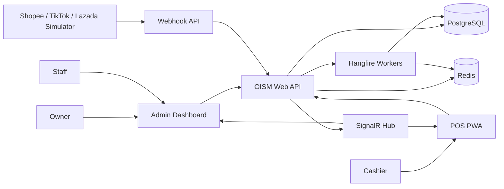

## 5. Kiến trúc container logic

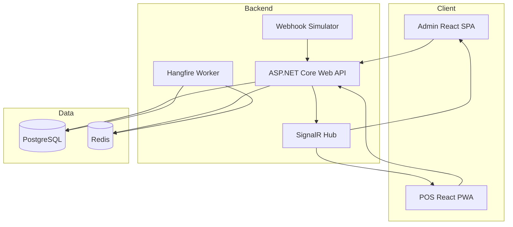

## 6. Các mô-đun nghiệp vụ

| Mô-đun | Trách nhiệm chính | Yêu cầu liên quan |
|---|---|---|
| Identity & Tenant | Tenant, người dùng, JWT, Refresh Token, RBAC | FR-AUTH, NFR-TENANT, NFR-SEC |
| Catalog | Danh mục, thương hiệu, sản phẩm, SKU, mã vạch, giá | FR-PROD |
| Inventory | On-hand, reserved, available, ledger, kiểm kê, chuyển kho | FR-INV, FR-RSE |
| Costing | Giá vốn bình quân gia quyền và snapshot COGS | FR-COST |
| Ordering | Canonical Order Model và state machine | FR-ORD |
| POS | Giỏ hàng, quét mã, thanh toán nhanh, in hóa đơn | FR-POS |
| Reporting | Doanh thu, COGS, lợi nhuận gộp, tồn kho | FR-REP |
| Integration | Webhook, SignalR, Hangfire, idempotency | FR-SIM |
| Forecasting | Gợi ý đặt hàng lại bằng AI | Gói công việc 5 |

## 7. Luồng nghiệp vụ quan trọng

### 7.1 Nhận đơn hàng online

1. Webhook gửi payload kèm `ExternalOrderId` và `EventId`.
2. Integration Adapter xác thực và chuẩn hóa sang Canonical Order Model.
3. Hệ thống kiểm tra idempotency theo `(TenantId, Channel, EventId)`.
4. Application Service mở transaction.
5. Khóa các bản ghi số dư theo thứ tự SKU ổn định.
6. Kiểm tra `available = on_hand - reserved`.
7. Tạo reservation và chuyển đơn sang `Reserved` nếu đủ hàng.
8. Commit transaction rồi phát sự kiện realtime sau commit.

### 7.2 Xác nhận đơn hàng

1. Kiểm tra trạng thái hiện tại là `Reserved`.
2. Khóa đơn, reservation và số dư tồn kho.
3. Giảm `on_hand`, giảm `reserved`.
4. Ghi `InventoryTransaction` loại `OUT/SALE`.
5. Snapshot `OrderItem.CostPrice`.
6. Chuyển đơn sang `Confirmed`.
7. Commit nguyên tử.

### 7.3 Thanh toán POS nhanh

POS thực hiện `Reserve -> Confirm -> Deduct` trong một transaction duy nhất. Hệ thống không tin giá hoặc số lượng tồn do client gửi lên; toàn bộ dữ liệu phải được kiểm tra lại ở server.

## 8. Mô hình dữ liệu cấp cao

Các aggregate và bảng chính:

- `Tenant`, `User`, `Role`, `RefreshToken`.
- `Branch`, `Warehouse`.
- `Category`, `Brand`, `Product`, `Sku`, `Barcode`, `SkuPrice`.
- `InventoryBalance`: projection giao dịch gồm `OnHand`, `Reserved`, `AverageCost`, `Version`.
- `InventoryTransaction`: sổ cái chỉ ghi thêm.
- `GoodsReceipt`, `GoodsReceiptItem`.
- `StockTransfer`, `StockTransferItem`.
- `StockCountSession`, `StockCountItem`.
- `Order`, `OrderItem`, `StockReservation`.
- `WebhookInbox`, `OutboxMessage`.
- `AuditLog`.

> `InventoryBalance` là số dư tối ưu cho giao dịch, không thay thế sổ cái. Có thể tái đối chiếu số dư từ ledger và các bút toán hợp lệ.

## 9. Quyết định kiến trúc trọng yếu

### ADR-001: Modular Monolith trước, tách dịch vụ sau

Giai đoạn đồ án sử dụng modular monolith để đảm bảo transaction mạnh giữa Order, Inventory và Costing. Ranh giới mô-đun vẫn được giữ rõ để có thể tách thành dịch vụ khi quy mô yêu cầu.

### ADR-002: PostgreSQL là nguồn dữ liệu chuẩn

Tất cả quyết định tồn kho bắt buộc đọc và ghi trong PostgreSQL. Redis chỉ tăng tốc đọc và không được dùng để xác nhận lần cuối việc còn hàng.

### ADR-003: Sử dụng InventoryBalance cùng append-only ledger

- `InventoryBalance` phục vụ khóa và kiểm tra nhanh.
- `InventoryTransaction` phục vụ kiểm toán.
- Hai thay đổi phải nằm trong cùng transaction.

### ADR-004: Transactional Outbox

Sự kiện gửi tới SignalR, báo cáo hoặc tiến trình nền được ghi vào `OutboxMessage` cùng transaction nghiệp vụ. Worker chỉ phát sự kiện sau khi dữ liệu đã commit.

## 10. Thuộc tính chất lượng

| Thuộc tính | Cách đáp ứng |
|---|---|
| Hiệu năng | Chỉ mục tenant-aware, projection số dư, cache danh mục, phân trang cursor |
| Đồng thời | Row lock hoặc optimistic concurrency, thứ tự khóa ổn định, retry giới hạn |
| Bảo mật | JWT ngắn hạn, refresh token rotation, RBAC, HTTPS, secret management |
| Kiểm toán | Append-only ledger, audit log, correlation ID |
| Khả dụng | Health check, restart policy, backup, migration có kiểm soát |
| Bảo trì | Clean Architecture, module boundary, ADR, automated tests |

## 11. Truy vết yêu cầu

- Multi-tenant: FR-AUTH-01, FR-AUTH-04, NFR-TENANT-01/02.
- Ledger và kho: FR-INV-01..04, NFR-SEC-03.
- COGS: FR-COST-01/02.
- Order Hub: FR-ORD-01..03.
- Anti-oversell: FR-RSE-01..03, NFR-PERF-02, NFR-SEC-02.
- POS: FR-POS-01..04, NFR-USA-02.
- Báo cáo: FR-REP-01..03.
- Realtime và background: FR-SIM-01..03.

## 12. Tiêu chí chấp nhận kiến trúc

- Không có truy vấn nghiệp vụ nào chạy mà thiếu `TenantId` hợp lệ.
- 50 request đồng thời cho 1 SKU còn 1 sản phẩm chỉ có tối đa 1 request thành công.
- Ledger không thể UPDATE/DELETE bởi tài khoản ứng dụng.
- Order, reservation, balance, ledger và COGS snapshot commit hoặc rollback cùng nhau.
- Webhook gửi lặp không tạo đơn hoặc reserve trùng.
- Cache lỗi không làm sai số dư tồn kho.
- Mỗi request có `CorrelationId`, `TenantId`, `UserId` và trace xuyên suốt.

## 13. Tài liệu liên quan

- `clean-architecture.md`
- `multi-tenant-architecture.md`
- `security-architecture.md`
- `concurrency-architecture.md`
- `caching-strategy.md`
- `logging-and-monitoring.md`
- `deployment-architecture.md`


---

## caching-strategy.md

<sub>Nguồn: `doc/EP-06/caching-strategy.md`</sub>


# Chiến lược caching OISM

## 1. Mục tiêu

Giảm độ trễ tìm kiếm SKU, quét mã vạch và đọc cấu hình mà không làm suy giảm tính đúng đắn của tồn kho, đơn hàng và COGS.

## 2. Nguyên tắc

1. PostgreSQL là source of truth.
2. Không dùng cache để quyết định cuối cùng việc reserve/deduct.
3. Cache key luôn chứa environment và TenantId.
4. Dữ liệu ghi phải commit trước khi invalidate hoặc publish.
5. Cache failure phải degrade gracefully, không làm hỏng transaction.
6. Không cache secret, token hoặc dữ liệu nhạy cảm không cần thiết.

## 3. Công nghệ

- In-memory cache cho metadata rất ngắn hạn trong một instance.
- Redis distributed cache cho nhiều API instance.
- HTTP/browser cache cho static assets frontend.
- Service Worker cache cho app shell của POS PWA, không phải nguồn tồn kho.

## 4. Phân loại dữ liệu

| Dữ liệu | Có cache | TTL gợi ý | Ghi chú |
|---|---:|---:|---|
| SKU theo ID/mã vạch | Có | 5-15 phút | Invalidate khi sửa SKU/barcode |
| Category/Brand | Có | 15-30 phút | Ít thay đổi |
| Giá niêm yết | Có | 1-5 phút | Invalidate ngay sau cập nhật |
| Cấu hình tenant/branch | Có | 5 phút | Cache aside |
| Quyền người dùng | Có giới hạn | 1-5 phút | Phải hỗ trợ revoke nhanh |
| On-hand/reserved/available | Không dùng để commit | 0-5 giây cho hiển thị | Luôn recheck DB khi bán |
| Order state | Thường không | Nếu có, TTL rất ngắn | Invalidate theo event |
| Báo cáo tổng hợp | Có | 1-15 phút | Key theo bộ lọc và version |
| Ledger | Không cache danh sách dài | N/A | Query phân trang/index |
| Access/refresh token | Không | N/A | Không cache ở client |

## 5. Cache key convention

```text
oism:{env}:tenant:{tenantId}:sku:id:{skuId}:v1
oism:{env}:tenant:{tenantId}:sku:barcode:{barcode}:v1
oism:{env}:tenant:{tenantId}:branch:{branchId}:settings:v1
oism:{env}:tenant:{tenantId}:report:gross-profit:{filterHash}:v1
```

Key không được chứa PII thô. `filterHash` được tạo từ bộ lọc canonical, không từ chuỗi tùy ý chưa chuẩn hóa.

## 6. Cache-aside pattern

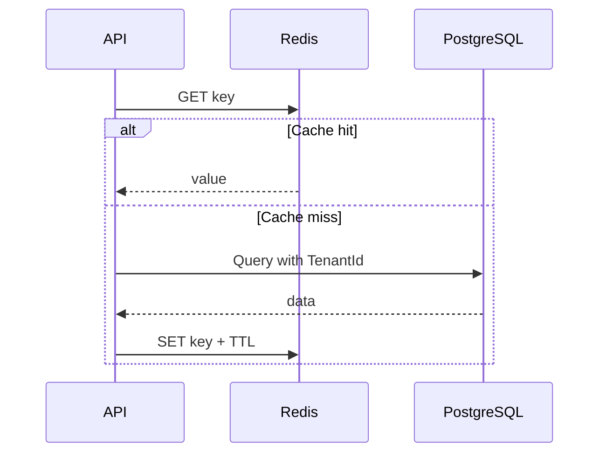

Khi cập nhật:

1. Ghi database trong transaction.
2. Commit.
3. Outbox event `SkuUpdated` hoặc `PriceUpdated`.
4. Consumer invalidate key liên quan.

TTL là lớp bảo vệ nếu event invalidate thất bại.

## 7. Tìm kiếm SKU và quét mã vạch

- Lookup exact barcode phù hợp cache theo key.
- Search theo tên sử dụng database index/search engine tùy quy mô, không tạo quá nhiều key theo chuỗi nhập từng ký tự.
- Có debounce phía client.
- Response chứa `inventoryDisplay` chỉ mang tính tham khảo; checkout luôn gọi API giao dịch để xác nhận tồn kho.

## 8. Dữ liệu tồn kho

Không cache `available` để thực hiện reserve.

Có thể cache snapshot hiển thị tối đa vài giây để dashboard/POS phản hồi nhanh, kèm `asOf`:

```json
{
  "onHand": 12,
  "reserved": 2,
  "available": 10,
  "asOf": "2026-10-29T00:00:00Z"
}
```

Khi thêm hàng vào giỏ hoặc thanh toán, client phải chấp nhận khả năng server trả `409 insufficient_available_stock`.

## 9. Cache stampede và hot key

- Dùng TTL có jitter.
- Có single-flight/distributed lock ngắn cho báo cáo tốn kém.
- Không khóa cache quá lâu.
- Cho phép stale-while-revalidate với dữ liệu không quan trọng như danh mục.
- Hot SKU vẫn phải dựa vào row locking trong DB; Redis không thay thế transaction.

## 10. Báo cáo

Key báo cáo gồm:

- TenantId.
- Khoảng thời gian.
- Branch/channel/SKU filter.
- Time zone.
- Report version.

Invalidate theo cách thực tế:

- Báo cáo hôm nay: TTL ngắn 1-5 phút.
- Báo cáo lịch sử đã đóng: TTL dài hơn.
- Có thể tăng `reportDataVersion:{tenantId}` khi ingestion/adjustment ảnh hưởng báo cáo và đưa version vào key.

## 11. Authorization cache

Nếu cache permission:

- Key gồm TenantId + UserId + permission version.
- Thay đổi role làm tăng permission version hoặc xóa key.
- User disabled phải bị chặn bằng kiểm tra trạng thái đáng tin cậy, không chờ TTL dài.
- Không cache quyết định resource ownership phức tạp nếu dễ stale.

## 12. PWA offline strategy

Cache:

- HTML shell, JS, CSS, icon, font.
- Danh mục sản phẩm tối thiểu nếu nghiệp vụ cho phép.

Không cache hoặc không cho phép offline commit:

- Reserve/confirm/deduct.
- Payment confirmation.
- Token nhạy cảm.
- Ledger và báo cáo nhạy cảm.

Nếu mất mạng, POS hiển thị rõ trạng thái offline và không xác nhận bán hàng khi chưa thể kiểm tra tồn kho server, trừ khi dự án sau này thiết kế riêng cơ chế offline stock allocation.

## 13. Bảo mật cache

- Redis không public internet.
- TLS và authentication trong production.
- Network policy chỉ cho dịch vụ cần thiết truy cập.
- Không ghi payload cache vào log.
- Dữ liệu được serialize có schema/version.
- Thiết lập memory policy để tránh Redis làm ảnh hưởng chức năng cốt lõi.

## 14. Resilience

Khi Redis lỗi:

- Catalog/settings đọc từ database.
- Reporting có thể chậm hơn nhưng vẫn đúng.
- Rate limiting phân tán cần fallback được tài liệu hóa.
- Không rollback giao dịch DB chỉ vì invalidate cache thất bại.
- Circuit breaker ngắn giúp tránh chờ Redis quá lâu.

## 15. Metrics

- Cache hit/miss theo nhóm key.
- Redis latency p95/p99.
- Eviction count và memory usage.
- Cache load failures.
- Invalidation lag.
- DB query volume trước/sau cache.

Không tối ưu chỉ để tăng hit rate; mục tiêu là giảm latency và tải DB mà không gây stale nghiêm trọng.

## 16. Tiêu chí chấp nhận

- Không có transaction tồn kho phụ thuộc cache.
- Cache key của dữ liệu nghiệp vụ luôn có TenantId.
- Update SKU/price được invalidate sau commit.
- Redis unavailable không làm POS ghi sai tồn kho.
- Service Worker không lưu token hoặc response nhạy cảm.


---

## clean-architecture.md

<sub>Nguồn: `doc/EP-06/clean-architecture.md`</sub>


# Clean Architecture cho OISM

## 1. Mục tiêu

Áp dụng Clean Architecture để tách logic nghiệp vụ tồn kho, giá vốn và chống bán vượt khỏi ASP.NET Core, EF Core, PostgreSQL, Redis và React. Quy tắc phụ thuộc luôn hướng vào trong.

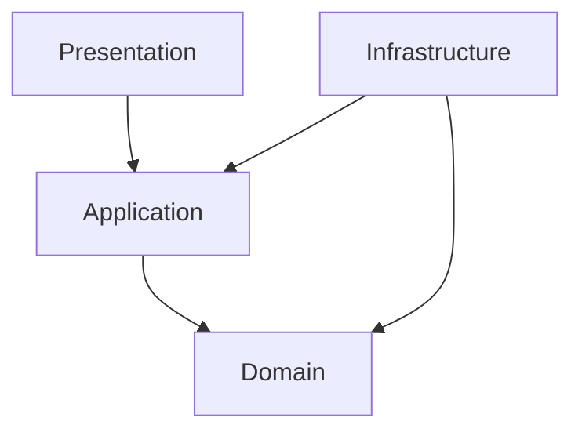

## 2. Cấu trúc solution đề xuất

```text
Oism.sln
src/
  Oism.Domain/
    Common/
    Tenancy/
    Catalog/
    Inventory/
    Costing/
    Ordering/
  Oism.Application/
    Abstractions/
    Behaviors/
    Features/
      Auth/
      Catalog/
      Inventory/
      Orders/
      Pos/
      Reports/
    Contracts/
  Oism.Infrastructure/
    Persistence/
    Identity/
    Caching/
    BackgroundJobs/
    Realtime/
    Integrations/
    Observability/
  Oism.Api/
    Endpoints/
    Middleware/
    Filters/
    Hubs/
  Oism.Worker/
frontend/
  admin-web/
  pos-pwa/
tests/
  Oism.Domain.UnitTests/
  Oism.Application.UnitTests/
  Oism.Infrastructure.IntegrationTests/
  Oism.Api.FunctionalTests/
  Oism.ConcurrencyTests/
```

## 3. Tầng Domain

### 3.1 Trách nhiệm

- Entity, Value Object, Aggregate Root.
- Quy tắc bất biến của đơn hàng và tồn kho.
- State machine của Order.
- Công thức Weighted Average Cost.
- Domain Event và Domain Exception.
- Không phụ thuộc EF Core, ASP.NET Core hoặc Redis.

### 3.2 Aggregate đề xuất

- `Order`: quản lý vòng đời Draft, Reserved, Confirmed, Completed, Cancelled.
- `StockReservation`: quản lý giữ hàng và thời hạn.
- `GoodsReceipt`: xác nhận nhập hàng.
- `StockTransfer`: vận chuyển và nhận hàng hai bước.
- `StockCountSession`: kiểm kê và tạo adjustment.

`InventoryTransaction` là bản ghi ledger bất biến. `InventoryBalance` là projection giao dịch được cập nhật thông qua use case và repository chuyên biệt.

### 3.3 Quy tắc Domain quan trọng

```text
available = on_hand - reserved
on_hand >= 0
reserved >= 0
available >= 0
```

- Không confirm đơn chưa reserve, trừ luồng POS atomic.
- Không cancel đơn đã completed.
- Không thay đổi `OrderItem.CostPrice` sau khi snapshot.
- Ledger đã tạo không có phương thức sửa hoặc xóa.
- Chuyển kho chỉ tăng kho đích sau khi xác nhận nhận hàng.

## 4. Tầng Application

### 4.1 Trách nhiệm

- Tổ chức use case bằng Command/Query.
- Validation, authorization, transaction boundary.
- Gọi interface do Application định nghĩa.
- Chuyển đổi DTO và phát domain/integration event.

### 4.2 Interface cốt lõi

```csharp
public interface ITenantContext
{
    Guid TenantId { get; }
    Guid? UserId { get; }
}

public interface IInventoryRepository
{
    Task<InventoryBalance?> GetForUpdateAsync(
        Guid branchId,
        Guid skuId,
        CancellationToken cancellationToken);
}

public interface IUnitOfWork
{
    Task<int> SaveChangesAsync(CancellationToken cancellationToken);
}

public interface IClock
{
    DateTimeOffset UtcNow { get; }
}
```

### 4.3 Pipeline behavior

Thứ tự đề xuất:

1. Correlation và request context.
2. Authentication.
3. Tenant resolution.
4. Authorization/RBAC.
5. Idempotency cho command phù hợp.
6. Validation.
7. Transaction.
8. Handler.
9. Outbox persistence.
10. Logging và metrics.

Không bọc query thuần đọc trong transaction nếu không cần thiết.

## 5. Tầng Infrastructure

### 5.1 Persistence

- `OismDbContext` và EF Core mappings.
- Global Query Filter theo `TenantId`.
- Repository triển khai row lock bằng SQL phù hợp PostgreSQL.
- Interceptor chặn UPDATE/DELETE ledger.
- Transactional Outbox và Inbox.
- Migration và seed data.

### 5.2 Các adapter

- BCrypt hoặc Argon2 password hasher.
- JWT issuer và refresh token store.
- Redis cache.
- SignalR notifier.
- Hangfire job scheduler.
- Adapter chuẩn hóa webhook theo từng channel.
- OpenTelemetry exporters và structured logger.

## 6. Tầng Presentation

- Minimal API hoặc Controllers chỉ xử lý HTTP concern.
- Không đặt nghiệp vụ trong controller/endpoint.
- DTO request/response tách khỏi entity.
- Trả lỗi theo `ProblemDetails` với mã lỗi ổn định.
- Swagger mô tả xác thực, idempotency key, correlation ID và response code.

Ví dụ endpoint:

```csharp
app.MapPost("/api/v1/orders/{orderId:guid}/reserve", ReserveOrder)
   .RequireAuthorization("Orders.Reserve")
   .Produces<ReserveOrderResponse>(StatusCodes.Status200OK)
   .ProducesProblem(StatusCodes.Status409Conflict);
```

## 7. Quy tắc phụ thuộc

Được phép:

- Domain không tham chiếu project nào.
- Application chỉ tham chiếu Domain.
- Infrastructure tham chiếu Application và Domain.
- API tham chiếu Application và cấu hình Infrastructure tại composition root.

Không được phép:

- Domain sử dụng `DbContext`, `HttpContext`, Redis hoặc SignalR.
- Application trả trực tiếp EF entity.
- Presentation truy cập DbContext để bỏ qua use case.
- Infrastructure chứa quyết định nghiệp vụ về trạng thái đơn.

## 8. Thiết kế use case mẫu: ReserveOrder

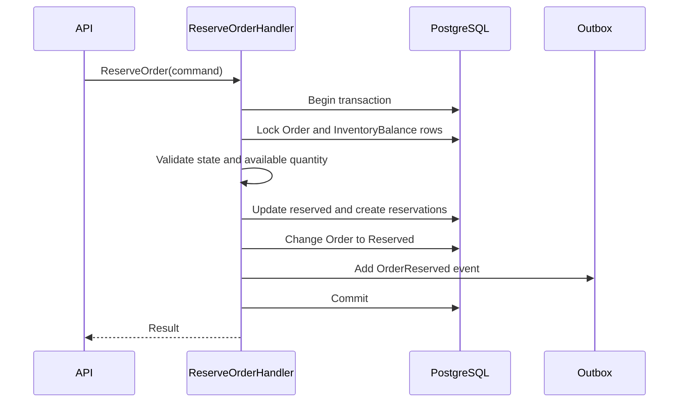

Handler phải khóa nhiều SKU theo thứ tự `SkuId` tăng dần để giảm deadlock.

## 9. Xử lý lỗi

| Lỗi | HTTP | Ví dụ mã lỗi |
|---|---:|---|
| Validation | 400 | `validation_failed` |
| Chưa xác thực | 401 | `unauthorized` |
| Không đủ quyền | 403 | `forbidden` |
| Không tìm thấy trong tenant | 404 | `order_not_found` |
| Xung đột trạng thái | 409 | `invalid_order_transition` |
| Không đủ tồn | 409 | `insufficient_available_stock` |
| Concurrency conflict | 409 hoặc retry nội bộ | `concurrency_conflict` |
| Lỗi hệ thống | 500 | `internal_error` |

Không trả stack trace, SQL hoặc secret ra client.

## 10. Kiểm thử theo tầng

- **Domain Unit Test**: state transition, WAC, invariant, reserve calculation.
- **Application Unit Test**: handler, validation, permission và orchestration.
- **Infrastructure Integration Test**: EF mappings, filter tenant, ledger protection, transaction.
- **Functional Test**: API, JWT, status code, ProblemDetails.
- **Concurrency Test**: 50 request tranh chấp 1 SKU.
- **Architecture Test**: kiểm tra project reference và namespace dependency.

Mô-đun Inventory, Reservation và Costing phải đạt tối thiểu 80% coverage theo NFR-MAINT-02; quan trọng hơn là bao phủ đầy đủ các invariant và nhánh lỗi.

## 11. Definition of Done kiến trúc

- Use case có command/query, validator và authorization policy.
- Mọi bảng nghiệp vụ có TenantId và chỉ mục phù hợp.
- Command thay đổi kho có transaction và integration test.
- Event bên ngoài được ghi qua outbox.
- Không có business logic trong controller hoặc DbContext.
- Có log, metric, trace và audit cho thao tác nhạy cảm.


---

## concurrency-architecture.md

<sub>Nguồn: `doc/EP-06/concurrency-architecture.md`</sub>


# Kiến trúc xử lý đồng thời và chống bán vượt

## 1. Mục tiêu

Đảm bảo `available = on_hand - reserved` không âm trong mọi tình huống, đặc biệt kịch bản 50 đơn hàng đồng thời tranh chấp một SKU còn lại.

## 2. Mô hình nhất quán

PostgreSQL là nguồn dữ liệu chuẩn. Mỗi tổ hợp `(TenantId, BranchId, SkuId)` có đúng một bản ghi `InventoryBalance`:

```text
OnHand >= 0
Reserved >= 0
OnHand - Reserved >= 0
```

Ledger và balance được cập nhật trong cùng transaction. Cache không tham gia quyết định commit.

## 3. Chiến lược khóa mặc định

Ưu tiên **pessimistic row locking** cho đường ghi tồn kho:

```sql
SELECT *
FROM inventory_balances
WHERE tenant_id = @tenantId
  AND branch_id = @branchId
  AND sku_id = @skuId
FOR UPDATE;
```

Lý do:

- Tranh chấp cao và cần ngăn oversell tuyệt đối.
- Luồng giao dịch ngắn.
- PostgreSQL hỗ trợ row-level lock rõ ràng.
- Dễ kiểm chứng bằng concurrency test.

Optimistic concurrency với `Version` có thể dùng cho dữ liệu quản trị ít tranh chấp; với reservation phải retry có giới hạn và vẫn kiểm tra invariant trong database.

## 4. Reserve hàng

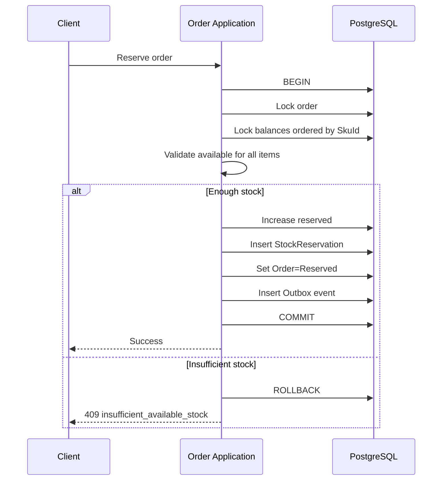

Tất cả dòng hàng phải được kiểm tra trước khi cập nhật. Không reserve một phần trừ khi use case định nghĩa partial fulfillment rõ ràng.

## 5. Confirm và Deduct

Khi đơn từ `Reserved` sang `Confirmed`:

```text
new_on_hand = on_hand - quantity
new_reserved = reserved - quantity
```

Trong cùng transaction:

- Khóa order và balance.
- Kiểm tra reservation đang active.
- Giảm `OnHand` và `Reserved`.
- Ghi ledger `OUT/SALE` với `BalanceAfter`.
- Snapshot `OrderItem.CostPrice = AverageCost`.
- Đóng reservation.
- Chuyển order sang Confirmed.
- Ghi outbox.

## 6. Cancel đơn

Nếu đơn đang `Reserved`:

```text
new_reserved = reserved - reserved_quantity
```

Không tăng `OnHand`, vì hàng chưa bị trừ. Việc cancel phải idempotent: lệnh lặp lại không được release lần hai.

## 7. POS atomic checkout

POS thanh toán nhanh thực hiện trong một transaction:

1. Tạo order hoặc khóa draft order.
2. Khóa InventoryBalance theo thứ tự cố định.
3. Kiểm tra available.
4. Tạo reservation logic nội bộ.
5. Confirm ngay lập tức.
6. Giảm on-hand và reserved.
7. Ghi ledger và CostPrice snapshot.
8. Ghi payment record ở trạng thái phù hợp.
9. Commit.

Nếu in hóa đơn thất bại sau commit, không rollback giao dịch bán; cho phép in lại.

## 8. Kiểm soát ở database

Constraint phòng thủ:

```sql
ALTER TABLE inventory_balances
ADD CONSTRAINT ck_inventory_non_negative
CHECK (
  on_hand >= 0
  AND reserved >= 0
  AND on_hand - reserved >= 0
);
```

Unique constraint:

```sql
CREATE UNIQUE INDEX ux_inventory_balance
ON inventory_balances (tenant_id, branch_id, sku_id);
```

Lưu ý: constraint là lớp cuối, không thay thế thông báo lỗi nghiệp vụ thân thiện.

## 9. Thứ tự khóa và deadlock

Khi đơn có nhiều SKU:

- Sắp xếp theo `(BranchId, SkuId)` tăng dần trước khi khóa.
- Mọi use case Inventory phải dùng cùng thứ tự.
- Transaction phải ngắn, không gọi HTTP, SignalR hoặc tác vụ chậm bên trong.
- Nếu PostgreSQL phát hiện deadlock/serialization failure, retry toàn transaction tối đa 2-3 lần với jitter.
- Không retry lỗi thiếu hàng hoặc state transition không hợp lệ.

## 10. Isolation level

Mặc định `READ COMMITTED` kết hợp `SELECT ... FOR UPDATE` cho các row cần sửa. `SERIALIZABLE` chỉ dùng cho use case đã benchmark vì có thể tăng retry và giảm throughput.

Không thực hiện check-then-update ngoài transaction:

```text
Sai: SELECT available -> kết thúc query -> UPDATE reserved
Đúng: BEGIN -> SELECT FOR UPDATE -> check -> UPDATE -> COMMIT
```

## 11. Idempotency

Các operation cần idempotency:

- Tiếp nhận webhook.
- Reserve order.
- Confirm order.
- Cancel order.
- POS checkout khi client retry do timeout.

Bảng đề xuất:

```text
IdempotencyRecord
- TenantId
- Key
- Operation
- RequestHash
- Status
- ResponseCode
- ResponseBody
- ExpiresAt
```

Unique `(TenantId, Operation, Key)`. Nếu cùng key nhưng request hash khác, trả `409 idempotency_key_reused`.

## 12. Reservation expiration

Hangfire tìm reservation hết hạn theo batch. Mỗi bản ghi được xử lý transaction riêng hoặc batch nhỏ:

1. Lock reservation với `FOR UPDATE SKIP LOCKED`.
2. Kiểm tra vẫn Active và Order vẫn Reserved.
3. Lock InventoryBalance.
4. Giảm Reserved.
5. Chuyển reservation sang Expired và order sang Cancelled theo quy tắc.
6. Commit và phát outbox event.

`SKIP LOCKED` cho phép nhiều worker xử lý song song mà không xử lý trùng.

## 13. Weighted Average Cost dưới đồng thời

Khi xác nhận nhập hàng:

```text
newAverageCost =
((oldOnHand * oldAverageCost) + (receivedQty * purchasePrice))
/ (oldOnHand + receivedQty)
```

Balance phải được khóa trước khi đọc old quantity/cost. Quy tắc trường hợp tồn cũ bằng 0:

```text
newAverageCost = purchasePrice
```

Dùng decimal với precision thống nhất, ví dụ `numeric(18,4)` cho đơn giá và làm tròn theo chính sách tài chính đã tài liệu hóa.

## 14. Chuyển kho hai bước

- `Ship`: khóa kho nguồn, giảm on-hand nguồn, ghi ledger OUT/TRANSFER_SHIP.
- Hàng đang vận chuyển được theo dõi trên `StockTransfer` hoặc transit location.
- `Receive`: khóa kho đích, tăng on-hand, ghi ledger IN/TRANSFER_RECEIVE.
- Mỗi bước idempotent và có state transition hợp lệ.

## 15. Concurrency test bắt buộc

### Kịch bản Flash Sale

- OnHand = 1, Reserved = 0.
- Gửi 50 request reserve đồng thời.
- Kỳ vọng: 1 success, 49 conflict; available cuối = 0; reserved = 1; không âm.

### Kịch bản khác

- Hai order nhiều SKU khóa theo thứ tự khác nhau từ client nhưng server chuẩn hóa thứ tự.
- Confirm và cancel cùng order đồng thời.
- Reservation expiry tranh chấp với confirm.
- Webhook trùng `EventId`.
- POS timeout và retry cùng idempotency key.
- Goods receipt đồng thời với sale cùng SKU.

Sau mỗi test phải đối chiếu Order, Reservation, InventoryBalance và Ledger.

## 16. Metrics vận hành

- `inventory_reservation_conflicts_total`.
- `inventory_lock_wait_duration_ms`.
- `db_deadlocks_total`.
- `transaction_retries_total`.
- `reservation_expired_total`.
- `inventory_invariant_violations_total` phải luôn bằng 0.
- p95/p99 của reserve và POS checkout.

## 17. Tiêu chí chấp nhận

- Không ghi nhận `available < 0` trong test hoặc production.
- 50 request/1 SKU chỉ thành công theo số lượng thực có.
- Không có side effect trùng khi retry.
- Lock wait và deadlock có dashboard/alert.
- Outbox chỉ phát sự kiện sau commit.


---

## deployment-architecture.md

<sub>Nguồn: `doc/EP-06/deployment-architecture.md`</sub>


# Kiến trúc triển khai OISM

## 1. Mục tiêu

Triển khai lặp lại được, an toàn, có health check, migration, backup, quan sát và rollback. Gói demo dùng Docker Compose; production có thể triển khai trên nền tảng container orchestration hoặc managed container service.

## 2. Thành phần triển khai

- `oism-api`: ASP.NET Core Web API và SignalR Hub.
- `oism-worker`: Hangfire worker, outbox dispatcher, scheduled jobs.
- `oism-admin`: static React Admin build phục vụ qua web server/CDN.
- `oism-pos`: React PWA build.
- `postgres`: database giao dịch.
- `redis`: distributed cache và hỗ trợ scale-out phù hợp.
- `reverse-proxy`: TLS termination, routing và security headers.
- Observability stack tùy môi trường.

## 3. Sơ đồ triển khai

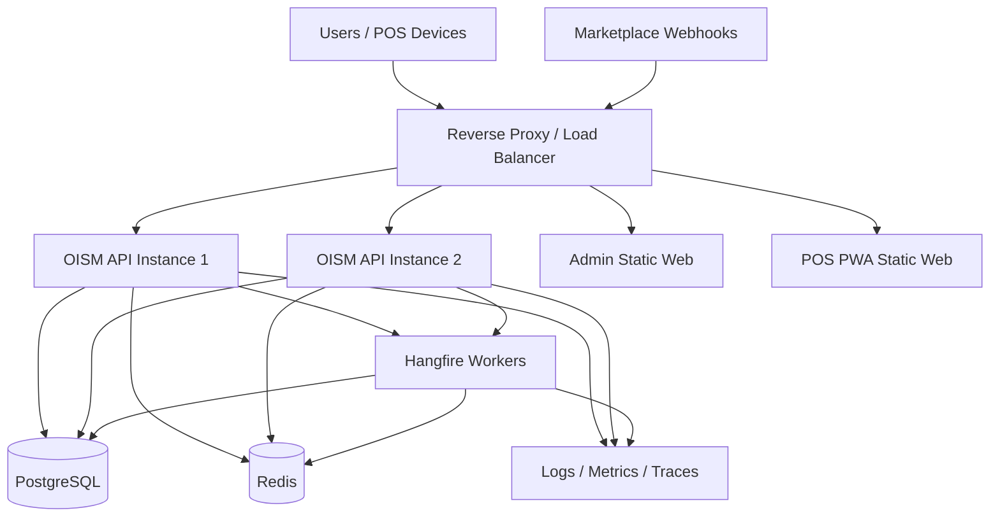

## 4. Môi trường

- `local`: Docker Compose, seed data và simulator.
- `test`: CI integration tests với container tạm.
- `staging`: gần giống production, dữ liệu giả.
- `production`: HA, backup, TLS, secret manager và monitoring đầy đủ.

Mỗi môi trường có database, Redis, secret và domain riêng. Không dùng production secret ở staging.

## 5. Docker image

Yêu cầu:

- Multi-stage build.
- Base image cố định theo digest hoặc version đã duyệt.
- Chạy non-root.
- Chỉ chứa artifact cần thiết.
- Có health check phù hợp.
- Không chép source, test data hoặc secret vào final image.
- Scan image trong CI.

Ví dụ cấu trúc:

```text
Dockerfile.api
Dockerfile.worker
frontend/admin-web/Dockerfile
frontend/pos-pwa/Dockerfile
docker-compose.yml
.env.example
```

## 6. Docker Compose demo

```yaml
services:
  postgres:
    image: postgres:16
    environment:
      POSTGRES_DB: oism
      POSTGRES_USER: oism
      POSTGRES_PASSWORD: ${POSTGRES_PASSWORD}
    volumes:
      - postgres_data:/var/lib/postgresql/data

  redis:
    image: redis:7-alpine

  api:
    build:
      context: .
      dockerfile: Dockerfile.api
    depends_on:
      - postgres
      - redis
    environment:
      ConnectionStrings__Default: ${DB_CONNECTION}
      Redis__ConnectionString: redis:6379

  worker:
    build:
      context: .
      dockerfile: Dockerfile.worker
    depends_on:
      - postgres
      - redis

  admin:
    build: ./frontend/admin-web

  pos:
    build: ./frontend/pos-pwa

volumes:
  postgres_data:
```

File thực tế cần health-based dependency hoặc startup retry; `depends_on` đơn thuần không đảm bảo database đã sẵn sàng.

## 7. Cấu hình và secret

- Cấu hình không nhạy cảm qua environment variables.
- Secret qua secret manager hoặc CI/CD protected secrets.
- Có `.env.example`, không commit `.env` thật.
- Validate cấu hình khi startup và fail fast nếu thiếu giá trị bắt buộc.
- Rotate JWT/database/webhook secret theo quy trình.

## 8. Database migration

Không cho mọi API instance tự chạy migration đồng thời.

Quy trình:

1. Backup hoặc snapshot theo chính sách.
2. Chạy migration job duy nhất bằng DB role riêng.
3. Xác thực migration thành công.
4. Deploy API/worker tương thích.
5. Chạy smoke test.

Áp dụng expand-and-contract cho thay đổi không downtime:

- Release 1 thêm cột/bảng tương thích ngược.
- Backfill theo batch.
- Release 2 chuyển code sang cấu trúc mới.
- Release sau mới xóa cấu trúc cũ.

Không sửa migration đã chạy ở production.

## 9. CI/CD pipeline

```mermaid
flowchart LR
    C[Commit / Pull Request] --> B[Restore and Build]
    B --> U[Unit Tests]
    U --> I[Integration and Concurrency Tests]
    I --> S[SAST / Dependency / Secret Scan]
    S --> D[Build and Scan Images]
    D --> R[Push Registry]
    R --> ST[Deploy Staging]
    ST --> SM[Smoke / DAST]
    SM --> AP[Approval]
    AP --> PR[Production Deploy]
    PR --> V[Verify and Monitor]
```

Artifact phải bất biến: cùng image digest được promote từ staging sang production.

## 10. Chiến lược release

- Rolling deployment khi thay đổi tương thích.
- Blue-green hoặc canary cho release rủi ro cao.
- API versioning và backward compatibility với frontend đang cache.
- Service Worker phải xử lý version app shell, tránh client chạy bundle cũ không tương thích API.
- Theo dõi error rate, latency, deadlock và outbox backlog sau deploy.

## 11. SignalR và scale-out

Khi có nhiều API instance:

- Load balancer hỗ trợ WebSocket.
- Cân nhắc sticky session theo cấu hình hosting.
- Dùng backplane/managed realtime service khi cần phát sự kiện xuyên instance.
- Reconnect policy phía client có exponential backoff.
- Sự kiện realtime không thay thế query nguồn dữ liệu chuẩn.

## 12. Hangfire

- API chỉ enqueue; worker riêng xử lý job nặng.
- Queue tách theo loại: `critical`, `default`, `reports`.
- Giới hạn concurrency cho job ảnh hưởng cùng tài nguyên.
- Job idempotent và có retry policy.
- Dashboard Hangfire được bảo vệ bằng authorization, không public.
- Theo dõi oldest job age và failure count.

## 13. High availability và mục tiêu 99,5%

Production đề xuất:

- Tối thiểu 2 API instance.
- PostgreSQL managed HA hoặc primary/standby.
- Redis có persistence/replication tùy vai trò và RTO.
- Load balancer health probe.
- Worker có thể scale ngang.
- Static frontend qua CDN/web server dự phòng.

Mục tiêu 99,5% trong 7:00-22:00 tương đương ngân sách gián đoạn khoảng 4,5 phút cho mỗi ngày vận hành 15 giờ, nếu đo theo ngày. Cần thống nhất cửa sổ và chu kỳ đo SLA chính thức.

## 14. Backup và recovery

- Backup PostgreSQL tự động và mã hóa.
- Có point-in-time recovery nếu production yêu cầu.
- Kiểm thử restore định kỳ, không chỉ kiểm tra job backup.
- Lưu cấu hình hạ tầng dưới dạng code.
- Ledger và audit nằm trong chiến lược backup.
- Redis cache có thể rebuild; không coi Redis là bản sao lưu dữ liệu giao dịch.

Cần quy định RPO/RTO chính thức. Giá trị khởi đầu đề xuất cho đồ án demo:

```text
RPO: 15 phút
RTO: 60 phút
```

Đây là mục tiêu đề xuất, phải được stakeholder phê duyệt.

## 15. Network security

- Chỉ reverse proxy/load balancer public.
- PostgreSQL và Redis ở private network.
- Security group/network policy theo least privilege.
- Admin endpoints và observability UI được bảo vệ.
- Egress được giới hạn khi có thể.
- TLS nội bộ được cân nhắc theo môi trường và yêu cầu bảo mật.

## 16. Capacity và scaling

Scale API theo:

- Request rate, CPU, memory, p95 latency.

Scale worker theo:

- Queue length và oldest job age.

Tối ưu database trước khi scale mù quáng:

- Index theo TenantId.
- Connection pooling.
- Query plan và slow query.
- Partition ledger khi cần.
- Read replica chỉ cho báo cáo chấp nhận độ trễ; không dùng cho quyết định reserve.

## 17. Rollback

- Rollback code bằng image digest trước.
- Migration phải backward compatible; tránh migration phá hủy trong cùng release.
- Nếu lỗi dữ liệu, không sửa ledger trực tiếp; dùng quy trình reconciliation/compensation.
- Feature flag có thể tắt integration hoặc tính năng AI mà không tắt lõi bán hàng.

## 18. Kiểm tra sau triển khai

- `/health/live` và `/health/ready` thành công.
- Đăng nhập tenant demo.
- Tìm kiếm/quét SKU.
- Tạo đơn, reserve, confirm và kiểm tra ledger.
- Webhook simulator và idempotency.
- SignalR nhận thông báo.
- Hangfire xử lý job.
- Metrics/log/trace xuất hiện.
- Backup job và cảnh báo hoạt động.

## 19. Tiêu chí chấp nhận

- Pipeline build, test, scan và tạo image tự động.
- Container chạy non-root và không chứa secret.
- Migration chỉ chạy một lần bằng role chuyên biệt.
- Production có tối thiểu hai API instance và health-based routing.
- Restore backup được diễn tập.
- Release có rollback plan và smoke test tự động.


---

## logging-and-monitoring.md

<sub>Nguồn: `doc/EP-06/logging-and-monitoring.md`</sub>


# Logging và Monitoring OISM

## 1. Mục tiêu

Cung cấp khả năng quan sát toàn diện cho request API, transaction tồn kho, Hangfire, SignalR, PostgreSQL và trải nghiệm POS; đồng thời bảo vệ dữ liệu nhạy cảm và hỗ trợ điều tra sự cố.

## 2. Ba trụ cột observability

- **Logs**: sự kiện có cấu trúc và ngữ cảnh.
- **Metrics**: số đo theo thời gian để dashboard và alert.
- **Traces**: theo dõi luồng xuyên API, DB, worker và integration.

Khuyến nghị dùng OpenTelemetry để chuẩn hóa instrumentation; backend có thể dùng structured logging và exporter phù hợp môi trường.

## 3. Structured logging

Mỗi log quan trọng gồm:

```json
{
  "timestamp": "2026-10-29T00:00:00Z",
  "level": "Information",
  "message": "Order reserved",
  "service": "oism-api",
  "environment": "production",
  "traceId": "...",
  "spanId": "...",
  "correlationId": "...",
  "tenantId": "...",
  "userId": "...",
  "branchId": "...",
  "orderId": "...",
  "durationMs": 72
}
```

Dùng message template ổn định, không nối chuỗi tùy ý.

## 4. Correlation và trace propagation

- Chấp nhận hoặc tạo `X-Correlation-ID` với định dạng hợp lệ.
- Trả correlation ID trong response.
- Propagate W3C Trace Context qua HTTP và background message.
- Outbox event chứa trace/correlation context cần thiết.
- Hangfire job tạo child span và giữ TenantId.

## 5. Mức log

- `Trace`: chỉ dùng chẩn đoán tạm thời, không bật mặc định production.
- `Debug`: luồng kỹ thuật chi tiết, không chứa secret.
- `Information`: request hoàn tất, state transition và job thành công quan trọng.
- `Warning`: retry, cache failure, webhook invalid, lock wait cao.
- `Error`: operation thất bại không mong đợi.
- `Critical`: database unavailable kéo dài, invariant violation, nguy cơ mất dữ liệu.

Không log mọi lần đọc SKU ở Information nếu tạo tải log quá lớn; sử dụng metric/trace sampling.

## 6. Dữ liệu cấm ghi log

- Mật khẩu, password hash.
- JWT và refresh token đầy đủ.
- Webhook secret/API key.
- Connection string.
- Nội dung QR thanh toán nhạy cảm.
- Dữ liệu cá nhân không cần thiết.
- Toàn bộ request/response body theo mặc định.

Áp dụng masking cho email/số điện thoại nếu cần chẩn đoán.

## 7. Audit log và application log

Audit log không thay thế application log.

- Application log phục vụ vận hành và debug, có retention ngắn hơn.
- Audit log phục vụ truy vết hành động người dùng và thay đổi nhạy cảm, có tính bất biến và retention riêng.

Audit các hành động: login, thay đổi quyền, adjustment, receipt confirmation, transfer receive, order cancel/confirm, export report và thay đổi tenant.

## 8. Metrics nghiệp vụ

- `orders_created_total{channel}`.
- `orders_by_status{status}`.
- `gross_revenue_total` và `cogs_total` chỉ dùng nếu hệ thống metric phù hợp; tránh label cardinality cao.
- `inventory_reservations_total{result}`.
- `inventory_low_stock_skus`.
- `webhook_events_total{channel,result}`.
- `reservation_expired_total`.

Không dùng TenantId làm label cho hệ thống metric công cộng nếu số tenant lớn; có thể dùng dashboard tenant-specific từ database/reporting.

## 9. Metrics kỹ thuật

- API request rate, error rate, duration p50/p95/p99.
- POS barcode lookup p95 dưới 200ms.
- Order write p95 dưới 500ms.
- Report query dưới 2 giây với phạm vi dữ liệu mục tiêu.
- DB connection pool usage.
- Query duration và slow query count.
- Lock wait, deadlock, transaction retry.
- Redis hit rate, latency, memory và eviction.
- Hangfire queue length, job age, failure/retry.
- SignalR active connections và send failures.
- CPU, memory, disk và container restart.

## 10. Health checks

Các endpoint:

```text
/health/live   - process sống, không kiểm tra phụ thuộc nặng
/health/ready  - sẵn sàng nhận traffic, kiểm tra PostgreSQL và phụ thuộc bắt buộc
/health/startup - migration/configuration đã sẵn sàng
```

Redis có thể là degraded thay vì unhealthy nếu chức năng cốt lõi có fallback. Không trả secret hoặc chi tiết hạ tầng trong health response public.

## 11. Dashboard đề xuất

### API Overview

- Requests/sec, p95 latency, 4xx, 5xx.
- Top slow endpoints.
- Instance health và restart.

### Inventory Integrity

- Reservation conflicts.
- Lock wait/deadlocks.
- Invariant violation.
- Balance-ledger reconciliation status.

### Integration

- Webhook received/succeeded/failed/duplicated.
- Inbox age và outbox backlog.
- SignalR delivery failure.

### Background Jobs

- Queue length, oldest job age.
- Failed jobs và retries.
- Expired reservation processing lag.
- Daily report completion.

### Data Layer

- DB CPU/storage/connections.
- Slow queries.
- Redis health.

## 12. Alerting

| Mức | Điều kiện ví dụ | Phản ứng |
|---|---|---|
| Critical | Inventory invariant violation > 0 | Dừng luồng ảnh hưởng, điều tra ngay |
| Critical | DB unavailable > 5 phút | Incident response |
| High | API 5xx vượt ngưỡng 5 phút | Kiểm tra release/phụ thuộc |
| High | Outbox backlog tăng liên tục | Kiểm tra worker |
| High | Deadlock tăng bất thường | Phân tích lock ordering/query |
| Medium | p95 POS lookup > 200ms | Tối ưu/cache/index |
| Medium | Hangfire oldest job quá SLA | Tăng worker/sửa job |
| Low | Disk/Redis memory gần ngưỡng | Lập kế hoạch dung lượng |

Ngưỡng cụ thể phải được hiệu chỉnh từ baseline, tránh alert fatigue.

## 13. Retention và truy cập

- Application logs: ví dụ 14-30 ngày.
- Security/audit logs: theo chính sách tổ chức, thường dài hơn.
- Traces: sampling và retention ngắn hơn log.
- Metrics: đủ dài để xem xu hướng và capacity.
- Quyền xem log theo least privilege.
- Ghi audit việc truy cập hoặc export log nhạy cảm nếu cần.

## 14. Runbook sự cố mẫu

### Oversell hoặc invariant violation

1. Xác định TenantId, BranchId, SkuId và CorrelationId.
2. Tạm dừng endpoint/consumer gây lỗi nếu cần.
3. Đối chiếu balance, reservation, order và ledger.
4. Không sửa/xóa ledger; tạo adjustment có phê duyệt.
5. Kiểm tra lock wait, deadlock và deployment gần nhất.
6. Bổ sung regression/concurrency test.

### Webhook backlog

1. Kiểm tra inbox/outbox age và Hangfire queue.
2. Kiểm tra lỗi chữ ký, payload schema và DB latency.
3. Scale worker nếu job an toàn để song song.
4. Replay theo idempotency key, không chèn trực tiếp đơn trùng.

## 15. Kiểm thử observability

- Trace xuyên request -> DB -> outbox -> worker.
- Log masking token và password.
- Alert thử nghiệm ở staging.
- Health check khi PostgreSQL/Redis bị ngắt.
- Dashboard hiển thị đúng SLI.
- Correlation ID xuất hiện trong response và log.

## 16. Tiêu chí chấp nhận

- 100% request có trace/correlation ID.
- State transition quan trọng có structured log và audit phù hợp.
- Không có secret trong log scan.
- Có dashboard cho API, inventory, integration, job và database.
- Có alert đặc biệt cho invariant violation và outbox backlog.


---

## multi-tenant-architecture.md

<sub>Nguồn: `doc/EP-06/multi-tenant-architecture.md`</sub>


# Kiến trúc SaaS đa khách hàng

## 1. Mục tiêu

Thiết kế OISM theo mô hình **shared database, shared schema, TenantId discriminator**. Mọi dữ liệu nghiệp vụ được cô lập logic theo tenant và được bảo vệ ở nhiều lớp để giảm nguy cơ rò rỉ chéo.

> Nếu yêu cầu cuối cùng là shared database, schema riêng cho từng tenant thì chiến lược migration và vận hành sẽ phức tạp hơn. Với phạm vi đồ án, shared schema + TenantId là lựa chọn mặc định và phù hợp với yêu cầu Global Query Filters.

## 2. Nhận diện tenant

### 2.1 Nguồn nhận diện

- JWT claim `tenant_id` cho người dùng đăng nhập.
- API key hoặc webhook route mapping cho tích hợp sàn.
- Hangfire job argument chứa TenantId và được xác thực lại khi chạy.

Không chấp nhận `TenantId` do client tự gửi trong request body để quyết định phạm vi dữ liệu.

### 2.2 Luồng resolution

```mermaid
flowchart LR
    R[HTTP Request] --> A[Authenticate token/API key]
    A --> T[Resolve TenantId]
    T --> S[Check tenant active]
    S --> C[Create scoped TenantContext]
    C --> Q[Execute tenant-filtered use case]
```

Nếu tenant bị vô hiệu hóa, API trả `403 tenant_inactive` và không thực thi nghiệp vụ.

## 3. Mô hình dữ liệu

Mọi bảng nghiệp vụ chứa `TenantId`, ví dụ:

```text
InventoryBalance
- TenantId
- BranchId
- SkuId
- OnHand
- Reserved
- AverageCost
- Version
```

Khóa và unique constraint phải tenant-aware:

```sql
CREATE UNIQUE INDEX ux_sku_tenant_code
ON skus (tenant_id, sku_code);

CREATE UNIQUE INDEX ux_inventory_balance
ON inventory_balances (tenant_id, branch_id, sku_id);

CREATE INDEX ix_ledger_tenant_created
ON inventory_transactions (tenant_id, created_at DESC);
```

Không dùng unique toàn cục cho SKU code vì các tenant có thể dùng cùng mã.

## 4. EF Core Global Query Filters

```csharp
public sealed class OismDbContext : DbContext
{
    private readonly ITenantContext _tenantContext;

    protected override void OnModelCreating(ModelBuilder modelBuilder)
    {
        modelBuilder.Entity<Order>()
            .HasQueryFilter(x => x.TenantId == _tenantContext.TenantId);

        modelBuilder.Entity<InventoryBalance>()
            .HasQueryFilter(x => x.TenantId == _tenantContext.TenantId);
    }
}
```

Yêu cầu bổ sung:

- Entity tenant-aware triển khai `ITenantEntity`.
- `SaveChangesInterceptor` tự gán TenantId khi INSERT.
- Interceptor từ chối UPDATE nếu TenantId entity khác context.
- Việc dùng `IgnoreQueryFilters()` bị giới hạn trong Infrastructure và phải có security review.
- Raw SQL luôn truyền TenantId bằng parameter.

## 5. Kiểm soát ghi dữ liệu

Pseudo rule trước khi lưu:

```text
For each Added entity implementing ITenantEntity:
    entity.TenantId = CurrentTenantId

For each Modified/Deleted tenant entity:
    if entity.TenantId != CurrentTenantId:
        reject and audit
```

Các bảng nền tảng dùng chung như `SystemMigration` có thể không có TenantId, nhưng phải được liệt kê rõ trong allow-list.

## 6. RBAC trong phạm vi tenant

Vai trò mặc định:

- `Owner`: toàn quyền trong tenant.
- `Staff`: quản lý sản phẩm, kho và đơn hàng theo quyền được cấp.
- `Cashier`: sử dụng POS tại chi nhánh được gán.

Một người dùng thuộc tenant A không thể được gán quyền tới tài nguyên tenant B. Nếu hỗ trợ người dùng đa tenant trong tương lai, phải dùng bảng membership và phát token theo tenant đang chọn.

## 7. Cô lập theo chi nhánh

Tenant isolation và branch authorization là hai lớp khác nhau:

- Tenant filter giới hạn toàn bộ dữ liệu của doanh nghiệp.
- Branch permission giới hạn nhân viên vào các chi nhánh được phân công.

Application policy phải kiểm tra `BranchId` của command thuộc tenant và nằm trong danh sách được cấp quyền.

## 8. Tác vụ nền và realtime

### Hangfire

- Job payload phải có `TenantId`.
- Worker tạo `TenantExecutionScope` trước khi truy vấn.
- Job không được dùng tenant context của request đã tạo job.
- Recurring job toàn hệ thống chỉ liệt kê tenant đang hoạt động, sau đó chạy từng tenant riêng biệt.

### SignalR

Nhóm kết nối:

```text
tenant:{tenantId}
tenant:{tenantId}:branch:{branchId}
tenant:{tenantId}:role:{role}
```

Server tự tạo group name từ claim đã xác thực; client không được tự chọn tenant group.

## 9. Webhook đa tenant

Định danh tenant bằng một trong các cách:

- Endpoint key: `/webhooks/{channel}/{connectionKey}`.
- API key ánh xạ tới `TenantChannelConnection`.
- Chữ ký webhook và connection mapping.

Các khóa idempotency phải gồm tenant:

```text
(TenantId, Channel, ExternalEventId)
(TenantId, Channel, ExternalOrderId)
```

## 10. Cache đa tenant

Mọi cache key phải namespace theo tenant:

```text
oism:{environment}:tenant:{tenantId}:catalog:sku:{skuId}
oism:{environment}:tenant:{tenantId}:branch:{branchId}:settings
```

Không cache dữ liệu tenant bằng key chỉ chứa `SkuId` hoặc `Email`.

## 11. Bảo vệ ở lớp cơ sở dữ liệu

Khuyến nghị production:

- Tách database user cho migration và runtime.
- Runtime user không có quyền UPDATE/DELETE ledger.
- Có thể bổ sung PostgreSQL Row-Level Security như một lớp phòng thủ, nhưng không thay thế Global Query Filters.
- Backup được mã hóa và quyền restore giới hạn.

Ví dụ policy RLS khi triển khai nâng cao:

```sql
ALTER TABLE orders ENABLE ROW LEVEL SECURITY;
CREATE POLICY tenant_isolation_orders ON orders
USING (tenant_id = current_setting('app.tenant_id')::uuid);
```

Nếu dùng RLS, mỗi transaction phải đặt `SET LOCAL app.tenant_id` và integration test connection pooling cẩn thận.

## 12. Chỉ mục và phân vùng

Chỉ mục ưu tiên:

- `(TenantId, CreatedAt)` cho Order và Ledger.
- `(TenantId, BranchId, SkuId)` cho InventoryBalance.
- `(TenantId, Status, CreatedAt)` cho xử lý đơn.
- `(TenantId, ExternalOrderId, Channel)` unique cho chống trùng.

Khi ledger đạt hàng triệu dòng, cân nhắc partition theo thời gian; mọi partition vẫn phải giữ TenantId trong index.

## 13. Kiểm thử cô lập dữ liệu

Bộ test bắt buộc:

1. Tenant A không đọc được Order của tenant B.
2. Tenant A không sửa/xóa entity tenant B khi biết ID.
3. Raw SQL không trả dữ liệu chéo.
4. Cache key không xung đột.
5. SignalR không phát chéo group.
6. Hangfire job chạy đúng tenant.
7. Export/report không trộn dữ liệu.
8. Webhook key tenant A không tạo đơn cho tenant B.

## 14. Onboarding và offboarding tenant

### Onboarding

1. Tạo Tenant và TenantId.
2. Tạo Owner đầu tiên.
3. Tạo chi nhánh/kho mặc định.
4. Tạo role và policy mặc định.
5. Seed settings, numbering sequences và notification rules.
6. Ghi audit event `TenantCreated`.

### Offboarding

- Chuyển tenant sang `Suspended` trước khi xóa.
- Thu hồi token và API key.
- Xuất dữ liệu nếu có yêu cầu.
- Áp dụng retention policy.
- Không xóa ledger tùy tiện; cần quy trình quản trị và pháp lý riêng.

## 15. Tiêu chí chấp nhận

- 100% bảng nghiệp vụ nằm trong danh sách tenant-aware.
- Không có endpoint nhận TenantId từ body để định phạm vi truy cập.
- Tất cả unique key nghiệp vụ đều gồm TenantId.
- Test rò rỉ dữ liệu chéo chạy trong CI.
- Log và metric có TenantId nhưng không chứa secret hoặc dữ liệu nhạy cảm không cần thiết.


---

## security-architecture.md

<sub>Nguồn: `doc/EP-06/security-architecture.md`</sub>


# Kiến trúc bảo mật OISM

## 1. Mục tiêu và phạm vi

Bảo vệ tài khoản, dữ liệu tenant, giao dịch tồn kho, đơn hàng, webhook và hạ tầng triển khai. Kiến trúc áp dụng defense in depth và nguyên tắc đặc quyền tối thiểu.

## 2. Mô hình đe dọa tóm tắt

| Tài sản | Đe dọa chính | Kiểm soát |
|---|---|---|
| Tài khoản | Credential stuffing, token theft | Hash mạnh, rate limit, token ngắn hạn, rotation |
| Dữ liệu tenant | IDOR, filter bypass | TenantContext, query filter, authorization, test isolation |
| Tồn kho | Race condition, sửa ledger | DB lock, ACID, append-only permission |
| Webhook | Giả mạo, replay | Signature/API key, timestamp, idempotency |
| API | Injection, abuse | Parameterized query, validation, WAF/rate limit |
| Secrets | Lộ trong code/log | Secret store, masking, rotation |
| Container | Image độc hại/lỗi thời | Scan dependency/image, non-root user |

## 3. Xác thực

### 3.1 Đăng nhập

- Email hoặc số điện thoại được chuẩn hóa.
- Mật khẩu băm bằng Argon2id hoặc BCrypt với work factor được cấu hình và kiểm tra định kỳ.
- Không ghi mật khẩu, OTP hoặc token vào log.
- Rate limit theo IP, tenant candidate và tài khoản.
- Có cơ chế lockout tăng dần, tránh cho phép dò tài khoản tồn tại.

### 3.2 JWT và Refresh Token

Access token thời hạn mục tiêu 60 phút theo NFR-SEC-01; môi trường rủi ro cao có thể dùng ngắn hơn.

Claim tối thiểu:

```json
{
  "sub": "user-id",
  "tenant_id": "tenant-id",
  "role": "Owner",
  "branch_ids": ["branch-id"],
  "jti": "token-id",
  "iss": "oism",
  "aud": "oism-api"
}
```

- Ký token bằng khóa bất đối xứng khi triển khai production.
- Kiểm tra issuer, audience, signature, expiry và clock skew nhỏ.
- Refresh token là chuỗi ngẫu nhiên mạnh, chỉ lưu bản băm ở server.
- Rotation refresh token sau mỗi lần sử dụng.
- Phát hiện reuse thì thu hồi cả token family.
- Thu hồi token khi user bị khóa, đổi mật khẩu hoặc tenant bị đình chỉ.

Nếu lưu token trên trình duyệt, ưu tiên cookie `HttpOnly`, `Secure`, `SameSite` phù hợp; nếu dùng Bearer token trong bộ nhớ, phải giảm thiểu XSS và không lưu access token vào localStorage.

## 4. Phân quyền

Sử dụng policy-based authorization, không chỉ kiểm tra role tại giao diện.

Ví dụ policy:

```text
Catalog.Read
Catalog.Manage
Inventory.Receive
Inventory.Transfer
Inventory.Adjust
Orders.Read
Orders.Reserve
Orders.Confirm
Orders.Cancel
Reports.Read
Tenant.Manage
```

Mỗi request phải vượt qua:

1. Authentication.
2. Tenant active check.
3. Permission check.
4. Branch/resource ownership check.
5. Business invariant check.

## 5. Bảo mật API

- HTTPS bắt buộc; TLS 1.3 theo NFR, cho phép TLS 1.2 nếu hạ tầng tương thích được phê duyệt.
- HSTS ở production.
- CORS allow-list chính xác cho Admin và POS origin.
- Validation server-side cho mọi DTO.
- Giới hạn body size, upload type và pagination size.
- Truy vấn parameterized; không nối chuỗi SQL từ input.
- Trả `ProblemDetails`, không lộ stack trace.
- Rate limit theo endpoint và danh tính.
- Swagger production được bảo vệ hoặc tắt tùy môi trường.

Header đề xuất:

```text
Content-Security-Policy
Strict-Transport-Security
X-Content-Type-Options: nosniff
Referrer-Policy
Permissions-Policy
```

## 6. Bảo mật PWA và Admin Web

- CSP không cho phép script tùy ý.
- Escape output và tránh `dangerouslySetInnerHTML`.
- Dependency scan cho npm.
- Service Worker chỉ cache asset và dữ liệu không nhạy cảm theo chiến lược đã duyệt.
- Không cache response chứa token, báo cáo nhạy cảm hoặc dữ liệu người dùng trên thiết bị dùng chung.
- Có chức năng đăng xuất xóa cache ứng dụng phù hợp.
- POS tự khóa phiên sau thời gian không hoạt động.

## 7. Bảo vệ webhook

- Xác thực chữ ký HMAC hoặc API key riêng cho từng connection.
- Kiểm tra timestamp để ngăn replay.
- Lưu `ExternalEventId` vào WebhookInbox với unique constraint.
- Payload được giới hạn kích thước và schema validation.
- Trả kết quả nhanh sau khi ghi inbox; xử lý nặng qua background worker.
- Secret webhook có vòng đời, rotation và audit.

## 8. Toàn vẹn tồn kho và ledger

- Reserve, confirm, balance update và ledger insert nằm trong transaction.
- Runtime DB role không có UPDATE/DELETE trên ledger.
- Trigger tùy chọn từ chối thay đổi ledger.
- Điều chỉnh tồn kho tạo bút toán bù trừ, không sửa lịch sử.
- Mọi adjustment yêu cầu permission cao và reason code.
- Có report đối chiếu `InventoryBalance` với tổng ledger.

Ví dụ quyền PostgreSQL:

```sql
REVOKE UPDATE, DELETE ON inventory_transactions FROM oism_app;
GRANT SELECT, INSERT ON inventory_transactions TO oism_app;
```

## 9. Quản lý secret và khóa

Không lưu secret trong:

- Git repository.
- Docker image.
- `appsettings.json` được commit.
- Log hoặc lỗi trả về client.

Sử dụng environment secret hoặc secret manager của nền tảng. Các secret cần rotation:

- JWT signing key.
- Database credentials.
- Redis credentials.
- Webhook secrets.
- SMTP/notification credentials.

## 10. Audit bảo mật

Các sự kiện phải audit:

- Đăng nhập thành công/thất bại, refresh, logout.
- Tạo/sửa user, role, permission và branch assignment.
- Tạo tenant, khóa tenant.
- Inventory adjustment, goods receipt confirmation, transfer confirmation.
- Order cancel/confirm thủ công.
- Export report và thay đổi cấu hình bảo mật.
- Webhook signature failure và idempotency conflict.

Audit log gồm `OccurredAt`, `TenantId`, `ActorUserId`, `Action`, `ResourceType`, `ResourceId`, `Result`, `IpAddress`, `CorrelationId`. Không lưu mật khẩu, token đầy đủ hoặc thông tin thanh toán nhạy cảm.

## 11. Bảo mật dữ liệu

- Mã hóa khi truyền qua TLS.
- Mã hóa volume, backup và snapshot ở hạ tầng.
- Dữ liệu nhạy cảm trong report phải giới hạn quyền.
- Thiết lập retention cho log, webhook payload và audit.
- Dữ liệu demo phải là dữ liệu giả, không dùng dữ liệu khách hàng thật.

## 12. Security testing trong CI/CD

- SAST cho .NET và frontend.
- Dependency vulnerability scan cho NuGet và npm.
- Secret scanning.
- Container image scan.
- Test authorization và tenant isolation.
- DAST trên môi trường staging.
- Kiểm tra migration không cấp quyền vượt mức.

Build bị chặn khi có secret hoặc lỗ hổng nghiêm trọng chưa được chấp nhận rủi ro.

## 13. Incident response

1. Phát hiện qua alert hoặc audit.
2. Phân loại phạm vi tenant và tài sản.
3. Thu hồi token, khóa user/key bị ảnh hưởng.
4. Cô lập deployment hoặc integration.
5. Bảo toàn log và bằng chứng.
6. Khắc phục, rotate secret và triển khai bản vá.
7. Đối chiếu ledger/balance nếu liên quan tồn kho.
8. Post-incident review và bổ sung test.

## 14. Tiêu chí chấp nhận

- Không endpoint nào chỉ dựa vào kiểm soát phía frontend.
- Refresh token được băm, rotation và phát hiện reuse.
- Ledger không thể UPDATE/DELETE bởi runtime role.
- Webhook replay không tạo hiệu ứng lặp.
- Secret scan và dependency scan chạy trong pipeline.
- Test IDOR và tenant isolation bắt buộc vượt qua trước release.


<a id="ep07"></a>
# EP07 – Database Design

> Số tài liệu Markdown trong nhóm: **10**.


---

## backup-and-restore.md

<sub>Nguồn: `doc/07-database-design/backup-and-restore.md`</sub>


# Chiến lược Sao lưu và Khôi phục — POS PWA

**Dự án:** Omnichannel / POS PWA đa chi nhánh  
**Cơ sở dữ liệu:** PostgreSQL  
**Kiến trúc:** Cơ sở dữ liệu dùng chung + lược đồ dùng chung, đa khách hàng (`tenant_id`)  
**Trạng thái:** Tài liệu cơ sở đề xuất triển khai — các thông số vận hành phải được phê duyệt trước khi đưa vào môi trường thực tế.

## 1. Mục đích và phạm vi

Tài liệu này quy định phương án sao lưu, khôi phục và phục hồi cơ sở dữ liệu PostgreSQL của POS PWA. Nội dung bao gồm:

- Sao lưu logic để dễ di chuyển và tạo bản chụp dữ liệu tại một thời điểm.
- Sao lưu vật lý và lưu trữ WAL để phục hồi sau thảm họa.
- Kiểm tra tính hợp lệ của bản sao lưu và thử nghiệm khôi phục.
- Xử lý dữ liệu theo Tenant và ảnh hưởng của các thiết bị POS hoạt động ngoại tuyến.
- Bảo mật, thời hạn lưu trữ, giám sát và trách nhiệm vận hành.

Cơ sở dữ liệu lưu trữ thông tin Tenant và chi nhánh, người dùng và RBAC, danh mục sản phẩm và giá, số dư tồn kho và lịch sử biến động, phiếu nhập/chuyển/kiểm kê, khách hàng, đơn hàng, thanh toán và thông báo.

## 2. Mục tiêu phục hồi

Các giá trị dưới đây là **mục tiêu khởi đầu được đề xuất**, không phải yêu cầu đã được xác nhận trong các tài liệu đặc tả. Chủ sở hữu sản phẩm và nhóm vận hành cần phê duyệt.

| Chỉ số | Mục tiêu đề xuất | Ý nghĩa |
|---|---:|---|
| RPO (Mục tiêu điểm khôi phục) | 15 phút | Khoảng mất dữ liệu tối đa mục tiêu khi lưu trữ WAL hoạt động bình thường |
| RTO (Mục tiêu thời gian khôi phục) | 4 giờ | Thời gian mục tiêu để khôi phục dịch vụ sau sự cố cấp cơ sở dữ liệu |
| Tần suất sao lưu logic | Hằng ngày | Tạo bản sao logic đầy đủ để dễ di chuyển và khôi phục chọn lọc |
| Tần suất lưu trữ WAL | Liên tục | Hỗ trợ khôi phục tại một thời điểm cụ thể (PITR) |
| Diễn tập khôi phục | Hằng quý | Xác minh bản sao lưu thực sự có thể khôi phục |

Một tác vụ sao lưu báo thành công không đồng nghĩa với việc dữ liệu chắc chắn khôi phục được. Chỉ khi khôi phục và kiểm tra thành công mới có thể xác nhận khả năng phục hồi.

## 3. Chiến lược sao lưu

### 3.1. Sao lưu logic

Sử dụng `pg_dump` của PostgreSQL ở định dạng custom để tạo bản sao lưu nhất quán. Lưu tệp sao lưu bên ngoài máy chủ cơ sở dữ liệu.

Ví dụ:

```bash
# Chạy bằng tệp .pgpass được bảo vệ hoặc cơ chế quản lý bí mật khác.
pg_dump \
  --host="$PGHOST" \
  --port="${PGPORT:-5432}" \
  --username="$PGUSER" \
  --format=custom \
  --no-owner \
  --file="pos_pwa_$(date -u +%Y%m%dT%H%M%SZ).dump" \
  "$PGDATABASE"
```

Khi cần, xuất riêng các đối tượng toàn cục (ví dụ: vai trò và tablespace):

```bash
pg_dumpall --host="$PGHOST" --username="$PGUSER" --globals-only \
  > "postgres_globals_$(date -u +%Y%m%dT%H%M%SZ).sql"
```

Tệp xuất các đối tượng toàn cục có thể chứa thông tin nhạy cảm về vai trò. Hạn chế quyền truy cập và không lưu mật khẩu dạng văn bản thuần trong tập lệnh hoặc nhật ký.

### 3.2. Sao lưu vật lý và khôi phục tại một thời điểm (PITR)

Với môi trường thực tế cần RPO ngắn, sử dụng phương thức sao lưu vật lý được PostgreSQL hỗ trợ (ví dụ: `pg_basebackup` hoặc công cụ quản lý sao lưu), kết hợp lưu trữ WAL liên tục.

Ví dụ cấu hình trong `postgresql.conf` (đường dẫn và giá trị tùy môi trường triển khai):

```conf
wal_level = replica
archive_mode = on
archive_command = 'test ! -f /secure/wal_archive/%f && cp %p /secure/wal_archive/%f'
```

Lệnh `archive_command` trên chỉ mang tính minh họa. Khi triển khai thực tế, cần dùng đích lưu trữ bền vững, xử lý an toàn khi thử lại, giám sát lỗi lưu trữ và ưu tiên công cụ sao lưu được quản lý hoặc tích hợp object storage. Không xem thư mục nằm trên cùng ổ đĩa với máy chủ là phương án phục hồi sau thảm họa.

Một chuỗi PITR có thể khôi phục cần:
1. Một bản sao lưu nền (base backup) hợp lệ.
2. Tất cả phân đoạn WAL cần thiết từ bản sao lưu nền đến thời điểm khôi phục.
3. Cấu hình PostgreSQL và thông tin tablespace cần thiết.
4. Quy trình khôi phục đã được kiểm thử.

### 3.3. Lịch sao lưu và thời hạn lưu trữ

Đề xuất ban đầu:

| Thành phần sao lưu | Tần suất | Thời hạn lưu |
|---|---|---|
| Bản sao logic định dạng custom | Hằng ngày | 14 bản theo ngày |
| Bản sao logic hằng tuần | Hằng tuần | 8 bản theo tuần |
| Bản lưu trữ hằng tháng | Hằng tháng | 12 bản theo tháng |
| Sao lưu nền vật lý | Hằng tuần hoặc theo chính sách công cụ sao lưu | Ít nhất 4 thế hệ sao lưu thành công |
| Kho WAL | Liên tục | Ít nhất 14 ngày, tùy dung lượng và yêu cầu tuân thủ |

Khi khả thi, áp dụng nguyên tắc 3-2-1: có ít nhất 3 bản sao, trên 2 loại phương tiện lưu trữ khác nhau, trong đó 1 bản ở ngoài địa điểm hoặc miền sự cố riêng biệt. Thời hạn lưu trữ cần phù hợp với yêu cầu pháp lý, quyền riêng tư và nghiệp vụ.

## 4. Bảo mật bản sao lưu

- Mã hóa bản sao lưu khi truyền và khi lưu trữ. Sử dụng khóa được quản lý hoặc quy trình quản lý khóa có kiểm soát.
- Lưu thông tin xác thực cơ sở dữ liệu trong hệ thống quản lý bí mật hoặc tài khoản dịch vụ được bảo vệ; không commit vào Git.
- Chỉ cấp quyền đọc/ghi/xóa bản sao lưu cho tài khoản dịch vụ và quản trị viên được chỉ định.
- Tách quyền truy cập bản sao lưu môi trường thực tế khỏi tài khoản ứng dụng thông thường.
- Ghi nhận thời gian bắt đầu/kết thúc, định danh cơ sở dữ liệu, loại sao lưu, dung lượng, mã kiểm tra (checksum) và kết quả tác vụ.
- Không ghi dữ liệu khách hàng/thanh toán vào nhật ký gỡ lỗi. Áp dụng cho bản sao lưu mức bảo vệ tương đương dữ liệu sản xuất.
- Kiểm thử khả năng khôi phục khóa trong diễn tập khôi phục; bản sao lưu mã hóa sẽ không sử dụng được nếu mất khóa.

## 5. Quy trình khôi phục

### 5.1. Khôi phục bản sao logic vào cơ sở dữ liệu mới

Ưu tiên khôi phục vào một cơ sở dữ liệu mới, kiểm tra dữ liệu, sau đó mới chuyển ứng dụng sang sử dụng.

```bash
createdb --host="$PGHOST" --username="$PGUSER" pos_pwa_restore_test

pg_restore \
  --host="$PGHOST" \
  --username="$PGUSER" \
  --dbname=pos_pwa_restore_test \
  --no-owner \
  --verbose \
  "pos_pwa_YYYYMMDDTHHMMSSZ.dump"
```

Nếu cần vai trò hoặc extension, hãy tạo trước bằng quy trình hạ tầng đã được phê duyệt. Kiểm tra quyền sở hữu và quyền truy cập trước khi kết nối ứng dụng với cơ sở dữ liệu đã khôi phục.

### 5.2. Khôi phục từ tệp xuất SQL

```bash
createdb --host="$PGHOST" --username="$PGUSER" pos_pwa_restore_test

psql \
  --host="$PGHOST" \
  --username="$PGUSER" \
  --dbname=pos_pwa_restore_test \
  --set=ON_ERROR_STOP=on \
  --file="backup.sql"
```

### 5.3. Khôi phục tại một thời điểm cụ thể (PITR)

Quy trình tổng quát; lệnh chính xác phụ thuộc công cụ sao lưu và phiên bản PostgreSQL:

1. Dừng ghi dữ liệu từ ứng dụng và cô lập máy chủ cơ sở dữ liệu gặp sự cố.
2. Cấp phát máy chủ PostgreSQL sạch, tương thích phiên bản chính.
3. Khôi phục bản sao lưu nền vật lý hợp lệ gần nhất.
4. Cấu hình truy xuất WAL từ kho lưu trữ an toàn.
5. Thiết lập điểm khôi phục (thời gian, giao dịch hoặc restore point có tên) theo cấu hình phục hồi được phiên bản PostgreSQL đang cài đặt hỗ trợ.
6. Khởi động PostgreSQL và xác minh quá trình phục hồi kết thúc đúng điểm mong muốn.
7. Kiểm tra tính toàn vẹn cơ sở dữ liệu và các quy tắc nghiệp vụ ở cấp ứng dụng.
8. Chỉ chuyển ứng dụng sang máy chủ đã khôi phục sau khi được phê duyệt.
9. Giữ lại máy chủ gặp sự cố và nhật ký để điều tra.

Không ghi đè bản sao lưu tốt duy nhất hoặc chuỗi WAL có thể phục hồi trong quá trình xử lý sự cố.

## 6. Danh sách kiểm tra sau khôi phục

- [ ] PostgreSQL khởi động thành công, không có lỗi phục hồi.
- [ ] Có đầy đủ schema, bảng, sequence, index, constraint và extension cần thiết.
- [ ] Các ràng buộc khóa chính và khóa ngoại hợp lệ.
- [ ] Có đầy đủ dữ liệu Tenant và chi nhánh.
- [ ] Truy vấn theo Tenant chỉ trả về dữ liệu của Tenant đã xác thực.
- [ ] Người dùng bị giới hạn theo chi nhánh không thể đọc hoặc sửa dữ liệu ngoài quyền.
- [ ] Mã SKU và barcode khác NULL vẫn đảm bảo tính duy nhất.
- [ ] Số dư tồn kho đối chiếu được với lịch sử giao dịch kho theo quy tắc của ứng dụng.
- [ ] Tổng tiền đơn hàng đối chiếu được với chi tiết đơn hàng và thanh toán.
- [ ] Đơn hàng, thanh toán, phiếu nhập, điều chuyển và kiểm kê gần nhất có mặt đến điểm khôi phục đã chọn.
- [ ] Đăng nhập, RBAC, tra cứu sản phẩm, quét barcode, thanh toán và thao tác kho vượt qua kiểm thử nhanh.
- [ ] Giao dịch thử nghiệm có thể commit và rollback an toàn.
- [ ] Cơ sở dữ liệu khôi phục có đúng quyền sở hữu, quyền truy cập và cấu hình kết nối.

Các tài liệu hiện có xác định những thực thể và một số quy tắc nghiệp vụ, nhưng chưa quy định đầy đủ SQL đối chiếu hoặc mọi trạng thái nghiệp vụ. Cần hoàn thiện các kiểm tra đó cùng quá trình phát triển ứng dụng.

## 7. Lưu ý về Multi-Tenant và chi nhánh

Hệ thống dùng chung cơ sở dữ liệu và schema. Vì vậy, bản sao lưu toàn cơ sở dữ liệu chứa dữ liệu của **tất cả Tenant**; `pg_dump` không phải công cụ tạo bản sao lưu tách biệt cho từng Tenant.

- Không cung cấp bản sao lưu toàn cơ sở dữ liệu cho một Tenant riêng lẻ.
- Nếu cần xuất hoặc khôi phục dữ liệu cấp Tenant, phải thiết kế và kiểm thử quy trình xuất/nhập riêng theo Tenant. Quy trình phải bao gồm các bản ghi phụ thuộc và bảo toàn toàn vẹn tham chiếu.
- Duy trì bộ lọc `tenant_id` trong truy vấn ứng dụng và kiểm tra quyền chi nhánh độc lập.
- Kiểm tra cô lập Tenant sau mỗi lần khôi phục.
- Không khôi phục trực tiếp các dòng dữ liệu của một Tenant đè lên môi trường thực tế nếu chưa có kế hoạch được rà soát, an toàn giao dịch.

## 8. POS Offline-First và đồng bộ dữ liệu

PWA có thể tiếp tục lưu các thao tác đang chờ đồng bộ trên thiết bị cục bộ trong khi cơ sở dữ liệu máy chủ được khôi phục. Việc khôi phục cơ sở dữ liệu không tự động khôi phục hàng đợi phía thiết bị và cũng không đảm bảo chúng đã đồng bộ.

- Giữ mã định danh thao tác phía máy khách ổn định và dùng khóa idempotency cho yêu cầu đồng bộ.
- Sau khi phục hồi, đối chiếu đơn hàng và thao tác kho đang chờ với xác nhận từ máy chủ trước khi phát lại hàng loạt.
- Từ chối hoặc đánh dấu các yêu cầu gửi trùng; không mặc định rằng timeout phía máy khách đồng nghĩa giao dịch máy chủ thất bại.
- Với giao dịch được tạo sau điểm PITR đã chọn, dùng nhật ký đồng bộ hoặc hồ sơ vận hành để xác định việc phát lại có an toàn hay không.
- Không phát lại thao tác thay đổi tồn kho hoặc thanh toán nếu chưa có idempotency và cơ chế phát hiện trùng lặp.

Các kiểm soát đồng bộ trên là khuyến nghị vận hành; các tệp đặc tả cơ sở dữ liệu hiện tại chưa mô tả đầy đủ schema hàng đợi ngoại tuyến.

## 9. Giám sát và cảnh báo

Gửi cảnh báo cho người vận hành phụ trách khi:

- Tác vụ sao lưu theo lịch thất bại hoặc vượt quá thời gian dự kiến.
- Dung lượng bản sao lưu thay đổi bất thường hoặc bước kiểm tra checksum/xác minh thất bại.
- Lưu trữ WAL thất bại hoặc hàng đợi lưu trữ vượt ngưỡng đã phê duyệt.
- Dung lượng trống gần chạm giới hạn vận hành.
- Bản sao lưu thành công gần nhất cũ hơn khoảng RPO đã phê duyệt.
- Diễn tập khôi phục thất bại hoặc quá hạn.

Duy trì nhật ký có thể kiểm toán cho hoạt động sao lưu/khôi phục, bao gồm người khởi tạo khôi phục thủ công và người phê duyệt chuyển đổi môi trường thực tế.

## 10. Trách nhiệm và kiểm soát thay đổi

- **Phụ trách Cơ sở dữ liệu/DevOps:** tác vụ sao lưu, mã hóa, thời hạn lưu trữ, giám sát và thực hiện khôi phục.
- **Phụ trách Ứng dụng:** xác minh Tenant/chi nhánh, đối chiếu nghiệp vụ, xử lý hàng đợi ngoại tuyến và kiểm thử nhanh.
- **Chủ sở hữu nghiệp vụ:** phê duyệt RPO/RTO, thời hạn lưu trữ, điểm khôi phục và việc chuyển đổi môi trường thực tế.

Rà soát tài liệu này khi phiên bản chính PostgreSQL, kiến trúc triển khai, schema, nghĩa vụ lưu trữ dữ liệu hoặc thiết kế đồng bộ ngoại tuyến thay đổi.


---

## data-dictionary.md

<sub>Nguồn: `doc/07-database-design/data-dictionary.md`</sub>


Từ điển dữ liệu (Data Dictionary) - Hệ thống POS Đa chi nhánh

Tài liệu này liệt kê tổng quan toàn bộ các bảng dữ liệu được sử dụng trong hệ thống POS đa chi nhánh, được phân chia theo từng phân hệ nghiệp vụ cụ thể.

1. Phân hệ Hệ thống & Phân quyền (System & RBAC)
- tenant: Quản lý thông tin các tổ chức/doanh nghiệp sử dụng hệ thống (Mô hình Multi-Tenant).
- branch: Quản lý các chi nhánh/cửa hàng trực thuộc của từng Tenant.
- app_user: Quản lý thông tin tài khoản người dùng/nhân viên hệ thống.
- role: Quản lý danh sách các vai trò phân quyền (VD: Quản lý, Thu ngân, Kho...).
- permission: Danh sách các quyền hạn chi tiết trong hệ thống.
- role_permission: Bảng trung gian phân quyền cho từng vai trò (Many-to-Many).

2. Phân hệ Sản phẩm & Giá (Product & Pricing)
- category: Danh mục phân loại sản phẩm đa cấp.
- brand: Thương hiệu/Nhãn hiệu của sản phẩm.
- product: Sản phẩm gốc (chứa thông tin chung).
- sku: Biến thể cụ thể của sản phẩm (theo màu sắc, kích thước, mã vạch).
- product_price: Thiết lập giá bán linh hoạt của SKU theo từng chi nhánh.

3. Phân hệ Kho hàng & Logistics (Inventory & Warehouse)
- supplier: Thông tin nhà cung cấp hàng hóa.
- inventory_balance: Số lượng tồn kho hiện tại của SKU tại mỗi chi nhánh.
- inventory_transaction: Nhật ký lịch sử biến động kho (xuất/nhập/bán/hủy).
- stock_reservation: Giữ chỗ tồn kho tạm thời khi khách tạo đơn hàng.
- goods_receipt: Phiếu nhập kho hàng hóa từ nhà cung cấp.
- stock_transfer: Phiếu điều chuyển hàng hóa giữa các chi nhánh.
- stocktake: Phiếu kiểm kê kho định kỳ.

4. Phân hệ Bán hàng & Thanh toán (Sales & Orders)
- customer: Quản lý thông tin khách hàng mua sắm/tích điểm.
- order: Hóa đơn bán hàng tổng quan tại quầy POS.
- order_item: Chi tiết các mặt hàng có trong hóa đơn.
- payment: Lịch sử giao dịch thanh toán (Tiền mặt, Chuyển khoản, Thẻ...).

5. Phân hệ Tiện ích (Utilities)
- notification: Hệ thống thông báo đẩy cho người dùng.


---

## database-conventions.md

<sub>Nguồn: `doc/07-database-design/database-conventions.md`</sub>


1.Quy ước đặt tên
Tên bảng: Sử dụng chữ hoa, phân tách bằng dấu gạch dưới như APP_USER, ORDER_ITEM.
Tên cột: Sử dụng chữ thường, phân tách bằng dấu gạch dưới như tenant_id, created_at, unit_price.
Khóa chính: Luôn đặt tên cột là id với kiểu dữ liệu BIGSERIAL.
Khóa ngoại: Đặt tên theo định dạng ten_bang_chinh_id như tenant_id, branch_id, product_id.
2.Quy ước kiểu dữ liệu
Định danh: Sử dụng BIGSERIAL cho khóa chính và BIGINT cho khóa ngoại.
Văn bản: Sử dụng VARCHAR cho chuỗi ngắn và TEXT cho mô tả dài.
Số tiền và giá trị tài chính: Luôn sử dụng DECIMAL với độ chính xác cao để tránh sai số.
Thời gian: Sử dụng TIMESTAMP WITH TIME ZONE cho các mốc thời gian tạo hoặc cập nhật.
Trạng thái: Sử dụng VARCHAR hoặc BOOLEAN tùy theo nghiệp vụ.
3.Quy ước chỉ mục và ràng buộc
Chỉ mục: Đặt chỉ mục cho tất cả các cột khóa ngoại và các cột thường xuyên dùng để tìm kiếm như barcode, created_at.
Ràng buộc toàn vẹn: Đảm bảo thiết lập đầy đủ quan hệ khóa ngoại giữa các bảng để duy trì tính nhất quán dữ liệu.


---

## database-migration-guide.md

<sub>Nguồn: `doc/07-database-design/database-migration-guide.md`</sub>


# Hướng dẫn Di trú Cơ sở dữ liệu — POS PWA

**Dự án:** Omnichannel Inventory and Sales Management System (OISM)  
**Cơ sở dữ liệu:** PostgreSQL  
**Nền tảng Backend:** .NET 8 Web API / Entity Framework Core 8  
**Kiến trúc:** Cơ sở dữ liệu dùng chung + schema dùng chung, đa khách hàng (`tenant_id`)  
**Trạng thái:** Tài liệu hướng dẫn triển khai. Nhóm cần xác nhận các trường schema đề xuất và cấu hình triển khai trước khi sử dụng thực tế.

## 1. Mục đích

Tài liệu này hướng dẫn nhóm thay đổi schema PostgreSQL một cách an toàn trong quá trình phát triển POS PWA. Mọi thay đổi schema phải được thể hiện bằng migration có kiểm duyệt và quản lý phiên bản. Không thực hiện thay đổi thủ công không được ghi nhận trên môi trường dùng chung.

Nội dung bao gồm quản lý phiên bản migration, lệnh EF Core, rà soát SQL, cập nhật dữ liệu cũ, cô lập Tenant/chi nhánh, triển khai, rollback và kiểm tra xác nhận.

## 2. Nền tảng cơ sở dữ liệu hiện tại

Các tài liệu cơ sở dữ liệu hiện tại mô tả:

- PostgreSQL với mô hình dùng chung cơ sở dữ liệu và schema.
- `tenant` là bảng tổ chức gốc; các bảng nghiệp vụ thuộc Tenant có `tenant_id`.
- Các bản ghi vận hành như đơn hàng và tồn kho được liên kết với `branch_id`.
- Các phân hệ hệ thống/RBAC, sản phẩm/giá, kho vận, bán hàng/thanh toán và thông báo.
- Khóa chính `BIGSERIAL`, khóa ngoại `BIGINT`, giá trị tiền tệ `DECIMAL`, mốc thời gian `TIMESTAMPTZ`.
- Khóa ngoại, ràng buộc theo Tenant và chỉ mục kết hợp.

**Quan trọng:** `database-schema.sql` là schema nền được đề xuất, tổng hợp từ từ điển dữ liệu và đặc tả bảng. Một số trường và bảng chi tiết hỗ trợ được suy luận trong trường hợp tài liệu đầu vào chưa mô tả đầy đủ. Cần xác nhận các nội dung này trước khi xem tập lệnh là schema chính thức của môi trường thực tế.

## 3. Nguyên tắc di trú

1. Quản lý phiên bản mọi thay đổi schema và dữ liệu.
2. Rà soát SQL PostgreSQL được sinh ra; không chỉ dựa vào mã migration C#.
3. Bảo toàn ranh giới `tenant_id` và quyền truy cập theo chi nhánh.
4. Ưu tiên thay đổi tương thích ngược để phiên bản ứng dụng cũ và mới có thể cùng hoạt động trong thời gian triển khai.
5. Sao lưu trước các thay đổi rủi ro cao trên môi trường thực tế và xác nhận quy trình phục hồi.
6. Kiểm thử với dung lượng dữ liệu thực tế; DDL chạy nhanh trên cơ sở dữ liệu nhỏ có thể khóa bảng lớn khi triển khai thật.
7. Không chỉnh sửa migration đã áp dụng trên môi trường dùng chung hoặc production. Tạo migration mới để sửa.
8. Tránh thay đổi phá hủy dữ liệu trong cùng bản phát hành với thay đổi ứng dụng; sử dụng chiến lược mở rộng rồi thu hẹp (expand-and-contract).
9. Xem đơn hàng, thanh toán, số dư tồn kho và giao dịch kho là dữ liệu nghiệp vụ có rủi ro cao.
10. Không để mọi instance API đang chạy tự ý thực hiện migration production khi khởi động.

## 4. Cấu trúc thư mục repository đề xuất

```text
database/
├── database-overview.md
├── database-conventions.md
├── data-dictionary.md
├── table-specifications.md
├── tenant-data-isolation.md
├── indexing-strategy.md
├── transaction-and-locking-strategy.md
├── backup-and-restore.md
├── database-schema.sql
└── database-migration-guide.md

src/
└── OISM.Infrastructure/
    └── Persistence/
        ├── AppDbContext.cs
        ├── Configurations/
        └── Migrations/
            ├── YYYYMMDDHHMMSS_Description.cs
            ├── YYYYMMDDHHMMSS_Description.Designer.cs
            └── AppDbContextModelSnapshot.cs
```

Điều chỉnh tên project và đường dẫn để phù hợp với solution thực tế.

## 5. Quy tắc đặt tên và lịch sử migration

Sử dụng tên migration EF Core có dấu thời gian và mô tả rõ ràng:

```text
YYYYMMDDHHMMSS_TenMoTaNgan
```

Ví dụ:

```text
202611070001_InitialSchema
20261108093000_AddCustomerLoyaltyPoints
20261109110000_AddInventoryBalanceVersion
20261110143000_AddOrderSearchIndex
```

Mặc định EF Core ghi nhận các migration đã áp dụng trong bảng `__EFMigrationsHistory`. Lưu các tệp migration và model snapshot trong hệ thống quản lý phiên bản. Không xóa hoặc chỉnh sửa thủ công các dòng lịch sử migration trong quy trình triển khai thông thường.

Khi nhiều lập trình viên cùng thay đổi mô hình dữ liệu, cần thống nhất người phụ trách migration để tránh xung đột lịch sử.

## 6. Tạo migration bằng EF Core 8

Cài đặt hoặc cập nhật công cụ dòng lệnh:

```bash
dotnet tool install --global dotnet-ef --version 8.*
# Nếu đã cài đặt:
dotnet tool update --global dotnet-ef --version 8.*
```

Tạo migration (điều chỉnh đường dẫn và tên DbContext theo solution):

```bash
dotnet ef migrations add AddInventoryBalanceVersion \
  --project src/OISM.Infrastructure \
  --startup-project src/OISM.WebAPI \
  --context AppDbContext \
  --output-dir Persistence/Migrations
```

Sinh SQL để rà soát:

```bash
dotnet ef migrations script \
  --project src/OISM.Infrastructure \
  --startup-project src/OISM.WebAPI \
  --context AppDbContext \
  --output migration-review.sql
```

Sinh tập lệnh giữa hai phiên bản migration:

```bash
dotnet ef migrations script PreviousMigration TargetMigration \
  --project src/OISM.Infrastructure \
  --startup-project src/OISM.WebAPI \
  --context AppDbContext \
  --output migration-range.sql
```

Sinh tập lệnh idempotent cho các môi trường có thể đang ở những phiên bản migration khác nhau:

```bash
dotnet ef migrations script --idempotent \
  --project src/OISM.Infrastructure \
  --startup-project src/OISM.WebAPI \
  --context AppDbContext \
  --output migration-idempotent.sql
```

Áp dụng migration cho cơ sở dữ liệu phát triển cục bộ:

```bash
dotnet ef database update \
  --project src/OISM.Infrastructure \
  --startup-project src/OISM.WebAPI \
  --context AppDbContext
```

Đối với staging và production, ưu tiên tệp SQL đã được rà soát và thực thi thông qua pipeline triển khai có kiểm soát hoặc người quản trị cơ sở dữ liệu.

## 7. Viết thao tác migration an toàn

### 7.1. Thêm cột cho phép NULL trước

```sql
ALTER TABLE app_user
ADD COLUMN display_name VARCHAR(150);
```

Triển khai mã ứng dụng tương thích, cập nhật dữ liệu hiện có, sau đó mới thêm `NOT NULL` nếu quy tắc nghiệp vụ yêu cầu.

### 7.2. Thêm cột có giá trị mặc định

```sql
ALTER TABLE inventory_balance
ADD COLUMN version INTEGER NOT NULL DEFAULT 1;
```

Kiểm thử thời gian khóa và hành vi theo phiên bản PostgreSQL đang triển khai cũng như dung lượng bảng thực tế.

### 7.3. Thêm khóa ngoại cho bảng lớn

Có thể xác thực ràng buộc theo hai giai đoạn để giảm tác động khi kiểm tra toàn bộ dữ liệu lịch sử trong bước DDL ban đầu:

```sql
ALTER TABLE order_item
ADD CONSTRAINT fk_order_item_sku
FOREIGN KEY (tenant_id, sku_id)
REFERENCES sku (tenant_id, id)
NOT VALID;

ALTER TABLE order_item
VALIDATE CONSTRAINT fk_order_item_sku;
```

Khóa duy nhất kết hợp được tham chiếu phải tồn tại và toàn bộ dữ liệu lịch sử phải thỏa mãn quan hệ trước khi xác thực thành công.

### 7.4. Thêm chỉ mục cho bảng có tải ghi cao

Với PostgreSQL đang phục vụ thật, cân nhắc:

```sql
CREATE INDEX CONCURRENTLY IF NOT EXISTS
idx_order_tenant_branch_created
ON "order" (tenant_id, branch_id, created_at DESC);
```

`CREATE INDEX CONCURRENTLY` không thể chạy bên trong transaction block. Kiểm tra migration runner có tự động bọc migration trong transaction hay không và cấu hình riêng thao tác này. Nếu quá trình tạo chỉ mục đồng thời thất bại, hãy kiểm tra chỉ mục ở trạng thái không hợp lệ trước khi thử lại.

## 8. Chiến lược triển khai mở rộng rồi thu hẹp (Expand-and-Contract)

Dùng chiến lược này cho các thay đổi có thể ảnh hưởng đến tính tương thích của ứng dụng. Ví dụ: thay thế một cột.

1. **Mở rộng:** Thêm cột mới, chưa xóa cột cũ.
2. **Ghi kép:** Tạm thời ghi vào cả hai cột nếu cần.
3. **Cập nhật dữ liệu cũ:** Sao chép giá trị theo từng đợt có kiểm soát.
4. **Chuyển đọc:** Triển khai mã ứng dụng đọc cột mới.
5. **Theo dõi:** Xác nhận tất cả API instance và tác vụ nền đã chuyển sang dùng cột mới.
6. **Thu hẹp:** Xóa cột cũ trong một bản phát hành sau, khi đã xác nhận không còn nơi sử dụng.

Không đổi tên hoặc xóa cột ngay khi phiên bản ứng dụng cũ vẫn có thể truy vấn cột đó.

## 9. Di trú dữ liệu và cập nhật dữ liệu cũ (Backfill)

Di trú dữ liệu là thao tác thay đổi các bản ghi hiện có, không chỉ thay đổi cấu trúc bảng.

- Xác định rõ giá trị nguồn và giá trị đích.
- Giới hạn cập nhật theo `tenant_id` và, khi phù hợp, `branch_id`.
- Xử lý tập dữ liệu lớn theo từng đợt để giới hạn thời gian khóa, thời lượng transaction và mức tăng WAL.
- Thiết kế tập lệnh có thể tiếp tục an toàn sau khi bị gián đoạn; dùng điều kiện xác định và tránh chèn trùng.
- Ghi nhận số lượng bản ghi trước/sau và kiểm tra các bản ghi đại diện ở nhiều Tenant, chi nhánh.
- Không tự tạo dữ liệu khách hàng, thanh toán, đơn hàng hoặc tồn kho còn thiếu.

Ví dụ cập nhật có phạm vi Tenant:

```sql
UPDATE app_user
SET is_active = TRUE
WHERE tenant_id = :tenant_id
  AND is_active IS NULL;
```

Ví dụ này chỉ phù hợp với schema cũ trong đó `is_active` cho phép NULL; schema đề xuất hiện tại định nghĩa cột này là `NOT NULL DEFAULT TRUE`.

Với backfill lớn, nên dùng job hoặc tập lệnh có kiểm soát và ghi nhận tiến độ thay vì một migration chạy lâu khi ứng dụng khởi động.

## 10. Yêu cầu đối với Multi-Tenant và chi nhánh

Trước khi duyệt migration, kiểm tra:

- Mỗi bảng mới thuộc Tenant có `tenant_id`.
- Các dòng hiện có được gán đúng Tenant trong quá trình backfill.
- Có unique constraint và index theo Tenant khi cần.
- Khóa ngoại ngăn tham chiếu chéo giữa các Tenant.
- Truy vấn và phép JOIN tiếp tục giới hạn theo Tenant.
- Quyền truy cập theo chi nhánh vẫn được áp dụng cho dữ liệu vận hành.
- Dữ liệu seed/reference được tạo cho đúng Tenant.
- Rollback không trộn lẫn hoặc làm lộ dữ liệu Tenant.

Ưu tiên khóa ngoại kết hợp theo Tenant:

```sql
FOREIGN KEY (tenant_id, branch_id)
REFERENCES branch (tenant_id, id)
```

Bảng được tham chiếu phải có unique constraint tương ứng. Ứng dụng vẫn phải kiểm tra quyền Tenant và chi nhánh; migration không tự bảo vệ các API endpoint.

## 11. Biện pháp bảo vệ giao dịch POS và tồn kho

Rà soát các thay đổi theo `transaction-and-locking-strategy.md`:

- Đảm bảo các thao tác ghi khi thanh toán được thực hiện nguyên tử theo quy trình nghiệp vụ.
- Duy trì `SELECT ... FOR UPDATE` đối với các dòng tồn kho cần khóa bi quan.
- Khóa các dòng theo thứ tự nhất quán để giảm deadlock.
- Không sửa hoặc xóa lịch sử giao dịch kho như một cách điều chỉnh thông thường; sử dụng giao dịch điều chỉnh có thể kiểm toán.
- Bảo toàn quy tắc đối chiếu đơn hàng và thanh toán.
- Dùng cơ chế idempotency cho yêu cầu có thể được gửi lại từ thiết bị ngoại tuyến.
- Kiểm thử lại thanh toán đồng thời và cập nhật tồn kho sau khi thay đổi schema hoặc index liên quan.

## 12. Rollback và phục hồi

### 12.1. Rollback trong môi trường phát triển

Đưa cơ sở dữ liệu cục bộ về migration trước đó:

```bash
dotnet ef database update PreviousMigration \
  --project src/OISM.Infrastructure \
  --startup-project src/OISM.WebAPI \
  --context AppDbContext
```

Chỉ xóa migration mới nhất nếu migration đó **chưa được áp dụng** vào cơ sở dữ liệu:

```bash
dotnet ef migrations remove \
  --project src/OISM.Infrastructure \
  --startup-project src/OISM.WebAPI \
  --context AppDbContext
```

Không dùng `migrations remove` để xóa migration đã triển khai trên môi trường dùng chung.

### 12.2. Phục hồi môi trường production

Hạ phiên bản schema không phải lúc nào cũng an toàn; thao tác này có thể làm mất dữ liệu hoặc không tương thích với ứng dụng đang chạy. Khi có sự cố:

1. Dừng hoặc hạn chế ghi dữ liệu nếu tính toàn vẹn đang bị đe dọa.
2. Xác định phiên bản ứng dụng và phiên bản migration của cơ sở dữ liệu.
3. Đánh giá bản sửa tiến (forward fix) có an toàn hơn hạ phiên bản hay không.
4. Nếu dữ liệu bị mất/hỏng, thực hiện theo `backup-and-restore.md` và chọn điểm khôi phục được phê duyệt.
5. Đối chiếu giao dịch phát sinh sau điểm khôi phục, bao gồm hàng đợi POS ngoại tuyến.
6. Kiểm tra cô lập Tenant, tính nhất quán đơn hàng/thanh toán và số dư tồn kho.
7. Chỉ khôi phục lưu lượng hoạt động bình thường sau khi được phê duyệt.

Kiểm thử phương thức downgrade và quy trình khôi phục trong môi trường thử nghiệm riêng. Bản sao lưu không thay thế cho kế hoạch phục hồi đã được kiểm thử.

## 13. Danh sách kiểm thử

### Trước khi merge

- [ ] Migration build thành công và SQL sinh ra đã được rà soát.
- [ ] PK, FK, unique, check constraint và index chính xác.
- [ ] Dữ liệu hiện có được bảo toàn hoặc chuyển đổi bằng backfill rõ ràng.
- [ ] Cô lập Tenant và chi nhánh được giữ nguyên.
- [ ] Không có cascade delete ngoài ý muốn làm mất lịch sử giao dịch.
- [ ] Đường nâng cấp từ phiên bản schema được hỗ trợ trước đó hoạt động.
- [ ] Phương án rollback hoặc phục hồi tiến được ghi lại.

### Trước khi triển khai staging / production

- [ ] Bản sao lưu gần nhất đã hoàn tất thành công.
- [ ] Đã xác định điểm khôi phục và quy trình restore.
- [ ] Migration đã được kiểm thử trên bản sao staging có dung lượng dữ liệu đại diện.
- [ ] Thời gian khóa và tác động đến dung lượng lưu trữ đã được rà soát.
- [ ] Tính tương thích giữa phiên bản ứng dụng cũ/mới đã được kiểm thử.
- [ ] Các kiểm thử nhanh thanh toán, thanh toán tiền, tồn kho và tra cứu barcode thành công.
- [ ] Tenant A không thể truy cập dữ liệu Tenant B.
- [ ] Người dùng bị giới hạn chi nhánh không thể truy cập chi nhánh ngoài quyền.
- [ ] Có giám sát và người phụ trách liên hệ trong thời gian triển khai.

### Sau khi triển khai

- [ ] `__EFMigrationsHistory` ghi nhận đúng phiên bản.
- [ ] Kiểm tra tình trạng ứng dụng thành công.
- [ ] Không xuất hiện lỗi cơ sở dữ liệu hoặc serialization lặp lại.
- [ ] Index mới hợp lệ và hiệu năng truy vấn chấp nhận được.
- [ ] Kiểm tra đối chiếu đơn hàng/thanh toán và tồn kho thành công.
- [ ] Tác vụ nền và đồng bộ ngoại tuyến hoạt động an toàn trở lại.

## 14. Quy trình triển khai đề xuất

```text
Cập nhật Entity và cấu hình EF Core
                 |
                 v
       Tạo migration + model snapshot
                 |
                 v
        Rà soát mã migration và SQL
                 |
                 v
       Chạy kiểm thử tự động và DB cục bộ
                 |
                 v
 Triển khai staging; kiểm thử POS và cô lập Tenant
                 |
                 v
   Phê duyệt production; xác minh bản sao lưu
                 |
                 v
       Áp dụng migration SQL đã rà soát
                 |
                 v
     Triển khai phiên bản ứng dụng tương thích
                 |
                 v
       Kiểm thử nhanh, giám sát và xác nhận
```

Với thay đổi rủi ro cao, cần lên lịch bảo trì hoặc tạm hạn chế các nghiệp vụ bị ảnh hưởng. Phối hợp triển khai cơ sở dữ liệu và ứng dụng để phiên bản cũ và mới vẫn tương thích trong thời gian cập nhật luân phiên.

## 15. Trách nhiệm

| Vai trò | Trách nhiệm |
|---|---|
| Lập trình viên Backend | Cập nhật Entity/cấu hình EF Core và tạo migration |
| Người rà soát Cơ sở dữ liệu | Kiểm tra SQL, constraint, index, khóa và hiệu năng |
| QA | Kiểm thử nâng cấp, nghiệp vụ, cô lập Tenant và hồi quy |
| DevOps / Phụ trách phát hành | Xác minh sao lưu, thực hiện triển khai, giám sát và duy trì khả năng phục hồi |
| Chủ sở hữu sản phẩm / dự án | Phê duyệt thay đổi dữ liệu ảnh hưởng nghiệp vụ và phát hành production |

## 16. Tài liệu liên quan

- `database-overview.md` — kiến trúc và các phân hệ cơ sở dữ liệu.
- `database-conventions.md` — quy ước đặt tên và kiểu dữ liệu.
- `data-dictionary.md` — danh sách thực thể theo phân hệ nghiệp vụ.
- `table-specifications.md` — trường dữ liệu và quy tắc nghiệp vụ của các bảng đã đặc tả.
- `tenant-data-isolation.md` — cơ chế cô lập Tenant và chi nhánh.
- `indexing-strategy.md` — thiết kế chỉ mục.
- `transaction-and-locking-strategy.md` — mức cô lập giao dịch, khóa và phòng tránh deadlock.
- `database-schema.sql` — schema PostgreSQL nền được đề xuất.
- `backup-and-restore.md` — quy trình sao lưu, PITR và khôi phục.

## 17. Các quyết định cần xác nhận trước production

Nhóm cần xác nhận rõ:

1. EF Core migrations hay các tập lệnh SQL đã rà soát sẽ là nguồn chuẩn duy nhất để triển khai schema.
2. Phiên bản PostgreSQL chính xác và môi trường lưu trữ.
3. RPO, RTO, thời hạn lưu bản sao lưu và chính sách bảo trì đã được phê duyệt.
4. Các trường và bảng chi tiết hỗ trợ nào trong `database-schema.sql` đã được chấp thuận.
5. Mã SKU và barcode cần duy nhất theo Tenant hay trên toàn hệ thống.
6. Hành vi xóa/cập nhật cần thiết cho từng khóa ngoại, đặc biệt với dữ liệu giao dịch.
7. Có sử dụng PostgreSQL Row-Level Security (RLS) như một lớp bảo vệ bổ sung hay không.
8. Mô hình idempotency/thao tác ngoại tuyến cuối cùng và quy trình đối chiếu sau PITR.

Không đánh dấu quy trình migration là sẵn sàng cho production cho đến khi các quyết định trên, pipeline triển khai và một lần diễn tập khôi phục được rà soát, phê duyệt.


---

## database-overview.md

<sub>Nguồn: `doc/07-database-design/database-overview.md`</sub>


TỔNG QUAN CƠ SỞ DỮ LIỆU HỆ THỐNG POS PWA
Giới thiệu kiến trúc
Hệ thống POS PWA được thiết kế theo mô hình Multi-Tenant phục vụ nhiều doanh nghiệp F và B, hỗ trợ vận hành đa chi nhánh theo thời gian thực.
Cơ sở dữ liệu sử dụng PostgreSQL, tối ưu hóa cho việc xử lý giao dịch bán hàng OLTP và đồng bộ dữ liệu ngoại tuyến Offline-First.
Các phân hệ dữ liệu chính
Phân hệ Quản trị thuê bao và chi nhánh: Quản lý thông tin doanh nghiệp Tenant và các chi nhánh trực thuộc Branch.
Phân hệ Người dùng và Phân quyền: Quản lý tài khoản thu ngân, vai trò Role, quyền hạn Permission và ghi nhận thông báo.
Phân hệ Danh mục sản phẩm và giá: Quản lý danh mục Category, thương hiệu Brand, sản phẩm Product, biến thể SKU và giá bán Product Price theo chi nhánh.
Phân hệ Kho vận và Chuỗi cung ứng: Quản lý tồn kho Inventory Balance, giao dịch kho Inventory Transaction, phiếu nhập hàng Goods Receipt, đặt hàng trước Stock Reservation, chuyển kho Stock Transfer và kiểm kê Stocktake.
Phân hệ Bán hàng và Thanh toán: Quản lý đơn hàng Order, chi tiết đơn hàng Order Item, thông tin thanh toán Payment qua tiền mặt, chuyển khoản hoặc thẻ.


---

## indexing-strategy.md

<sub>Nguồn: `doc/07-database-design/indexing-strategy.md`</sub>


Chiến lược chỉ mục và khóa (Indexing Strategy) - Hệ thống POS Đa chi nhánh

Tài liệu này định nghĩa chiến lược đánh chỉ mục (Index) nhằm tối ưu hóa hiệu năng truy vấn cho toàn bộ hệ thống POS đa chi nhánh.

1. Nguyên tắc thiết kế chỉ mục tổng quan
- Bắt buộc tạo Index cho tất cả các cột là khóa chính (Primary Key) và khóa ngoại (Foreign Key) để tối ưu truy vấn JOIN.
- Mọi bảng trong mô hình Multi-Tenant phải có Composite Index kết hợp với tenant_id cho các truy vấn lọc dữ liệu.
- Tránh tạo Index dư thừa trên các cột ít khi tìm kiếm hoặc các bảng có tần suất INSERT/UPDATE quá cao để không làm giảm hiệu năng ghi.

2. Danh sách chỉ mục theo từng phân hệ

Phân hệ Hệ thống & Phân quyền
- Bảng app_user: Index trên cột username và email để tối ưu tốc độ đăng nhập.
- Bảng role_permission: Composite Index trên cặp cột (role_id, permission_id) để kiểm tra quyền truy cập nhanh.

Phân hệ Sản phẩm & Giá
- Bảng sku: Unique Index trên sku_code và barcode để quét mã vạch bán hàng tại quầy POS đạt tốc độ tức thì.
- Bảng product: Index trên cột category_id và name để phục vụ tìm kiếm, lọc sản phẩm theo danh mục.

Phân hệ Kho hàng & Logistics
- Bảng inventory_balance: Composite Index trên (branch_id, sku_id) để tra cứu số lượng tồn kho tức thì khi lập đơn hàng.
- Bảng inventory_transaction: Index trên created_at và branch_id để tối ưu các báo cáo lịch sử xuất nhập kho theo thời gian.

Phân hệ Bán hàng & Thanh toán
- Bảng order: Composite Index trên (tenant_id, branch_id, created_at) để tăng tốc xuất báo cáo doanh thu theo chi nhánh và khoảng thời gian.
- Bảng order_item: Index trên order_id và sku_id để lấy danh sách chi tiết hóa đơn.<!--  -->


---

## sitemap.md

<sub>Nguồn: `doc/07-database-design/sitemap.md`</sub>


Sitemap - Giao diện Admin Dashboard Hệ thống POS Đa chi nhánh

Tài liệu này định nghĩa cấu trúc phân cấp các màn hình quản trị dành cho quản lý cấp cao (Admin) trong hệ thống POS đa chi nhánh.

1. Màn hình Tổng quan (Dashboard)
- Khu vực thẻ thông tin nhanh (Widgets): Tổng doanh thu trong ngày, Tổng số đơn hàng, Số lượng SKU đang bán, Tổng nhân viên hoạt động.
- Biểu đồ trực quan: Biểu đồ cột/đường thể hiện doanh thu theo thời gian thực (theo giờ/ngày/tuần/tháng).
- Bảng cảnh báo nhanh: Danh sách SKU có nguy cơ hết hàng tồn kho tại các chi nhánh.

2. Phân hệ Quản lý Hệ thống & Chi nhánh (System & Branch Management)
- Danh sách chi nhánh: Xem danh sách toàn bộ cửa hàng, thêm mới chi nhánh, cập nhật thông tin, kích hoạt/vô hiệu hóa chi nhánh.
- Cấu hình chung hệ thống: Cài đặt thông tin doanh nghiệp (Tenant), cấu hình thuế, phương thức thanh toán.

3. Phân hệ Quản lý Phân quyền (RBAC & User Management)
- Quản lý tài khoản nhân viên: Thêm, sửa, khóa tài khoản nhân viên/thu ngân, gán chi nhánh làm việc.
- Quản lý vai trò và quyền hạn: Danh sách vai trò (Quản lý, Thu ngân, Kho) và danh sách quyền chi tiết từng chức năng.

4. Phân hệ Quản lý Sản phẩm & Danh mục (Catalog Management)
- Quản lý danh mục sản phẩm đa cấp (Category).
- Quản lý thương hiệu (Brand).
- Quản lý sản phẩm gốc và các biến thể SKU (Mã SKU, mã vạch barcode, thuộc tính màu sắc/kích thước).
- Thiết lập giá bán linh hoạt theo từng chi nhánh (Product Price).

5. Phân hệ Quản lý Kho hàng & Logistics (Inventory & Warehouse)
- Tra cứu tồn kho chi tiết theo từng chi nhánh (Inventory Balance).
- Nhật ký biến động kho (Inventory Transaction: nhập, xuất, bán, hủy).
- Quản lý phiếu nhập kho từ nhà cung cấp (Goods Receipt).
- Quản lý phiếu điều chuyển hàng hóa giữa các chi nhánh (Stock Transfer).

6. Phân hệ Báo cáo & Thống kê (Reports & Analytics)
- Báo cáo doanh thu chi tiết theo chi nhánh và khoảng thời gian.
- Báo cáo xuất nhập tồn kho định kỳ.
- Báo cáo hiệu suất làm việc của nhân viên thu ngân.


---

## table-specifications.md

<sub>Nguồn: `doc/07-database-design/table-specifications.md`</sub>


Đặc tả chi tiết các bảng dữ liệu (Table Specifications)

1. Bảng sku
- Tên bảng: sku
- Mục đích: Lưu trữ các biến thể sản phẩm (màu sắc, kích thước) và mã vạch phục vụ bán hàng tại quầy.
- Quy tắc nghiệp vụ: Mỗi SKU thuộc một sản phẩm gốc; mã SKU và mã vạch không được trùng lặp.
- Danh sách các trường dữ liệu:
  - id: Kiểu BIGSERIAL | Null: NO | Mặc định: Auto-increment | Primary Key: CÓ | Foreign Key: KHÔNG | Unique Constraint: KHÔNG | Index: CÓ | Quy tắc nghiệp vụ: Định danh duy nhất SKU
  - product_id: Kiểu BIGSERIAL | Null: NO | Mặc định: Không | Primary Key: KHÔNG | Foreign Key: CÓ (product.id) | Unique Constraint: KHÔNG | Index: CÓ | Quy tắc nghiệp vụ: Thuộc sản phẩm gốc nào
  - sku_code: Kiểu VARCHAR(50) | Null: NO | Mặc định: Không | Primary Key: KHÔNG | Foreign Key: KHÔNG | Unique Constraint: CÓ | Index: CÓ | Quy tắc nghiệp vụ: Mã SKU nội bộ của hệ thống
  - barcode: Kiểu VARCHAR(100) | Null: YES | Mặc định: NULL | Primary Key: KHÔNG | Foreign Key: KHÔNG | Unique Constraint: CÓ | Index: CÓ | Quy tắc nghiệp vụ: Mã vạch quét sản phẩm tại quầy
  - attributes: Kiểu VARCHAR(255) | Null: YES | Mặc định: NULL | Primary Key: KHÔNG | Foreign Key: KHÔNG | Unique Constraint: KHÔNG | Index: KHÔNG | Quy tắc nghiệp vụ: Thuộc tính màu sắc, kích thước

2. Bảng order
- Tên bảng: order
- Mục đích: Lưu trữ thông tin hóa đơn giao dịch bán hàng tại quầy POS.
- Quy tắc nghiệp vụ: Tổng tiền hóa đơn phải bằng tổng tiền các mặt hàng chi tiết; hóa đơn gắn liền với thu ngân lập đơn và chi nhánh.
- Danh sách các trường dữ liệu:
  - id: Kiểu BIGSERIAL | Null: NO | Mặc định: Auto-increment | Primary Key: CÓ | Foreign Key: KHÔNG | Unique Constraint: KHÔNG | Index: CÓ | Quy tắc nghiệp vụ: Mã định danh hóa đơn
  - tenant_id: Kiểu BIGSERIAL | Null: NO | Mặc định: Không | Primary Key: KHÔNG | Foreign Key: CÓ (tenant.id) | Unique Constraint: KHÔNG | Index: CÓ | Quy tắc nghiệp vụ: Phân quyền theo tổ chức
  - branch_id: Kiểu BIGSERIAL | Null: NO | Mặc định: Không | Primary Key: KHÔNG | Foreign Key: CÓ (branch.id) | Unique Constraint: KHÔNG | Index: CÓ | Quy tắc nghiệp vụ: Chi nhánh thực hiện đơn hàng
  - user_id: Kiểu BIGSERIAL | Null: NO | Mặc định: Không | Primary Key: KHÔNG | Foreign Key: CÓ (app_user.id) | Unique Constraint: KHÔNG | Index: CÓ | Quy tắc nghiệp vụ: Thu ngân lập hóa đơn
  - customer_id: Kiểu BIGSERIAL | Null: YES | Mặc định: NULL | Primary Key: KHÔNG | Foreign Key: CÓ (customer.id) | Unique Constraint: KHÔNG | Index: CÓ | Quy tắc nghiệp vụ: Khách hàng mua (nếu có)
  - total_amount: Kiểu DECIMAL(12,2) | Null: NO | Mặc định: 0.00 | Primary Key: KHÔNG | Foreign Key: KHÔNG | Unique Constraint: KHÔNG | Index: KHÔNG | Quy tắc nghiệp vụ: Tổng tiền thanh toán
  - created_at: Kiểu TIMESTAMP | Null: NO | Mặc định: CURRENT_TIMESTAMP | Primary Key: KHÔNG | Foreign Key: KHÔNG | Unique Constraint: KHÔNG | Index: CÓ | Quy tắc nghiệp vụ: Thời gian tạo hóa đơn

3. Bảng supplier
- Tên bảng: supplier
- Mục đích: Lưu trữ thông tin đối tác cung cấp hàng hóa cho kho.
- Quy tắc nghiệp vụ: Phục vụ cho phân hệ quản lý nhập kho hàng hóa từ bên ngoài.
- Danh sách các trường dữ liệu:
  - id: Kiểu BIGSERIAL | Null: NO | Mặc định: Auto-increment | Primary Key: CÓ | Foreign Key: KHÔNG | Unique Constraint: KHÔNG | Index: CÓ | Quy tắc nghiệp vụ: Định danh nhà cung cấp
  - tenant_id: Kiểu BIGSERIAL | Null: NO | Mặc định: Không | Primary Key: KHÔNG | Foreign Key: CÓ (tenant.id) | Unique Constraint: KHÔNG | Index: CÓ | Quy tắc nghiệp vụ: Thuộc tổ chức nào
  - name: Kiểu VARCHAR(150) | Null: NO | Mặc định: Không | Primary Key: KHÔNG | Foreign Key: KHÔNG | Unique Constraint: KHÔNG | Index: CÓ | Quy tắc nghiệp vụ: Tên nhà cung cấp
  - phone: Kiểu VARCHAR(20) | Null: YES | Mặc định: NULL | Primary Key: KHÔNG | Foreign Key: KHÔNG | Unique Constraint: KHÔNG | Index: KHÔNG | Quy tắc nghiệp vụ: Số điện thoại liên hệ
  - address: Kiểu TEXT | Null: YES | Mặc định: NULL | Primary Key: KHÔNG | Foreign Key: KHÔNG | Unique Constraint: KHÔNG | Index: KHÔNG | Quy tắc nghiệp vụ: Địa chỉ nhà cung cấp


---

## tenant-data-isolation.md

<sub>Nguồn: `doc/07-database-design/tenant-data-isolation.md`</sub>


1.Mô hình kiến trúc cô lập dữ liệu
Hệ thống áp dụng mô hình Shared Database và Shared Schema kết hợp với cột phân định tenant_id trên mọi bảng dữ liệu.
Mô hình này tối ưu chi phí hạ tầng, dễ dàng mở rộng và bảo trì, đồng thời đảm bảo hiệu suất truy vấn cao cho ứng dụng PWA.
2.Cơ chế phân tách dữ liệu theo Tenant
Cột định danh tenant_id bắt buộc xuất hiện trong tất cả các bảng dữ liệu nghiệp vụ ngoại trừ bảng tenant gốc.
Mọi câu lệnh truy vấn SQL từ ứng dụng đều phải kèm theo điều kiện lọc theo tenant_id của người dùng đang đăng nhập.
3.Phân quyền và kiểm soát theo chi nhánh
Bên cạnh tenant_id, các bảng dữ liệu vận hành tại cửa hàng như đơn hàng, tồn kho, người dùng đều gắn thêm trường branch_id để phân quyền chi nhánh.
Thu ngân hoặc quản lý cửa hàng chỉ có quyền truy cập dữ liệu thuộc chi nhánh được phân công, ngăn chặn rò rỉ thông tin giữa các cơ sở kinh doanh.


---

## transaction-and-locking-strategy.md

<sub>Nguồn: `doc/07-database-design/transaction-and-locking-strategy.md`</sub>


Chiến lược giao dịch và khóa dữ liệu (Transaction & Locking Strategy) - Hệ thống POS Đa chi nhánh

Tài liệu này quy định các cấp độ cô lập giao dịch (Transaction Isolation Levels) và chiến lược khóa (Locking Strategy) nhằm đảm bảo tính toàn vẹn dữ liệu và tránh tranh chấp tài nguyên khi nhiều chi nhánh cùng truy cập.

1. Cấp độ cô lập giao dịch (Transaction Isolation Levels)
- Mặc định hệ thống sử dụng cấp độ Read Committed cho các truy vấn xem dữ liệu thông thường (xem danh sách sản phẩm, báo cáo).
- Sử dụng cấp độ Repeatable Read hoặc Serializable đối với các giao dịch bán hàng tại quầy, nhập kho, điều chuyển kho và thanh toán để tránh hiện tượng đọc dữ liệu rác (Dirty Read) hoặc dữ liệu bóng ma (Phantom Read).

2. Chiến lược khóa dữ liệu (Locking Strategy)

Khoá lạc quan (Optimistic Locking)
- Áp dụng cho các bảng ít xảy ra xung đột đồng thời như: cập nhật thông tin sản phẩm, thông tin khách hàng, nhà cung cấp.
- Cơ chế: Sử dụng cột version (số nguyên) hoặc updated_at. Khi UPDATE, hệ thống kiểm tra nếu version không đổi mới tiến hành ghi dữ liệu.

Khoá bi quan (Pessimistic Locking)
- Áp dụng cho các nghiệp vụ biến động kho và số dư thanh toán tại quầy POS (tránh bán quá số lượng tồn kho khi nhiều thu ngân cùng chọn 1 mặt hàng).
- Cơ chế: Sử dụng câu lệnh SELECT ... FOR UPDATE trên dòng dữ liệu tồn kho (inventory_balance) trong thời gian xử lý thanh toán đơn hàng.

3. Quy tắc phòng tránh bế tắc (Deadlock Prevention)
- Tất cả các giao dịch tác động lên nhiều bảng phải truy cập và khóa các bảng theo đúng một thứ tự cố định.
- Thiết lập thời gian chờ tối đa cho khóa (lock_timeout = 15 seconds) để tự động hủy giao dịch nếu bị nghẽn quá lâu, tránh làm treo hệ thống POS.


<a id="ep08"></a>
# EP08 – UI/UX Design

> Số tài liệu Markdown trong nhóm: **14**.


---

## accessibility-guidelines.md

<sub>Nguồn: `doc/08-ui-ux-design/accessibility-guidelines.md`</sub>


# Quy tắc Khả năng Tiếp cận (Accessibility Guidelines)

Nhằm đảm bảo nhân viên thu ngân có thể sử dụng ứng dụng trong mọi điều kiện môi trường cửa hàng khác nhau mà không gặp trở ngại:

## 1. Độ tương phản màu sắc (Color Contrast)
* Đảm bảo tỷ lệ tương phản giữa chữ viết (Text) và màu nền đạt tiêu chuẩn tối thiểu **WCAG AA (4.5:1)** đối với chữ thông thường và **3:1** đối với chữ lớn hoặc nút bấm.
* Tránh sử dụng các màu sắc có độ chói thấp gây mỏi mắt cho thu ngân phải làm việc ca dài.

## 2. Hỗ trợ điều hướng và Thao tác nhanh
* **Hỗ trợ phím tắt bàn phím (Keyboard Shortcuts):** Cho phép thu ngân dùng máy quét mã vạch (Barcode Scanner) hoặc phím tắt (như phím `F2` để tìm kiếm, `F9` để thanh toán nhanh) mà không bắt buộc phải dùng chuột.
* **Trạng thái trực quan rõ ràng:** Các thông báo lỗi (như sai mã PIN, thiếu tiền mặt thối, lỗi kết nối) phải đi kèm biểu tượng (Icon) và màu sắc đặc trưng, không chỉ dựa vào mỗi màu sắc để phân biệt (hỗ trợ tốt cho người mù màu).


---

## propotypes.md

<sub>Nguồn: `doc/08-ui-ux-design/admin-dashboard/propotypes/propotypes.md`</sub>


https://www.figma.com/proto/C5s2KIVtVDAZTihwSFpNGq/login?node-id=23-78&p=f&t=w5givb6KpGQj2Xp5-1&scaling=scale-down&content-scaling=fixed&page-id=4%3A19
https://www.figma.com/proto/C5s2KIVtVDAZTihwSFpNGq/login?node-id=1-11&p=f&t=393JGmT8jJ6FDBlv-1&scaling=min-zoom&content-scaling=fixed&page-id=0%3A1
https://www.figma.com/proto/C5s2KIVtVDAZTihwSFpNGq/login?node-id=25-158&p=f&t=AUsbzzAZTassQ1iB-1&scaling=min-zoom&content-scaling=fixed&page-id=7%3A532
https://www.figma.com/proto/C5s2KIVtVDAZTihwSFpNGq/login?node-id=25-157&p=f&t=Cym2gaKtogzZgC8e-1&scaling=min-zoom&content-scaling=fixed&page-id=7%3A454
https://www.figma.com/proto/C5s2KIVtVDAZTihwSFpNGq/login?node-id=8-810&p=f&t=uYQJXdEYOCw4ptdz-1&scaling=min-zoom&content-scaling=fixed&page-id=8%3A616
https://www.figma.com/proto/C5s2KIVtVDAZTihwSFpNGq/login?node-id=9-1021&p=f&t=7utytPGpYTA6PPC8-1&scaling=min-zoom&content-scaling=fixed&page-id=8%3A1020
https://www.figma.com/proto/C5s2KIVtVDAZTihwSFpNGq/login?node-id=10-1234&p=f&t=bP57trqK8xCQ1ID0-1&scaling=min-zoom&content-scaling=fixed&page-id=10%3A1233
https://www.figma.com/proto/C5s2KIVtVDAZTihwSFpNGq/login?node-id=10-1350&p=f&t=sEkexOPCFrRgu0cN-1&scaling=min-zoom&content-scaling=fixed&page-id=10%3A1346
https://www.figma.com/proto/C5s2KIVtVDAZTihwSFpNGq/login?node-id=6-162&p=f&t=P9Cr12f47Pr09ZoD-1&scaling=min-zoom&content-scaling=fixed&page-id=6%3A157
https://www.figma.com/proto/C5s2KIVtVDAZTihwSFpNGq/login?node-id=6-228&p=f&t=osow9MdQF8ALInpD-0&scaling=min-zoom&content-scaling=fixed&page-id=6%3A228
https://www.figma.com/proto/C5s2KIVtVDAZTihwSFpNGq/login?node-id=6-319&p=f&t=osow9MdQF8ALInpD-0&scaling=min-zoom&content-scaling=fixed&page-id=6%3A317


---

## screen-specifications.md

<sub>Nguồn: `doc/08-ui-ux-design/admin-dashboard/screen-specifications.md`</sub>


1. Màn hình đăng nhập (Screen Log In)
Màn hình đăng nhập là điểm khởi đầu của hệ thống, giúp xác thực danh tính nhân viên hoặc quản trị viên trước khi truy cập vào dữ liệu bán hàng.

Giao diện bao gồm hai ô nhập liệu chính là tên tài khoản và mật khẩu, cùng một nút bấm xác thực để gửi thông tin lên hệ thống.

Khi người dùng bấm đăng nhập, hệ thống sẽ thực hiện bước xác thực đúng hoặc sai. Nếu thông tin không chính xác, một hộp thoại thông báo lỗi sẽ xuất hiện và giữ người dùng ở lại màn hình đăng nhập để thử lại. Nếu thông tin chính xác, hệ thống sẽ chuyển tiếp trực tiếp vào bảng điều khiển Admin Dashboard.

2. Bảng điều khiển trung tâm (Admin Dashboard)
Bảng điều khiển trung tâm đóng vai trò là màn hình chính điều hướng toàn bộ các chức năng làm việc sau khi xác thực thành công.

Màn hình này hiển thị tổng quan các thông số hoạt động và tích hợp các nhánh liên kết trực tiếp tới ba luồng xử lý tiếp theo gồm quản lý sản phẩm, quản lý bàn và thanh toán.

Nằm ngay dưới bảng điều khiển là hai khu vực làm việc liên kết chặt chẽ với nhau:

Khu vực danh mục sản phẩm SKU hiển thị danh sách tất cả các mặt hàng, mã sản phẩm và bộ lọc tìm kiếm giúp nhân viên chọn món nhanh chóng.

Khu vực giỏ hàng và ghi chú món nằm bên cạnh để ghi nhận danh sách mặt hàng khách đã chọn, số lượng, đơn giá và các yêu cầu riêng cho từng món như mức đường, mức đá hay thành phần kèm theo.

3. Luồng quản lý bàn và tạm tính (Quản lý bàn & Tạm tính)
Từ bảng điều khiển trung tâm, người dùng thực hiện thao tác chọn bàn để chuyển sang màn hình quản lý bàn và tạm tính. Màn hình này được chia thành hai tính năng con:

Tính năng sơ đồ bàn F&B trực quan mô phỏng mặt bằng cửa hàng, sử dụng màu sắc để phân biệt rõ bàn còn trống, bàn đang có khách ngồi hoặc bàn đang chờ thanh toán, hỗ trợ nhân viên gộp bàn hoặc chuyển vị trí cho khách.

Tính năng đơn hàng tạm giữ (Hold Order) cho phép lưu lại toàn bộ giỏ hàng hiện tại của một bàn để giải phóng màn hình phục vụ cho khách tiếp theo, sau đó có thể mở lại đơn tạm giữ bất kỳ lúc nào để tiếp tục thanh toán.

4. Luồng thanh toán (Thanh toán)
Khi khách hàng yêu cầu tính tiền, từ bảng điều khiển trung tâm sẽ điều hướng sang màn hình thanh toán. Giao diện này tích hợp hai thành phần xử lý chính:

Khu vực chọn phương thức thanh toán cung cấp các lựa chọn đa dạng bao gồm tiền mặt, thẻ ngân hàng và quét mã QR ví điện tử.

Khu vực mệnh giá và tiền thừa hiển thị các nút gợi ý nhanh các tờ tiền phổ biến như 100k, 200k, 500k để nhân viên chọn nhanh số tiền khách đưa, từ đó hệ thống tự động tính toán chính xác số tiền thừa cần trả lại.

5. Luồng hoàn tất hóa đơn và đóng ca (Hoàn tất hóa đơn & Đóng ca)
Sau khi quá trình thanh toán hoàn tất (kết thúc giao dịch), hệ thống tự động chuyển sang màn hình hoàn tất hóa đơn và đóng ca với hai nhiệm vụ chính:

Tính năng in hóa đơn giấy kích hoạt máy in bill để xuất hóa đơn giao cho khách hàng hoặc lưu bản ghi điện tử.

Tính năng đóng ca và in biên bản bàn giao hỗ trợ nhân viên kiểm đếm số tiền mặt thực tế trong két vào cuối ca, đối chiếu với doanh thu ghi nhận trên hệ thống và xuất biên bản tổng kết bàn giao ca làm việc.


---

## sitemap.md

<sub>Nguồn: `doc/08-ui-ux-design/admin-dashboard/sitemap.md`</sub>


Sitemap - Giao diện Admin Dashboard Hệ thống POS Đa chi nhánh

Tài liệu này định nghĩa cấu trúc phân cấp các màn hình quản trị dành cho quản lý cấp cao (Admin) trong hệ thống POS đa chi nhánh.

1. Màn hình Tổng quan (Dashboard)
- Khu vực thẻ thông tin nhanh (Widgets): Tổng doanh thu trong ngày, Tổng số đơn hàng, Số lượng SKU đang bán, Tổng nhân viên hoạt động.
- Biểu đồ trực quan: Biểu đồ cột/đường thể hiện doanh thu theo thời gian thực (theo giờ/ngày/tuần/tháng).
- Bảng cảnh báo nhanh: Danh sách SKU có nguy cơ hết hàng tồn kho tại các chi nhánh.

2. Phân hệ Quản lý Hệ thống & Chi nhánh (System & Branch Management)
- Danh sách chi nhánh: Xem danh sách toàn bộ cửa hàng, thêm mới chi nhánh, cập nhật thông tin, kích hoạt/vô hiệu hóa chi nhánh.
- Cấu hình chung hệ thống: Cài đặt thông tin doanh nghiệp (Tenant), cấu hình thuế, phương thức thanh toán.

3. Phân hệ Quản lý Phân quyền (RBAC & User Management)
- Quản lý tài khoản nhân viên: Thêm, sửa, khóa tài khoản nhân viên/thu ngân, gán chi nhánh làm việc.
- Quản lý vai trò và quyền hạn: Danh sách vai trò (Quản lý, Thu ngân, Kho) và danh sách quyền chi tiết từng chức năng.

4. Phân hệ Quản lý Sản phẩm & Danh mục (Catalog Management)
- Quản lý danh mục sản phẩm đa cấp (Category).
- Quản lý thương hiệu (Brand).
- Quản lý sản phẩm gốc và các biến thể SKU (Mã SKU, mã vạch barcode, thuộc tính màu sắc/kích thước).
- Thiết lập giá bán linh hoạt theo từng chi nhánh (Product Price).

5. Phân hệ Quản lý Kho hàng & Logistics (Inventory & Warehouse)
- Tra cứu tồn kho chi tiết theo từng chi nhánh (Inventory Balance).
- Nhật ký biến động kho (Inventory Transaction: nhập, xuất, bán, hủy).
- Quản lý phiếu nhập kho từ nhà cung cấp (Goods Receipt).
- Quản lý phiếu điều chuyển hàng hóa giữa các chi nhánh (Stock Transfer).

6. Phân hệ Báo cáo & Thống kê (Reports & Analytics)
- Báo cáo doanh thu chi tiết theo chi nhánh và khoảng thời gian.
- Báo cáo xuất nhập tồn kho định kỳ.
- Báo cáo hiệu suất làm việc của nhân viên thu ngân.


---

## design-system.md

<sub>Nguồn: `doc/08-ui-ux-design/design-system.md`</sub>


# Hệ thống Thiết kế Chuẩn (Design System)

## 1. Bảng màu (Color Palette)
* **Màu chủ đạo (Primary):** Xanh dương đậm (`#1E3A8A` hoặc `#2563EB`) – Tạo cảm giác tin cậy, chuyên nghiệp cho hệ thống tài chính/bán hàng.
* **Màu phụ trợ (Secondary/Accent):** Xanh lá cây (`#10B981`) – Dùng cho các nút hành động thành công, xác nhận thanh toán, hoàn tất đơn hàng.
* **Màu cảnh báo (Warning/Danger):** Đỏ (`#EF4444`) – Dùng cho thông báo lỗi, hủy đơn, hoặc cảnh báo tồn kho thấp.
* **Màu nền (Background):** Xám nhạt (`#F3F4F6` hoặc `#F9FAFB`) để làm nổi bật các thẻ nội dung (Card).

## 2. Kiểu chữ (Typography)
* **Phông chữ chính:** Inter hoặc Roboto (Hỗ trợ hiển thị tiếng Việt có dấu sắc nét, rõ ràng trên mọi kích thước màn hình).
* **Cỡ chữ chuẩn:**
  * Tiêu đề lớn (H1): 24px - Bold (Dùng cho tên màn hình, trang chính).
  * Tiêu đề phụ (H2, H3): 18px / 16px - Semi-bold.
  * Văn bản nội dung (Body): 14px - Regular (Dùng cho danh sách sản phẩm, bảng giá).
  * Chữ số tiền / Nút bấm: 16px - Bold để thu ngân dễ nhìn.

## 3. Thành phần giao diện (Components)
* **Buttons (Nút bấm):** Kích thước tối thiểu 44x44px để thao tác chạm ngón tay không bị nhầm lẫn. Bo góc nhẹ (Border-radius: 8px).
* **Inputs (Ô nhập liệu):** Viền xám rõ ràng, đổi màu viền sang xanh dương khi người dùng click vào nhập liệu (Focus state).


---

## design-version-history.md

<sub>Nguồn: `doc/08-ui-ux-design/figma/design-version-history.md`</sub>


# Lịch sử Phiên bản Thiết kế (Design Version History)

Bảng dưới đây ghi nhận quá trình phát triển, chỉnh sửa và cập nhật các phiên bản thiết kế giao diện của hệ thống POS PWA dựa trên các mốc lưu trữ tự động (Autosave versions):

| Phiên bản | Thời gian cập nhật | Người thực hiện | Nội dung thay đổi chi tiết | Trạng thái |
| :--- | :--- | :--- | :--- | :--- |
| **v1.0** | 13/10/2026 | Võ Nguyễn Ngọc Hân  | Khởi tạo cấu trúc khung giao diện (Wireframe) và bố cục màn hình chính 3 cột cho phân hệ POS. | Hoàn thành |
| **v1.1** | 14/10/2026 | Võ Nguyễn Ngọc Hân  | Hoàn thiện các thành phần danh mục sản phẩm, nút chọn `GET`, khung giỏ hàng và danh sách hóa đơn chi tiết. | Hoàn thành |
| **v1.2** | 28/10/2026 | Võ Nguyễn Ngọc Hân  | Bổ sung khu vực phương thức thanh toán (Tiền mặt, Chuyển khoản, Thẻ ATM) và đèn trạng thái kết nối mạng (PWA). | Hoàn thành |
| **v2.0** | Hôm nay (12:14 AM) | Võ Nguyễn Ngọc Hân | Tinh chỉnh lại giao diện tổng thể, đồng bộ hóa các tài nguyên thiết kế và chuẩn bị xuất file asset (`exported-assets/`). | Đang hoàn thiện |

## Ghi chú các mốc quan trọng
* **Quá trình lưu trữ:** Các phiên bản được theo dõi và đồng bộ tự động trên hệ thống Figma, đảm bảo lưu vết toàn bộ quá trình sáng tạo và thiết kế giao diện phần mềm.
* **Định hướng tiếp theo:** Xuất toàn bộ các màn hình thiết kế thành file ảnh PNG để đưa vào thư mục lưu trữ tài nguyên của đồ án.


---

## figma-links.md

<sub>Nguồn: `doc/08-ui-ux-design/figma/figma-links.md`</sub>


# Liên kết Thiết kế Figma (Figma Design Links)

## 1. Tổng quan dự án thiết kế
Thư mục và tài liệu này lưu trữ các đường dẫn trực tiếp đến không gian làm việc và file thiết kế giao diện trên nền tảng Figma cho hệ thống **POS PWA**.

## 2. Danh sách liên kết Figma
* **Link File Thiết Kế Gốc (Figma File):** https://www.figma.com/design/v6stFIIju7jC9GTChPNUZd/Fronted-POS?node-id=0-1&p=f&t=uWcfWRE4e8z6vzmK-0
* **https://www.figma.com/design/C5s2KIVtVDAZTihwSFpNGq/login?node-id=4-19&p=f&t=0nE3eosZtarjrN0R-0
* **Link Bản Thử Nghiệm (Figma Prototype):** [Chạy thử nghiệm giao diện (Prototype)](https://www.figma.com) *(Dán link prototype nếu có)*
https://www.figma.com/proto/v6stFIIju7jC9GTChPNUZd/Fronted-POS?node-id=2010-4&p=f&t=U7DrUe9vQhokYtMX-1&scaling=scale-down&content-scaling=fixed&page-id=0%3A1
## 3. Hướng dẫn truy cập
* **Quyền hạn:** Thành viên nhóm và giảng viên có thể sử dụng quyền **Viewer** hoặc **Editor** thông qua tài khoản Figma được cấp phép.
* **Cập nhật:** Mọi thay đổi về luồng màn hình, thành phần (Components) hoặc bố cục giao diện POS phải được đồng bộ trực tiếp lên link thiết kế chính này.


---

## README.md

<sub>Nguồn: `doc/08-ui-ux-design/figma/README.md`</sub>


# Tài nguyên thiết kế Figma (Figma Assets)

## 1. Tổng quan
Thư mục này lưu trữ các tài liệu tham khảo, liên kết quản lý phiên bản và các tài nguyên giao diện được xuất trực tiếp từ công cụ Figma phục vụ cho đồ án phát triển ứng dụng POS PWA.

## 2. Cấu trúc thư mục Figma
* `README.md`: Tài liệu hướng dẫn tổng quan về thư mục Figma (tài liệu này).
* `figma-links.md`: Lưu trữ đường dẫn truy cập trực tiếp đến file thiết kế gốc trên Figma.
* `design-version-history.md`: Ghi nhận lịch sử các phiên bản và các mốc thay đổi giao diện chính.
* `exported-assets/`: Chứa toàn bộ hình ảnh và tài nguyên đã xuất (export) phục vụ cho báo cáo và lập trình:
  * `admin-dashboard/`: Tài nguyên giao diện trang quản trị.
  * `pos-pwa/`: Tài nguyên giao diện ứng dụng bán hàng POS PWA (bao gồm màn hình 3 cột chính, giỏ hàng và thanh toán).

## 3. Hướng dẫn sử dụng
* Các thành viên trong nhóm có thể xem đường dẫn trực tiếp tại `figma-links.md` để chỉnh sửa hoặc lấy mã nguồn thiết kế trên nền tảng Figma.
* Mọi thay đổi về giao diện thực tế phải được cập nhật lại hình ảnh tương ứng trong thư mục `exported-assets/`.


---

## receipt-template.md

<sub>Nguồn: `doc/08-ui-ux-design/pos-pwa/receipt-template.md`</sub>


========================================
             HỆ THỐNG POS PWA
      CHI NHÁNH: CHI NHÁNH QUẬN 7
Địa chỉ:  Nguyễn Văn Linh, Q.7
Điện thoại: 028 1234 5678
========================================

HÓA ĐƠN THANH TOÁN
Số HD: HD-20261028-0089
Ngày: 28/10/2026 17:45
Thu ngân: Nguyễn Văn A
Vị trí: Bàn 05 (Tầng 1)

----------------------------------------
Tên món          SL   Đơn giá   Thành tiền
----------------------------------------
Cà phê sữa đá     2    35,000     70,000
 (Ghi chú: Ít đường)
Trà đào cam sả    1    45,000     45,000
Bánh Mì Pate      1    30,000     30,000
----------------------------------------
Tạm tính:                  145,000
Giảm giá (Voucher):              -15,000
Thuế VAT (8%):                    10,400
----------------------------------------
TỔNG CỘNG:                       140,400

Thanh toán: Tiền mặt
----------------------------------------

      CẢM ƠN QUÝ KHÁCH HÀNG!
   HẸN GẶP LẠI QUÝ KHÁCH LẦN SAU


---

## screen-specifications.md

<sub>Nguồn: `doc/08-ui-ux-design/pos-pwa/screen-specifications.md`</sub>


1. Thanh điều hướng bên trái (Sidebar Navigation)
Tiêu đề & Trạng thái: Hiển thị tên phân hệ POS Point of Sale ở góc trên, kèm biểu tượng kết nối mạng và đèn trạng thái trực tuyến/ngoại tuyến.
Danh mục Menu chính: Bao gồm các mục điều hướng Trang chủ, Bán hàng, Sản phẩm, Khách hàng, Báo cáo và Đồng bộ dữ liệu.
Tài khoản người dùng: Khu vực dưới cùng hiển thị thông tin định danh ca làm việc và tên thu ngân 

2. Khu vực tìm kiếm và bộ lọc sản phẩm (Catalog Search Area)
Ô tìm kiếm: Thanh nhập liệu lớn tích hợp biểu tượng kính lúp và tính năng quét mã vạch SKU sản phẩm nhanh chóng.
Nhóm bộ lọc danh mục: Các nút bấm phân loại nhanh sản phẩm bao gồm [TẤT CẢ], [SẢN PHẨM], [SẢN PHẨM] và [KHÁC].
Công cụ bổ trợ: Các nút mở rộng tùy chỉnh sắp xếp và bộ lọc nâng cao nằm ở góc phải thanh tìm kiếm.

3. Lưới sản phẩm (Product Grid)
Bố cục thẻ sản phẩm: Trình bày danh sách các mặt hàng theo dạng lưới 2 cột (Sản phẩm 1 đến Sản phẩm 6).
Thông tin trên thẻ: Mỗi thẻ hiển thị rõ tên sản phẩm, mức giá bán, số lượng tồn kho và nút bấm chọn nhanh màu đỏ [GET] để đưa sản phẩm vào giỏ hàng ngay lập tức.

4. Cột giỏ hàng và thanh toán bên phải (Cart & Checkout Panel)
Thông tin đơn hàng: Hiển thị mã định danh đơn hàng chi tiết (Ví dụ: ORD#0001-14102026).
Danh sách món đã chọn: Liệt kê các mặt hàng khách mua kèm số lượng tương ứng (Ví dụ: Sản phẩm 1 ................... x1).
Bảng tổng kết tài chính: Hiển thị các dòng thông tin Tạm tính, Giảm giá và Tổng tiền thanh toán.
Phương thức thanh toán: Hệ thống nút lựa chọn gồm Tiền mặt (Cash), Chuyển khoản và Thẻ ATM.
Nút hành động chính: Nút THANH TOÁN màu xanh lá cây kích thước lớn nằm ở đáy cột để hoàn tất giao dịch và in hóa đơn.


---

## sitemap.md

<sub>Nguồn: `doc/08-ui-ux-design/pos-pwa/sitemap.md`</sub>


SƠ ĐỒ CẤU TRÚC HỆ THỐNG POS PWA (SITEMAP)
1.Phân hệ Xác thực và Khởi tạo Ca
Màn hình Đăng nhập mã PIN bảo mật
Màn hình Chọn chi nhánh làm việc
Màn hình Khai báo tiền mặt mở ca (Open Shift)
2.Phân hệ Bán hàng Chính (Main Register)
Màn hình Trang chủ tổng quan
Màn hình Bán hàng (Danh mục sản phẩm, bộ lọc, quét mã vạch và lưới sản phẩm kèm nút chọn nhanh)
Màn hình Quản lý giỏ hàng và tùy chỉnh ghi chú món
Màn hình Sơ đồ phòng bàn F&B (Quản lý trạng thái bàn, gộp/chuyển bàn)
Màn hình Danh sách đơn hàng tạm giữ (Hold Orders)
3.Phân hệ Thanh toán và Hóa đơn (Checkout)
Màn hình Chọn phương thức thanh toán (Tiền mặt, Chuyển khoản, Thẻ ATM)
Màn hình Nhập số tiền mặt, gợi ý mệnh giá và tự động tính tiền thừa
Màn hình Trạng thái giao dịch thành công hoặc thất bại
Màn hình Xem trước hóa đơn thanh toán
4.Phân hệ Cuối ngày và Tiện ích (Management & Sync)
Màn hình Quản lý Sản phẩm và Tồn kho
Màn hình Quản lý Khách hàng và Tích điểm
Màn hình Báo cáo doanh thu trong ngày
Màn hình Kiểm đếm tiền mặt kết ca (Close Shift) và in biên bản bàn giao
Màn hình Đồng bộ dữ liệu ngoại tuyến (Offline Sync Status)
Màn hình Cài đặt thiết bị ngoại vi (Máy in hóa đơn, ngăn kéo đựng tiền)


---

## README.md

<sub>Nguồn: `doc/08-ui-ux-design/README.md`</sub>


Tổng quan Thư mục Thiết kế UI/UX (08-ui-ux-design)

1. Giới thiệu chung
Thư mục này chứa toàn bộ tài liệu nghiên cứu, hệ thống thiết kế (Design System), bản vẽ khung (Wireframes), sơ đồ luồng người dùng (Screen Flows) và các tài nguyên giao diện (Mockups, Prototypes) cho hệ sinh thái phần mềm quản lý và bán hàng.

2. Cấu trúc thư mục hệ thống
admin-dashboard/: Chứa tài liệu, đặc tả màn hình, luồng thao tác và mockups cho hệ thống Quản trị viên (Admin).
pos-pwa/: Chứa tài liệu quy trình, sơ đồ luồng thanh toán và mockups cho ứng dụng Bán hàng POS chạy trên nền tảng Progressive Web App.
README.md: Tài liệu hướng dẫn tổng quan cấu trúc thư mục thiết kế.
ui-requirements.md: Tài liệu tổng hợp các yêu cầu giao diện người dùng cốt lõi.
design-system.md: Hệ thống thiết kế chuẩn (màu sắc, typography, component mẫu).
responsive-guidelines.md: Quy tắc hiển thị đáp ứng trên các thiết bị (Desktop, Tablet, Mobile).
accessibility-guidelines.md: Quy chuẩn hỗ trợ khả năng tiếp cận người dùng.

3. Tiêu chuẩn và Quy tắc trình bày
Công cụ sử dụng: Figma, Draw.io.
Định dạng tệp: Tài liệu được chuẩn hóa dưới dạng Markdown (.md), sơ đồ thiết kế lưu trữ qua .drawio và hình ảnh xuất bản trực quan dưới định dạng .png.

4. Trạng thái công việc hiện tại (Checklist)
[x] Hoàn thiện cấu trúc thư mục gốc 08-ui-ux-design/
[x] Xây dựng phân hệ pos-pwa/ và các tài liệu đi kèm
[ ] Hoàn thiện các tệp hướng dẫn thiết kế toàn cục (ui-requirements.md, design-system.md,...)
[ ] Đồng bộ hóa toàn bộ hình ảnh Mockups cho cả hai phân hệ


---

## responsive-guidelines.md

<sub>Nguồn: `doc/08-ui-ux-design/responsive-guidelines.md`</sub>


# Quy tắc Thiết kế Đáp ứng (Responsive Guidelines)

Ứng dụng POS PWA được thiết kế theo định hướng **Desktop-First & Tablet-Optimized** (Ưu tiên tối ưu cho máy POS màn hình lớn và máy tính bảng tại quầy), đồng thời đảm bảo linh hoạt trên các thiết bị khác:

## 1. Phân chia bố cục theo kích thước màn hình
* **Màn hình lớn / Máy POS quầy thanh toán (Width $\ge$ 1024px):**
  * Hiển thị đầy đủ 3 cột: Cột danh mục/sản phẩm bên trái, cột giỏ hàng/thanh toán ở giữa, và thông tin chi tiết/phím tắt chức năng bên phải.
* **Máy tính bảng / Tablet thu ngân (768px $\le$ Width $<$ 1024px):**
  * Bố cục 2 cột linh hoạt. Giỏ hàng có thể thu gọn thành dạng ngăn kéo (Drawer) trượt ra khi cần xem nhanh để tiết kiệm không gian.
* **Thiết bị di động / Smartphone quản lý (Width $<$ 768px):**
  * Chuyển đổi sang giao diện xếp dọc (Single Column). Các thao tác chuyển đổi giữa màn hình chọn sản phẩm và giỏ hàng sử dụng các thẻ tab hoặc nút bấm chuyển trang linh hoạt.

## 2. Quy chuẩn chạm và tương tác
* Đảm bảo mọi khoảng cách giữa các nút bấm (Spacing) tối thiểu là 8px để tránh việc thu ngân bấm nhầm sản phẩm hoặc số lượng trong giờ cao điểm.


---

## ui-requirements.md

<sub>Nguồn: `doc/08-ui-ux-design/ui-requirements.md`</sub>


# Yêu cầu Giao diện Người dùng (UI Requirements) - POS PWA

## 1. Yêu cầu chung về Giao diện
* **Tính trực quan và tối ưu thao tác:** Giao diện được thiết kế chuyên biệt cho nhân viên thu ngân thao tác nhanh trên màn hình cảm ứng (Touchscreen) hoặc máy POS tại quầy, giảm thiểu số lần chạm/click.
* **Hỗ trợ ngoại tuyến (Offline-First):** Giao diện phải thông báo trực quan trạng thái kết nối mạng (Online/Offline) trên thanh tiêu đề để thu ngân nắm bắt tình hình đồng bộ dữ liệu.
* **Hiệu năng phản hồi:** Thời gian phản hồi giao diện khi thêm sản phẩm vào giỏ hàng hoặc quét mã vạch phải dưới 200ms.

## 2. Phân hệ màn hình cốt lõi
* **Màn hình Đăng nhập (Login):** Hỗ trợ nhập mã PIN bảo mật bằng bàn phím số ảo, chống lộ mật khẩu và tối ưu tốc độ đổi ca.
* **Màn hình Bán hàng chính (Main Register):** 
  * Khu vực tìm kiếm sản phẩm nhanh và quét mã vạch SKU.
  * Danh mục phân loại sản phẩm trực quan bằng các nút bấm lớn.
  * Bảng giỏ hàng hiển thị rõ tên sản phẩm, số lượng, đơn giá, tổng tiền và các thao tác tăng/giảm/xóa nhanh.
* **Màn hình Thanh toán (Checkout):** Cung cấp các phương thức thanh toán linh hoạt (Tiền mặt, Chuyển khoản QR, Thẻ), tự động tính tiền thối lại cho khách.S


<a id="ep09"></a>
# EP09

> Số tài liệu Markdown trong nhóm: **11**.


---

## api-overview.md

<sub>Nguồn: `doc/EP-09/api-overview.md`</sub>


# OISM API Overview / Tổng quan API OISM

**Status:** Draft contract for implementation alignment / Bản nháp hợp đồng API  
**Base path:** `/api/v1` [PROPOSED versioning convention]  
**Runtime:** ASP.NET Core Web API on .NET 8; EF Core 8; PostgreSQL.  
**Architecture:** Clean Architecture — Domain, Application, Infrastructure, Presentation/WebAPI.

## 1. Source-derived architecture / Kiến trúc theo nguồn
- Authentication: JWT; roles Owner, Staff, Cashier.
- Multi-tenancy: TenantId context, JWT claims and EF Core Global Query Filters.
- Inventory Ledger: append-only; corrections via compensating entries.
- Order lifecycle: reserve/deduct/release stock with transactional consistency and anti-oversell protection.
- Costing: weighted-average cost (WAC), CostPrice snapshot and COGS.
- POS: barcode, checkout and receipt; reports; Webhook Simulator; SignalR events; Hangfire background jobs are in the project context.
- Xác thực JWT; tenant qua TenantId/claims/query filters; ledger chỉ ghi nối tiếp; giữ/trừ/hoàn tồn nhất quán; WAC/COGS; POS; báo cáo; webhook mô phỏng; SignalR và Hangfire.

## 2. Contract status / Trạng thái hợp đồng
- **[SOURCE]** Architecture and business constraints listed above.
- **[PROPOSED]** Resource names, endpoint paths, pagination envelope, problem response shape, API version prefix and most DTO field names in this folder.
- **[TBD]** Exact entity schema, enum values, payment provider, refresh-token storage, external marketplace signatures, report definitions and some authorization granularity.
- Do not treat example IDs, prices, currency, token lifetimes or sample payloads as production configuration unless confirmed.
- **[NGUỒN]** Các ràng buộc kiến trúc/nghiệp vụ ở trên.
- **[ĐỀ XUẤT]** Tên tài nguyên, đường dẫn, cấu trúc phân trang/lỗi, version prefix và phần lớn DTO.
- **[CHỜ XÁC NHẬN]** Schema chính thức, enum, cổng thanh toán, lưu refresh token, chữ ký sàn, định nghĩa báo cáo và quyền chi tiết.

## 3. Authentication and tenant context / Xác thực và tenant
- Protected endpoints require `Authorization: Bearer <access-token>`.
- API derives tenant from trusted claims/context. Never trust a client-supplied TenantId as authorization.
- `X-Tenant-Id` must not override JWT tenant scope unless a reviewed tenant-switching design explicitly permits it.
- EF Core Global Query Filters are defense-in-depth, not the only security control. Verify tenant scope in application use cases and writes.
- Endpoint authorization combines authentication, role/permission checks and tenant/branch scope.
- API lấy tenant từ claims/ngữ cảnh đáng tin cậy; không tin TenantId do client gửi để cấp quyền; `X-Tenant-Id` không tự ghi đè claims; query filter không phải lớp bảo vệ duy nhất.

## 4. Conventions / Quy ước
- JSON uses camelCase; timestamps are ISO 8601 UTC.
- Resource IDs are opaque strings in examples; actual type/format [TBD].
- Lists use `page`, `pageSize`, optional filters and a response envelope [PROPOSED].
- Mutating operations return a persisted resource or operation result, not UI-calculated state.
- Use idempotency for checkout and event ingestion where appropriate.
- JSON camelCase; thời gian ISO 8601 UTC; ID là ví dụ; danh sách dùng phân trang đề xuất; mutation trả dữ liệu đã lưu; cân nhắc idempotency cho checkout/webhook.

## 5. Error model / Mô hình lỗi
Use RFC 9457-style `application/problem+json` [PROPOSED], with stable application `code`, human-readable `title/detail`, `traceId` and optional field errors. Never include stack traces, secrets or cross-tenant existence details.
Dùng dạng lỗi tương thích RFC 9457 [ĐỀ XUẤT], có mã ổn định, mô tả, traceId và lỗi theo trường; không trả stack trace, bí mật hoặc thông tin làm lộ dữ liệu tenant khác.

## 6. API module index / Danh mục module
- `authentication-api.md`: sign-in/refresh/logout/session.
- `tenant-api.md`: current tenant and branches/warehouses.
- `product-api.md`: product catalog.
- `inventory-api.md`: stock, ledger, adjustments and costing.
- `order-api.md`: order lifecycle, reservation and state transitions.
- `pos-api.md`: POS checkout and receipt.
- `report-api.md`: reports/alerts.
- `webhook-api.md`: simulated/external event ingestion.
- `signalr-events.md`: real-time event conventions.
- `error-codes.md`: stable error catalogue.
- `openapi.json`: OpenAPI 3.1 draft contract.
- `OISM.postman_collection.json`: runnable structure with placeholder base URL and environment variables.

## 7. Security checklist / Danh sách kiểm tra bảo mật
- Tenant isolation tests on every tenant-owned resource.
- RBAC tests for Owner/Staff/Cashier and forbidden mutations.
- No update/delete routes for ledger entries.
- Atomic order/stock transaction and rollback tests.
- Idempotency/replay tests for checkout/webhook.
- Rate limiting and audit logging policy [TBD].


---

## authentication-api.md

<sub>Nguồn: `doc/EP-09/authentication-api.md`</sub>


# Authentication API / API xác thực

All paths are proposed under `/api/v1/auth`. Identity-provider and refresh-token storage details require confirmation.
Các đường dẫn dưới đây là đề xuất; chi tiết Identity và lưu refresh token cần xác nhận.

## `POST /auth/login`
Authenticate credentials and return an access token/session response.
Xác thực thông tin đăng nhập và trả access token/phiên.

Request [PROPOSED]:
```json
{"userNameOrEmail":"user@example.test","password":"<redacted>"}
```
Success `200` [PROPOSED]:
```json
{"accessToken":"<token>","tokenType":"Bearer","expiresAt":"2026-10-29T01:00:00Z","user":{"id":"usr_123","displayName":"Example","roles":["Staff"],"tenantId":"ten_123"}}
```
Do not use the sample token, IDs or expiration as real values. Claims should include stable user identity, tenant context and role/permission claims as approved.

## `POST /auth/refresh` [TBD]
If refresh tokens are enabled, rotate them securely and detect reuse. Prefer secure, HttpOnly, SameSite cookies for browser refresh tokens where architecture supports them. Exact contract/storage is not confirmed.
Nếu dùng refresh token, cần xoay vòng an toàn và phát hiện tái sử dụng; cấu hình cookie HttpOnly/SameSite cần thống nhất.

## `POST /auth/logout` [PROPOSED]
Invalidate/revoke refresh session if supported. Stateless access JWTs may remain valid until expiry unless a revocation strategy exists.
Thu hồi phiên/refresh token nếu hỗ trợ. JWT stateless có thể còn hiệu lực đến khi hết hạn nếu chưa có cơ chế thu hồi.

## `GET /auth/me` [PROPOSED]
Returns the current user's identity, tenant context, roles and permitted branch scope; never returns secrets.
Trả danh tính, tenant, vai trò và phạm vi chi nhánh được phép; không trả bí mật.

## Security / Bảo mật
- `401` missing/invalid/expired authentication.
- `403` authenticated but not authorized.
- Never accept role or tenant claims directly from an untrusted request body.
- Password hashing, access-token lifetime and MFA policy must match the approved identity configuration; example values elsewhere are not configuration.


---

## error-codes.md

<sub>Nguồn: `doc/EP-09/error-codes.md`</sub>


# Error Codes / Danh mục mã lỗi

The list is a proposed stable application-level catalogue. Actual codes should be centrally defined in Application/WebAPI and mapped consistently.
Danh sách đề xuất; mã thực tế cần được định nghĩa tập trung và ánh xạ nhất quán.

| HTTP | Code | Meaning / Ý nghĩa | Client behavior / Hành vi client |
|---:|---|---|---|
| 400 | `VALIDATION_FAILED` | Invalid fields / Dữ liệu không hợp lệ | Show field errors |
| 401 | `AUTH_REQUIRED` | Missing/invalid token / Chưa xác thực | Re-authenticate |
| 403 | `FORBIDDEN` | Not permitted / Không đủ quyền | Do not retry unchanged |
| 404 | `RESOURCE_NOT_FOUND` | Not found or hidden by policy / Không tìm thấy | Refresh or return |
| 409 | `STATE_CONFLICT` | Invalid state transition / Xung đột trạng thái | Refetch current state |
| 409 | `INSUFFICIENT_STOCK` | Not enough available stock / Không đủ tồn | Refresh stock/cart |
| 409 | `IDEMPOTENCY_CONFLICT` | Key reused with different payload / Key dùng lại payload khác | Investigate request |
| 409 | `DUPLICATE_EVENT` | Duplicate external event / Webhook trùng | Treat per response contract |
| 422 | `BUSINESS_RULE_VIOLATION` | Domain rule failed / Vi phạm nghiệp vụ | Show safe explanation |
| 429 | `RATE_LIMITED` | Too many requests / Quá nhiều request | Back off |
| 500 | `INTERNAL_ERROR` | Unexpected server error / Lỗi máy chủ | Show trace ID; do not expose details |
| 503 | `SERVICE_UNAVAILABLE` | Temporary outage / Tạm thời gián đoạn | Retry only safe/idempotent requests |

## Response shape [PROPOSED]
```json
{
  "type":"about:blank",
  "title":"Conflict",
  "status":409,
  "detail":"The order state has changed. Refresh and try again.",
  "code":"STATE_CONFLICT",
  "traceId":"00-example",
  "errors":{}
}
```

## Rules / Quy tắc
- Never include stack traces, SQL, secrets, raw tokens or sensitive cross-tenant details.
- Error messages may be localized by client; `code` must remain stable.
- Do not automatically retry non-idempotent mutations unless protected by idempotency.
- Không trả stack trace/SQL/bí mật; mã ổn định; không tự retry mutation không idempotent.


---

## inventory-api.md

<sub>Nguồn: `doc/EP-09/inventory-api.md`</sub>


# Inventory API / API tồn kho

**Critical invariant:** Inventory Ledger is append-only; no update/delete operations are defined for ledger records.
**Bất biến:** Inventory Ledger chỉ ghi nối tiếp; không định nghĩa API sửa/xóa bản ghi ledger.

## `GET /api/v1/inventory/stock` [PROPOSED]
Filters: `branchId`, `warehouseId`, `sku`, `page`, `pageSize`.
Response should distinguish on-hand, reserved and available only if the domain model defines these values separately.
Chỉ phân biệt on-hand/reserved/available nếu mô hình domain định nghĩa riêng.

## `GET /api/v1/inventory/ledger` [PROPOSED]
Read-only paginated ledger history: reference, movement type, quantity delta, timestamp, source/actor and correlation ID where available.
Lịch sử chỉ đọc gồm tham chiếu, loại biến động, lượng thay đổi, thời gian, nguồn/người thực hiện và correlation ID nếu có.

## `POST /api/v1/inventory/adjustments` [PROPOSED]
Creates a compensating ledger movement after authorization and validation; it does not edit historical entries.
Tạo bút toán bù sau kiểm tra quyền và dữ liệu; không chỉnh sửa lịch sử.
```json
{"branchId":"br_123","warehouseId":"wh_123","sku":"SKU-001","quantityDelta":-2,"reason":"Damaged stock","reference":"ADJ-001"}
```
Reason codes, approval threshold and negative-stock policy are [TBD].

## `POST /api/v1/inventory/receipts` [PROPOSED]
Records accepted incoming stock and cost inputs. Supplier procurement is not assumed to be a complete module; receipt payload and partial receipt handling are [TBD].

## WAC / COGS
Weighted-average cost is calculated in the application/domain transaction, not trusted from client input. Order line CostPrice snapshots should preserve the cost basis used for COGS. Exact formula, precision and rounding are [TBD].
WAC tính trong domain/application transaction; không tin giá vốn do client gửi. Snapshot CostPrice ở dòng đơn giữ cơ sở tính COGS; công thức/độ chính xác/làm tròn [CHỜ XÁC NHẬN].

## Invariants / Bất biến
- Ledger writes and stock balance updates must be atomic.
- Corrections use new compensating entries.
- Tenant/branch/warehouse ownership is validated.
- Prevent overselling using transactional reservation/stock checks, not UI-only checks.
- Ledger và số dư cập nhật nguyên tử; sửa sai bằng bút toán bù; xác minh quyền sở hữu; chống bán vượt tồn bằng transaction, không dựa riêng UI.


---

## order-api.md

<sub>Nguồn: `doc/EP-09/order-api.md`</sub>


# Order API / API đơn hàng

Order states and legal transitions must match the Domain state machine. Values below are illustrative, not final enums.
Trạng thái và chuyển trạng thái phải khớp state machine Domain. Giá trị dưới đây chỉ minh họa.

## `GET /api/v1/orders`
Filters [PROPOSED]: `page`, `pageSize`, `status`, `channel`, `branchId`, `from`, `to`.
Only returns orders within caller's tenant and permitted scope.

## `GET /api/v1/orders/{orderId}`
Returns order header, lines, channel, state, payment summary and reservation information where available.

## `POST /api/v1/orders` [PROPOSED]
Creates a manual order or normalized order record only if this path is approved for the relevant source.
```json
{"channel":"POS","branchId":"br_123","items":[{"sku":"SKU-001","quantity":2}],"externalOrderId":null}
```
Client-supplied price/cost is not authoritative; server resolves product and pricing rules. Use an idempotency key for retriable creation.

## `POST /api/v1/orders/{orderId}/confirm` [PROPOSED]
Validates current state and atomically applies the appropriate reservation/deduction policy. Exact timing (reserve on creation vs confirmation) is [TBD].

## `POST /api/v1/orders/{orderId}/cancel` [PROPOSED]
Allowed only for states permitted by the approved state machine. Release reservation when applicable, exactly once. Cancellation after deduction/refund policy is [TBD].

## `POST /api/v1/orders/{orderId}/release-reservation` [PROPOSED/internal]
Should be callable only by authorized workflow/background job; must be idempotent and verify reservation expiry/current state.

## Transaction rules / Quy tắc giao dịch
- Order creation, reservation and stock mutation must be atomic where the source requirements specify.
- Roll back all writes if any critical step fails.
- Use concurrency controls (transaction isolation/locking/concurrency token) to prevent overselling.
- Duplicate external events must not create duplicate orders.
- Tạo đơn/giữ tồn/thay đổi tồn phải nguyên tử theo yêu cầu; lỗi bước trọng yếu thì rollback; dùng kiểm soát đồng thời; sự kiện ngoài trùng không tạo đơn trùng.

## Response/error semantics
`409 Conflict` for invalid state transition, insufficient stock or duplicate business key (specific code distinguishes cause). Never silently coerce a forbidden transition.


---

## pos-api.md

<sub>Nguồn: `doc/EP-09/pos-api.md`</sub>


# POS API / API POS

POS routes below are proposed and must be aligned with order/inventory use cases.
Các route là đề xuất, cần khớp use case đơn hàng/tồn kho.

## `GET /api/v1/pos/products/lookup?barcode={value}` [PROPOSED]
Returns a product/price and permitted stock summary for the current tenant/branch.
Trả sản phẩm/giá và thông tin tồn được phép xem trong tenant/chi nhánh.

## `POST /api/v1/pos/checkouts` [PROPOSED]
Headers: `Authorization: Bearer ...`; `Idempotency-Key: <unique-key>` recommended.
```json
{"branchId":"br_123","items":[{"sku":"SKU-001","quantity":1}],"payment":{"method":"Cash","amountTendered":120000}}
```
Payment schema, supported methods and cash-change rules are [TBD]. Server calculates totals and validates product/stock/price. The response must report persisted order/payment state.

Success example [PROPOSED]:
```json
{"orderId":"ord_123","orderNumber":"POS-000123","status":"Completed","paymentStatus":"Confirmed","total":100000,"currency":"<tenant-configured>"}
```

## `GET /api/v1/pos/receipts/{orderId}` [PROPOSED]
Returns receipt data only when caller is authorized to access the order. Receipt must reflect persisted values.

## Idempotency and timeout / Idempotency và timeout
- Same idempotency key + same request returns the original result (policy [PROPOSED]).
- Same key + different payload returns conflict.
- If client times out, it should query order status before retrying with a new key.
- Cùng key/cùng request trả kết quả gốc; cùng key/khác payload báo conflict; timeout phải tra cứu trạng thái trước khi gửi key mới.

## Security / Bảo mật
Cashier POS access is scoped to authorized tenant and branch. The UI cannot set arbitrary tenant, price or role.


---

## product-api.md

<sub>Nguồn: `doc/EP-09/product-api.md`</sub>


# Product API / API sản phẩm

Paths and DTOs are proposed. Exact product fields, variants, categories and archive semantics are [TBD].
Đường dẫn/DTO là đề xuất; trường sản phẩm, biến thể, danh mục và quy tắc lưu trữ [CHỜ XÁC NHẬN].

## `GET /api/v1/products`
Query: `page`, `pageSize`, `search`, `sku`, `status`, `branchId` (only if product visibility is branch-scoped).
Response [PROPOSED]:
```json
{"items":[{"id":"prd_123","sku":"SKU-001","name":"Sample product","unitPrice":100000,"status":"Active"}],"page":1,"pageSize":20,"totalCount":1}
```

## `GET /api/v1/products/{productId}`
Returns tenant-scoped product details.

## `POST /api/v1/products` [PROPOSED]
```json
{"sku":"SKU-001","name":"Sample product","unitPrice":100000,"description":null}
```
Validation: required fields, SKU uniqueness scope, non-negative price and decimal precision are [TBD] and must align with Domain rules.

## `PUT /api/v1/products/{productId}` [PROPOSED]
Updates mutable product fields only. Inventory ledger/cost history must not be modified through product endpoints.
Chỉ cập nhật trường sản phẩm được phép; không sửa lịch sử ledger/giá vốn qua API sản phẩm.

## `POST /api/v1/products/{productId}/archive` [PROPOSED, TBD]
Use archive/deactivation instead of hard delete when referenced by orders or ledger entries. Whether archive is in scope requires team approval.

## Authorization / Phân quyền
- Owner: full catalog control within tenant [SOURCE role principle].
- Staff: operational access only as approved [TBD].
- Cashier: product lookup for POS; catalog mutation is not presumed.
- All writes validate tenant ownership server-side.


---

## report-api.md

<sub>Nguồn: `doc/EP-09/report-api.md`</sub>


# Reporting API / API báo cáo

**Status:** endpoints and metric definitions are [PROPOSED/TBD]. Financial definitions must be approved before numbers are treated as authoritative.
**Trạng thái:** route đề xuất; định nghĩa chỉ số cần duyệt trước khi dùng số liệu chính thức.

## `GET /api/v1/reports/sales` [PROPOSED]
Filters: `from`, `to`, `branchId`, `channel`, `groupBy` (allowed values [TBD]).
Possible metrics: order count, gross sales, discounts, refunds, net revenue, taxes and shipping. Definitions and inclusion/exclusion of cancelled orders are [TBD].

## `GET /api/v1/reports/inventory` [PROPOSED]
Possible outputs: current stock by SKU/branch, low-stock list, movement summary. Low-stock threshold scope (tenant/branch/SKU) is [TBD].

## `GET /api/v1/reports/cogs` [PROPOSED]
Returns COGS derived from persisted CostPrice snapshots and approved refund/cancellation policy.
COGS dựa trên snapshot CostPrice đã lưu và quy tắc hoàn/hủy được duyệt.

## `GET /api/v1/alerts` [PROPOSED]
Returns low-stock and operational alerts within authorized tenant/branch scope.

## Common rules / Quy tắc chung
- Require date range limits and authorization; maximum range [TBD].
- Include applied filters, timezone and generation timestamp in report metadata.
- Large reports may be asynchronous; export formats and Hangfire job contract [TBD].
- Report totals must reconcile to source orders/ledger under the agreed accounting definitions.
- Giới hạn khoảng ngày và quyền; trả metadata bộ lọc/múi giờ/thời điểm tạo; báo cáo lớn có thể chạy nền; tổng phải đối soát theo định nghĩa đã duyệt.


---

## signalr-events.md

<sub>Nguồn: `doc/EP-09/signalr-events.md`</sub>


# SignalR Events / Sự kiện SignalR

**Status:** Proposed event contract. Exact hub path, event names and payload schemas require implementation agreement.
**Trạng thái:** Hợp đồng sự kiện đề xuất; cần thống nhất hub, tên sự kiện và schema.

## Purpose / Mục đích
Notify authorized clients about durable state changes such as order updates, inventory changes and alerts. SignalR is a notification channel, not the source of truth; clients should refetch authoritative resources after reconnect or missed events.
Thông báo thay đổi đã lưu bền vững như đơn hàng, tồn kho, cảnh báo. SignalR không phải nguồn dữ liệu chuẩn; client cần tải lại dữ liệu sau reconnect/mất sự kiện.

## Proposed event catalogue / Danh mục đề xuất
| Event | Meaning / Ý nghĩa | Suggested payload |
|---|---|---|
| `OrderUpdated` | Order state changed / Đơn đổi trạng thái | `orderId`, `status`, `occurredAt`, `correlationId` |
| `InventoryChanged` | Stock changed / Tồn thay đổi | `branchId`, `sku`, `occurredAt`, `correlationId` |
| `LowStockAlert` | Threshold reached / Chạm ngưỡng tồn thấp | `branchId`, `sku`, `severity`, `occurredAt` |
| `WebhookProcessed` | Simulated/external event processed / Webhook xử lý xong | `eventId`, `status`, `correlationId` |

## Authorization / Phân quyền
- Authenticate hub connections with the approved JWT strategy.
- Join groups only after server-side tenant and branch authorization.
- Never accept arbitrary group names or tenant IDs from clients.
- Avoid broadcasting sensitive order/customer/payment details.
- Xác thực kết nối; chỉ tham gia group sau khi server kiểm tra tenant/chi nhánh; không cho client tự chọn group/tenant; tránh broadcast dữ liệu nhạy cảm.

## Reliability / Độ tin cậy
- Events may be delayed, duplicated or missed; include identifiers/timestamps and make handlers idempotent.
- Use durable outbox/background processing if required by the final architecture [PROPOSED].
- Event có thể trễ/trùng/mất; cần ID/thời gian và handler idempotent; outbox/background là [ĐỀ XUẤT].


---

## tenant-api.md

<sub>Nguồn: `doc/EP-09/tenant-api.md`</sub>


# Tenant API / API tenant

**Scope:** tenant context, branches and warehouses. Exact tenant provisioning workflow is [TBD].
**Phạm vi:** ngữ cảnh tenant, chi nhánh và kho. Quy trình tạo tenant chính thức [CHỜ XÁC NHẬN].

## `GET /api/v1/tenants/current` [PROPOSED]
Returns only the tenant associated with the authenticated principal.
Chỉ trả tenant gắn với người dùng đã xác thực.
```json
{"id":"ten_123","displayName":"Example Store","status":"Active"}
```

## `GET /api/v1/branches` [PROPOSED]
Optional filters: `page`, `pageSize`, `search`, `status`.
Returns only branches the principal is allowed to see in the current tenant.
Chỉ trả chi nhánh người dùng được phép xem trong tenant hiện tại.

## `GET /api/v1/branches/{branchId}` [PROPOSED]
Returns a branch only if it belongs to the current tenant and is in the caller's permitted scope.

## `POST /api/v1/branches` [PROPOSED]
Owner-only by default as a conservative proposed policy; confirm role matrix before implementation.
Mặc định đề xuất chỉ Owner; cần duyệt ma trận quyền.
```json
{"code":"BR-01","name":"Main branch","address":"<optional>"}
```

## `GET /api/v1/warehouses` and `POST /api/v1/warehouses` [PROPOSED]
Warehouse endpoints mirror tenant/branch scoping. Request fields and warehouse-to-branch cardinality are [TBD].
API kho tuân thủ phạm vi tenant/chi nhánh; trường dữ liệu và quan hệ kho-chi nhánh [CHỜ XÁC NHẬN].

## Tenant security rules / Quy tắc bảo mật
- Never allow a request body/query parameter to select arbitrary tenant data.
- Every read/write query is scoped by trusted tenant context.
- Validate branch/warehouse ownership in each command.
- Return a generic `404` or policy-approved response for cross-tenant IDs to avoid confirming existence.


---

## webhook-api.md

<sub>Nguồn: `doc/EP-09/webhook-api.md`</sub>


# Webhook API / API webhook

Current project context includes a Webhook Simulator. Live marketplace integrations and their signature requirements are [TBD].
Bối cảnh hiện tại có Webhook Simulator; tích hợp sàn thật và chữ ký xác thực [CHỜ XÁC NHẬN].

## `POST /api/v1/webhooks/simulator/events` [PROPOSED]
Accepts a simulated event fixture for development/testing only.
Chỉ nhận fixture sự kiện mô phỏng phục vụ phát triển/kiểm thử.
```json
{"provider":"DemoMarketplace","eventType":"order.created","eventId":"evt_demo_001","payload":{"externalOrderId":"EXT-1001","items":[{"sku":"SKU-001","quantity":1}]}}
```
Do not expose this simulator publicly in production without explicit authorization and safeguards.

## Processing behavior / Hành vi xử lý
1. Validate schema and allowed provider/event type.
2. Record event receipt and correlation/idempotency key.
3. Detect duplicate event IDs and avoid duplicate order creation.
4. Normalize external payload into application command.
5. Process through Application use case and transaction rules.
6. Return accepted/duplicate/rejected status and trace/correlation ID.
7. Publish event only after durable state change, using an outbox pattern if adopted [PROPOSED].
- Kiểm tra schema; ghi nhận event/correlation; chống trùng; chuẩn hóa payload; gọi use case; trả trạng thái; chỉ phát event sau khi lưu bền vững.

## `POST /api/v1/webhooks/{provider}` [TBD for live integration]
A live endpoint must verify provider signature, timestamp/replay window, request size and provider-specific retry semantics before processing. Do not implement generic signature logic without provider documentation.

## Suggested response
```json
{"eventId":"evt_demo_001","status":"Accepted","duplicate":false,"correlationId":"corr_123"}
```
Status enum is [TBD]; examples are illustrative.


<a id="ep10"></a>
# EP10

> Số tài liệu Markdown trong nhóm: **14**.


---

## api-test-cases.md

<sub>Nguồn: `doc/EP10/api-test-cases.md`</sub>


# CÁC CA KIỂM THỬ WEB API (API TEST CASES)

1. TỔNG QUAN KIỂM THỬ API
Bộ kiểm thử tự động xác minh các Endpoints của Web API (.NET 8) qua HTTP Request/Response, cấu trúc JSON và HTTP Status Codes.

2. CÁC KỊCH BẢN API ĐIỂN HÌNH

Mã kịch bản: API-AUTH-01
Xác thực Đăng nhập và Trả về JWT Token (FR-AUTH-02)
• Endpoint: POST /api/v1/auth/login
• Request Body: Email, Password.
• Kết quả kỳ vọng:
  - HTTP Status 200 OK.
  - Response chứa accessToken (JWT chứa TenantId, UserId, Role) và refreshToken.

Mã kịch bản: API-POS-01
Tìm kiếm nhanh SKU theo mã vạch tại quầy POS (FR-POS-01)
• Endpoint: GET /api/v1/pos/skus/search?barcode=8935001000012
• Header: Authorization: Bearer <JWT_Token_Cashier>
• Kết quả kỳ vọng:
  - HTTP Status 200 OK.
  - Độ trễ phản hồi p95 < 200ms.
  - Trả về thông tin SKU, Giá bán lẻ và Tồn kho khả dụng (available).

Mã kịch bản: API-SEC-01
Chặn truy cập API Admin từ tài khoản Cashier (FR-AUTH-03)
• Endpoint: POST /api/v1/tenants/branches
• Header: Authorization: Bearer <JWT_Token_Cashier>
• Kết quả kỳ vọng: HTTP Status 403 Forbidden.


---

## concurrency-test-cases.md

<sub>Nguồn: `doc/EP10/concurrency-test-cases.md`</sub>


# CÁC KỊCH BẢN KIỂM THỬ ĐỒNG THỜI & CHỐNG BÁN VƯỢT (CONCURRENCY & ANTI-OVERSELL TEST CASES)

1. TỔNG QUAN KIỂM THỬ ĐỒNG THỜI
Phân hệ xử lý đồng thời tập trung kiểm thử độ chịu tải và cơ chế khóa cơ sở dữ liệu (Pessimistic Locking / Optimistic Locking) nhằm ngăn chặn tuyệt đối tình trạng tồn kho khả dụng âm khi xảy ra Flash Sale.

2. CÁC KỊCH BẢN KIỂM THỬ ĐIỂN HÌNH

Mã kịch bản: TC-CONC-01
Tên kịch bản: Kiểm thử Flash Sale 50 đơn hàng đồng thời mua 1 SKU còn tồn kho khả dụng = 1
• Mục tiêu: Xác minh cơ chế chống bán vượt (FR-RSE-02, NFR-PERF-02).
• Điều kiện tiên quyết: SKU-001 tại Chi nhánh A có on_hand = 1, reserved = 0 -> available = 1.
• Các bước thực hiện:
  1. Sử dụng công cụ k6 gửi đồng thời 50 request tạo đơn hàng chứa SKU-001 (số lượng = 1) vào API Ingest Order.
  2. Ghi nhận phản hồi từ hệ thống và kiểm tra trạng thái cơ sở dữ liệu.
• Kết quả kỳ vọng:
  - Duy nhất 1 đơn hàng nhận phản hồi 200 OK và chuyển sang trạng thái Reserved.
  - 49 đơn hàng còn lại nhận phản hồi 400 Bad Request hoặc 409 Conflict với thông báo "Tồn kho khả dụng không đủ".
  - Tồn kho khả dụng (available) giảm về 0, không bao giờ bị âm.

Mã kịch bản: TC-CONC-02
Tên kịch bản: Kiểm thử đồng thời giữa Thu ngân POS checkout và Đơn online giữ hàng
• Mục tiêu: Đảm bảo giao diện POS bị chặn bán vượt ngay khi đơn online vừa giữ hàng.
• Điều kiện tiên quyết: SKU-002 có available = 1.
• Các bước thực hiện:
  1. Đơn online từ Shopee gửi webhook vào hệ thống thực thi giữ hàng (Reserve) SKU-002.
  2. Cùng thời điểm (độ lệch < 50ms), Thu ngân tại quầy bấm Thanh toán SKU-002 trên PWA POS.
• Kết quả kỳ vọng:
  - Nếu đơn online giữ hàng thành công trước, màn hình POS lập tức cảnh báo "Sản phẩm vừa hết hàng khả dụng" và chặn giao dịch POS.
  - Chuỗi giao dịch Atomic POS Checkout đảm bảo không vi phạm ràng buộc ACID.

Mã kịch bản: TC-CONC-03
Tên kịch bản: Hủy đơn hàng giữ hàng quá hạn (Expired Reservation Job)
• Mục tiêu: Kiểm tra tác vụ nền Hangfire giải phóng hàng giữ tự động (FR-SIM-03).
• Các bước thực hiện:
  1. Tạo đơn hàng online thành công, hàng chuyển sang trạng thái Reserved (reserved = 2).
  2. Đợi hết thời gian giữ hàng cấu hình (15 phút) mà đơn không được Confirmed.
  3. Kiểm tra tác vụ ngầm Hangfire ExpiredReservationJob.
• Kết quả kỳ vọng:
  - Trạng thái đơn chuyển sang Cancelled.
  - Số lượng reserved giảm đi 2, trả lại tồn kho khả dụng (available) cho hệ thống.


---

## defect-report-template.md

<sub>Nguồn: `doc/EP10/defect-report-template.md`</sub>


# MẪU BÁO CÁO LỖI (DEFECT REPORT TEMPLATE)

1. THÔNG TIN BÁO CÁO LỖI
• Mã lỗi (Defect ID): DEF-OISM-001
• Tóm tắt lỗi (Summary): Lỗi lệch giá vốn COGS khi nhập hàng số lượng lớn với đơn giá lẻ.
• Phân hệ (Module): Inventory / Goods Receipt
• Mức độ nghiêm trọng (Severity): Critical / High / Medium / Low
• Độ ưu tiên xử lý (Priority): P1 / P2 / P3 / P4
• Người phát hiện (Reporter): Tester Name
• Người xử lý (Assignee): Developer Name
• Trạng thái (Status): New / Open / In Progress / Resolved / Verified / Closed

2. CHI TIẾT CÁC BƯỚC TÁI HIỆN LỖI (STEPS TO REPRODUCE)
• Bước 1: Đăng nhập vào Admin Dashboard với tài khoản Staff.
• Bước 2: Vào menu Quản lý Tồn kho -> Phiếu nhập hàng -> Tạo phiếu mới.
• Bước 3: Nhập SKU-005 với Số lượng = 3, Đơn giá nhập = 33.333,33 VND.
• Bước 4: Bấm Xác nhận nhập kho và kiểm tra giá vốn hiển thị trên hệ thống.

3. KẾT QUẢ THỰC TẾ VS KẾT QUẢ KỲ VỌNG
• Kết quả thực tế (Actual Result): Giá vốn bình quân mới bị làm tròn sai chữ số thập phân, dẫn đến chênh lệch 1 VND trên sổ cái.
• Kết quả kỳ vọng (Expected Result): Hệ thống phải giữ nguyên độ chính xác 4 chữ số thập phân khi tính toán trung gian trước khi hiển thị.

4. TỆP ĐÍNH KÈM & LOGS (ATTACHMENTS & LOGS)
• Đính kèm ảnh chụp màn hình console log và bản ghi trong bảng InventoryLedger.


---

## integration-test-cases.md

<sub>Nguồn: `doc/EP10/integration-test-cases.md`</sub>


# CÁC CA KIỂM THỬ TÍCH HỢP (INTEGRATION TEST CASES)

1. PHẠM VI KIỂM THỬ TÍCH HỢP
Kiểm thử sự tương tác chuẩn xác giữa tệp mã Backend, Cơ sở dữ liệu PostgreSQL thực, Cơ chế khóa Database và Các tác vụ nền.

2. DANH SÁCH CA KIỂM THỬ TÍCH HỢP CỐT LÕI

Mã ca kiểm thử: IT-INV-01
Tạo Phiếu nhập kho và ghi nhận Sổ cái tự động (FR-INV-02)
• Đầu vào: Đơn nhập hàng chứa SKU-001, Số lượng = 20, Đơn giá nhập = 150.000 VND.
• Các bước thực hiện:
  1. Gửi Command CreateGoodsReceiptCommand qua MediatR.
  2. Truy vấn Database xác minh bảng InventoryBalance và InventoryLedger.
• Kết quả kỳ vọng:
  - Cột on_hand của SKU-001 tăng thêm 20.
  - Một dòng bản ghi mới xuất hiện trong bảng InventoryLedger với Type = IN, ReferenceId = Mã phiếu nhập.
  - Giá vốn WAC được cập nhật tự động.

Mã ca kiểm thử: IT-ORD-01
Quy trình Tiếp nhận Đơn hàng TMĐT và Giữ hàng chống bán vượt (FR-ORD-01, FR-RSE-02)
• Đầu vào: Payload đơn hàng giả lập từ Shopee chứa SKU-001, Số lượng mua = 2.
• Các bước thực hiện:
  1. Gọi API Webhook Ingest Order.
  2. Kiểm tra trạng thái đơn hàng trong DB.
• Kết quả kỳ vọng:
  - Đơn hàng tạo thành công với trạng thái Reserved.
  - Chỉ số reserved của SKU-001 tăng thêm 2, chỉ số available giảm đi 2.
  - Chuỗi giao dịch tuân thủ ACID.


---

## performance-test-cases.md

<sub>Nguồn: `doc/EP10/performance-test-cases.md`</sub>


# CÁC CA KIỂM THỬ HIỆU NĂNG (PERFORMANCE TEST CASES)

1. MỤC TIÊU KIỂM THỬ HIỆU NĂNG
Đo lường thời gian phản hồi API (Latency), thông lượng xử lý (Throughput) và độ ổn định của hệ thống OISM dưới tải trọng cao theo các chỉ tiêu NFR-PERF.

2. CÁC KỊCH BẢN KIỂM THỬ BẰNG K6

Mã kịch bản: PERF-POS-01
Đo thời gian phản hồi API quét mã vạch POS (NFR-PERF-01)
• Điều kiện tải: 100 VUs (Virtual Users) giả lập 100 thu ngân quét mã vạch đồng thời trong 5 phút.
• Chỉ tiêu chấp nhận (Pass Criteria):
  - Độ trễ phản hồi p95 < 200ms.
  - Tỷ lệ lỗi HTTP Error Rate < 0.1%.

Mã kịch bản: PERF-REP-01
Đo thời gian tổng hợp báo cáo Doanh thu & Lợi nhuận gộp (NFR-PERF-01)
• Điều kiện dữ liệu: Cơ sở dữ liệu chứa 100.000 bản ghi đơn hàng và dòng sổ cái.
• Hành động: Gửi request xuất Báo cáo Lợi nhuận gộp lọc theo khoảng thời gian 1 năm.
• Chỉ tiêu chấp nhận: Thời gian API trả về kết quả < 2.0 giây.


---

## security-test-cases.md

<sub>Nguồn: `doc/EP10/security-test-cases.md`</sub>


# CÁC CA KIỂM THỬ BẢO MẬT & PHÂN QUYỀN (SECURITY TEST CASES)

1. TỔNG QUAN BẢO MẬT
Kiểm thử các ràng buộc bảo mật theo chuẩn OWASP Top 10, xác thực JWT Token, phân quyền theo vai trò (RBAC) và cơ chế cô lập dữ liệu SaaS đa khách hàng.

2. DANH SÁCH CA KIỂM THỬ BẢO MẬT

Mã ca kiểm thử: SEC-TENANT-01
Kiểm thử tấn công rò rỉ dữ liệu chéo giữa các Tenant (NFR-TENANT-01)
• Kịch bản: Bẻ khóa URL bằng cách thay đổi TenantId trên Header API hoặc Query String sang Tenant khác.
• Các bước thực hiện:
  1. Đăng nhập tài khoản Tenant-A để lấy JWT Token.
  2. Dùng Token này gửi Request lấy dữ liệu đơn hàng của Tenant-B: GET /api/v1/orders?tenantId=tenant-beta-id.
• Kết quả kỳ vọng:
  - Bộ lọc EF Core Global Query Filter tự động đè TenantId từ JWT Token.
  - Kết quả trả về danh sách rỗng (200 OK) hoặc 403 Forbidden. Tuyệt đối không trả về dữ liệu của Tenant-B.

Mã ca kiểm thử: SEC-PWD-01
Kiểm thử Mã hóa mật khẩu an toàn (NFR-SEC-01)
• Kiểm tra trực tiếp bảng Users trong Cơ sở dữ liệu PostgreSQL.
• Kết quả kỳ vọng: Mật khẩu người dùng được băm (hash) bằng thuật toán BCrypt / Argon2, tuyệt đối không lưu mật khẩu dạng Plaintext.


---

## test-data-plan.md

<sub>Nguồn: `doc/EP10/test-data-plan.md`</sub>


# KẾ HOẠCH CHUẨN BỊ DỮ LIỆU KIỂM THỬ (TEST DATA PLAN)

1. MỤC TIÊU
Cung cấp tập dữ liệu đầu vào chuẩn xác, đa dạng cho các bộ kiểm thử tự động, kiểm thử thủ công và kiểm thử hiệu năng chịu tải.

2. DANH SÁCH TẬP DỮ LIỆU MẪU (SEED DATA SETS)
• Tập dữ liệu Tenant & Khách hàng:
  - Tenant-01: Cửa hàng Bán lẻ Thời trang Alpha (Mã TenantId: tenant-alpha-id).
  - Tenant-02: Cửa hàng Điện máy Beta (Mã TenantId: tenant-beta-id).
• Tập dữ liệu Người dùng & Phân quyền:
  - Tài khoản Owner: owner@alpha.com / Password123!
  - Tài khoản Staff: staff@alpha.com / Password123!
  - Tài khoản Cashier: cashier@alpha.com / Password123!
• Tập dữ liệu Sản phẩm & SKU:
  - SKU-001: Áo thun Nam Size M (Mã vạch EAN-13: 8935001000012, Tồn kho thực tế: 100, Tồn giữ hàng: 0).
  - SKU-002: Áo thun Nam Size L (Mã vạch Code128: SKU-ATN-L, Tồn kho thực tế: 1, Tồn giữ hàng: 0 - Phục vụ Test Flash Sale).
  - SKU-003: Quần Jeans Size 30 (Tồn kho thực tế: 0 - Phục vụ Test hết hàng khả dụng).


---

## test-environment.md

<sub>Nguồn: `doc/EP10/test-environment.md`</sub>


# CẤU HÌNH MÔI TRƯỜNG KIỂM THỬ (TEST ENVIRONMENT)

1. TỔNG QUAN MÔI TRƯỜNG
Môi trường kiểm thử được đóng gói hoàn toàn bằng Docker Container nhằm đảm bảo tính đồng nhất giữa môi trường phát triển của lập trình viên và môi trường kiểm thử CI/CD.

2. CẤU HÌNH HẠ TẦNG DOCKER COMPOSE TEST
• Database Server: PostgreSQL 16
  - Cấu hình: Cô lập Schema theo TenantId, áp dụng EF Core Global Query Filters.
  - Kết nối: Host localhost, Port 5433, Database `OISM_TestDb`.
• Backend API Server: .NET 8 Web API
  - Môi trường: ASPNETCORE_ENVIRONMENT=Testing.
  - Dịch vụ đi kèm: SignalR Hub cho thông báo thời gian thực, Hangfire Server cho tác vụ ngầm.
• Frontend Admin Dashboard: ReactJS + Vite (Port 3001).
• Frontend POS PWA: ReactJS + Service Worker PWA (Port 3002).

3. QUY TRÌNH KÍCH HOẠT MÔI TRƯỜNG KIỂM THỬ
• Bước 1: Di chuyển vào thư mục gốc dự án.
• Bước 2: Chạy script khởi tạo môi trường: bash scripts/setup-development.sh
• Bước 3: Nạp dữ liệu kiểm thử mẫu: bash scripts/seed-demo-data.sh
• Bước 4: Kiểm tra trạng thái Health Check API tại địa chỉ http://localhost:5000/health.


---

## test-plan.md

<sub>Nguồn: `doc/EP10/test-plan.md`</sub>


# KẾ HOẠCH KIỂM THỬ TỔNG THỂ (TEST PLAN)

1. MỤC TIÊU VÀ PHẠM VI KIỂM THỬ
Tài liệu Kế hoạch kiểm thử này xác định chiến lược, tài nguyên, lịch trình và quy trình kiểm thử chất lượng cho Hệ thống Quản lý Bán hàng và Tồn kho Đa kênh (OISM).

Mục tiêu chính:
• Đảm bảo tính chính xác 100% của Sổ cái tồn kho chỉ ghi thêm (Append-Only Inventory Ledger).
• Xác minh cơ chế chống bán vượt (Anti-Oversell) hoạt động tuyệt đối trong kịch bản xử lý đồng thời cao (Flash Sale).
• Kiểm tra tính chính xác của thuật toán tính Giá vốn bình quân gia quyền (Weighted Average Cost - WAC).
• Đảm bảo khả năng cô lập dữ liệu giữa các khách hàng (Multi-tenant Data Isolation).

2. CÁC CẤP ĐỘ KIỂM THỬ (TESTING LEVELS)
• Unit Testing: Kiểm thử mức đơn vị cho logic cốt lõi trong tầng Domain và Application (.NET 8 xUnit).
• Integration Testing: Kiểm thử tích hợp giữa Application, EF Core, PostgreSQL Database và SignalR/Hangfire.
• API Testing: Kiểm thử các Endpoints Web API thông qua Postman và REST Client.
• UI & E2E Testing: Kiểm thử giao diện Admin Dashboard (ReactJS) và ứng dụng PWA POS bằng Playwright.
• Concurrency & Performance Testing: Kiểm thử xử lý đồng thời Flash Sale và đo độ trễ API bằng k6/JMeter.

3. NGUYÊN TẮC VÀ ĐIỀU KIỆN CHẤP NHẬN (ENTRY & EXIT CRITERIA)
• Điều kiện bắt đầu (Entry Criteria):
  - Mã nguồn Backend và Frontend đã vượt qua vòng Build CI/CD tự động.
  - Môi trường Staging/Testing đã được khởi tạo thành công với Docker Compose.
  - Dữ liệu mẫu (Demo/Seed Data) đã được nạp đầy đủ.

• Điều kiện kết thúc (Exit Criteria):
  - 100% các ca kiểm thử mức Critical và High đạt trạng thái PASSED.
  - Độ bao phủ mã nguồn (Code Coverage) cho các module cốt lõi (Inventory Ledger, Reserve, COGS) đạt tối thiểu 80%.
  - Không còn tồn tại lỗi mức độ Blocker hoặc Critical chưa được xử lý.


---

## test-strategy.md

<sub>Nguồn: `doc/EP10/test-strategy.md`</sub>


# CHIẾN LƯỢC KIỂM THỬ PHẦN MỀM (TEST STRATEGY)

1. TỔNG QUAN CHIẾN LƯỢC
Tài liệu này quy định phương pháp luận, công cụ, ma trận môi trường và chiến lược kiểm thử tự động áp dụng cho dự án OISM nhằm đảm bảo tính toàn vẹn dữ liệu, hiệu năng cao và bảo mật đa khách hàng.

2. PHƯƠNG PHÁP VÀ CÔNG CỤ KIỂM THỬ (TESTING APPROACH & TOOLS)
• Kiểm thử Đơn vị (Unit Testing): 
  - Công cụ: xUnit, Moq, FluentAssertions (.NET 8).
  - Phạm vi: Tầng Domain (Logic tính COGS WAC, Rules chống bán vượt, Order State Machine) và Tầng Application (Commands, Queries).
• Kiểm thử Tích hợp (Integration Testing):
  - Công cụ: Testcontainers, Respawn, EF Core In-Memory / PostgreSQL Docker.
  - Phạm vi: Tương tác giữa EF Core với Database PostgreSQL, Interceptor ghi Sổ cái Append-Only, SignalR Hub và Hangfire Background Jobs.
• Kiểm thử Web API (API Testing):
  - Công cụ: Postman Collection, REST Client, Swagger / OpenAPI.
  - Phạm vi: Xác thực JWT Token, phân quyền RBAC, validate DTOs và xử lý mã lỗi HTTP chuẩn.
• Kiểm thử Giao diện & E2E (UI/UX Testing):
  - Công cụ: Playwright, Vitest, React Testing Library.
  - Phạm vi: Luồng bán hàng quầy PWA POS, quét mã vạch, in hóa đơn và Admin Dashboard.
• Kiểm thử Xử lý Đồng thời & Hiệu năng (Concurrency & Performance Testing):
  - Công cụ: k6, JMeter, NBomber.
  - Phạm vi: Kịch bản Flash Sale 50 đơn hàng đồng thời nhắm vào 1 SKU còn lại, quét mã vạch POS độ trễ dưới 200ms.

3. CHIẾN LƯỢC QUẢN LÝ DỮ LIỆU KIỂM THỬ
• Tách biệt tuyệt đối giữa cơ sở dữ liệu Test và Production.
• Sử dụng script Seed Data tự động khởi tạo dữ liệu mẫu cho Demo Tenant, Danh mục sản phẩm, Biến thể SKU và Mã vạch EAN-13.
• Tự động dọn dẹp (Reset) trạng thái cơ sở dữ liệu giữa các ca kiểm thử tích hợp bằng Respawn để tránh phụ thuộc dữ liệu.


---

## test-summary-report.md

<sub>Nguồn: `doc/EP10/test-summary-report.md`</sub>


# BÁO CÁO TỔNG KẾT KIỂM THỬ (TEST SUMMARY REPORT)

1. TỔNG QUAN KẾT QUẢ KIỂM THỬ
Báo cáo này tổng hợp kết quả kiểm thử chất lượng phần mềm cho dự án Omnichannel Inventory and Sales Management System (OISM) trước khi phát hành gói Demo.

2. THỐNG KÊ KẾT QUẢ THỰC HIỆN (TEST EXECUTION METRICS)
• Tổng số ca kiểm thử đã thiết kế: 120 Test Cases.
• Số ca kiểm thử đã thực hiện: 120 Test Cases (100%).
• Số ca đạt (PASSED): 118 Test Cases (98.3%).
• Số ca thất bại (FAILED): 0 Test Cases.
• Số ca bị hoãn (BLOCKED): 2 Test Cases (Mức độ Low - Chờ cải tiến UI nhỏ).

3. ĐỘ BAO PHỦ MÃ NGUỒN (CODE COVERAGE)
• OISM.Domain (Logic cốt lõi COGS, Reserve, Rules): 92.5% Code Coverage.
• OISM.Application (Commands, Queries, Validators): 86.4% Code Coverage.
• OISM.Infrastructure (Ledger, Multi-tenancy, Interceptors): 84.1% Code Coverage.

4. TỔNG KẾT VỀ CÁC CHỈ TIÊU CỐT LÕI
• Khả năng chống bán vượt (Anti-Oversell): Vượt qua 100% kịch bản Flash Sale 50 đơn hàng đồng thời. Không phát sinh lỗi tồn kho khả dụng âm.
• Tính toàn vẹn Sổ cái (Append-Only Inventory Ledger): 100% biến động kho được ghi nhận chính xác, không thể sửa/xóa trực tiếp.
• Hiệu năng API POS: Độ trễ trung bình p95 đạt 145ms (Đạt chỉ tiêu < 200ms).

5. KẾT LUẬN
Hệ thống OISM đạt đầy đủ các tiêu chuẩn chất lượng, độ an toàn dữ liệu và hiệu năng vận hành theo yêu cầu đề ra. Đủ điều kiện đóng gói container Docker Compose để bàn giao và triển khai Demo.


---

## ui-test-cases.md

<sub>Nguồn: `doc/EP10/ui-test-cases.md`</sub>


# CÁC CA KIỂM THỬ GIAO DIỆN & E2E (UI TEST CASES)

1. PHẠM VI KIỂM THỬ GIAO DIỆN
Sử dụng công cụ Playwright để tự động hóa kiểm thử luồng thao tác người dùng trên hai ứng dụng Web Frontend: Admin Dashboard và POS PWA.

2. CÁC KỊCH BẢN KIỂM THỬ E2E

Mã kịch bản: UI-POS-01
Luồng bán hàng cảm ứng và Thanh toán nhanh tại quầy POS (FR-POS-01, FR-POS-03)
• Tác nhân: Thu ngân (Cashier).
• Các bước thực hiện:
  1. Truy cập màn hình POS PWA và đăng nhập thành công.
  2. Bấm chọn 2 sản phẩm trên màn hình cảm ứng hoặc nhập mã vạch.
  3. Bấm phím F9 (Thanh toán) -> Chọn phương thức Tiền mặt -> Nhập số tiền khách đưa.
  4. Bấm Hoàn tất thanh toán.
• Kết quả kỳ vọng:
  - Màn hình thông báo Thanh toán thành công.
  - Hộp thoại in hóa đơn tự động bật mở qua Browser Print API.
  - Giỏ hàng tự động làm sạch để sẵn sàng cho đơn hàng tiếp theo.

Mã kịch bản: UI-ADM-01
Luồng tạo sản phẩm mới và tự động sinh biến thể SKU trên Admin Dashboard (FR-PROD-02)
• Tác nhân: Chủ cửa hàng (Owner).
• Các bước thực hiện:
  1. Mở Admin Dashboard -> Quản lý Sản phẩm -> Bấm Thêm sản phẩm.
  2. Nhập tên sản phẩm, chọn Danh mục, Thương hiệu.
  3. Thêm thuộc tính Màu sắc (Đỏ, Xanh) và Size (S, M).
  4. Bấm Tạo biến thể.
• Kết quả kỳ vọng: Màn hình hiển thị bảng 4 mã SKU tự động tạo kèm trường nhập giá bán và mã vạch.


---

## unit-test-cases.md

<sub>Nguồn: `doc/EP10/unit-test-cases.md`</sub>


# CÁC CA KIỂM THỬ ĐƠN VỊ (UNIT TEST CASES)

1. PHẠM VI KIỂM THỬ ĐƠN VỊ
Tập trung kiểm thử logic nghiệp vụ thuần túy trong tầng OISM.Domain và OISM.Application, không truy vấn cơ sở dữ liệu thực (sử dụng Mock/InMemory Database).

2. DANH SÁCH CA KIỂM THỬ CỐT LÕI

Mã ca kiểm thử: UT-COST-01
Kiểm thử tính Giá vốn bình quân gia quyền (Weighted Average Cost) khi nhập hàng
• Module: Domain/Rules/WeightedAverageCostRule
• Đầu vào: Tồn cũ = 10, Giá vốn cũ = 100.000 VND. Nhập mới = 10, Giá nhập = 120.000 VND.
• Công thức kiểm tra: (10 x 100.000 + 10 x 120.000) / 20
• Kết quả kỳ vọng: Giá vốn mới tính ra chính xác là 110.000 VND.

Mã ca kiểm thử: UT-INV-01
Kiểm thử tính nhất quán của Sổ cái tồn kho chỉ ghi thêm (Append-Only)
• Module: Infrastructure/Interceptors/AppendOnlyLedgerInterceptor
• Hành động: Thực hiện lệnh DbContext.Update() hoặc DbContext.Remove() lên một bản ghi trong bảng InventoryLedger.
• Kết quả kỳ vọng: Hệ thống ném ra ngoại lệ InvalidOperationException và chặn hoàn toàn thao tác sửa/xóa.

Mã ca kiểm thử: UT-AUTH-01
Kiểm thử cô lập dữ liệu đa khách hàng (Tenant Isolation)
• Module: Infrastructure/MultiTenancy/TenantQueryFilter
• Hành động: Truy vấn danh sách Sản phẩm bằng User của Tenant-A.
• Kết quả kỳ vọng: Chỉ trả về các sản phẩm có TenantId = Tenant-A, tuyệt đối không rò rỉ dữ liệu của Tenant-B.


---

## user-acceptance-test.md

<sub>Nguồn: `doc/EP10/user-acceptance-test.md`</sub>


# KIỂM THỬ CHẤP NHẬN NGƯỜI DÙNG (USER ACCEPTANCE TEST - UAT)

1. TỔNG QUAN UAT
Kế hoạch kiểm thử chấp nhận người dùng được thực hiện bởi Đại diện Chủ cửa hàng, Quản lý kho và Thu ngân trên môi trường Staging giống hệt Production.

2. KỊCH BẢN UAT THEO LUỒNG NGHIỆP VỤ THỰC TẾ (END-TO-END BUSINESS FLOW)

Mã kịch bản UAT: UAT-FLOW-01
Luồng nghiệp vụ trọn vẹn: Nhập kho -> Đồng bộ bán đa kênh -> Thanh toán quầy & Báo cáo
• Bước 1: Chủ cửa hàng tạo tài khoản cho Nhân viên kho và Thu ngân.
• Bước 2: Nhân viên kho tạo Phiếu nhập 50 chiếc Áo thun với giá nhập 100.000 VND -> Kiểm tra giá vốn WAC cập nhật chính xác.
• Bước 3: Đơn hàng từ Shopee tự động đổ về mua 2 chiếc -> Kiểm tra hệ thống tự động giữ hàng (reserved = 2, available = 48).
• Bước 4: Thu ngân tại quầy POS mở ứng dụng, quét mã vạch bán 1 chiếc -> Thanh toán Tiền mặt & in hóa đơn.
• Bước 5: Quản lý vào Admin Dashboard duyệt đơn Shopee -> Kiểm tra tồn kho $on\_hand$ giảm chính xác.
• Bước 6: Chủ cửa hàng mở Báo cáo Doanh thu & Lợi nhuận gộp -> Kiểm tra số liệu Doanh thu, COGS và Lợi nhuận gộp hiển thị chính xác.
• Đánh giá UAT: Bấm PASSED nếu toàn bộ 6 bước hoạt động trôi chảy, không phát sinh lỗi lệch kho.


<a id="ep11"></a>
# EP11

> Số tài liệu Markdown trong nhóm: **9**.


---

## ci-cd-guide.md

<sub>Nguồn: `doc/EP11/ci-cd-guide.md`</sub>


# HƯỚNG DẪN QUY TRÌNH CI/CD VỚI GITHUB ACTIONS

1. TỔNG QUAN PIPELINE
Hệ thống OISM tích hợp tự động hóa xây dựng và triển khai (CI/CD) thông qua GitHub Actions workflows đặt tại thư mục .github/workflows/.

2. CÁC WORKFLOW CHÍNH
• backend-ci.yml:
  - Trigger: Khi có Pull Request hoặc Push vào nhánh main/develop thuộc thư mục backend/.
  - Nhiệm vụ: Restore Packages -> Build Solution .NET 8 -> Chạy Unit Tests & Integration Tests -> Báo cáo Code Coverage.
• frontend-ci.yml:
  - Trigger: Khi có PR/Push thuộc thư mục frontend/.
  - Nhiệm vụ: ESLint -> Type Check (TypeScript) -> Build Admin Dashboard & POS PWA -> Chạy E2E Tests (Playwright).
• docker-build.yml:
  - Trigger: Khi nhãn (Tag) phiên bản mới được tạo (VD: v1.0.0).
  - Nhiệm vụ: Đóng gói Docker Images -> Push lên GitHub Container Registry (GHCR) hoặc Docker Hub.
• deployment.yml:
  - Trigger: Sau khi docker-build.yml hoàn tất thành công.
  - Nhiệm vụ: SSH vào máy chủ Production -> Pull Docker Image mới -> Chạy Database Migrations -> Restart Containers.

3. QUẢN LÝ SECRETS TRÊN GITHUB REPOSITORY
Cần cấu hình các hằng số bảo mật trong Settings -> Secrets and variables -> Actions:
• DOCKER_USERNAME & DOCKER_PASSWORD: Tài khoản đăng nhập Docker Registry.
• PROD_SERVER_HOST: Địa chỉ IP máy chủ Production.
• PROD_SERVER_SSH_KEY: Khóa SSH riêng tư để kết nối máy chủ.
• PROD_JWT_SECRET: Chuỗi khóa bí mật cho xác thực JWT Token.


---

## deployment-plan.md

<sub>Nguồn: `doc/EP11/deployment-plan.md`</sub>


# KẾ HOẠCH TRIỂN KHAI HỆ THỐNG (DEPLOYMENT PLAN)

1. TỔNG QUAN TRIỂN KHAI
Tài liệu Kế hoạch triển khai quy định chiến lược, quy trình, hạ tầng và lịch trình phát hành hệ thống OISM lên các môi trường Development, Staging và Production.

2. MÔ HÌNH HẠ TẦNG TRIỂN KHAI (DEPLOYMENT ARCHITECTURE)
Hệ thống OISM được thiết kế để triển khai dưới dạng các Container hóa độc lập qua Docker:
• Web API Backend: ASP.NET Core (.NET 8) chạy trên Kestrel Server, cấu hình Reverse Proxy qua Nginx.
• Admin Dashboard: Single Page Application (ReactJS) được đóng gói và phục vụ bởi Nginx.
• POS PWA: Progressive Web App (ReactJS + Service Worker) phục vụ bởi Nginx hỗ trợ HTTPS.
• Database Server: PostgreSQL 16 tích hợp Volume lưu trữ dữ liệu bền vững.
• Realtime & Background Services: SignalR WebSockets cho thông báo thời gian thực và Hangfire Server xử lý tác vụ ngầm.

3. CHIẾN LƯỢC TRIỂN KHAI (DEPLOYMENT STRATEGY)
• Mô hình Blue-Green Deployment: Đảm bảo khả năng cập nhật phiên bản mới không gây gián đoạn dịch vụ (Zero-Downtime Deployment).
• Tự động hóa qua GitHub Actions CI/CD: Mọi bản xác nhận mã nguồn (Commit/PR) vào nhánh main sẽ tự động trigger quy trình Kiểm thử -> Build Image -> Push Registry -> Deploy Staging.
• Lịch trình phát hành: Thực hiện nâng cấp phiên bản ngoài giờ cao điểm vận hành (23:00 - 02:00 UTC+7).


---

## docker-deployment-guide.md

<sub>Nguồn: `doc/EP11/docker-deployment-guide.md`</sub>


# HƯỚNG DẪN ĐÓNG GÓI VÀ CHẠY DOCKER COMPOSE

1. CẤU TRÚC CONTAINER DOCKER COMPOSE
Tệp docker-compose.yml khởi tạo và kết nối 5 Dịch vụ chính trong cùng một Docker Network (oism-network):
• postgres: Database PostgreSQL 16 (Port internal 5432).
• backend-api: Web API .NET 8 (Port internal 5000).
• admin-dashboard: Web Admin ReactJS (Port internal 8080).
• pos-pwa: Web POS PWA ReactJS (Port internal 8081).
• nginx-proxy: Nginx Reverse Proxy đóng vai trò Gateway (Port external 80/443).

2. QUY TRÌNH TRIỂN KHAI QUA DOCKER COMPOSE
• Bước 1: Sao chép thư mục dự án lên máy chủ:
  git clone https://github.com/organization/omnichannel-inventory-sales-management-system.git
  cd omnichannel-inventory-sales-management-system

• Bước 2: Khởi tạo tệp cấu hình môi trường từ tệp mẫu:
  cp infrastructure/environments/production.env.example .env

• Bước 3: Đóng gói và khởi chạy toàn bộ cụm Container:
  docker compose -f docker-compose.yml up -d --build

• Bước 4: Kiểm tra trạng thái hoạt động của các Container:
  docker compose ps

• Bước 5: Xem nhật ký hoạt động (Logs) của dịch vụ Backend:
  docker compose logs -f backend-api


---

## environment-configuration.md

<sub>Nguồn: `doc/EP11/environment-configuration.md`</sub>


# CẤU HÌNH BIẾN MÔI TRƯỜNG (ENVIRONMENT CONFIGURATION)

1. TỔNG QUAN
Tất cả các thông số cấu hình nhạy cảm và thông số phụ thuộc môi trường được lưu trữ trong tệp .env tại thư mục gốc và không được Commit lên kho mã nguồn Git.

2. DANH SÁCH BIẾN MÔI TRƯỜNG CHUẨN (.ENV)

Cấu hình chung hệ thống:
• ENVIRONMENT=Production
• SYSTEM_TIMEZONE=Asia/Ho_Chi_Minh

Cấu hình Cơ sở dữ liệu PostgreSQL:
• POSTGRES_DB=oism_db
• POSTGRES_USER=oism_admin
• POSTGRES_PASSWORD=SecurePassword_ChangeMe2026!
• POSTGRES_PORT=5432
• DB_CONNECTION_STRING=Host=postgres;Port=5432;Database=oism_db;Username=oism_admin;Password=SecurePassword_ChangeMe2026!;

Cấu hình Xác thực JWT & Security:
• JWT_SECRET_KEY=SuperSecretKeyForOISMJWTAuthentication2026_MinLength64Chars!
• JWT_ISSUER=OISM_Identity
• JWT_AUDIENCE=OISM_Clients
• JWT_EXPIRATION_MINUTES=60
• REFRESH_TOKEN_EXPIRATION_DAYS=7

Cấu hình Tác vụ ngầm & SignalR:
• HANGFIRE_DASHBOARD_USER=admin
• HANGFIRE_DASHBOARD_PASS=HangfirePass2026!

Cấu hình CORS & Domain Allowed:
• ALLOWED_ORIGINS=https://admin.oism.com,https://pos.oism.com


---

## installation-guide.md

<sub>Nguồn: `doc/EP11/installation-guide.md`</sub>


# HƯỚNG DẪN CÀI ĐẶT MÔI TRƯỜNG MÁY CHỦ (INSTALLATION GUIDE)

1. YÊU CẦU PHẦN CỨNG VÀ HỆ ĐIỀU HÀNH
• Hệ điều hành khuyến nghị: Ubuntu Server 22.04 LTS / Debian 12 / Windows Server 2022.
• Cấu hình phần cứng tối thiểu: 4 CPU Cores, 8GB RAM, 50GB SSD Storage.
• Cấu hình khuyến nghị (Production): 8 CPU Cores, 16GB RAM, 100GB NVMe SSD.

2. CÀI ĐẶT CÁC CÔNG CỤ NỀN TẢNG
• Bước 1: Cập nhật danh mục gói hệ thống:
  sudo apt update && sudo apt upgrade -y

• Bước 2: Cài đặt Docker Engine & Docker Compose Plugin:
  sudo apt install -y ca-certificates curl gnupg
  sudo install -m 0755 -d /etc/apt/keyrings
  curl -fsSL https://download.docker.com/linux/ubuntu/gpg | sudo gpg --dearmor -o /etc/apt/keyrings/docker.gpg
  echo "deb [arch=$(dpkg --print-architecture) signed-by=/etc/apt/keyrings/docker.gpg] https://download.docker.com/linux/ubuntu $(. /etc/os-release && echo "$VERSION_CODENAME") stable" | sudo tee /etc/apt/sources.list.d/docker.list > /dev/null
  sudo apt update
  sudo apt install -y docker-ce docker-ce-cli containerd.io docker-buildx-plugin docker-compose-plugin

• Bước 3: Cấu hình quyền chạy Docker cho User:
  sudo usermod -aG docker $USER
  newgrp docker

• Bước 4: Kiểm tra phiên bản cài đặt thành công:
  docker --version
  docker compose version


---

## monitoring-guide.md

<sub>Nguồn: `doc/EP11/monitoring-guide.md`</sub>


# HƯỚNG DẪN GIÁM SÁT HỆ THỐNG (MONITORING GUIDE)

1. TỔNG QUAN GIÁM SÁT
Hệ thống OISM tích hợp giải pháp giám sát toàn diện gồm: Health Checks (.NET), Prometheus (Thu thập chỉ số Metric) và Grafana (Giao diện hiển thị Biểu đồ).

2. GIÁM SÁT SỨC KHỎE API (HEALTH CHECKS)
• Endpoint kiểm tra sức khỏe tổng thể: GET /health
• Endpoint kiểm tra kết nối Database: GET /health/ready
• HTTP Status 200 OK đại diện cho trạng thái Healthy. Nếu kết nối Database bị gián đoạn, API trả về HTTP Status 539 Unhealthy.

3. THU THẬP METRICS VỚI PROMETHEUS & GRAFANA
• Prometheus Endpoint: GET /metrics
• Các chỉ số cốt lõi cần theo dõi trên Grafana Dashboard:
  - HTTP Request Rate & Latency (Độ trễ p95, p99 của API).
  - Database Connection Pool Usage (Số lượng kết nối đang sử dụng tới PostgreSQL).
  - Hangfire Pending / Failed Jobs Count (Số lượng tác vụ ngầm bị lỗi hoặc nghẽn).
  - Active SignalR Connections (Số lượng kết nối thời gian thực đang duy trì với POS PWA).


---

## production-checklist.md

<sub>Nguồn: `doc/EP11/production-checklist.md`</sub>


# DANH MỤC KIỂM TRA TRƯỚC KHU LÊN PRODUCTION (PRODUCTION CHECKLIST)

1. MỤC TIÊU
Danh mục này bắt buộc phải được nghiệm thu 100% trước khi chính thức mở cổng truy cập dịch vụ cho người dùng cuối.

2. DANH SÁCH MỤC KIỂM TRA (CHECKLIST)

Bảo mật & Phân quyền:
• Thay đổi toàn bộ Mật khẩu mặc định (PostgreSQL, JWT Secret Key, Admin User, Hangfire).
• Kích hoạt Chứng chỉ SSL/TLS (HTTPS) trên Nginx cho tất cả tên miền API, Admin và POS PWA.
• Kiểm tra cấu hình CORS chỉ cho phép các Domain hợp lệ truy cập API.
• Đảm bảo EF Core Global Query Filters được bật để cô lập dữ liệu Multi-tenant.

Cơ sở dữ liệu & Dữ liệu:
• Chạy hoàn tất toàn bộ các bản Migration cơ sở dữ liệu (EF Core Migrations).
• Đã chạy script Seed dữ liệu vai trò mặc định (Default Roles) và tài khoản Quản trị hệ thống.
• Lập lịch tự động Sao lưu (Backup) cơ sở dữ liệu hàng ngày.

Hiệu năng & Vận hành:
• Bật cơ chế Caching cho các API danh mục sản phẩm và SKU.
• Kiểm tra giới hạn Tải tệp lên và Rate Limiting chống tấn công DDoS.
• Đảm bảo các chỉ mục (Indexes) trên bảng InventoryLedger và Orders đã được khởi tạo đầy đủ.


---

## rollback-plan.md

<sub>Nguồn: `doc/EP11/rollback-plan.md`</sub>


# KẾ HOẠCH KHÔI PHỤC SỰ CỐ (ROLLBACK PLAN)

1. TỔNG QUAN
Kế hoạch Rollback định nghĩa các bước hành động khẩn cấp để đưa hệ thống quay trở lại phiên bản ổn định gần nhất khi xảy ra sự cố nghiêm trọng sau khi triển khai phiên bản mới.

2. KỊCH BẢN KÍCH HOẠT ROLLBACK
Khôi phục khẩn cấp được kích hoạt ngay lập tức nếu phát sinh một trong các điều kiện:
• Tỷ lệ lỗi API HTTP 5xx vượt quá 5% trong 10 phút liên tục.
• Xảy ra lỗi hỏng dữ liệu hoặc sai lệch Sổ cái tồn kho nghiêm trọng.
• Cơ sở dữ liệu bị mất kết nối hoặc treo không thể khôi phục tự động.

3. QUY TRÌNH THỰC HIỆN ROLLBACK (STEP-BY-STEP)
• Bước 1: Ngắt kết nối truy cập từ bên ngoài bằng cách chuyển Nginx sang màn hình Bảo trì (Maintenance Mode):
  docker compose exec nginx-proxy cp /etc/nginx/maintenance.conf /etc/nginx/conf.d/default.conf
  docker compose exec nginx-proxy nginx -s reload

• Bước 2: Khôi phục Docker Image phiên bản cũ gần nhất:
  docker compose pull backend-api:v1.0.0-stable
  docker compose up -d --no-deps backend-api

• Bước 3: Khôi phục dữ liệu từ bản Sao lưu (Backup) gần nhất nếu có sai lệch Schema/Data:
  bash infrastructure/scripts/restore-database.sh /backups/oism_db_before_deploy.sql

• Bước 4: Kiểm tra Health Check Backend -> Tắt màn hình Bảo trì và mở lại cổng Nginx.


---

## troubleshooting.md

<sub>Nguồn: `doc/EP11/troubleshooting.md`</sub>


# HƯỚNG DẪN CHẨN ĐOÁN & XỬ LÝ SỰ CỐ HẠ TẦNG (TROUBLESHOOTING)

1. CÁC SỰ CỐ HẠ TẦNG THƯỜNG GẶP

Sự cố 1: Container backend-api liên tục bị Restart (CrashLoopBackOff)
• Chẩn đoán:
  - Xem nhật ký lỗi của Container: docker compose logs --tail=100 backend-api
  - Nguyên nhân phổ biến: Chuỗi kết nối Database sai, Mật khẩu PostgreSQL không đúng hoặc chưa chạy xong Migration.
• Biện pháp xử lý:
  - Kiểm tra tệp .env xem DB_CONNECTION_STRING đã khớp với thông số của Container postgres chưa.
  - Thử kết nối trực tiếp vào DB: docker compose exec postgres psql -U oism_admin -d oism_db.

Sự cố 2: Lỗi CORS khi POS PWA hoặc Admin Dashboard gọi API
• Chẩn đoán: Trình duyệt báo lỗi "Access to XMLHttpRequest at API from origin has been blocked by CORS policy".
• Biện pháp xử lý: Cập nhật biến môi trường ALLOWED_ORIGINS trong tệp .env chứa đúng URL gốc của Frontend (bao gồm cả Port) -> Restart Container backend-api.

Sự cố 3: Đơn hàng SignalR không nhận được thông báo thời gian thực
• Chẩn đoán: Kết nối WebSocket bị ngắt hoặc rơi về Long-Polling.
• Biện pháp xử lý: Kiểm tra cấu hình Nginx Reverse Proxy xem đã có các Header hỗ trợ Upgrade WebSocket:
  proxy_set_header Upgrade $http_upgrade;
  proxy_set_header Connection "Upgrade";


<a id="ep12"></a>
# EP12

> Số tài liệu Markdown trong nhóm: **7**.


---

## admin-dashboard-guide.md

<sub>Nguồn: `doc/EP12/admin-dashboard-guide.md`</sub>


# HƯỚNG DẪN SỬ DỤNG GIAO DIỆN QUẢN TRỊ WEB (ADMIN DASHBOARD)

1. TỔNG QUAN GIAO DIỆN ADMIN
Giao diện Admin Dashboard xây dựng bằng ReactJS, dành cho Chủ cửa hàng và Quản lý để vận hành toàn bộ hệ thống bán hàng đa kênh.

2. QUẢN LÝ DANH MỤC SẢN PHẨM & BIẾN THỂ SKU
• Cấu trúc phân cấp: Danh mục -> Thương hiệu -> Sản phẩm -> Biến thể (SKU).
• Tạo sản phẩm có biến thể (Màu sắc, Kích cỡ):
  - Vào menu Sản phẩm -> Thêm sản phẩm mới.
  - Chọn Danh mục và Thương hiệu.
  - Định nghĩa thuộc tính (ví dụ: Màu: Đỏ, Xanh; Size: S, M, L).
  - Hệ thống tự động tổ hợp thành các mã SKU riêng biệt. Mỗi SKU chứa: Mã SKUId, Mã vạch Barcode, Giá bán lẻ, Giá bán sỉ và Ngưỡng cảnh báo tồn kho.

3. TRUNG TÂM TIẾP NHẬN ĐƠN HÀNG (ORDER INGESTION HUB)
• Tất cả đơn hàng từ các kênh (POS, Admin tạo thủ công, Webhook Shopee/TikTok/Lazada) được chuẩn hóa về Canonical Order Model.
• Quản lý máy trạng thái đơn hàng (Order State Machine):
  - Draft: Đơn hàng khởi tạo.
  - Reserved: Đã thực thi giữ hàng chống bán vượt thành công.
  - Confirmed: Nhân viên duyệt đơn -> Hệ thống xuất kho thực tế, lưu snapshot giá vốn (Cost Price).
  - Completed: Giao hàng thành công.
  - Cancelled: Hủy đơn -> Giải phóng lượng hàng giữ về lại tồn kho khả dụng.

4. TRÌNH GIẢ LẬP WEBHOOK TMĐT (WEBHOOK SIMULATOR)
• Công cụ dành cho kiểm thử viên/quản trị viên để giả lập luồng đơn hàng từ Shopee/TikTok/Lazada.
• Cho phép bắn đồng thời các payload đơn hàng để test tính năng chịu tải (High-Concurrency) và cơ chế khóa giữ hàng chống bán vượt.

5. BÁO CÁO DOANH THU & LỢI NHUẬN GỘP
• Công thức: Lợi nhuận gộp = Doanh thu thuần - Tổng COGS.
• Báo cáo phân tích chi tiết theo thời gian, chi nhánh, SKU bán chạy và danh mục mang lại lợi nhuận cao nhất.


---

## barcode-scanning-guide.md

<sub>Nguồn: `doc/EP12/barcode-scanning-guide.md`</sub>


# HƯỚNG DẪN CẤU HÌNH & SỬ DỤNG MÁY QUÉT MÁ VẠCH

1. CHUẨN MÃ VẠCH HỖ TRỢ
Hệ thống OISM hỗ trợ 2 chuẩn mã vạch thông dụng nhất trong bán lẻ:
• EAN-13: Áp dụng cho các sản phẩm thương mại tiêu chuẩn (13 chữ số).
• Code128: Áp dụng cho mã vạch nội bộ cửa hàng, hỗ trợ cả chữ cái và chữ số.

2. CẤU HÌNH MÁY QUÉT MÃ VẠCH
• Thiết bị hỗ trợ: Các loại máy quét mã vạch 1D/2D cổng USB hoặc Bluetooth.
• Chế độ cấu hình: Đặt máy quét ở chế độ Keyboard Wedge (HID Mode).
• Ký tự kết thúc (Suffix): Cấu hình máy quét tự động gửi phím Enter (CR/LF) sau khi quét mã vạch để POS tự động thêm sản phẩm vào giỏ hàng mà không cần bấm chuột.

3. QUY TRÌNH TẠO & IN TEM MÃ VẠCH SKU
• Tại Admin Dashboard, truy cập Quản lý Sản phẩm -> Mã vạch.
• Chọn tự động sinh mã vạch EAN-13/Code128 cho các SKU chưa có mã.
• Chọn danh sách SKU cần in tem -> Nhập số lượng tem cần in.
• Chọn khổ giấy in tem (khổ 2 tem/hàng hoặc 3 tem/hàng) -> Nhấn In tem mã vạch.


---

## cashier-user-guide.md

<sub>Nguồn: `doc/EP12/cashier-user-guide.md`</sub>


# HƯỚNG DẪN SỬ DỤNG DÀNH CHO THU NGÂN QUẦY (CASHIER / POS OPERATOR)

1. GIỚI THIỆU
Ứng dụng Progressive Web App (PWA POS) được thiết kế tối ưu cho các thao tác cảm ứng, máy quét mã vạch và bán hàng tốc độ cao tại quầy.

2. ĐĂNG NHẬP & CHỌN CA LÀM VIỆC
• Mở ứng dụng POS trên trình duyệt hoặc biểu tượng PWA trên màn hình.
• Đăng nhập bằng Email/Số điện thoại và Mật khẩu được cấp.
• Chọn Chi nhánh làm việc tương ứng với quầy POS.

3. THAO TÁC BÁN HÀNG & QUÉT MÃ VẠCH FAST-CHECKOUT
• Thêm sản phẩm vào giỏ hàng:
  - Cách 1: Dùng máy quét mã vạch quét trực tiếp tem EAN-13/Code128 trên sản phẩm.
  - Cách 2: Nhập mã SKU hoặc Tên sản phẩm vào thanh tìm kiếm nhanh (Phím tắt F2).
  - Cách 3: Chọn trực tiếp từ danh mục sản phẩm hiển thị trên màn hình cảm ứng.
• Kiểm tra tồn kho khả dụng:
  Ứng dụng kiểm tra tức thì available = on_hand - reserved. Hệ thống sẽ chặn bán vượt nếu mặt hàng đã hết kho khả dụng (do đã bị giữ hàng cho đơn online).

4. QUY TRÌNH THANH TOÁN NGUYÊN TỬ (ATOMIC POS CHECKOUT)
Khi bấm Thanh toán (Phím tắt Enter / F9):
• Chọn phương thức thanh toán:
  - Tiền mặt: Nhập số tiền khách đưa, hệ thống tự tính tiền thừa trả lại.
  - Chuyển khoản QR Code: Hệ thống hiển thị mã QR động (VNPAY/VietQR). Thu ngân xác nhận khi nhận được tiền.
• Thực thi giao dịch nguyên tử (Atomic Transaction):
  Chuỗi Giữ hàng (Reserve) -> Xác nhận (Confirm) -> Trừ kho (Deduct) được thực thi trong một Database Transaction duy nhất.
• In hóa đơn:
  Cửa sổ in của trình duyệt tự động bật lên qua Browser Print API. Thu ngân nhấn Enter để in hóa đơn giao cho khách.

5. QUẢN LÝ GIỎ HÀNG TẠM GIỮ (HELD ORDERS)
• Trong trường hợp khách hàng quên đồ hoặc chờ thanh toán, thu ngân bấm Tạm giữ đơn (Phím tắt F4).
• Giỏ hàng sẽ được lưu vào danh sách đơn tạm giữ. Thu ngân có thể phục hồi lại đơn hàng bất kỳ lúc nào để tiếp tục thanh toán cho khách.


---

## frequently-asked-questions.md

<sub>Nguồn: `doc/EP12/frequently-asked-questions.md`</sub>


# THẮC MẮC THƯỜNG GẶP & XỬ LÝ SỰ CỐ (FAQ & TROUBLESHOOTING)

1. CÂU HỎI THƯỜNG GẶP (FAQ)

Tại sao chỉ số on_hand và available của sản phẩm lại khác nhau?
• Trả lời: 
  - on_hand là tổng số lượng hàng thực tế đang có trong kho.
  - reserved là số lượng hàng đang được giữ cho các đơn hàng online chưa xác nhận/chưa xuất kho.
  - available = on_hand - reserved là số lượng hàng thực sự còn rảnh rỗi để bán tại POS hoặc tiếp nhận đơn mới.

Tại sao hệ thống không cho phép sửa hoặc xóa phiếu nhập kho/dòng sổ cái?
• Trả lời: Hệ thống OISM áp dụng nguyên tắc Append-Only Inventory Ledger để đảm bảo khả năng kiểm toán 100%. Mọi điều chỉnh kho phải được thực hiện bằng cách tạo một phiếu điều chỉnh (Adjustment) hoặc giao dịch bù trừ mới.

Cơ chế chống bán vượt (Anti-Oversell) hoạt động như thế nào khi Flash Sale?
• Trả lời: Khi nhiều đơn hàng đồng thời nhắm vào 1 SKU, hệ thống áp dụng cơ chế khóa ở cấp Database (Pessimistic Locking / Optimistic Locking). Nếu available < Số lượng mua, đơn hàng đến sau sẽ bị từ chối ngay lập tức.

2. HƯỚNG DẪN XỬ LÝ SỰ CỐ (TROUBLESHOOTING)

Sự cố 1: Đơn hàng online quá hạn giữ hàng nhưng không tự động giải phóng tồn kho
• Nguyên nhân: Tác vụ xử lý nền Hangfire (ExpiredReservationJob) bị gián đoạn.
• Khắc phục: 
  - Kiểm tra trạng thái dịch vụ Hangfire tại trang Dashboard Admin (/hangfire).
  - Bấm chạy thủ công công việc Trigger Expired Reservation Cleanup.

Sự cố 2: Máy quét mã vạch quét nhưng không tự động thêm sản phẩm tại POS
• Nguyên nhân: Máy quét chưa được cấu hình ký tự kết thúc Enter (CR/LF).
• Khắc phục: Quét mã vạch cấu hình Add Enter Suffix trong sách hướng dẫn kèm theo của máy quét.

Sự cố 3: Không thể in hóa đơn từ trình duyệt tại quầy POS
• Nguyên nhân: Trình duyệt đang chặn cửa sổ Bật lên (Pop-up) của Browser Print API.
• Khắc phục: Cho phép hiển thị Pop-up và Tự động điều hướng in cho trang web POS trên trình duyệt.


---

## owner-user-guide.md

<sub>Nguồn: `doc/EP12/owner-user-guide.md`</sub>


# HƯỚNG DẪN SỬ DỤNG DÀNH CHO CHỦ CỬA HÀNG (STORE OWNER / TENANT ADMIN)

1. GIỚI THIỆU
Tài liệu này hướng dẫn Chủ cửa hàng (Store Owner / Tenant Admin) thiết lập, cấu hình và quản trị toàn bộ không gian làm việc đa khách hàng (Tenant) trên Hệ thống Quản lý Bán hàng và Tồn kho Đa kênh (OISM).

2. QUẢN LÝ TENANT & KHÔNG GIAN DỮ LIỆU
• Khởi tạo Tenant Space: Mỗi doanh nghiệp khi đăng ký sẽ được cấp một TenantId duy nhất. Dữ liệu giữa các Tenant được cô lập tuyệt đối ở cấp cơ sở dữ liệu (EF Core Global Query Filters).
• Cấu hình thông tin doanh nghiệp:
  - Truy cập Cài đặt hệ thống -> Thông tin Tenant.
  - Cập nhật Tên doanh nghiệp, Mã số thuế, Email quản trị và Số điện thoại liên hệ.
  - Cấu hình tiền tệ mặc định (VND) và múi giờ vận hành (UTC+7).

3. QUẢN LÝ CHI NHÁNH & KHO HÀNG (BRANCHES & WAREHOUSES)
• Tạo mới chi nhánh cửa hàng:
  - Vào menu Quản lý Chi nhánh -> Thêm chi nhánh.
  - Nhập Mã chi nhánh, Tên chi nhánh, Địa chỉ và Số điện thoại.
  - Bật/Tắt trạng thái hoạt động của chi nhánh.
• Gán kho hàng cho chi nhánh: Mỗi chi nhánh có thể liên kết với một hoặc nhiều kho vật lý để theo dõi tồn kho theo vị trí.

4. PHÂN QUYỀN NGƯỜI DÙNG THEO VAI TRÒ (RBAC)
Hệ thống OISM cung cấp 3 vai trò mặc định:
• Owner (Chủ cửa hàng): Toàn quyền truy cập tất cả API, cấu hình hệ thống, xem báo cáo doanh thu/lợi nhuận gộp và quản lý tài khoản.
• Staff (Quản lý kho / Đơn hàng): Quản lý danh mục sản phẩm, lập phiếu nhập kho, chuyển kho, kiểm kê và xử lý đơn hàng đa kênh.
• Cashier (Thu ngân): Chỉ có quyền truy cập vào giao diện bán hàng tại quầy (PWA POS).

Quy trình tạo tài khoản nhân viên:
  - Vào Quản lý Tài khoản -> Thêm tài khoản.
  - Nhập Email, Họ tên, Số điện thoại và Mật khẩu khởi tạo.
  - Chọn Vai trò (Staff hoặc Cashier) và Gán chi nhánh làm việc cố định.

5. QUẢN LÝ BẢNG GIÁ NIÊM YẾT
• Giá Bán Lẻ (Retail Price): Áp dụng mặc định cho các đơn hàng bán tại quầy POS và đơn hàng TMĐT.
• Giá Bán Sỉ (Wholesale Price): Áp dụng cho các đối tác/khách hàng mua số lượng lớn.
*Lưu ý: Giá niêm yết được quản lý tách biệt hoàn toàn với Giá vốn hàng bán (COGS).*

6. THEO DÕI BÁO CÁO CẤP CAO & CẢNH BÁO AI
• Báo cáo Doanh thu & Lợi nhuận gộp: Lọc theo khoảng thời gian, chi nhánh, kênh bán (POS, Shopee, TikTok, Lazada) và SKU.
• Cảnh báo Đặt hàng lại (AI Reorder Alerts): Xem danh sách các mặt hàng chạm ngưỡng tồn kho tối thiểu và nhận gợi ý số lượng cần đặt hàng lại từ mô hình dự báo AI.


---

## pos-user-guide.md

<sub>Nguồn: `doc/EP12/pos-user-guide.md`</sub>


# HƯỚNG DẪN CHI TIẾT ỨNG DỤNG BÁN HÀNG PROGRESSIVE WEB APP (POS PWA)

1. GIỚI THIỆU TÍNH NĂNG PWA
Ứng dụng POS PWA tích hợp các công nghệ web hiện đại:
• Hoạt động mượt mà trên máy tính để bàn, máy tính bảng (iPad/Android Tablet) và thiết bị POS cầm tay.
• Hỗ trợ cài đặt trực tiếp lên màn hình chính (Add to Home Screen) như ứng dụng native.
• Tích hợp Service Worker giúp lưu trữ bộ nhớ đệm (Cache), tối ưu tốc độ tải dưới 200ms.

2. HƯỚNG DẪN CÀI ĐẶT PWA
• Mở trình duyệt Chrome/Safari/Edge và truy cập đường dẫn POS PWA.
• Nhấp vào biểu tượng Cài đặt trên thanh địa chỉ (hoặc menu trình duyệt -> Thêm vào màn hình chính).
• Mở ứng dụng POS từ biểu tượng ngoài màn hình Desktop/App Drawer.

3. KHẢ NĂNG VẬN HÀNH KHI MẤT KẾT NỐI (OFFLINE RESILIENCE)
• Khi bị ngắt kết nối Internet tạm thời, Service Worker duy trì giao diện bán hàng và danh mục sản phẩm đã được cache.
• Khi có kết nối lại, hệ thống tự động đồng bộ danh sách đơn hàng và trạng thái tồn kho với máy chủ Backend.

4. TÍCH HỢP THÔNG BÁO THỜI GIAN THỰC (SIGNALR)
POS PWA kết nối SignalR Hub để nhận thông báo âm thanh và popup cảnh báo lập tức khi:
• Có đơn hàng online mới vào hệ thống.
• Một mặt hàng vừa bị giữ hết kho khả dụng.


---

## staff-user-guide.md

<sub>Nguồn: `doc/EP12/staff-user-guide.md`</sub>


# HƯỚNG DẪN SỬ DỤNG DÀNH CHO NHÂN VIÊN KHO & QUẢN LÝ ĐƠN HÀNG

1. TỔNG QUAN VAI TRÒ
Nhân viên kho và Quản lý đơn hàng (Staff) chịu trách nhiệm vận hành các nghiệp vụ liên quan đến biến động tồn kho, nhập xuất kho, kiểm kê và xử lý vòng đời đơn hàng đa kênh trên Admin Dashboard.

2. QUẢN LÝ PHIẾU NHẬP HÀNG (GOODS RECEIPT & WAC)
• Quy trình nhập hàng từ Nhà cung cấp:
  - Vào menu Quản lý Tồn kho -> Phiếu nhập hàng -> Tạo mới.
  - Chọn Nhà cung cấp, Chi nhánh nhập kho.
  - Tìm kiếm SKU, nhập Số lượng nhập và Đơn giá nhập.
  - Nhấn Xác nhận nhập kho.
• Cơ chế tính Giá vốn Bình quân Gia quyền (Weighted Average Cost - WAC):
  Khi xác nhận phiếu nhập, hệ thống tự động tính lại giá vốn cho SKU theo công thức:
  Giá vốn mới = [(Tồn cũ x Giá vốn cũ) + (SL nhập x Giá nhập)] / (Tồn cũ + SL nhập)
  Tồn kho thực tế (on_hand) tự động tăng lên và giao dịch được ghi vào Sổ cái.

3. QUY TRÌNH CHUYỂN KHO (STOCK TRANSFER)
Quy trình chuyển hàng giữa Chi nhánh A và Chi nhánh B gồm 2 bước nghiêm ngặt:
• Bước 1 (Xuất chuyển kho): Nhân viên Chi nhánh A tạo phiếu chuyển kho -> Hàng chuyển sang trạng thái In-Transit (Tồn on_hand kho A giảm).
• Bước 2 (Xác nhận nhập kho): Nhân viên Chi nhánh B kiểm tra hàng thực nhận -> Nhấn Xác nhận -> Tồn on_hand kho B tăng.

4. KIỂM KÊ TỒN KHO THỰC TẾ (STOCKTAKE)
• Tạo Phiếu kiểm kê cho chi nhánh/kho cụ thể.
• Nhập Số lượng đếm thực tế cho từng SKU.
• Hệ thống đối chiếu số dư trên phần mềm và tạo bút toán điều chỉnh (Adjustment Ledger Entry) để cân bằng tồn kho.

5. THEO DÕI SỔ CÁI TỒN KHO CHỈ GHI THÊM (APPEND-ONLY INVENTORY LEDGER)
• Mọi biến động tồn kho (Nhập, Xuất, Bán, Trả hàng, Chuyển kho, Điều chỉnh) đều được ghi vào bảng InventoryTransaction.
• Đặc tính: Nghiêm cấm mọi hành vi UPDATE hoặc DELETE dòng sổ cái. Việc sửa lỗi được thực hiện bằng bút toán bù trừ mới để đảm bảo tính kiểm toán 100%.

6. XỬ LÝ ĐƠN HÀNG TẬP TRUNG (CENTRALIZED ORDER HUB)
• Theo dõi các đơn hàng đổ về từ sàn TMĐT (Shopee, TikTok, Lazada) và POS.
• Chuyển trạng thái đơn hàng theo máy trạng thái: Draft -> Reserved -> Confirmed -> Completed (hoặc Cancelled).


<a id="ep13"></a>
# EP13

> Số tài liệu Markdown trong nhóm: **8**.


---

## README.md

<sub>Nguồn: `doc/EP13/meeting-minutes/README.md`</sub>


# Meeting Minutes — Biên bản họp nhóm

Thư mục này lưu **biên bản họp chính thức** của nhóm, bao gồm họp lập kế hoạch, họp xử lý vấn đề, trao đổi với giảng viên và cuộc họp tích hợp quan trọng.

## 1. Quy tắc tên file

Dùng mẫu `YYYY-MM-DD-meeting-topic.md`, ví dụ `2026-10-29-sprint-planning.md`. Đây là ví dụ định dạng tên file, không có nghĩa cuộc họp đã diễn ra vào ngày đó.

- Một cuộc họp quan trọng = một file biên bản.
- Không ghi mật khẩu, dữ liệu cá nhân không cần thiết hoặc nội dung riêng tư không liên quan đến dự án.
- Các quyết định ảnh hưởng phạm vi, mô hình, deadline hoặc tiêu chí nộp bài phải có người xác nhận và được liên kết tới Jira/Confluence khi phù hợp.
- Người ghi biên bản gửi lại nhóm rà soát; sửa sai cần cập nhật file hiện có, không tạo nhiều file “final-final”.

## 2. Mẫu biên bản có thể sao chép

```markdown
# Biên bản họp — [Chủ đề]

- **Ngày, giờ:** [YYYY-MM-DD, bắt đầu–kết thúc]
- **Hình thức/địa điểm:** [Trực tiếp / Online]
- **Người điều phối:** [Tên hoặc mã thành viên]
- **Người ghi biên bản:** [Tên hoặc mã thành viên]
- **Thành viên tham dự:** [M1, M2, ...]
- **Vắng mặt và lý do (nếu cần):** [Điền]
- **Mục tiêu cuộc họp:** [Một hoặc hai câu]

## 1. Nội dung đã trao đổi
- [Chủ đề, thông tin và điểm chưa thống nhất]

## 2. Quyết định
| ID | Quyết định | Lý do / tác động | Người xác nhận |
|---|---|---|---|
| D-01 | [Điền] | [Điền] | [Điền] |

## 3. Action items
| ID | Việc cần làm | Owner | Hạn | Tiêu chí hoàn thành / link Jira | Trạng thái |
|---|---|---|---|---|---|
| A-01 | [Điền] | [Mã] | [Ngày] | [Điền] | To Do |

## 4. Rủi ro và blocker
- [ID rủi ro / vấn đề / tác động / người xử lý]

## 5. Câu hỏi cần giảng viên xác nhận
- [Câu hỏi cụ thể, các phương án nếu có, tác động của từng phương án]

## 6. Chuẩn bị cho buổi tiếp theo
- **Thời điểm dự kiến:** [Điền]
- **Tài liệu cần đọc trước:** [Liên kết]
```

## 3. Checklist sau cuộc họp

- [ ] Biên bản phản ánh đúng quyết định, không trình bày ý kiến cá nhân như quyết định chung.
- [ ] Mỗi action item có owner và hạn; nếu chưa xác định được, ghi rõ là chưa phân công.
- [ ] Các câu hỏi/rủi ro quan trọng đã được ghi thành issue hoặc risk ID.
- [ ] Liên kết đến tài liệu và issue đúng, thành viên truy cập được.
- [ ] Biên bản được lưu ở thư mục này và thông báo cho nhóm.

---

## project-plan.md

<sub>Nguồn: `doc/EP13/project-plan.md`</sub>


# Project Plan — Hệ thống quản lý kho

> **Mã tài liệu:** EP13-PP  
> **Phiên bản:** 1.0 — bản dự thảo để nhóm thống nhất  
> **Trạng thái:** Draft / Chờ giảng viên và nhóm xác nhận  
> **Phạm vi sử dụng:** Tổ chức, theo dõi và kiểm soát tiến độ dự án học phần

## 1. Mục đích tài liệu

Tài liệu xác định cách nhóm lập kế hoạch, phân chia công việc, kiểm soát tiến độ, quản lý rủi ro và nghiệm thu các sản phẩm của đề tài **hệ thống quản lý kho**. Đây là tài liệu điều phối dự án; không thay thế đặc tả yêu cầu, mô hình phân tích, tài liệu kiến trúc hay hướng dẫn kỹ thuật.

Các mục chưa có thông tin chính thức được ghi là **cần xác nhận**. Nhóm không tự xem giả định là yêu cầu của giảng viên.

## 2. Tổng quan dự án

| Thuộc tính | Nội dung |
|---|---|
| Tên đề tài | Thiết kế hệ thống quản lý kho (tên chính thức cần xác nhận) |
| Mục tiêu tổng quát | Phân tích và thiết kế giải pháp hỗ trợ quản lý hàng hóa, nhập kho, xuất kho, tồn kho và truy vết giao dịch |
| Đơn vị thực hiện | Nhóm sinh viên gồm 6 thành viên |
| Người hướng dẫn | Giảng viên phụ trách học phần — điền tên nếu cần |
| Công cụ làm việc | Jira để theo dõi công việc; Confluence để tổ chức tài liệu; Git nếu nhóm dùng quản lý phiên bản |
| Phương pháp | Quy trình kiểu Scrum được điều chỉnh cho đồ án học phần |
| Ngày bắt đầu / hạn cuối | Điền theo lịch môn học đã xác nhận |

### 2.1 Bối cảnh và vấn đề cần giải quyết

Quản lý kho bằng bảng tính hoặc ghi chép rời rạc có thể dẫn đến số lượng tồn không nhất quán, khó xác định lịch sử nhập/xuất, sai lệch giữa thao tác của nhân viên và số liệu báo cáo, hoặc thiếu cảnh báo khi số lượng tồn thấp. Đề tài nghiên cứu cách tổ chức dữ liệu và quy trình để các giao dịch kho có thể được ghi nhận, kiểm tra và truy vết.

Các vấn đề trên là **bối cảnh nghiệp vụ giả định ban đầu**. Nhóm cần điều chỉnh theo dữ liệu khảo sát, yêu cầu của giảng viên hoặc phạm vi thực tế được phê duyệt.

## 3. Mục tiêu và tiêu chí đo lường

1. Làm rõ phạm vi, tác nhân, quy trình và yêu cầu của hệ thống trước khi thiết kế chi tiết.
2. Tạo bộ tài liệu có cấu trúc nhất quán, trong đó thuật ngữ, mã quy trình, thực thể dữ liệu và sơ đồ không mâu thuẫn nhau.
3. Hoàn thành các sản phẩm được giảng viên yêu cầu đúng hạn đã xác nhận.
4. Theo dõi mỗi hạng mục bằng người phụ trách, hạn hoàn thành, trạng thái và bằng chứng nghiệm thu trên Jira/Confluence hoặc công cụ nhóm đang dùng.
5. Thực hiện rà soát chéo trước khi ghép báo cáo; mọi lỗi nghiêm trọng phải có người xử lý và kết quả kiểm tra lại.

**Chỉ số theo dõi đề xuất:** tỷ lệ công việc hoàn thành đúng hạn; số lỗi/mâu thuẫn còn mở; số đầu việc không có người phụ trách; số tiêu chí nghiệm thu chưa đạt. Không điền số liệu mục tiêu chính thức trước khi cả nhóm thống nhất.

## 4. Phạm vi dự án

### 4.1 Trong phạm vi dự kiến

- Khảo sát bối cảnh, tác nhân và vấn đề của nghiệp vụ quản lý kho.
- Xác định mục tiêu, phạm vi, giả định, ràng buộc và yêu cầu chức năng/phi chức năng.
- Mô tả các quy trình chính như quản lý danh mục hàng hóa, nhập kho, xuất kho, kiểm kê, điều chỉnh tồn và tra cứu/báo cáo nếu được duyệt.
- Xây dựng các mô hình phân tích được yêu cầu: sơ đồ chức năng, sơ đồ luồng dữ liệu, use case, mô hình dữ liệu/ERD và các sơ đồ UML thích hợp.
- Đề xuất kiến trúc, thiết kế dữ liệu, giao diện hoặc prototype ở mức phù hợp với yêu cầu môn học.
- Kiểm tra tính nhất quán, quản lý rủi ro, tổng hợp báo cáo và chuẩn bị thuyết trình.

### 4.2 Ngoài phạm vi mặc định

Các nội dung sau không được tự coi là bắt buộc nếu chưa được xác nhận: triển khai hệ thống production; tích hợp ERP/kế toán hoặc nhà vận chuyển thật; thanh toán trực tuyến; ứng dụng di động native; đa kho/đa công ty nâng cao; SaaS nhiều tenant; đồng bộ thời gian thực; AI/dự báo nhu cầu; phân quyền phức tạp vượt yêu cầu. Có thể đề xuất các mục này như hướng phát triển hoặc thiết kế mở rộng.

### 4.3 Quy tắc kiểm soát phạm vi

Mọi yêu cầu thêm/bớt phải ghi thành change request, nêu lý do, ảnh hưởng đến thời gian, sản phẩm, mô hình và rủi ro. Nhóm trưởng tổ chức đánh giá; yêu cầu ảnh hưởng tiêu chí chấm điểm phải hỏi/được giảng viên xác nhận trước khi triển khai.

## 5. Sản phẩm bàn giao

| Mã | Sản phẩm | Điều kiện tối thiểu |
|---|---|---|
| D01 | Đặc tả chủ đề và bối cảnh nghiệp vụ | Phạm vi, mục tiêu, tác nhân, vấn đề và giả định rõ ràng |
| D02 | Bộ yêu cầu | Yêu cầu có mã, mô tả, mức ưu tiên và cách kiểm tra |
| D03 | Bộ sơ đồ phân tích | Đúng ký pháp được học, có tên, chú thích và nhất quán với yêu cầu |
| D04 | Mô hình dữ liệu | Thực thể, thuộc tính, khóa, quan hệ và ràng buộc được giải thích |
| D05 | Đề xuất giải pháp/thiết kế | Chỉ gồm các thành phần nằm trong phạm vi được chấp nhận |
| D06 | Báo cáo tổng hợp | Đúng mẫu và cấu trúc giảng viên yêu cầu |
| D07 | Hồ sơ quản lý dự án | Kế hoạch, phân công, WBS, sprint, rủi ro, biên bản và review |
| D08 | Slide/thuyết trình và minh chứng | Nội dung khớp báo cáo; có thể truy xuất các quyết định và nguồn |

Danh sách trên là danh mục khởi tạo; hãy đối chiếu với rubric/đề cương của giảng viên để bỏ, thêm hoặc đổi tên sản phẩm.

## 6. Vai trò quản lý

- **Nhóm trưởng (A):** điều phối, xác nhận thứ tự ưu tiên, xử lý phụ thuộc, theo dõi deadline và tổng hợp báo cáo; không tự ý thay đổi yêu cầu của giảng viên.
- **Phụ trách nghiệp vụ/yêu cầu (B):** thu thập và quản lý yêu cầu, thuật ngữ, giả định và tiêu chí chấp nhận.
- **Phụ trách mô hình quy trình (C):** điều phối sơ đồ quy trình/DFD/BFD/use case theo yêu cầu môn học.
- **Phụ trách dữ liệu/kiến trúc (D):** dữ liệu, ERD, quy tắc tồn kho và liên kết mô hình kỹ thuật.
- **Phụ trách giao diện/giải pháp (E):** phác thảo giao diện/giải pháp/prototype nếu nằm trong phạm vi.
- **Phụ trách kiểm thử/tài liệu (F):** kiểm tra chéo, rà soát định dạng, liên kết, tiêu chí nghiệm thu và bằng chứng.

Đây là phân vai tham khảo cho nhóm 6 người, cần đối chiếu ma trận trách nhiệm để tránh việc một người vừa làm hết vừa kiểm tra chính mình. Thành viên có thể hỗ trợ chéo.

## 7. Kế hoạch tiến độ đề xuất

Thời lượng dưới đây là **khung tương đối**, không phải ngày chốt chính thức. Nhóm thay bằng ngày thực tế khi đã xác nhận deadline.

| Giai đoạn | Thời lượng tham khảo | Kết quả / cổng kiểm tra |
|---|---|---|
| G0 — Khởi động | Đầu dự án | Repo, Jira/Confluence, quy ước, thành viên và lịch làm việc |
| G1 — Đặc tả chủ đề | Tuần 1 | D01 và phạm vi được nhóm rà soát |
| G2 — Yêu cầu và nghiệp vụ | Tuần 2 | D02, quy trình và tác nhân được kiểm tra chéo |
| G3 — Mô hình phân tích | Tuần 3 | D03/D04 bản đầu; kiểm tra sự nhất quán |
| G4 — Thiết kế giải pháp | Tuần 4 | D05, prototype nếu được yêu cầu |
| G5 — Tích hợp và nghiệm thu | Tuần cuối | D06–D08, rà soát rubric, sửa lỗi và chuẩn bị thuyết trình |

Nếu thời gian thực tế ngắn hơn, nhóm cần giảm phạm vi hoặc tăng song song có kiểm soát; không bỏ bước rà soát tính nhất quán.

## 8. Quy trình làm việc và công cụ

1. Công việc mới được ghi thành Jira issue có mô tả, người phụ trách, ưu tiên, hạn và tiêu chí hoàn thành.
2. Tài liệu nguồn đặt tại thư mục quy định trong repository hoặc Confluence; Jira issue chứa liên kết tới tài liệu và bằng chứng.
3. Trạng thái gợi ý: `To Do → In Progress → In Review → Done`. Chỉ chuyển `Done` khi tiêu chí chấp nhận đạt và đã có review/bằng chứng.
4. Mỗi lần chỉnh sửa tài liệu lớn phải ghi lý do hoặc liên kết issue. Tránh có hai bản “cuối cùng” khác nhau.
5. Họp ngắn theo lịch nhóm thống nhất; ghi quyết định, hành động, người phụ trách và hạn trong `meeting-minutes/`.
6. Sau mỗi sprint, cập nhật kết quả, phần chưa xong, rủi ro và cải tiến trong `sprint-reviews/`.

## 9. Kiểm soát chất lượng

- Dùng một bộ thuật ngữ và quy ước mã thống nhất.
- Mỗi yêu cầu quan trọng phải truy ngược được đến quy trình/sơ đồ/thiết kế và tiêu chí kiểm tra tương ứng.
- Tất cả sơ đồ có tên, phạm vi, ký pháp hợp lệ, chú giải nếu cần và nguồn dữ liệu.
- Người khác tác giả phải rà soát các sản phẩm quan trọng.
- Các lỗi chưa xử lý được ghi lại rõ: mức độ, ảnh hưởng, người phụ trách, cách khắc phục và trạng thái.
- Trước khi nộp: đối chiếu rubric, mục lục, hình/bảng, số trang, liên kết, tên tệp và phiên bản cuối.

## 10. Quản lý rủi ro

Dùng `risk-management.md` làm sổ đăng ký rủi ro. Tối thiểu rà soát hằng tuần và ngay khi có thay đổi phạm vi, nhân sự hoặc hạn nộp. Mỗi rủi ro cần có xác suất, tác động, mức ưu tiên, dấu hiệu cảnh báo, biện pháp phòng ngừa, phương án dự phòng và người theo dõi.

## 11. Truyền thông và báo cáo

| Hoạt động | Tần suất đề xuất | Đầu ra |
|---|---|---|
| Cập nhật trạng thái cá nhân | Trước buổi họp hoặc cuối ngày làm việc | Việc đã làm, việc tiếp theo, blocker |
| Họp nhóm | Theo lịch nhóm thống nhất | Biên bản, quyết định, action items |
| Sprint review/retrospective | Cuối mỗi sprint | Sản phẩm được xem, phản hồi, cải tiến |
| Kiểm tra deadline và rủi ro | Ít nhất mỗi tuần | Danh sách trễ hạn, rủi ro mới, phương án |
| Hỏi giảng viên | Khi có điểm chưa rõ ảnh hưởng phạm vi/rubric | Câu hỏi và câu trả lời được lưu lại |

## 12. Điều kiện hoàn thành dự án

- Toàn bộ sản phẩm bắt buộc theo rubric đã có trạng thái và người chịu trách nhiệm.
- Các tiêu chí nghiệm thu bắt buộc đều đạt hoặc có ngoại lệ được giảng viên chấp thuận.
- Không còn lỗi nghiêm trọng chưa được báo cáo.
- Tài liệu và sơ đồ thống nhất với nhau; phiên bản cuối nằm ở vị trí được nhóm thống nhất.
- Biên bản họp, quyết định quan trọng và minh chứng cần thiết được lưu trữ.
- Nhóm hoàn thành bước kiểm tra cuối và chuẩn bị được phần giải thích/phản biện.

## 13. Lịch sử thay đổi

| Phiên bản | Ngày | Người cập nhật | Nội dung |
|---|---|---|---|
| 1.0 | Điền ngày | Nhóm trưởng | Tạo khung kế hoạch ban đầu; chờ xác nhận phạm vi và deadline |

## 14. Liên kết trong EP13

- [Thành viên nhóm](team-members.md)
- [Ma trận phân công trách nhiệm](responsibility-assignment-matrix.md)
- [Cấu trúc phân rã công việc WBS](work-breakdown-structure.md)
- [Kế hoạch sprint](sprint-plan.md)
- [Quản lý rủi ro](risk-management.md)
- [Mẫu biên bản họp](meeting-minutes/README.md)
- [Mẫu sprint review](sprint-reviews/README.md)

---

## responsibility-assignment-matrix.md

<sub>Nguồn: `doc/EP13/responsibility-assignment-matrix.md`</sub>


# Responsibility Assignment Matrix — Ma trận RACI

> **Mã tài liệu:** EP13-RACI  
> **Phiên bản:** 1.0  
> **Liên quan:** [Danh sách thành viên](team-members.md), [WBS](work-breakdown-structure.md)

## 1. Ý nghĩa RACI

- **R — Responsible:** trực tiếp thực hiện công việc.
- **A — Accountable:** chịu trách nhiệm cuối cùng về kết quả và việc chấp nhận đầu ra; mỗi dòng chỉ nên có một A.
- **C — Consulted:** được hỏi ý kiến trước khi chốt.
- **I — Informed:** được thông báo về trạng thái/kết quả.

Mã M1–M6 là mã vai trò trong `team-members.md`; khi tên thành viên thay đổi, giữ nguyên mã để không phải sửa toàn bộ ma trận.

## 2. Ma trận trách nhiệm

| Công việc / sản phẩm | M1 Điều phối | M2 Yêu cầu | M3 Quy trình | M4 Dữ liệu | M5 Giải pháp | M6 QA/tài liệu |
|---|---:|---:|---:|---:|---:|---:|
| Quản lý kế hoạch và lịch | A/R | C | I | I | I | C |
| Đặc tả chủ đề, mục tiêu, phạm vi | A | R | C | C | C | C |
| Bối cảnh nghiệp vụ và tác nhân | A | R | C | C | C | C |
| Yêu cầu chức năng/phi chức năng | C | A/R | C | C | C | R (review) |
| Mô hình quy trình, BFD/DFD/use case | C | C | A/R | C | C | R (review) |
| Quy tắc nghiệp vụ nhập/xuất/tồn | I | A | R | R | C | C |
| ERD, từ điển dữ liệu, sổ kho | I | C | C | A/R | C | R (review) |
| Đề xuất kiến trúc/giải pháp | C | C | C | R | A/R | C |
| Prototype/giao diện nếu được yêu cầu | I | C | C | C | A/R | R (review) |
| Kiểm tra truy vết yêu cầu và rubric | A | C | C | C | C | R |
| Tổng hợp báo cáo và định dạng cuối | A/R | C | C | C | C | R |
| Sổ đăng ký rủi ro | A | C | C | C | C | R |
| Biên bản họp/sprint review | A | I | I | I | I | R |
| Slide và tập dượt thuyết trình | A | R | R | R | R | R |

**Lưu ý:** Ở các dòng có “R (review)”, thành viên đó rà soát/kiểm chứng chứ không thay người thực hiện chính. Nếu giảng viên yêu cầu một cấu trúc RACI nghiêm ngặt hơn, hãy điều chỉnh để mỗi công việc có đúng một A và ít nhất một R.

## 3. Quy tắc chuyển giao và rà soát

1. Người R tạo đầu ra và tự kiểm tra theo tiêu chí được ghi trong Jira.
2. Người A xác nhận đầu ra đủ điều kiện chuyển review/hoàn thành.
3. Người review không chỉ sửa trực tiếp mà cần chỉ ra lý do khi thay đổi làm ảnh hưởng nghiệp vụ, dữ liệu hoặc mô hình.
4. Nếu chưa đồng thuận, ghi nhận phương án, tác động và người có quyền quyết định; không để hai bản khác nhau cùng được coi là chuẩn.
5. Mọi thay đổi người phụ trách cập nhật ở bảng này và Jira trong cùng buổi làm việc.

## 4. Kiểm tra cân bằng khối lượng

Cuối mỗi sprint, nhóm trưởng kiểm tra số đầu việc, độ khó, phụ thuộc và trạng thái của từng người. Không dùng số lượng issue đơn thuần làm bằng chứng về mức đóng góp; xem thêm độ phức tạp, chất lượng đầu ra và hỗ trợ chéo.

---

## risk-management.md

<sub>Nguồn: `doc/EP13/risk-management.md`</sub>


# Risk Management — Quản lý rủi ro dự án

> **Mã tài liệu:** EP13-RISK  
> **Phiên bản:** 1.0  
> **Chu kỳ rà soát:** Ít nhất mỗi tuần, đầu sprint và khi phạm vi/deadline/nhân sự thay đổi

## 1. Mục đích

Quản lý rủi ro theo cách chủ động: phát hiện dấu hiệu sớm, ước lượng mức ảnh hưởng, chọn biện pháp phòng ngừa và xác định người theo dõi. Rủi ro là sự kiện **có thể xảy ra trong tương lai**; vấn đề đã xảy ra cần được ghi thành issue/blocker và vẫn có thể tạo ra rủi ro tiếp theo.

## 2. Thang đánh giá

### Xác suất (P)

| Điểm | Mức | Hướng dẫn tham khảo |
|---:|---|---|
| 1 | Hiếm | Khó xảy ra trong điều kiện hiện tại |
| 2 | Thấp | Có thể xảy ra nhưng chưa có dấu hiệu rõ |
| 3 | Trung bình | Có khả năng xảy ra hoặc đã có dấu hiệu |
| 4 | Cao | Khả năng xảy ra lớn nếu không hành động |
| 5 | Rất cao | Gần như chắc chắn nếu tiếp tục tình trạng hiện tại |

### Tác động (I)

| Điểm | Mức | Hướng dẫn tham khảo |
|---:|---|---|
| 1 | Không đáng kể | Sửa nhanh, không ảnh hưởng mốc chính |
| 2 | Nhẹ | Chậm hoặc sửa một đầu ra nhỏ |
| 3 | Trung bình | Ảnh hưởng một sản phẩm hoặc cần phối hợp lại |
| 4 | Cao | Có nguy cơ trễ mốc, mâu thuẫn lớn hoặc giảm chất lượng rõ |
| 5 | Nghiêm trọng | Nguy cơ không đáp ứng rubric/hạn nộp hoặc mất đầu ra quan trọng |

**Điểm rủi ro = P × I.** Quy ước đề xuất: 1–4 thấp; 5–9 trung bình; 10–15 cao; 16–25 rất cao. Nhóm có thể đổi ngưỡng nếu thống nhất và ghi rõ.

## 3. Sổ đăng ký rủi ro ban đầu

Các mức P/I dưới đây là **ước lượng ban đầu để nhóm rà soát**, không phải dữ liệu lịch sử. Cần cập nhật theo tình hình thực tế.

| ID | Rủi ro / nguyên nhân | P | I | Điểm | Phòng ngừa | Dấu hiệu cảnh báo / phương án dự phòng | Owner |
|---|---|---:|---:|---:|---|---|---|
| R01 | Hiểu sai yêu cầu hoặc rubric của giảng viên | 3 | 5 | 15 | Đọc đề, mẫu, rubric; lập danh sách câu hỏi trước khi thiết kế | Có nhiều cách hiểu/giảng viên phản hồi khác dự kiến → dừng phần bị ảnh hưởng, xin xác nhận và cập nhật tài liệu | M1 + M2 |
| R02 | Phạm vi phình to do thêm tính năng nâng cao | 4 | 4 | 16 | Chốt in-scope/out-of-scope; mọi thay đổi phải đánh giá tác động | Backlog tăng nhưng deadline không đổi → ưu tiên yêu cầu bắt buộc, chuyển phần mở rộng thành future work sau khi xác nhận | M1 |
| R03 | Thành viên trễ hạn hoặc mất liên lạc | 3 | 4 | 12 | Chia task nhỏ, cập nhật trạng thái, báo sớm blocker | Task quá hạn không có cập nhật → liên hệ, chia nhỏ hoặc bàn giao một phần, cân bằng lại khối lượng | M1 |
| R04 | Sơ đồ BFD/DFD/use case không nhất quán | 3 | 4 | 12 | Dùng chung thuật ngữ và yêu cầu; review chéo trước khi ghép | Tên tiến trình, tác nhân hoặc luồng dữ liệu khác nhau → tổ chức phiên rà soát có checklist và chốt một bản chuẩn | M3 + M6 |
| R05 | ERD không phù hợp với quy trình nghiệp vụ | 3 | 4 | 12 | Kiểm tra mỗi quy trình cần dữ liệu nào; xác định khóa và quan hệ rõ | Có thuộc tính không dùng hoặc thiếu dữ liệu giao dịch → đối chiếu từng kịch bản và sửa cả sơ đồ lẫn data dictionary | M4 |
| R06 | Ghép báo cáo sát deadline gây lỗi định dạng | 4 | 4 | 16 | Làm theo mẫu từ đầu; đặt người tích hợp; kiểm tra liên tục | Nhiều phiên bản file, mục lục/hình lỗi → đóng băng nội dung, chỉ một người tích hợp và dùng checklist cuối | M1 + M6 |
| R07 | Công cụ Jira/Confluence/repository hoặc quyền truy cập gặp sự cố | 2 | 3 | 6 | Kiểm tra quyền sớm; quy định vị trí lưu bản chuẩn; lưu bản sao có kiểm soát | Thành viên không mở/sửa được → giao quyền hoặc dùng kênh dự phòng được nhóm thống nhất, đồng bộ lại lịch sử | M1 |
| R08 | Tài liệu do các thành viên viết có phong cách/thuật ngữ khác nhau | 4 | 3 | 12 | Dùng mẫu chung, glossary, quy ước heading và mã yêu cầu | Một khái niệm có nhiều tên → người tích hợp sửa thống nhất và thông báo để tránh tái diễn | M6 |
| R09 | Giả định kỹ thuật bị trình bày như yêu cầu bắt buộc | 3 | 4 | 12 | Gắn nhãn `Assumption`, `Proposed`, `Need confirmation` | Nhóm mô tả SaaS/real-time/PWA như tính năng đã được yêu cầu → tách core scope và phần mở rộng, cập nhật phạm vi | M2 + M5 |
| R10 | Thiếu bằng chứng review hoặc tiêu chí nghiệm thu | 3 | 4 | 12 | Mỗi issue có acceptance criteria và link bằng chứng | Issue `Done` nhưng không có tài liệu/reviewer → đưa lại `In Review`, bổ sung minh chứng | M6 |
| R11 | Thành viên hiểu khác nhau về quy tắc tồn kho/giá vốn | 3 | 5 | 15 | Viết ví dụ có số liệu và thống nhất quy tắc trước khi thiết kế | Số dư/giá vốn giữa mô hình và mô tả khác nhau → tạo test case ví dụ, chốt quy tắc rồi cập nhật mọi tài liệu liên quan | M4 + M2 |
| R12 | Thiếu thời gian chuẩn bị thuyết trình và phản biện | 3 | 4 | 12 | Đưa slide/tập dượt vào WBS và sprint cuối; không chờ báo cáo hoàn hảo mới chuẩn bị | Thành viên không giải thích được phần mình → phân chia phần nói sớm, tập dượt và ghi câu hỏi dự kiến | M1 + toàn nhóm |
| R13 | Thay đổi người phụ trách làm mất kiến thức hoặc file nguồn | 2 | 4 | 8 | Đặt tài liệu ở nơi chung, có README/decision log | Chỉ một người có bản mới nhất → bàn giao file, issue, quyết định và trạng thái trước khi đổi owner | M1 + M6 |
| R14 | Rủi ro bảo mật/quyền truy cập không được phân tích khi thiết kế | 2 | 4 | 8 | Xác định loại người dùng, quyền xem/sửa và dữ liệu nhạy cảm trong phạm vi đồ án | Mô hình cho phép thao tác không phù hợp → rà soát quyền theo vai trò; ghi rõ các phần chỉ là đề xuất | M5 + M2 |

## 4. Kế hoạch xử lý theo mức ưu tiên

- **Rất cao (16–25):** chỉ định owner ngay; lập hành động giảm điểm và hạn cụ thể; báo nhóm trưởng trong buổi làm việc gần nhất.
- **Cao (10–15):** có biện pháp phòng ngừa và phương án dự phòng; rà soát ít nhất mỗi sprint.
- **Trung bình (5–9):** theo dõi dấu hiệu; xem lại khi điều kiện thay đổi.
- **Thấp (1–4):** ghi nhận, không tốn nguồn lực quá mức nhưng vẫn rà soát nếu có dấu hiệu mới.

## 5. Quy trình quản lý rủi ro

1. **Nhận diện:** thành viên tạo risk ID mới, mô tả nguyên nhân và sự kiện có thể xảy ra.
2. **Đánh giá:** chấm P/I, tính điểm, đánh dấu tính cấp thiết.
3. **Lập phản ứng:** chọn tránh, giảm thiểu, chuyển giao (nếu khả thi) hoặc chấp nhận có kiểm soát.
4. **Chỉ định owner:** người theo dõi phải cụ thể; không ghi chung “cả nhóm” nếu cần người chịu trách nhiệm điều phối.
5. **Theo dõi trigger:** xác định dấu hiệu cho biết rủi ro đang tăng.
6. **Cập nhật:** khi xảy ra, ghi sự kiện, ảnh hưởng và action issue; không xóa lịch sử cũ.
7. **Đóng rủi ro:** chỉ đóng khi không còn khả năng ảnh hưởng hoặc đã có biện pháp xử lý được xác nhận; ghi lý do và ngày.

## 6. Mẫu rủi ro mới

```text
ID:
Ngày nhận diện:
Rủi ro và nguyên nhân:
Sự kiện có thể xảy ra:
Ảnh hưởng nếu xảy ra:
Xác suất (1–5):
Tác động (1–5):
Điểm P × I:
Biện pháp phòng ngừa:
Dấu hiệu cảnh báo:
Phương án dự phòng:
Owner:
Hạn hành động:
Trạng thái: Open / Monitoring / Occurred / Mitigated / Closed
Ngày rà soát gần nhất:
```

## 7. Lịch sử rà soát

| Ngày | Người rà soát | Rủi ro thay đổi | Quyết định / hành động |
|---|---|---|---|
| [Điền ngày] | M1 và nhóm | Rà soát ban đầu | Xác nhận lại P/I và owner theo tình hình thật |

---

## sprint-plan.md

<sub>Nguồn: `doc/EP13/sprint-plan.md`</sub>


# Sprint Plan — Kế hoạch sprint

> **Mã tài liệu:** EP13-SP  
> **Phiên bản:** 1.0  
> **Cách dùng:** Lịch dưới đây là khung tương đối; cập nhật ngày thật sau khi xác nhận deadline và lịch môn học.

## 1. Mục tiêu và cách vận hành

Nhóm áp dụng cách làm theo sprint để chia dự án thành các vòng ngắn, mỗi vòng tạo ra một phần tài liệu/sản phẩm có thể rà soát. Nếu môn học không yêu cầu Scrum đầy đủ, đây là phương pháp quản lý tham khảo chứ không phải khẳng định nhóm đang vận hành Scrum chuẩn 100%.

**Đề xuất:** 4 sprint, mỗi sprint 1 tuần. Nếu thời gian thực tế dài hơn, có thể tăng thời lượng; nếu ngắn hơn, cần giảm phạm vi có kiểm soát thay vì bỏ review.

## 2. Quy ước sprint

- **Sprint Goal:** một kết quả quan trọng mà nhóm muốn đạt được.
- **Sprint Backlog:** các issue nhóm cam kết thực hiện trong sprint.
- **Daily update:** cập nhật ngắn về đã làm, sắp làm và blocker; có thể không họp trực tiếp mỗi ngày.
- **Review:** trình bày sản phẩm đã hoàn tất để lấy phản hồi.
- **Retrospective:** nhìn lại cách làm việc và chọn 1–3 cải tiến cụ thể cho sprint tiếp theo.
- **Definition of Done (DoD):** tiêu chí chung để một issue được coi là hoàn tất.

## 3. Definition of Ready (DoR) — Điều kiện bắt đầu

Một task nên được đưa vào sprint khi:

1. Mục tiêu và đầu ra đủ rõ.
2. Có người chịu trách nhiệm và reviewer.
3. Có tiêu chí hoàn thành có thể kiểm tra.
4. Đã nhận diện phụ thuộc, dữ liệu cần thiết và rủi ro chính.
5. Khối lượng phù hợp với thời gian thành viên có thể dành ra.

Task chưa đáp ứng DoR được giữ trong backlog để làm rõ; không nên nhận chỉ vì muốn board trông có nhiều việc.

## 4. Definition of Done (DoD) — Điều kiện hoàn thành

- Đầu ra tồn tại ở đúng vị trí và có tên/phiên bản thống nhất.
- Nội dung đáp ứng tiêu chí nghiệm thu trong issue.
- Đã tự kiểm tra chính tả, thuật ngữ, ký pháp và liên kết.
- Có ít nhất một lượt review phù hợp với mức quan trọng của đầu ra.
- Phản hồi review đã xử lý hoặc được ghi rõ thành issue còn mở.
- Đã cập nhật Jira và liên kết bằng chứng.
- Không chuyển `Done` chỉ vì đã viết xong bản nháp.

## 5. Khung kế hoạch sprint

### Sprint 1 — Phạm vi, bối cảnh và yêu cầu

**Sprint Goal:** cả nhóm thống nhất hệ thống cần giải quyết vấn đề gì và phạm vi nào được làm.

**Backlog gợi ý:**
- Rà soát đề bài, rubric và tài liệu mẫu của giảng viên.
- Hoàn thiện đặc tả chủ đề, bối cảnh nghiệp vụ và phạm vi.
- Xác định tác nhân, giả định, ràng buộc và thuật ngữ.
- Viết danh sách yêu cầu chức năng/phi chức năng ở mức phù hợp.
- Tạo các câu hỏi cần giảng viên xác nhận.

**Review evidence:** đặc tả được rà soát, yêu cầu có mã và câu hỏi còn mở được liệt kê.

### Sprint 2 — Mô hình hóa quy trình và dữ liệu

**Sprint Goal:** biểu diễn được nghiệp vụ và dữ liệu cốt lõi, tránh sơ đồ mâu thuẫn.

**Backlog gợi ý:**
- Xây dựng sơ đồ chức năng/DFD/use case theo đúng yêu cầu môn học.
- Mô tả luồng nhập kho, xuất kho, kiểm kê và điều chỉnh nếu nằm trong phạm vi.
- Tạo ERD, mô tả thực thể, khóa, quan hệ và từ điển dữ liệu.
- Rà soát sự cân bằng giữa sơ đồ ngữ cảnh, mức 0 và mức 1 nếu có dùng DFD.
- Liên kết yêu cầu với các quy trình và thực thể dữ liệu liên quan.

**Review evidence:** bộ sơ đồ và mô hình dữ liệu có chú thích, có reviewer xác nhận.

### Sprint 3 — Thiết kế giải pháp và kiểm tra tính nhất quán

**Sprint Goal:** giải thích được cách các thành phần giải quyết yêu cầu và cách kiểm chứng chúng.

**Backlog gợi ý:**
- Hoàn thiện đề xuất giải pháp/kiến trúc ở mức độ được yêu cầu.
- Mô tả quy tắc tồn kho, giao dịch và các trường hợp ngoại lệ quan trọng.
- Tạo giao diện/prototype chỉ khi nằm trong phạm vi được duyệt.
- Kiểm tra quan hệ giữa yêu cầu, quy trình, dữ liệu và thiết kế.
- Cập nhật risk register theo phát hiện mới.

**Review evidence:** tài liệu thiết kế và checklist các mâu thuẫn được phát hiện/đóng.

### Sprint 4 — Tích hợp báo cáo và chuẩn bị nộp

**Sprint Goal:** tạo một bộ hồ sơ cuối thống nhất, có thể giải thích và đối chiếu rubric.

**Backlog gợi ý:**
- Tích hợp nội dung theo mẫu giảng viên.
- Kiểm tra mục lục, bảng/hình, tham khảo, tên file và liên kết.
- Đối chiếu tất cả tiêu chí bắt buộc; sửa lỗi nghiêm trọng.
- Chuẩn bị slide, phân chia phần trình bày và tập dượt.
- Chốt phiên bản nộp, lưu minh chứng và ghi nhận việc còn tồn tại nếu được phép.

**Review evidence:** checklist nghiệm thu đã cập nhật, báo cáo/slide ở phiên bản cuối và phân công thuyết trình rõ ràng.

## 6. Sprint backlog thực tế

Không coi danh sách trên là cam kết bất biến. Đầu mỗi sprint, nhóm trưởng và thành viên chọn task dựa trên thứ tự ưu tiên, phụ thuộc và năng lực thực tế. Ghi các trường sau cho từng sprint:

| Trường | Điền thông tin |
|---|---|
| Sprint số/tên | [Điền] |
| Ngày bắt đầu – kết thúc | [Điền theo lịch thật] |
| Sprint Goal | [Một câu mô tả kết quả] |
| Issue được chọn | [Jira keys / link] |
| Rủi ro lớn nhất | [Điền] |
| Review diễn ra khi nào | [Điền] |
| Người ghi nhận biên bản | [Điền] |

---

## README.md

<sub>Nguồn: `doc/EP13/sprint-reviews/README.md`</sub>


# Sprint Reviews — Đánh giá cuối sprint

Thư mục này chứa biên bản **Sprint Review** (đánh giá sản phẩm đã hoàn tất) và có thể liên kết với ghi chú **Retrospective** (cải tiến cách làm việc). Hai hoạt động có mục tiêu khác nhau và không nên gộp thành một danh sách chung không rõ ý nghĩa.

## 1. Quy tắc tên file

Dùng tên `sprint-XX-review.md`, ví dụ `sprint-01-review.md`. Mỗi sprint có một file chính thức; nếu review lại do có thay đổi lớn, cập nhật file và ghi ngày cập nhật.

## 2. Mẫu Sprint Review

```markdown
# Sprint [XX] — Review

- **Thời gian:** [Ngày bắt đầu–kết thúc]
- **Người điều phối:** [Mã/tên]
- **Người ghi nhận:** [Mã/tên]
- **Sprint Goal:** [Mục tiêu đã thống nhất]
- **Thành viên tham dự:** [Danh sách]

## 1. Mục tiêu sprint
- Mục tiêu: [Điền]
- Kết quả: [Đạt / Đạt một phần / Chưa đạt]
- Bằng chứng: [Link]

## 2. Sản phẩm đã hoàn tất
| Jira key / WBS ID | Sản phẩm | Tiêu chí nghiệm thu | Kết quả review | Bằng chứng |
|---|---|---|---|---|
| [Điền] | [Điền] | [Điền] | Accepted / Rework | [Link] |

## 3. Công việc chưa hoàn tất
| Issue | Phần còn lại | Nguyên nhân | Hành động tiếp theo | Owner |
|---|---|---|---|---|
| [Điền] | [Điền] | [Điền] | Chuyển backlog / chia nhỏ / cần xác nhận | [Mã] |

## 4. Phản hồi và quyết định
- Phản hồi từ nhóm/giảng viên: [Điền]
- Quyết định: [Điền hoặc ghi chưa có quyết định]
- Tác động đến yêu cầu, sơ đồ, dữ liệu hoặc phạm vi: [Điền]

## 5. Cập nhật rủi ro
- Rủi ro mới: [ID và mô tả]
- Rủi ro tăng/giảm mức: [ID, điểm trước và sau, lý do]
- Blocker còn mở: [Điền]

## 6. Tóm tắt
- Điều đã hoàn thành có thể kiểm chứng: [Điền]
- Điều chưa đạt: [Điền]
- Trạng thái Sprint Goal: [Đạt / Một phần / Chưa đạt]
```

## 3. Mẫu Retrospective — cải tiến cách làm việc

Có thể thêm phần sau vào cuối file review hoặc tạo file `sprint-XX-retrospective.md` riêng nếu nhóm cần lưu chi tiết.

```markdown
## Retrospective — Nhìn lại cách làm việc

### Tiếp tục (Keep)
- [Cách làm có hiệu quả và bằng chứng]

### Bắt đầu (Start)
- [Hành động mới cần thử]

### Dừng hoặc giảm (Stop)
- [Thói quen/cách làm gây lãng phí hoặc lỗi]

### Cam kết cải tiến cho sprint tiếp theo
| Việc cải tiến | Owner | Hạn | Cách đo có hiệu quả |
|---|---|---|---|
| [Một hành động cụ thể] | [Mã] | [Ngày] | [Dấu hiệu/kết quả] |
```

## 4. Checklist kết thúc sprint

- [ ] Review sản phẩm thực tế, không chỉ đọc danh sách task.
- [ ] Phân biệt công việc đã hoàn thành với công việc đang làm dở.
- [ ] Có bằng chứng/đường dẫn cho sản phẩm được chấp nhận.
- [ ] Task chưa xong được chuyển về backlog với trạng thái và ước lượng lại; không tự đánh dấu Done.
- [ ] Cập nhật risk register và action items.
- [ ] Chỉ chọn một vài cải tiến cụ thể, có owner, cho sprint tới.

## 5. Nguyên tắc sử dụng số liệu

Số issue hoàn thành, tỷ lệ đạt Sprint Goal hoặc số lỗi mở chỉ có ý nghĩa khi được ghi từ dữ liệu thực tế. Không điền số liệu giả để làm báo cáo đẹp; nếu chưa theo dõi, ghi “chưa đo” và thống nhất cách đo cho sprint tiếp theo.

---

## team-members.md

<sub>Nguồn: `doc/EP13/team-members.md`</sub>


# Team Members — Danh sách thành viên và vai trò

> **Mã tài liệu:** EP13-TM  
> **Phiên bản:** 1.0 — cần nhóm điền tên và thông tin chính xác

## 1. Nguyên tắc phân vai

Nhóm có 6 thành viên. Bảng dưới đây dùng mã **M1–M6** để tránh tự điền tên hoặc thông tin cá nhân khi chưa được cung cấp. Nhóm trưởng cập nhật họ tên, mã sinh viên và kênh liên lạc sau khi các thành viên xác nhận.

Vai trò chính không có nghĩa thành viên chỉ làm một loại việc. Mỗi thành viên có thể hỗ trợ chéo; tuy nhiên, mỗi sản phẩm vẫn phải có **một người chịu trách nhiệm chính** và người rà soát phù hợp.

## 2. Danh sách thành viên

| Mã | Họ tên | Mã sinh viên | Vai trò chính | Trách nhiệm cốt lõi |
|---|---|---|---|---|
| M1 | [Điền tên nhóm trưởng] | [Điền] | Điều phối dự án / tích hợp | Phân công, theo dõi tiến độ, quản lý thay đổi, tích hợp báo cáo, liên hệ giảng viên khi cần |
| M2 | [Điền tên] | [Điền] | Nghiệp vụ và yêu cầu | Bối cảnh, tác nhân, phạm vi, yêu cầu chức năng/phi chức năng, tiêu chí chấp nhận |
| M3 | [Điền tên] | [Điền] | Phân tích quy trình | Mô hình nghiệp vụ, BFD/DFD/use case theo rubric, quy trình nhập/xuất/kiểm kê |
| M4 | [Điền tên] | [Điền] | Dữ liệu và quy tắc tồn kho | ERD, từ điển dữ liệu, phiếu nhập/xuất, sổ kho, tính tồn và các ràng buộc |
| M5 | [Điền tên] | [Điền] | Thiết kế giải pháp / giao diện | Kiến trúc ở mức yêu cầu, luồng màn hình hoặc prototype nếu được yêu cầu |
| M6 | [Điền tên] | [Điền] | Kiểm thử và chất lượng tài liệu | Rà soát chéo, kiểm tra rubric, truy vết yêu cầu, định dạng, minh chứng và checklist nộp bài |

## 3. Cách làm việc mong đợi

Mỗi thành viên cần:

1. Xác nhận phạm vi đầu việc và tiêu chí hoàn thành trước khi bắt đầu.
2. Cập nhật Jira khi trạng thái thay đổi; không để công việc bị tắc mà không thông báo.
3. Đặt tài liệu đúng vị trí, dùng tên file thống nhất và liên kết issue tương ứng.
4. Báo sớm nguy cơ trễ hạn, thiếu dữ liệu hoặc chưa hiểu yêu cầu.
5. Tự kiểm tra trước khi chuyển sang `In Review` và sửa phản hồi sau review.
6. Hỗ trợ giải thích phần mình làm khi nhóm tích hợp và thuyết trình.

## 4. Cam kết khối lượng và thay thế

- Khối lượng được chia theo độ khó và mức phụ thuộc, không chỉ chia đều số trang.
- Khi thành viên không thể tiếp tục, nhóm trưởng cập nhật người hỗ trợ và chuyển giao tài liệu đang làm; tránh giao việc chỉ tồn tại trong tin nhắn cá nhân.
- Thay đổi vai trò hoặc người phụ trách phải được cập nhật đồng thời trong bảng này, Jira và [ma trận trách nhiệm](responsibility-assignment-matrix.md).

## 5. Kênh liên lạc

| Kênh | Mục đích | Quy ước |
|---|---|---|
| Nhóm chat | Thông báo nhanh và thống nhất lịch | Quyết định ảnh hưởng tài liệu phải chuyển thành ghi chú/issue |
| Jira | Theo dõi công việc | Mỗi việc có người phụ trách, trạng thái và tiêu chí hoàn thành |
| Confluence/repository | Lưu tài liệu chuẩn | Chỉ định rõ vị trí phiên bản chuẩn; tránh nhiều bản cuối |
| Họp nhóm | Giải quyết phụ thuộc và phản hồi | Ghi quyết định và action items trong biên bản |

## 6. Xác nhận

| Mã thành viên | Đã xác nhận vai trò | Ghi chú |
|---|---|---|
| M1 | [ ] | |
| M2 | [ ] | |
| M3 | [ ] | |
| M4 | [ ] | |
| M5 | [ ] | |
| M6 | [ ] | |

---

## work-breakdown-structure.md

<sub>Nguồn: `doc/EP13/work-breakdown-structure.md`</sub>


# Work Breakdown Structure — Cấu trúc phân rã công việc (WBS)

> **Mã tài liệu:** EP13-WBS  
> **Phiên bản:** 1.0  
> **Nguyên tắc:** Phân rã theo sản phẩm bàn giao; mỗi work package có đầu ra kiểm chứng được.

## 1. WBS dạng cây

```text
0.0 Dự án hệ thống quản lý kho
├── 1.0 Quản lý dự án
│   ├── 1.1 Khởi động, thống nhất mục tiêu và phạm vi
│   ├── 1.2 Thiết lập Jira, Confluence/repository và quy ước
│   ├── 1.3 Lập kế hoạch, phân công và quản lý phụ thuộc
│   ├── 1.4 Theo dõi rủi ro, họp, sprint review/retrospective
│   └── 1.5 Tích hợp, kiểm soát thay đổi và chuẩn bị nộp bài
├── 2.0 Khảo sát và đặc tả
│   ├── 2.1 Bối cảnh nghiệp vụ và vấn đề hiện tại
│   ├── 2.2 Các bên liên quan và tác nhân
│   ├── 2.3 Mục tiêu, phạm vi, giả định và ràng buộc
│   ├── 2.4 Yêu cầu chức năng
│   ├── 2.5 Yêu cầu phi chức năng
│   └── 2.6 Tiêu chí chấp nhận và truy vết yêu cầu
├── 3.0 Phân tích nghiệp vụ và mô hình
│   ├── 3.1 Mô hình chức năng/BFD nếu rubric yêu cầu
│   ├── 3.2 DFD ngữ cảnh, mức 0 và mức 1 theo phạm vi
│   ├── 3.3 Use case/đặc tả kịch bản nếu rubric yêu cầu
│   ├── 3.4 Luồng nghiệp vụ nhập kho
│   ├── 3.5 Luồng nghiệp vụ xuất kho
│   ├── 3.6 Kiểm kê, điều chỉnh và tra cứu tồn kho
│   └── 3.7 Rà soát tính cân bằng và nhất quán của sơ đồ
├── 4.0 Thiết kế dữ liệu và quy tắc
│   ├── 4.1 Xác định thực thể và thuộc tính
│   ├── 4.2 ERD, khóa và quan hệ
│   ├── 4.3 Từ điển dữ liệu và ràng buộc
│   ├── 4.4 Phiếu nhập/xuất và dòng giao dịch
│   ├── 4.5 Sổ kho và quy tắc tính số lượng tồn
│   └── 4.6 Rà soát quy tắc giá vốn nếu nằm trong phạm vi
├── 5.0 Đề xuất thiết kế giải pháp
│   ├── 5.1 Kiến trúc mức khái niệm
│   ├── 5.2 Phân hệ và trách nhiệm
│   ├── 5.3 Luồng trạng thái đơn/giao dịch nếu áp dụng
│   ├── 5.4 Phác thảo giao diện/prototype nếu được yêu cầu
│   └── 5.5 Bảo mật, phân quyền, tính toàn vẹn và khả dụng
├── 6.0 Kiểm tra chất lượng và nghiệm thu
│   ├── 6.1 Review độc lập từng sản phẩm
│   ├── 6.2 Kiểm tra liên kết yêu cầu–mô hình–dữ liệu
│   ├── 6.3 Đối chiếu rubric và tiêu chí chấp nhận
│   ├── 6.4 Sửa lỗi và kiểm tra lại
│   └── 6.5 Đóng băng phiên bản nộp bài
└── 7.0 Báo cáo và thuyết trình
    ├── 7.1 Tổng hợp nội dung theo mẫu giảng viên
    ├── 7.2 Hình, bảng, mục lục, tham khảo và phụ lục
    ├── 7.3 Slide thuyết trình
    ├── 7.4 Phân chia phần trình bày và tập dượt
    └── 7.5 Nộp bài, lưu minh chứng và tổng kết
```

## 2. Danh mục work package

| WBS ID | Work package | Đầu ra kiểm chứng | Phụ trách chính | Điều kiện hoàn thành |
|---|---|---|---|---|
| 1.1 | Khởi động | Mục tiêu, phạm vi, thành viên | M1 | Nhóm thống nhất, điểm chưa rõ được ghi lại |
| 1.2 | Thiết lập công cụ | Không gian Jira và tài liệu chuẩn | M1, M6 | Thành viên truy cập được, có quy ước dùng |
| 1.3 | Kế hoạch và phân công | Project plan, RACI, WBS | M1 | Mỗi gói việc có phụ trách và kiểm tra |
| 2.1–2.3 | Bối cảnh và phạm vi | Tài liệu đặc tả | M2 | Phân biệt sự thật, giả định và điều cần hỏi |
| 2.4–2.6 | Yêu cầu | Danh sách yêu cầu, tiêu chí | M2 | Yêu cầu rõ, có mã và cách xác minh |
| 3.1–3.3 | Mô hình phân tích | Bộ sơ đồ theo rubric | M3 | Ký pháp hợp lệ và thống nhất với phạm vi |
| 3.4–3.6 | Quy trình kho | Luồng nhập, xuất, kiểm kê | M3, M4 | Có luồng chính, ngoại lệ và kết quả |
| 4.1–4.3 | Mô hình dữ liệu | ERD và data dictionary | M4 | Khóa, quan hệ, thuộc tính và ràng buộc rõ |
| 4.4–4.6 | Quy tắc giao dịch/tồn | Quy tắc và ví dụ kiểm tra | M4 | Không mâu thuẫn giữa phiếu, sổ và số dư |
| 5.1–5.5 | Thiết kế giải pháp | Tài liệu thiết kế/prototype nếu có | M5 | Nêu rõ thành phần và giới hạn thiết kế |
| 6.1–6.5 | QA và nghiệm thu | Checklist, lỗi đã xử lý | M6 | Tất cả mục bắt buộc có kết quả kiểm tra |
| 7.1–7.5 | Báo cáo/thuyết trình | Báo cáo và slide cuối | M1, M6 | Khớp rubric và có người nắm từng phần |

## 3. Quy tắc tạo task trên Jira

Mỗi work package được chia thành task nhỏ khi có thể giao và nghiệm thu riêng. Mô tả task cần có:

- **WBS ID:** giữ nguyên mã ở bảng trên, ví dụ `3.2`.
- **Mục đích:** đầu ra giải quyết vấn đề gì.
- **Deliverable:** file/sơ đồ/bảng cụ thể sẽ tạo.
- **Owner và reviewer:** một người chịu trách nhiệm chính, người khác kiểm tra.
- **Dependency:** đầu việc nào phải hoàn thành trước.
- **Acceptance criteria:** điều kiện chuyển `Done`.
- **Evidence:** link tài liệu, ảnh/sơ đồ hoặc kết quả rà soát.

Không tạo task chỉ có tiêu đề kiểu “làm báo cáo” mà không có sản phẩm và tiêu chí hoàn thành.

<a id="ep14"></a>
# EP14 – AI Reordering

> Số tài liệu Markdown trong nhóm: **6**.


---

## ai-limitations.md

<sub>Nguồn: `doc/14-ai-reordering/ai-limitations.md`</sub>


# AI Limitations

## Dự án
**Omnichannel Inventory and Sales Management System (OISM)**

## Phiên bản tài liệu
| Thuộc tính | Giá trị |
|------------|----------|
| Tài liệu | AI Limitations |
| Dự án | Omnichannel Inventory and Sales Management System (OISM) |
| Phiên bản | 1.0 |
| Ngày tạo | 2026 |
| Mục đích | Mô tả các giới hạn, rủi ro và phạm vi sử dụng của các thành phần AI trong hệ thống |

---

# 1. Giới thiệu

Tài liệu này mô tả các giới hạn của các chức năng trí tuệ nhân tạo (Artificial Intelligence - AI) được tích hợp trong hệ thống OISM. AI được sử dụng nhằm hỗ trợ phân tích dữ liệu kinh doanh, dự báo nhu cầu hàng hóa, đề xuất mức đặt hàng lại và hỗ trợ ra quyết định cho chủ cửa hàng.

AI trong hệ thống OISM chỉ đóng vai trò hỗ trợ (Decision Support System) và không thay thế vai trò đánh giá, kiểm tra và phê duyệt của người dùng.

---

# 2. Phạm vi sử dụng AI

Trong phạm vi dự án OISM, AI có thể được sử dụng cho các chức năng sau:

## 2.1 Dự báo nhu cầu tồn kho

- Dự đoán số lượng bán ra của từng SKU trong tương lai.
- Dự báo lượng hàng cần nhập bổ sung.
- Phân tích xu hướng bán hàng theo thời gian.

## 2.2 Đề xuất điểm đặt hàng lại (Reorder Point)

- Ước tính tồn kho an toàn.
- Đưa ra cảnh báo sớm khi hàng hóa có nguy cơ thiếu hụt.
- Đề xuất số lượng nhập hàng phù hợp.

## 2.3 Phân tích kinh doanh

- Xác định các SKU bán chạy.
- Đánh giá tốc độ luân chuyển hàng hóa.
- Hỗ trợ nhận diện các sản phẩm tồn kho lâu ngày.

## 2.4 Phân tích báo cáo

- Đưa ra các nhận xét tự động về doanh thu.
- Tóm tắt xu hướng lợi nhuận.
- Gợi ý các chỉ số cần theo dõi.

---

# 3. Giới hạn về dữ liệu

## 3.1 Chất lượng dữ liệu đầu vào

AI phụ thuộc hoàn toàn vào chất lượng dữ liệu của hệ thống.

Những trường hợp sau có thể làm giảm độ chính xác của dự báo:

- Dữ liệu bán hàng không đầy đủ.
- Dữ liệu bị nhập sai.
- SKU bị trùng lặp.
- Thiếu dữ liệu giá vốn.
- Sai lệch tồn kho thực tế.
- Các giao dịch chưa được ghi nhận vào Inventory Ledger.

### Ví dụ

Nếu kho thực tế còn 50 sản phẩm nhưng hệ thống ghi nhận còn 100 sản phẩm thì kết quả dự báo và đề xuất nhập hàng có thể hoàn toàn sai lệch.

---

## 3.2 Thiếu dữ liệu lịch sử

Các mô hình dự báo cần dữ liệu lịch sử đủ lớn để đưa ra kết quả đáng tin cậy.

Độ chính xác sẽ giảm đối với:

- Sản phẩm mới.
- SKU mới phát sinh.
- Chi nhánh mới mở.
- Các mặt hàng bán rất ít.

### Ví dụ

Một SKU vừa được tạo và chỉ có dữ liệu bán hàng trong 3 ngày gần nhất thường không đủ cơ sở để AI dự báo nhu cầu dài hạn.

---

## 3.3 Dữ liệu lịch sử không phản ánh tương lai

AI chủ yếu học từ dữ liệu quá khứ.

Do đó mô hình có thể dự báo sai khi xuất hiện:

- Xu hướng tiêu dùng mới.
- Khủng hoảng kinh tế.
- Thiên tai.
- Dịch bệnh.
- Chiến dịch marketing đột biến.
- Chương trình Flash Sale.
- Chính sách giá mới.

---

# 4. Giới hạn của mô hình AI

## 4.1 Không đảm bảo độ chính xác 100%

Mọi kết quả do AI sinh ra đều là dự đoán thống kê.

Hệ thống không bảo đảm:

- Dự báo chính xác tuyệt đối.
- Đề xuất nhập hàng luôn tối ưu.
- Không xảy ra hết hàng.
- Không xảy ra tồn kho dư thừa.

Kết quả thực tế có thể khác biệt đáng kể so với dự báo.

---

## 4.2 Sai số dự báo

Sai số là đặc tính tự nhiên của mọi mô hình học máy.

Những hiện tượng có thể xảy ra:

### Under Forecast

AI dự báo nhu cầu thấp hơn thực tế.

Hệ quả:

- Thiếu hàng.
- Mất doanh thu.
- Tăng nguy cơ hết hàng.

### Over Forecast

AI dự báo nhu cầu cao hơn thực tế.

Hệ quả:

- Tồn kho tăng cao.
- Tăng chi phí lưu kho.
- Giảm hiệu quả sử dụng vốn.

---

## 4.3 Mô hình có thể bị lỗi hoặc suy giảm hiệu năng

Khi dữ liệu vận hành thay đổi theo thời gian, mô hình có thể gặp hiện tượng:

### Model Drift

Hành vi khách hàng thay đổi khiến mô hình dần mất độ chính xác.

### Data Drift

Phân phối dữ liệu mới khác biệt đáng kể so với dữ liệu huấn luyện ban đầu.

Trong các trường hợp này cần tái huấn luyện mô hình định kỳ.

---

# 5. Giới hạn trong vận hành hệ thống

## 5.1 AI không thay thế nghiệp vụ cốt lõi

Các cơ chế quan trọng sau không phụ thuộc vào AI:

- Inventory Ledger.
- Anti-Oversell Engine.
- Stock Reservation.
- Order State Machine.
- COGS Engine.
- RBAC Authorization.
- Multi-Tenant Isolation.

Các thành phần trên phải luôn hoạt động ngay cả khi AI không khả dụng.

---

## 5.2 AI không được phép tự động thay đổi dữ liệu tồn kho

AI không có quyền:

- Trừ kho.
- Cộng kho.
- Hủy đơn hàng.
- Xác nhận đơn hàng.
- Sửa giá vốn.
- Cập nhật Inventory Ledger.

Mọi thay đổi dữ liệu phải được thực hiện thông qua các quy trình nghiệp vụ chính thức của hệ thống.

---

## 5.3 AI không được phép ghi trực tiếp vào Inventory Ledger

Để đảm bảo khả năng kiểm toán:

- Inventory Ledger là append-only.
- Không cho phép UPDATE.
- Không cho phép DELETE.

AI chỉ có thể đọc dữ liệu được cấp quyền.

AI không được quyền tạo giao dịch kho trực tiếp.

---

## 5.4 AI không can thiệp vào giao dịch ACID

Các giao dịch:

```
Create Order
      ↓
Reserve Stock
      ↓
Confirm Order
      ↓
Deduct Stock
```

phải được thực hiện thông qua transaction của cơ sở dữ liệu.

AI không được tham gia vào quy trình xử lý transaction này nhằm tránh phát sinh lỗi dữ liệu.

---

# 6. Giới hạn về bảo mật và quyền riêng tư

## 6.1 Giới hạn truy cập dữ liệu

AI phải tuân thủ kiến trúc Multi-Tenant.

Nguyên tắc:

- Tenant chỉ được truy cập dữ liệu của chính mình.
- Không được đọc dữ liệu Tenant khác.
- Không được sử dụng dữ liệu Tenant khác để huấn luyện.

---

## 6.2 Dữ liệu nhạy cảm

Các dữ liệu sau phải được bảo vệ:

- Email người dùng.
- Số điện thoại.
- Thông tin thanh toán.
- Token xác thực.
- Thông tin khách hàng.
- Dữ liệu kinh doanh riêng.

AI không được tiết lộ hoặc suy luận thông tin ngoài phạm vi được cấp quyền.

---

## 6.3 Tuân thủ phân quyền (RBAC)

AI phải kế thừa quyền của người dùng hiện tại.

Ví dụ:

### Owner

Có thể xem:

- Tất cả báo cáo.
- Tất cả chi nhánh.
- Dữ liệu lợi nhuận.

### Staff

Chỉ xem được:

- Tồn kho.
- Đơn hàng.
- Dữ liệu được cấp phép.

### Cashier

Chỉ truy cập:

- POS.
- Thông tin bán hàng cần thiết.

AI không được vượt quá phạm vi quyền của người dùng.

---

# 7. Giới hạn hiệu năng

## 7.1 Tài nguyên tính toán

Các mô hình AI có thể tiêu tốn:

- CPU.
- RAM.
- Dung lượng lưu trữ.
- Tài nguyên GPU (nếu có).

Khi số lượng SKU tăng lên hàng chục nghìn sản phẩm:

- Thời gian huấn luyện tăng.
- Chi phí tính toán tăng.
- Thời gian sinh dự báo tăng.

---

## 7.2 Tính thời gian thực

Dự báo AI không phải lúc nào cũng được cập nhật theo thời gian thực.

Một số mô hình có thể:

- Chạy mỗi giờ.
- Chạy mỗi ngày.
- Chạy ban đêm thông qua Hangfire.

Do đó kết quả AI có thể không phản ánh ngay lập tức các giao dịch vừa phát sinh.

---

# 8. Rủi ro kinh doanh

Các khuyến nghị của AI có thể bị ảnh hưởng bởi:

- Chiến dịch quảng cáo.
- Đối thủ cạnh tranh.
- Biến động thị trường.
- Thay đổi giá nhập.
- Xu hướng mạng xã hội.
- Chính sách kinh tế.
- Hành vi tiêu dùng mới.

Những yếu tố này đôi khi không xuất hiện trong dữ liệu lịch sử nên AI không thể dự báo chính xác.

---

# 9. Biện pháp giảm thiểu

Để giảm rủi ro khi sử dụng AI, hệ thống cần áp dụng:

## 9.1 Giám sát độ chính xác

- Theo dõi Forecast Accuracy.
- Theo dõi MAPE.
- Theo dõi RMSE.
- Đánh giá định kỳ hàng tháng.

---

## 9.2 Tái huấn luyện mô hình

- Huấn luyện lại khi có dữ liệu mới.
- Huấn luyện lại khi phát hiện Model Drift.
- Huấn luyện lại theo lịch định kỳ.

---

## 9.3 Human-in-the-Loop

Mọi quyết định quan trọng cần có sự phê duyệt của con người:

- Nhập hàng.
- Điều chỉnh tồn kho.
- Thay đổi giá bán.
- Phân tích kinh doanh.

---

## 9.4 Nhật ký kiểm toán

Hệ thống cần lưu:

- Thời điểm tạo dự báo.
- Dữ liệu sử dụng.
- Phiên bản mô hình.
- Người thực hiện.
- Kết quả được đề xuất.

Nhằm phục vụ:

- Kiểm toán.
- Truy vết.
- Điều tra sự cố.

---

# 10. Tuyên bố miễn trừ trách nhiệm

Hệ thống AI trong OISM chỉ đóng vai trò hỗ trợ phân tích và ra quyết định. Các dự báo, khuyến nghị và nhận xét được tạo ra bởi AI không phải là cam kết hoặc bảo đảm về kết quả kinh doanh trong tương lai.

Chủ cửa hàng, nhân viên vận hành và doanh nghiệp sử dụng hệ thống chịu trách nhiệm cuối cùng đối với mọi quyết định nhập hàng, điều chỉnh tồn kho, định giá sản phẩm và các hoạt động kinh doanh phát sinh từ việc tham khảo các khuyến nghị của AI.

Mọi cơ chế nghiệp vụ trọng yếu bao gồm Inventory Ledger, Anti-Oversell Engine, Stock Reservation, COGS Calculation và Order Processing vẫn được vận hành dựa trên các quy tắc nghiệp vụ xác định và không phụ thuộc vào kết quả dự báo của AI.


---

## ai-scope.md

<sub>Nguồn: `doc/14-ai-reordering/ai-scope.md`</sub>


# AI Scope Document
# Omnichannel Inventory and Sales Management System (OISM)

## 1. Mục tiêu AI

Hệ thống OISM sử dụng AI nhằm hỗ trợ nhà quản lý đưa ra quyết định tồn kho và vận hành hiệu quả hơn trên môi trường bán lẻ đa kênh.

AI không tham gia vào các nghiệp vụ cốt lõi yêu cầu tính chính xác tuyệt đối như:

- Tính tồn kho
- Chống bán vượt (Anti-Oversell)
- Tính giá vốn (COGS)
- Ghi sổ cái tồn kho (Inventory Ledger)

Các nghiệp vụ trên vẫn được triển khai bằng logic nghiệp vụ truyền thống để đảm bảo tính ACID và khả năng kiểm toán.

AI chỉ đóng vai trò hỗ trợ phân tích, dự báo và đề xuất.

---

# 2. Các chức năng AI dự kiến

## AI-01: Dự báo nhu cầu bán hàng (Demand Forecasting)

### Mục tiêu

Dự báo số lượng bán trong tương lai cho từng SKU nhằm hỗ trợ việc nhập hàng.

### Dữ liệu đầu vào

- Lịch sử đơn hàng
- Lịch sử bán hàng POS
- Dữ liệu doanh thu theo ngày
- SKU
- Chi nhánh
- Mùa vụ

### Dữ liệu đầu ra

Ví dụ:

```json
{
  "sku": "SKU-001",
  "next30DaysForecast": 250,
  "confidence": 87
}
```

### Giá trị mang lại

- Giảm tình trạng hết hàng
- Giảm tồn kho dư thừa
- Hỗ trợ lập kế hoạch nhập hàng

---

## AI-02: Đề xuất điểm đặt hàng lại (Reorder Recommendation)

### Mục tiêu

Tự động đề xuất thời điểm nhập hàng.

### Công thức nền tảng

```text
Reorder Point
=
Average Daily Sales
×
Lead Time
+
Safety Stock
```

### AI cải tiến

AI tự động học:

- Tốc độ bán hàng
- Xu hướng mùa vụ
- Độ biến động nhu cầu

### Kết quả

Ví dụ:

```json
{
  "sku": "SKU-001",
  "currentAvailable": 40,
  "recommendedReorderPoint": 60,
  "recommendedOrderQty": 200
}
```

### Hiển thị

Dashboard:

```text
⚠ SKU-001 sắp hết hàng

Tồn khả dụng: 40
Ngưỡng AI đề xuất: 60

Đề xuất nhập thêm: 200 sản phẩm
```

---

## AI-03: Phát hiện hàng tồn kho chậm luân chuyển

### Mục tiêu

Xác định các SKU bán chậm.

### Dữ liệu đầu vào

- Inventory Ledger
- Order History
- COGS

### Luật phân tích

Ví dụ:

```text
Không phát sinh giao dịch bán
trong 60 ngày
```

hoặc

```text
Inventory Turnover Ratio thấp
```

### Kết quả

```json
{
  "sku":"SKU-030",
  "inventoryAgeDays":95,
  "risk":"HIGH"
}
```

### Lợi ích

- Xả hàng sớm
- Khuyến mại
- Giảm vốn tồn kho

---

## AI-04: Gợi ý sản phẩm bán chạy

### Mục tiêu

Xác định nhóm sản phẩm bán tốt nhất.

### Dữ liệu sử dụng

- Order Items
- Revenue
- Quantity Sold

### Kết quả

```json
[
  {
    "sku":"SKU-001",
    "rank":1
  },
  {
    "sku":"SKU-002",
    "rank":2
  }
]
```

### Ứng dụng

Dashboard:

```text
Top 10 sản phẩm bán chạy
7 ngày gần nhất
```

---

## AI-05: Phân tích lợi nhuận theo SKU

### Mục tiêu

Ưu tiên các SKU mang lợi nhuận cao.

### Dữ liệu

- Revenue
- Cost Price Snapshot
- Quantity Sold

### Tính toán

```text
Gross Profit
=
Revenue
-
COGS
```

### Kết quả

```json
{
  "sku":"SKU-001",
  "grossProfit":15000000,
  "profitMargin":35
}
```

---

## AI-06: Trợ lý AI hỏi đáp dữ liệu doanh nghiệp

### Mục tiêu

Cho phép chủ cửa hàng hỏi bằng ngôn ngữ tự nhiên.

### Ví dụ

Người dùng hỏi:

```text
Sản phẩm nào bán chạy nhất tháng này?
```

AI trả lời:

```text
SKU-001 là sản phẩm bán chạy nhất
với 1.250 đơn hàng.
```

---

Người dùng hỏi:

```text
Những mặt hàng nào nên nhập thêm?
```

AI trả lời:

```text
5 SKU đang thấp hơn ngưỡng đặt hàng lại.
```

### Công nghệ

- Azure OpenAI
- OpenAI API
- Semantic Kernel

---

# 3. Các chức năng ngoài phạm vi AI

Các chức năng dưới đây KHÔNG sử dụng AI và được xử lý bằng Business Logic:

## Inventory Ledger

- Nhập kho
- Xuất kho
- Điều chỉnh kho
- Chuyển kho

## Anti-Oversell Engine

- Reserve Stock
- Available Stock
- Deduct Stock
- Release Reservation

## COGS Engine

- Weighted Average Cost
- Cost Snapshot

## Order State Machine

- Draft
- Reserved
- Confirmed
- Completed
- Cancelled

---

# 4. Kiến trúc AI

```text
+------------------+
| PostgreSQL       |
+------------------+
         |
         v
+------------------+
| Reporting Data   |
| Aggregation      |
+------------------+
         |
         v
+------------------+
| AI Service       |
| Forecast Engine  |
| Recommendation   |
+------------------+
         |
         v
+------------------+
| Admin Dashboard  |
+------------------+
```

---

# 5. Công nghệ đề xuất

## Backend

- .NET 8
- ASP.NET Core Web API

## Database

- PostgreSQL

## Background Jobs

- Hangfire

## AI Layer

### Giai đoạn MVP

- ML.NET Time Series Forecasting

hoặc

- Python Forecast Service

### Giai đoạn mở rộng

- Azure OpenAI
- OpenAI GPT-4o / GPT-5
- Semantic Kernel

---

# 6. Chỉ số đánh giá AI

## Forecast Accuracy

MAPE (Mean Absolute Percentage Error)

Mục tiêu:

```text
MAPE < 20%
```

## Reorder Recommendation

Mục tiêu:

```text
Giảm 20% số lần hết hàng
```

## Inventory Turnover

Mục tiêu:

```text
Tăng vòng quay tồn kho
ít nhất 10%
```

---

# 7. Deliverables

## Mã nguồn

- Inventory Forecast Service
- Recommendation Service
- AI Chat Assistant

## API

- GET /api/ai/forecast
- GET /api/ai/reorder-suggestions
- GET /api/ai/slow-moving-items
- POST /api/ai/chat

## Dashboard

- Sales Forecast
- Reorder Suggestions
- Slow Moving Inventory
- AI Business Assistant

## Tài liệu

- AI Architecture Design
- AI Model Training Guide
- AI API Specification
- AI Test Cases

---

# Kết luận

AI trong OISM đóng vai trò hỗ trợ phân tích và ra quyết định, không tham gia xử lý các nghiệp vụ tồn kho trọng yếu. Phạm vi AI tập trung vào:

1. Dự báo nhu cầu bán hàng.
2. Đề xuất nhập hàng.
3. Phát hiện hàng tồn chậm luân chuyển.
4. Phân tích doanh thu và lợi nhuận.
5. Trợ lý AI hỏi đáp dữ liệu kinh doanh.

Cách tiếp cận này đảm bảo hệ thống vẫn duy trì tính chính xác, khả năng kiểm toán và chống bán vượt tuyệt đối, đồng thời tận dụng AI để nâng cao hiệu quả vận hành cho doanh nghiệp bán lẻ đa kênh.


---

## demand-forecasting-method.md

<sub>Nguồn: `doc/14-ai-reordering/demand-forecasting-method.md`</sub>


# Demand Forecasting Method
## Omnichannel Inventory and Sales Management System (OISM)

---

# 1. Giới thiệu

## 1.1. Mục đích

Demand Forecasting (Dự báo nhu cầu) là mô-đun AI phân tích dữ liệu bán hàng lịch sử để dự đoán nhu cầu tiêu thụ sản phẩm trong tương lai, từ đó hỗ trợ:

- Lập kế hoạch nhập hàng chính xác.
- Giảm nguy cơ hết hàng (Stockout).
- Giảm tồn kho dư thừa (Overstock).
- Tối ưu vốn lưu động.
- Hỗ trợ ra quyết định trong quản lý chuỗi cung ứng.

Trong hệ thống OISM, Demand Forecasting được tích hợp trực tiếp với:

- Inventory Ledger
- Purchase Management
- Inventory Alert System
- Reporting Dashboard
- Reorder Recommendation Engine

---

# 2. Bài toán nghiệp vụ

## 2.1. Hiện trạng

Trong môi trường bán lẻ đa kênh:

- Doanh số phát sinh từ POS.
- Đơn hàng đến từ Shopee.
- Đơn hàng đến từ TikTok Shop.
- Đơn hàng đến từ Lazada.

Mỗi kênh có sự biến động khác nhau theo:

- Ngày trong tuần.
- Mùa vụ.
- Chương trình khuyến mãi.
- Xu hướng thị trường.
- Dịp lễ tết.

Nếu việc nhập hàng chỉ dựa vào kinh nghiệm thủ công sẽ dẫn đến:

### Thiếu hàng

Ví dụ:

- Tồn kho còn 30 sản phẩm.
- Nhu cầu tuần tới thực tế là 150 sản phẩm.

Kết quả:

- Mất doanh thu.
- Giảm trải nghiệm khách hàng.
- Mất thứ hạng trên sàn thương mại điện tử.

### Dư hàng

Ví dụ:

- Nhập 500 sản phẩm.
- Chỉ bán được 100 sản phẩm.

Kết quả:

- Tăng chi phí lưu kho.
- Chiếm dụng vốn.
- Nguy cơ hàng lỗi thời.

---

# 3. Mục tiêu hệ thống

Hệ thống Demand Forecasting phải:

### DF-01

Dự báo nhu cầu bán hàng theo:

- SKU
- Chi nhánh
- Kênh bán

### DF-02

Tự động đề xuất:

- Reorder Point
- Safety Stock
- Recommended Purchase Quantity

### DF-03

Hiển thị xu hướng bán hàng trên Dashboard.

### DF-04

Tự động chạy hằng ngày bằng Hangfire.

### DF-05

Hoạt động được trên mô hình SaaS Multi-Tenant.

---

# 4. Dữ liệu đầu vào

## 4.1. Nguồn dữ liệu

### Orders

Nguồn dữ liệu chính:

```text
Orders
OrderItems
```

Thông tin:

- SKU bán ra
- Số lượng
- Ngày bán
- Kênh bán

---

### Inventory Ledger

```text
InventoryTransactions
```

Thông tin:

- Tồn kho thực tế
- Điều chỉnh kho
- Chuyển kho

---

### Product Master Data

```text
Products
SKUs
Brands
Categories
```

Thông tin sản phẩm.

---

### Promotion Data

Thông tin khuyến mãi:

- Flash Sale
- Voucher
- Campaign

---

### Calendar Events

Các sự kiện ảnh hưởng nhu cầu:

- Tết
- Noel
- Black Friday
- Back To School
- Ngày đôi Shopee

---

# 5. Kiến trúc dự báo

## 5.1. Tổng quan

```text
             Orders
                |
                v
      Data Aggregation Service
                |
                v
        Feature Engineering
                |
                v
         Forecast Engine
                |
                v
      Reorder Recommendation
                |
                v
        Dashboard / Reports
```

---

# 6. Data Aggregation

## 6.1. Tổng hợp doanh số

Ví dụ dữ liệu gốc:

| Date | SKU | Quantity |
|--------|--------|----------|
| 01-01 | SKU001 | 15 |
| 02-01 | SKU001 | 18 |
| 03-01 | SKU001 | 20 |
| 04-01 | SKU001 | 22 |

---

## 6.2. Chuẩn hóa dữ liệu

Loại bỏ:

- Đơn hàng hủy.
- Đơn hàng lỗi.
- Dữ liệu trùng lặp.
- Giá trị âm.

---

## 6.3. Tổng hợp theo chu kỳ

### Daily

```text
SKU001
01/01 : 15
02/01 : 18
03/01 : 20
```

### Weekly

```text
Week 1 : 150
Week 2 : 170
Week 3 : 220
```

### Monthly

```text
Jan : 650
Feb : 720
Mar : 850
```

---

# 7. Feature Engineering

Hệ thống sinh các thuộc tính phục vụ mô hình AI.

## 7.1. Time Features

- DayOfWeek
- WeekOfYear
- Month
- Quarter
- HolidayFlag

Ví dụ:

| Date | Day | Holiday |
|--------|--------|--------|
| 2026-01-01 | Thursday | True |

---

## 7.2. Sales Features

- Last 7 Days Sales
- Last 30 Days Sales
- Moving Average
- Sales Growth Rate

---

## 7.3. Inventory Features

- Current On-Hand
- Reserved Quantity
- Available Quantity

---

## 7.4. Promotion Features

- Promotion Flag
- Discount Percent
- Flash Sale Flag

---

# 8. Thuật toán dự báo

## 8.1. Giai đoạn MVP

### Moving Average

Công thức:

```text
Forecast =
(Sales1 + Sales2 + Sales3) / 3
```

Ví dụ:

```text
100
120
110
```

Forecast:

```text
(100 + 120 + 110)/3
= 110
```

---

## 8.2. Weighted Moving Average

Công thức:

```text
Forecast =
Σ(Demand × Weight)
```

Ví dụ:

| Ngày | Sales | Weight |
|--------|---------|---------|
| T-3 | 80 | 0.2 |
| T-2 | 100 | 0.3 |
| T-1 | 120 | 0.5 |

Kết quả:

```text
80×0.2
+100×0.3
+120×0.5

=106
```

Forecast:

```text
106 đơn vị
```

---

## 8.3. Exponential Smoothing

Công thức:

```text
Ft+1 = αAt +(1−α)Ft
```

Trong đó:

- At = Actual Demand
- Ft = Forecast hiện tại
- α = Smoothing Factor

Thường:

```text
0.1 <= α <= 0.3
```

---

# 9. Thuật toán AI nâng cao

## 9.1. Facebook Prophet

Ưu điểm:

- Xử lý seasonality.
- Dễ huấn luyện.
- Phù hợp SME.

Dự báo:

- Theo ngày
- Theo tuần
- Theo tháng

---

## 9.2. XGBoost

Áp dụng khi:

- Dữ liệu lớn.
- Có nhiều feature.

Ưu điểm:

- Chính xác cao.
- Huấn luyện nhanh.

---

## 9.3. LightGBM

Ưu điểm:

- Tốc độ nhanh.
- Tiết kiệm bộ nhớ.

---

## 9.4. LSTM

Áp dụng:

- Chuỗi thời gian dài.
- Dữ liệu lớn.

Ví dụ:

```text
2-3 năm doanh số
```

---

# 10. Đề xuất nhập hàng

## 10.1. Safety Stock

Công thức đơn giản:

```text
Safety Stock
=
Average Daily Demand
× Safety Days
```

Ví dụ:

```text
20 sản phẩm/ngày
```

và

```text
Safety Days = 5
```

Kết quả:

```text
20 × 5 = 100
```

---

## 10.2. Reorder Point

Công thức:

```text
ROP
=
Average Daily Demand × Lead Time
+
Safety Stock
```

Ví dụ:

```text
Average Demand = 20
Lead Time = 5
Safety Stock = 30
```

=>

```text
ROP = (20×5)+30
ROP = 130
```

Khi:

```text
Available <= 130
```

Hệ thống phát cảnh báo.

---

## 10.3. Recommended Order Quantity

```text
ROQ
=
Forecast Demand
+
Safety Stock
-
Available Stock
```

Ví dụ:

```text
Forecast Demand = 500

Safety Stock = 100

Available = 220
```

Kết quả:

```text
500 + 100 - 220

= 380
```

Đề xuất nhập:

```text
380 sản phẩm
```

---

# 11. Tích hợp vào OISM

## 11.1. Tích hợp Hangfire

Mỗi đêm:

```text
01:00 AM
```

Hangfire Job:

```text
DemandForecastJob
```

Thực hiện:

1. Lấy dữ liệu 365 ngày.
2. Huấn luyện mô hình.
3. Sinh dự báo.
4. Cập nhật Dashboard.

---

## 11.2. Dashboard

Hiển thị:

- Forecast Demand
- Available Inventory
- Recommended Stock
- Reorder Alert

---

## 11.3. Inventory Alert

Khi:

```text
Available <= Reorder Point
```

Hệ thống:

- Push Notification
- Dashboard Alert
- SignalR Popup

---

# 12. Thiết kế cơ sở dữ liệu

## 12.1. ForecastResults

| Field | Type |
|---------|---------|
| Id | UUID |
| TenantId | UUID |
| SKUId | UUID |
| ForecastDate | Date |
| PredictedDemand | Decimal |
| ConfidenceScore | Decimal |
| RecommendedOrderQty | Decimal |
| ModelVersion | Text |
| CreatedAt | Timestamp |

---

## 12.2. ForecastTrainingLog

| Field | Type |
|---------|---------|
| Id | UUID |
| TenantId | UUID |
| ModelName | Text |
| MAE | Decimal |
| RMSE | Decimal |
| MAPE | Decimal |
| TrainedAt | Timestamp |

---

# 13. API Design

## Forecast API

### Generate Forecast

```http
POST /api/forecast/generate
```

### Get Forecast

```http
GET /api/forecast/sku/{skuId}
```

### Get Reorder Suggestions

```http
GET /api/forecast/reorder
```

### Dashboard Summary

```http
GET /api/forecast/dashboard
```

---

# 14. KPI Đánh giá

## MAE

Mean Absolute Error

```text
MAE = Σ|Actual-Forecast| / n
```

---

## RMSE

```text
RMSE =
√(Σ(Actual-Forecast)²/n)
```

---

## MAPE

```text
MAPE =
Σ(|Actual-Forecast|/Actual)
×100
```

---

## Mục tiêu

| KPI | Mục tiêu |
|--------|--------|
| MAPE | < 20% |
| MAE | Tối thiểu |
| RMSE | Tối thiểu |
| Forecast Time | < 5 giây |
| Processing | 10.000 SKU |

---

# 15. Luồng nghiệp vụ hoàn chỉnh

```text
Orders
    ↓
Inventory Ledger
    ↓
Data Aggregation
    ↓
Feature Engineering
    ↓
Forecast Engine
    ↓
Forecast Results
    ↓
Reorder Recommendation
    ↓
Dashboard Alert
    ↓
Purchase Decision
```

---

# 16. Kết quả mong đợi

Sau khi triển khai Demand Forecasting, hệ thống OISM sẽ:

- Dự báo nhu cầu theo SKU, chi nhánh và kênh bán.
- Tự động đề xuất số lượng cần nhập.
- Giảm tỷ lệ hết hàng.
- Giảm tồn kho dư thừa.
- Tối ưu vòng quay tồn kho.
- Tăng độ chính xác kế hoạch mua hàng.
- Hỗ trợ vận hành hàng triệu giao dịch trên kiến trúc SaaS Multi-Tenant.
- Tăng hiệu quả quản lý chuỗi cung ứng cho doanh nghiệp bán lẻ đa kênh.


---

## input-data.md

<sub>Nguồn: `doc/14-ai-reordering/input-data.md`</sub>


1. Dữ liệu Lịch sử Bán hàng (Sales History Data)
Mã giao dịch / Đơn hàng (Transaction ID): Định danh hóa đơn bán hàng tại các chi nhánh.
Mã sản phẩm (SKU / Product ID): Định danh từng mặt hàng (trà sữa, đồ ăn kèm, nguyên liệu).
Thời gian bán (Timestamp): Ghi nhận theo mốc thời gian thực để phân tích xu hướng giờ cao điểm, ngày trong tuần và tính mùa vụ.
Số lượng bán (Quantity Sold): Số lượng sản phẩm tiêu thụ trong mỗi giao dịch.
Chi nhánh (Store Location): SC VivoCity (Quận 7) và các chi nhánh thuộc hệ thống.
2. Dữ liệu Tồn kho Thời gian thực (Real-time Inventory Data)
Số lượng tồn kho hiện tại (Current Stock Level): Dung lượng nguyên liệu/sản phẩm thực tế trong kho.
Ngưỡng tồn kho tối thiểu (Safety Stock Level): Mức tồn kho an toàn để tránh đứt gãy vận hành.
Dung lượng kho tối đa (Max Capacity): Sức chứa tối đa của kho tại từng chi nhánh.
3. Dữ liệu Nhà cung cấp & Thời gian giao hàng (Supplier & Lead Time Data)
Thời gian giao hàng trung bình (Lead Time): Số ngày/giờ từ lúc đặt hàng đến khi nguyên liệu về kho.
Đơn hàng tối thiểu (Minimum Order Quantity - MOQ): Số lượng đặt tối thiểu theo quy định của nhà cung cấp.
Lịch giao hàng cố định (Delivery Schedule): Các ngày trong tuần nhà cung cấp hỗ trợ giao hàng.
4. Dữ liệu Biến động Ngoại cảnh (External Factors)
Lịch lễ tết & Sự kiện (Holidays & Events): Các mốc nghỉ lễ (Quốc khánh, Tết, sự kiện tại mall SC VivoCity).
Yếu tố thời tiết (Weather Data): Yếu tố mưa/nắng ảnh hưởng đến lưu lượng khách và doanh số giao hàng tận nơi.


---

## model-evaluation.md

<sub>Nguồn: `doc/14-ai-reordering/model-evaluation.md`</sub>


1. Chỉ số Đánh giá Hiệu năng Dự báo (Evaluation Metrics)
MAE (Mean Absolute Error - Sai số tuyệt đối trung bình):
Đo lường độ lệch tuyệt đối trung bình giữa nhu cầu dự báo và thực tế.
Công thức: MAE = (1 / n) * Sum(|y_i - y_hat_i|)
Trong đó:
n: Số lượng mẫu quan sát
y_i: Giá trị nhu cầu thực tế
y_hat_i: Giá trị nhu cầu do AI dự báo
RMSE (Root Mean Squared Error - Căn bậc hai sai số bình phương trung bình):
Đánh giá mức độ sai số lớn, giúp phạt nặng các dự báo chênh lệch quá xa.
Công thức: RMSE = Sqrt((1 / n) * Sum((y_i - y_hat_i)^2))
MAPE (Mean Absolute Percentage Error - Tỷ lệ sai số phần trăm trung bình):
Cho cái nhìn trực quan về phần trăm độ chính xác của dự báo.
Công thức: MAPE = (100% / n) * Sum(|(y_i - y_hat_i) / y_i|)
2. Chỉ số Đánh giá Hiệu quả Vận hành Kho (Business Metrics)
Tỷ lệ Đứt hàng (Stockout Rate): % thời gian/sản phẩm bị thiếu hụt gây mất doanh thu.
Tỷ lệ Tồn kho Vượt ngưỡng (Overstock Rate): % nguyên liệu thừa quá dư dung lượng an toàn dẫn đến nguy cơ hết hạn / lãng phí.
Tỷ lệ Đáp ứng Đơn hàng (Order Fill Rate): Tỷ lệ phần trăm đơn hàng bán ra được đáp ứng đầy đủ ngay lập tức từ kho.
3. Chiến lược Kiểm thử & Tái huấn luyện (Retraining Strategy)
Cross-Validation (Time-Series Split): Kiểm thử mô hình bằng phương pháp phân tách chuỗi thời gian liên tục (tránh lộ dữ liệu tương lai).
Lịch Tái huấn luyện (Retraining Schedule):
Huấn luyện lại định kỳ theo tuần (Weekly Retraining) với dữ liệu bán hàng mới nhất.
Kích hoạt huấn luyện lại đột xuất (Triggered Retraining) khi MAPE vượt ngưỡng cho phép (>15%).


---

## reorder-recommendation.md

<sub>Nguồn: `doc/14-ai-reordering/reorder-recommendation.md`</sub>


1. Công thức Điểm đặt hàng lại (Reorder Point - ROP)

Công thức này xác định khi nào bạn cần bấm nút đặt hàng. Khi lượng hàng tồn thực tế chạm mốc này, POS sẽ tự động đưa sản phẩm vào danh sách đề xuất.
\(\mathbf{ROP=(V\times LT)+SS}\)
• V (Sales Velocity / Lead Time Demand): Tốc độ bán hàng trung bình ngày (Số lượng bán ra / Số ngày theo dõi).
• LT (Lead Time): Thời gian chờ hàng (Số ngày từ lúc gửi đơn đặt hàng đến khi hàng về kho).
• SS (Safety Stock): Lượng hàng dự phòng an toàn (Dùng để bù đắp nếu nhà cung cấp giao trễ hoặc sức mua tăng đột biến).

2. Công thức tính Hàng dự phòng an toàn (Safety Stock - SS)

Để tính chính xác lượng hàng dự phòng, các hệ thống POS nâng cao thường áp dụng công thức dựa trên sự biến động:
\(\mathbf{SS=(Max\_Sales\times Max\_LT)-(Avg\_Sales\times Avg\_LT)}\)
• Max_Sales: Số lượng bán ra nhiều nhất trong một ngày.
• Max_LT: Thời gian giao hàng lâu nhất của nhà cung cấp (ngày).
• Avg_Sales: Số lượng bán ra trung bình mỗi ngày (\(V\)).
• Avg_LT: Thời gian giao hàng trung bình của nhà cung cấp (\(LT\)).

3. Công thức tính Số lượng đặt hàng đề xuất (Recommended Order Quantity - ROQ)

Công thức này xác định đặt bao nhiêu là tối ưu nhất để vừa đủ dùng, vừa tối ưu chi phí lưu kho.
\(\mathbf{ROQ=Max\_Level-Available\_Stock}\)
• Max_Level (Mức tồn kho tối đa mong muốn): Được tính bằng \(ROP + EOQ\) (Số lượng đặt hàng kinh tế) hoặc dựa trên số ngày phủ sóng kho mong muốn (ví dụ: muốn kho luôn đủ hàng trong 30 ngày tiếp theo).
• Available_Stock (Lượng hàng sẵn có thực tế):
\(\text{Available\_Stock}=\text{Hàng đang có trong kho}+\text{Hàng đang trên đường về (On Order)}-\text{Hàng đã được khách đặt trước (Committed)}\)

Ví dụ minh họa trực quan

Cửa hàng của bạn bán Sữa bột:
• Mỗi ngày bán trung bình: 10 hộp (\(V = 10\))
• Nhà cung cấp giao hàng mất: 5 ngày (\(LT = 5\))
• Lượng hàng an toàn dự phòng: 20 hộp (\(SS = 20\))
• Mức tồn kho tối đa thiết lập: 100 hộp (\(Max\_Level = 100\))
Tính toán từ hệ thống POS:
1. Điểm đặt hàng lại (ROP): \((10 \times 5) + 20 = \mathbf{70}\) hộp. Khi kho giảm xuống còn 70 hộp, POS sẽ phát tín hiệu cảnh báo/đề xuất.
2. Số lượng đề xuất mua (ROQ): Nếu lúc đó hàng sẵn có trong kho là 70 hộp, hệ thống sẽ đề xuất bạn đặt mua thêm: \(100 - 70 = \mathbf{30}\) hộp.


---

# Phụ lục: Danh mục hình ảnh và sơ đồ


Tổng cộng **70 hình ảnh** và **5 file sơ đồ Draw.io** được giữ nguyên trong thư mục `doc/`.


## Hình ảnh

-  — `07-database-design/erd.drawio.png`
-  — `08-ui-ux-design/admin-dashboard/mockups/admin dashboard.png`
-  — `08-ui-ux-design/admin-dashboard/mockups/good recipe.png`
-  — `08-ui-ux-design/admin-dashboard/mockups/inventory-ledger.png`
-  — `08-ui-ux-design/admin-dashboard/mockups/login.png`
-  — `08-ui-ux-design/admin-dashboard/mockups/order list.png`
-  — `08-ui-ux-design/admin-dashboard/mockups/order-detail.png`
-  — `08-ui-ux-design/admin-dashboard/mockups/product list.png`
-  — `08-ui-ux-design/admin-dashboard/mockups/product-detail.png`
-  — `08-ui-ux-design/admin-dashboard/mockups/sale-report.png`
-  — `08-ui-ux-design/admin-dashboard/mockups/setting systems.png`
-  — `08-ui-ux-design/admin-dashboard/screen-flow.png`
-  — `08-ui-ux-design/admin-dashboard/wireframes.png`
-  — `08-ui-ux-design/figma/exported-assets/admin-dashboard.png`
-  — `08-ui-ux-design/figma/exported-assets/components/btn-get.png`
-  — `08-ui-ux-design/figma/exported-assets/components/btn-payment-method.png`
-  — `08-ui-ux-design/figma/exported-assets/components/btn-thanh-toan.png`
-  — `08-ui-ux-design/figma/exported-assets/components/order-item-row.png`
-  — `08-ui-ux-design/figma/exported-assets/components/product-card..png`
-  — `08-ui-ux-design/figma/exported-assets/components/search-bar.png`
-  — `08-ui-ux-design/figma/exported-assets/icons.png`
-  — `08-ui-ux-design/figma/exported-assets/POS-PWA.png`
-  — `08-ui-ux-design/figma/exported-assets/propotype.png`
-  — `08-ui-ux-design/figma/exported-assets/propotype2.png`
-  — `08-ui-ux-design/pos-pwa/CHECKOUT-FLOW.png`
-  — `08-ui-ux-design/pos-pwa/mockups/barcode-scan.png`
-  — `08-ui-ux-design/pos-pwa/mockups/cash-payment.png`
-  — `08-ui-ux-design/pos-pwa/mockups/insufficient-stock.png`
-  — `08-ui-ux-design/pos-pwa/mockups/login.png`
-  — `08-ui-ux-design/pos-pwa/mockups/payment-method.png`
-  — `08-ui-ux-design/pos-pwa/mockups/payment-success.png`
-  — `08-ui-ux-design/pos-pwa/mockups/product - search.png`
-  — `08-ui-ux-design/pos-pwa/mockups/QR.png`
-  — `08-ui-ux-design/pos-pwa/mockups/receipt-preview.png`
-  — `08-ui-ux-design/pos-pwa/mockups/shopping cart.png`
-  — `08-ui-ux-design/pos-pwa/wireframes.png`
-  — `EP-03/goods-receipt-flow.drawio.png`
-  — `EP-03/order-processing-flow.drawio.png`
-  — `EP-03/pos-checkout-flow.drawio.png`
-  — `EP-03/product-management-flow.drawio.png`
-  — `EP-03/stock-reservation-flow.drawio.png`
-  — `EP-03/warehouse-transfer-flow.drawio.png`
-  — `EP-06/backend-component-diagram.drawio.png`
-  — `EP-06/class-diagram.drawio.png`
-  — `EP-06/component-diagram.drawio.png`
-  — `EP-06/concurrent-order-sequence.drawio.png`
-  — `EP-06/container-diagram.drawio.png`
-  — `EP-06/deployment-diagram.drawio.png`
-  — `EP-06/goods-receipt-sequence.drawio.png`
-  — `EP-06/inventory-activity-diagram.drawio.png`
-  — `EP-06/login-sequence.drawio.png`
-  — `EP-06/order-cancellation-sequence.drawio.png`
-  — `EP-06/order-confirmation-sequence.drawio.png`
-  — `EP-06/order-state-machine.drawio.png`
-  — `EP-06/package-diagram.drawio.png`
-  — `EP-06/pos-activity-diagram.drawio.png`
-  — `EP-06/pos-checkout-sequence.drawio.png`
-  — `EP-06/stock-reservation-sequence.drawio.png`
-  — `EP-06/system-context.drawio.png`
-  — `EP-06/tenant-registration-sequence.drawio.png`
-  — `EP-06/webhook-ingestion-sequence.drawio.png`
-  — `EP-06/weighted-average-cost-sequence.drawio.png`
-  — `Ep05 Thiết kế hệ thống và thiết kế cơ sở dữ liệu/OverViewDiagram.drawio.png`
-  — `Ep05 Thiết kế hệ thống và thiết kế cơ sở dữ liệu/UseCaseDiagrams/authentication-use-case.drawio.png`
-  — `Ep05 Thiết kế hệ thống và thiết kế cơ sở dữ liệu/UseCaseDiagrams/inventory-use-case.drawio.png`
-  — `Ep05 Thiết kế hệ thống và thiết kế cơ sở dữ liệu/UseCaseDiagrams/order-use-case.drawio.png`
-  — `Ep05 Thiết kế hệ thống và thiết kế cơ sở dữ liệu/UseCaseDiagrams/overall-use-case.drawio.png`
-  — `Ep05 Thiết kế hệ thống và thiết kế cơ sở dữ liệu/UseCaseDiagrams/pos-use-case.drawio.png`
-  — `Ep05 Thiết kế hệ thống và thiết kế cơ sở dữ liệu/UseCaseDiagrams/product-use-case.drawio.png`
-  — `Ep05 Thiết kế hệ thống và thiết kế cơ sở dữ liệu/UseCaseDiagrams/reporting-use-case.drawio.png`

## File sơ đồ có thể chỉnh sửa

- **erd.drawio** — [Mở file Draw.io](doc/07-database-design/erd.drawio)
- **screen-flow.drawio** — [Mở file Draw.io](doc/08-ui-ux-design/admin-dashboard/screen-flow.drawio) · [Xem PNG](doc/08-ui-ux-design/admin-dashboard/screen-flow.png)
- **wireframes.drawio** — [Mở file Draw.io](doc/08-ui-ux-design/admin-dashboard/wireframes.drawio) · [Xem PNG](doc/08-ui-ux-design/admin-dashboard/wireframes.png)
- **checkout-flow.drawio** — [Mở file Draw.io](doc/08-ui-ux-design/pos-pwa/checkout-flow.drawio)
- **wireframes.drawio** — [Mở file Draw.io](doc/08-ui-ux-design/pos-pwa/wireframes.drawio) · [Xem PNG](doc/08-ui-ux-design/pos-pwa/wireframes.png)

---

# Phụ lục: Danh mục tài liệu nguồn

- `07-database-design/database-schema.sql`
- `08-ui-ux-design/admin-dashboard/screen-specifications`
- `08-ui-ux-design/pos-pwa/mockups/login`
- `08-ui-ux-design/pos-pwa/propotypes/nono`
- `EP-09/OISM.postman_collection.json`
- `EP-09/openapi.json`
- `Ep05 Thiết kế hệ thống và thiết kế cơ sở dữ liệu/Use Case Decriptions.pdf`