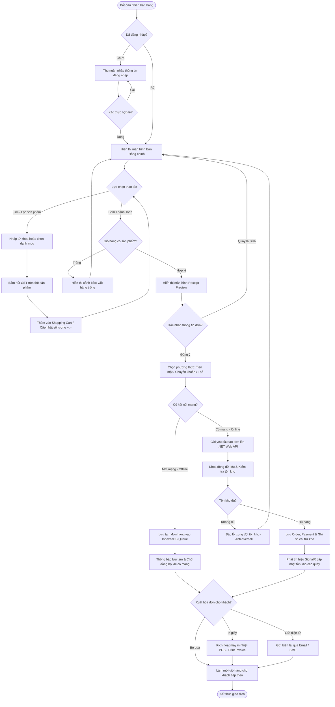

# ⚡ Activity Diagram (Sơ đồ hoạt động) - POS PWA Project

Tài liệu này mô tả chi tiết luồng hoạt động (**Activity Flow**) của hệ thống **POS PWA (Point of Sale Progressive Web App)**, thể hiện trình tự các hành động, điểm phân nhánh điều kiện (Decision Nodes) và cơ chế xử lý song song trong quy trình bán hàng tại quầy từ lúc bắt đầu ca làm việc đến khi hoàn tất xuất hóa đơn.

---

## 🏛️ 1. Sơ đồ Hoạt động (Biểu đồ dạng Mermaid)

Bạn có thể sử dụng đoạn mã Mermaid dưới đây để hiển thị trực quan sơ đồ hoạt động trên các nền tảng hỗ trợ (như GitHub, Notion, hoặc VS Code Extension):

---

## 📋 2. Diễn giải chi tiết các Luồng Quyết định (Decision Nodes)

1. **Kiểm tra trạng thái giỏ hàng (`CheckCart`):**
   * Hệ thống ngăn chặn thao tác chuyển sang màn hình thanh toán nếu thu ngân chưa thêm bất kỳ sản phẩm nào vào `Shopping Cart`, tránh phát sinh các giao dịch rỗng.
2. **Rà soát trước khi chốt (`ReceiptPreview` & `ReviewChoice`):**
   * Cung cấp bước đệm trực quan để thu ngân và khách hàng cùng đối chiếu lại danh sách món, số lượng, chiết khấu và tổng tiền. Thu ngân có thể quay lại màn hình chính để chỉnh sửa ngay lập tức nếu khách đổi ý.
3. **Xử lý linh hoạt giữa Online và Offline (`CheckOnline`):**
   * **Khi Online:** Hệ thống gửi request trực tiếp lên `.NET Web API`, áp dụng cơ chế khóa dữ liệu chống bán quá mức (`Anti-oversell`) và phát sự kiện đồng bộ tồn kho qua `SignalR`.
   * **Khi Offline:** Nhờ kiến trúc PWA với `Service Worker` và `IndexedDB`, thu ngân vẫn có thể hoàn tất thao tác bán hàng tại quầy; đơn hàng được xếp vào hàng đợi nội bộ và tự động đồng bộ lên máy chủ ngay khi có kết nối Internet trở lại.
4. **Tùy chọn xuất chứng từ (`PrintDecision`):**
   * Hỗ trợ đa dạng nhu cầu nhận biên lai của khách hàng: in trực tiếp ra máy in nhiệt qua trình duyệt (`Print Invoice`), gửi hóa đơn điện tử hoặc bỏ qua để tăng tốc độ phục vụ giờ cao điểm.

---
