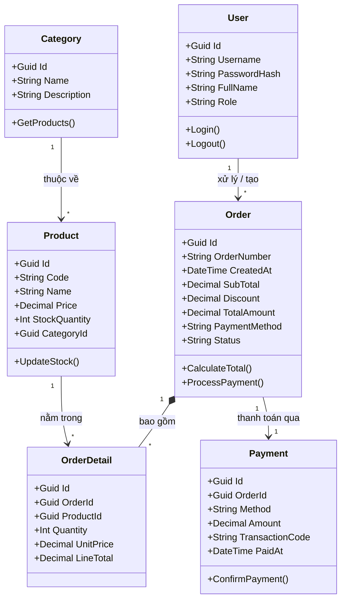

# 🧩 Class Diagram (Sơ đồ lớp) - POS PWA Project

Tài liệu này mô tả cấu trúc tĩnh của hệ thống **POS PWA (Point of Sale Progressive Web App)** thông qua sơ đồ lớp (**Class Diagram**), định nghĩa các thực thể dữ liệu cốt lõi, thuộc tính (attributes), phương thức (methods) và mối quan hệ giữa chúng, làm nền tảng để thiết kế cơ sở dữ liệu quan hệ (PostgreSQL) và các Entity trong Clean Architecture (.NET).

---

## 🏛️ 1. Sơ đồ Lớp (Biểu đồ dạng Mermaid)

Bạn có thể sử dụng đoạn mã Mermaid dưới đây để hiển thị trực quan sơ đồ lớp trên các nền tảng hỗ trợ (như GitHub, Notion, hoặc VS Code Extension):

---

## 📋 2. Mô tả chi tiết các Thực thể (Classes)

### 2.1. Lớp `User` (Người dùng / Thu ngân)
* **Chức năng:** Quản lý thông tin tài khoản đăng nhập của nhân viên thu ngân và quản lý cửa hàng.
* **Thuộc tính chính:** `Id` (Khóa chính), `Username`, `PasswordHash`, `FullName`, `Role` (Thu Ngân / Quản Lý).

### 2.2. Lớp `Category` (Danh mục sản phẩm)
* **Chức năng:** Phân loại sản phẩm (ví dụ: `[Tất cả]`, `[Sản phẩm]`, `[Khác]`).
* **Thuộc tính chính:** `Id`, `Name`, `Description`.

### 2.3. Lớp `Product` (Sản phẩm)
* **Chức năng:** Lưu trữ thông tin chi tiết hàng hóa hiển thị trên màn hình POS (gắn liền với nút `GET`).
* **Thuộc tính chính:** `Id`, `Code` (Mã vạch/SKU), `Name`, `Price` (Đơn giá), `StockQuantity` (Tồn kho), `CategoryId` (Khóa ngoại).

### 2.4. Lớp `Order` (Đơn hàng / Hóa đơn)
* **Chức năng:** Đại diện cho một phiên giao dịch bán hàng tại quầy (sinh ra mã đơn hàng dạng `ORD#0001-...` phục vụ cho tính năng **Receipt Preview**).
* **Thuộc tính chính:** `Id`, `OrderNumber`, `CreatedAt`, `SubTotal` (Tạm tính), `Discount` (Giảm giá), `TotalAmount` (Tổng tiền), `PaymentMethod`, `Status` (Pending / Completed / Cancelled).

### 2.5. Lớp `OrderDetail` (Chi tiết đơn hàng)
* **Chức năng:** Lưu trữ danh sách các món hàng cụ thể có trong một đơn hàng (`Order`).
* **Thuộc tính chính:** `Id`, `OrderId`, `ProductId`, `Quantity` (Số lượng đặt, tương ứng với thao tác `+`, `-` trong giỏ hàng), `UnitPrice`, `LineTotal`.

### 2.6. Lớp `Payment` (Giao dịch thanh toán)
* **Chức năng:** Ghi nhận thông tin thanh toán (Tiền mặt, Chuyển khoản, Thẻ ATM).
* **Thuộc tính chính:** `Id`, `OrderId`, `Method`, `Amount`, `TransactionCode`, `PaidAt`.

---

## 🔗 3. Mối quan hệ giữa các lớp (Relationships)

1. **Category 1 - * Product:** Một danh mục chứa nhiều sản phẩm.
2. **User 1 - * Order:** Một thu ngân có thể tạo ra và xử lý nhiều đơn hàng.
3. **Order 1 - * OrderDetail:** Một đơn hàng bao gồm nhiều dòng chi tiết sản phẩm (Quan hệ thành phần - Composition).
4. **Product 1 - * OrderDetail:** Một sản phẩm có thể xuất hiện trong nhiều chi tiết đơn hàng khác nhau.
5. **Order 1 - 1 Payment:** Mỗi đơn hàng hoàn tất sẽ tương ứng với một bản ghi thanh toán.

---
