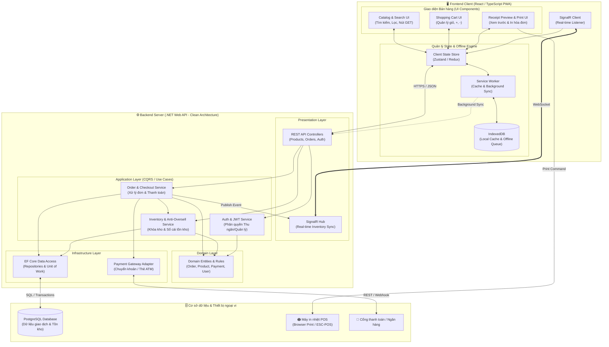

# 🏗️ Component Diagram (Sơ đồ thành phần) - POS PWA Project

Tài liệu này mô tả kiến trúc phân rã thành phần phần mềm (**Component Architecture**) của hệ thống **POS PWA (Point of Sale Progressive Web App)**, thể hiện rõ sự tách biệt trách nhiệm giữa tầng giao diện người dùng ngoại tuyến (**React/TypeScript PWA**), tầng xử lý nghiệp vụ cốt lõi (**.NET Clean Architecture**) và tầng lưu trữ dữ liệu (**PostgreSQL**).

---

## 🏛️ 1. Sơ đồ Thành phần Hệ thống (Biểu đồ dạng Mermaid)

Bạn có thể sử dụng đoạn mã Mermaid dưới đây để hiển thị trực quan sơ đồ thành phần trên các nền tảng hỗ trợ (như GitHub, Notion, hoặc VS Code Extension):

---

## 📋 2. Diễn giải chi tiết các Thành phần (Components)

### 2.1. Tầng Frontend Client (`React / TypeScript PWA`)
* **UI Components:** Chia tách độc lập thành các module chức năng (`Catalog & Search UI`, `Shopping Cart UI`, `Receipt Preview & Print UI`) giúp tối ưu tốc độ render khi thu ngân thao tác liên tục tại quầy.
* **Offline Engine (`Service Worker` & `IndexedDB`):** Đóng vai trò trái tim của tính năng PWA. `Service Worker` lưu trữ tài nguyên tĩnh (HTML/CSS/JS) và chặn các request API khi mất mạng để chuyển hướng đọc/ghi vào cơ sở dữ liệu cục bộ `IndexedDB`, sau đó tự động đồng bộ nền (`Background Sync`) khi có Internet.
* **SignalR Client:** Duy trì kết nối WebSocket hai chiều để nhận cập nhật tồn kho ngay lập tức khi có đơn hàng phát sinh từ quầy khác.

### 2.2. Tầng Backend Server (`.NET Clean Architecture`)
Kiến trúc tuân thủ nghiêm ngặt quy tắc phụ thuộc hướng tâm (Dependency Rule) gồm 4 lớp:
* **Presentation Layer:** Tiếp nhận yêu cầu HTTP qua `REST API Controllers` (xác thực bằng JWT) và quản lý kênh giao tiếp thời gian thực qua `SignalR Hub`.
* **Application Layer:** Chứa logic điều phối nghiệp vụ. Trong đó `Inventory & Anti-Oversell Service` chịu trách nhiệm thực thi cơ chế khóa dữ liệu giao dịch (`Transaction Locking`) nhằm triệt tiêu lỗi bán vượt quá số lượng tồn kho thực tế.
* **Domain Layer:** Chứa các thực thể cốt lõi (`Order`, `Product`, `OrderDetail`, `Payment`, `User`) và các quy tắc nghiệp vụ thuần túy, không phụ thuộc vào thư viện hay cơ sở dữ liệu bên ngoài.
* **Infrastructure Layer:** Triển khai truy xuất dữ liệu thông qua `Entity Framework Core` (mẫu thiết kế Repository & Unit of Work) và tích hợp giao tiếp với cổng thanh toán ngân hàng.

### 2.3. Tầng Cơ sở dữ liệu & Thiết bị ngoại vi
* **PostgreSQL Database:** Lưu trữ dữ liệu quan hệ với tính toàn vẹn ACID cao, hỗ trợ khóa mức dòng (`Row-level Locking`) phục vụ bài toán chống bán quá mức.
* **Máy in nhiệt POS:** Nhận lệnh in trực tiếp từ `Receipt Preview & Print UI` thông qua Browser Print API / chuẩn in hóa đơn nhiệt.

---
