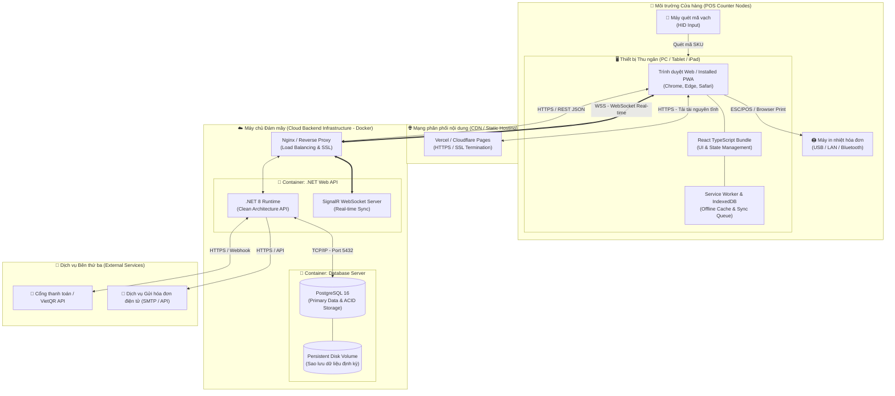

# 🚀 Deployment Diagram (Sơ đồ triển khai) - POS PWA Project

Tài liệu này mô tả kiến trúc hạ tầng vật lý và môi trường triển khai (**Deployment Architecture**) của hệ thống **POS PWA (Point of Sale Progressive Web App)**, thể hiện cách các thành phần phần mềm được đóng gói, phân phối và giao tiếp qua mạng giữa thiết bị tại quầy thu ngân, máy chủ đám mây và các dịch vụ bên ngoài.

---

## 🏛️ 1. Sơ đồ Triển khai Hạ tầng (Biểu đồ dạng Mermaid)

Bạn có thể sử dụng đoạn mã Mermaid dưới đây để hiển thị trực quan sơ đồ triển khai trên các nền tảng hỗ trợ (như GitHub, Notion, hoặc VS Code Extension):

---

## 📋 2. Diễn giải chi tiết các Nút Triển khai (Deployment Nodes)

### 2.1. Môi trường Cửa hàng (`Store Environment - POS Counter`)
* **Thiết bị Thu ngân (PC / Tablet):** Không yêu cầu cài đặt phần mềm nặng nề hay cấu hình phần cứng cao. Nhân viên chỉ cần mở trình duyệt hiện đại hoặc cài đặt trực tiếp ứng dụng thông qua tính năng **"Add to Home Screen" (PWA)**.
* **Bộ nhớ cục bộ (`Service Worker & IndexedDB`):** Đóng vai trò lớp đệm trực tiếp trên thiết bị đầu cuối, giúp giao diện phản hồi tức thì và duy trì khả năng nhận đơn khi đường truyền Internet tại cửa hàng gặp sự cố.
* **Thiết bị ngoại vi (`Máy in nhiệt & Máy quét mã vạch`):** Kết nối trực tiếp với thiết bị thu ngân qua cổng USB, LAN nội bộ hoặc Bluetooth, tương tác liền mạch thông qua chuẩn nhập liệu bàn phím (HID) và Browser Print API.

### 2.2. Hạ tầng Phân phối Giao diện (`CDN / Static Hosting`)
* Toàn bộ mã nguồn Frontend (`React/TypeScript` sau khi build) được triển khai trên các nền tảng Edge CDN (như **Vercel** hoặc **Cloudflare Pages**).
* Tự động cấp phát chứng chỉ bảo mật **HTTPS/SSL** (điều kiện bắt buộc để kích hoạt `Service Worker` của PWA) và tối ưu tốc độ tải trang lần đầu trên toàn quốc.

### 2.3. Hạ tầng Máy chủ Backend (`Cloud Backend Infrastructure`)
Hệ thống Backend được đóng gói thành các **Docker Containers** độc lập, giúp dễ dàng triển khai, mở rộng và bảo trì:
* **Reverse Proxy (Nginx):** Đóng vai trò cổng tiếp nhận duy nhất (Entry Point), xử lý định tuyến lưu lượng HTTPS, hỗ trợ nâng cấp kết nối WebSocket cho `SignalR` và bảo vệ máy chủ ứng dụng bên trong.
* **Container `.NET Web API`:** Chạy trên môi trường `.NET Runtime`, xử lý toàn bộ nghiệp vụ bán hàng, kiểm soát khóa tồn kho (`Anti-oversell`) và duy trì kênh đồng bộ thời gian thực qua `SignalR`.
* **Container `PostgreSQL`:** Hệ quản trị cơ sở dữ liệu quan hệ lưu trữ toàn bộ dữ liệu giao dịch, sản phẩm và sổ cái kho hàng, gắn liền với phân vùng lưu trữ bền vững (`Persistent Volume`) để đảm bảo an toàn dữ liệu khi khởi động lại container.

---

## 🔒 3. Yêu cầu Mạng & Bảo mật Triển khai
1. **Mã hóa đường truyền (TLS/HTTPS):** Mọi giao tiếp giữa trình duyệt POS và CDN/Backend đều bắt buộc sử dụng giao thức mã hóa `HTTPS` và `WSS` (Secure WebSocket).
2. **Cô lập mạng nội bộ (Container Network Isolation):** Cổng kết nối cơ sở dữ liệu PostgreSQL (`5432`) chỉ mở trong mạng nội bộ của Docker (`Internal Bridge Network`), tuyệt đối không công khai trực tiếp ra ngoài Internet.

---
