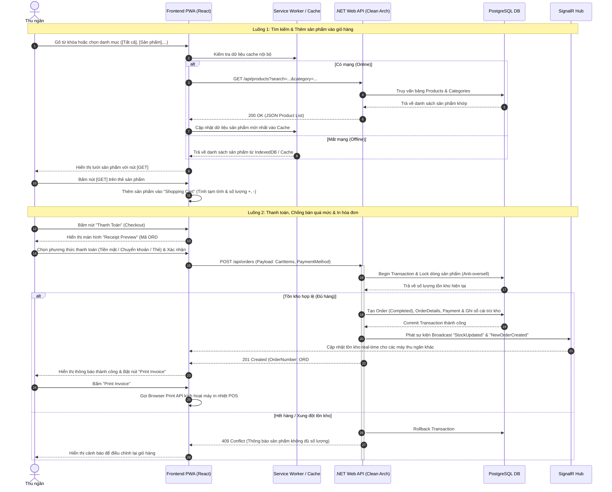

# 🔄 Sequence Diagram (Sơ đồ tuần tự) - POS PWA Project

Tài liệu này mô tả chi tiết luồng thông điệp tương tác theo thời gian giữa các thành phần trong hệ thống **POS PWA (Point of Sale Progressive Web App)**, tập trung vào hai kịch bản nghiệp vụ cốt lõi: **Tìm kiếm/Quản lý giỏ hàng** và **Thanh toán/Trừ kho chống bán quá mức (Anti-oversell)/In hóa đơn**.

---

## 🏛️ 1. Sơ đồ Tuần tự (Biểu đồ dạng Mermaid)

Bạn có thể sử dụng đoạn mã Mermaid dưới đây để hiển thị trực quan sơ đồ tuần tự trên các nền tảng hỗ trợ (như GitHub, Notion, hoặc VS Code Extension):

---

## 📋 2. Diễn giải chi tiết các bước trong Luồng Tuần tự

### 2.1. Giai đoạn 1: Truy xuất danh mục & Thao tác giỏ hàng (Bước 1 – 11)
* **Tối ưu PWA (Bước 2 – 9):** Khi thu ngân tìm kiếm hoặc lọc danh mục, ứng dụng ưu tiên lấy dữ liệu mới nhất từ `.NET Web API` và đồng bộ ngầm vào `Service Worker / IndexedDB`. Trong trường hợp mất kết nối mạng đột ngột, hệ thống vẫn lấy dữ liệu từ bộ nhớ đệm để đảm bảo việc bán hàng không bị gián đoạn.
* **Xử lý State tại Client (Bước 10 – 11):** Thao tác bấm nút `GET` và tăng/giảm số lượng (`+`, `-`) được xử lý trực tiếp trên State của React giúp giao diện phản hồi tức thì ($< 200\text{ms}$) mà không cần gọi API liên tục.

### 2.2. Giai đoạn 2: Xem trước hóa đơn & Giao dịch thanh toán (Bước 12 – 26)
* **Receipt Preview (Bước 12 – 13):** Hệ thống hiển thị màn hình xem trước hóa đơn để thu ngân đối chiếu mã đơn (`ORD#...`), danh sách món và tổng tiền với khách hàng trước khi chốt.
* **Cơ chế Anti-oversell (Bước 15 – 19):** Tại tầng Backend, hệ thống mở một Database Transaction và áp dụng khóa dữ liệu (Optimistic/Pessimistic Locking) trên các bản ghi sản phẩm tương ứng. Nếu hai thu ngân cùng thanh toán món cuối cùng trong kho, chỉ một giao dịch được phép `Commit`, giao dịch còn lại sẽ `Rollback` và trả về mã lỗi `409 Conflict`.
* **Đồng bộ thời gian thực & In ấn (Bước 20 – 25):** Ngay sau khi đơn hàng được ghi nhận, `SignalR Hub` đẩy thông báo cập nhật tồn kho tới toàn bộ các thiết bị thu ngân đang kết nối, đồng thời Frontend kích hoạt lệnh in hóa đơn nhiệt trực tiếp từ trình duyệt.

---