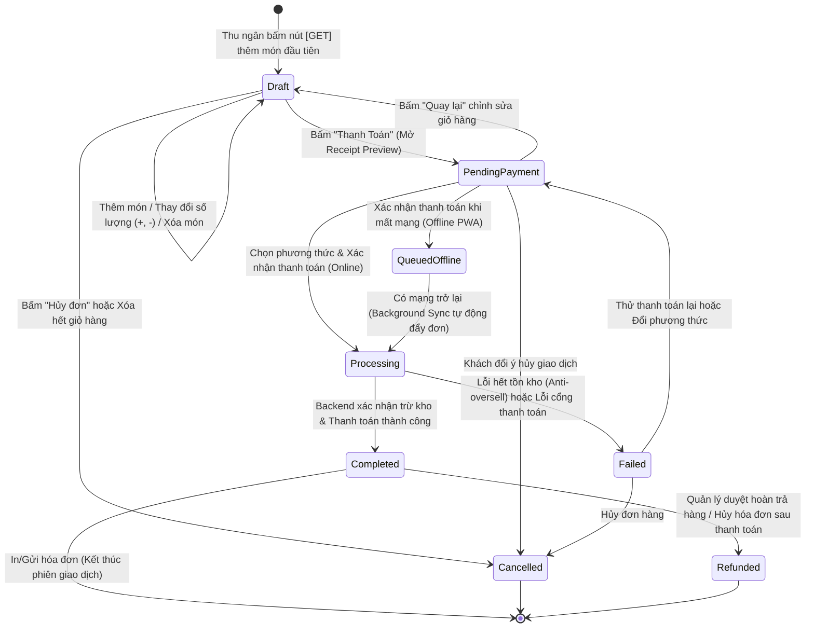

# 🔁 State Machine Diagram (Sơ đồ máy trạng thái) - POS PWA Project

Tài liệu này mô tả vòng đời và sự chuyển đổi trạng thái (**State Transitions**) của một thực thể **Đơn hàng (`Order`)** trong hệ thống **POS PWA (Point of Sale Progressive Web App)**, giúp đội ngũ phát triển kiểm soát chặt chẽ các quy tắc nghiệp vụ, trạng thái đồng bộ ngoại tuyến (Offline PWA) và tính toàn vẹn dữ liệu trong suốt quá trình bán hàng.

---

## 🏛️ 1. Sơ đồ Chuyển đổi Trạng thái Đơn hàng (Biểu đồ dạng Mermaid)

Bạn có thể sử dụng đoạn mã Mermaid dưới đây để hiển thị trực quan sơ đồ máy trạng thái trên các nền tảng hỗ trợ (như GitHub, Notion, hoặc VS Code Extension):

---

## 📋 2. Mô tả chi tiết các Trạng thái (States)

| Trạng thái (State) | Ý nghĩa nghiệp vụ | Hành động hợp lệ tiếp theo |
| :--- | :--- | :--- |
| **`Draft` (Giỏ hàng nháp)** | Đơn hàng đang được khởi tạo tạm thời trên giao diện Frontend (`Shopping Cart`). Chưa ghi nhận vào Database và chưa giữ tồn kho. | Thêm/bớt số lượng sản phẩm, chuyển sang thanh toán, hoặc hủy bỏ giỏ hàng. |
| **`PendingPayment` (Chờ thanh toán)** | Thu ngân đã chuyển sang màn hình **Receipt Preview** để khách kiểm tra lại thông tin hóa đơn và chọn hình thức thanh toán (Tiền mặt, Chuyển khoản, Thẻ). | Xác nhận thanh toán, quay lại chỉnh sửa giỏ hàng, hoặc hủy đơn. |
| **`QueuedOffline` (Hàng đợi ngoại tuyến)** | Đơn hàng đã chốt tại quầy trong lúc mất kết nối Internet, được lưu an toàn trong `IndexedDB` và chờ `Service Worker` đồng bộ. | Tự động chuyển sang `Processing` ngay khi thiết bị kết nối lại mạng. |
| **`Processing` (Đang xử lý)** | Request tạo đơn đã được gửi lên `.NET Web API`. Backend đang thực hiện giao dịch khóa kho (Anti-oversell Locking) và xác thực thanh toán. | Chuyển sang `Completed` nếu thành công, hoặc `Failed` nếu gặp lỗi tồn kho/thanh toán. |
| **`Completed` (Hoàn thành)** | Giao dịch đã được lưu chính thức vào bảng `Orders` và `Payments` trong PostgreSQL, số lượng tồn kho đã được trừ chính xác. | Kích hoạt in hóa đơn (`Print Invoice`), gửi biên lai điện tử, hoặc hoàn tiền (`Refunded`). |
| **`Failed` (Thất bại)** | Giao dịch bị từ chối do xung đột tồn kho (sản phẩm vừa hết hàng ở quầy khác) hoặc lỗi kết nối cổng thanh toán. | Thử thanh toán lại, quay lại điều chỉnh số lượng hoặc hủy đơn. |
| **`Cancelled` (Đã hủy)** | Đơn hàng bị hủy bỏ trước khi hoàn tất thanh toán. Không làm thay đổi số lượng tồn kho thực tế. | Kết thúc vòng đời đơn hàng. |
| **`Refunded` (Đã hoàn tiền)** | Đơn hàng đã thanh toán nhưng khách hàng yêu cầu trả hàng/hoàn tiền (cần quyền Quản lý phê duyệt để cộng lại tồn kho). | Kết thúc vòng đời đơn hàng. |

---

## 🛡️ 3. Quy tắc kiểm soát chuyển đổi (State Guard Rules)

1. **Chống nhảy cóc trạng thái:** Một đơn hàng ở trạng thái `Draft` bắt buộc phải đi qua `PendingPayment` và `Processing` (hoặc `QueuedOffline` $\rightarrow$ `Processing`) trước khi đạt trạng thái `Completed`.
2. **Bảo toàn tồn kho (Inventory Integrity):** Chỉ duy nhất quá trình chuyển đổi từ `Processing` $\rightarrow$ `Completed` mới được phép ghi nhận bút toán trừ kho vào sổ cái (`Inventory Ledger`). Nếu chuyển sang `Cancelled` hoặc `Failed`, tồn kho hoàn toàn không bị ảnh hưởng.
3. **Hoàn trả có kiểm soát:** Đơn hàng đã ở trạng thái `Completed` không thể quay ngược về `Draft` hay `Cancelled`; mọi điều chỉnh giảm sau thanh toán đều phải đi qua trạng thái `Refunded` kèm ghi nhận bút toán nhập hoàn kho.

---
