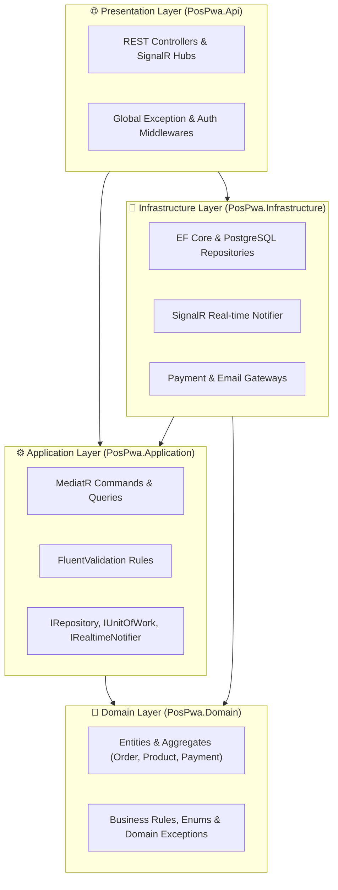

# 🏛️ Clean Architecture Guidelines - POS PWA Project

Tài liệu này quy định cấu trúc phân tầng kiến trúc phần mềm (**Clean Architecture**) cho toàn bộ hệ thống Backend **.NET 8** của dự án **POS PWA (Point of Sale Progressive Web App)**. Mục tiêu cốt lõi là tách biệt hoàn toàn logic nghiệp vụ bán hàng, tính tiền và quản lý tồn kho khỏi các chi tiết hạ tầng bên ngoài (cơ sở dữ liệu PostgreSQL, thư viện ORM, giao thức HTTP hay SignalR).

---

## 🎯 1. Quy tắc Phụ thuộc Hướng tâm (The Dependency Rule)

Nguyên tắc bất di bất dịch của Clean Architecture là **mọi sự phụ thuộc mã nguồn chỉ được phép hướng từ vòng ngoài vào vòng trong**:
* Tầng bên trong (**Domain**) hoàn toàn không biết gì về sự tồn tại của các tầng bên ngoài (**Application**, **Infrastructure**, **Presentation**).
* Tầng **Application** định nghĩa các giao diện (`Interfaces`) cho việc lưu trữ dữ liệu hoặc thông báo thời gian thực, và tầng **Infrastructure** chịu trách nhiệm triển khai (`Implement`) các giao diện đó.



---

## 📂 2. Tổ chức Cấu trúc Solution (.NET Projects)

Solution Backend được chia thành **4 Project độc lập** (tương ứng với 4 tầng kiến trúc) để trình biên dịch tự động kiểm soát ranh giới phụ thuộc:

```text
src/
├── PosPwa.Domain/                  # Tầng 1: Lõi nghiệp vụ thuần túy (Zero external dependencies)
│   ├── Entities/                   # Order, OrderDetail, Product, Category, Payment, User
│   ├── Enums/                      # OrderStatus, PaymentMethod, UserRole
│   ├── Exceptions/                 # InsufficientStockException, InvalidOrderStateException
│   └── Common/                     # BaseEntity, AuditableEntity, IDomainEvent
│
├── PosPwa.Application/             # Tầng 2: Điều phối Use Cases (Phụ thuộc PosPwa.Domain)
│   ├── Common/
│   │   ├── Interfaces/             # IApplicationDbContext, IUnitOfWork, IPosSyncNotifier
│   │   └── Behaviors/              # ValidationBehavior, LoggingBehavior (MediatR Pipeline)
│   ├── Features/
│   │   ├── Orders/
│   │   │   ├── Commands/           # CreateOrderCommand, RefundOrderCommand
│   │   │   └── Queries/            # GetOrderByIdQuery, GetOrdersHistoryQuery
│   │   └── Products/
│   │       └── Queries/            # SearchProductsQuery
│   └── DTOs/                       # OrderReceiptDto, ProductResponseDto
│
├── PosPwa.Infrastructure/          # Tầng 3: Triển khai kỹ thuật (Phụ thuộc Application & Domain)
│   ├── Persistence/
│   │   ├── Configurations/         # EF Core Fluent API (Index, Precision, ConcurrencyToken)
│   │   ├── Repositories/           # OrderRepository, ProductRepository, UnitOfWork
│   │   └── ApplicationDbContext.cs # Cấu hình PostgreSQL & Transaction
│   ├── RealTime/
│   │   └── SignalRPosNotifier.cs   # Triển khai IPosSyncNotifier đẩy sự kiện tồn kho
│   └── Security/
│       └── JwtTokenGenerator.cs    # Tạo và xác thực JWT Token
│
└── PosPwa.Api/                     # Tầng 4: Điểm tiếp nhận giao tiếp (Phụ thuộc Application & Infrastructure)
    ├── Controllers/                # OrdersController, ProductsController, AuthController
    ├── Hubs/                       # PosSyncHub
    ├── Middlewares/                # GlobalExceptionHandlerMiddleware
    └── Program.cs                  # Cấu hình DI Container, CORS, Swagger, Serilog
```

---

## 📋 3. Trách nhiệm chi tiết của từng Tầng

### 3.1. `PosPwa.Domain` (Tầng Nghiệp vụ Cốt lõi)
* **Đặc điểm:** Không cài đặt bất kỳ gói NuGet nào liên quan đến Entity Framework, ASP.NET Core hay JSON Serialization.
* **Nhiệm vụ:** Chứa các quy tắc bất biến của doanh nghiệp. Ví dụ: Thực thể `Product` tự quản lý phương thức `DeductStock(int quantity)` để kiểm tra tồn kho và ném ra `InsufficientStockException` nếu số lượng đặt vượt quá tồn kho thực tế; thực thể `Order` tự tính toán `SubTotal` và `TotalAmount`.

### 3.2. `PosPwa.Application` (Tầng Ứng dụng / Use Cases)
* **Đặc điểm:** Chỉ tham chiếu tới `PosPwa.Domain` và các thư viện hỗ trợ điều phối luồng như `MediatR`, `FluentValidation`.
* **Nhiệm vụ:** Tiếp nhận yêu cầu từ người dùng (ví dụ: `CreateOrderCommand`), kiểm tra tính hợp lệ dữ liệu đầu vào, điều phối việc lấy dữ liệu thông qua các Interface (`IProductRepository`, `IOrderRepository`), gọi thực thể Domain thực thi nghiệp vụ, lưu thay đổi qua `IUnitOfWork` và kích hoạt thông báo thời gian thực qua `IPosSyncNotifier`.

### 3.3. `PosPwa.Infrastructure` (Tầng Hạ tầng Kỹ thuật)
* **Đặc điểm:** Chứa toàn bộ chi tiết kết nối công nghệ bên ngoài như `Npgsql.EntityFrameworkCore.PostgreSQL`, `StackExchange.Redis` (nếu mở rộng cache), dịch vụ gửi email hóa đơn và cấu hình sinh mã JWT.
* **Nhiệm vụ:** Hiện thực hóa các Interface đã khai báo ở tầng `Application`, xử lý ánh xạ ORM, quản lý Database Migrations và thực thi cơ chế khóa dữ liệu giao dịch (`Anti-oversell Locking`) dưới mức PostgreSQL.

### 3.4. `PosPwa.Api` (Tầng Trình diễn / Giao tiếp)
* **Đặc điểm:** Là điểm khởi chạy ứng dụng (`Composition Root`), chịu trách nhiệm đăng ký toàn bộ dịch vụ vào Dependency Injection Container (`Program.cs`).
* **Nhiệm vụ:** Định tuyến HTTP Request tới đúng Controller, xác thực JWT Token, xử lý ngoại lệ toàn cục trả về chuẩn `ProblemDetails` và duy trì kết nối WebSocket cho `PosSyncHub`.

---

## 🛡️ 4. Quy tắc kiểm soát chất lượng kiến trúc

1. **Cấm rò rỉ thực thể (No Entity Leakage):** Các API Controller tuyệt đối không trả về trực tiếp đối tượng `Entity` của tầng Domain mà phải ánh xạ sang `DTO` của tầng Application để tránh lộ cấu trúc bảng cơ sở dữ liệu và lỗi vòng lặp tham chiếu (Circular Reference).
2. **Đảo ngược phụ thuộc (Dependency Inversion):** Khi cần gửi thông báo cập nhật tồn kho real-time sau khi chốt đơn, `CreateOrderCommandHandler` ở tầng Application chỉ gọi phương thức `await _posSyncNotifier.NotifyStockUpdatedAsync(...)`, không được phép tham chiếu trực tiếp tới `IHubContext<PosSyncHub>` của ASP.NET Core SignalR.

---
## ✅ 5. Lợi ích thực tiễn đối với dự án POS PWA

1. **Dễ dàng kiểm thử tự động (Unit Testing):** Toàn bộ logic tính tiền, chiết khấu, chống âm kho ở tầng `Domain` và `Application` có thể chạy Unit Test độc lập trong vài mili-giây mà không cần khởi tạo Database PostgreSQL hay Web Server.
2. **Thay đổi hạ tầng linh hoạt:** Nếu sau này dự án cần nâng cấp cổng thanh toán (từ VietQR sang VNPay/MoMo) hoặc bổ sung bộ nhớ đệm phân tán (Redis), nhóm chỉ cần viết lớp triển khai mới ở tầng `Infrastructure` mà không phải sửa một dòng code nào ở tầng nghiệp vụ.
3. **Phân chia công việc rõ ràng trong nhóm:** Thành viên phụ trách nghiệp vụ cốt lõi tập trung vào `Domain` & `Application`, trong khi thành viên phụ trách Database và DevOps tập trung vào `Infrastructure` & `Api` thông qua hợp đồng `Interfaces` đã thống nhất trước.