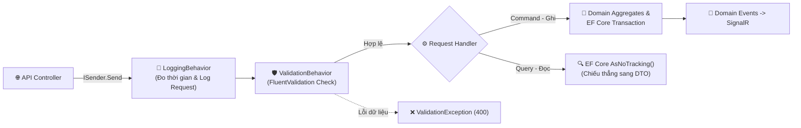

# ⚡ CQRS & MediatR Pattern - POS PWA Project

Tài liệu này quy định cách triển khai mẫu kiến trúc **CQRS (Command Query Responsibility Segregation)** kết hợp thư viện **MediatR** tại tầng `PosPwa.Application` của hệ thống **POS PWA (Point of Sale Progressive Web App)**. Việc phân tách rạch ròi giữa luồng **Ghi (Commands)** và luồng **Đọc (Queries)** giúp tối ưu hiệu năng truy vấn danh mục sản phẩm tại quầy đồng thời kiểm soát chặt chẽ tính toàn vẹn giao dịch khi thanh toán đơn hàng.

---

## 🏛️ 1. Nguyên lý hoạt động & Luồng xử lý (MediatR Pipeline)

Mọi yêu cầu từ `REST API Controllers` đều được đóng gói thành một đối tượng `IRequest<TResponse>` (`Command` hoặc `Query`) và gửi qua trung gian `ISender` (`MediatR`). Trước khi chạm tới `Handler` xử lý chính, yêu cầu sẽ đi qua chuỗi **Pipeline Behaviors** để tự động kiểm tra dữ liệu đầu vào và ghi log.



---

## ✍️ 2. Luồng Ghi (Commands) — Thay đổi trạng thái hệ thống

* **Đặc điểm:** Thực hiện các hành động làm thay đổi dữ liệu (Tạo đơn hàng, Trừ tồn kho, Hoàn tiền, Đồng bộ đơn Offline).
* **Quy chuẩn:** Đặt tên theo cấu trúc `{ĐộngTừ}{ĐốiTượng}Command` (ví dụ: `CreateOrderCommand`), đi qua đầy đủ các quy tắc nghiệp vụ của **Domain Aggregates** và bọc trong giao dịch cơ sở dữ liệu (`IUnitOfWork`).

### Ví dụ triển khai `CreateOrderCommand` & `CreateOrderCommandHandler`:

```csharp
// 1. Định nghĩa Command (Bất biến với record)
public sealed record OrderItemInput(Guid ProductId, int Quantity);

public sealed record CreateOrderCommand(
    Guid CashierId,
    PaymentMethod PaymentMethod,
    decimal Discount,
    IReadOnlyList<OrderItemInput> Items
) : IRequest<OrderReceiptDto>;

// 2. Triển khai Command Handler
public sealed class CreateOrderCommandHandler : IRequestHandler<CreateOrderCommand, OrderReceiptDto>
{
    private readonly IOrderRepository _orderRepository;
    private readonly IProductRepository _productRepository;
    private readonly IUnitOfWork _unitOfWork;

    public CreateOrderCommandHandler(
        IOrderRepository orderRepository,
        IProductRepository productRepository,
        IUnitOfWork unitOfWork)
    {
        _orderRepository = orderRepository;
        _productRepository = productRepository;
        _unitOfWork = unitOfWork;
    }

    public async Task<OrderReceiptDto> Handle(CreateOrderCommand request, CancellationToken ct)
    {
        // Tải danh sách sản phẩm liên quan trong một truy vấn duy nhất (tránh N+1)
        var productIds = request.Items.Select(i => i.ProductId).Distinct().ToList();
        var products = await _productRepository.GetByIdsForUpdateAsync(productIds, ct);

        var orderNumber = $"ORD#{DateTime.UtcNow:yyyyMMdd}-{Random.Shared.Next(1000, 9999)}";
        var order = Order.CreateDraft(request.CashierId, orderNumber);

        foreach (var item in request.Items)
        {
            var product = products.FirstOrDefault(p => p.Id == item.ProductId)
                ?? throw new NotFoundException($"Không tìm thấy sản phẩm {item.ProductId}");

            // Thực thi quy tắc Anti-oversell ngay trong Domain Entity
            product.DeductStock(item.Quantity);
            order.AddItem(product.Id, product.Name, product.Price, item.Quantity);
        }

        if (request.Discount > 0)
            order.ApplyDiscount(request.Discount);

        order.CompletePayment(request.PaymentMethod);

        await _orderRepository.AddAsync(order, ct);
        
        // Commit Transaction & Phát Domain Events (Cập nhật tồn kho real-time qua SignalR)
        await _unitOfWork.SaveChangesAsync(ct);

        return OrderReceiptDto.FromEntity(order);
    }
}
```

---

## 🔍 3. Luồng Đọc (Queries) — Truy xuất dữ liệu tốc độ cao

* **Đặc điểm:** Chỉ phục vụ nhu cầu đọc dữ liệu (Tìm kiếm sản phẩm trên lưới POS, lấy chi tiết hóa đơn cho màn hình `Receipt Preview`, xem thống kê doanh thu). **Tuyệt đối không làm thay đổi trạng thái hệ thống.**
* **Quy chuẩn:** Đặt tên theo cấu trúc `Get{ĐốiTượng}Query` (ví dụ: `SearchProductsQuery`). Bỏ qua tầng Domain phức tạp, truy vấn trực tiếp từ `IApplicationDbContext` với `.AsNoTracking()` và chiếu thẳng (`Select`) sang `DTO` để đạt độ trễ thấp nhất ($< 100\text{ms}$).

### Ví dụ triển khai `SearchProductsQuery` & `SearchProductsQueryHandler`:

```csharp
// 1. Định nghĩa Query
public sealed record SearchProductsQuery(
    string? Keyword,
    Guid? CategoryId
) : IRequest<IReadOnlyList<ProductResponseDto>>;

// 2. Triển khai Query Handler
public sealed class SearchProductsQueryHandler 
    : IRequestHandler<SearchProductsQuery, IReadOnlyList<ProductResponseDto>>
{
    private readonly IApplicationDbContext _context;

    public SearchProductsQueryHandler(IApplicationDbContext context)
    {
        _context = context;
    }

    public async Task<IReadOnlyList<ProductResponseDto>> Handle(
        SearchProductsQuery request, 
        CancellationToken ct)
    {
        var query = _context.Products
            .AsNoTracking()
            .Where(p => p.IsActive);

        if (request.CategoryId.HasValue)
            query = query.Where(p => p.CategoryId == request.CategoryId.Value);

        if (!string.IsNullOrWhiteSpace(request.Keyword))
        {
            var term = request.Keyword.Trim().ToLower();
            query = query.Where(p => p.Name.ToLower().Contains(term) || p.Code.ToLower().Contains(term));
        }

        return await query
            .OrderBy(p => p.Name)
            .Select(p => new ProductResponseDto(
                p.Id,
                p.Code,
                p.Name,
                p.Price,
                p.StockQuantity,
                p.Category.Name))
            .ToListAsync(ct);
    }
}
```

---

## 🔗 4. Pipeline Behaviors (Xử lý chéo tự động)

Để loại bỏ mã lặp (Boilerplate Code) trong từng Handler, hệ thống đăng ký các `IPipelineBehavior<TRequest, TResponse>` chạy tuần tự cho mọi Request:

1. **`LoggingBehavior`:** Tự động ghi lại tên Command/Query, mã thu ngân thực hiện và đo thời gian thực thi (`Stopwatch`). Nếu một truy vấn POS mất quá `500ms`, hệ thống tự động ghi cảnh báo `Warning` để tối ưu Index.
2. **`ValidationBehavior`:** Tự động thu thập toàn bộ các lớp `IValidator<TRequest>` từ **FluentValidation**, chạy kiểm tra trước khi vào Handler; nếu có lỗi sẽ ném `ValidationException` ngay lập tức.

---
