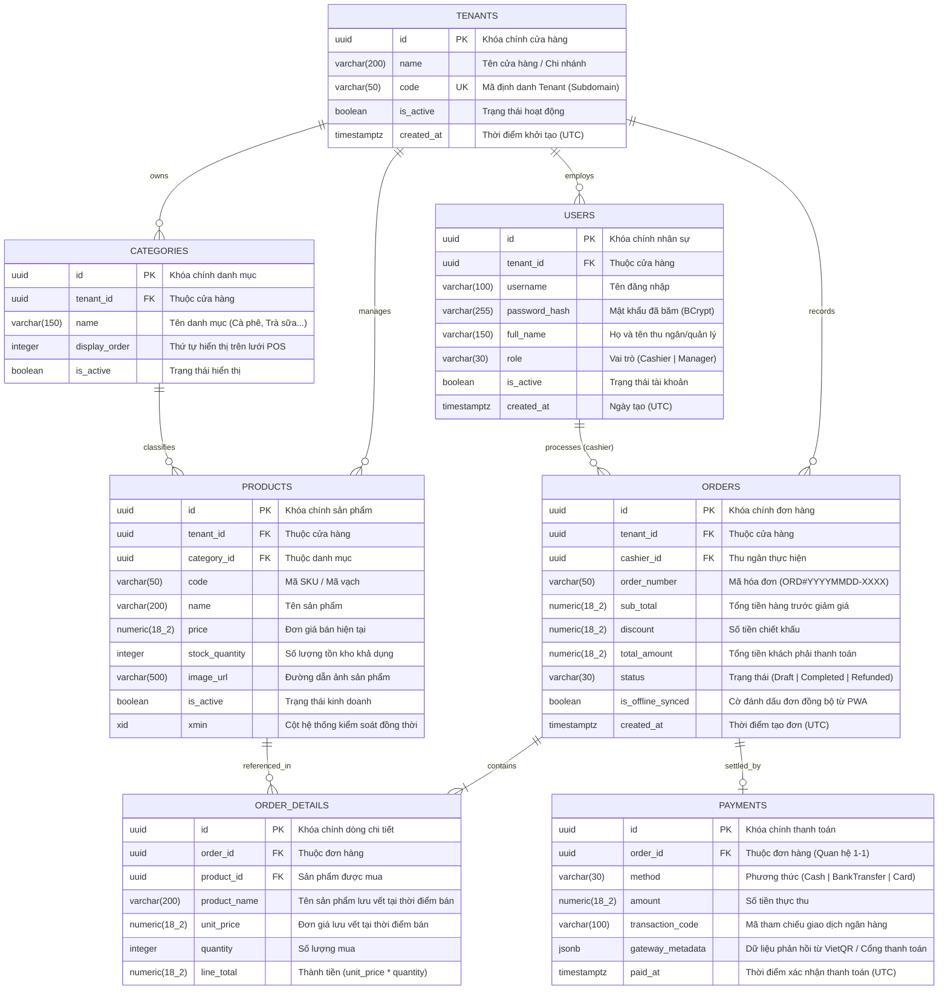

# 📐 Database Design & Data Dictionary (ERD) - POS PWA Project

Tài liệu này mô tả thiết kế lược đồ cơ sở dữ liệu quan hệ (**Entity-Relationship Diagram - ERD**) và từ điển dữ liệu chi tiết (**Data Dictionary**) cho hệ thống **POS PWA (Point of Sale Progressive Web App)** trên nền tảng **PostgreSQL 16**. Thiết kế tuân thủ chuẩn chuẩn hóa dữ liệu **3NF (Third Normal Form)**, hỗ trợ kiến trúc **SaaS Multi-Tenancy** (`tenant_id`) và lưu trữ lịch sử giá bán tại thời điểm giao dịch để đảm bảo tính chính xác tuyệt đối của báo cáo tài chính.

---

## 🗺️ 1. Sơ đồ Quan hệ Thực thể (ERD - Mermaid Diagram)

Bạn có thể xem trực quan sơ đồ quan hệ giữa các bảng trên GitHub, Notion hoặc VS Code Extension hỗ trợ Mermaid:

---

## 📋 2. Từ điển Dữ liệu chi tiết (Data Dictionary)

### 2.1. Bảng `tenants` (Thông tin Cửa hàng / Người thuê SaaS)
Quản lý danh sách các cửa hàng đăng ký sử dụng hệ thống POS PWA.

| Tên cột | Kiểu dữ liệu | Ràng buộc | Mô tả nghiệp vụ |
| :--- | :--- | :--- | :--- |
| `id` | `uuid` | `PRIMARY KEY` | Định danh duy nhất của cửa hàng (`TenantId`). |
| `name` | `varchar(200)` | `NOT NULL` | Tên thương hiệu cửa hàng (hiển thị trên tiêu đề hóa đơn in nhiệt). |
| `code` | `varchar(50)` | `NOT NULL, UNIQUE` | Mã định danh viết liền không dấu dùng cho Subdomain hoặc đăng nhập nhanh. |
| `is_active` | `boolean` | `NOT NULL, DEFAULT true` | Trạng thái kích hoạt gói dịch vụ của cửa hàng. |
| `created_at` | `timestamptz` | `NOT NULL` | Thời điểm khởi tạo cửa hàng theo chuẩn UTC. |

### 2.2. Bảng `users` (Tài khoản Thu ngân & Quản lý)
Lưu trữ thông tin nhân sự vận hành quầy thu ngân thuộc từng cửa hàng.

| Tên cột | Kiểu dữ liệu | Ràng buộc | Mô tả nghiệp vụ |
| :--- | :--- | :--- | :--- |
| `id` | `uuid` | `PRIMARY KEY` | Định danh duy nhất của nhân viên. |
| `tenant_id` | `uuid` | `NOT NULL, FK -> tenants(id)` | Liên kết nhân viên với cửa hàng làm việc. |
| `username` | `varchar(100)` | `NOT NULL` | Tên đăng nhập (duy nhất trong phạm vi từng `tenant_id`). |
| `password_hash` | `varchar(255)` | `NOT NULL` | Chuỗi mật khẩu đã được băm an toàn bằng thuật toán BCrypt/Argon2. |
| `full_name` | `varchar(150)` | `NOT NULL` | Họ tên đầy đủ in trên phiếu hóa đơn (`Cashier: ...`). |
| `role` | `varchar(30)` | `NOT NULL` | Phân quyền truy cập: `Cashier` (Thu ngân) hoặc `Manager` (Quản lý). |
| `is_active` | `boolean` | `NOT NULL, DEFAULT true` | Cho phép khóa tài khoản nhân viên nghỉ việc mà không mất lịch sử đơn hàng cũ. |
| `created_at` | `timestamptz` | `NOT NULL` | Thời điểm tạo tài khoản (UTC). |

### 2.3. Bảng `categories` (Danh mục Sản phẩm)
Phân nhóm hàng hóa giúp thu ngân lọc nhanh trên giao diện cảm ứng POS.

| Tên cột | Kiểu dữ liệu | Ràng buộc | Mô tả nghiệp vụ |
| :--- | :--- | :--- | :--- |
| `id` | `uuid` | `PRIMARY KEY` | Định danh duy nhất của danh mục. |
| `tenant_id` | `uuid` | `NOT NULL, FK -> tenants(id)` | Cô lập danh mục theo từng cửa hàng. |
| `name` | `varchar(150)` | `NOT NULL` | Tên nhóm hàng (ví dụ: *Cà phê*, *Trà trái cây*, *Bánh ngọt*). |
| `display_order` | `integer` | `NOT NULL, DEFAULT 0` | Số thứ tự ưu tiên sắp xếp trên thanh bộ lọc của màn hình POS. |
| `is_active` | `boolean` | `NOT NULL, DEFAULT true` | Ẩn/hiện danh mục trên giao diện bán hàng. |

### 2.4. Bảng `products` (Danh mục Hàng hóa & Tồn kho)
Bảng trọng tâm phục vụ hiển thị lưới sản phẩm, quét mã vạch và kiểm soát tồn kho (`Anti-oversell`).

| Tên cột | Kiểu dữ liệu | Ràng buộc | Mô tả nghiệp vụ |
| :--- | :--- | :--- | :--- |
| `id` | `uuid` | `PRIMARY KEY` | Định danh duy nhất của sản phẩm. |
| `tenant_id` | `uuid` | `NOT NULL, FK -> tenants(id)` | Cô lập sản phẩm theo cửa hàng. |
| `category_id` | `uuid` | `NOT NULL, FK -> categories(id)` | Khóa ngoại trỏ tới nhóm danh mục sản phẩm. |
| `code` | `varchar(50)` | `NOT NULL` | Mã SKU hoặc mã vạch EAN-13 (duy nhất theo cặp `(tenant_id, code)`). |
| `name` | `varchar(200)` | `NOT NULL` | Tên sản phẩm hiển thị trên thẻ món và hóa đơn. |
| `price` | `numeric(18,2)` | `NOT NULL, CHECK (price >= 0)` | Đơn giá bán hiện hành tại quầy. |
| `stock_quantity` | `integer` | `NOT NULL, CHECK (stock_quantity >= 0)` | Số lượng tồn kho thực tế; cấm âm dưới mọi hình thức. |
| `image_url` | `varchar(500)` | `NULL` | Đường dẫn hình ảnh thu nhỏ (được Service Worker cache cục bộ). |
| `is_active` | `boolean` | `NOT NULL, DEFAULT true` | Cờ ngừng kinh doanh (Soft Delete để bảo toàn lịch sử đơn hàng cũ). |

### 2.5. Bảng `orders` (Hóa đơn Bán hàng)
Lưu trữ thông tin tổng hợp của một giao dịch bán hàng tại quầy POS.

| Tên cột | Kiểu dữ liệu | Ràng buộc | Mô tả nghiệp vụ |
| :--- | :--- | :--- | :--- |
| `id` | `uuid` | `PRIMARY KEY` | Định danh duy nhất của đơn hàng (do Client/Server sinh `UUIDv4`). |
| `tenant_id` | `uuid` | `NOT NULL, FK -> tenants(id)` | Cô lập hóa đơn theo cửa hàng. |
| `cashier_id` | `uuid` | `NOT NULL, FK -> users(id)` | Mã nhân viên thu ngân lập hóa đơn. |
| `order_number` | `varchar(50)` | `NOT NULL` | Mã hóa đơn thân thiện in trên giấy nhiệt (VD: `ORD#20261117-1024`). |
| `sub_total` | `numeric(18,2)` | `NOT NULL, CHECK (sub_total >= 0)` | Tổng cộng thành tiền các món trước khi trừ chiết khấu. |
| `discount` | `numeric(18,2)` | `NOT NULL, DEFAULT 0` | Số tiền giảm giá áp dụng cho đơn hàng. |
| `total_amount` | `numeric(18,2)` | `NOT NULL, CHECK (total_amount >= 0)` | Tổng số tiền thực tế khách phải thanh toán (`sub_total - discount`). |
| `status` | `varchar(30)` | `NOT NULL` | Trạng thái vòng đời: `Draft`, `Completed`, `Refunded`. |
| `is_offline_synced` | `boolean` | `NOT NULL, DEFAULT false` | Đánh dấu `true` nếu đơn hàng được tạo lúc mất mạng và đồng bộ lại sau. |
| `created_at` | `timestamptz` | `NOT NULL` | Thời điểm tạo giao dịch theo chuẩn UTC. |

### 2.6. Bảng `order_details` (Chi tiết Dòng sản phẩm trong Đơn)
Lưu trữ danh sách từng món hàng thuộc một hóa đơn cụ thể.

| Tên cột | Kiểu dữ liệu | Ràng buộc | Mô tả nghiệp vụ |
| :--- | :--- | :--- | :--- |
| `id` | `uuid` | `PRIMARY KEY` | Định danh duy nhất của dòng chi tiết. |
| `order_id` | `uuid` | `NOT NULL, FK -> orders(id)` | Khóa ngoại liên kết về hóa đơn cha (`ON DELETE CASCADE`). |
| `product_id` | `uuid` | `NOT NULL, FK -> products(id)` | Khóa ngoại tham chiếu tới sản phẩm gốc (`ON DELETE RESTRICT`). |
| `product_name` | `varchar(200)` | `NOT NULL` | **Snapshot** tên sản phẩm tại thời điểm mua (tránh sai lệch nếu sau này đổi tên món). |
| `unit_price` | `numeric(18,2)` | `NOT NULL, CHECK (unit_price >= 0)` | **Snapshot** đơn giá bán tại thời điểm mua (tránh sai lệch doanh thu cũ khi tăng/giảm giá). |
| `quantity` | `integer` | `NOT NULL, CHECK (quantity > 0)` | Số lượng khách mua cho món hàng này. |
| `line_total` | `numeric(18,2)` | `NOT NULL` | Thành tiền của dòng (`unit_price * quantity`). |

### 2.7. Bảng `payments` (Thông tin Thanh toán Giao dịch)
Lưu trữ chứng từ thanh toán tương ứng với mỗi đơn hàng hoàn tất.

| Tên cột | Kiểu dữ liệu | Ràng buộc | Mô tả nghiệp vụ |
| :--- | :--- | :--- | :--- |
| `id` | `uuid` | `PRIMARY KEY` | Định danh duy nhất của giao dịch thanh toán. |
| `order_id` | `uuid` | `NOT NULL, UNIQUE, FK -> orders(id)` | Khóa ngoại đảm bảo quan hệ `1-1` với đơn hàng đã thanh toán. |
| `method` | `varchar(30)` | `NOT NULL` | Phương thức thanh toán: `Cash` (Tiền mặt), `BankTransfer` (VietQR), `Card` (Thẻ). |
| `amount` | `numeric(18,2)` | `NOT NULL, CHECK (amount >= 0)` | Số tiền khách đã thanh toán. |
| `transaction_code` | `varchar(100)` | `NULL` | Mã giao dịch ngân hàng / mã chuẩn chi máy POS (nếu thanh toán không tiền mặt). |
| `gateway_metadata` | `jsonb` | `NULL` | Lưu nguyên văn payload webhook từ cổng thanh toán phục vụ đối soát. |
| `paid_at` | `timestamptz` | `NOT NULL` | Thời điểm xác nhận thanh toán thành công (UTC). |

---

## 🔒 3. Các quyết định thiết kế dữ liệu quan trọng (Design Decisions)

1. **Lưu vết lịch sử giá (`Price & Name Snapshot`) tại `order_details`:**
   Thay vì chỉ lưu `product_id` và `JOIN` sang bảng `products` để lấy giá khi xem lại hóa đơn cũ, bảng `order_details` sao chép cứng `unit_price` và `product_name` tại thời điểm chốt đơn. Điều này đảm bảo khi cửa hàng điều chỉnh tăng/giảm giá bán trong tương lai, toàn bộ hóa đơn lịch sử và báo cáo doanh thu quá khứ vẫn giữ nguyên tính chính xác tuyệt đối.
2. **Bảo vệ toàn vẹn tham chiếu bằng `ON DELETE RESTRICT`:**
   Mối quan hệ từ `order_details` tới `products` và từ `orders` tới `users` sử dụng quy tắc `RESTRICT` (cấm xóa vật lý sản phẩm hoặc nhân viên đã từng phát sinh giao dịch). Khi cần ngừng bán sản phẩm, hệ thống cập nhật cờ `is_active = false` (**Soft Delete**).
3. **Sinh khóa chính `UUID` phía ứng dụng phục vụ Offline PWA:**
   Sử dụng kiểu `uuid` thay vì `SERIAL / IDENTITY` tự tăng giúp trình duyệt PWA có thể tự tạo sẵn `OrderId` hợp lệ ngay cả khi mất kết nối Internet tại quầy, đảm bảo khi đồng bộ nền (`Background Sync`) lên PostgreSQL không bao giờ xảy ra xung đột trùng khóa chính giữa các quầy thu ngân.

---
