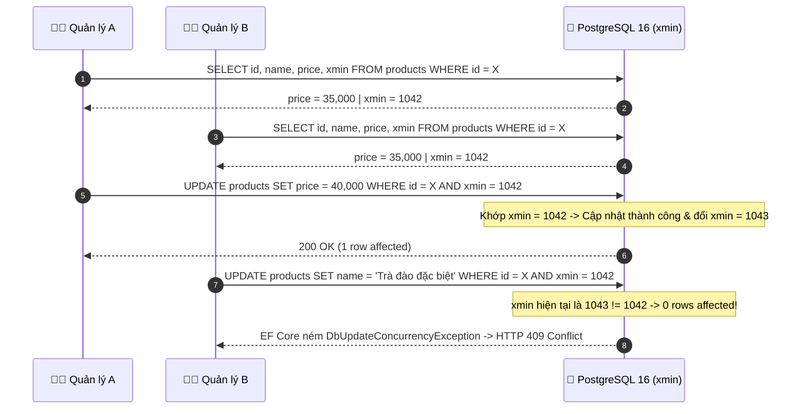

# 🔓 Optimistic Locking (`xmin` Concurrency Token) - POS PWA Project

Tài liệu này quy định cơ chế **Khóa lạc quan (Optimistic Locking / Optimistic Concurrency Control)** trên **PostgreSQL 16** kết hợp **Entity Framework Core 8** cho hệ thống **POS PWA (Point of Sale Progressive Web App)**. Khác với khóa bi quan giữ khóa dòng ngay từ lúc đọc, khóa lạc quan giả định rằng xung đột ít khi xảy ra, cho phép nhiều người dùng đọc dữ liệu đồng thời mà không chặn lẫn nhau và chỉ kiểm tra tính nhất quán phiên bản tại thời điểm ghi (`UPDATE`/`DELETE`).

---

## 🎯 1. Phạm vi áp dụng trong POS PWA

Hệ thống kết hợp song song cả hai cơ chế khóa tùy theo đặc thù tranh chấp dữ liệu của từng nghiệp vụ:

| Nghiệp vụ | Cơ chế khóa áp dụng | Lý do lựa chọn |
| :--- | :--- | :--- |
| **Chốt đơn & Trừ kho tại quầy (`CreateOrderCommand`)** | **Pessimistic Locking** (`FOR UPDATE`) | Xung đột cao trong giờ cao điểm; cần tuần tự hóa giao dịch và phản hồi ngay lập tức cho thu ngân mà không phải thử lại nhiều lần. |
| **Quản lý danh mục & Giá bán (`UpdateProductCommand`)** | **Optimistic Locking** (`xmin`) | Hai quản lý hiếm khi sửa cùng một sản phẩm cùng lúc; tránh khóa dòng làm treo giao diện bán hàng ở quầy. |
| **Nhập điều chỉnh kho thủ công (`AdjustStockCommand`)** | **Optimistic Locking** (`xmin`) | Ngăn chặn tình trạng quản lý vô tình ghi đè số lượng tồn kho mới trong khi thu ngân vừa bán bớt hàng. |
| **Xử lý hoàn tiền (`RefundOrderCommand`)** | **Optimistic Locking** (`xmin`) | Đảm bảo một hóa đơn không bị hai quản lý duyệt hoàn tiền hai lần song song (Double Refund). |

---

## 🐘 2. Tận dụng cột hệ thống `xmin` của PostgreSQL 16

Thay vì phải tự tạo thêm cột `RowVersion` (`bytea` hoặc `timestamp`) trong từng bảng và tự viết Trigger cập nhật mỗi khi sửa dữ liệu, hệ thống tận dụng trực tiếp **cột hệ thống ẩn `xmin`** có sẵn trên mọi bảng của PostgreSQL:

* **Bản chất của `xmin`:** Là mã định danh giao dịch (`xid` - 32-bit unsigned integer) đã chèn hoặc cập nhật phiên bản hiện tại của dòng dữ liệu đó. Mỗi khi một câu lệnh `UPDATE` thành công trên dòng, PostgreSQL tự động cập nhật giá trị `xmin` sang ID của giao dịch mới.
* **Ưu điểm:** Không tốn thêm dung lượng lưu trữ trên đĩa, không cần tạo Trigger, và được trình điều khiển **Npgsql.EntityFrameworkCore.PostgreSQL** hỗ trợ nguyên bản thông qua `.IsRowVersion()`.

---

## 🔄 3. Cơ chế phát hiện xung đột (Lost Update Prevention)

Giả sử **Quản lý A** và **Quản lý B** cùng mở màn hình chỉnh sửa thông tin sản phẩm **Trà đào cam sả** (hiện đang có `price = 35,000đ` và `xmin = 1042`):



---

## 💻 4. Triển khai kỹ thuật trong .NET 8 & EF Core 8

### 4.1. Khai báo thuộc tính `RowVersion` trong Domain Entity
Tại tầng `PosPwa.Domain`, thực thể khai báo thuộc tính `uint RowVersion` (kiểu số nguyên không dấu 32-bit khớp với `xid` của PostgreSQL):

```csharp
public sealed class Product : AggregateRoot, IMustHaveTenant
{
    public Guid TenantId { get; private set; }
    public string Code { get; private set; }
    public string Name { get; private set; }
    public decimal Price { get; private set; }
    public int StockQuantity { get; private set; }

    // Ánh xạ tới cột hệ thống xmin của PostgreSQL
    public uint RowVersion { get; private set; }

    public void UpdateDetails(string name, decimal price)
    {
        if (string.IsNullOrWhiteSpace(name))
            throw new DomainException("Tên sản phẩm không được để trống.");

        if (price < 0)
            throw new DomainException("Đơn giá bán không được âm.");

        Name = name.Trim();
        Price = price;
    }
}
```

### 4.2. Cấu hình Fluent API trong `ProductConfiguration.cs`
Sử dụng `.IsRowVersion()` để EF Core 8 tự động đọc cột `xmin` khi truy vấn và tự động chèn `AND xmin = @p0` vào mệnh đề `WHERE` mỗi khi sinh câu lệnh `UPDATE` hoặc `DELETE`:

```csharp
public sealed class ProductConfiguration : IEntityTypeConfiguration<Product>
{
    public void Configure(EntityTypeBuilder<Product> builder)
    {
        builder.ToTable("products");

        builder.HasKey(p => p.Id);

        // Cấu hình Optimistic Concurrency Token sử dụng cột ẩn xmin của PostgreSQL
        builder.Property(p => p.RowVersion)
            .IsRowVersion();
    }
}
```

Câu lệnh SQL thực tế do EF Core 8 sinh ra khi gọi `SaveChangesAsync()`:
```sql
UPDATE products
SET name = @p0, price = @p1
WHERE id = @p2 AND tenant_id = @p3 AND xmin = @p4;
```

### 4.3. Bắt và chuẩn hóa lỗi xung đột trong `GlobalExceptionHandler`
Khi `UPDATE` trả về `0 rows affected`, EF Core ném ra ngoại lệ `DbUpdateConcurrencyException`. Lớp `GlobalExceptionHandler` sẽ bắt ngoại lệ này và trả về mã lỗi chuẩn **HTTP 409 Conflict** để giao diện React thông báo cho người dùng tải lại dữ liệu mới nhất:

```csharp
var (statusCode, title, detail) = exception switch
{
    DbUpdateConcurrencyException => (
        StatusCodes.Status409Conflict,
        "Xung đột cập nhật dữ liệu",
        "Dữ liệu này vừa được người dùng khác thay đổi. Vui lòng tải lại trang và thử lại."
    ),
    NotFoundException => (StatusCodes.Status404NotFound, "Không tìm thấy tài nguyên", exception.Message),
    InsufficientStockException => (StatusCodes.Status409Conflict, "Xung đột tồn kho", exception.Message),
    DomainException => (StatusCodes.Status400BadRequest, "Lỗi quy tắc nghiệp vụ", exception.Message),
    _ => (StatusCodes.Status500InternalServerError, "Lỗi hệ thống nội bộ", "Đã xảy ra lỗi ở máy chủ.")
};
```

---
