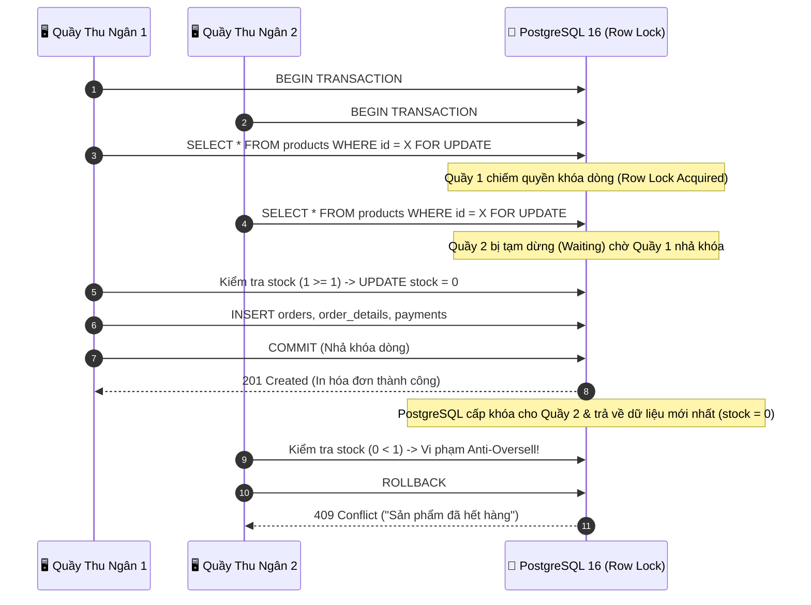

# 🔒 Pessimistic Locking (`SELECT ... FOR UPDATE`) - POS PWA Project

Tài liệu này quy định cơ chế **Khóa bi quan (Pessimistic Locking)** trên **PostgreSQL 16** kết hợp **Entity Framework Core 8** cho hệ thống **POS PWA (Point of Sale Progressive Web App)**. Tại các cửa hàng có nhiều quầy thu ngân hoạt động song song trong giờ cao điểm (Flash Sale, giờ nghỉ trưa), hai thu ngân có thể cùng bấm thanh toán món cuối cùng trong kho tại cùng một thời điểm. Khóa bi quan đảm bảo luồng đọc-và-trừ kho được tuần tự hóa tuyệt đối ở mức dòng dữ liệu (**Row-Level Locking**), triệt tiêu hoàn toàn lỗi bán vượt tồn kho (**Anti-oversell**) mà không phải hủy và thử lại giao dịch nhiều lần.

---

## 🎯 1. Khi nào sử dụng Pessimistic Locking?

| Tiêu chí | Pessimistic Locking (`FOR UPDATE`) | Optimistic Locking (`xmin`) |
| :--- | :--- | :--- |
| **Bản chất cơ chế** | Khóa dòng dữ liệu ngay lúc `SELECT` cho đến khi giao dịch `COMMIT` hoặc `ROLLBACK`. | Không khóa lúc đọc; chỉ kiểm tra phiên bản lúc `UPDATE` và ném lỗi xung đột nếu có người sửa trước. |
| **Mức độ tranh chấp** | **Cao (High Contention)** — Nhiều quầy cùng bán một mặt hàng tồn kho thấp. | **Thấp (Low Contention)** — Cập nhật thông tin sản phẩm, sửa hồ sơ nhân viên, chỉnh sửa đơn nháp. |
| **Áp dụng trong POS PWA** | **Bắt buộc** cho luồng chốt đơn thanh toán (`CreateOrderCommand`) và đồng bộ trừ kho (`SyncOfflineOrdersCommand`). | Áp dụng cho màn hình Quản lý danh mục (`UpdateProductCommand`), điều chỉnh giá bán. |

---

## 🔄 2. Luồng hoạt động giữa hai quầy thu ngân đồng thời

Giả sử sản phẩm **Cà phê sữa đá** chỉ còn **`stock_quantity = 1`**, và **Quầy 1** cùng **Quầy 2** đều nhấn thanh toán 1 ly tại cùng một thời điểm:



---

## 💻 3. Triển khai kỹ thuật trong .NET 8 & EF Core 8

### 3.1. Phương thức khóa dòng trong `ProductRepository`
Vì EF Core 8 chưa có phương thức LINQ chuẩn cho mệnh đề `FOR UPDATE` của PostgreSQL, hệ thống sử dụng `FromSqlInterpolated` kết hợp tham số hóa an toàn để tránh SQL Injection, đồng thời sắp xếp `OrderBy(id => id)` để chống Deadlock:

```csharp
using Microsoft.EntityFrameworkCore;
using PosPwa.Application.Abstractions.Persistence;
using PosPwa.Application.Abstractions.Services;
using PosPwa.Domain.Entities;

public sealed class ProductRepository : IProductRepository
{
    private readonly AppDbContext _dbContext;
    private readonly ITenantContext _tenantContext;

    public ProductRepository(AppDbContext dbContext, ITenantContext tenantContext)
    {
        _dbContext = dbContext;
        _tenantContext = tenantContext;
    }

    /// <summary>
    /// Tải danh sách sản phẩm và khóa bi quan mức dòng (FOR UPDATE) trong PostgreSQL
    /// </summary>
    public async Task<List<Product>> GetByIdsForUpdateAsync(
        IEnumerable<Guid> productIds,
        CancellationToken cancellationToken = default)
    {
        // BẮT BUỘC sắp xếp ID tăng dần để ngăn chặn Deadlock khi nhiều giao dịch khóa chéo món
        var sortedIds = productIds
            .Distinct()
            .OrderBy(id => id)
            .ToArray();

        if (sortedIds.Length == 0)
            return new List<Product>();

        var tenantId = _tenantContext.TenantId
            ?? throw new UnauthorizedAccessException("Thiếu ngữ cảnh TenantId.");

        // Lưu ý: FromSqlInterpolated bỏ qua Global Query Filter của EF Core,
        // nên BẮT BUỘC truyền điều kiện tenant_id = {tenantId} tường minh!
        return await _dbContext.Products
            .FromSqlInterpolated($"""
                SELECT * FROM products
                WHERE tenant_id = {tenantId}
                  AND id = ANY({sortedIds})
                ORDER BY id ASC
                FOR UPDATE
                """)
            .ToListAsync(cancellationToken);
    }
}
```

### 3.2. Kết hợp với `UnitOfWork` trong `CreateOrderCommandHandler`
Khóa `FOR UPDATE` chỉ có hiệu lực khi nằm bên trong một **Database Transaction** đang mở:

```csharp
public async Task<OrderReceiptDto> Handle(CreateOrderCommand request, CancellationToken ct)
{
    OrderReceiptDto? receipt = null;

    await _unitOfWork.ExecuteInTransactionAsync(async token =>
    {
        var productIds = request.Items.Select(i => i.ProductId);
        
        // 1. Khóa độc quyền các dòng sản phẩm liên quan trong PostgreSQL
        var lockedProducts = await _productRepository.GetByIdsForUpdateAsync(productIds, token);

        var orderNumber = $"ORD#{DateTime.UtcNow:yyyyMMdd}-{Random.Shared.Next(1000, 9999)}";
        var order = Order.CreateDraft(request.CashierId, orderNumber);

        foreach (var item in request.Items)
        {
            var product = lockedProducts.FirstOrDefault(p => p.Id == item.ProductId)
                ?? throw new NotFoundException($"Không tìm thấy sản phẩm {item.ProductId}");

            // 2. Thực thi quy tắc trừ kho (ném InsufficientStockException nếu không đủ)
            product.DeductStock(item.Quantity);
            order.AddItem(product.Id, product.Name, product.Price, item.Quantity);
        }

        if (request.Discount > 0)
            order.ApplyDiscount(request.Discount);

        order.CompletePayment(request.PaymentMethod);

        await _orderRepository.AddAsync(order, token);
        receipt = OrderReceiptDto.FromEntity(order);
    }, cancellationToken: ct);

    return receipt!;
}
```

---

## ⚠️ 4. Các lưu ý bảo mật & vận hành bắt buộc

1. **Tường minh điều kiện `tenant_id` trong Raw SQL:**
   Trong EF Core 8, khi sử dụng `.FromSqlInterpolated(...)` để viết câu lệnh SQL gốc (`SELECT * FROM products ... FOR UPDATE`), **Global Query Filter** của Multi-Tenancy sẽ không tự động chèn thêm mệnh đề `WHERE`. Do đó, lập trình viên **bắt buộc** phải truyền `WHERE tenant_id = {tenantId}` trực tiếp vào câu truy vấn như ví dụ trên.
2. **Tùy chọn `FOR UPDATE NOWAIT` (Tùy chọn nâng cao):**
   Nếu muốn hệ thống trả lỗi ngay lập tức (`PostgreSQL Error 55P03`) thay vì bắt thu ngân đứng đợi khi một dòng đang bị khóa quá lâu, có thể sử dụng `FOR UPDATE NOWAIT`. Tuy nhiên, với tốc độ chốt đơn POS dưới `50ms`, `FOR UPDATE` tiêu chuẩn là lựa chọn tối ưu giúp giao dịch thứ hai tự động hoàn tất mượt mà nếu hàng vẫn còn trong kho.
3. **Chỉ khóa bảng `products` (Không dùng `FOR UPDATE` trên bảng `categories`):**
   Nếu câu lệnh có `JOIN` sang bảng `categories`, bắt buộc ghi rõ `FOR UPDATE OF products` để tránh khóa nhầm cả dòng danh mục khiến các quầy khác không thể truy vấn danh mục sản phẩm.

---
