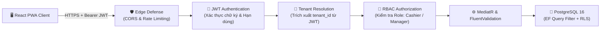

# 🔐 Multi-Tenancy & Security Architecture - POS PWA Project

Thư mục này tổng hợp toàn bộ tài liệu thiết kế kiến trúc đa người thuê (**SaaS Multi-Tenancy**), cơ chế cô lập dữ liệu (**Tenant Isolation**) và các tiêu chuẩn bảo mật nhiều lớp (**Defense-in-Depth Security**) cho hệ thống **POS PWA (Point of Sale Progressive Web App)**. Mục tiêu cốt lõi là đảm bảo dữ liệu bán hàng, tồn kho và doanh thu của từng cửa hàng luôn được tách biệt tuyệt đối, đồng thời bảo vệ hệ thống trước các rủi ro xác thực phiên làm việc tại quầy thu ngân và lỗ hổng bảo mật Web API.

---

## 📂 Cấu trúc thư mục `05-multi-tenancy-and-security/`

```text
05-multi-tenancy-and-security/
├── README.md                         # Tổng quan kiến trúc Multi-Tenancy & Bảo mật nhiều lớp
├── saas-multi-tenancy.md             # Mô hình SaaS Shared Schema, nhận diện Tenant & luồng đăng nhập
├── tenant-isolation.md               # Cô lập dữ liệu đa tầng (EF Core Global Filters, PostgreSQL RLS, SignalR)
├── jwt-authentication.md             # Xác thực không trạng thái với JSON Web Token (JWT Bearer)
├── refresh-token.md                  # Cơ chế làm mới phiên làm việc an toàn (Refresh Token Rotation)
├── role-based-access-control.md      # Phân quyền truy cập theo vai trò (RBAC: Cashier vs. Manager)
├── password-hashing.md               # Băm mật khẩu an toàn với BCrypt / Argon2id & chính sách mật khẩu
└── web-api-security.md               # Bảo vệ Web API (CORS, Rate Limiting, Security Headers, HTTPS)
```

---

## 🛡️ Nguyên tắc bảo mật & Cô lập cốt lõi (Security Pillars)

| Trụ cột bảo mật | Công nghệ / Cơ chế áp dụng | Mục tiêu bảo vệ trong POS PWA |
| :--- | :--- | :--- |
| **Cô lập dữ liệu cửa hàng (Tenant Isolation)** | `tenant_id` + EF Core Global Query Filter + PostgreSQL RLS + SignalR Groups | Ngăn chặn tuyệt đối rò rỉ dữ liệu giữa các cửa hàng dùng chung hạ tầng SaaS (`Cross-Tenant Data Leak`). |
| **Xác thực phiên thu ngân (Authentication)** | JWT Access Token (ngắn hạn `15 phút`) + HttpOnly Refresh Token (`7 ngày`) | Giữ cho thu ngân thao tác mượt mà suốt ca làm việc mà không bị gián đoạn đăng nhập, đồng thời vô hiệu hóa ngay lập tức khi mất thiết bị. |
| **Phân quyền nghiệp vụ (Authorization)** | ASP.NET Core Policy-Based RBAC (`Cashier`, `Manager`) | Tách bạch quyền bán hàng thông thường của thu ngân khỏi các thao tác nhạy cảm như hoàn tiền (`Refund`), điều chỉnh giá bán và xem báo cáo lợi nhuận. |
| **An toàn thông tin định danh (Credential Safety)** | BCrypt (Work Factor $\ge 12$) + Zero Plaintext Logging | Bảo vệ mật khẩu nhân viên ngay cả khi cơ sở dữ liệu bị truy cập trái phép. |
| **Phòng thủ biên API (API Edge Defense)** | Strict CORS + ASP.NET Core Rate Limiting + Security Headers | Chống tấn công vét cạn mật khẩu (`Brute-force`), chống spam tạo đơn ảo và chặn truy cập từ tên miền lạ. |

---

## 🔄 Sơ đồ luồng bảo mật tổng thể cho một Request POS



---
