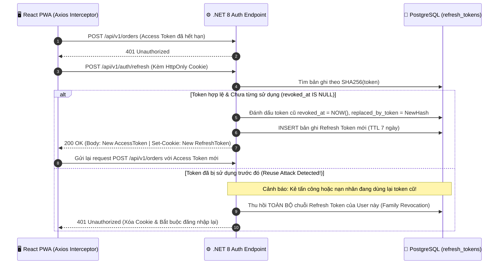

# 🔄 Refresh Token Rotation & Session Lifecycle - POS PWA Project

Tài liệu này quy định cơ chế cấp lại phiên làm việc liên tục và an toàn thông qua **Refresh Token Rotation (Xoay vòng Refresh Token)** và **Reuse Detection (Phát hiện tái sử dụng Token bị đánh cắp)** cho hệ thống **POS PWA (Point of Sale Progressive Web App)**. Tại quầy thu ngân, ca làm việc thường kéo dài 8–12 tiếng; cơ chế này giúp thu ngân không bị gián đoạn đăng nhập khi `Access Token` hết hạn sau 15 phút, đồng thời cho phép Quản lý thu hồi quyền truy cập từ xa ngay lập tức nếu thiết bị POS bị mất hoặc nhân viên nghỉ việc.

---

## 🎯 1. Kiến trúc bảo mật cặp đôi Token

| Đặc điểm kỹ thuật | JWT Access Token | Refresh Token |
| :--- | :--- | :--- |
| **Thời hạn sống (TTL)** | Ngắn hạn: **15 phút** | Dài hạn: **7 ngày** (đủ bao phủ lịch làm việc tuần) |
| **Định dạng & Lưu trữ Server** | Stateless (Không lưu trong Database) | Stateful: Chuỗi ngẫu nhiên mật mã 64-byte (`SHA-256 Hash` lưu trong bảng `refresh_tokens`) |
| **Nơi lưu trữ trên React PWA** | Bộ nhớ RAM (Zustand / In-Memory State) | **`HttpOnly; Secure; SameSite=Strict` Cookie** (JavaScript không thể đọc) |
| **Cơ chế thu hồi (Revocation)** | Tự động hết hạn sau 15 phút | Thu hồi tức thì bằng cách đánh dấu `revoked_at` trong PostgreSQL |

---

## 🔄 2. Luồng xoay vòng Refresh Token & Phát hiện đánh cắp (Reuse Detection)

Mỗi `Refresh Token` chỉ có giá trị sử dụng **một lần duy nhất (One-Time Use)**. Khi trình duyệt PWA gửi yêu cầu làm mới phiên (`POST /api/v1/auth/refresh`), máy chủ sẽ vô hiệu hóa token cũ và cấp phát một cặp `Access Token` + `Refresh Token` hoàn toàn mới:



---

## 🗄️ 3. Thiết kế bảng `refresh_tokens` trong PostgreSQL 16

Hệ thống **không bao giờ lưu chuỗi Refresh Token gốc** trong cơ sở dữ liệu mà chỉ lưu giá trị băm **SHA-256** (tương tự mật khẩu) để đảm bảo ngay cả khi Database bị lộ bản sao lưu, kẻ tấn công cũng không thể dùng dữ liệu đó để chiếm phiên đăng nhập:

```sql
CREATE TABLE refresh_tokens (
    id uuid PRIMARY KEY,
    tenant_id uuid NOT NULL REFERENCES tenants(id) ON DELETE CASCADE,
    user_id uuid NOT NULL REFERENCES users(id) ON DELETE CASCADE,
    token_hash varchar(128) NOT NULL UNIQUE,
    expires_at timestamptz NOT NULL,
    created_at timestamptz NOT NULL,
    revoked_at timestamptz NULL,
    replaced_by_token_hash varchar(128) NULL,
    created_by_ip varchar(45) NULL
);

CREATE INDEX ix_refresh_tokens_user_id ON refresh_tokens (user_id);
```

---

## 💻 4. Triển khai kỹ thuật trong .NET 8

### 4.1. Thực thể `RefreshToken` (`PosPwa.Domain/Entities/RefreshToken.cs`)
```csharp
public sealed class RefreshToken : Entity, IMustHaveTenant
{
    public Guid TenantId { get; private set; }
    public Guid UserId { get; private set; }
    public string TokenHash { get; private set; }
    public DateTime ExpiresAt { get; private set; }
    public DateTime CreatedAt { get; private set; }
    public DateTime? RevokedAt { get; private set; }
    public string? ReplacedByTokenHash { get; private set; }
    public string? CreatedByIp { get; private set; }

    public bool IsExpired => DateTime.UtcNow >= ExpiresAt;
    public bool IsRevoked => RevokedAt is not null;
    public bool IsActive => !IsRevoked && !IsExpired;

    public void Revoke(string? replacedByHash = null)
    {
        RevokedAt = DateTime.UtcNow;
        ReplacedByTokenHash = replacedByHash;
    }
}
```

### 4.2. Cấu hình gắn `HttpOnly Cookie` an toàn trong `AuthController`
```csharp
private void SetRefreshTokenCookie(string rawRefreshToken, DateTime expiresAt)
{
    var cookieOptions = new CookieOptions
    {
        HttpOnly = true,                        // Chặn JavaScript (document.cookie) đọc token -> Chống XSS
        Secure = true,                          // Chỉ truyền qua kết nối mã hóa HTTPS
        SameSite = SameSiteMode.Strict,         // Ngăn chặn tấn công giả mạo yêu cầu liên trang (CSRF)
        Path = "/api/v1/auth",                  // Chỉ gửi cookie tới các endpoint xác thực (refresh/logout)
        Expires = expiresAt
    };

    Response.Cookies.Append("pos_refresh_token", rawRefreshToken, cookieOptions);
}
```

### 4.3. Xử lý đồng thời trên React PWA (Single Refresh Promise)
Khi mở màn hình báo cáo hoặc đồng bộ nhiều đơn hàng Offline cùng lúc sau khi `Access Token` hết hạn, trình duyệt có thể gửi đồng thời 3–5 request bị lỗi `401 Unauthorized`. Để tránh việc gửi 5 yêu cầu `/auth/refresh` cùng lúc (khiến 4 yêu cầu sau kích hoạt nhầm cảnh báo **Reuse Detection**), **Axios Response Interceptor** ở Frontend áp dụng mẫu **Request Queueing (Single-Flight Refresh)**:
* Request đầu tiên gặp `401` sẽ khởi tạo một `refreshPromise` duy nhất và khóa trạng thái `isRefreshing = true`.
* Các request lỗi `401` tiếp theo sẽ tạm dừng và đăng ký chờ kết quả của `refreshPromise` đó thay vì tự gọi API refresh riêng lẻ.
* Khi `refreshPromise` hoàn tất, toàn bộ hàng đợi request được tự động gắn `Access Token` mới và thực thi lại mượt mà.

---
