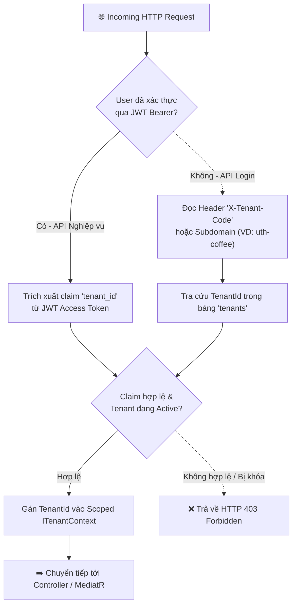

# 🏢 SaaS Multi-Tenancy Architecture - POS PWA Project

Tài liệu này mô tả thiết kế kiến trúc đa người thuê (**Multi-Tenancy**) cho hệ thống **POS PWA (Point of Sale Progressive Web App)** khi triển khai dưới dạng nền tảng phần mềm dịch vụ (**SaaS - Software as a Service**). Hệ thống cho phép hàng trăm cửa hàng bán lẻ / chuỗi F&B (**Tenants**) cùng vận hành trên một cụm hạ tầng **.NET 8 Web API** và **PostgreSQL 16**, đồng thời đảm bảo dữ liệu kinh doanh luôn cô lập, dễ mở rộng và hỗ trợ bán hàng ngoại tuyến (**Offline PWA**) theo từng cửa hàng riêng biệt.

---

## 🏛️ 1. Phân tích & Lựa chọn mô hình Multi-Tenancy

Trong kiến trúc SaaS, có ba mô hình tổ chức cơ sở dữ liệu phổ biến. Hệ thống **POS PWA** lựa chọn chiến lược **Shared Database, Shared Schema (Cơ sở dữ liệu dùng chung, Lược đồ bảng dùng chung với cột định danh `tenant_id`)**:

| Tiêu chí đánh giá | Database-per-Tenant | Schema-per-Tenant | Shared Schema (`tenant_id`) — **Lựa chọn** |
| :--- | :--- | :--- | :--- |
| **Chi phí hạ tầng & Vận hành** | Rất cao (mỗi cửa hàng 1 instance DB) | Trung bình | **Tối ưu nhất** (chia sẻ tài nguyên RAM/CPU cho hàng trăm shop) |
| **Quản lý EF Core Migrations** | Phức tạp (lặp lại N lần cho N shop) | Phức tạp (lặp lại N schema) | **Đơn giản** (chạy 1 lần duy nhất cho toàn bộ hệ thống) |
| **Hiệu quả Connection Pooling** | Dễ cạn kiệt pool khi nhiều shop mở ca | Tốt | **Tối đa** qua Npgsql Connection Pool dùng chung |
| **Tốc độ mở rộng (Onboarding)** | Chậm (cần cấp phát DB mới) | Trung bình | **Tức thì ($< 1\text{s}$)** — Chỉ cần `INSERT` một dòng vào bảng `tenants` |

---

## 🔄 2. Luồng nhận diện Tenant (Tenant Resolution Pipeline)

Mọi HTTP Request từ ứng dụng **React PWA** gửi lên **.NET 8 Web API** đều đi qua `TenantResolutionMiddleware` để xác định ngữ cảnh cửa hàng (`ITenantContext`) trước khi chạm tới tầng `Application` hay `Database`.



### Quy tắc bảo mật khi phân giải `TenantId`:
1. **Tin cậy tuyệt đối JWT Claims cho các API đã đăng nhập:** Sau khi thu ngân đăng nhập thành công, mọi yêu cầu tạo đơn, trừ kho hay xem báo cáo đều lấy `tenant_id` trực tiếp từ chữ ký số của **JWT Token**, bỏ qua mọi giá trị `X-Tenant-Id` giả mạo mà kẻ tấn công có thể chèn thêm vào HTTP Header.
2. **Chỉ dùng `X-Tenant-Code` / Subdomain cho luồng đăng nhập (`POST /api/v1/auth/login`):** Vì hai cửa hàng khác nhau có thể cùng đặt tên tài khoản thu ngân là `cashier01`, màn hình đăng nhập PWA gửi kèm mã cửa hàng (`tenant_code`) để hệ thống định vị đúng bảng `users` của cửa hàng đó.

---

## 💻 3. Triển khai kỹ thuật trong .NET 8

### 3.1. Dịch vụ ngữ cảnh `ITenantContext` (Scoped Service)
Lưu trữ `TenantId` xuyên suốt vòng đời của một HTTP Request duy nhất:

```csharp
public interface ITenantContext
{
    Guid? TenantId { get; }
    bool IsResolved => TenantId.HasValue && TenantId.Value != Guid.Empty;
    void SetTenant(Guid tenantId);
}

public sealed class TenantContext : ITenantContext
{
    public Guid? TenantId { get; private set; }

    public void SetTenant(Guid tenantId)
    {
        if (tenantId == Guid.Empty)
            throw new ArgumentException("TenantId không được là Guid rỗng.", nameof(tenantId));

        TenantId = tenantId;
    }
}
```

### 3.2. Triển khai `TenantResolutionMiddleware`
```csharp
public sealed class TenantResolutionMiddleware
{
    private readonly RequestDelegate _next;

    public TenantResolutionMiddleware(RequestDelegate next)
    {
        _next = next;
    }

    public async Task InvokeAsync(HttpContext context, ITenantContext tenantContext)
    {
        // Ưu tiên 1: Lấy từ JWT Claim 'tenant_id' nếu người dùng đã đăng nhập
        var tenantClaim = context.User.FindFirst("tenant_id")?.Value;
        if (Guid.TryParse(tenantClaim, out var jwtTenantId))
        {
            tenantContext.SetTenant(jwtTenantId);
        }
        // Ưu tiên 2: Lấy từ Header 'X-Tenant-Id' cho các endpoint công khai được phép
        else if (context.Request.Headers.TryGetValue("X-Tenant-Id", out var headerValue)
                 && Guid.TryParse(headerValue.FirstOrDefault(), out var headerTenantId))
        {
            tenantContext.SetTenant(headerTenantId);
        }

        await _next(context);
    }
}
```

### 3.3. Thứ tự đăng ký Middleware trong `Program.cs`
`TenantResolutionMiddleware` bắt buộc phải đặt **sau** `UseAuthentication()` (để `context.User` đã giải mã xong JWT Claims) và **trước** `UseAuthorization()` cùng `MapControllers()`:

```csharp
app.UseHttpsRedirection();
app.UseCors("PosPwaPolicy");

app.UseAuthentication();
app.UseMiddleware<TenantResolutionMiddleware>(); // Giải mã TenantId ngay sau khi xác thực JWT
app.UseAuthorization();

app.MapControllers();
app.MapHub<PosSyncHub>("/hubs/pos-sync");
```

---

## 📱 4. Kiến trúc Multi-Tenancy trên Offline PWA (Frontend)

Khi triển khai trên thiết bị máy tính bảng hoặc máy POS tại quầy, ứng dụng **React PWA** đảm bảo tính nhất quán theo từng Tenant qua các cơ chế sau:

* **Phân vùng cơ sở dữ liệu cục bộ (`IndexedDB`):** Mỗi cửa hàng được cấp một không gian lưu trữ ngoại tuyến riêng biệt theo định dạng `PosPwaOfflineDb_{tenantId}` (sử dụng thư viện Dexie.js). Nhờ đó, danh mục sản phẩm cache và hàng đợi đơn hàng chờ đồng bộ (`Sync Queue`) của cửa hàng này không bao giờ bị lẫn với cửa hàng khác nếu thiết bị được điều chuyển chi nhánh.
* **Tự động đính kèm ngữ cảnh khi đồng bộ nền (`Background Sync`):** Mỗi gói tin đơn hàng lưu trong `IndexedDB` đều lưu kèm `tenantId` và `cashierId` tại thời điểm lập đơn. Khi có mạng trở lại, API `/api/v1/orders/sync` đối chiếu `tenantId` của gói tin với `tenant_id` trong JWT hiện hành; nếu không khớp sẽ từ chối đồng bộ và cảnh báo thu ngân.

---
