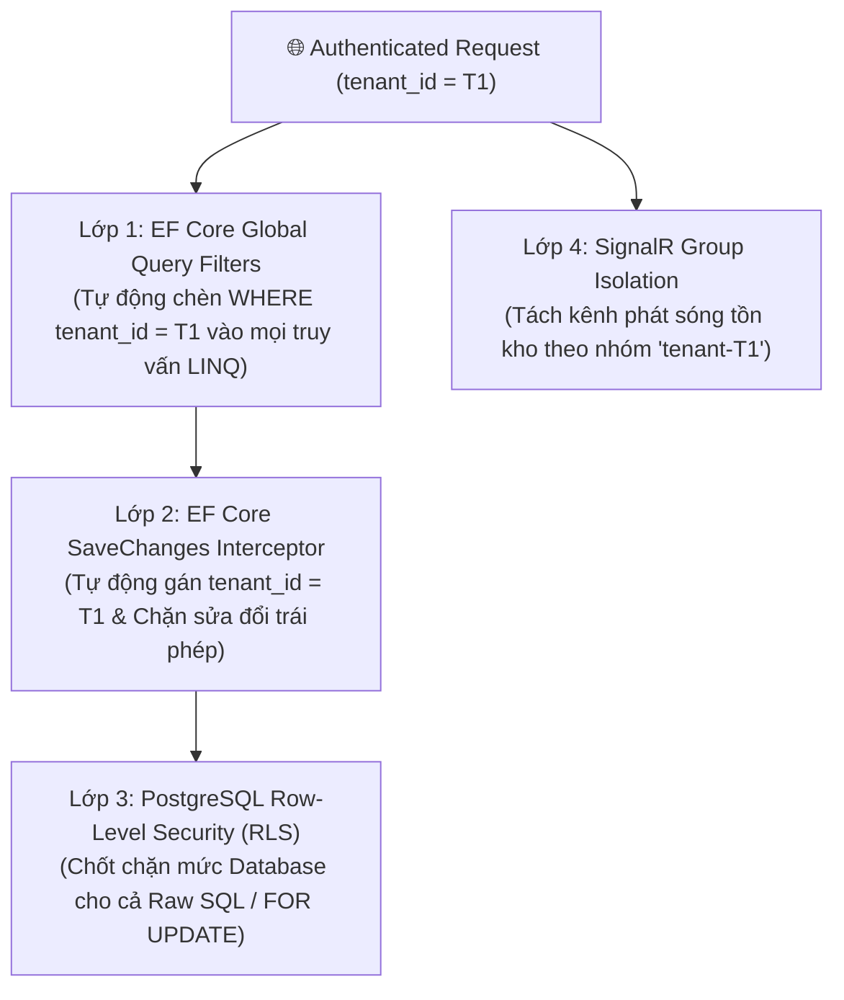

# 🛡️ Multi-Layer Tenant Isolation - POS PWA Project

Tài liệu này quy định cơ chế **Cô lập dữ liệu đa tầng (Multi-Layer Tenant Isolation)** cho hệ thống **POS PWA (Point of Sale Progressive Web App)**. Trong mô hình SaaS dùng chung cơ sở dữ liệu (**Shared Schema**), rủi ro nghiêm trọng nhất là lỗi rò rỉ dữ liệu chéo giữa các cửa hàng (**Cross-Tenant Data Leak**) do lập trình viên quên thêm điều kiện `WHERE tenant_id = ...`. Để loại bỏ hoàn toàn rủi ro này, hệ thống áp dụng chiến lược **Phòng thủ chiều sâu (Defense-in-Depth)** qua 4 lớp bảo vệ độc lập từ tầng ORM, Database cho đến Real-time SignalR và Cache.

---

## 🏗️ 1. Kiến trúc phòng thủ 4 lớp (Defense-in-Depth Isolation)



---

## ⚙️ 2. Lớp 1 & Lớp 2: Tự động cô lập tại tầng ORM (`AppDbContext`)

### 2.1. Global Query Filters (Tự động lọc khi Đọc - `SELECT`)
Mọi thực thể triển khai giao diện `IMustHaveTenant` (`Category`, `Product`, `Order`, `User`) đều được đăng ký **Global Query Filter** trong `AppDbContext.OnModelCreating()`. Nhờ đó, mọi truy vấn LINQ (`_dbContext.Products.ToListAsync()`) đều tự động được EF Core biên dịch kèm điều kiện `WHERE tenant_id = @tenantId`:

```csharp
protected override void OnModelCreating(ModelBuilder modelBuilder)
{
    base.OnModelCreating(modelBuilder);

    // Tự động áp dụng bộ lọc TenantId cho tất cả các thực thể thuộc cửa hàng
    modelBuilder.Entity<Category>().HasQueryFilter(e => e.TenantId == _tenantContext.TenantId);
    modelBuilder.Entity<Product>().HasQueryFilter(e => e.TenantId == _tenantContext.TenantId);
    modelBuilder.Entity<Order>().HasQueryFilter(e => e.TenantId == _tenantContext.TenantId);
    modelBuilder.Entity<User>().HasQueryFilter(e => e.TenantId == _tenantContext.TenantId);
}
```

### 2.2. Bảo vệ toàn vẹn khi Ghi (`INSERT`, `UPDATE`, `DELETE`)
Trong phương thức `SaveChangesAsync()`, hệ thống thực hiện kiểm tra chéo trước khi gửi lệnh xuống PostgreSQL nhằm ngăn chặn hành vi sửa đổi dữ liệu thuộc Tenant khác:

```csharp
public override async Task<int> SaveChangesAsync(CancellationToken cancellationToken = default)
{
    foreach (var entry in ChangeTracker.Entries<IMustHaveTenant>())
    {
        switch (entry.State)
        {
            case EntityState.Added:
                if (!_tenantContext.IsResolved)
                    throw new UnauthorizedAccessException("Không thể tạo dữ liệu khi chưa xác định Tenant.");
                
                entry.Entity.SetTenant(_tenantContext.TenantId!.Value);
                break;

            case EntityState.Modified:
            case EntityState.Deleted:
                // Chặn tuyệt đối hành vi thay đổi TenantId hoặc sửa bản ghi của Tenant khác
                if (entry.Entity.TenantId != _tenantContext.TenantId)
                    throw new UnauthorizedAccessException("Vi phạm cô lập dữ liệu: Không có quyền tác động lên Tenant này.");
                break;
        }
    }

    return await base.SaveChangesAsync(cancellationToken);
}
```

---

## 🐘 3. Lớp 3: Chốt chặn cuối cùng với PostgreSQL Row-Level Security (RLS)

**Vấn đề thực tế:** Các câu lệnh Raw SQL như khóa bi quan `FromSqlInterpolated("SELECT * FROM products ... FOR UPDATE")` hoặc truy vấn báo cáo phức tạp bỏ qua Global Query Filter của EF Core. Nếu lập trình viên vô tình viết thiếu `WHERE tenant_id = ...`, dữ liệu của cửa hàng khác có thể bị đọc hoặc khóa nhầm.

**Giải pháp:** Kích hoạt **Row-Level Security (RLS)** trực tiếp trên PostgreSQL 16. Khi mỗi kết nối mở từ Npgsql bắt đầu, hệ thống thiết lập biến phiên `app.current_tenant_id`:

```sql
-- 1. Kích hoạt RLS trên các bảng chứa dữ liệu cửa hàng
ALTER TABLE products ENABLE ROW LEVEL SECURITY;
ALTER TABLE orders ENABLE ROW LEVEL SECURITY;
ALTER TABLE categories ENABLE ROW LEVEL SECURITY;

-- 2. Tạo Policy bắt buộc mọi truy vấn (SELECT, INSERT, UPDATE, DELETE) phải khớp biến phiên
CREATE POLICY tenant_isolation_policy ON products
    USING (tenant_id = current_setting('app.current_tenant_id', true)::uuid)
    WITH CHECK (tenant_id = current_setting('app.current_tenant_id', true)::uuid);

CREATE POLICY tenant_isolation_policy ON orders
    USING (tenant_id = current_setting('app.current_tenant_id', true)::uuid)
    WITH CHECK (tenant_id = current_setting('app.current_tenant_id', true)::uuid);
```

### Tích hợp thiết lập biến phiên qua `DbConnectionInterceptor` (.NET 8)
```csharp
public sealed class TenantConnectionInterceptor : DbConnectionInterceptor
{
    private readonly ITenantContext _tenantContext;

    public TenantConnectionInterceptor(ITenantContext tenantContext)
    {
        _tenantContext = tenantContext;
    }

    public override async Task ConnectionOpenedAsync(
        DbConnection connection,
        ConnectionEndEventData eventData,
        CancellationToken cancellationToken = default)
    {
        if (_tenantContext.IsResolved)
        {
            await using var cmd = connection.CreateCommand();
            // Thiết lập biến phiên cục bộ cho PostgreSQL RLS
            cmd.CommandText = $"SELECT set_config('app.current_tenant_id', '{_tenantContext.TenantId}', false);";
            await cmd.ExecuteNonQueryAsync(cancellationToken);
        }
    }
}
```

---

## 📡 4. Lớp 4: Cô lập kênh Real-time SignalR (`PosSyncHub`)

Hệ thống sử dụng **SignalR** để đồng bộ biến động tồn kho (`StockUpdated`) và thông báo đơn hàng mới (`OrderCreated`) giữa các quầy thu ngân theo thời gian thực. Để đảm bảo cửa hàng A không bao giờ nhận được thông báo nhảy số tồn kho của cửa hàng B:

1. **Xác thực kết nối Hub (`[Authorize]`):** Yêu cầu client đính kèm JWT Access Token hợp lệ ngay khi bắt tay kết nối WebSocket.
2. **Phân nhóm tự động theo `TenantId` trong `OnConnectedAsync`:**

```csharp
[Authorize]
public sealed class PosSyncHub : Hub
{
    public override async Task OnConnectedAsync()
    {
        var tenantId = Context.User?.FindFirst("tenant_id")?.Value;
        
        if (string.IsNullOrEmpty(tenantId))
        {
            Context.Abort(); // Ngắt kết nối ngay lập tức nếu Token không chứa tenant_id
            return;
        }

        // Đưa thiết bị POS vào đúng nhóm riêng của cửa hàng đó
        await Groups.AddToGroupAsync(Context.ConnectionId, $"tenant-{tenantId}");
        await base.OnConnectedAsync();
    }
}
```

3. **Phát sóng sự kiện đúng phạm vi cửa hàng:**
```csharp
// Chỉ gửi cập nhật tồn kho tới các quầy thu ngân thuộc cùng TenantId
await _hubContext.Clients
    .Group($"tenant-{notification.TenantId}")
    .SendAsync("StockUpdated", new { notification.ProductId, notification.NewStockQuantity }, ct);
```

---

## 🧪 5. Quy chuẩn kiểm thử cô lập dữ liệu (Isolation Testing)

Mọi tính năng mới liên quan đến truy xuất dữ liệu bắt buộc phải vượt qua bài kiểm thử tích hợp (**Integration Test**):
* Khởi tạo dữ liệu cho **Tenant A** và **Tenant B**.
* Đăng nhập bằng JWT Token của **Thu ngân thuộc Tenant A**.
* Gửi yêu cầu lấy danh sách sản phẩm (`GET /api/v1/products`) hoặc truy cập trực tiếp ID đơn hàng của Tenant B (`GET /api/v1/orders/{orderIdOfTenantB}`).
* **Kết quả kỳ vọng:** Danh sách trả về tuyệt đối không chứa bản ghi của Tenant B, và truy cập trực tiếp ID của Tenant B phải trả về **`404 Not Found`** (không trả về `403` để tránh làm lộ thông tin rằng ID đó có tồn tại trong hệ thống).

---
