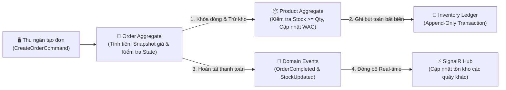

# 📦 Inventory & Order Domain Architecture - POS PWA Project

Thư mục này lưu trữ toàn bộ tài liệu thiết kế mô hình miền (**Domain-Driven Design - DDD**) và các quy tắc nghiệp vụ cốt lõi cho hai phân hệ trọng tâm của hệ thống **POS PWA (Point of Sale Progressive Web App)**: **Quản lý Tồn kho (Inventory Domain)** và **Xử lý Đơn hàng (Order Domain)**. Thiết kế đảm bảo tính nhất quán tài chính tuyệt đối, khả năng kiểm toán lịch sử biến động kho không thể tẩy xóa (**Immutable Audit Trail**), chống bán vượt tồn kho (**Anti-Oversell**) khi nhiều quầy thu ngân giao dịch đồng thời, và quản lý vòng đời trạng thái đơn hàng chặt chẽ.

---

## 📂 Cấu trúc thư mục `06-inventory-and-order-domain/`

```text
06-inventory-and-order-domain/
├── README.md                     # Tổng quan kiến trúc miền Tồn kho & Đơn hàng
├── inventory-ledger.md           # Sổ cái biến động tồn kho (Inventory Ledger) & Truy vết xuất nhập
├── append-only-data.md           # Nguyên tắc dữ liệu chỉ nối thêm (Immutable / Append-Only) cho tài chính & kho
├── stock-reservation.md          # Cơ chế giữ chỗ tồn kho tạm thời (Soft Reservation) cho giỏ hàng / đơn chờ
├── anti-oversell.md              # Chiến lược chống bán vượt tồn kho đa lớp (Pessimistic Lock + DB Constraints)
├── weighted-average-cost.md      # Phương pháp tính giá vốn bình quân gia quyền (WAC) & Biên lợi nhuận
├── canonical-order-model.md      # Mô hình thực thể Đơn hàng chuẩn hóa (Order Aggregate Root & Snapshots)
└── order-state-machine.md        # Máy trạng thái hữu hạn (State Machine) điều phối vòng đời đơn hàng POS
```

---

## 🏛️ Nguyên tắc thiết kế miền cốt lõi (Core Domain Principles)

| Nguyên tắc kiến trúc | Áp dụng trong hệ thống POS PWA | Giá trị nghiệp vụ & Kỹ thuật |
| :--- | :--- | :--- |
| **Rich Domain Model (DDD)** | Toàn bộ quy tắc kiểm tra tồn kho, tính tổng tiền, chiết khấu và chuyển trạng thái đơn đều đóng gói bên trong `Product` và `Order` Aggregate Root. | Loại bỏ hoàn toàn *Anemic Domain Model*, ngăn chặn việc ghi đè trực tiếp `StockQuantity` hoặc `Status` từ bên ngoài. |
| **Append-Only Ledger** | Mọi biến động tăng/giảm tồn kho (`Nhập hàng`, `Bán POS`, `Hoàn trả`, `Kiểm kê`) đều ghi thành một bút toán bất biến trong `inventory_transactions`. | Giúp đối soát chính xác tồn kho tại bất kỳ thời điểm nào trong quá khứ và chống gian lận sửa số liệu kho. |
| **Zero Negative Stock (Anti-Oversell)** | Kết hợp khóa bi quan `FOR UPDATE`, ràng buộc `CHECK (stock_quantity >= 0)` và cơ chế đối soát đơn Offline. | Triệt tiêu 100% tình trạng hai thu ngân cùng chốt món cuối cùng gây âm kho trong giờ cao điểm. |
| **Price & Cost Snapshot** | Đơn hàng lưu cứng đơn giá bán (`unit_price`) và giá vốn bình quân (`unit_cost`) tại thời điểm giao dịch. | Bảo toàn độ chính xác của báo cáo doanh thu và lợi nhuận gộp ngay cả khi giá nhập/giá bán thay đổi sau này. |
| **Strict State Machine** | Vòng đời đơn hàng tuân theo đồ thị chuyển trạng thái hợp lệ (`Draft` $\rightarrow$ `Completed` $\rightarrow$ `Refunded` / `Cancelled`). | Ngăn chặn các lỗi logic như hoàn tiền đơn chưa thanh toán hoặc hủy đơn đã hoàn tất. |

---

## 🔄 Tương tác giữa Order Domain và Inventory Domain



---
