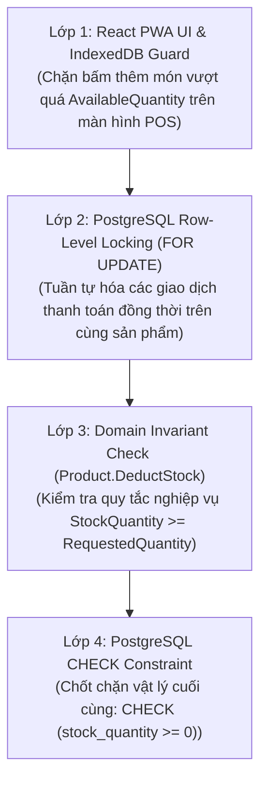

# 🛡️ Anti-Oversell Architecture (Chống Bán Vượt Tồn Kho) - POS PWA Project

Tài liệu này quy định kiến trúc phòng vệ đa lớp nhằm triệt tiêu 100% tình trạng **Bán vượt tồn kho (Overselling / Negative Stock)** trong hệ thống **POS PWA (Point of Sale Progressive Web App)**. Tại các cửa hàng bán lẻ và chuỗi F&B có nhiều quầy thu ngân hoạt động đồng thời hoặc bán hàng trong chế độ ngoại tuyến (**Offline PWA**), hiện tượng điều kiện tranh chấp (**Race Condition**) có thể khiến hai quầy cùng bán một đơn vị hàng hóa cuối cùng trong kho. Hệ thống giải quyết triệt để bài toán này thông qua **4 lớp chốt chặn từ Frontend, Domain, Concurrency Control cho đến Database Constraint**.

---

## 🏗️ 1. Kiến trúc Phòng thủ Chống Âm Kho 4 Lớp



---

## ⚙️ 2. Chi tiết kỹ thuật từng lớp bảo vệ

### 2.1. Lớp 1: Ngăn chặn sớm tại giao diện React PWA & SignalR Real-time
* Màn hình bán hàng hiển thị rõ số lượng tồn kho khả dụng (`AvailableQuantity = OnHandQuantity - ReservedQuantity`) trên từng thẻ sản phẩm. Khi `AvailableQuantity == 0`, thẻ món tự động chuyển sang trạng thái **Hết hàng (Sold Out)** và vô hiệu hóa thao tác thêm vào giỏ.
* Ngay khi **Quầy 1** thanh toán thành công, Backend phát sự kiện **`StockUpdated`** qua **SignalR Group** (`tenant-{tenantId}`), cập nhật số lượng tồn kho mới xuống màn hình **Quầy 2** trong vòng chưa đầy **$100\text{ms}$**.

### 2.2. Lớp 2: Tuần tự hóa giao dịch bằng Khóa bi quan (`SELECT ... FOR UPDATE`)
Trong trường hợp **Quầy 1** và **Quầy 2** cùng nhấn nút **Thanh toán** trong cùng một mili-giây trước khi SignalR kịp cập nhật giao diện:
* `CreateOrderCommandHandler` mở một **Database Transaction** và gọi `GetByIdsForUpdateAsync(sortedProductIds)`.
* PostgreSQL áp đặt **Row-Level Lock (`FOR UPDATE`)** lên các dòng sản phẩm tương ứng (theo thứ tự `ProductId` tăng dần để triệt tiêu nguy cơ **Deadlock**).
* Giao dịch đến sau bắt buộc phải chờ giao dịch trước `COMMIT` hoàn tất, sau đó mới đọc được giá trị `stock_quantity` mới nhất vừa bị trừ.

### 2.3. Lớp 3: Cưỡng chế quy tắc bất biến tại Domain Entity (`Product.cs`)
Thực thể `Product` đóng gói chặt chẽ thuộc tính `StockQuantity` (`private set`), buộc mọi thao tác xuất kho đều phải đi qua phương thức `DeductStock`:

```csharp
public InventoryTransaction DeductStock(int quantity, Guid orderId, Guid cashierId)
{
    if (quantity <= 0)
        throw new DomainException("Số lượng xuất bán phải lớn hơn 0.");

    // Kiểm tra khả dụng thực tế (đã trừ đi các phiếu giữ chỗ Active của đơn khác)
    var availableQuantity = StockQuantity - ActiveReservedQuantity;
    if (availableQuantity < quantity)
    {
        throw new InsufficientStockException(
            $"Sản phẩm '{Name}' không đủ tồn kho khả dụng (Còn lại: {availableQuantity}, Yêu cầu: {quantity}).");
    }

    var balanceBefore = StockQuantity;
    StockQuantity -= quantity;

    AddDomainEvent(new StockUpdatedDomainEvent(TenantId, Id, StockQuantity));

    return InventoryTransaction.Record(
        TenantId, Id, InventoryTransactionType.PosSale,
        -quantity, balanceBefore, AverageCost, cashierId,
        referenceType: "Order", referenceId: orderId);
}
```

### 2.4. Lớp 4: Chốt chặn vật lý tại PostgreSQL 16 (`CHECK Constraint`)
Kể cả khi có tác vụ bảo trì hay lỗi logic ở tầng ứng dụng, PostgreSQL từ chối mọi câu lệnh `UPDATE` làm `stock_quantity` rơi xuống dưới `0` (trả về mã lỗi SQL `23514 - check_violation`):

```sql
ALTER TABLE products
ADD CONSTRAINT ck_products_stock_quantity_non_negative
CHECK (stock_quantity >= 0);
```

---

## 📶 3. Xử lý xung đột tồn kho khi đồng bộ Đơn hàng Offline (Offline Sync Conflict Resolution)

**Bài toán thực tế:** Khi cửa hàng mất kết nối Internet, **Quầy 1** và **Quầy 2** đều hoạt động ở chế độ **Offline PWA** (lưu đơn vào `IndexedDB`). Cả hai quầy đều thấy tồn kho cục bộ còn `1` ly *Trà vải hoa hồng* và đều bán cho khách. Khi có mạng trở lại, cả hai quầy cùng gửi yêu cầu đồng bộ (`POST /api/v1/orders/sync`).

**Chiến lược xử lý chuẩn (First-Write-Wins + Conflict Flagging):**
1. **Giao dịch đến trước (`Quầy 1`):** Hệ thống khóa dòng `FOR UPDATE`, thấy `stock_quantity = 1 >= 1`, trừ kho về `0`, lưu đơn hàng bình thường với trạng thái `Completed`.
2. **Giao dịch đến sau (`Quầy 2`):** Vì khách đã nhận hàng và thanh toán tại quầy lúc mất mạng, hệ thống **không thể từ chối xóa bỏ hóa đơn tài chính** của Quầy 2. Thay vào đó:
   * Đơn hàng của Quầy 2 vẫn được ghi nhận vào sổ doanh thu (`orders`) để không thất thoát tiền mặt/chuyển khoản thực thu, nhưng được gắn cờ **`RequiresInventoryReconciliation = true`** (Cần đối soát kho).
   * Hệ thống ghi nhận cảnh báo trên Dashboard của Quản lý (*"Phát hiện bán vượt tồn kho 1 đơn vị sản phẩm [Trà vải hoa hồng] do đồng bộ Offline từ Quầy 2"*), giúp Quản lý chủ động kiểm kê thực tế hoặc nhập bổ sung hàng hóa kịp thời.

---

## 🧪 4. Kiểm thử chịu tải đồng thời (Concurrency Integration Test)

Hệ thống duy trì bài kiểm thử tự động sử dụng **Testcontainers (PostgreSQL 16)** để xác minh cơ chế Anti-Oversell:
* Khởi tạo 1 sản phẩm có `stock_quantity = 5`.
* Sử dụng `Task.WhenAll(...)` bắn đồng thời **10 HTTP Request `POST /api/v1/orders`** (mỗi đơn mua `1` sản phẩm) tại cùng một thời điểm.
* **Tiêu chí nghiệm thu:** Đúng **5 request** trả về `201 Created`, đúng **5 request** trả về `409 Conflict (InsufficientStockException)`, và giá trị `stock_quantity` cuối cùng trong PostgreSQL bằng đúng **`0`** (tuyệt đối không âm).

---
