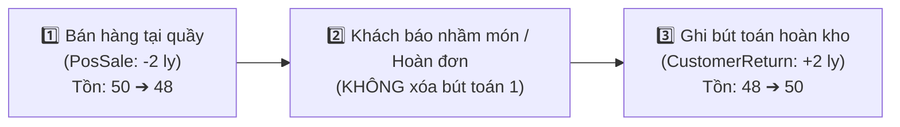

# 📜 Append-Only Data & Immutability Architecture - POS PWA Project

Tài liệu này quy định nguyên tắc **Dữ liệu chỉ nối thêm (Append-Only / Immutable Data Pattern)** cho các phân hệ tài chính, hóa đơn bán hàng và biến động tồn kho trong hệ thống **POS PWA (Point of Sale Progressive Web App)**. Tại môi trường bán lẻ và F&B, việc cho phép chỉnh sửa trực tiếp (`UPDATE`) hoặc xóa (`DELETE`) các bản ghi giao dịch đã hoàn tất không chỉ phá vỡ tính nhất quán của báo cáo doanh thu cuối ngày mà còn tạo ra lỗ hổng gian lận nội bộ. Thay vào đó, mọi sai sót sau khi chốt giao dịch đều được xử lý bằng cách **ghi thêm một bút toán bù trừ/đảo ngược (Compensating Record)** mới.

---

## 🎯 1. Phân loại bảng dữ liệu theo tính bất biến (Immutability Classification)

| Nhóm bảng dữ liệu | Chế độ thao tác cho phép | Quy tắc xử lý khi có sai sót / thay đổi |
| :--- | :--- | :--- |
| **Dữ liệu Sổ cái & Tài chính (Strictly Append-Only)**<br>• `inventory_transactions`<br>• `payments`<br>• `audit_logs` | Chỉ cho phép **`INSERT`**<br>(Cấm `UPDATE` & `DELETE`) | **Không bao giờ sửa hoặc xóa bản ghi cũ.** Nếu nhập sai số lượng tồn kho hoặc hoàn tiền hóa đơn, hệ thống chèn thêm một bản ghi mới mang dấu âm/dương tương ứng (`StockAdjustment`, `CustomerReturn`, `Refund`). |
| **Hóa đơn đã chốt (`orders` ở trạng thái `Completed`)** | Chỉ được chuyển trạng thái sang `Refunded` | Cấm sửa đổi danh sách món (`order_details`), đơn giá hoặc tổng tiền của hóa đơn đã thanh toán. Mọi điều chỉnh phải thông qua quy trình Hoàn tiền (`RefundOrderCommand`). |
| **Dữ liệu Danh mục & Trạng thái hiện hành (Mutable)**<br>• `products` (Tên, Giá bán, `stock_quantity`)<br>• `categories`, `users` | Cho phép `INSERT`, `UPDATE`<br>(Dùng Soft Delete `is_active = false`) | Khi đổi giá bán sản phẩm, cập nhật `products.price` cho các đơn tương lai, nhưng các đơn cũ trong `order_details` vẫn giữ nguyên giá trị snapshot tại thời điểm mua. |

---

## 🔄 2. Cơ chế Bù trừ Giao dịch (Compensating Transactions)

Thay vì xóa dấu vết, mọi nghiệp vụ điều chỉnh đều tạo ra một chuỗi lịch sử minh bạch dễ dàng kiểm toán:



### Lợi ích của mô hình Append-Only trong POS PWA:
1. **Truy vết kiểm toán tuyệt đối (Auditability):** Quản lý biết chính xác ai đã thực hiện giao dịch gốc, ai đã duyệt hoàn tiền/điều chỉnh kho, vào thời điểm nào và lý do cụ thể là gì.
2. **Tái dựng trạng thái quá khứ (Point-in-Time Reconstruction):** Hệ thống có thể tính chính xác số lượng tồn kho hoặc doanh thu thực tế tại bất kỳ mốc thời gian nào trong quá khứ (ví dụ: *Tồn kho lúc 14:00 ngày hôm qua là bao nhiêu?*) bằng cách cộng dồn các bút toán có `created_at <= mốc thời gian`.
3. **Đồng bộ Offline PWA an toàn:** Khi thiết bị thu ngân mất mạng và gửi lên các đơn hàng ngoại tuyến (`SyncOfflineOrders`), việc xử lý theo mô hình nối thêm giúp tránh xung đột ghi đè dữ liệu giữa các quầy.

---

## 🛡️ 3. Cưỡng chế tính bất biến đa tầng (Multi-Layer Enforcement)

Nguyên tắc Append-Only không chỉ là quy ước bằng lời nói mà được cưỡng chế bằng kỹ thuật ở cả **tầng Application (.NET 8 EF Core)** và **tầng Database (PostgreSQL 16)**:

### 3.1. Lớp 1: Chặn tại EF Core Interceptor (`ImmutableEntityInterceptor.cs`)
Triển khai `SaveChangesInterceptor` trong `PosPwa.Infrastructure` để tự động ném ngoại lệ nếu bất kỳ đoạn mã nào vô tình đánh dấu bản ghi `IMustBeImmutable` ở trạng thái `Modified` hoặc `Deleted`:

```csharp
using Microsoft.EntityFrameworkCore;
using Microsoft.EntityFrameworkCore.Diagnostics;
using PosPwa.Domain.Common;

public sealed class ImmutableEntityInterceptor : SaveChangesInterceptor
{
    public override ValueTask<InterceptionResult<int>> SavingChangesAsync(
        DbContextEventData eventData,
        InterceptionResult<int> result,
        CancellationToken cancellationToken = default)
    {
        var context = eventData.Context;
        if (context is null) return base.SavingChangesAsync(eventData, result, cancellationToken);

        foreach (var entry in context.ChangeTracker.Entries<IMustBeImmutable>())
        {
            if (entry.State is EntityState.Modified or EntityState.Deleted)
            {
                throw new InvalidOperationException(
                    $"Vi phạm quy tắc Append-Only: Thực thể '{entry.Entity.GetType().Name}' là bất biến, không được phép sửa hoặc xóa.");
            }
        }

        return base.SavingChangesAsync(eventData, result, cancellationToken);
    }
}
```

### 3.2. Lớp 2: Khóa cứng bằng PostgreSQL Trigger (Database-Level Guardrail)
Để ngăn chặn ngay cả các truy vấn SQL trực tiếp từ bên ngoài ứng dụng (hoặc thao tác nhầm của quản trị viên DB), PostgreSQL sử dụng Trigger từ chối mọi lệnh `UPDATE` và `DELETE` trên các bảng sổ cái:

```sql
-- Hàm Trigger chặn mọi thao tác UPDATE hoặc DELETE
CREATE OR REPLACE FUNCTION prevent_append_only_modification()
RETURNS TRIGGER AS $$
BEGIN
    RAISE EXCEPTION 'Vi phạm chính sách bảo mật: Bảng % là Append-Only, cấm thực hiện %!', TG_TABLE_NAME, TG_OP;
END;
$$ LANGUAGE plpgsql;

-- Áp dụng lên bảng sổ cái tồn kho và chứng từ thanh toán
CREATE TRIGGER trg_inventory_transactions_immutable
BEFORE UPDATE OR DELETE ON inventory_transactions
FOR EACH ROW EXECUTE FUNCTION prevent_append_only_modification();

CREATE TRIGGER trg_payments_immutable
BEFORE UPDATE OR DELETE ON payments
FOR EACH ROW EXECUTE FUNCTION prevent_append_only_modification();
```

---

## 🧹 4. Chiến lược Lưu trữ Dài hạn (Data Retention & Partitioning)

Vì các bảng Append-Only (`inventory_transactions`, `orders`, `audit_logs`) chỉ tăng trưởng về dung lượng theo thời gian:
* **Phân vùng bảng theo thời gian (Declarative Range Partitioning):** Khi dữ liệu vượt ngưỡng hàng triệu dòng, các bảng sổ cái được chia thành các phân vùng theo từng năm hoặc quý (`PARTITION BY RANGE (created_at)`) trên PostgreSQL 16 để giữ kích thước chỉ mục nhỏ gọn.
* **Lưu trữ lạnh (Cold Archival):** Dữ liệu giao dịch cũ hơn 2 năm có thể tách phân vùng sang vùng lưu trữ lịch sử mà không làm ảnh hưởng đến tốc độ quét mã vạch và thanh toán tại quầy POS hiện tại.

---
