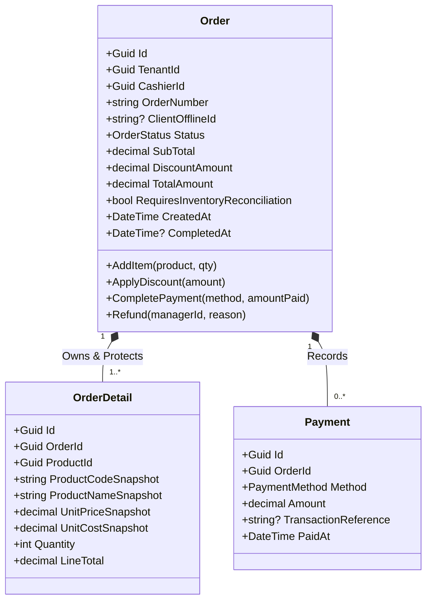

# 🧾 Canonical Order Model (Order Aggregate Root) - POS PWA Project

Tài liệu này quy định mô hình chuẩn hóa của thực thể **Đơn hàng (`Order` Aggregate Root)** trong hệ thống **POS PWA (Point of Sale Progressive Web App)** theo chuẩn **Domain-Driven Design (DDD)**. Mô hình này đóng gói toàn bộ quy tắc tính toán tài chính, lưu trữ ảnh chụp dữ liệu tại thời điểm giao dịch (**Transaction Snapshots**), hỗ trợ định danh đồng bộ ngoại tuyến (**Offline Idempotency Key**) và bảo vệ tính bất biến của hóa đơn sau khi đã thanh toán.

---

## 🏗️ 1. Cấu trúc Aggregate Root & ranh giới nhất quán (Aggregate Boundary)

Trong mô hình DDD, **`Order`** là **Aggregate Root** quản lý vòng đời của các thực thể con **`OrderDetail`** (chi tiết từng món) và **`Payment`** (giao dịch thanh toán). Mọi thao tác thêm món, áp dụng chiết khấu, thanh toán hay hoàn tiền đều bắt buộc phải đi qua các phương thức hành vi của `Order`, tuyệt đối không chỉnh sửa trực tiếp `OrderDetail` từ bên ngoài.



---

## 📸 2. Nguyên tắc Ảnh chụp Dữ liệu (Transaction Snapshots)

Để đảm bảo hóa đơn đã in cho khách hàng và báo cáo doanh thu/lợi nhuận lịch sử không bao giờ bị sai lệch khi Quản lý đổi tên món, đổi giá bán hoặc nhập lô hàng mới có giá vốn khác:

| Thuộc tính trên `OrderDetail` | Nguồn sao chép tại thời điểm chốt đơn | Mục đích bảo toàn dữ liệu |
| :--- | :--- | :--- |
| **`ProductCodeSnapshot`** | `product.Code` | Giữ nguyên mã SKU gốc ngay cả khi sản phẩm bị đổi mã hoặc ngừng kinh doanh. |
| **`ProductNameSnapshot`** | `product.Name` | Đảm bảo khi in lại hóa đơn cũ vẫn hiển thị đúng tên món khách đã mua lúc đó. |
| **`UnitPriceSnapshot`** | `product.Price` | Cố định đơn giá bán tại thời điểm giao dịch, không bị ảnh hưởng bởi các đợt tăng/giảm giá sau này. |
| **`UnitCostSnapshot`** | `product.AverageCost` (WAC) | Cố định giá vốn bình quân gia quyền lúc bán để tính chính xác **Lợi nhuận gộp (Gross Profit)** theo từng đơn. |

---

## 📶 3. Hỗ trợ Đồng bộ Ngoại tuyến (`ClientOfflineId` - Idempotency)

Khi quầy thu ngân mất kết nối Internet, ứng dụng **React PWA** tự sinh một mã định danh duy nhất phía client (`ClientOfflineId` — định dạng UUID v4) và lưu đơn hàng vào `IndexedDB`.
* Khi mạng phục hồi, nếu kết nối chập chờn khiến PWA gửi trùng gói tin đồng bộ 2 lần, Backend kiểm tra chỉ mục duy nhất **`UNIQUE (tenant_id, client_offline_id)`** trên PostgreSQL để nhận diện đơn đã tồn tại và trả về kết quả thành công ngay lập tức (**Idempotent Response**), triệt tiêu lỗi tạo trùng hóa đơn và trừ kho 2 lần.

---

## 💻 4. Triển khai mã nguồn `Order.cs` (`PosPwa.Domain/Entities/Order.cs`)

```csharp
public sealed class Order : AggregateRoot, IMustHaveTenant
{
    private readonly List<OrderDetail> _items = new();
    private readonly List<Payment> _payments = new();

    public Guid TenantId { get; private set; }
    public Guid CashierId { get; private set; }
    public string OrderNumber { get; private set; }
    public string? ClientOfflineId { get; private set; }
    public OrderStatus Status { get; private set; }
    public decimal SubTotal { get; private set; }
    public decimal DiscountAmount { get; private set; }
    public decimal TotalAmount { get; private set; }
    public bool RequiresInventoryReconciliation { get; private set; }
    public DateTime CreatedAt { get; private set; }
    public DateTime? CompletedAt { get; private set; }

    public IReadOnlyCollection<OrderDetail> Items => _items.AsReadOnly();
    public IReadOnlyCollection<Payment> Payments => _payments.AsReadOnly();

    private Order() { }

    public static Order Create(
        Guid tenantId,
        Guid cashierId,
        string orderNumber,
        string? clientOfflineId = null)
    {
        return new Order
        {
            Id = Guid.NewGuid(),
            TenantId = tenantId,
            CashierId = cashierId,
            OrderNumber = orderNumber,
            ClientOfflineId = clientOfflineId,
            Status = OrderStatus.Draft,
            SubTotal = 0m,
            DiscountAmount = 0m,
            TotalAmount = 0m,
            CreatedAt = DateTime.UtcNow
        };
    }

    public void AddItem(Product product, int quantity)
    {
        EnsureIsModifiable();

        if (quantity <= 0)
            throw new DomainException("Số lượng món phải lớn hơn 0.");

        var existingItem = _items.FirstOrDefault(x => x.ProductId == product.Id);
        if (existingItem is not null)
        {
            existingItem.IncreaseQuantity(quantity);
        }
        else
        {
            _items.Add(OrderDetail.Create(
                orderId: Id,
                productId: product.Id,
                productCode: product.Code,
                productName: product.Name,
                unitPrice: product.Price,
                unitCost: product.AverageCost,
                quantity: quantity));
        }

        RecalculateTotals();
    }

    public void ApplyDiscount(decimal discountAmount)
    {
        EnsureIsModifiable();

        if (discountAmount < 0)
            throw new DomainException("Số tiền chiết khấu không được âm.");

        if (discountAmount > SubTotal)
            throw new DomainException("Chiết khấu không được vượt quá tổng tiền hàng.");

        DiscountAmount = discountAmount;
        RecalculateTotals();
    }

    public void CompletePayment(PaymentMethod method, decimal amountPaid, string? reference = null)
    {
        if (Status is not (OrderStatus.Draft or OrderStatus.PendingPayment))
            throw new DomainException($"Không thể thanh toán đơn hàng đang ở trạng thái {Status}.");

        if (_items.Count == 0)
            throw new DomainException("Đơn hàng phải có ít nhất một sản phẩm trước khi thanh toán.");

        if (amountPaid < TotalAmount)
            throw new DomainException("Số tiền thanh toán chưa đủ tổng giá trị đơn hàng.");

        _payments.Add(Payment.Create(Id, method, TotalAmount, reference));
        Status = OrderStatus.Completed;
        CompletedAt = DateTime.UtcNow;

        AddDomainEvent(new OrderCompletedDomainEvent(TenantId, Id, OrderNumber, TotalAmount));
    }

    public void MarkInventoryConflict() => RequiresInventoryReconciliation = true;

    private void RecalculateTotals()
    {
        SubTotal = _items.Sum(x => x.LineTotal);
        TotalAmount = Math.Max(0m, SubTotal - DiscountAmount);
    }

    private void EnsureIsModifiable()
    {
        if (Status != OrderStatus.Draft)
            throw new DomainException("Chỉ được phép chỉnh sửa danh sách món khi đơn hàng đang ở trạng thái Nháp (Draft).");
    }
}
```

---
