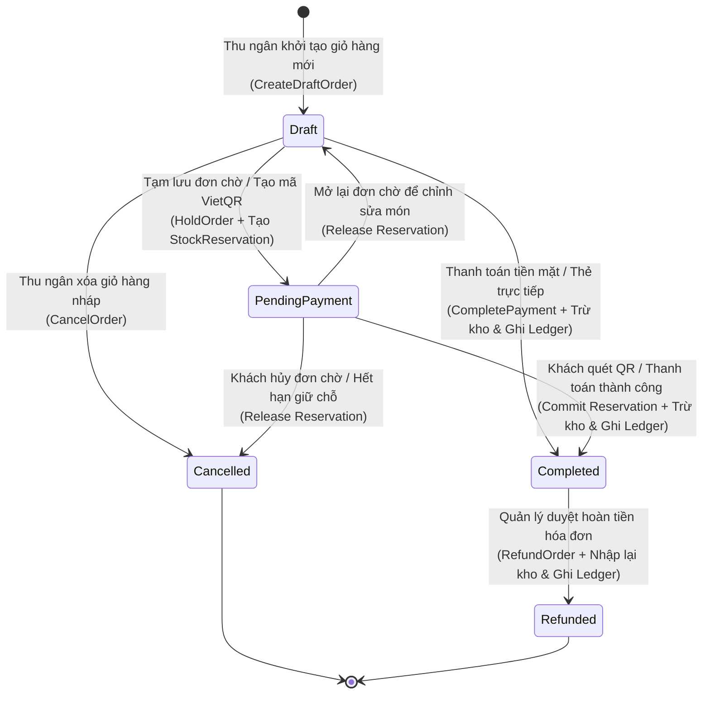

# ⚙️ Order State Machine (Máy Trạng Thái Đơn Hàng) - POS PWA Project

Tài liệu này quy định **Máy trạng thái hữu hạn (Finite State Machine - FSM)** điều phối toàn bộ vòng đời của một đơn hàng (`OrderStatus`) trong hệ thống **POS PWA (Point of Sale Progressive Web App)**. Việc kiểm soát chặt chẽ các bước chuyển trạng thái hợp lệ ngay bên trong Domain Entity giúp ngăn chặn triệt để các lỗi nghiệp vụ nghiêm trọng như: thanh toán trùng lặp một đơn hàng hai lần, hủy đơn hàng đã thu tiền, hoặc hoàn tiền cho một đơn hàng chưa từng thanh toán.

---

## 🔄 1. Sơ đồ Chuyển đổi Trạng thái (State Transition Diagram)



---

## 📋 2. Bảng Quy tắc Chuyển đổi & Tác động Tồn kho / Tài chính

| Trạng thái nguồn (`From`) | Trạng thái đích (`To`) | Hành động kích hoạt | Quyền hạn | Tác động tới Tồn kho & Sổ cái (`Ledger`) |
| :--- | :--- | :--- | :---: | :--- |
| *(Khởi tạo)* | **`Draft`** | Tạo đơn mới tại quầy | `Cashier`, `Manager` | Không tác động tồn kho. |
| **`Draft`** | **`PendingPayment`** | Giữ đơn (`Hold`) hoặc tạo mã VietQR | `Cashier`, `Manager` | Tạo phiếu giữ chỗ **`StockReservation` (`Active`)** làm giảm `AvailableQuantity`. |
| **`Draft`** | **`Completed`** | Thu ngân bấm Thanh toán ngay | `Cashier`, `Manager` | Khóa dòng `FOR UPDATE`, trừ `OnHandQuantity`, ghi bút toán **`PosSale` (`-Q`)**. |
| **`Draft`** | **`Cancelled`** | Hủy giỏ hàng nháp | `Cashier`, `Manager` | Không tác động tồn kho. |
| **`PendingPayment`** | **`Completed`** | Xác nhận đã nhận tiền thanh toán | `Cashier`, `Manager` | Chuyển `StockReservation` sang `Committed`, trừ `OnHandQuantity`, ghi **`PosSale` (`-Q`)**. |
| **`PendingPayment`** | **`Cancelled`** | Hủy đơn chờ hoặc hết hạn TTL | `Cashier`, `Manager` / System | Giải phóng `StockReservation` (`Released`/`Expired`), trả lại `AvailableQuantity`. |
| **`Completed`** | **`Refunded`** | Duyệt hoàn tiền hóa đơn | **Chỉ `Manager`** | Ghi bút toán **`CustomerReturn` (`+Q`)** nhập lại kho & ghi nhận giao dịch hoàn tiền. |

---

## 🚫 3. Các chuyển đổi bị cấm tuyệt đối (Illegal Transitions)

Hệ thống từ chối ngay lập tức bằng ngoại lệ nghiệp vụ **`DomainException` (`HTTP 400 Bad Request`)** đối với mọi yêu cầu vi phạm đồ thị trạng thái:
1. **`Completed` $\rightarrow$ `Draft` / `Cancelled`:** Hóa đơn đã hoàn tất thu tiền và xuất biên lai là chứng từ tài chính bất biến; không bao giờ được quay ngược về nháp hay xóa bỏ.
2. **`Refunded` $\rightarrow$ Bất kỳ trạng thái nào:** Trạng thái `Refunded` là trạng thái kết thúc (**Terminal State**). Nếu khách đổi ý muốn mua lại, thu ngân phải lập một đơn hàng mới hoàn toàn.
3. **`Cancelled` $\rightarrow$ Bất kỳ trạng thái nào:** Đơn đã hủy không thể khôi phục thanh toán.
4. **`Draft` $\rightarrow$ `Refunded`:** Không thể hoàn tiền cho đơn hàng chưa từng phát sinh thanh toán.

---

## 💻 4. Triển khai State Machine trong `Order.cs` (.NET 8)

Toàn bộ logic chuyển trạng thái và hoàn tiền được đóng gói an toàn trong thực thể `Order`:

```csharp
public enum OrderStatus
{
    Draft = 1,
    PendingPayment = 2,
    Completed = 3,
    Cancelled = 4,
    Refunded = 5
}

// Phương thức xử lý chuyển trạng thái bên trong Order Aggregate Root:
public void Cancel(string? reason = null)
{
    if (Status is not (OrderStatus.Draft or OrderStatus.PendingPayment))
    {
        throw new DomainException(
            $"Không thể hủy đơn hàng ở trạng thái '{Status}'. Chỉ đơn Nháp hoặc Chờ thanh toán mới được phép hủy.");
    }

    Status = OrderStatus.Cancelled;
    AddDomainEvent(new OrderCancelledDomainEvent(TenantId, Id, reason));
}

public void Refund(Guid managerId, string reason)
{
    if (Status != OrderStatus.Completed)
    {
        throw new DomainException(
            $"Chỉ được phép hoàn tiền cho đơn hàng đã hoàn tất (Completed). Trạng thái hiện tại: '{Status}'.");
    }

    if (string.IsNullOrWhiteSpace(reason))
        throw new DomainException("Bắt buộc phải nhập lý do hoàn tiền hóa đơn.");

    Status = OrderStatus.Refunded;
    AddDomainEvent(new OrderRefundedDomainEvent(TenantId, Id, managerId, reason.Trim()));
}
```

### Quy trình xử lý hoàn tiền (`RefundOrderCommandHandler`)
Khi Quản lý kích hoạt `POST /api/v1/orders/{id}/refund`:
1. Mở **Database Transaction** thông qua `IUnitOfWork`.
2. Gọi `order.Refund(managerId, reason)` để chuyển trạng thái đơn từ `Completed` sang `Refunded` (được bảo vệ bởi **Optimistic Locking `xmin`** để chống hai quản lý duyệt hoàn tiền trùng nhau).
3. Khóa dòng (`FOR UPDATE`) các sản phẩm có trong `order.Items`, cộng trả lại số lượng vào `Product.StockQuantity` và ghi nhận bút toán **`CustomerReturn` (`+Q`)** vào bảng `inventory_transactions`.
4. Ghi nhận bản ghi hoàn tiền âm vào bảng `payments` để cân đối quỹ tiền mặt/chuyển khoản cuối ca của thu ngân.

---
