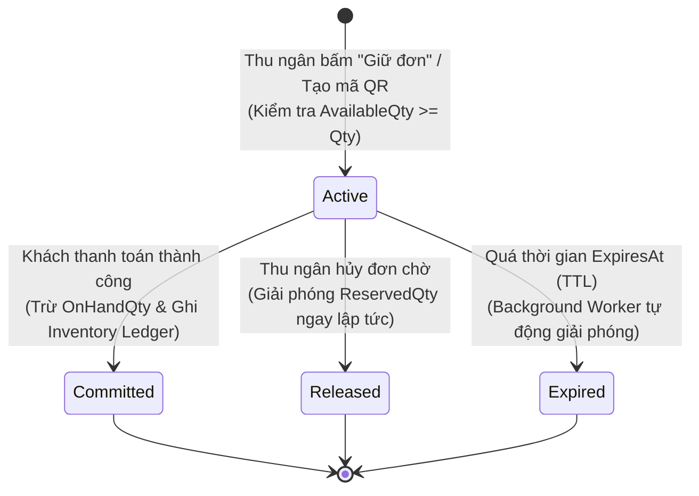

# ⏳ Stock Reservation Architecture (Giữ chỗ Tồn kho Tạm thời) - POS PWA Project

Tài liệu này quy định cơ chế **Giữ chỗ tồn kho tạm thời (Stock Reservation / Soft Allocation)** cho hệ thống **POS PWA (Point of Sale Progressive Web App)**. Tại quầy thu ngân hoặc mô hình phục vụ tại bàn (F&B / Bán lẻ có giữ đơn chờ), khách hàng thường gọi món trước và thanh toán sau, hoặc thu ngân tạm lưu đơn nháp (`Draft` / `Hold Order`) để phục vụ khách kế tiếp. Cơ chế giữ chỗ tồn kho đảm bảo lượng hàng hóa trong các đơn chờ thanh toán không bị quầy khác bán nhầm, đồng thời tự động giải phóng tồn kho nếu đơn chờ quá hạn hoặc bị hủy.

---

## ⚖️ 1. Phân biệt Các trạng thái Tồn kho (Inventory Stock Metrics)

Thay vì chỉ nhìn vào một con số tồn kho duy nhất, hệ thống phân tách rõ ràng **3 chỉ số tồn kho** cho từng sản phẩm để kiểm soát chính xác hàng hóa tại quầy:

| Chỉ số tồn kho | Công thức tính toán | Ý nghĩa nghiệp vụ tại quầy POS |
| :--- | :--- | :--- |
| **Tồn kho vật lý (`OnHandQuantity`)** | Lưu trên cột `products.stock_quantity` | Tổng số lượng hàng hóa thực tế đang nằm trong kho/kệ của cửa hàng (chỉ giảm khi đơn đã hoàn tất thanh toán `Completed`). |
| **Tồn kho đang giữ chỗ (`ReservedQuantity`)** | $\sum \text{Quantity}$ các đơn `StockReservation` ở trạng thái `Active` | Tổng số lượng hàng hóa đang nằm trong các đơn chờ thanh toán (`Hold Order` / `VietQR Pending`) chưa hết hạn. |
| **Tồn kho khả dụng (`AvailableQuantity`)** | $\text{OnHandQuantity} - \text{ReservedQuantity}$ | **Số lượng thực tế được phép mở bán** cho khách hàng mới tại các quầy thu ngân. |

> **Quy tắc bất biến (Invariant):** Tại mọi thời điểm, hệ thống luôn đảm bảo:
> $$\text{AvailableQuantity} = \text{OnHandQuantity} - \text{ReservedQuantity} \ge 0$$

---

## 🔄 2. Vòng đời của một Phiếu giữ chỗ (`StockReservation`)

Cơ chế giữ chỗ tồn kho được kích hoạt cho hai kịch bản thực tế tại quầy POS:
1. **Giữ đơn chờ thanh toán (`Hold Order`):** Thu ngân tạm lưu giỏ hàng của khách đang chọn thêm đồ (thời hạn giữ chỗ mặc định: **15 phút**).
2. **Chờ xác nhận chuyển khoản VietQR / Thẻ (`Payment Pending`):** Khóa tạm số lượng món trong lúc chờ khách quét mã QR thanh toán (thời hạn giữ chỗ mặc định: **5 phút**).



---

## 🗄️ 3. Thiết kế bảng `stock_reservations` (PostgreSQL 16)

```sql
CREATE TABLE stock_reservations (
    id uuid PRIMARY KEY,
    tenant_id uuid NOT NULL REFERENCES tenants(id),
    order_id uuid NOT NULL REFERENCES orders(id) ON DELETE CASCADE,
    product_id uuid NOT NULL REFERENCES products(id) ON DELETE RESTRICT,
    quantity integer NOT NULL CHECK (quantity > 0),
    status varchar(20) NOT NULL, -- 'Active', 'Committed', 'Released', 'Expired'
    expires_at timestamptz NOT NULL,
    created_at timestamptz NOT NULL,
    resolved_at timestamptz NULL
);

-- Tối ưu tính tổng số lượng đang giữ chỗ theo từng sản phẩm trong cửa hàng
CREATE INDEX ix_stock_reservations_active_product 
ON stock_reservations (tenant_id, product_id) 
WHERE status = 'Active';

-- Tối ưu cho Background Service quét các phiếu giữ chỗ đã hết hạn (TTL)
CREATE INDEX ix_stock_reservations_expires_at 
ON stock_reservations (expires_at) 
WHERE status = 'Active';
```

---

## 💻 4. Triển khai kỹ thuật trong .NET 8

### 4.1. Thực thể `StockReservation` (`PosPwa.Domain/Entities/StockReservation.cs`)
```csharp
public sealed class StockReservation : Entity, IMustHaveTenant
{
    public Guid TenantId { get; private set; }
    public Guid OrderId { get; private set; }
    public Guid ProductId { get; private set; }
    public int Quantity { get; private set; }
    public ReservationStatus Status { get; private set; }
    public DateTime ExpiresAt { get; private set; }
    public DateTime CreatedAt { get; private set; }
    public DateTime? ResolvedAt { get; private set; }

    private StockReservation() { }

    public static StockReservation Create(
        Guid tenantId,
        Guid orderId,
        Guid productId,
        int quantity,
        TimeSpan duration)
    {
        if (quantity <= 0)
            throw new DomainException("Số lượng giữ chỗ phải lớn hơn 0.");

        var now = DateTime.UtcNow;
        return new StockReservation
        {
            Id = Guid.NewGuid(),
            TenantId = tenantId,
            OrderId = orderId,
            ProductId = productId,
            Quantity = quantity,
            Status = ReservationStatus.Active,
            CreatedAt = now,
            ExpiresAt = now.Add(duration)
        };
    }

    public void Commit()
    {
        if (Status != ReservationStatus.Active)
            throw new DomainException("Chỉ có thể xác nhận phiếu giữ chỗ đang ở trạng thái Active.");

        Status = ReservationStatus.Committed;
        ResolvedAt = DateTime.UtcNow;
    }

    public void Release(bool isExpired = false)
    {
        if (Status != ReservationStatus.Active)
            return;

        Status = isExpired ? ReservationStatus.Expired : ReservationStatus.Released;
        ResolvedAt = DateTime.UtcNow;
    }
}
```

### 4.2. Tự động thu hồi giữ chỗ quá hạn (`ExpiredReservationCleanupWorker`)
Sử dụng **`BackgroundService`** tích hợp sẵn trong **.NET 8** chạy định kỳ mỗi **30 giây** để tìm và giải phóng các phiếu giữ chỗ đã quá thời hạn (`expires_at <= NOW()`), giúp hàng hóa tự động quay trở lại trạng thái khả dụng cho các quầy khác mà không cần thu ngân thao tác thủ công:

```csharp
public sealed class ExpiredReservationCleanupWorker : BackgroundService
{
    private readonly IServiceScopeFactory _scopeFactory;
    private readonly ILogger<ExpiredReservationCleanupWorker> _logger;

    public ExpiredReservationCleanupWorker(
        IServiceScopeFactory scopeFactory,
        ILogger<ExpiredReservationCleanupWorker> logger)
    {
        _scopeFactory = scopeFactory;
        _logger = logger;
    }

    protected override async Task ExecuteAsync(CancellationToken stoppingToken)
    {
        using var timer = new PeriodicTimer(TimeSpan.FromSeconds(30));

        while (await timer.WaitForNextTickAsync(stoppingToken))
        {
            try
            {
                using var scope = _scopeFactory.CreateScope();
                var dbContext = scope.ServiceProvider.GetRequiredService<AppDbContext>();

                var now = DateTime.UtcNow;

                // Sử dụng ExecuteUpdateAsync của EF Core 8 để giải phóng hàng loạt siêu tốc
                // Lưu ý: IgnoreQueryFilters() vì Background Worker chạy ngoài ngữ cảnh HTTP Request
                var expiredCount = await dbContext.StockReservations
                    .IgnoreQueryFilters()
                    .Where(r => r.Status == ReservationStatus.Active && r.ExpiresAt <= now)
                    .ExecuteUpdateAsync(setters => setters
                        .SetProperty(r => r.Status, ReservationStatus.Expired)
                        .SetProperty(r => r.ResolvedAt, now),
                        stoppingToken);

                if (expiredCount > 0)
                {
                    _logger.LogInformation("Đã tự động giải phóng {Count} phiếu giữ chỗ tồn kho quá hạn.", expiredCount);
                }
            }
            catch (Exception ex)
            {
                _logger.LogError(ex, "Lỗi khi chạy tác vụ dọn dẹp giữ chỗ tồn kho quá hạn.");
            }
        }
    }
}
```

---

## 📱 5. Quy tắc đối với Chế độ Ngoại tuyến (Offline PWA Mode)

* **Chỉ áp dụng Stock Reservation khi trực tuyến (Online):** Cơ chế giữ chỗ tồn kho thời gian thực yêu cầu sự đồng bộ giữa các quầy qua máy chủ trung tâm nên chỉ kích hoạt khi thiết bị POS có kết nối mạng.
* **Khi mất kết nối Internet (Offline Mode):** Ứng dụng PWA dựa vào bản sao `AvailableQuantity` được lưu trong `IndexedDB` tại thời điểm mất mạng gần nhất để cảnh báo thu ngân nếu số lượng chọn vượt quá tồn kho ước tính, và thực hiện đối soát tồn kho cuối cùng khi đồng bộ đơn lên máy chủ.

---
