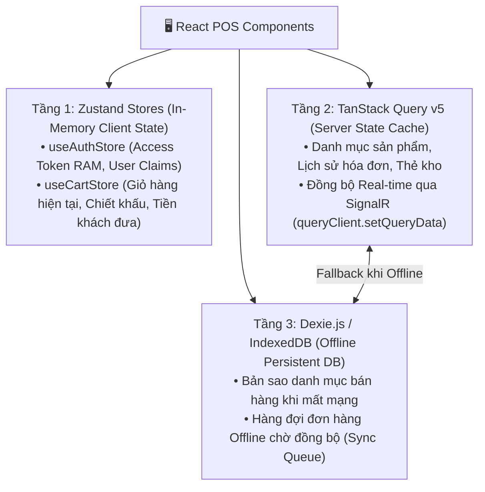

# 🧠 Multi-Layer State Management Architecture - POS PWA Project

Tài liệu này quy định kiến trúc quản lý trạng thái 3 tầng (**3-Layer State Management**) cho ứng dụng **React PWA** trong hệ thống **POS PWA (Point of Sale Progressive Web App)**. Thay vì nhồi nhét toàn bộ dữ liệu vào một kho lưu trữ duy nhất (như Redux truyền thống dễ gây phình to và chậm re-render), hệ thống phân tách rõ ràng trạng thái theo vòng đời và bản chất lưu trữ: **Client UI/Cart State (Zustand)**, **Server Cache State (TanStack Query v5)** và **Offline Persistent Storage (IndexedDB / Dexie.js)**.

---

## 🏗️ 1. Kiến trúc Phân tầng Trạng thái (3-Layer State Separation)



| Tầng trạng thái | Công nghệ sử dụng | Phạm vi lưu trữ | Dữ liệu quản lý |
| :--- | :--- | :--- | :--- |
| **1. Client / Ephemeral State** | **Zustand** | Bộ nhớ RAM (In-Memory) | Phiên đăng nhập (`AccessToken` RAM), giỏ hàng đang thao tác tại quầy (`Cart`), trạng thái mở modal, từ khóa lọc nhanh. |
| **2. Server Cache State** | **TanStack Query v5** | In-Memory Cache + Stale-While-Revalidate | Danh sách sản phẩm (`['products', tenantId]`), danh mục, lịch sử đơn hàng, báo cáo doanh thu. |
| **3. Offline Persistent State** | **Dexie.js (IndexedDB)** | Ổ cứng thiết bị (Trình duyệt PWA) | Bản sao bảng `products` phục vụ quét mã khi mất mạng; bảng `offlineOrdersQueue` lưu hóa đơn tạo lúc Offline. |

---

## ⚡ 2. Tầng 1: Quản lý Giỏ hàng & Phiên làm việc với Zustand

### 2.1. `useAuthStore.ts` (Bảo mật Token trong RAM)
Lưu trữ `accessToken` và thông tin nhân viên giải mã từ JWT chỉ trong bộ nhớ RAM (không dùng `persist` middleware xuống `localStorage` để chống tấn công XSS):

```typescript
import { create } from 'zustand';

export interface AuthUser {
  id: string;
  tenantId: string;
  username: string;
  fullName: string;
  role: 'Cashier' | 'Manager';
}

interface AuthState {
  accessToken: string | null;
  user: AuthUser | null;
  isAuthenticated: boolean;
  setSession: (accessToken: string, user: AuthUser) => void;
  clearSession: () => void;
}

export const useAuthStore = create<AuthState>((set) => ({
  accessToken: null,
  user: null,
  isAuthenticated: false,
  setSession: (accessToken, user) =>
    set({ accessToken, user, isAuthenticated: true }),
  clearSession: () =>
    set({ accessToken: null, user: null, isAuthenticated: false }),
}));
```

### 2.2. `useCartStore.ts` (Tối ưu hóa thao tác tại quầy POS)
Hỗ trợ lưu giữ nhiều giỏ hàng song song (**Multi-Tab / Hold Carts**) để thu ngân có thể tạm giữ đơn của khách A và phục vụ ngay khách B:

```typescript
import { create } from 'zustand';
import type { ProductDto } from '@/types/product.types';

export interface CartItem {
  productId: string;
  code: string;
  name: string;
  unitPrice: number;
  quantity: number;
  maxAvailable: number;
}

interface CartState {
  items: CartItem[];
  discountAmount: number;
  note: string;
  addItem: (product: ProductDto) => void;
  updateQuantity: (productId: string, quantity: number) => void;
  removeItem: (productId: string) => void;
  setDiscount: (amount: number) => void;
  clearCart: () => void;
}

export const useCartStore = create<CartState>((set) => ({
  items: [],
  discountAmount: 0,
  note: '',

  addItem: (product) =>
    set((state) => {
      if (product.availableQuantity <= 0) return state;

      const existing = state.items.find((i) => i.productId === product.id);
      if (existing) {
        if (existing.quantity >= product.availableQuantity) return state;
        return {
          items: state.items.map((i) =>
            i.productId === product.id ? { ...i, quantity: i.quantity + 1 } : i
          ),
        };
      }

      return {
        items: [
          ...state.items,
          {
            productId: product.id,
            code: product.code,
            name: product.name,
            unitPrice: product.price,
            quantity: 1,
            maxAvailable: product.availableQuantity,
          },
        ],
      };
    }),

  updateQuantity: (productId, quantity) =>
    set((state) => ({
      items:
        quantity <= 0
          ? state.items.filter((i) => i.productId !== productId)
          : state.items.map((i) =>
              i.productId === productId
                ? { ...i, quantity: Math.min(quantity, i.maxAvailable) }
                : i
            ),
    })),

  removeItem: (productId) =>
    set((state) => ({
      items: state.items.filter((i) => i.productId !== productId),
    })),

  setDiscount: (discountAmount) => set({ discountAmount: Math.max(0, discountAmount) }),

  clearCart: () => set({ items: [], discountAmount: 0, note: '' }),
}));
```

---

## 🔄 3. Tầng 2: Quản lý Server State với TanStack Query v5 & SignalR

* **Quy chuẩn Query Keys (`src/lib/queryKeys.ts`):** Toàn bộ Query Key bắt buộc chứa `tenantId` để đảm bảo nếu thu ngân đăng xuất cửa hàng A và đăng nhập cửa hàng B trên cùng trình duyệt, dữ liệu cache không bao giờ bị hiển thị nhầm lẫn:
  ```typescript
  export const posQueryKeys = {
    products: (tenantId: string) => ['products', tenantId] as const,
    orders: (tenantId: string, page: number) => ['orders', tenantId, page] as const,
    stockCard: (tenantId: string, productId: string) => ['stock-card', tenantId, productId] as const,
  };
  ```
* **Cập nhật Cache tức thì qua SignalR (Zero-Fetch Real-time Sync):** Khi nhận được sự kiện `StockUpdated` từ máy chủ, ứng dụng cập nhật thẳng vào bộ nhớ đệm của TanStack Query mà không cần gọi lại API `GET /products`:
  ```typescript
  queryClient.setQueryData<ProductDto[]>(
    posQueryKeys.products(tenantId),
    (oldProducts) =>
      oldProducts?.map((p) =>
        p.id === event.productId
          ? { ...p, stockQuantity: event.newStockQuantity, availableQuantity: event.newAvailableQuantity }
          : p
      )
  );
  ```

---

## 💾 4. Tầng 3: Lưu trữ Ngoại tuyến theo Tenant (`Dexie.js` / `IndexedDB`)

Mỗi cửa hàng (`tenantId`) được cô lập trong một cơ sở dữ liệu `IndexedDB` riêng biệt (`PosPwaOfflineDb_${tenantId}`):
* Mỗi khi tải danh sách sản phẩm từ API thành công, ứng dụng tự động đồng bộ bản sao mới nhất xuống bảng `cachedProducts` của Dexie.
* Khi mất kết nối mạng (`navigator.onLine === false`), hook `useProducts()` tự động chuyển sang đọc dữ liệu từ `IndexedDB` để quầy thu ngân tiếp tục bán hàng không gián đoạn.

---
