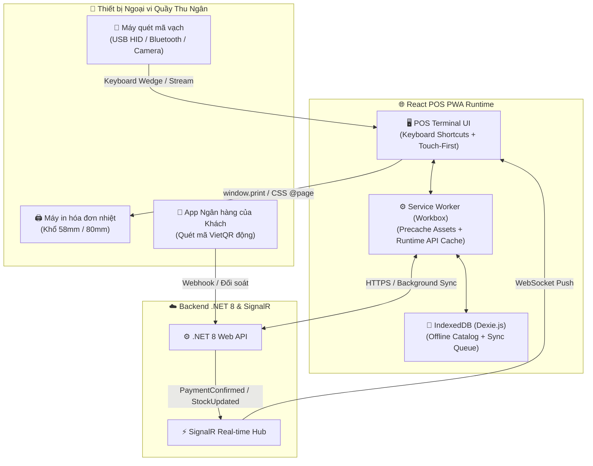

# 📱 Progressive Web App (PWA) & POS Hardware Integration - POS PWA Project

Thư mục này tổng hợp toàn bộ tài liệu thiết kế kiến trúc **Progressive Web App (PWA)**, khả năng vận hành ngoại tuyến (**Offline-First Resilience**) và tích hợp phần cứng ngoại vi tại quầy thu ngân (**POS Peripherals & Ergonomics**) cho hệ thống **POS PWA (Point of Sale Progressive Web App)**. Mục tiêu cốt lõi là biến một ứng dụng web chạy trên trình duyệt trở thành một phần mềm bán hàng chuyên dụng: cài đặt được lên màn hình chính như ứng dụng gốc (**Installable Native-Like App**), miễn nhiễm với sự cố rớt mạng Internet, giao tiếp trực tiếp với máy quét mã vạch, máy in nhiệt và hệ thống thanh toán chuyển khoản động **VietQR**.

---

## 📂 Cấu trúc thư mục `08-pwa-pos/`

```text
08-pwa-pos/
├── README.md                   # Tổng quan kiến trúc PWA & Tích hợp phần cứng quầy thu ngân
├── progressive-web-app.md      # Cấu hình Web App Manifest, Chuẩn cài đặt & Lifecycle cập nhật
├── service-worker.md           # Chiến lược Caching (Workbox) & Background Sync đồng bộ đơn Offline
├── barcode-scanning.md         # Giao tiếp máy quét mã vạch HID/USB & Camera Quét mã (BarcodeDetector)
├── keyboard-shortcuts.md       # Hệ thống phím tắt tốc độ cao (Zero-Mouse Operation) cho thu ngân
├── browser-printing.md         # Cơ chế in hóa đơn nhiệt tự động (Silent/Direct Print & ESC/POS)
├── qr-payment-flow.md          # Luồng thanh toán VietQR động & Xác nhận biến động số dư qua SignalR
└── pos-usability.md            # Quy chuẩn công thái học (Ergonomics), Phản hồi âm thanh & UX quầy POS
```

---

## 🏗️ Kiến trúc Tổng thể Lớp PWA & Phần cứng Ngoại vi



---

## 🎯 Các cam kết chất lượng vận hành tại quầy (POS SLA Targets)

| Chỉ số vận hành | Mục tiêu thiết kế | Giải pháp kỹ thuật áp dụng |
| :--- | :--- | :--- |
| **Thời gian khởi động lạnh (Cold Boot)** | **$< 1.5\text{ giây}$** (kể cả khi mất mạng) | Precache toàn bộ JS/CSS/Fonts cục bộ qua **Service Worker**. |
| **Độ trễ quét mã vạch $\rightarrow$ Thêm giỏ** | **$< 50\text{ ms}$** | Tra cứu trực tiếp trên bộ nhớ RAM / IndexedDB + phát âm thanh Web Audio API. |
| **Khả năng chịu lỗi mạng (Offline Continuity)** | **100% thời gian hoạt động** | Lưu đơn ngoại tuyến vào `IndexedDB` và tự động đồng bộ nền khi có mạng. |
| **Xác nhận thanh toán VietQR** | **$< 2\text{ giây}$** sau khi khách chuyển khoản | Webhook ngân hàng kích hoạt sự kiện SignalR tự động đóng modal & in bill. |

---
