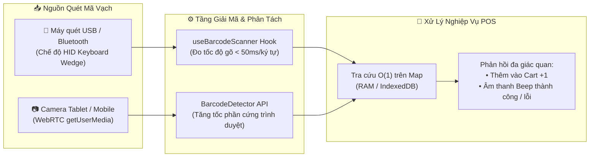

# 🔫 Barcode Scanning Architecture (HID Scanner & Camera API) - POS PWA Project

Tài liệu này quy định kiến trúc tích hợp giải mã mã vạch (**1D EAN-13, UPC-A, Code-128** và **2D QR Code**) cho hệ thống **POS PWA (Point of Sale Progressive Web App)**. Tại quầy thu ngân bán lẻ hoặc cửa hàng tiện lợi, tốc độ quét sản phẩm quyết định trực tiếp thời gian thanh toán của khách hàng. Hệ thống hỗ trợ đồng thời hai phương thức quét linh hoạt mà không cần cài đặt driver phức tạp: **Máy quét mã vạch cầm tay USB/Bluetooth (Keyboard Wedge HID)** và **Camera tích hợp trên thiết bị di động/máy tính bảng (Native `BarcodeDetector` API + Fallback)**.

---

## 🏗️ 1. Kiến trúc Đa phương thức Quét mã vạch (Dual-Mode Barcode Input)



---

## ⌨️ 2. Phương thức 1: Máy quét Cầm tay HID (USB / Bluetooth Scanner)

Hầu hết các máy quét mã vạch chuyên dụng trên thị trường (Zebra, Honeywell, Datalogic, Symcode...) mặc định hoạt động ở chế độ **HID Keyboard Emulation**: khi bóp cò quét, thiết bị gửi liên tiếp chuỗi ký tự mã vạch với tốc độ cực nhanh ($5–20\text{ms}$ mỗi ký tự) và kết thúc bằng phím `Enter` (`\r` hoặc `\n`).

### 2.1. Thuật toán phân biệt Quét mã vạch vs. Gõ phím thủ công (`useBarcodeScanner.ts`)
Để thu ngân có thể quét mã vạch **ngay lập tức ở bất kỳ vị trí nào trên màn hình bán hàng** mà không cần phải click chuột focus vào ô tìm kiếm trước:

```typescript
import { useEffect, useRef } from 'react';

interface BarcodeScannerOptions {
  onScan: (barcode: string) => void;
  enabled?: boolean;
  maxInterKeyDelayMs?: number; // Ngưỡng tối đa giữa 2 ký tự liên tiếp (mặc định 50ms)
  minLength?: number;          // Độ dài tối thiểu của mã vạch hợp lệ (mặc định 4 ký tự)
}

export function useBarcodeScanner({
  onScan,
  enabled = true,
  maxInterKeyDelayMs = 50,
  minLength = 4,
}: BarcodeScannerOptions) {
  const bufferRef = useRef<string>('');
  const lastKeystrokeTimeRef = useRef<number>(0);

  useEffect(() => {
    if (!enabled) return;

    const handleKeyDown = (event: KeyboardEvent) => {
      // Bỏ qua nếu thu ngân đang chủ động nhập liệu trong ô tìm kiếm hoặc ô nhập số tiền
      const activeTag = (event.target as HTMLElement)?.tagName;
      if (activeTag === 'INPUT' || activeTag === 'TEXTAREA' || activeTag === 'SELECT') {
        return;
      }

      const now = performance.now();
      const timeDiff = now - lastKeystrokeTimeRef.current;

      // Nếu khoảng cách giữa 2 lần nhấn > 50ms -> thao tác gõ tay của người dùng -> xóa bộ đệm
      if (timeDiff > maxInterKeyDelayMs) {
        bufferRef.current = '';
      }
      lastKeystrokeTimeRef.current = now;

      if (event.key === 'Enter') {
        if (bufferRef.current.length >= minLength) {
          event.preventDefault();
          event.stopPropagation();
          const scannedCode = bufferRef.current.trim();
          bufferRef.current = '';
          onScan(scannedCode);
        } else {
          bufferRef.current = '';
        }
        return;
      }

      // Chỉ thu thập các ký tự in được (loại bỏ Shift, Control, Alt, F1-F12)
      if (event.key.length === 1 && !event.ctrlKey && !event.altKey && !event.metaKey) {
        bufferRef.current += event.key;
      }
    };

    window.addEventListener('keydown', handleKeyDown, { capture: true });
    return () => window.removeEventListener('keydown', handleKeyDown, { capture: true });
  }, [onScan, enabled, maxInterKeyDelayMs, minLength]);
}
```

---

## 📷 3. Phương thức 2: Quét mã vạch bằng Camera Thiết bị (`CameraScannerModal.tsx`)

Khi cửa hàng sử dụng máy tính bảng (iPad / Android Tablet) hoặc điện thoại di động làm máy POS lưu động mà không gắn máy quét cầm tay:
1. **Ưu tiên dùng `BarcodeDetector` Web API:** Trình duyệt Chromium trên Android/Desktop hỗ trợ giải mã mã vạch trực tiếp bằng phần cứng (GPU/NPU) với tốc độ $60\text{fps}$ mà không cần tải thêm thư viện nặng.
2. **Thư viện dự phòng (`html5-qrcode` / `zxing-wasm`):** Tự động kích hoạt khi chạy trên trình duyệt Safari (iOS/iPadOS) chưa hỗ trợ sẵn `BarcodeDetector`.
3. **Chống quét trùng lặp liên tiếp (Debounce Cooldown `1200ms`):** Sau khi camera nhận diện thành công một mã vạch, hệ thống khóa nhận diện chính mã đó trong `1.2 giây` (kèm hiệu ứng nháy khung xanh + tiếng bíp) để tránh việc camera quét nhầm 1 món thành 3–4 món khi thu ngân chưa kịp rút sản phẩm ra khỏi ống kính.

---

## ⚡ 4. Tối ưu Tra cứu $O(1)$ & Phản hồi Âm thanh (Web Audio API)

* **Tra cứu Hash Map (`Map<string, ProductDto>`):** Danh sách sản phẩm của cửa hàng được lập chỉ mục sẵn theo `code` (SKU/Barcode) trong bộ nhớ RAM. Khi nhận được chuỗi mã vạch, thời gian tìm ra sản phẩm chỉ mất **$< 0.1\text{ms}$** ($O(1)$).
* **Phản hồi âm thanh tức thì (`AudioContext`):**
  * **Quét hợp lệ & Còn hàng:** Phát tiếng *"Bíp"* ngắn tần số cao (`1000Hz`, `80ms`) và cộng `+1` vào giỏ hàng.
  * **Không tìm thấy mã hoặc Hết hàng (`availableQuantity === 0`):** Phát tiếng *"Bíp-Bíp"* trầm cảnh báo (`300Hz`, `200ms`) kèm thông báo Toast màu đỏ để thu ngân nhận biết ngay mà không cần nhìn chằm chằm vào màn hình.

---
