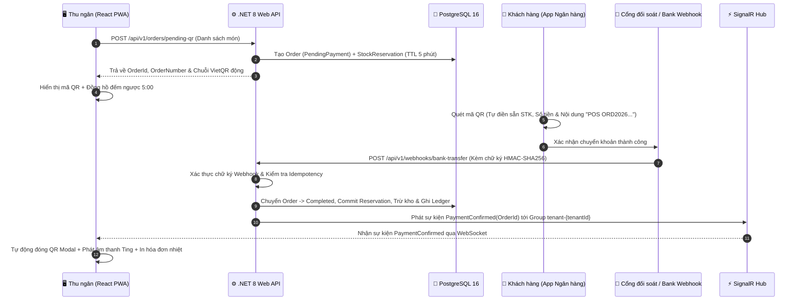

# 📲 Dynamic VietQR Payment Flow & SignalR Webhook Sync - POS PWA Project

Tài liệu này quy định kiến trúc luồng thanh toán chuyển khoản ngân hàng thông qua mã **VietQR Động (Dynamic VietQR)** kết hợp xác nhận biến động số dư thời gian thực qua **SignalR** trong hệ thống **POS PWA (Point of Sale Progressive Web App)**. Thay vì để thu ngân phải kiểm tra màn hình điện thoại cá nhân hoặc chụp ảnh biên lai chuyển khoản của khách (dễ xảy ra gian lận hóa đơn giả mạo), hệ thống tự động sinh mã QR chứa sẵn **số tiền chính xác** và **mã định danh đơn hàng**, đồng thời tự động đóng hộp thoại thanh toán và in hóa đơn ngay khi tiền về tài khoản cửa hàng ($< 2\text{ giây}$).

---

## 🔄 1. Luồng Xử lý Thanh toán VietQR Động (End-to-End Sequence)

---

## 🏦 2. Cấu trúc Mã VietQR Động & Nội dung Đối soát

Hệ thống sử dụng chuẩn **EMVCo / NAPAS VietQR** để sinh đường dẫn hoặc chuỗi dữ liệu QR động cho từng đơn hàng:

| Tham số VietQR | Nguồn dữ liệu | Ví dụ thực tế | Ý nghĩa chống nhầm lẫn |
| :--- | :--- | :--- | :--- |
| **`bankBin` & `accountNo`** | Cấu hình tài khoản ngân hàng của `Tenant` | `970436` (Vietcombank) / `1029384756` | Mỗi cửa hàng (`Tenant`) nhận tiền trực tiếp về tài khoản ngân hàng riêng. |
| **`amount`** | `order.TotalAmount` | `85000` | Khóa cứng số tiền cần thanh toán, khách không thể gõ nhầm thiếu/thừa tiền. |
| **`addInfo` (Nội dung CK)** | `POS {OrderNumber}` (Không dấu) | `POS ORD2611180042` | Mã đối soát duy nhất giúp Webhook tự động khớp chính xác 100% với đơn hàng đang chờ. |
| **`template`** | `compact2` | Hiển thị kèm logo Napas 247 & tên chủ TK | Tăng độ tin cậy cho khách hàng khi quét mã tại quầy. |

---

## 🛡️ 3. Các Chốt chặn Bảo mật & Xử lý Ngoại lệ

1. **Xác thực chữ ký Webhook (`HMAC-SHA256` / Bearer Secret):**
   Endpoint `POST /api/v1/webhooks/bank-transfer` bắt buộc kiểm tra chữ ký mật mã trong HTTP Header (`X-Webhook-Signature`) trước khi xử lý, ngăn chặn kẻ xấu giả mạo gói tin báo đã chuyển khoản thành công.
2. **Kiểm tra khớp số tiền thực nhận (`Amount Verification`):**
   Hệ thống đối chiếu `webhookPayload.TransferAmount >= order.TotalAmount`. Nếu khách chuyển thiếu tiền, hệ thống không tự động chốt đơn mà gửi cảnh báo real-time tới màn hình thu ngân để xử lý thu bổ sung tiền mặt.
3. **Nút xác nhận thủ công dự phòng (`Manual Confirm`):**
   Trong trường hợp dịch vụ Webhook ngân hàng bị trễ mạng tạm thời nhưng thu ngân đã thấy tin nhắn biến động số dư trên máy POS của cửa hàng, thu ngân có thể bấm nút **"Đã nhận tiền (Xác nhận thủ công)"** (hệ thống ghi nhận lại `ConfirmedBy = CashierId` vào `AuditLog` để kiểm soát).
4. **Chế độ Ngoại tuyến (Offline Mode Guard):**
   Nếu thiết bị POS đang mất kết nối Internet (`!isOnline`), tùy chọn tạo mã **VietQR động** tự động vô hiệu hóa và hiển thị chú thích *"Không khả dụng khi mất mạng"*, hướng dẫn thu ngân thu tiền mặt để tránh rủi ro không nhận được phản hồi Webhook.

---
