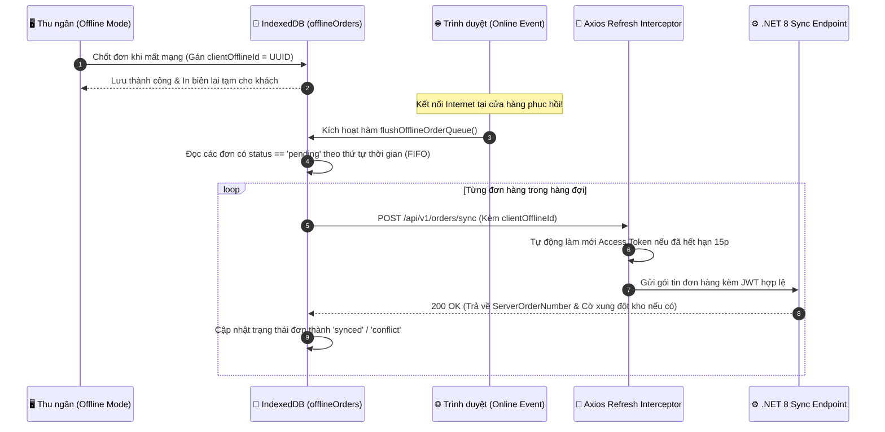

# ⚙️ Service Worker Caching & Background Sync - POS PWA Project

Tài liệu này quy định chiến lược lưu trữ đệm (**Caching Strategies**) và cơ chế đồng bộ nền (**Background Sync**) của **Service Worker** (xây dựng trên nền tảng **Google Workbox** qua `vite-plugin-pwa`) trong hệ thống **POS PWA (Point of Sale Progressive Web App)**. Thiết kế đảm bảo ứng dụng khởi động tức thì ngay cả khi rút dây mạng hoàn toàn, đồng thời tự động đẩy các đơn hàng phát sinh trong lúc mất mạng lên máy chủ **.NET 8** ngay khi kết nối Internet phục hồi.

---

## 🗂️ 1. Ma trận Chiến lược Caching (Workbox Routing Strategies)

Mỗi loại tài nguyên của hệ thống POS có đặc thù thay đổi khác nhau nên được áp dụng chiến lược bộ nhớ đệm riêng biệt:

| Loại tài nguyên / Endpoint | Chiến lược Workbox | Thời gian lưu (TTL) | Lý do kỹ thuật & Nghiệp vụ |
| :--- | :--- | :---: | :--- |
| **App Shell & Static Assets**<br>(`index.html`, `.js`, `.css`, `.woff2`, âm thanh `.mp3`) | **`PrecacheAndRoute`** | Vĩnh viễn theo Hash Build | Đảm bảo toàn bộ giao diện và logic bán hàng tải lên tức thì ($< 100\text{ms}$) mà không cần Internet. |
| **Hình ảnh sản phẩm**<br>(`/uploads/products/*`, CDN) | **`CacheFirst`** | **30 ngày** (Tối đa 500 ảnh) | Ảnh món ăn/sản phẩm ít thay đổi; ưu tiên đọc từ ổ cứng để lưới sản phẩm hiển thị tức thì. |
| **API Danh mục & Sản phẩm**<br>(`GET /api/v1/products`, `/categories`) | **`NetworkFirst`** (Timeout `3s`) | **24 giờ** | Luôn ưu tiên lấy giá bán & tồn kho mới nhất từ Server; nếu mất mạng hoặc mạng quá chậm ($> 3\text{s}$), tự động trả về bản sao mới nhất trong Cache. |
| **API Xác thực & Giao dịch ghi**<br>(`/api/v1/auth/*`, `POST /api/v1/orders`) | **`NetworkOnly`** | **Không cache** | Tuyệt đối không cache token bảo mật hoặc phản hồi giao dịch thanh toán; đơn hàng lúc Offline được quản lý tường minh bởi `IndexedDB Sync Queue`. |

---

## 💻 2. Cấu hình `vite.config.ts` với `vite-plugin-pwa`

```typescript
import { defineConfig } from 'vite';
import react from '@vitejs/plugin-react';
import { VitePWA } from 'vite-plugin-pwa';

export default defineConfig({
  plugins: [
    react(),
    VitePWA({
      registerType: 'prompt',
      includeAssets: ['favicon.ico', 'sounds/beep-success.mp3', 'sounds/beep-error.mp3'],
      workbox: {
        // Precache toàn bộ mã nguồn biên dịch và âm thanh phản hồi máy quét
        globPatterns: ['**/*.{js,css,html,ico,png,svg,woff2,mp3}'],
        cleanupOutdatedCaches: true,
        runtimeCaching: [
          {
            // 1. Cache danh mục & sản phẩm theo chiến lược NetworkFirst (fallback sau 3 giây)
            urlPattern: ({ url }) => url.pathname.startsWith('/api/v1/products') || url.pathname.startsWith('/api/v1/categories'),
            handler: 'NetworkFirst',
            options: {
              cacheName: 'pos-catalog-api-cache',
              networkTimeoutSeconds: 3,
              expiration: {
                maxEntries: 50,
                maxAgeSeconds: 24 * 60 * 60, // 24 giờ
              },
              cacheableResponse: {
                statuses: [0, 200],
              },
            },
          },
          {
            // 2. Cache hình ảnh sản phẩm theo chiến lược CacheFirst
            urlPattern: ({ request }) => request.destination === 'image',
            handler: 'CacheFirst',
            options: {
              cacheName: 'pos-product-images-cache',
              expiration: {
                maxEntries: 500,
                maxAgeSeconds: 30 * 24 * 60 * 60, // 30 ngày
              },
              cacheableResponse: {
                statuses: [0, 200],
              },
            },
          },
        ],
      },
    }),
  ],
});
```

---

## 🔄 3. Cơ chế Đồng bộ Đơn hàng Ngoại tuyến (Offline Order Sync Engine)

Thay vì phụ thuộc hoàn toàn vào `BackgroundSyncPlugin` mặc định của trình duyệt (vốn bị hạn chế trên Safari/iPadOS và khó kiểm soát thứ tự xoay vòng `Refresh Token`), hệ thống triển khai một **Hybrid Offline Sync Engine** kết hợp sự kiện trình duyệt (`online` / `visibilitychange`) và **IndexedDB (`Dexie.js`)**:



### Các nguyên tắc an toàn của hàng đợi đồng bộ:
1. **Tuần tự hóa theo thứ tự thời gian (FIFO Sequential Processing):** Các đơn hàng Offline được đồng bộ lần lượt từng đơn một theo thứ tự `createdAt` tăng dần để đảm bảo thứ tự trừ tồn kho trên PostgreSQL khớp đúng với diễn biến bán hàng thực tế tại quầy.
2. **Bảo vệ chống trùng lặp (Idempotency):** Mỗi đơn hàng mang theo `clientOfflineId` duy nhất. Nếu đang đồng bộ nửa chừng lại rớt mạng tiếp, lần đồng bộ sau gửi lại đúng `clientOfflineId` đó sẽ được Backend nhận diện và không tạo trùng hóa đơn.
3. **Ngăn chặn tự động đăng xuất khi Offline:** Khi mất mạng, ứng dụng tạm hoãn việc chuyển hướng về trang `/login` nếu `Access Token` quá 15 phút, cho phép thu ngân tiếp tục bán hàng bình thường và chỉ thực hiện `POST /api/v1/auth/refresh` ngay giây đầu tiên có mạng trở lại.

---
