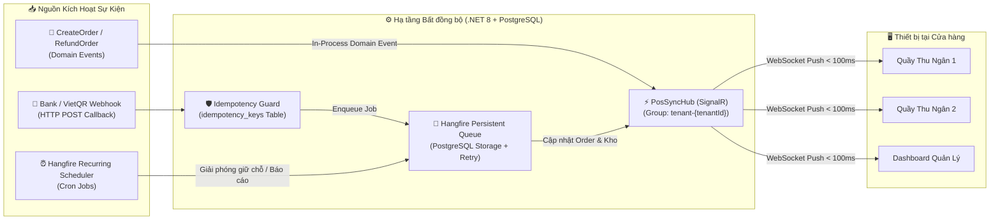

# ⚡ Real-time Communication & Background Jobs - POS PWA Project

Thư mục này tổng hợp toàn bộ tài liệu thiết kế kiến trúc **Giao tiếp Thời gian thực (Real-time Sync)** và **Xử lý Tác vụ Nền (Asynchronous Background Jobs)** cho hệ thống **POS PWA (Point of Sale Progressive Web App)**. Trong mô hình bán lẻ đa quầy thu ngân kết hợp thanh toán chuyển khoản động (**VietQR**), các tác vụ như cập nhật số lượng tồn kho giữa các quầy, giải phóng hàng giữ chỗ quá hạn, tiếp nhận Webhook ngân hàng và đồng bộ đơn hàng ngoại tuyến (**Offline Sync**) bắt buộc phải vận hành bất đồng bộ, có khả năng chịu lỗi (**Fault-Tolerant**) và đảm bảo tính lũy đẳng (**Idempotent**).

---

## 📂 Cấu trúc thư mục `09-realtime-and-background-jobs/`

```text
09-realtime-and-background-jobs/
├── README.md                     # Tổng quan kiến trúc Real-time & Background Processing
├── signalr.md                    # Kiến trúc ASP.NET Core SignalR Hub, Tenant Groups & Outbox Push
├── hangfire.md                   # Quản lý tác vụ nền định kỳ & hàng đợi bền vững với Hangfire + PostgreSQL
├── webhook-processing.md         # Quy trình tiếp nhận, xác thực chữ ký HMAC & xử lý Webhook ngân hàng
├── idempotency.md                # Thiết kế Idempotency Key chống trùng lặp giao dịch & Webhook
└── retry-and-failure-handling.md # Chiến lược Exponential Backoff, Polly Resilience & Dead-Letter Queue
```

---

## 🏗️ Kiến trúc Luồng Xử lý Bất đồng bộ & Thời gian thực



---

## 🎯 Nguyên tắc Thiết kế Cốt lõi

| Nguyên tắc | Áp dụng trong hệ thống POS PWA | Mục tiêu kỹ thuật |
| :--- | :--- | :--- |
| **Strict Tenant Group Isolation** | Mọi kết nối SignalR đều được xác thực JWT và gắn vào nhóm riêng `tenant-{tenantId}` ngay khi `OnConnectedAsync`. | Tuyệt đối không rò rỉ thông báo doanh thu hay biến động tồn kho sang cửa hàng khác. |
| **Persistent Job Storage** | Hàng đợi tác vụ nền **Hangfire** lưu trữ trực tiếp trên **PostgreSQL 16** (schema `hangfire`). | Không mất tác vụ đang chờ xử lý (như gửi biên lai, đối soát Webhook) ngay cả khi container Backend khởi động lại. |
| **End-to-End Idempotency** | Áp dụng `Idempotency-Key` cho cả Webhook ngân hàng lẫn API đồng bộ đơn Offline. | Đảm bảo một giao dịch gửi trùng 2–3 lần do mạng chập chờn chỉ được thực thi **duy nhất 1 lần**. |
| **Graceful Degradation** | Nếu kết nối SignalR tạm gián đoạn do mạng yếu, React PWA tự chuyển sang cơ chế Polling dự phòng và tự động đồng bộ lại khi WebSocket phục hồi. | Giữ cho quầy thu ngân hoạt động ổn định trong mọi điều kiện hạ tầng mạng. |

---
