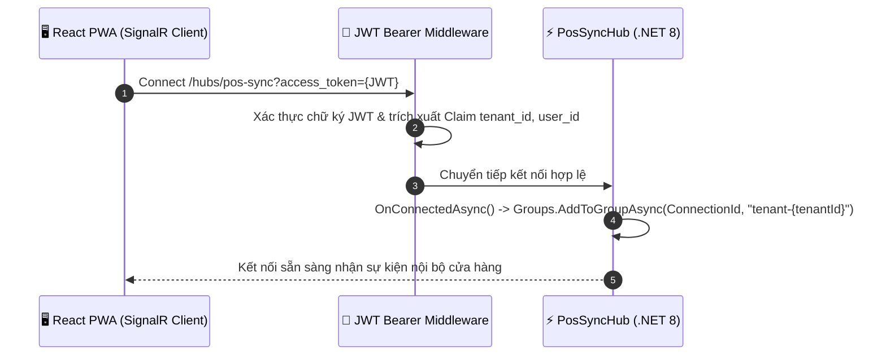

# ⚡ ASP.NET Core SignalR Real-time Architecture - POS PWA Project

Tài liệu này quy định kiến trúc giao tiếp hai chiều thời gian thực (**Real-time WebSocket Communication**) sử dụng **ASP.NET Core SignalR** cho hệ thống **POS PWA (Point of Sale Progressive Web App)**. Tại các cửa hàng có nhiều quầy thu ngân hoặc nhân viên phục vụ cùng nhận đơn trên máy tính bảng, SignalR đảm bảo mọi biến động tồn kho, xác nhận thanh toán chuyển khoản **VietQR** và cảnh báo hệ thống được đẩy tức thì (**$< 100\text{ms}$**) tới đúng các thiết bị thuộc cửa hàng đó.

---

## 🏛️ 1. Kiến trúc Kết nối & Cô lập Nhóm theo Tenant (`Tenant Group Isolation`)

Trong mô hình **Multi-Tenant SaaS**, việc phát thông báo qua `Clients.All` là lỗ hổng bảo mật nghiêm trọng vì sẽ làm lộ doanh thu và tồn kho giữa các cửa hàng khác nhau. Hệ thống áp dụng cơ chế phân nhóm nghiêm ngặt dựa trên `tenant_id` trích xuất từ **JWT Access Token** đã xác thực:



### Cấu hình đọc Token từ Query String cho WebSocket (`Program.cs`)
Do giao thức **WebSocket** và **Server-Sent Events (SSE)** trên trình duyệt không hỗ trợ gắn tùy ý HTTP Header `Authorization` trong bước bắt tay đầu tiên, SignalR Client truyền token qua tham số truy vấn `?access_token=...` và Backend cấu hình đọc riêng cho đường dẫn `/hubs`:

```csharp
options.Events = new JwtBearerEvents
{
    OnMessageReceived = context =>
    {
        var accessToken = context.Request.Query["access_token"];
        var path = context.HttpContext.Request.Path;

        if (!string.IsNullOrEmpty(accessToken) && path.StartsWithSegments("/hubs"))
        {
            context.Token = accessToken;
        }
        return Task.CompletedTask;
    }
};
```

---

## 📡 2. Danh mục Sự kiện Thời gian thực (Strongly-Typed Hub Contract)

Hệ thống sử dụng **Strongly-Typed Hub (`Hub<IPosSyncClient>`)** để tránh lỗi gõ sai tên chuỗi sự kiện (*Magic Strings*) giữa Backend và Frontend:

| Tên sự kiện (`Method Name`) | Dữ liệu truyền tải (`Payload`) | Thời điểm kích hoạt | Hành động trên React PWA |
| :--- | :--- | :--- | :--- |
| **`StockUpdated`** | `{ productId, newStockQuantity, newAvailableQuantity }` | Ngay sau khi đơn hàng chốt thành công, nhập kho hoặc hủy giữ chỗ. | Cập nhật thẳng vào **TanStack Query Cache** của tất cả quầy trong cửa hàng. |
| **`PaymentConfirmed`** | `{ orderId, orderNumber, paidAmount, method, confirmedAt }` | Ngay khi Webhook ngân hàng xác nhận khách đã chuyển khoản thành công đơn VietQR. | Tự động đóng `VietQrModal`, phát âm thanh *"Ting-Ting"* và kích hoạt in hóa đơn nhiệt. |
| **`OrderRefunded`** | `{ orderId, orderNumber, refundedBy, refundedAt }` | Khi Quản lý duyệt hoàn tiền hóa đơn. | Cập nhật trạng thái đơn sang `Refunded` trên màn hình lịch sử đơn hàng. |
| **`InventoryConflictDetected`** | `{ orderId, orderNumber, productName, deficitQuantity }` | Khi đồng bộ đơn hàng Offline phát hiện bán vượt tồn kho thực tế. | Hiển thị thông báo cảnh báo đỏ trên Dashboard của Quản lý để kiểm kê kho. |

---

## 💻 3. Triển khai `PosSyncHub.cs` (`PosPwa.WebApi/Hubs/PosSyncHub.cs`)

```csharp
using Microsoft.AspNetCore.Authorization;
using Microsoft.AspNetCore.SignalR;

public interface IPosSyncClient
{
    Task StockUpdated(StockUpdatedNotification notification);
    Task PaymentConfirmed(PaymentConfirmedNotification notification);
    Task OrderRefunded(OrderRefundedNotification notification);
    Task InventoryConflictDetected(InventoryConflictNotification notification);
}

[Authorize]
public sealed class PosSyncHub : Hub<IPosSyncClient>
{
    public override async Task OnConnectedAsync()
    {
        var tenantId = Context.User?.FindFirst("tenant_id")?.Value;

        if (string.IsNullOrWhiteSpace(tenantId))
        {
            // Từ chối kết nối nếu Token không chứa thông tin định danh cửa hàng hợp lệ
            Context.Abort();
            return;
        }

        // Gắn kết nối vào nhóm riêng biệt của cửa hàng
        await Groups.AddToGroupAsync(Context.ConnectionId, GetTenantGroupName(tenantId));
        await base.OnConnectedAsync();
    }

    public override async Task OnDisconnectedAsync(Exception? exception)
    {
        var tenantId = Context.User?.FindFirst("tenant_id")?.Value;
        if (!string.IsNullOrWhiteSpace(tenantId))
        {
            await Groups.RemoveFromGroupAsync(Context.ConnectionId, GetTenantGroupName(tenantId));
        }

        await base.OnDisconnectedAsync(exception);
    }

    public static string GetTenantGroupName(string tenantId) => $"tenant-{tenantId}";
}
```

### Phát sự kiện thông qua Domain Event Handler (`StockUpdatedEventHandler.cs`)
Tầng `Application` giao tiếp với SignalR thông qua giao diện trừu tượng `IPosRealtimeNotifier` (tuân thủ Dependency Inversion của Clean Architecture), chỉ đẩy thông báo **sau khi Database Transaction đã `COMMIT` thành công** để tránh trường hợp giao diện cập nhật tồn kho giả trong khi giao dịch DB bị Rollback:

```csharp
public sealed class SignalRPosRealtimeNotifier : IPosRealtimeNotifier
{
    private readonly IHubContext<PosSyncHub, IPosSyncClient> _hubContext;

    public SignalRPosRealtimeNotifier(IHubContext<PosSyncHub, IPosSyncClient> hubContext)
    {
        _hubContext = hubContext;
    }

    public Task NotifyStockUpdatedAsync(Guid tenantId, StockUpdatedNotification payload, CancellationToken ct)
    {
        var groupName = PosSyncHub.GetTenantGroupName(tenantId.ToString());
        return _hubContext.Clients.Group(groupName).StockUpdated(payload);
    }

    public Task NotifyPaymentConfirmedAsync(Guid tenantId, PaymentConfirmedNotification payload, CancellationToken ct)
    {
        var groupName = PosSyncHub.GetTenantGroupName(tenantId.ToString());
        return _hubContext.Clients.Group(groupName).PaymentConfirmed(payload);
    }
}
```

---
