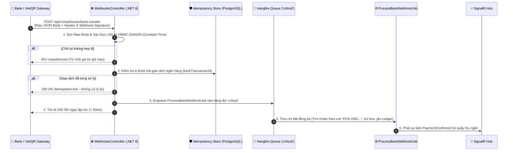

# 🔔 Webhook Ingestion & Verification Architecture - POS PWA Project

Tài liệu này quy định quy trình tiếp nhận, xác thực chữ ký mật mã (**HMAC-SHA256 Signature Verification**) và xử lý bất đồng bộ các sự kiện thanh toán chuyển khoản tự động từ cổng thanh toán / ngân hàng (**Bank Transfer & VietQR Webhooks**) trong hệ thống **POS PWA (Point of Sale Progressive Web App)**. Thiết kế tuân thủ nguyên tắc **Fast-Acknowledge & Async Processing** (phản hồi `200 OK` trong vòng $< 100\text{ms}$ sau khi xác thực và đẩy vào hàng đợi Hangfire) nhằm ngăn chặn cổng thanh toán gửi trùng gói tin do hết thời gian chờ (**Timeout Retry Storm**).

---

## 🔄 1. Kiến trúc Tiếp nhận Webhook An toàn (Secure Webhook Pipeline)



---

## 🔐 2. Xác thực Chữ ký Mật mã (`HMAC-SHA256` & Constant-Time Comparison)

Vì endpoint Webhook phải mở công khai (`[AllowAnonymous]`) để máy chủ ngân hàng gọi tới, hệ thống bắt buộc xác thực nguồn gốc gói tin thông qua chữ ký **HMAC-SHA256** tính trên **toàn bộ chuỗi Raw Request Body** bằng khóa bí mật `WebhookSettings:SecretKey`:

```csharp
using System.Security.Cryptography;
using System.Text;

public sealed class HmacWebhookSignatureValidator : IWebhookSignatureValidator
{
    private readonly byte[] _secretKeyBytes;

    public HmacWebhookSignatureValidator(IConfiguration configuration)
    {
        var secret = configuration["WebhookSettings:SecretKey"]
            ?? throw new InvalidOperationException("Chưa cấu hình WebhookSettings:SecretKey.");
        _secretKeyBytes = Encoding.UTF8.GetBytes(secret);
    }

    public bool IsValid(string rawPayload, string? providedSignatureHeader)
    {
        if (string.IsNullOrWhiteSpace(rawPayload) || string.IsNullOrWhiteSpace(providedSignatureHeader))
            return false;

        // Loại bỏ tiền tố "sha256=" nếu cổng thanh toán gửi theo chuẩn GitHub/Stripe/SePay
        var cleanSignature = providedSignatureHeader.StartsWith("sha256=", StringComparison.OrdinalIgnoreCase)
            ? providedSignatureHeader["sha256=".Length..]
            : providedSignatureHeader;

        var payloadBytes = Encoding.UTF8.GetBytes(rawPayload);
        var computedHash = HMACSHA256.HashData(_secretKeyBytes, payloadBytes);
        var computedHex = Convert.ToHexString(computedHash).ToLowerInvariant();

        // Sử dụng FixedTimeEquals để chống tấn công đo thời gian (Timing Attack)
        return CryptographicOperations.FixedTimeEquals(
            Encoding.UTF8.GetBytes(computedHex),
            Encoding.UTF8.GetBytes(cleanSignature.ToLowerInvariant()));
    }
}
```

---

## 🔌 3. Triển khai Controller Tiếp nhận Nhanh (`WebhooksController.cs`)

Controller đọc `Request.Body` nguyên bản trước khi Model Binding thay đổi định dạng khoảng trắng của JSON, lưu vết vào bảng `webhook_inbox_logs` và đẩy sang Hangfire:

```csharp
[ApiController]
[Route("api/v1/webhooks")]
[AllowAnonymous]
public sealed class WebhooksController : ControllerBase
{
    private readonly IWebhookSignatureValidator _signatureValidator;
    private readonly IBackgroundJobClient _backgroundJobs;
    private readonly AppDbContext _dbContext;

    public WebhooksController(
        IWebhookSignatureValidator signatureValidator,
        IBackgroundJobClient backgroundJobs,
        AppDbContext dbContext)
    {
        _signatureValidator = signatureValidator;
        _backgroundJobs = backgroundJobs;
        _dbContext = dbContext;
    }

    [HttpPost("bank-transfer")]
    public async Task<IActionResult> ReceiveBankTransfer(CancellationToken ct)
    {
        using var reader = new StreamReader(Request.Body, Encoding.UTF8);
        var rawBody = await reader.ReadToEndAsync(ct);

        var signature = Request.Headers["X-Webhook-Signature"].FirstOrDefault();
        if (!_signatureValidator.IsValid(rawBody, signature))
        {
            return Unauthorized(new { message = "Chữ ký Webhook không hợp lệ." });
        }

        var payload = JsonSerializer.Deserialize<BankTransferWebhookPayload>(rawBody, new JsonSerializerOptions
        {
            PropertyNameCaseInsensitive = true
        });

        if (payload is null || string.IsNullOrWhiteSpace(payload.BankTransactionId))
            return BadRequest(new { message = "Dữ liệu giao dịch không hợp lệ." });

        // Trích xuất mã đơn hàng theo mẫu "POS ORD..." từ nội dung chuyển khoản
        var orderNumber = OrderReferenceParser.ExtractOrderNumber(payload.Description);
        if (orderNumber is null)
        {
            // Giao dịch chuyển khoản cá nhân không thuộc hệ thống POS -> Bỏ qua an toàn
            return Ok(new { status = "ignored_non_pos_transfer" });
        }

        // Đẩy vào hàng đợi ưu tiên cao của Hangfire để xử lý bền vững
        _backgroundJobs.Enqueue<ProcessBankWebhookJob>(
            job => job.ExecuteByOrderNumberAsync(orderNumber, payload, CancellationToken.None));

        return Ok(new { status = "accepted" });
    }
}
```

---

## 🔍 4. Phân tích Nội dung Chuyển khoản & Đối soát Sai lệch Tiền

* **Trích xuất mã đơn hàng chuẩn (`OrderReferenceParser`):** Hệ thống sử dụng biểu thức chính quy không phân biệt hoa thường `\bORD\d{10,16}\b` để tìm chính xác mã đơn hàng ngay cả khi ứng dụng ngân hàng của khách tự động chèn thêm mã giao dịch của ngân hàng vào đầu hoặc cuối nội dung chuyển khoản (ví dụ: `"MBVCB.8472910.POS ORD2611180042.CT tu..."`).
* **Xử lý chênh lệch số tiền chuyển khoản:**
  * Nếu `TransferAmount == Order.TotalAmount`: Tự động hoàn tất đơn hàng (`Completed`), trừ tồn kho và phát SignalR đóng hộp thoại QR.
  * Nếu `TransferAmount < Order.TotalAmount`: Không tự động chốt đơn, ghi log cảnh báo và bắn sự kiện `UnderpaymentDetected` tới quầy thu ngân để nhân viên thu thêm phần tiền mặt còn thiếu.

---
