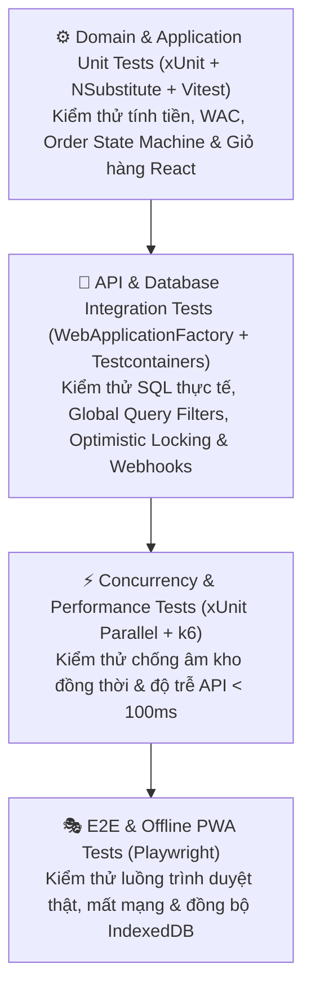

# 🧪 Quality Assurance & Automated Testing Strategy - POS PWA Project

Thư mục này tổng hợp toàn bộ tài liệu thiết kế chiến lược kiểm thử tự động (**Automated Testing Architecture**) cho hệ thống **POS PWA (Point of Sale Progressive Web App)**. Trong môi trường bán lẻ và F&B liên quan trực tiếp đến dòng tiền, tính toán giá vốn bình quân gia quyền (**WAC**), cô lập dữ liệu đa cửa hàng (**Multi-Tenant Isolation**) và đồng bộ đơn hàng ngoại tuyến (**Offline Sync**), kiểm thử thủ công không đủ khả năng phát hiện các lỗi điều kiện tranh chấp (**Race Condition**) hay rò rỉ dữ liệu. Toàn bộ dự án áp dụng mô hình **Kim tự tháp Kiểm thử (Testing Pyramid)** kết hợp **Testcontainers** trên cơ sở dữ liệu PostgreSQL thực tế.

---

## 📂 Cấu trúc thư mục `10-testing/`

```text
10-testing/
├── README.md                 # Tổng quan chiến lược kiểm thử & Kim tự tháp chất lượng POS PWA
├── unit-testing.md           # Kiểm thử đơn vị Domain Logic & Application Handlers (xUnit + FluentAssertions)
├── integration-testing.md    # Kiểm thử tích hợp cơ sở dữ liệu thật với Testcontainers (PostgreSQL 16)
├── api-testing.md            # Kiểm thử hợp đồng REST API, JWT Auth, RBAC & Multi-Tenant Isolation
├── ui-testing.md             # Kiểm thử giao diện React PWA & luồng bán hàng Offline với Playwright
├── concurrency-testing.md    # Kiểm thử chịu tải đồng thời & chống bán vượt tồn kho (Anti-Oversell)
├── performance-testing.md    # Kiểm thử hiệu năng & độ trễ API bán hàng dưới tải cao với k6
└── test-coverage.md          # Chỉ số bao phủ mã nguồn (Code Coverage) & Cổng kiểm soát CI/CD
```

---

## 🔺 Kim tự tháp Kiểm thử Toàn diện (Full-Stack Testing Pyramid)



---

## 🛠️ Bộ công cụ Kiểm thử Chuẩn hóa (Testing Tech Stack)

| Tầng kiểm thử | Công cụ Backend (.NET 8) | Công cụ Frontend (React PWA) | Mục tiêu xác minh cốt lõi |
| :--- | :--- | :--- | :--- |
| **Unit Testing** | `xUnit`, `FluentAssertions`, `NSubstitute` | `Vitest`, `Testing Library` | Đảm bảo 100% quy tắc toán học, chuyển trạng thái đơn hàng và validation chạy đúng độc lập. |
| **Integration & API** | `Microsoft.AspNetCore.Mvc.Testing`, `Testcontainers.PostgreSql` | `MSW (Mock Service Worker)` | Kiểm chứng EF Core Migrations, ràng buộc `CHECK`, khóa `FOR UPDATE` và tách biệt `TenantId`. |
| **Concurrency & Load** | `Task.WhenAll` + `Testcontainers`, `Grafana k6` | — | Đảm bảo 100 quầy chốt đơn cùng lúc không bao giờ làm âm kho và đạt chuẩn SLA độ trễ. |
| **End-to-End (E2E)** | Docker Compose Test Environment | `Playwright` (Chromium / Tablet) | Mô phỏng thao tác thu ngân thực tế, ngắt kết nối mạng và kiểm tra tự động đồng bộ. |

---
