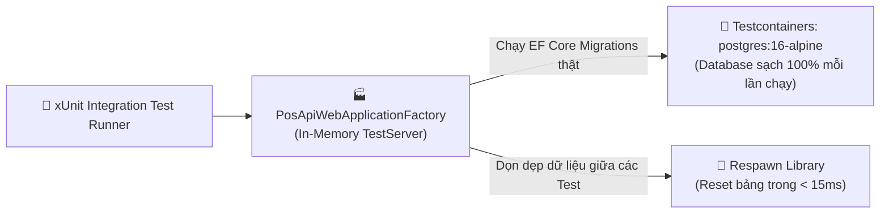

# 🐘 Database & Infrastructure Integration Testing (Testcontainers) - POS PWA Project

Tài liệu này quy định kiến trúc **Kiểm thử Tích hợp (Integration Testing)** sử dụng **`Testcontainers.PostgreSql`** và **`WebApplicationFactory<Program>`** trong hệ thống **POS PWA (Point of Sale Progressive Web App)**. Tuyệt đối **không sử dụng EF Core In-Memory Database** cho kiểm thử tích hợp vì In-Memory Provider không hỗ trợ khóa dòng bi quan (`SELECT ... FOR UPDATE`), cột hệ thống `xmin` của PostgreSQL, ràng buộc `CHECK (stock_quantity >= 0)`, và các Trigger chặn sửa/xóa bảng Append-Only. Thay vào đó, mỗi phiên chạy kiểm thử tự động khởi chạy một container **PostgreSQL 16 thực thụ** trong Docker.

---

## 🏗️ 1. Kiến trúc Môi trường Kiểm thử Cô lập (`PosApiWebApplicationFactory`)



### Triển khai `PosApiWebApplicationFactory.cs`:
Sử dụng giao diện `IAsyncLifetime` của xUnit để khởi động container PostgreSQL một lần duy nhất cho toàn bộ Test Collection (tối ưu tốc độ chạy CI/CD) và dùng thư viện **`Respawn`** để làm sạch dữ liệu giữa từng bài test:

```csharp
using Microsoft.AspNetCore.Hosting;
using Microsoft.AspNetCore.Mvc.Testing;
using Microsoft.EntityFrameworkCore;
using Microsoft.Extensions.DependencyInjection;
using PosPwa.Infrastructure.Persistence;
using Testcontainers.PostgreSql;
using Xunit;

public sealed class PosApiWebApplicationFactory : WebApplicationFactory<Program>, IAsyncLifetime
{
    private readonly PostgreSqlContainer _postgresContainer = new PostgreSqlBuilder()
        .WithImage("postgres:16-alpine")
        .WithDatabase("pos_pwa_test_db")
        .WithUsername("pos_test_user")
        .WithPassword("PosTest@2026")
        .Build();

    public string ConnectionString => _postgresContainer.GetConnectionString();

    protected override void ConfigureWebHost(IWebHostBuilder builder)
    {
        builder.ConfigureServices(services =>
        {
            // Thay thế DbContext mặc định bằng chuỗi kết nối tới container Testcontainers
            var descriptor = services.SingleOrDefault(
                d => d.ServiceType == typeof(DbContextOptions<AppDbContext>));
            if (descriptor is not null) services.Remove(descriptor);

            services.AddDbContext<AppDbContext>(options =>
                options.UseNpgsql(ConnectionString));
        });
    }

    public async Task InitializeAsync()
    {
        await _postgresContainer.StartAsync();

        // Áp dụng toàn bộ EF Core Migrations & PostgreSQL Triggers lên DB kiểm thử
        using var scope = Services.CreateScope();
        var dbContext = scope.ServiceProvider.GetRequiredService<AppDbContext>();
        await dbContext.Database.MigrateAsync();
    }

    public new async Task DisposeAsync()
    {
        await _postgresContainer.DisposeAsync();
    }
}
```

---

## 🔍 2. Các Kịch bản Trọng tâm Bắt buộc Kiểm thử Tích hợp

1. **Xác minh tính bất biến của Sổ cái (`Append-Only Trigger Test`):**
   * Tạo một bút toán `InventoryTransaction` thông qua nghiệp vụ bán hàng.
   * Thử thực thi câu lệnh SQL trực tiếp `UPDATE inventory_transactions SET quantity_delta = 0` hoặc `DELETE FROM inventory_transactions`.
   * **Kỳ vọng:** PostgreSQL ném ngoại lệ `PostgresException` với thông báo vi phạm chính sách Append-Only.
2. **Xác minh Khóa Lạc quan (`Optimistic Concurrency Control - xmin`):**
   * Hai quản lý cùng tải thông tin của một sản phẩm (`rowVersion` giống nhau).
   * Quản lý A cập nhật giá bán thành công (`SaveChangesAsync()`).
   * Quản lý B gửi yêu cầu cập nhật giá bán với `rowVersion` cũ $\rightarrow$ Hệ thống ném `DbUpdateConcurrencyException` và trả về `HTTP 409 Conflict`.
3. **Xác minh Đồng bộ Đơn hàng Ngoại tuyến Lũy đẳng (`Offline Sync Idempotency`):**
   * Gửi 2 lần liên tiếp cùng một payload `SyncOfflineOrdersCommand` chứa `ClientOfflineId = "uuid-offline-999"`.
   * **Kỳ vọng:** Cả 2 lần đều trả về `200 OK` với cùng một `OrderNumber`, bảng `orders` chỉ có đúng `1` bản ghi và `stock_quantity` chỉ bị trừ đúng `1` lần.

---
