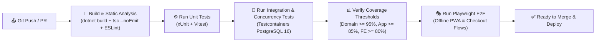

# 📊 Code Coverage Metrics & CI/CD Quality Gates - POS PWA Project

Tài liệu này quy định các chỉ số đo lường **Độ bao phủ Mã nguồn (Code Coverage Targets)** và hệ thống **Cổng Kiểm soát Chất lượng Tự động (CI/CD Quality Gates)** cho toàn bộ dự án **POS PWA (Point of Sale Progressive Web App)**. Mục tiêu không phải là chạy theo con số bao phủ hình thức trên các tệp cấu hình thụ động, mà là đảm bảo **100% logic nghiệp vụ cốt lõi (Domain Models, Tài chính, Kho, Bảo mật)** được bảo vệ chặt chẽ bởi các bài kiểm thử tự động có ý nghĩa trước khi hợp nhất mã nguồn vào nhánh chính (`main`).

---

## 🎯 1. Chỉ tiêu Độ bao phủ Mã nguồn theo Từng Tầng Kiến trúc

| Phân hệ / Tầng kiến trúc | Chỉ tiêu Line Coverage tối thiểu | Chỉ tiêu Branch Coverage tối thiểu | Công cụ đo lường | Lý do & Trọng tâm kiểm soát |
| :--- | :---: | :---: | :--- | :--- |
| **`PosPwa.Domain`**<br>(Entities, WAC, Order State Machine, Value Objects) | **$\ge 95\%$** | **$\ge 90\%$** | `Coverlet` + `ReportGenerator` | Toàn bộ logic tính tiền, giá vốn bình quân, chuyển trạng thái và trừ tồn kho phải được phủ gần như tuyệt đối. |
| **`PosPwa.Application`**<br>(Command/Query Handlers, FluentValidation, Behaviors) | **$\ge 85\%$** | **$\ge 80\%$** | `Coverlet` | Kiểm soát đầy đủ các nhánh xử lý lỗi, Idempotency, và quy tắc phân quyền. |
| **`PosPwa.Infrastructure` & `WebApi`**<br>(Repositories, Interceptors, Controllers, Hubs) | **$\ge 75\%$** | **$\ge 70\%$** | `Coverlet` (via Testcontainers) | Xác minh truy vấn SQL thực tế, Trigger Append-Only, Middleware bảo mật và SignalR. |
| **`Frontend React PWA`**<br>(`stores/`, `utils/`, `schemas/`, `hooks/`) | **$\ge 80\%$** | **$\ge 75\%$** | `Vitest` (`@vitest/coverage-v8`) | Đảm bảo logic giỏ hàng, tính tiền thối lại, bộ đệm máy quét mã vạch và Zod validation chính xác tuyệt đối. |

### Danh mục loại trừ khỏi tính toán Coverage (`[ExcludeFromCodeCoverage]`):
* Các tệp sinh tự động bởi EF Core Migrations (`src/PosPwa.Infrastructure/Persistence/Migrations/*`).
* Các lớp `DTO` / `Record` chỉ chứa thuộc tính lưu trữ dữ liệu thuần túy không có logic tính toán.
* Tệp khởi tạo cấu hình giao diện tĩnh (`main.tsx`, `vite-env.d.ts`).

---

## 🚦 2. Quy trình CI/CD Quality Gates (GitHub Actions Pipeline)

Mỗi khi lập trình viên tạo **Pull Request** hoặc đẩy mã nguồn lên nhánh `main`, quy trình CI/CD tự động thực thi tuần tự các cổng kiểm duyệt sau. Nếu bất kỳ bước nào thất bại hoặc dưới ngưỡng Coverage quy định, hệ thống tự động chặn nút **Merge**:



---

## 💻 3. Lệnh Thực thi Kiểm thử & Xuất Báo cáo Coverage Cục bộ

### 3.1. Đối với Backend (.NET 8)
```bash
# Chạy toàn bộ Unit & Integration Tests và thu thập dữ liệu Coverlet Cobertura
dotnet test --configuration Release \
  --collect:"XPlat Code Coverage" \
  --results-directory ./TestResults

# Sinh báo cáo HTML trực quan bằng ReportGenerator
reportgenerator \
  -reports:"./TestResults/**/coverage.cobertura.xml" \
  -targetdir:"./TestResults/CoverageReport" \
  -reporttypes:"Html;TextSummary"
```

### 3.2. Đối với Frontend (React + Vite)
```bash
# Chạy Vitest kèm báo cáo độ bao phủ V8 và kiểm tra ngưỡng tối thiểu
npm run test:unit -- --coverage
```

---
