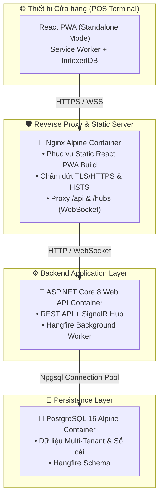

# 🚀 Devops, Containerization & CI/CD Pipeline - POS PWA Project

Thư mục này tổng hợp toàn bộ tài liệu quy định quy trình quản lý mã nguồn, chuẩn cộng tác nhóm, đóng gói ứng dụng bằng **Docker** và tự động hóa tích hợp/triển khai liên tục (**CI/CD với GitHub Actions**) cho hệ thống **POS PWA (Point of Sale Progressive Web App)**. Mục tiêu của hạ tầng DevOps là đảm bảo sự đồng nhất tuyệt đối giữa môi trường phát triển cục bộ (**Local Dev**), môi trường kiểm thử (**Testcontainers**) và môi trường vận hành (**Production**), đồng thời cho phép triển khai các bản cập nhật mới xuống cửa hàng mà không làm gián đoạn hoạt động bán hàng tại quầy (**Zero-Downtime Deployment**).

---

## 📂 Cấu trúc thư mục `11-devops/`

```text
11-devops/
├── README.md                 # Tổng quan kiến trúc DevOps, Containerization & CI/CD
├── git-and-github.md         # Chuẩn Commit (Conventional Commits), .gitignore & Quản lý Repository
├── branching-strategy.md     # Mô hình phân nhánh GitHub Flow / Trunk-Based tối ưu cho nhóm dự án
├── code-review.md            # Quy trình Pull Request, Checklist đánh giá & Bảo vệ nhánh chính
├── docker.md                 # Tối ưu hóa Multi-Stage Dockerfile cho .NET 8 API & React PWA (Nginx)
├── docker-compose.md         # Điều phối toàn bộ hệ sinh thái POS PWA bằng Docker Compose
├── github-actions.md         # Cấu hình chi tiết các Workflow tự động trên GitHub Actions
├── environment-variables.md  # Quản lý biến môi trường, Secrets & Cấu hình đa môi trường
└── ci-cd.md                  # Luồng triển khai liên tục (CD), Health Checks & Chiến lược Rollback
```

---

## 🏗️ Kiến trúc Hạ tầng Triển khai (Containerized Topology)



---

## 🎯 Các Nguyên tắc Vận hành DevOps Cốt lõi

| Trụ cột DevOps | Chuẩn áp dụng trong POS PWA | Lợi ích thực tiễn |
| :--- | :--- | :--- |
| **Immutable Artifacts** | Mọi bản build Backend và Frontend đều được đóng gói thành Docker Image gắn thẻ theo `Git SHA` (ví dụ: `pos-api:a1b2c3d`). | Đảm bảo bản chạy ở Production giống hệt bản đã vượt qua kiểm thử tự động. |
| **Non-Root Container Security** | Toàn bộ container chạy dưới quyền người dùng không đặc quyền (`appuser` / `nginx`), tuyệt đối không chạy bằng `root`. | Giảm thiểu bề mặt tấn công nếu xảy ra lỗ hổng thực thi mã từ xa. |
| **Automated Quality Gates** | Không một dòng mã nào được phép hợp nhất vào `main` nếu chưa vượt qua `tsc`, `dotnet test` (Testcontainers) và `Playwright`. | Giữ nhánh `main` luôn ở trạng thái sẵn sàng phát hành (**Always Deployable**). |
| **Secret Hygiene** | Tuyệt đối không lưu mật khẩu DB, JWT Secret hay Webhook Key trong mã nguồn; toàn bộ nạp qua biến môi trường / GitHub Secrets. | Loại bỏ 100% nguy cơ lộ khóa bảo mật trên lịch sử Git. |

---
