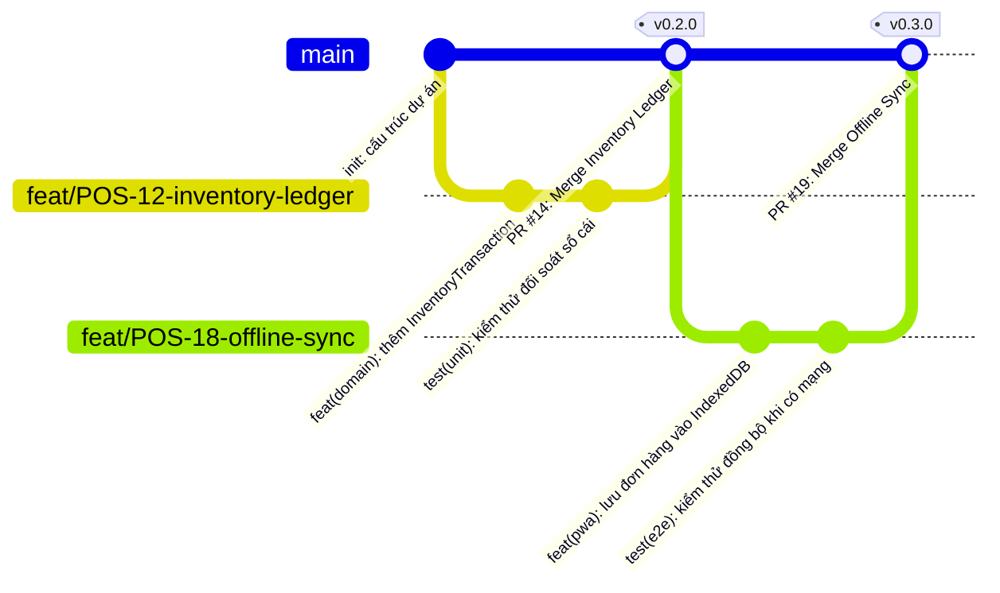

# 🌿 Git Branching Strategy (GitHub Flow) - POS PWA Project

Tài liệu này quy định chiến lược phân nhánh mã nguồn (**Branching Strategy**) cho nhóm phát triển dự án **POS PWA (Point of Sale Progressive Web App)**. Thay vì sử dụng mô hình GitFlow truyền thống quá cồng kềnh với nhiều nhánh trung gian (`develop`, `release`, `hotfix`) dễ gây xung đột khi hợp nhất (**Merge Hell**), dự án áp dụng mô hình **GitHub Flow (Feature-Branch Workflow)** tinh gọn, kết hợp đồng bộ chặt chẽ với bảng quản lý công việc **Jira Sprint**.

---

## 🔄 1. Sơ đồ Vòng đời Nhánh Mã nguồn (GitHub Flow)

---

## 📋 2. Quy tắc Đặt tên Nhánh (Branch Naming Convention)

Mọi nhánh tính năng hoặc sửa lỗi đều được tách trực tiếp từ nhánh **`main`** mới nhất và gắn kèm mã thẻ công việc trên **Jira** (`POS-<số-thứ-tự>`) để liên kết tự động tiến độ:

| Tiền tố nhánh (`Prefix`) | Mục đích sử dụng | Mẫu đặt tên chuẩn | Ví dụ thực tế |
| :--- | :--- | :--- | :--- |
| **`feat/`** | Phát triển tính năng mới theo User Story | `feat/POS-<id>-<ten-ngan-gon>` | `feat/POS-24-vietqr-dynamic-payment` |
| **`fix/`** | Sửa lỗi phát hiện trong quá trình kiểm thử | `fix/POS-<id>-<mo-ta-loi>` | `fix/POS-31-barcode-scanner-debounce` |
| **`refactor/`** | Tái cấu trúc mã nguồn, tối ưu hiệu năng | `refactor/POS-<id>-<pham-vi>` | `refactor/POS-35-product-grid-memo` |
| **`docs/`** | Viết tài liệu kỹ thuật, sơ đồ Draw.io | `docs/POS-<id>-<chu-de>` | `docs/POS-40-architecture-diagrams` |
| **`chore/`** | Cấu hình Docker, CI/CD, nâng cấp gói | `chore/POS-<id>-<cong-viec>` | `chore/POS-42-github-actions-pipeline` |

---

## 🛡️ 3. Quy tắc Bảo vệ Nhánh Chính (`main` Branch Protection Rules)

Nhánh **`main`** đại diện cho phiên bản ổn định nhất của hệ thống POS PWA và được thiết lập các quy tắc khóa bảo vệ trên GitHub:
1. **Cấm đẩy mã trực tiếp (`Disable Direct Push`):** Không thành viên nào (kể cả Trưởng nhóm) được phép `git push origin main` trực tiếp; mọi thay đổi bắt buộc thông qua **Pull Request (PR)**.
2. **Yêu cầu vượt qua kiểm thử tự động (`Require Status Checks`):** Các kiểm tra GitHub Actions (`build-and-test-backend`, `build-and-test-frontend`) phải báo xanh toàn bộ mới mở khóa nút Merge.
3. **Bắt buộc cập nhật nhánh mới nhất (`Require Branches to be Up-to-Date`):** Trước khi Merge, nhánh tính năng phải `rebase` hoặc `merge` các thay đổi mới nhất từ `main` để đảm bảo không phát sinh xung đột tích hợp.
4. **Hợp nhất bằng `Squash and Merge` & Xóa nhánh sau khi Merge:** Gom gọn toàn bộ các commit nhỏ trong quá trình phát triển thành 1 commit sạch sẽ trên nhánh `main` và tự động xóa nhánh phụ đã hoàn thành.

---
