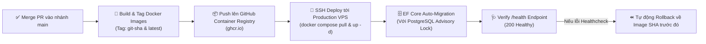

# 🚀 Continuous Deployment (CD), Health Checks & Rollback Strategy - POS PWA Project

Tài liệu này quy định quy trình **Triển khai Liên tục (Continuous Deployment - CD)**, cơ chế giám sát sức khỏe dịch vụ (**Health Checks**) và chiến lược khôi phục khẩn cấp (**Zero-Downtime Rollback**) cho hệ thống **POS PWA (Point of Sale Progressive Web App)**. Vì phần mềm POS phục vụ hoạt động bán hàng trực tiếp tại quầy suốt cả ngày, quy trình triển khai được thiết kế để cập nhật phiên bản mới tự động, an toàn và cho phép thu ngân tiếp tục chốt đơn ngay cả trong vài giây chuyển giao container.

---

## 🔄 1. Luồng Triển khai Tự động Đầu cuối (End-to-End CD Pipeline)

---

## 🩺 2. Hệ thống Giám sát Sức khỏe Dịch vụ (`ASP.NET Core Health Checks`)

Backend cung cấp hai endpoint chuyên biệt để Docker Engine và Reverse Proxy giám sát trạng thái sẵn sàng phục vụ:

| Endpoint | Mục đích kiểm tra | Thành phần được đo lường | Hành động khi `Unhealthy` |
| :--- | :--- | :--- | :--- |
| **`GET /health/live`** | **Liveness Probe** (Kiểm tra tiến trình còn sống) | Kiểm tra tiến trình .NET 8 Web API không bị treo deadlock. | Docker tự động khởi động lại container `pos-backend`. |
| **`GET /health`** | **Readiness Probe** (Kiểm tra sẵn sàng nhận lưu lượng) | Kiểm tra kết nối thực tế tới **PostgreSQL 16 (`AspNetCore.HealthChecks.NpgSql`)** và trạng thái hoạt động của **Hangfire Server**. | Nginx tạm ngừng chuyển request mới tới instance đang lỗi và cảnh báo cho Quản trị viên. |

---

## 🗄️ 3. Quản lý Cập nhật Cấu trúc Database An toàn (`Safe Database Migrations`)

Để đảm bảo không xảy ra xung đột khi cập nhật lược đồ PostgreSQL trong quá trình triển khai:
1. **Quy tắc Mở rộng trước — Thu hẹp sau (Expand and Contract Pattern):**
   * Khi thêm cột mới (ví dụ: cột `min_stock_threshold` trên bảng `products`), luôn khai báo giá trị mặc định (`DEFAULT 0`) hoặc cho phép `NULL` ở phiên bản đầu tiên để các phiên bản ứng dụng cũ vẫn hoạt động trơn tru.
   * Tuyệt đối không xóa hoặc đổi tên cột đang được sử dụng trực tiếp trong cùng một lần triển khai.
2. **Tự động chạy Migration an toàn lúc khởi động:** Khi container `pos-backend` khởi động, hệ thống xin khóa tư vấn của PostgreSQL (`pg_advisory_lock`) trước khi gọi `await dbContext.Database.MigrateAsync()` để đảm bảo chỉ có duy nhất 1 tiến trình thực thi câu lệnh `ALTER TABLE`.

---

## ⏪ 4. Chiến lược Khôi phục Khẩn cấp (`Instant Rollback`) & Khả năng Chịu lỗi tại Quầy

* **Quay lui phiên bản trong $< 30\text{ giây}$:** Nhờ mỗi lần triển khai đều gắn thẻ Docker Image theo mã băm Git (`ghcr.io/pos-pwa/backend:<git-sha>`), nếu phát hiện lỗi nghiêm trọng sau khi phát hành, Quản trị viên chỉ cần trỏ biến `IMAGE_TAG` về mã `SHA` ổn định liền trước và chạy `docker compose up -d` để khôi phục toàn bộ hệ thống ngay lập tức.
* **Lá chắn Offline PWA tại cửa hàng:** Trong khoảng thời gian ngắn 5–10 giây khi container Backend khởi động lại để cập nhật phiên bản, các quầy thu ngân đang mở **React PWA** vẫn tiếp tục quét mã vạch và chốt đơn bình thường vào `IndexedDB`, sau đó tự động đồng bộ lên máy chủ ngay khi container mới báo trạng thái `Healthy`.

---
