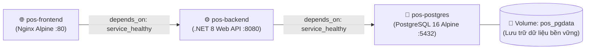

# 🎼 Docker Compose System Orchestration - POS PWA Project

Tài liệu này quy định cấu hình điều phối toàn bộ hệ sinh thái các dịch vụ của hệ thống **POS PWA (Point of Sale Progressive Web App)** bằng **Docker Compose v2** (`docker-compose.yml`). Chỉ với một câu lệnh khởi chạy duy nhất (`docker compose up -d --build`), toàn bộ hạ tầng bao gồm cơ sở dữ liệu **PostgreSQL 16**, máy chủ **ASP.NET Core 8 Web API (SignalR + Hangfire)** và máy chủ **Nginx phục vụ React PWA** được kết nối trong một mạng nội bộ cô lập (**Isolated Bridge Network**) với đầy đủ cơ chế kiểm tra sức khỏe (**Healthchecks**) và lưu trữ dữ liệu bền vững (**Named Volumes**).

---

## 🏗️ 1. Kiến trúc Mạng & Phụ thuộc Khởi động (Service Dependency Graph)



---

## 📄 2. Cấu hình Chuẩn `docker-compose.yml`

```yaml
name: pos-pwa-platform

services:
  # 1. Cơ sở dữ liệu PostgreSQL 16
  postgres:
    image: postgres:16-alpine
    container_name: pos-postgres
    restart: unless-stopped
    environment:
      POSTGRES_DB: ${POSTGRES_DB}
      POSTGRES_USER: ${POSTGRES_USER}
      POSTGRES_PASSWORD: ${POSTGRES_PASSWORD}
      TZ: Asia/Ho_Chi_Minh
    ports:
      - "127.0.0.1:5432:5432" # Chỉ mở cổng trên localhost máy chủ để chống truy cập từ Internet
    volumes:
      - pos_pgdata:/var/lib/postgresql/data
    healthcheck:
      test: ["CMD-SHELL", "pg_isready -U ${POSTGRES_USER} -d ${POSTGRES_DB}"]
      interval: 10s
      timeout: 5s
      retries: 5
    networks:
      - pos_internal_net

  # 2. Backend ASP.NET Core 8 Web API + SignalR + Hangfire
  backend:
    build:
      context: ./src/backend
      dockerfile: Dockerfile
    container_name: pos-backend
    restart: unless-stopped
    depends_on:
      postgres:
        condition: service_healthy
    environment:
      ASPNETCORE_ENVIRONMENT: ${ASPNETCORE_ENVIRONMENT:-Production}
      ConnectionStrings__DefaultConnection: "Host=postgres;Port=5432;Database=${POSTGRES_DB};Username=${POSTGRES_USER};Password=${POSTGRES_PASSWORD};Pooling=true;Minimum Pool Size=5;Maximum Pool Size=100;"
      JwtSettings__SecretKey: ${JWT_SECRET_KEY}
      JwtSettings__Issuer: ${JWT_ISSUER}
      JwtSettings__Audience: ${JWT_AUDIENCE}
      WebhookSettings__SecretKey: ${WEBHOOK_SECRET_KEY}
    healthcheck:
      test: ["CMD", "curl", "-f", "http://localhost:8080/health"]
      interval: 15s
      timeout: 5s
      retries: 3
      start_period: 20s
    networks:
      - pos_internal_net

  # 3. Frontend React PWA + Nginx Reverse Proxy
  frontend:
    build:
      context: ./src/frontend
      dockerfile: Dockerfile
    container_name: pos-frontend
    restart: unless-stopped
    depends_on:
      backend:
        condition: service_healthy
    ports:
      - "80:80"
    networks:
      - pos_internal_net

volumes:
  pos_pgdata:
    driver: local

networks:
  pos_internal_net:
    driver: bridge
```

---

## 🛠️ 3. Các Lệnh Vận hành Thường dùng cho Nhóm Phát triển

| Mục đích thao tác | Câu lệnh thực thi | Ghi chú vận hành |
| :--- | :--- | :--- |
| **Khởi chạy toàn bộ hệ thống** | `docker compose up -d --build` | Tự động dựng PostgreSQL, chạy EF Core Migrations và phục vụ PWA tại `http://localhost`. |
| **Chỉ chạy PostgreSQL để Debug IDE** | `docker compose up -d postgres` | Tiện lợi khi lập trình viên chạy Backend/Frontend trực tiếp trên Visual Studio / VS Code. |
| **Xem nhật ký hoạt động real-time** | `docker compose logs -f backend` | Theo dõi log JSON của Serilog, truy vấn SQL và tiến trình Hangfire. |
| **Sao lưu cơ sở dữ liệu thủ công** | `docker exec -t pos-postgres pg_dump -U pos_user pos_pwa_db > backup.sql` | Xuất toàn bộ dữ liệu cửa hàng và sổ cái tồn kho ra tệp `.sql`. |
| **Dừng hệ thống (Giữ nguyên dữ liệu)** | `docker compose down` | Dừng và xóa container nhưng vẫn bảo toàn dữ liệu trong volume `pos_pgdata`. |

---
