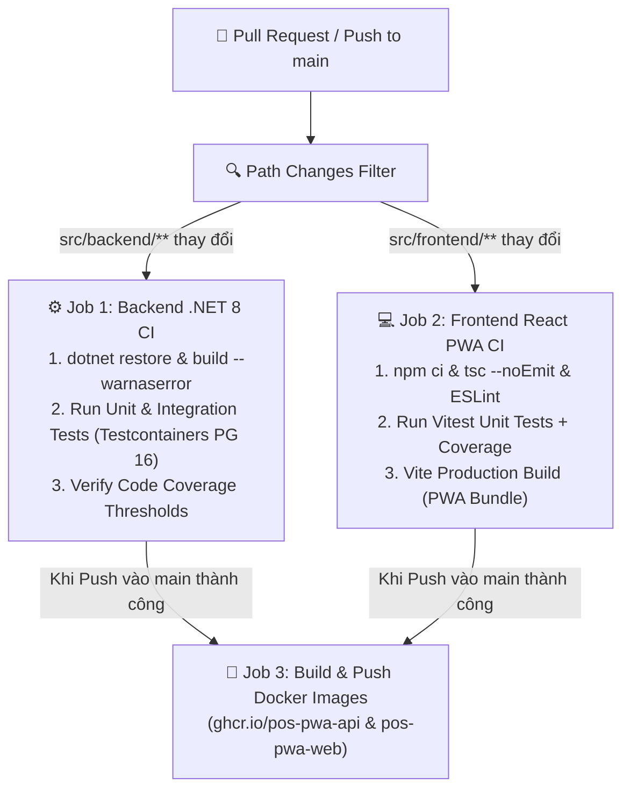

# ⚙️ GitHub Actions CI Workflows - POS PWA Project

Tài liệu này quy định cấu hình hệ thống tự động hóa kiểm thử và đóng gói (**Continuous Integration - CI**) sử dụng **GitHub Actions** cho dự án **POS PWA (Point of Sale Progressive Web App)**. Nhờ tận dụng cơ chế lọc đường dẫn (`paths` filter) trong Monorepo và lưu trữ đệm gói phụ thuộc (`NuGet` / `npm` cache), hệ thống chỉ thực thi kiểm thử phần Backend hoặc Frontend khi mã nguồn của phân hệ đó thực sự thay đổi, rút ngắn thời gian phản hồi trên mỗi Pull Request xuống dưới **3 phút**.

---

## 🏗️ 1. Kiến trúc Pipeline Song song (Parallel CI Jobs)



---

## 📄 2. Cấu hình Workflow Chuẩn (`.github/workflows/ci-pipeline.yml`)

```yaml
name: POS PWA - Continuous Integration Pipeline

on:
  push:
    branches: [main]
  pull_request:
    branches: [main]

concurrency:
  group: ${{ github.workflow }}-${{ github.ref }}
  cancel-in-progress: true # Tự động hủy bản chạy cũ nếu thành viên vừa đẩy commit mới lên cùng PR

jobs:
  # ============================================================================
  # JOB 1: KIỂM THỬ BACKEND .NET 8 & TESTCONTAINERS POSTGRESQL 16
  # ============================================================================
  backend-ci:
    name: Backend (.NET 8 Build & Testcontainers)
    runs-on: ubuntu-latest
    defaults:
      run:
        working-directory: ./src/backend

    steps:
      - name: Checkout mã nguồn
        uses: actions/checkout@v4

      - name: Cài đặt .NET 8 SDK
        uses: actions/setup-dotnet@v4
        with:
          dotnet-version: '8.0.x'

      - name: Khôi phục gói NuGet (với Cache)
        uses: actions/cache@v4
        with:
          path: ~/.nuget/packages
          key: ${{ runner.os }}-nuget-${{ hashFiles('**/*.csproj') }}
          restore-keys: |
            ${{ runner.os }}-nuget-

      - name: Biên dịch Release (Coi mọi Warning là Lỗi)
        run: dotnet build PosPwa.sln --configuration Release -warnaserror

      - name: Chạy Unit Tests & Integration Tests (Testcontainers PostgreSQL)
        run: |
          dotnet test PosPwa.sln \
            --configuration Release \
            --no-build \
            --collect:"XPlat Code Coverage" \
            --results-directory ./TestResults

      - name: Lưu trữ báo cáo Test & Coverage Artifacts
        if: always()
        uses: actions/upload-artifact@v4
        with:
          name: backend-test-results
          path: ./src/backend/TestResults

  # ============================================================================
  # JOB 2: KIỂM THỬ FRONTEND REACT + TYPESCRIPT + VITEST + PWA BUILD
  # ============================================================================
  frontend-ci:
    name: Frontend (TypeScript, Vitest & Vite PWA Build)
    runs-on: ubuntu-latest
    defaults:
      run:
        working-directory: ./src/frontend

    steps:
      - name: Checkout mã nguồn
        uses: actions/checkout@v4

      - name: Cài đặt Node.js 20 LTS
        uses: actions/setup-node@v4
        with:
          node-version: '20'
          cache: 'npm'
          cache-dependency-path: './src/frontend/package-lock.json'

      - name: Cài đặt thư viện (Clean Install)
        run: npm ci

      - name: Kiểm tra kiểu dữ liệu TypeScript Strict Mode
        run: npm run typecheck

      - name: Kiểm tra quy chuẩn mã nguồn ESLint
        run: npm run lint

      - name: Chạy Vitest Unit Tests & Coverage
        run: npm run test:unit -- --coverage

      - name: Đóng gói Production PWA Bundle (Kèm Service Worker)
        run: npm run build
        env:
          VITE_API_BASE_URL: /api/v1
          VITE_SIGNALR_HUB_URL: /hubs/pos-sync
```

---

## 🔒 3. Bảo mật Quyền hạn trong GitHub Actions (`Least Privilege`)

* Thiết lập quyền mặc định `permissions: contents: read` ở cấp độ Workflow để ngăn chặn mã độc từ các thư viện bên thứ ba tự ý ghi đè mã nguồn hoặc tạo Release trái phép.
* Sử dụng `concurrency: cancel-in-progress: true` giúp tiết kiệm tài nguyên chạy kiểm thử tự động khi lập trình viên đẩy nhiều commit sửa lỗi liên tiếp lên cùng một Pull Request.

---
