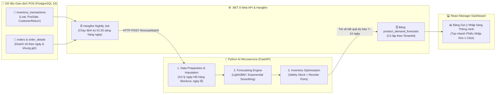

# 🤖 AI Demand Forecasting & Smart Inventory Reorder - POS PWA Project

Thư mục này tổng hợp toàn bộ tài liệu thiết kế kiến trúc phân hệ **Trí tuệ Nhân tạo Dự báo Nhu cầu Bán hàng & Gợi ý Nhập hàng Thông minh (AI Demand Forecasting & Automated Reorder Point)** cho hệ thống **POS PWA (Point of Sale Progressive Web App)**. Thay vì để chủ cửa hàng hoặc quản lý ước lượng số lượng nhập hàng theo cảm tính (dẫn đến tình trạng dư thừa gây hỏng hóc hàng cận date hoặc thiếu hụt hàng bán chạy vào cuối tuần), hệ thống khai thác trực tiếp dữ liệu từ **Sổ cái Tồn kho (`inventory_transactions`)** và **Lịch sử Đơn hàng (`orders`)** của từng cửa hàng (`Tenant`) để dự báo nhu cầu tiêu thụ theo chuỗi thời gian (**Time-Series Forecasting**) và đề xuất phiếu nhập kho tối ưu.

---

## 📂 Cấu trúc thư mục `12-ai-demand-forecasting/`

```text
12-ai-demand-forecasting/
├── README.md                   # Tổng quan kiến trúc AI Dự báo nhu cầu & Tối ưu tồn kho
├── sales-data-preparation.md   # Quy trình trích xuất, làm sạch & tạo đặc trưng chuỗi thời gian (ETL)
├── demand-forecasting.md       # Mô hình dự báo nhu cầu (LightGBM / Prophet / Holt-Winters)
├── reorder-point.md            # Công thức tính Tồn kho An toàn (Safety Stock) & Điểm Đặt hàng lại (ROP)
├── model-evaluation.md         # Chỉ số đánh giá độ chính xác dự báo (WMAPE, MAE, RMSE) & Backtesting
└── ai-integration.md           # Tích hợp dịch vụ AI vào .NET 8 (Hangfire Cron + REST API + React UI)
```

---

## 🏗️ Kiến trúc Luồng Dữ liệu & Suy luận AI (AI Pipeline Architecture)



---

## 🎯 Nguyên tắc Thiết kế Cốt lõi của Phân hệ AI

| Nguyên tắc thiết kế | Áp dụng trong POS PWA | Lý do kỹ thuật & Nghiệp vụ |
| :--- | :--- | :--- |
| **Strict Tenant Model Isolation** | Dữ liệu huấn luyện và suy luận được phân tách tuyệt đối theo `TenantId`. | Hành vi tiêu dùng của quán cà phê tại Quận 1 khác hoàn toàn cửa hàng tạp hóa ở ngoại thành; không trộn lẫn dữ liệu giữa các cửa hàng. |
| **Stockout Censored Demand Correction** | Hiệu chỉnh lại số lượng bán của những ngày sản phẩm bị `stock_quantity == 0`. | Nếu một món bán hết lúc 10h sáng, doanh số cả ngày ghi nhận là `5` không phản ánh đúng nhu cầu thực tế (có thể là `15` nếu đủ hàng). |
| **Cold-Start Fallback Strategy** | Phân tầng thuật toán dựa trên độ dài lịch sử bán hàng của từng sản phẩm (`< 14 ngày`, `14–60 ngày`, `> 60 ngày`). | Đảm bảo sản phẩm mới ra mắt vẫn có gợi ý nhập hàng hợp lý ngay từ tuần đầu tiên. |
| **Asynchronous Batch Inference** | Chạy huấn luyện và suy luận theo lô vào ban đêm qua **Hangfire**, lưu kết quả vào PostgreSQL. | Giao diện Quản lý hiển thị gợi ý nhập hàng tức thì (**$< 30\text{ms}$**) mà không bắt người dùng chờ mô hình AI tính toán. |

---
