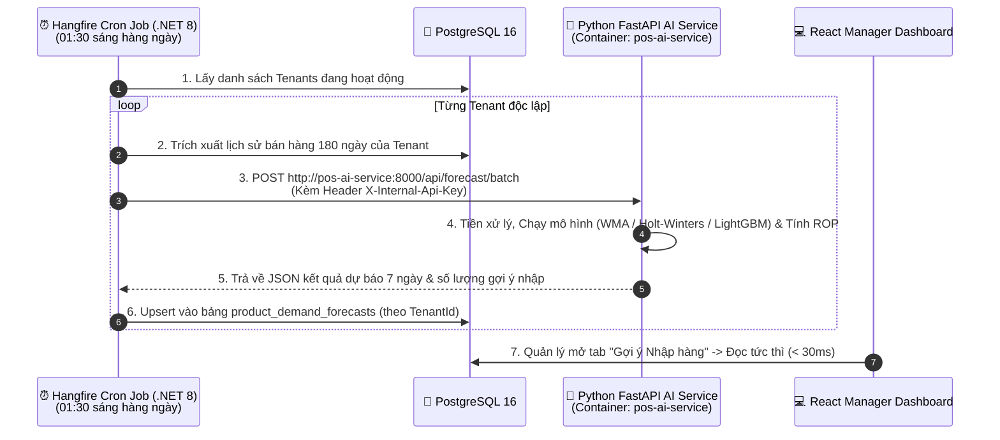

# 🔗 AI Microservice Integration & Automated Reorder Workflow - POS PWA Project

Tài liệu này quy định kiến trúc tích hợp dịch vụ dự báo nhu cầu **Python AI Service (FastAPI)** vào hệ thống cốt lõi **ASP.NET Core 8 Web API**, **Hangfire** và giao diện quản lý **React PWA** trong dự án **POS PWA (Point of Sale Progressive Web App)**. Thiết kế tuân thủ nguyên tắc **Loose Coupling & Asynchronous Pre-Computation**: dịch vụ Python chỉ đóng vai trò tính toán thuần túy (*Stateless Compute Engine*) giao tiếp qua mạng nội bộ Docker, không kết nối trực tiếp vào cơ sở dữ liệu sản xuất để bảo toàn ranh giới bảo mật **Multi-Tenant**.

---

## 🏗️ 1. Kiến trúc Giao tiếp Nội bộ & Lưu trữ Kết quả Dự báo



---

## 🗄️ 2. Lược đồ Bảng Lưu trữ Kết quả Dự báo (`product_demand_forecasts`)

```sql
CREATE TABLE product_demand_forecasts (
    id uuid PRIMARY KEY,
    tenant_id uuid NOT NULL REFERENCES tenants(id),
    product_id uuid NOT NULL REFERENCES products(id),
    forecast_date date NOT NULL,               -- Ngày chạy dự báo
    model_used varchar(50) NOT NULL,           -- 'WMA_ColdStart', 'HoltWinters_Seasonal7', 'LightGBM'
    predicted_7d_demand numeric(18,2) NOT NULL,-- Tổng nhu cầu dự báo 7 ngày tới
    safety_stock integer NOT NULL,             -- Tồn kho an toàn (SS)
    reorder_point integer NOT NULL,            -- Điểm đặt hàng lại (ROP)
    suggested_order_qty integer NOT NULL,      -- Số lượng đề xuất nhập kho
    stock_status varchar(30) NOT NULL,         -- 'CRITICAL_STOCKOUT', 'REORDER_NEEDED', 'OPTIMAL', 'OVERSTOCK_RISK'
    wmape_score numeric(5,2) NULL,             -- Chỉ số độ chính xác Backtest (%)
    created_at timestamptz NOT NULL
);

CREATE UNIQUE INDEX ux_product_demand_forecasts_tenant_product 
ON product_demand_forecasts (tenant_id, product_id);
```

---

## 💻 3. Triển khai Tích hợp trên .NET 8 (`AiForecastClient.cs`) & Luồng "1-Click Nhập Kho"

### 3.1. Giao tiếp HTTP có cơ chế Chịu lỗi (`HttpClient` + Timeout Guard)
Nếu container `pos-ai-service` đang bảo trì hoặc quá tải, tác vụ nền Hangfire tự động bắt ngoại lệ và thử lại sau 15 phút mà **không làm ảnh hưởng bất kỳ chức năng bán hàng nào tại quầy POS**:

```csharp
public sealed class HttpAiForecastClient : IAiForecastClient
{
    private readonly HttpClient _httpClient;

    public HttpAiForecastClient(HttpClient httpClient)
    {
        _httpClient = httpClient;
    }

    public async Task<BatchForecastResponse> GenerateForecastAsync(
        BatchForecastRequest request,
        CancellationToken ct)
    {
        using var response = await _httpClient.PostAsJsonAsync("/api/forecast/batch", request, ct);
        response.EnsureSuccessStatusCode();

        return await response.Content.ReadFromJsonAsync<BatchForecastResponse>(cancellationToken: ct)
               ?? throw new InvalidOperationException("Dịch vụ AI trả về dữ liệu rỗng.");
    }
}
```

### 3.2. Trải nghiệm "1-Click Nhập Kho" trên Giao diện Quản lý (`React PWA`)
Trên màn hình **Quản lý Kho (`InventoryReorderTab.tsx`)**, Quản lý nhìn thấy danh sách các sản phẩm đang ở trạng thái **`CRITICAL_STOCKOUT`** hoặc **`REORDER_NEEDED`** kèm giải thích trực quan (*"Dự báo 7 ngày tới bán ~84 hộp | Tồn hiện tại: 25 | Đề xuất nhập: 92 hộp"*):
* Quản lý chỉ cần bấm nút **"Tạo phiếu nhập theo gợi ý"**, hệ thống tự động điền sẵn số lượng `suggested_order_qty` và giá nhập gần nhất (`lastPurchaseCost`) vào biểu mẫu `ReceiveStockModal`.
* Khi Quản lý xác nhận nhập kho, hệ thống gọi API nhập kho chuẩn của Domain (`Product.ReceiveStock`), tự động cập nhật lại **Giá vốn bình quân gia quyền (WAC)** và ghi nhận bút toán **`PurchaseReceipt`** vào sổ cái tồn kho.

---
