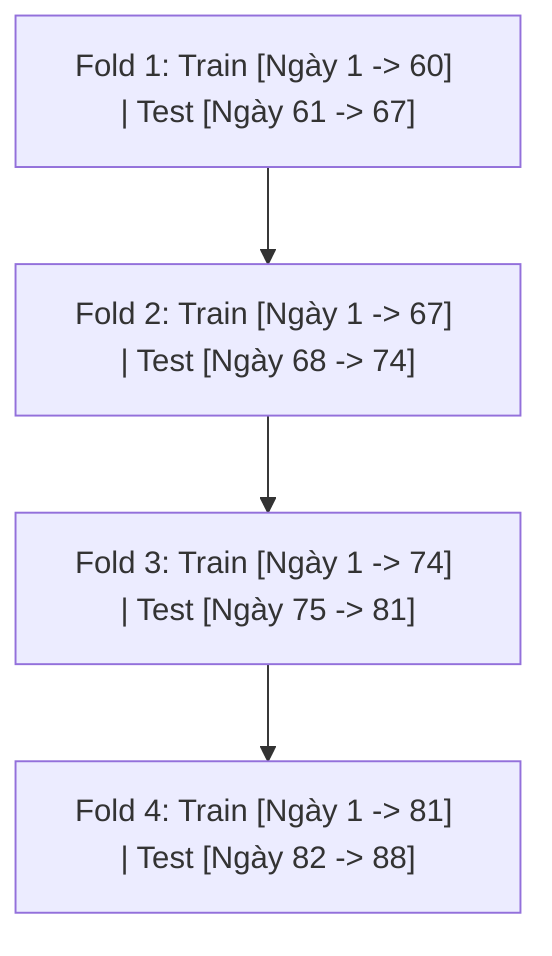

# 📏 Demand Forecasting Model Evaluation & Backtesting - POS PWA Project

Tài liệu này quy định phương pháp **Đánh giá Độ chính xác Mô hình Dự báo (Model Evaluation Metrics)** và quy trình **Kiểm thử Ngược Chuỗi thời gian (Time-Series Cross-Validation / Backtesting)** trong hệ thống **POS PWA (Point of Sale Progressive Web App)**. Trong bài toán dự báo bán lẻ, nhiều sản phẩm bán chậm thường có những ngày doanh số bằng `0`, khiến chỉ số truyền thống `MAPE` bị chia cho `0` (`DivisionByZero`) hoặc thổi phồng sai số giả tạo. Do đó, hệ thống sử dụng bộ chỉ số chuẩn ngành bán lẻ gồm **WMAPE**, **MAE**, **RMSE** và **Forecast Bias**.

---

## 📐 1. Bộ Chỉ số Đánh giá Chuẩn Ngành Bán Lẻ (Evaluation Metrics)

Giả sử trên tập kiểm thử gồm $N$ cặp `(Sản phẩm, Ngày)` với giá trị thực tế là $y_i$ và giá trị mô hình dự báo là $\hat{y}_i$:

### 1.1. Sai số Phần trăm Tuyệt đối có Trọng số (`WMAPE - Weighted Mean Absolute Percentage Error`) *(Chỉ số chính)*
Khắc phục hoàn toàn lỗi chia cho `0` của `MAPE` và tự động đặt trọng số cao hơn cho các sản phẩm chủ lực có doanh thu/sản lượng lớn:

$$\text{WMAPE} = \frac{\sum_{i=1}^{N} |y_i - \hat{y}_i|}{\sum_{i=1}^{N} y_i} \times 100\%$$

### 1.2. Sai số Tuyệt đối Trung bình (`MAE`) & Căn bậc hai Sai số Toàn phương (`RMSE`)
* **$\text{MAE} = \frac{1}{N} \sum_{i=1}^{N} |y_i - \hat{y}_i|$:** Cho quản lý biết trung bình mỗi ngày mô hình lệch bao nhiêu đơn vị sản phẩm.
* **$\text{RMSE} = \sqrt{\frac{1}{N} \sum_{i=1}^{N} (y_i - \hat{y}_i)^2}$:** Phạt nặng các sai số lớn đột biến vào những ngày cuối tuần hoặc dịp khuyến mãi.

### 1.3. Độ lệch Thiên vị Dự báo (`Forecast Bias`)
Giúp phát hiện mô hình đang có xu hướng **dự báo thừa (Over-forecasting)** gây tồn đọng hàng hay **dự báo thiếu (Under-forecasting)** gây cháy hàng:

$$\text{Bias} = \frac{\sum_{i=1}^{N} (\hat{y}_i - y_i)}{\sum_{i=1}^{N} y_i} \times 100\%$$

---

## 🔄 2. Quy trình Kiểm thử Cuốn chiếu Thời gian (`Rolling-Origin Backtesting`)

Tuyệt đối **không sử dụng `K-Fold Cross Validation` xáo trộn ngẫu nhiên** cho dữ liệu bán hàng vì sẽ gây rò rỉ dữ liệu tương lai vào quá khứ (**Data Leakage**). Thay vào đó, hệ thống sử dụng **Expanding Window Backtesting** qua 4 cửa sổ thời gian liên tiếp (mỗi cửa sổ dự báo chân trời $H = 7\text{ ngày}$):

---

## 🎯 3. Ngưỡng Chấp nhận Mô hình & Cơ chế Model Guardrail (`Shadow Fallback`)

| Nhóm sản phẩm | Ngưỡng `WMAPE` mục tiêu | Ngưỡng `Forecast Bias` cho phép | Cơ chế bảo vệ khi mô hình mới kém hơn |
| :--- | :---: | :---: | :--- |
| **Nhóm A (Bán chạy / Chủ lực)** | **$< 18\%$** | **$-5\% \le \text{Bias} \le +8\%$** | Nếu mô hình LightGBM mới có `WMAPE` tệ hơn mô hình **Seasonal Naive** (tuần trước bán sao tuần này bán vậy), hệ thống tự động hạ cấp sản phẩm đó về **Holt-Winters / WMA** để đảm bảo an toàn. |
| **Nhóm B (Bán trung bình)** | **$< 28\%$** | **$-10\% \le \text{Bias} \le +12\%$** | Tự động điều chỉnh hệ số an toàn $Z$ dựa trên phần dư thực tế. |
| **Nhóm C (Bán chậm / Ngắt quãng)** | **$< 40\%$** | **$-15\% \le \text{Bias} \le +15\%$** | Áp dụng phương pháp Croston / Trung bình động 14 ngày. |

---
